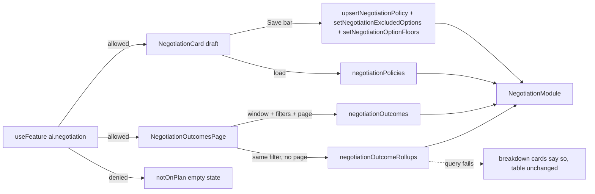

# Negotiation (vendor)

**Last updated:** 2026-10-04

## Overview

Two surfaces. **The policy card** on the product form, shown when `sale_type` is `NEGOTIABLE`: loads product-level policy via `negotiationPolicies`, stages edits locally, and persists with `upsertNegotiationPolicy` on the product contextual save bar (create saves the product first, then the policy). Floor-mode radios (max discount / min price / min margin / advanced). Never displays floor to customers — preview is vendor-only (live preview still open).

**Which options negotiate (2026-09-27).** For a product sold in options (`product_type` VARIABLE), the card lists every saved option under the main switch, each with a switch of its own: on, it negotiates under the card's settings; off, its price stays fixed — the storefront shows no "negotiate" button for it and the assistant will not bargain on it. The main switch stays the master: off, no option negotiates. An option added in the same edit has no id yet, so it negotiates until the product is saved and can be switched off after (the card says so). Saving sends the whole list of switched-off options with `setNegotiationExcludedOptions`, right after the policy upsert.

**The outcomes report** at Analytics → Negotiations: every negotiation session in a date window, what it closed at, whether it became an order, and what each deal cost. It reads `negotiationOutcomes`, a paginated list plus a summary over every matching session. Two cost figures sit side by side and are never merged: **Discount from list** (what the customer saved against list price) and **Margin over cost** (what the shop kept after cost of goods and the payment processing fee, from the cost recorded at session start; after fees since 2026-10-04, computed by the back-end). Headline totals count redeemed deals only. A deal whose order was since cancelled or refunded reads "Order cancelled or refunded" in the Offer column, with its discount and margin struck through (`order_unwound`), and "Redeemed only" leaves it out. A product title in a row drills into that product (the `product_id` filter the API always took; a chip clears it), and **Export CSV** downloads every row the filter matches, not the page on screen — fetched a hundred at a time, capped at 5,000 rows (`OUTCOMES_EXPORT_LIMIT`), money as plain amounts in the row's currency (`outcomesCsvRows`). **Between the KPI row and the table, the same report grouped (2026-10-01):** a trend chart (negotiations and those that became orders, per day up to 92 days or per month beyond, bucketed by the day each negotiation started), a by-product table and a by-strategy table, each footed by the report's total, from `negotiationOutcomeRollups`. Their averages are money-weighted — average discount over list value, average margin, after cost and payment fees, over selling price — and read "—" rather than "0%" when nothing is under them; the strategy table adds rounds to close and how many deals closed at the merchant's floor (a count and a rate, never the floor). A product name in the breakdown drills in exactly like one in a row.

Both are gated on plan entitlement `ai.negotiation` via `useFeature` — same key as `@RequireFeature` on the resolver. When the plan excludes it, each shows a quiet "not on plan" state and does **not** call its query (avoids `FEATURE_NOT_AVAILABLE`). Save also skips the upsert when the entitlement is off.

## Screens/routes

- Product create/edit (`/store/[shopSlug]/products/...`) — `NegotiationCard` beside Auction/Pricing.
- `/store/[shopSlug]/analytics/negotiations` — `NegotiationOutcomesPage`; sidebar entry **Negotiations** under Analytics.

## Diagram

## Components

- `features/negotiation/components/negotiation-card.tsx` — enable, the per-option switches and each negotiating option's own minimum price (VARIABLE products), floor mode, rounds, constraint fields; entitlement gate
- `features/negotiation/components/negotiation-outcomes-page.tsx` — range select, five KPI cards (`MetricCard`), toolbar (session status, channel, redeemed-only switch) and the table on the shared `DataTableCard` / `DataTable` / `DataTablePagination` chrome
- `features/negotiation/components/negotiation-trend-card.tsx` — recharts `BarChart` (slate negotiations beside teal became-orders, theme grid and ticks, `formatBucketLabel` in the dashboard locale), custom tooltip with the bucket's money, legend, and an sr-only table twin
- `features/negotiation/components/negotiation-rollups-card.tsx` — `NegotiationProductRollupsCard` and `NegotiationStrategyRollupsCard`: `@repo/ui` tables with a `TableFooter` total row, rates through `formatRate`, negative margin in red, "Showing N of M" when `products_total` exceeds the list
- `features/negotiation/components/negotiation-outcomes-columns.tsx` — date, product, masked customer (with a Guest tag), channel, rounds, session status, list price, final price (or "Last offer" when no deal), quantity, offer status, discount from list, margin over cost (red when negative), order link
- `features/negotiation/api.ts` — codegen-tag policy operations; `api-outcomes.ts` — `gql` from `@apollo/client` (named `api*` so the documents-against-schema guard covers it); `types.ts` — hand-written outcome and rollup types. `NEGOTIATION_OUTCOME_ROLLUPS` carries its `NegotiationOutcomeFiguresFields` fragment in the same literal, so codegen sees it
- Product list status via `productNegotiationStatuses` (Enabled / N of M / Disabled) when wired on the table

## State & forms

Policy card: local draft in `ProductFormBody` compared to server baseline; dirty drives `forceDirty` on the product save bar. Value-based dirty via `draftsEqual`. Server policy is loaded in `NegotiationCard` and pushed to the parent via `useEffect` once (never during render — parent `onChange` / `onBaselineChange` mid-render throws). New drafts default `enabled: true` when sale type is negotiable; turning the toggle off and saving writes `enabled: false` so the storefront/`negotiate_price` path refuses. The draft's `excluded_variation_ids` (sorted, so `draftsEqual` compares it as a set) is seeded from the option rows switched off, and the settings from the product's own row only. `option_floors` (option id to cents, compared order-free) is seeded from option rows switched on that carry a `minimum_price_cents` (`floorsFromRows`); a row given only a discount of its own by the variants table's bulk policy is not one and is left alone. One amount cannot fit options priced differently, so the minimum price is the one thing an option overrides: an empty input means the product's floor. On save, after the product's policy and the excluded list, `setNegotiationOptionFloors` gets the whole list minus the excluded options, and the server writes each as a copy of the product's settings, so the copies are refreshed on every save. It is skipped when neither the draft nor the baseline holds an own price: there is nothing to keep or release. The baseline is the list the server returns.

Outcomes page: local state only (preset, status, channel, redeemed-only, TanStack `PaginationState`), no save bar — nothing is edited. The window is memoised on the preset so the Apollo variables do not change every render; every filter change returns to page one. `buildOutcomesFilter` (`lib/outcomes.ts`) drops the select's `ALL` value before it reaches the API. The rollups query takes that same `filter` object with `product_limit: 10` and **never the page**, so a page flip or the CSV export's page loop does not regroup; the server picks the granularity. It is deliberately a separate document, so a failure of the grouping never takes the report with it: any rollup error shows "Could not load the breakdown." inside the three cards, never over the table, and the KPI row and the table render as before. The page used to hide the section on an API image that predated the query (a latched `isSchemaMismatchError` branch); every API image carries `negotiationOutcomeRollups` now, so that branch was removed on 2026-10-04 and such a refusal would read as an ordinary breakdown error.

## GraphQL operations

`negotiationPolicies`, `previewNegotiationFloor`, `upsertNegotiationPolicy`, `bulkUpsertNegotiationPolicies`, `setNegotiationExcludedOptions`, `setNegotiationOptionFloors`, `productNegotiationStatuses`, `negotiationOutcomes`, `negotiationOutcomeRollups`

## Validation

Server: `NEGOTIATION_INVALID_*`; an option's own minimum price is checked against that option's own price (`NEGOTIATION_INVALID_MINIMUM_PRICE` at or above it), and the refusal paints the save bar. Client mirrors min/max on bps and rounds. The minimum-price field keeps the typed text while focused and normalises to two decimals only on blur; formatting on every keystroke made multi-digit prices untypable. The outcomes filter is built from closed option lists, so there is nothing free-form to validate.

## Main files

- `apps/vendor/src/features/negotiation/`
- `apps/vendor/src/app/store/[shopSlug]/analytics/negotiations/page.tsx`
- `apps/vendor/src/features/products/components/form/use-product-submit.ts` (policy upsert after product save)
- `apps/vendor/src/shared/components/app-sidebar.tsx` (Analytics → Negotiations)

## Notes

The customer column is **masked by the back-end** and the app has no masker of its own: a signed-in customer reads as a masked email or phone, and a guest as `Guest ··a1b2` (a digest suffix, because the underlying key is a cart bearer credential). WhatsApp and Telegram shoppers talking to the store's assistant are guests of the same kind: the assistant keys their session by the conversation's cart session (`wa:<conversationId>` on both channels), which is itself a cart credential, so they show the digest too (its fallbacks, `wa:<phone>` and the bare conversation id, match no masking rule either). A masked phone (`+97********56`) or `Telegram ...4321` appears only for a guest key that is a bare phone number or a `tg:` id, which only a direct `startNegotiation` caller supplies. A redeemed row's quantity is what the order actually bought, and an unused offer past its expiry shows as Expired. The API also takes a `week` granularity (Monday-start, since 2026-10-01) but this page never asks for it, so the server's choice — day or month — stands; its trend counts a deal on the day the negotiation started, not the day of the order — the card's hint says so. The new cards render plain loading text rather than a measured `Bones` skeleton, as the table does.

Category override hierarchy is not in V1 (TODO.md). **Inventory-aware floors are live and are not a policy field**: the back-end raises the floor toward list on the last units in stock (1/2/3 of a threshold of 4 → 25/50/75% of the merchant's discount band, 0 → negotiation unavailable). It only ever raises, so nothing a vendor sets here is overridden — but `previewNegotiationFloor` reads live stock, so the preview on a nearly-sold-out product is higher than the constraint alone implies. **The min-margin figure includes processing fees (2026-10-01):** the back-end keeps the minimum margin after the highest fee among the shop's payment methods, so "From min margin" on a card-enabled shop is above cost ÷ (1 − margin) (30% on a 60.00 cost reads 90.92, not 85.72), and on a cheap item it can reach list and switch negotiation off. The `floorHint` copy says so. The outcomes report's margin is after fees too (2026-10-04): the back-end takes each deal's payment fee off `margin_cents` and `margin_bps`, so a deal closed at the floor reads at the policy's minimum rather than above it. The column and the KPI keep the label "Margin over cost"; their hints and the two definitions lines name the fee. Live floor preview and strategy/TTL UI polish still open. Plan key `ai.negotiation` is seeded by `npm run seed:plans` from `feature-registry.ts` and is **enabled on every tier (FREE through PLUS)**, including Basic. `useFeature` reads `myEntitlements` with `cache-and-network` so a fresh grant shows up without a hard reload.
