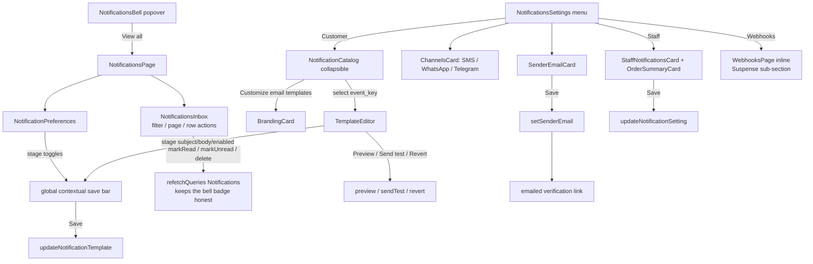

# Notifications

**Last updated:** 2026-10-05 — **Feature:** `src/features/notifications/` — the notifications landing card is titled Reply-to address

## Overview

Three surfaces, matching Shopify. The **header bell** (`NotificationsBell` in `SiteHeader`) is the activity feed — a popover of the signed-in user's latest 15 in-app notifications with an unread badge and mark-read, refreshed over SSE, with a **View all** footer. That footer opens the **notifications page** (`/store/[shopSlug]/notifications`): the full paged history under an **Inbox** tab (All/Unread filter, 20 rows a page, per-row mark read/unread and delete) plus a **Preferences** tab holding the per-type in-app/email delivery matrix. The **Settings → Notifications console** opens on a **landing menu** (Shopify layout): a **Reply-to address** card on top, then rows for **Customer notifications**, **Staff notifications**, **Fulfillment request notification**, and **Webhooks** (Webhooks opens the webhook manager inline as a sub-section — matching Shopify, where webhooks live under Notifications; there is no standalone webhooks route). Customer notifications shows the templates as a **collapsible category list** (each row: name + description + Customized/Off badge) with a **Customize email templates** button opening the branding editor; selecting a row opens the template editor (subject + Liquid body, live **Preview**, **Send test**, **Revert**). Staff notifications holds the recipient list and the **Store order summary** digest cadence. The former settings-hub inbox/preferences tabs were consolidated here; the bell is unchanged.

Templates, sender, and branding live back-end-side (module `notifications`); this feature only reads and edits them over GraphQL. The back-end renders Preview/Send-test through the same engine used for live sends, so the editor shows exactly what a customer receives.

## Screens / routes

- **Bell:** `NotificationsBell` mounted in the global `SiteHeader`; a popover, no route of its own. Its footer links to the page below.
- **`/store/[shopSlug]/notifications`:** the `NotificationsPage` — Inbox + Preferences tabs.
- **`/store/[shopSlug]/settings?section=notifications`:** the `NotificationsSettings` console (rendered inside the settings overlay). Not a route of its own.
- **`/verify-sender`:** consumes the emailed sender-verification token.

## Diagram

## Components

| Component | Role |
|-----------|------|
| `NotificationsBell` | Header activity feed: popover of the latest 15 in-app notifications, unread badge, mark-read/mark-all, SSE refresh, and a **View all** footer to the notifications page. |
| `NotificationsPage` | Route shell for `/notifications`: Inbox / Preferences tabs. |
| `NotificationsInbox` | Full paged history — All/Unread filter, 20 rows a page, prev/next, mark-all-read, and per-row mark read/unread + delete. Refetches the shared `Notifications` query after every write so the bell badge stays in sync. |
| `NotificationPreferences` | Per-type in-app/email delivery matrix for the signed-in user, staged into a draft and persisted through the **global contextual save bar**. |
| `NotificationsSettings` | Console shell. Queries `notificationSetting` + `notificationCatalog`; renders the sender + branding + staff cards and the catalog, or the `TemplateEditor` when a template is selected. |
| `SenderEmailCard` | Set/change the sender address (`setSenderEmail`), verified/unverified badge, resend link. The address is the **Reply-To** of the store's emails and never the From — every email leaves from the platform address, because a merchant's domain is not linked with the email provider — so the card's copy says where customers' replies land, and the former public-domain warning is gone: any mailbox works, Gmail included (2026-10-02). |
| `BrandingCard` | Logo URL, accent colour and the "Powered by" toggle — staged locally, saved on an explicit Save (`updateNotificationSetting`). Branding only since 2026-09-04; the SMS toggle moved to `ChannelsCard`. |
| `ChannelsCard` | The three opt-in transports — SMS, WhatsApp, Telegram — on the landing screen under `SenderEmailCard`: "who they come from", then "where they go". All three are sent on every Save, since the mutation merges what it is given and omitting one would say nothing about it. Email is deliberately **not** a switch: it is what happens whenever a customer left an address, and per-template control already exists in the catalog. The Telegram row states its own precondition — a bot may only message somebody who has opened a chat with it — because a merchant who switches it on and sees nothing arrive has hit Telegram's rule, not a bug. |
| `NotificationCatalog` | The templates grouped by Shopify category (`lib/notify-catalog.ts`), each row with a Customized/Off badge; click opens the editor. |
| `TemplateEditor` | Subject + Liquid HTML body staged via the **global contextual save bar** (`updateNotificationTemplate`), a sandboxed `iframe` Preview, Send test, and a Revert menu. |
| `StaffNotificationsCard` | Staff notification recipients: list + add / remove / enable-toggle + Send test. Immediate single-mutation actions (settings surface). |
| `OrderSummaryCard` | The Store order summary digest cadence (off/daily/weekly + day + hour), staged + explicit Save (`updateNotificationSetting`). Shown under Staff notifications. |
| `TemplatePreviewPanel` | Live email preview on the Customize screen: renders the selected template (with saved branding) in a sandboxed iframe, prev/next arrows cycle the catalog, refreshes after a branding save. |

## State & forms

The `TemplateEditor` and `NotificationPreferences` are **editing screens** and use the mandatory contextual save bar: values stage into a local `draft`, dirty is value-compared to the server snapshot, and `useUnsavedBarStore` drives Save/Discard — no mutation fires on toggle or keystroke. Preferences save fans out one `updateNotificationPreference` per changed type (the back-end takes a single type per call) from one explicit Save. The inbox holds `filter` and `page` in local state — both are query variables, so paging and filtering are server-side, not a client slice. Preview is a non-persisting mutation, refreshed on load and on demand. `SenderEmailCard`/`BrandingCard`/`ChannelsCard` stage locally and persist on their own explicit Save buttons (settings surfaces, not document editors). The catalog and setting queries are `cache-and-network`; each successful write refetches.

## GraphQL operations

| Operation | Type | Notes |
|-----------|------|-------|
| `notifications` | Query | The feed. `page` / `limit` / `unread_only`; returns `unread_count` for the whole scope, so the badge is right on any page. |
| `markNotificationRead` / `markNotificationUnread` / `deleteNotification` | Mutation | Per-row actions on the inbox. |
| `markAllNotificationsRead` | Mutation | Clears unread within the current shop scope only. |
| `notificationPreferences` / `updateNotificationPreference` | Query/Mutation | The per-type delivery matrix. Per-person, **not** shop-scoped. |
| `notificationStreamTicket` | Mutation | One-shot ticket for the SSE stream (`EventSource` can't send a Bearer header). |
| `notificationCatalog` / `notificationTemplate` | Query | The grouped catalog / one effective template. |
| `notificationSetting` | Query | Sender + branding for the active shop. |
| `updateNotificationTemplate` / `revertNotificationTemplate` | Mutation | Edit (save bar) / revert to previous or default. |
| `previewNotificationTemplate` / `sendTestNotification` | Mutation | Render sample HTML / email a test to the current user. |
| `updateNotificationSetting` / `setSenderEmail` / `resendSenderVerification` | Mutation | Branding / sender address + verification. |
| `staffNotificationRecipients` + `add`/`update`/`remove`/`sendTestStaffNotification` | Query/Mutation | Staff recipient list, management, and a self-test. |

All are shop-scoped by the `X-SHOP` the Apollo link sends, except `notificationPreferences` / `updateNotificationPreference`, which are per-user and identical in every store.

## Validation

Sender email is `type="email"`; accent colour is a hex `<input type="color">`. Server enforces the real constraints (email format, hex colour, length caps). The console surfaces errors through the save bar (`setError`) for template saves.

## Main files

- `components/notifications-bell.tsx` — header activity popover (+ `use-notifications-stream.ts`, `lib/href.ts`, `lib/notify-type.ts`, `lib/backoff.ts`)
- `components/{notifications-page,notifications-inbox,notification-preferences}.tsx` — the `/notifications` route
- `components/notifications-settings.tsx` — Shopify-style landing menu (Reply-to address + Customer/Staff/Fulfillment/Webhooks rows) + sub-section routing
- `components/{sender-email-card,branding-card,channels-card,notification-catalog,template-editor,staff-notifications-card,order-summary-card,template-preview-panel}.tsx`
- `lib/notify-catalog.ts` — console category order + icons
- `api.ts` — bell + console + staff GraphQL operations
- `types.ts` — bell + console + staff result types

## Notes

- Every string on the bell, the inbox, the preferences page and the console reads `notifications.*` (en + ar); relative times use date-fns' Arabic locale in Arabic.
- **The console's two reads are server-preloaded (2026-08-24).** The settings notifications page wraps `NotificationsSettings` in `PreloadQuery` for `NotificationSetting` and `NotificationCatalog`, and the screen reads them with `useSuspenseQuery`, so the landing menu streams with data instead of a spinner the client replaces. A plain `useQuery` there would not suspend and would quietly bring the flash back.
- The Liquid body is edited in a monospace `<textarea>`; a richer code editor (CodeMirror) is a later enhancement.
- Preview renders in a fully sandboxed `iframe` (`sandbox=""`), so template HTML/JS can't touch the dashboard.
- The header bell is kept (Shopify has one). The former settings-hub inbox/preferences tabs were consolidated: the customer-email side into the console, the activity/preferences side into the `/notifications` page. The bell's back-end (`notify-logs`) is unchanged — the page consumes operations that already existed. Staff notifications add the new-order/new-return email alerting on top.
- The bell and the inbox run the same `Notifications` query under different variables, so the inbox's writes call `client.refetchQueries({ include: ["Notifications"] })` rather than patching one variable set and leaving the other's badge stale.
- `MESSAGE` is included in `NOTIFY_TYPES` (the preferences matrix) for new customer messages. Its in-app and email channels use the same staged Save/Discard flow as the other types, with English and Arabic descriptions.
- Rows are coloured by type (`toneForType` in `lib/notify-type.ts`): the icon puck, the bar down the leading edge of an unread row, and the unread dot all take one hue — green for an order, red for a refund, amber for stock. They were all drawn in `primary`, which is near-black in this theme, so the accent meant to pick an unread row out rendered as grey on grey and a refund looked like a new order. A read row keeps its hue at lower saturation instead of dropping to grey. The preferences matrix draws the same puck, so a type is recognised there by the colour it will arrive in.
- **The SSE hook is unit-tested (2026-09-08).** `__tests__/use-notifications-stream.test.ts` (18 cases) drives `useNotificationsStream` through `renderHook` with fake timers, a stubbed `EventSource` (neither jsdom nor Node ships one) and a mocked Apollo client, and pins the three things a regression would otherwise swallow silently: the ticket handshake (silent, `no-cache`, ticket URL-encoded, cookie fallback, retried on rejection / empty ticket / construction failure), the stream lifecycle (only `notification` frames reach the callback, an error closes the source and re-handshakes with a fresh ticket, an opened stream resets the backoff), and cleanup (unmount closes the source and cancels a pending retry, a ticket that resolves after unmount opens nothing, a token change swaps streams). The real delay math stays pinned in `lib/__tests__/backoff.test.ts`.
