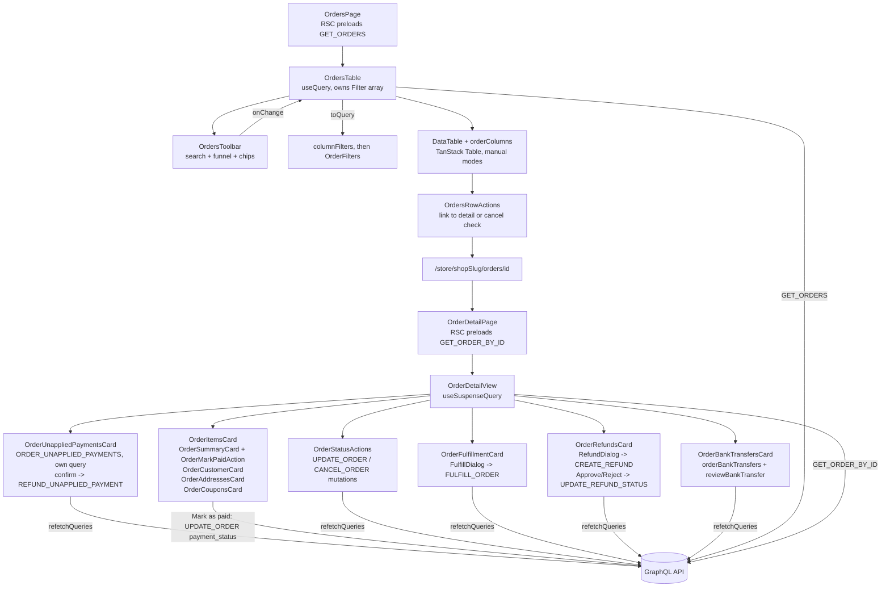

# Orders

**Last updated:** 2026-10-05 — Export orders downloads `GET /api/v1/orders/export.csv` (every matching order, no 10,000-row ceiling) — 2026-10-05 — the Date chip takes a custom calendar range (`custom:YYYY-MM-DD:YYYY-MM-DD`, cut by `rangeForCustom`) and re-anchors a Today window at the next local midnight — 2026-10-04 — **Feature:** `src/features/orders/` — "Export orders" downloads the list as a CSV under its current filters and sort (`useOrdersExport`, `EXPORT_ORDERS_CSV`); the list filters by date (a fourth FilterBar field holding one of the analytics page's windows); the unapplied payments card no longer hides a refused document as "an older API" (the API serves `unapplied_payments`); the unused `CANCEL_ORDER` document is gone; the list filters by sales channel (a third FilterBar field, `channel`, named from `salesChannels.names`); "Mark as cancelled" goes through `UPDATE_ORDER` behind a confirm (it called `CANCEL_ORDER`, which refuses every merchant), and a paid card order is told to be refunded instead (`REFUND_CARD_PAYMENT_FIRST`); the unapplied payments card names a charge refunded by something else (`charge_already_refunded`) instead of reading it as done; the order screen explains `payment-mismatch` ("Refund needed") and refunds a card payment the order never took (`OrderUnappliedPaymentsCard`: `ORDER_UNAPPLIED_PAYMENTS`, `REFUND_UNAPPLIED_PAYMENT`), a duplicate charge on a paid order included; the draft Markets badge names a stored country code instead of printing it; a refused draft shipping quote is shown in the modal (`draftQuoteErrorKey`) instead of reading as "no rate matches"; an order the shop's WhatsApp or Telegram assistant placed carries a chat mark (`PlacedViaMark`, from `placed_via`, one per channel) beside its number in the list and among the detail badges; the draft shipping modal quotes for the draft's customer (`customer_id` on `verifyCheckout`); store coupons on a draft (active-coupon picker + code check through `verifyCoupon`, ids saved as `coupon_ids`, figure shown as an estimate); "Payment due later" persists and converts as INVOICE, "Mark as paid" as CASH; Mark as paid on the order screen, for pending INVOICE orders only; draft customer is the contact's linked shop customer (`customers.id`), and an `invalid_customer` refusal says the customer was removed

## Overview

The orders feature lets shop owners view all orders placed in their shop, filter and search them, drill into a single order's full detail, and act on it: advance its status, **fulfill items** (in part or in full, with carrier tracking), and **refund items** (per line, with a restock toggle). For **bank-transfer** orders, receipt review (view receipt, approve, reject) lives on the same detail page — see [bank-transfers](bank-transfers.md); there is no separate queue under Orders. It also provides a Shopify-style **draft orders** / **Create order** flow (`components/drafts/`): a two-column screen (Products + Payment | Notes, Customer, Markets, Tags) with modals for select products, custom item, note, discount, and shipping, plus a bottom-drawer **new customer** surface (same shell as analytics `TargetCreateDialog`). Merchants stage products, quantities, a manual discount, shipping, a customer (with optional address), a note, and tags; Save persists a draft via the global save bar; **Mark as paid** / **Create order** converts an open draft into a real order (which prices, taxes, and reserves stock). The shipping modal (`ShippingOptionsDialog`) lists delivery channels from `shopShippingSettings` (`offers_merchant_delivery` → personal / own delivery, `offers_carrier_delivery` → OTO or other connected carrier) and, when catalog lines + a customer address are present, quotes live options via `verifyCheckout` so the merchant can pick a priced rate. Selection is stored as `shipping_rule_id` + `shipping_method_name` (the picked option, frozen) alongside `shipping_override_cents`, and **the frozen pick outranks the fee override at conversion**: the draft is converted with the method id and no override, so the server re-quotes the fee and the order records `shipping_method: { source: "carrier", delivery_option_id, legs }` rather than `{ source: "merchant_override" }`. That distinction is load-bearing — the shipments service reads `merchant_override` as "no carrier chosen" and books through the shop's default carrier, so an order that kept only the fee could never book the option the merchant picked. A merchant-typed fee leaves `shipping_rule_id` null and behaves as before. The method **name** also used to be lost on reload (`draftToBaseline` seeded it `""`); it is now read back from the draft. Without an override, zones price shipping at conversion (no address → only a catch-all zone can match). Estimated tax on the Payment card uses the shop's `tax_bps` as a client preview; authoritative tax is computed at conversion. Markets shows the shop country/name badge (the back-end stores the country as an ISO code, so the badge names it through `resolveCountry` / `geoLabel` as Settings > General does; free text it cannot place shows as written) and a read-only currency from `Shop.currency` (no multi-market API). **Tags persist** — the API has carried `DraftOrder.tags` since the module shipped (schema column, both DTOs, `DraftOrderEntry`); only the vendor half was missing, so the card discarded them on save. The fragment now selects `tags`, the save-bar baseline seeds from the loaded draft, and `buildInput` sends them. **"Payment due later" and its terms persist** (`payment_due_later`, `payment_terms`: seeded by `draftToBaseline`, sent by `buildInput`), and the convert button names its gateway: **Mark as paid** sends `CASH` (recorded as paid, nothing for a courier to collect), **Create order** with Payment due later sends `INVOICE` (order and payment pending, invoice due after the terms). It used to send only the id, so the server made every converted draft cash on delivery: the courier collected money the merchant had already received, a due-later order read as paid, and a shop with COD off could convert nothing. An INVOICE order is settled from its order page (**Mark as paid**, below). **Store coupons** are staged in the discount modal and saved by id (`coupon_ids`); the server prices them when the draft converts, for the draft's customer, so the Payment card shows any figure as an estimate (see State & forms). Custom line items stage locally but block Save — draft lines still require catalog `product_id`s. "Send invoice" is a toast stub.

An order carries three independent statuses, and the detail screen shows all three: `order_status` (the legacy combined lifecycle), `fulfillment_status` (unfulfilled / partial / fulfilled), and `financial_status` (paid / partially_refunded / refunded / …, derived server-side from payment plus settled refunds). They are orthogonal — an order can be paid and unfulfilled, or shipped and refunded — so the fulfil and refund actions key off the latter two, not off the lifecycle status.

## Screens / routes

| Route | Purpose |
|-------|---------|
| `/store/[shopSlug]/orders` | Paginated, filterable orders list |
| `/store/[shopSlug]/orders/[id]` | Single-order detail view with status actions |
| `/store/[shopSlug]/orders/drafts` | Draft orders list |
| `/store/[shopSlug]/orders/drafts/new` | Create order (Shopify-style draft screen) |
| `/store/[shopSlug]/orders/drafts/[id]` | Edit a draft, delete it, or convert it into an order |

## How it works

## Components

### List components (`components/list/`)

| Component | What it shows |
|-----------|--------------|
| `OrdersTable` | Root list component; owns the filter chips, sorting, pagination and row selection, and re-runs `GET_ORDERS` whenever any of them changes |
| `OrdersHeader` | Page title, the drafts link, Create order, and a More actions menu whose **Export orders** downloads the list as a CSV. It is handed the table's current `OrderFilters`; the item is disabled while an export runs and when the list is empty |
| `useOrdersExport` | The export itself: `GET /api/v1/orders/export.csv` with the list's filters and sort minus its page (`exportFilters`), the session bearer and `X-SHOP`, then downloads `orders-YYYY-MM-DD.csv` through `downloadCsv`. A refusal is a toast. There is no 10,000-row cut |
| `OrdersToolbar` | Quiet chrome row: compact search, funnel, column picker; FilterBar chips for order status, payment status, sales channel and date on a second row, with Clear that resets both chips and search |
| `orderColumns` | Column definitions: checkbox, tracking number, date, customer initials monogram + name/email, total, payment status badge, order status badge, item count, row actions |
| `OrdersRowActions` | Per-row ellipsis menu with links to view details, update status, and cancel (cancel is disabled when the current status cannot transition to cancelled) |
| `OrderStatusBadge` / `PaymentStatusBadge` | Coloured pill badges for order and payment statuses |
| `PlacedViaMark` | A small mark beside the order number (and among the detail header's badges) for an order the shop's assistant placed in a chat: an emerald chat bubble for `placed_via === "whatsapp_assistant"`, a sky-blue paper plane for `"telegram_assistant"`. Its title and `aria-label` come from `orders.placedVia.<value>` (en + ar). Every other order, and any value it does not know, renders nothing — a mark rather than a mostly empty column, and no guess at a channel |
| `OrdersEmpty` | Empty-state display, shown either standalone (no orders at all) or inline when filters return no results |

### Detail components (`components/detail/`)

| Component | What it shows |
|-----------|--------------|
| `OrderDetailView` | Page shell: back link, order heading, order/payment/fulfillment/financial badges (plus `PlacedViaMark` for an order placed in a WhatsApp or Telegram chat), total, and the two-column layout |
| `OrderStatusActions` | "Update status" dropdown driven by `nextStatuses()`; every transition fires `UPDATE_ORDER`. "Mark as cancelled" first opens a confirm naming the order and what a cancellation does (items back on sale, coupon and store credit returned, the customer told). On a card order marked paid (`isPaidCardOrder`) the dialog says to refund the order instead and its confirm is disabled; the server refuses that cancel either way (`REFUND_CARD_PAYMENT_FIRST`, shown as the same sentence through `cancelRefusalKey`). Shows a plain message for terminal statuses |
| `OrderUnappliedPaymentsCard` | "Payments not applied to this order", first in the left column: each card payment the order never took — paid after it was closed, a different amount, a second charge — with what happened, the amount, the date and that it was not applied, then where its refund stands. "Refund {amount}" opens a confirm quoting the server's amount and the effects (the order and the shop balance do not change); "Check again" re-asks about a refund the provider has not settled; a different amount on an order still open says "Cancel the order first". STRIPE orders only; renders nothing when there is nothing to show |
| `OrderItemsCard` | Line items with image, name, variation, quantity, unit price, and subtotal |
| `OrderFulfillmentCard` | Fulfillment status, how many units are still to ship, every shipment made (with carrier + tracking link), and the "Fulfill items" button |
| `FulfillDialog` | Per-line quantities (defaulted to everything remaining, capped at it) plus optional tracking number / carrier / URL; fires `FULFILL_ORDER` |
| `OrderSummaryCard` | Pricing breakdown: subtotal, tax, discount, delivery fee, total; payment method and status; **Payment due** (the invoice `due_date`) while an INVOICE order is unpaid; hosts `OrderMarkPaidAction` |
| `OrderMarkPaidAction` | "Mark as paid" behind a confirm naming the amount. Shown only when `canMarkOrderPaid` holds: gateway `INVOICE` (merchant-recorded deferred payment), payment `payment-pending`, order not cancelled / failed / refunded. Never for a pending card (`STRIPE`) order, where an open Checkout session could still complete and collect twice, nor a bank transfer (its receipt review owns that write); the server refuses both (`MANUAL_PAYMENT_NOT_ALLOWED`, `BANK_TRANSFER_REVIEW_REQUIRED`). Fires `UPDATE_ORDER` with `payment_status: "payment-success"` and refetches the order and the list. The server writes it as a compare-and-set, so a double click or a second tab fires `ORDER_PAID` once (the second call succeeds quietly, or shows `ORDER_PAYMENT_STATUS_CHANGED` if the payment moved elsewhere), and marks the invoice paid |
| `OrderCustomerCard` | Customer name, email, phone or contact (whichever is set), and order language |
| `OrderAddressesCard` | Shipping and billing address blocks |
| `OrderCouponsCard` | Applied coupons and their discount amounts |
| `OrderRefundsCard` | Refund records + cancellation; "Refund items" button; Approve / Reject on a pending refund (Approve behind a confirmation naming the money effects) |
| `RefundDialog` | Per-line refund quantity, reason, and restock toggle; shows an advisory estimate; fires `CREATE_REFUND` (which leaves the refund `pending`) |
| `OrderBankTransfersCard` | Bank-transfer orders only (from `features/bank-transfers`): instructed IBAN, waiting or submitted receipt, approve/reject confirm dialogs |

### Draft components (`components/drafts/`)

| Component | What it shows |
|-----------|--------------|
| `DraftOrdersList` | White list card with Linear chrome: All / Open / Completed / Cancelled tabs and compact search; "Create order" links to `drafts/new` |
| `DraftOrderForm` | Shopify-style create/edit: Products (empty centered +Custom/+Product; line rows with qty/remove) + Payment (discount/shipping links, tax estimate, Mark as paid / Create order, Payment due later) and Notes / Customer / Markets / Tags aside; stages behind the global save bar |
| `DraftOrderEditPage` | Loads a draft via `GET_DRAFT_ORDER` and renders `DraftOrderForm` in edit mode |
| `DraftProductPicker` | "Select products" modal — live `GET_PRODUCTS` search, multi-select, `0/500 variants selected` |
| `CustomItemDialog` | Local custom line (name/price/qty); blocks Save until removed |
| `CustomerPickerDialog` | Customer search via `contacts(search:)` + "Create new customer". Emits the contact's linked shop customer (`contact.customer_id`) as `customer_id`, never the contact's own id; a contact that is nobody's customer stages as a guest (`customer_id` null, name and contact kept). The staged contact is the phone number, else the contact's `email` column (`contactEmail`), not `meta.email` |
| `NewCustomerDialog` | Bottom drawer (swipe-up, same shell as analytics new target) to create a contact via `createContact` — overview, address, tax, notes, tags; Close + Save in the header. Hands back `created.customer_id` — the shop's customer the back-end linked by the proven number, null = guest (typing a number does not make somebody a customer) — and on success evicts every cached `contacts(...)` list (`cache.evict({ id: "ROOT_QUERY", fieldName: "contacts" })` + `cache.gc()`) instead of refetching one argument set |
| `AddNoteDialog` / `ShippingOptionsDialog` | Note (0/5000), shipping method picker (shop channels + live `verifyCheckout` rates + custom name/price) |
| `AddDiscountDialog` | Store coupons and a custom amount/percent discount. Lists the shop's active coupons (`DraftCouponOptions`, 50, filtered as you type) with a "Per customer" tag on ones that target customers or cap uses per customer, plus code entry checked through `VERIFY_COUPON` (the coupons feature's document, its first caller). Picking or applying stages the coupon's **id**, at most 5. A code the merchant's preview cannot price but that is one of the shop's active coupons (customer targeting, a per-customer cap, a collection scope the dashboard cannot send) is still staged, with no figure; an unknown or expired code is refused inline. Each staged coupon says whether it needs a customer on the draft, is no longer available, has an estimate, or is priced at conversion |

## Fulfilling and refunding

**Fulfilling** ships units and moves real inventory (the back-end takes them out of committed stock). `FulfillDialog` defaults every line to its remaining quantity — so "ship it all" is one click — and caps each input at what is actually left, the same limit the server enforces with `EXCEEDS_REMAINING`. Tracking is optional; when given it is stored on the fulfillment row and rendered as a link.

**Refunding is deliberately two steps**, because only the second one moves money:

1. `RefundDialog` → `CREATE_REFUND` creates the refund in `pending`. Nothing is debited, nothing is restocked.
2. Approve on `OrderRefundsCard` → `UPDATE_REFUND_STATUS(approved)` is what debits the shop balance, restocks the lines flagged for it, rewinds coupon usage, and issues the real gateway refund. It is confirmed in a dialog that names those four effects. Reject moves no money and needs no confirmation.

The amount shown in `RefundDialog` is an **estimate and is labelled as one**. The client does not send an `amount_cents` override: the back-end allocates the order's discount and tax across the refunded lines (with a remainder correction so the parts sum exactly), and a client-computed figure pinned into the request is exactly how a quote drifts from the charge. The approval dialog therefore quotes the **server's** `amount_cents` from the created refund, never the estimate.

The per-line refundable cap is `order_quantity` alone. The order payload carries no per-line *already refunded* totals, so the client cannot honestly compute the remaining refundable quantity; the server rejects an over-refund with `OVER_REFUND_QUANTITY`.

## Payments not applied to the order

A card payment can land on an order that will not take it: after the order was closed, for a different amount, or a second time on an order already paid. The back-end records it, flags the first two `payment-mismatch` (badge "Refund needed", was "Mismatch") and rings the merchant's bell; the money is the customer's until the merchant refunds it here. Nothing refunds it automatically.

`OrderUnappliedPaymentsCard` reads them through **its own query**, `ORDER_UNAPPLIED_PAYMENTS` (`order(id) { data { id unapplied_payments { … } } }`), never through `ORDER_DETAIL_FIELDS`: the card refetches it alone after a refund or a "Check again", and a failure costs this card, not the order page. A failure shows a retry on an order the badge says is owed a refund, and nothing otherwise (the query runs with `silentErrors`, so the card's retry is the only report). The API serves the field, so a refused document is no longer hidden as "an older API"; that fallback was removed on 2026-10-04 (pinned by `order-unapplied-payments-card.render.test.tsx`). The query selects the same `success` / `message` wrapper as `GET_ORDER_BY_ID`, so the two never drop each other's fields from the shared `order(id)` cache entry.

The refund is `REFUND_UNAPPLIED_PAYMENT`, behind a confirm, with no save bar: it is a single irreversible action, not a staged edit. The server refunds exactly the charged amount, never twice (an idempotency key per payment and a claim under the order lock), and touches no order status, total or balance. A provider refusal comes back as data (`refund_status: failed` with `refund_error`), so the card says why and offers the refund again; `refund_error: charge_already_refunded` has its own sentence (the provider reports the charge as already refunded in full, but not from here: check whether the customer is still owed it), because the server records that as failed and keeps the "Refund needed" badge rather than calling it done; no answer reads "Check again in a minute". A thrown refusal is named (`ORDER_STILL_OPEN`, `REFUND_IN_PROGRESS`, `NOT_UNAPPLIED`, `NO_PAYMENT_REFERENCE`, `refusalKey`) and the card is refetched, because only the server knows where the refund stands. A success refetches the card, the order (its badge becomes "Refunded" once every stray payment of a closed order is back) and the list. When the refund is offered is decided by `lib/detail/unapplied-payments.ts`; the server re-checks all of it. Strings live under `orders.unappliedPayments` (en + ar).

## State & forms

Order status transitions are immediate, except a cancellation: clicking a status option in `OrderStatusActions` fires `UPDATE_ORDER` directly ("Mark as cancelled" first opens a confirm, because it cannot be undone; strings under `orders.statusActions.cancel`, en + ar), shows a `sileo` toast on success or failure, and awaits `refetchQueries` to update both the detail view and the list. The fulfil, refund, and **bank-transfer review** dialogs work the same way — they are modal actions, not editing screens, so they do **not** use the contextual save bar (which governs staged edits, per `AGENTS.md`).

The **draft order form** (`DraftOrderForm`) uses the global contextual save bar (`useUnsavedBarStore`): all edits stage in local `useState`, dirty is value-based against a server `baseline`, and Save fires `createDraftOrder`/`updateDraftOrder`. Create mode always shows the bar; edit mode when dirty. **Mark as paid** / **Create order** (when Payment due later is checked) creates (if needed) then `convertDraftOrder` with an explicit `payment_gateway` from `draftConvertGateway` (`CASH` / `INVOICE`); edit mode refuses to convert with unsaved changes, so the gateway always matches the stored flag. **Coupons** are a `DraftCouponPick[]` in the same baseline: seeded from the draft's resolved `coupons` (`draftCouponsFromDraft`), compared by id only (a preview figure arriving is not a change), restored by Discard, and sent by `buildInput` as `coupon_ids`. They are never folded into `manual_discount_cents`. The Payment card shows a "Store discounts" row with the sum of known previews labelled "estimate" (or "Priced when the order is created" when there is none), subtracts it from the estimated total, and adds a line saying store discount figures are estimates. The preview comes from `verifyCoupon`, which evaluates for the signed-in merchant and the staged lines, while conversion prices for the draft's customer with stacking, shipping and tax, so the two can differ. A save or convert refused over a coupon (`coupon_requires_customer`, `invalid_coupon`, `coupon_not_applicable` / `conflict`, `user_limit` / `global_limit`) is shown as a localized sentence (`draftCouponErrorKey`) instead of "Validation failed". A save refused with `invalid_customer` says the customer's account has been deleted and to remove the customer or choose another (`draftCustomerErrorKey`, key `customerErrorDeleted`; abandoned carts' Create order reads the same refusal with its own copy, see [abandoned carts](abandoned-carts.md)). The shipping modal reads a refused `verifyCheckout` quote from the mutation hook's `error`, which Apollo keeps for the latest call only: `invalid_customer` shows `shippingQuoteCustomerInvalid` above the methods, any other refusal `shippingQuoteFailed` (`draftQuoteErrorKey`), and the empty-rates hint asks for a custom fee instead of saying no rate matches. The custom name and price stay available, and nothing is retried as a guest quote. The banner is hidden while a quote loads and whenever the modal cannot quote (no address or no catalog lines). The quote checks the draft's customer on every call, while save checks only a changed one, so a draft that saves can still have every quote refused (see Notes). Strings live under `draftOrders.form` (en + ar). The order screen's **Mark as paid** is a confirm dialog, not a save-bar edit, like the other detail actions; its strings live under `orders.settle`.

Filtering runs through the shared **`FilterBar`**. The chips are the state: `OrdersTable` holds a `Filter[]` and derives TanStack's `columnFilters` with `useMemo(() => toQuery(filters))`, never the other way round. Sorting, row selection and pagination stay in their own `useState` hooks.

`lib/list/filters.tsx` owns the two ends of that seam. `orderFilterFields` declares Status, Payment and Channel with one `is any of` operator; status options map from the same option lists the badges use, and Channel offers the four sales channels (`CHANNEL_OPTIONS`), named from `salesChannels.names` (resolved by the toolbar and passed in as `channelName`) so a chip reads as the analytics page does. `OrdersTable` sends the chosen channels as the comma-joined `channel` filter and the API derives each order's channel by the rule the sales-by-channel report uses. A fourth field, Date (`created`), holds one of the analytics page's windows (`RANGE_PRESETS`, named from `analytics.ranges`) under a single-value `is`, and a one-month calendar under that list (`CreatedRangePicker`) commits a hand-picked pair as `custom:YYYY-MM-DD:YYYY-MM-DD` (inclusive local days). `createdWindow` turns a preset into `created_from` / `created_to` with `rangeForPreset` and a custom pair with `rangeForCustom`, and leaves `created_to` off a window that runs to now, so an order placed while the list is open still appears. "Now" is anchored in state (`windowAnchor`, re-anchored on every filter change) rather than read during render, so the query's variables keep their identity. A Today chip also arms a timeout to the next local midnight (`todayAnchorStale`), so a list left open past midnight does not keep yesterday's start. `toQuery` drops empty chips and merges duplicates; Reset clears the chip array itself.

## GraphQL operations

| Operation | Type | Purpose |
|-----------|------|---------|
| `Orders` | Query | Fetch paginated order list with core fields (used on the list page) |
| `ExportOrdersCsv` | Mutation | The list as one inline CSV body, capped at 10,000 rows. The header's Export orders action does not call it; it downloads the streamed REST file |
| `Order` | Query | Fetch a single order by ID with full detail fields including refunds, invoices, and cancellation |
| `OrderByTrackingNumber` | Query | Fetch a single order by tracking number with full detail fields |
| `CreateOrder` | Mutation | Create a new order |
| `UpdateOrder` | Mutation | Update order fields: `order_status` from the status menu, `payment_status: "payment-success"` from Mark as paid |
| `OrderUnappliedPayments` | Query | `order(id) { data { id unapplied_payments } }` — the card payments the order never took, on their own so an older API costs only that card |
| `RefundUnappliedPayment` | Mutation | Refund one of them in full, or check a refund the provider has not settled (`refundUnappliedPayment(payment_intent_id)`) |
| `DeleteOrder` | Mutation | Permanently delete an order |
| `FulfillOrder` | Mutation | Ship some or all remaining units, optionally with carrier tracking |
| `CreateRefund` | Mutation | Create a `pending` refund over chosen lines (no money moves) |
| `UpdateRefundStatus` | Mutation | Approve (moves the money) or reject a pending refund |
| `DraftOrders` / `DraftOrder` | Query | List drafts / fetch one draft by ID (`api/draft-orders.ts`) |
| `CreateDraftOrder` / `UpdateDraftOrder` | Mutation | Create or edit a draft (lines, customer, note, manual discount, shipping, tags, `payment_due_later`, `payment_terms`, `coupon_ids`); the fragment reads back `coupon_ids` and `coupons { id code description available requires_customer }` |
| `DraftCouponOptions` (`coupons`) | Query | The shop's active coupons for the discount modal (`statuses: [ACTIVE]`, limit 50) |
| `VerifyCoupon` | Mutation | Checks a typed or picked code against the staged lines for the estimate (coupons feature document; evaluates for the merchant, throttled 10/min) |
| `ConvertDraftOrder` | Mutation | Convert an open draft into a real order, with `payment_gateway` `CASH` or `INVOICE` |
| `DeleteDraftOrder` | Mutation | Delete (cancel) a draft |
| `Contacts` / `CreateContact` | Query / Mutation | Customer picker search + New customer modal (customers feature) |
| `ShopShippingSettings` | Query | Which delivery channels the draft shipping modal lists (`offers_merchant_delivery`, `offers_carrier_delivery`, carrier readiness) |
| `VerifyDraftShipping` (`verifyCheckout`) | Mutation | Quote priced shipping options for catalog lines + address (writes nothing; used only to populate the picker). Sends the draft's `customer_id`, so the quote uses that customer's tax exemption and coupon checks; with no customer on the draft it is a guest quote, never the merchant's own account |

## Validation

None. The orders feature has no `validations/` directory and no Zod schemas. Status transition safety is enforced by `status-transitions.ts` logic and ultimately by the backend. New customer uses `buildContactMutationInput` from the customers feature.

## Main files

- `src/features/orders/api/` — `queries.ts`, `mutations.ts`, `draft-orders.ts`
- `src/features/orders/lib/list/filters.tsx` — FilterBar ↔ `columnFilters` mapping, `createdWindow`, `exportFilters`; `components/list/use-orders-export.ts` — the CSV export
- `src/features/orders/lib/detail/fulfillment.ts` — fulfil/refund maths
- `src/features/orders/lib/detail/payment.ts`, `lib/drafts/payment.ts` — when Mark as paid is offered; the convert gateway and the terms list
- `src/features/orders/components/detail/order-unapplied-payments-card.tsx`, `lib/detail/unapplied-payments.ts` — payments not applied to the order and their refund
- `src/features/orders/lib/drafts/coupons.ts`, `lib/drafts/customer.ts` — `DraftCouponPick`, seeding from a draft, estimate sum; coupon and customer refusal messages
- `src/features/orders/components/drafts/draft-order-form.tsx` — Create/edit order screen
- `src/features/orders/components/drafts/*-dialog.tsx` — note, discount, shipping, custom item, new customer, pickers
- `src/features/orders/types.ts` — Order / draft TypeScript interfaces
- `src/features/orders/components/list/orders-table.tsx` — List page root
- `src/features/orders/components/detail/order-detail-view.tsx` — Detail shell
- `src/features/orders/lib/list/status-transitions.ts` — Status state machine

## Notes

- Filtering, sorting and pagination are all **server-side**: the table runs in `manualFiltering` / `manualSorting` / `manualPagination` and `GET_ORDERS` is re-run with the derived `OrderFilters`. Apollo's `previousData` keeps rows on screen while the next page loads. With the Date chip on the analytics page's window and Status narrowed to everything but Cancelled and Failed, a channel's total here is that page's order count for the channel. **Export orders** (header menu) downloads the list under its current filters and sort, every page of it, from `GET /api/v1/orders/export.csv`. The file is streamed in batches and is not cut at 10,000 orders. A custom date range is two inclusive local days picked on the calendar under the Date chip's presets; a range that ends today stays open at its end, the same rule as Today.
- `PAGE_SIZE` is 15 — the same `limit` the page's `PreloadQuery` sends.
- Terminal statuses (`order-cancelled`, `order-refunded`, `order-failed`) have no valid transitions.
- `OrderByTrackingNumber` is defined but not wired to a UI screen.
- `placed_via` is selected by the `OrderCoreFields` fragment, so the list and the detail read it with no extra query. The back-end sets it to `whatsapp_assistant` for an order placed from a WhatsApp chat, `telegram_assistant` for one placed from the shop's Telegram bot, and leaves it null otherwise (see `back-end/docs/features/chat-checkout.md`).
- Mark as paid settles INVOICE orders only (`SETTLEABLE_GATEWAY` in `lib/detail/payment.ts`). It used to be offered for any pending non-bank-transfer order, pending card orders included. A server refusal is shown in the dialog as the back-end's localized message.
- Every string on the list and the order screen reads `orders.*` (en + ar); the draft screens read `draftOrders.*`. Fulfillment and financial badges take their words from `fulfillmentStatusKey` / `financialStatusKey` (message keys, replacing `fulfillmentStatusLabel` / `financialStatusLabel`); an unknown financial status draws no badge. The draft's payment-terms and discount-type selects show labels rather than the raw value, and the new-customer drawer builds its language options with `customerLanguageOptions(t)`.
- Returns (RMA) still have no vendor UI. A refund created here is a standalone refund, not a return.
- **A draft's `customer_id` is a shop customer id (`customers.id`), not a contact id.** It becomes the converted order's customer, and `orders.customer_id` is a foreign key to `customers`. The picker used to send the contact id, so every conversion with a picked customer failed and the draft went back to open. The back-end now refuses a `customer_id` that is not a customer of the shop (`VALIDATION_ERROR`, `invalid_customer`). The card shows `customer_name` / `customer_contact`, so a guest draft still shows the chosen person after a reload. An older draft still holding a contact id keeps saving, because the back-end checks only a changed value, and conversion resolves it server side. Its shipping quote does not: `verifyCheckout` refuses it as `invalid_customer`, and the shipping modal says the draft's customer is out of date or was deleted (see State & forms). Nothing was migrated. From the picker, `invalid_customer` means the contact's account was deleted after it was linked; deleting an account does not unlink its contacts, so picking the same contact again fails the same way, and the form says to remove the customer or choose another. Keeping such a contact on the draft as a guest: Not yet implemented.
- **Draft coupons are the customer's.** The server judges and claims a stored coupon for the draft's customer at conversion, so a once-per-customer coupon can be used on many customers' drafts by one merchant; a guest draft cannot carry one limited per customer. The dashboard's figure is only a preview run as the merchant.
- Draft shipping selection cannot freeze a carrier `deliveryOptionId` on convert today — only the fee override is stored. Booking the exact OTO option after convert is tracked in `TODO.md`.
