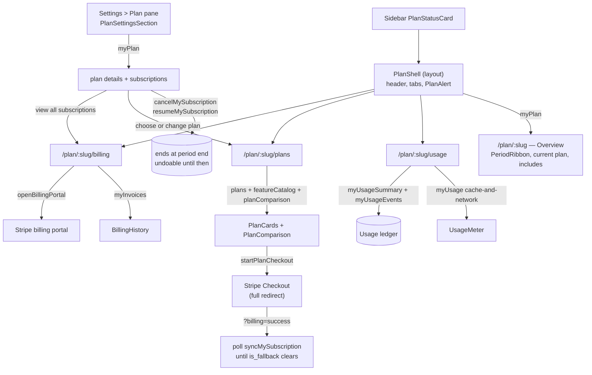

# Plan & usage

**Last updated:** 2026-09-28 — **Feature:** `src/features/plan/`

## Overview

What the shop is subscribed to, what is left of each metered allowance, every tier it could move to side by side, what it has actually consumed, and what it has been charged. Backed by the entitlements platform (`back-end/docs/features/plans.md`).

**Four routes, not one page.** Those questions were one 600-line scroll, so the answer to any of them sat below the answer to another — and usage, the section a vendor arrives at from a quota wall, was fifth of six. Each is a URL now, which is the part that matters: "your usage page" is something support can send.

It is a **top-level route with no dashboard chrome** — no sidebar, no site header. Layouts in the App Router nest unconditionally, so a page under `/store` gets the sidebar whether it wants it or not; `/plan/[shopSlug]` has its own layout instead. Choosing a plan deserves the whole viewport, and a nav rail listing everything the vendor is *not* doing is the one thing this screen does not need. The page carries its own slim header with the way back and the current plan.

Self-serve billing is live, and the split is deliberate. A shop's **first** subscription goes through Stripe Checkout and comes back here. Everything after that stays in the app: changing plan, cancelling, resuming, and reading the invoice history. Only **cards** remain in Stripe's hosted portal, because SCA and dunning are compliance surfaces we would otherwise own.

**Checkout is the only path that writes nothing** — the back-end's webhook opens the subscription, so returning from Stripe means refetching rather than assuming. A plan change, a cancel and a resume all land at Stripe by the time the mutation answers, so each needs one refetch and no polling.

Everything renders from the server's own lists: the tiers, the capability catalog, the per-plan matrix, the units and the reset dates. **A capability shipped next month appears as a new table row with no frontend change.**

## Screens / routes

| Route | Purpose |
|---|---|
| `plan/[shopSlug]` | **Overview** — the billing period drawn to scale, the current plan, the two fullest meters, and the shop's resolved capability list. |
| `plan/[shopSlug]/plans` | **Plans** — the interval switch, the tier cards, the full comparison table. |
| `plan/[shopSlug]/usage` | **Usage** — every allowance, per-capability totals over 7/30/90 days, and the call-by-call ledger. |
| `plan/[shopSlug]/billing` | **Billing** — the payment method (Stripe's portal), the invoice history, and cancel/resume. |
| `plan/[shopSlug]?billing=success` | Where Stripe returns after a paid checkout. |
| `plan/[shopSlug]?billing=canceled` | Where Stripe returns when the vendor backs out. |
| `store[shopSlug]/settings` → Plan | **The settings pane** (`PlanSettingsSection`): what the shop is on, and the two actions that apply to it. Every long answer links out to the routes above. |
| `store/[shopSlug]/settings/plan` | The old location. Redirects, **carrying the query string** — dropping it would swallow the `?billing=` acknowledgement of a payment just made. |
| `store/[shopSlug]/settings?section=plan` | Opens the pane. With a `billing` parameter alongside it, `settings-page.tsx` forwards to `plan/[shopSlug]` instead, because the acknowledgement and the webhook poll live there. |

`app/plan/layout.tsx` repeats the token check the `/store` layout does, since this route no longer sits under it. `app/plan/[shopSlug]/layout.tsx` mounts `PlanShell`, which owns the header, the tab nav, the alert and the return-from-Stripe poll — the alert has to be visible from every tab, and Stripe returns to whichever URL the session was opened from. `proxy.ts` lists `/plan` in `PROTECTED_PREFIXES`, and `src/shared/lib/shop-path.ts` lists it in `SHOP_SCOPED_PREFIXES`: the second is what makes the proxy write `{slug}` into the `active_shop_slug` cookie, without which server-side Apollo would answer for whichever store the vendor last opened.

Reachable from Settings and from the sidebar's plan card.

## How it works

## Components

| Component | What it shows |
|---|---|
| `plan-shell.tsx` | The layout every tab wears: the header, the tab nav, the alert, and the return-from-Stripe poll. Reads `?billing=` from `window.location.search` rather than `useSearchParams`, which would opt the whole subtree into a Suspense boundary for one value read once. |
| `plan-overview.tsx` | Where the store stands: period ribbon, current plan card, the **two fullest** meters with a link to Usage, and the resolved capability list. |
| `plan-picker.tsx` | The tier comparison — interval switch, cards, table. The tallest thing in the feature, and now a page of its own. |
| `usage-page.tsx` | Allowances (the counter), totals over the window (the ledger, grouped), and the ledger itself, most actionable first. |
| `billing-page.tsx` | Payment method, invoices, and cancellation — the three things that change what gets charged, together. |
| `plan-page-header.tsx` | The route's own top bar, since it has no dashboard header above it. Carries the way back and what the store is on — the fact every price below is relative to. |
| `period-ribbon.tsx` | The billing period drawn to scale: the real `current_period_start` to `current_period_end`, with today marked where today falls, and one line naming what the end **is** (trial ends / renews / plan ends / changes to X). Every question this screen answers is a question about time; this answers three of them at once. Renders nothing on the free fallback — there is no period to draw. A period end already behind us is its own state: the bar reads full and spent, the heading says the period has ended and the end line reads **Ended** rather than a renewal date. It used to clamp instead, drawing a full bar labelled "Last day of this period" beside "Renews 8 September" four days after the 8th, and it would have read that way forever. |
| `plan-alert.tsx` | The one thing that has gone wrong, at the top. `PAST_DUE` is the case it exists for: Stripe retries for days and the store keeps everything, so **nothing else on screen looks wrong** and no mail is sent. A scheduled end gets the same slot because its undo should not be buried. So does an ended period, which takes the destructive shell rather than the neutral one and swaps the resume button for a link to the plans tab — there is nothing left to keep. |
| `plan-status-card.tsx` | The sidebar footer, mounted by `shared/components/app-sidebar.tsx` with `key={shopSlug}`. Always present once this shop's `myPlan` answers: the plan name, one derived line above it, and the call to action only when there is something to ask for. A paying, up-to-date store reads "Your plan / Growth / Renews 1 September" with no button. While the query for the **current** shop is in flight it draws a dark skeleton — never the previous shop's plan. |
| `plan-settings-section.tsx` | The **Plan pane of the settings overlay**, mounted by `features/settings/components/settings-page.tsx`. One row — plan name, state badge, price, next date — plus cancel/keep and choose/change plan, then a Subscriptions card pointing at the billing tab. Renders no comparison table and no meters: those are what the routes are for. |
| `plan-cards.tsx` | One card per public tier — price, trial badge, the pick button, and derived bullets. Each card after the cheapest reads "Everything in X, plus:" followed only by what that tier adds. |
| `billing-history.tsx` | What the shop has been charged: date, invoice number, status, amount, and a link out to Stripe's own receipt. Renders **nothing** when there are no invoices — an empty table on a shop that has never been charged reads as a fault. |
| `plan-change-dialog.tsx` | The money, before the change: credit for unused time, the charge for the rest of the period, the total due now, and what the next invoice becomes. A downgrade shows no amount at all — none is taken — and says when the new tier starts instead. |
| `plan-comparison.tsx` | The full table: a Pricing section then one section per capability group. Scrolls inside its own box; the tier names stay sticky. |
| `plan-cell.tsx` | One cell — a tick, a dash, "Unlimited", or an amount in its `billing_unit`. `useCellLabel` is the same rule as words only, reused by the card bullets. |
| `spenders-card.tsx` | Who is spending the customer-AI allowance. Runs its **own** query on the entitlement period rather than the screen's rolling 7/30/90 window — handing it the screen's `from` is the one thing that would make two numbers in one column disagree. Renders `unattributed_turns` as a distinct row below the list, because presenting the breakdown as though it summed to the meter would be a claim we cannot support; renders **nothing at all** when the shop has no entitlement row, which is different from having spent nothing. Never masks anything itself — `label` arrives masked from the API, the same contract `phone_masked` keeps. |
| `usage-meter.tsx` | One metered capability — used/limit, a bar, and when it resets. No bar is drawn for an unlimited allowance: a full-width empty track reads as "at the limit", the opposite of the truth. |

`lib/use-feature.ts` is the gate seam other features import. `useFeature(key)` returns the resolved state for one capability; `useAiImageQuota()` is a named wrapper because the key is a server contract and a typo would render a **denied** capability as unlimited.

## State & forms

**No contextual save bar** — nothing here is a staged edit. `AGENTS.md` mandates the staged-save pattern for *editing* screens; picking a plan is a navigation, not a field, and the value is confirmed on Stripe's page rather than by a Save button.

`myUsage` uses `cache-and-network` because the counter moves the moment anything is consumed. `plans`, `featureCatalog` and `planComparison` are not shop-scoped, so they cache for the session.

On return from a successful checkout the page **polls `syncMySubscription`** (6 tries, 1.5s apart), not `myPlan`. Stripe's webhook is what opens the subscription and it races the browser's redirect, so one refetch can lose. More importantly, `myPlan` reads a row **only the webhook writes** — if the event is never delivered, every attempt re-reads the same stale row and the vendor watches a spinner resolve to "no plan" after paying. `syncMySubscription` re-reads Stripe itself, so a lost webhook costs a few seconds instead of a support ticket.

The monthly/yearly switch opens on the interval the shop already pays on, latched during render once `myPlan` answers — an effect would move the prices after paint.

## GraphQL operations

| Operation | Type | Purpose |
|---|---|---|
| `myPlan` | Query | Current subscription and plan. `is_fallback` means no live subscription; **`is_stripe_billed` means the live one is Stripe's**, which is the field that decides Checkout from change. `billing_enabled` / `has_billing_account` decide which buttons render; `trial_available` decides whether the cards may advertise a trial. |
| `myEntitlements` | Query | The **resolved** map. Override-over-plan precedence is applied server-side. |
| `myUsage` | Query | Consumption per metered capability in the current window — the counter. |
| `myUsageSummary` | Query | Per-capability totals over the chosen window, from the ledger. |
| `myUsageEvents` | Query | The ledger itself, one row per metered call. Carries **no cost** — the server projects `cost_cents` away before a vendor can select it. |
| `myAiSpenders` | Query | **Who** spent the customer-AI allowance this period, not just how much. Takes **no arguments** on purpose: the server reads the entitlement period, so this and the meters above it cannot drift apart. Returns a masked label per visitor, a channel, a turn count — and `unattributed_turns`, the part of the meter no row can name. No cost, same rule. |
| `plans` | Query | The public tiers — the table's columns and the cards. |
| `featureCatalog` | Query | The capability catalog — the table's rows, already grouped and ordered. |
| `planComparison` | Query | What each public tier grants — the table's cells. Carries no `config`. |
| `startPlanCheckout` | Mutation | Returns a Stripe Checkout URL. Writes nothing. For a shop with no **Stripe** subscription — which includes one an admin assigned by hand, since there is nothing at Stripe to move. What the server refuses is a second *Stripe* subscription, not a second row. |
| `previewPlanChange` | Query | Stripe's own proration for a change that has not happened. `network-only`: a cached quote is a quote for a different moment in the billing period. |
| `changePlanSubscription` | Mutation | Moves the existing subscription. No redirect and no webhook to wait on — one refetch after it answers. |
| `myInvoices` | Query | Invoices read live from Stripe. Nothing is mirrored locally. |
| `cancelMySubscription` / `resumeMySubscription` | Mutation | End the plan at the period end, or undo that. Both are reversible until the date. |
| `openBillingPortal` | Mutation | Returns a Stripe billing-portal URL. Writes nothing. |
| `syncMySubscription` | Mutation | Re-reads the subscription **from Stripe** and answers with the plan. What the return-from-checkout poll calls. |

The `my*` queries and the mutations are shop-scoped through the `X-SHOP` header the Apollo link already attaches; the three pricing reads are public.

## Validation

No form inputs, so no schema. The library pins the conventions a UI gets wrong first, in `lib/__tests__/entitlements.test.ts` and `lib/__tests__/comparison.test.ts`:

- **`limit_value: null` means unlimited; `0` means none left.** `remaining()` returns null for unlimited and clamps at zero otherwise — a shop can end up over its ceiling after a downgrade, and a negative would render as text.
- **A capability absent from the map is denied, not unlimited.** A missing entitlement row denies server-side, and the UI has to agree. `cellFor` follows the same rule, so the table cannot advertise what checkout will not deliver.
- **`excluded` and `amount: 0` stay different answers.** A tier that does not sell a capability shows a dash; a tier that sells you none of it shows a zero.
- **`percentUsed` treats a zero ceiling as a real ceiling**, rather than returning null and showing plenty of room to a shop allowed nothing.
- **A period end in the past is a state, not a clamped zero.** `daysUntil` still rounds up and clamps and `periodProgress` still caps at 1 — both exist for the hours between a window closing and its webhook landing — but `isPeriodExpired` answers separately once the end is genuinely behind us, and `subscriptionState` returns `expired`. Without that branch the two clamps were answering for days and then weeks, and every one of them rendered as a healthy full bar.
- **`yearlySavingPercent` reports the lowest saving across plans, not the best.** The badge sits on one switch that applies to every tier, so it has to be true for whichever plan the vendor then clicks.
- **`monthlyEquivalentCents` rounds up**, so twelve monthly figures never quote less than the yearly charge.

## Main files

- `src/features/plan/components/plan-shell.tsx` — the layout the four routes share, and the return-from-Stripe handling.
- `src/features/plan/components/usage-page.tsx` — meters, who is spending them, window totals, and the ledger.
- `src/features/plan/components/spenders-card.tsx` — the per-visitor breakdown and the remainder it cannot name.
- `src/features/plan/lib/routes.ts` — `planUrl` / `planTabUrl` / `planTabFromPath`. The back-end builds `planUrl` for Stripe's return URL, so the overview keeps the bare path.
- `src/features/plan/components/plan-comparison.tsx` + `plan-cell.tsx` — the table and its one-cell rule.
- `src/features/plan/lib/comparison.ts` — `buildMatrix` / `cellFor` / `groupCatalog` / `highlightsFor`. The table's whole model; nothing in it knows a capability by name.
- `src/features/plan/lib/entitlements.ts` — `featureState` / `remaining` / `percentUsed` / `byGroup`. The seam every future gate reads from.
- `src/features/plan/lib/format-unit.ts` — where `billing_unit` earns its keep: "820 / 1,000 images" and "31 / 50 GB" come out of one component.
- `src/features/plan/components/plan-settings-section.tsx` — the settings pane, and the second surface that cancels a subscription.
- `src/features/plan/lib/use-subscription-lifecycle.ts` — cancel and resume, neither of them immediate.
- `src/features/plan/lib/use-plan-change.ts` — the routing seam: first subscription to Checkout, every later change quoted then charged in place.
- `src/features/plan/lib/status.ts` — `subscriptionState` / `isPeriodExpired` / `hasLiveStripeSubscription` / `daysUntil` / `periodProgress`. One answer to "what state is this in" and one to "can this change be charged in place", shared by the page, the ribbon, the sidebar and the tier picker.
- `src/features/plan/api/queries.ts` + `api/mutations.ts` — the seven reads and the billing mutations.

## Notes

- **The card bullets are derived, not written.** `highlightsFor` lists only what a tier adds over the one below it — a bigger ceiling counts, an identical one does not — so the row of cards reads as a ladder instead of repeating the table four times.
- **Cancelling is ours; changing a card is Stripe's.** Leaving an Arabic app for an English page is the worst moment to hand a vendor off, so cancel and resume are buttons on this screen. Cards, SCA and dunning stay in Stripe's portal, because each is a compliance surface we would otherwise own.
- **Cancelling is confirmed, resuming is not.** One ends a paid relationship and reads as irreversible; the other only undoes it. A dialog in front of "keep my plan" is friction for nobody's benefit.
- **The settings pane's `myPlan` is server-preloaded (2026-08-24).** The settings plan page wraps `PlanPane` in `PreloadQuery` and the pane reads with `useSuspenseQuery`, so it streams with the plan in it rather than a loading card. The full-viewport `/plan` routes keep their client `useQuery`s.
- **Settings gets a pane; the routes keep the long answers.** Plan is in the settings rail, which is where a vendor looks for it, and clicking it used to throw them out of the overlay. The pane answers "what am I on and what can I do about it" in one row and links out for the rest — the reason Plan left settings in the first place was a four-column comparison table that does not fit a 640px pane, and nothing in the pane tries to.
- **A cancel offered during a trial is worded for a trial.** The paid copy says "you already paid for it", which is false before the first charge; the trial wording says the trial runs to its end and no charge follows. Same mutation, different sentence — `plan-settings-section.test.tsx` pins which one appears.
- **The pane's dates prefer `trial_ends_at` over `current_period_end` while trialing.** A subscription an admin opened by hand can carry a trial that ends inside its first period, and the date a vendor is being asked about is the trial's.
- **Which button a tier card runs depends on whether the shop pays *Stripe*, not on whether it has a subscription row.** `usePlanChange` sends a shop with no Stripe-backed subscription to Checkout, and a shop with one to `previewPlanChange` -> confirm -> `changePlanSubscription`. The test is `hasLiveStripeSubscription` over `is_stripe_billed`, and it has to be: a plan an admin assigned by hand is not a fallback and does carry a `subscription_id`, so the old `!is_fallback && subscription_id` test routed it to a change the server refuses with `no_live_subscription` — a dead end in which the set of plans that shop could buy was empty. Sending a paying shop back through Checkout is the opposite bug and opens a *second* Stripe subscription that bills it twice. One boolean separates the two; neither of the old two could.
- **The one change that is not prorated is called out in words.** A running trial makes every proration zero, so moving onto a tier that grants no trial jumps from 0 to the full price. `ends_trial` renders a warning above the total explaining why, because an unexplained jump of that size is the worst possible surprise on a statement.
- **A prorated amount is always shown before it is charged.** It is a figure the vendor did not choose and cannot derive from the two prices on the cards — it depends on how far into the period they are — so the dialog quotes it, itemised, and the confirm button carries the number. No quote means no dialog: a confirm button with a blank amount is never offered.
- **A scheduled downgrade is stated on the current-plan line.** `pending_plan` outranks both "renews" and "ends" there. Without it a vendor who downgraded sees the old plan and a renewal date, and concludes the button did nothing.
- **The sidebar card is permanent; what is derived is every line of it.** What stood there before was hardcoded — "Trial ends in 3 days / Subscribe for $1", rendered for every store forever, in a currency this product does not use, with a button that led nowhere. On a store whose trial had eleven days left it sat next to a dialog saying so. The fault was that it was wrong, not that it was there, so it now reads `myPlan` and every state has its own true sentence. `current` gets the plan name and its renewal date **and no button**: four of the five states are asking for something (choose a plan, fix a card, keep the plan, see the plans) and a store that is paying and up to date is not one of them, so the fact is drawn as quiet text rather than as a call to action. A scheduled downgrade outranks the renewal date there, the same rule the overview's plan line follows. With no `current_period_end` — a plan an admin assigned by hand — the line is dropped rather than rendered blank. `plan-status-card.test.tsx` pins which sentence each state gets.
- **The sidebar card must not flash another shop's plan on switch (2026-09-17).** `myPlan` is scoped by the `X-SHOP` header, not by query variables, so Apollo stores one `ROOT_QUERY.myPlan` for every shop. `ShopCacheBoundary` clears that on an active-shop change, but only in an effect — after paint — so a `cache-first` read on the new URL still had a frame of the previous shop's Plus/renewal date. The card remounts with `key={shopSlug}`, opens with `fetchPolicy: network-only` (then `cache-first`), and draws a skeleton while `loading` rather than painting a foreign result. Copy is unchanged.
- **`lib/status.ts` is the single answer to "what state is this subscription in".** Four nullable fields re-derived per surface is how the sidebar came to claim a trial that did not exist. `subscriptionState` orders them deliberately: a failed payment outranks everything, because the store is working and days from being cut off; a scheduled end outranks a running trial, because it is the more recent decision and the one still undoable. `expired` slots below `past_due` and above `ending`: a Stripe subscription mid-dunning past its period end is being retried, not dead, and calling it expired would be a worse lie than the one this branch fixes.
- **The trial badge is gated on the owner, not the tier.** `plan.trial_days > 0` says the tier offers a trial; `current.trial_available` says this owner still has one. Both are required, because one trial is granted **per owner, ever** — creating a shop is free, and the per-shop rule let one account start fresh fourteen-day trials indefinitely. Without the second condition the cards would badge "14-day free trial" and label the button "Try Grow" for a vendor the server will charge in full, which is the same lie as refusing it silently at checkout, told earlier and more loudly.
- **`daysUntil` rounds up and clamps at zero.** A trial with eighteen hours left is on its last day and must not read "0 days" while it is still running, and a window whose closing webhook has not landed says "today" rather than "-1". The clamp is a grace of hours, not of days: `subscriptionState` returns `expired` once the end is really behind us, so the screen stops promising a renewal on a date that has passed.
- **A comparison row excluded by every tier is dropped.** It is not information, and on a deployment that has enabled half the catalog it would be most of the table.
- **Checkout navigates in the same tab.** It is the next step of this flow, not a detour, and a popup is the one thing a browser reliably blocks. The per-plan button keeps its spinner until the navigation happens; on failure the state is reset, because the redirect never came.
- **The cards are hidden entirely when `billing_enabled` is false**, and the page falls back to the "contact support" sentence — but the comparison table stays, because it still says what the other tiers offer. On a deployment with no `STRIPE_API_KEY`, every card button would error.
- **The portal button needs `has_billing_account`, not just a paid plan.** A shop an admin assigned by hand has no Stripe customer, so the portal has nothing to open and the server refuses.
- **"What your plan includes" is not the same list as the table.** It is the resolved map, so a limit support raised by hand shows there and nowhere else.
- **The overview shows two meters, not all of them, and picks them by how full they are.** The question it answers is "is anything about to run out"; "what have I used" is the Usage tab. An unlimited allowance sorts last, because it can never be the one that stops working.
- **A zero-quantity ledger row is labelled as a refund.** The work failed and the allowance went back; without the label a vendor reads an entry that consumed nothing as a bug.
- **Storage reads back in the unit it was sold in.** The server meters it in megabytes (`limit_value` is INT4 and bytes overflow at 2.1 GB), so `formatStorage` converts to GB above a gigabyte — a plan sold as "50 GB" must not display as "51200".
- **`featureState` is the gate seam, and two surfaces already use it.** The product-form AI panel shows a live remaining count, and the AI Studio's `remainingImages` delegates its arithmetic here — the one place the two "unlimited" conventions meet, translating `enhanceStyles`' wire-compatible `cap: 0` into the plan's `limit_value: null`.
- **`shared/lib/plan-errors.ts`** carries the platform's codes plus the six billing ones. None of the billing codes is flagged `upgrade`: a bigger plan is exactly what the vendor was trying to buy when they hit one. The three checkout refusals — `subscription_exists`, `no_live_subscription`, `already_on_plan` — were missing until 2026-09-12, so the one rejection a vendor is most likely to hit while trying to give us money rendered the caller's generic fallback sentence.
- English and Arabic copy is complete (`plan.*` and `aiImage.errors.*` in both message files). Capability and plan names come from the server, which carries its own `name_ar`; `pickLocale` falls back to English when a row has no Arabic name, so an unfilled translation reads as the English name rather than a blank cell. Unit labels come from `plan.units.*` (`unitLabel(unit, count, t)`, agreeing with the count) and capability group headings from `plan.groups.*` (`groupLabel(group, t)`); a unit or group added after this build falls back to the old text (the unit plus an English "s", the slug with its separators spaced) rather than a key path.
