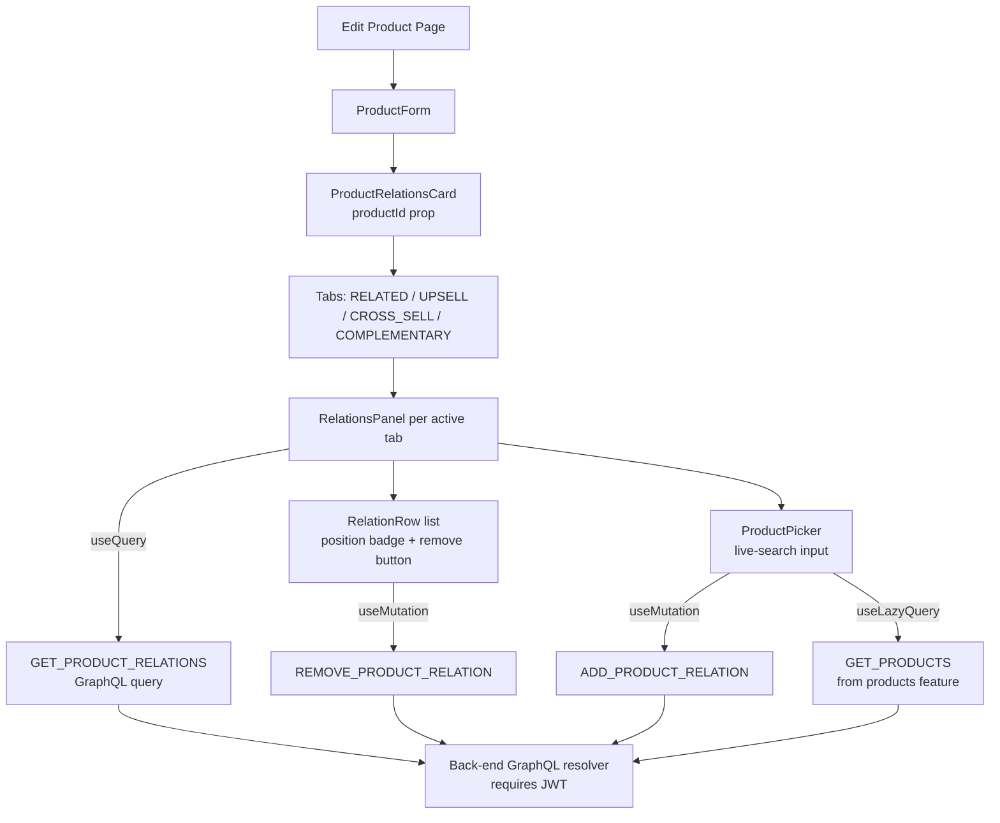

# Product Relations

**Last updated:** 2026-09-28 — **Feature:** `src/features/product-relations/`

## Overview

Product relations let a vendor link an existing product to other products in their shop under one of four curated slots: Related, Upsell, Cross-sell, or Complementary (bundle). The card appears only on the edit-product screen (a saved `productId` is required as the relation source). Within each slot the vendor can search the shop's product catalogue, add links, and remove them. The same source–target pair can exist under multiple types because each type surfaces in a different storefront UI location.

## Screens / routes

The `ProductRelationsCard` is embedded inside `ProductForm`, which is rendered by two routes:

- `src/app/store/[shopSlug]/products/[slug]/edit/page.tsx` — edit an existing product (card is active)
- `src/app/store/[shopSlug]/products/new/page.tsx` — create a new product (card silently returns `null` because no `productId` exists yet)

## How it works

## Components

| Component | Location | Purpose |
|-----------|----------|---------|
| `ProductRelationsCard` | `components/product-relations-card.tsx` | Root card with a four-tab layout (one tab per `ProductRelationType`). Returns `null` when no `productId` is supplied. |
| `RelationsPanel` | same file (internal) | Per-tab panel: fetches the current relations list, renders `RelationRow` chips, and mounts `ProductPicker`. Calls `refetch()` after every add or remove. |
| `RelationRow` | same file (internal) | Displays a linked product as a row with a truncated target ID, a position badge, and a remove button. Does not fetch the target product's name to avoid per-row queries. |
| `ProductPicker` | same file (internal) | Live-search input (min 2 chars) that queries the shop's products via `GET_PRODUCTS` and renders a name/slug label with an add button per result. Excludes the current product and already-linked targets on the client side. |

## State & forms

There is no react-hook-form or Zustand store in this feature. Each add/remove mutation fires immediately on user action (no staging), so the contextual save-bar pattern does not apply. Error feedback on mutation failure is provided via `sileo.error()` toast.

Relations within a type sort by `created_at` (the order the vendor added them). `REORDER_PRODUCT_RELATION` is defined in the API file but no reorder UI is implemented.

## GraphQL operations

| Operation | Type | Purpose |
|-----------|------|---------|
| `ProductRelations` | Query | Fetch all relations for a given `product_id`, optionally filtered by `type`. Requires JWT (owner only). |
| `AddProductRelation` | Mutation | Create a new relation between `source_product_id` and `target_product_id` for a given `type`. |
| `RemoveProductRelation` | Mutation | Delete a relation by `id`; returns `success` and an optional `message`. |
| `ReorderProductRelation` | Mutation | Update the `position` of a relation. Defined but not wired to any UI yet. |

## Validation

None. There are no Zod schemas in this feature. The only client-side guard is filtering out already-linked products in `ProductPicker` before the back-end can reject with `RELATION_ALREADY_EXISTS`.

## Main files

- `src/features/product-relations/api.ts` — all four GraphQL documents
- `src/features/product-relations/types.ts` — `ProductRelationType` union, `ProductRelation` interface, and GraphQL response wrappers
- `src/features/product-relations/components/product-relations-card.tsx` — all UI: card, tabs, panel, row, picker
- `src/features/product-relations/index.ts` — public barrel (re-exports `ProductRelationsCard`, api, types)

## Notes

- The card reads the `productRelations.*` namespace (en + ar), including each tab's label and hint (`productRelations.types.<type>`).
- `RelationRow` shows the raw `target_product_id` UUID and a position badge, not the product name. The source notes this is intentional for MVP; a follow-up should batch-fetch target names in a single query.
- `REORDER_PRODUCT_RELATION` is exported from `api.ts` but has no consumer in the codebase. Drag-reorder UI is deferred.
- The card is rendered inside `ProductForm` outside of any save-bar scope — mutations fire immediately and do not participate in the product form's unsaved-changes flow.
