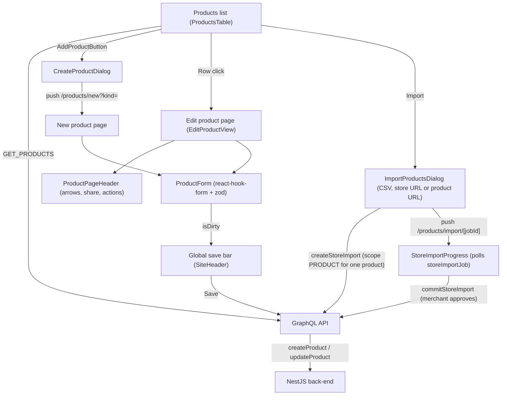

# Products

**Last updated:** 2026-10-07 -- **Feature:** `src/features/products/`

## Overview

The Products feature provides catalog browsing, filtering, and authoring. The list view provides TanStack-powered pagination, debounced search, faceted filter chips, and bulk actions. The create and edit views provide a two-column form spanning media, inventory, pricing, shipping, variants, and AI-suggested category metafields. Choosing "Assembled product" opens a form for the price and the choice groups. The product is stored as a simple product, and the rules are saved with it. One group sets the price by how many products are picked. Further groups are extras, either one price or a price on each product. Each part can carry a cut-out photo, separate from the photo it uses when sold on its own.

**Digital products are out of V1 (D12):** the add-product picker offers a simple product, an assembled product, a product with options, and a service. `?kind=digital` falls back to a simple product. The publishing `is_digital` toggle is hidden. The API refuses digital create/sell independently.

It also owns the ways a catalogue arrives from elsewhere: a CSV upload, a **store import** that reads a merchant's old storefront, and a **single-product import** -- the same job with `scope: PRODUCT`, which reads one product page and nothing else on the site. A store import is two operations with a screen between them -- `createStoreImport` queues a scan that writes nothing, and `commitStoreImport` is the separate approval that writes. The scan runs for minutes in a worker, so the progress screen is its own route and polls.

## Screens / routes

| Route | Purpose |
|-------|---------|
| `dashboard/[shopSlug]/products` | Paginated product list with search, filter bar, and bulk actions |
| `dashboard/[shopSlug]/products/new` | Create product (`?kind=simple\|variable\|service`; digital omitted for D12) |
| `dashboard/[shopSlug]/products/[slug]/edit` | Edit product with neighbor navigation |
| `store/[shopSlug]/products/import/[jobId]` | One store import: status ladder, counts, the three image counters, the approval, what the scan did not find, and -- on a scan that failed before producing anything -- what it tried. `?from=<jobId>` (set by Scan again) names the scan it replaced, so a READY scan can offer that scan's edits; without it the screen finds the previous scan of the same store itself |
| `store/[shopSlug]/products/import/[jobId]/review` | Review and edit the scanned catalogue before approving it, drawn as a sheet over the dashboard with no app sidebar. Optional -- the approval stays one click from the progress screen |

## Diagram

## Components

- **`ProductsTable`:** Root list component with URL query synchronization (`useProductListQuery`), TanStack Table integration, and sorting.
- **`ProductsHeader` & `ProductsToolbar`:** Status view tabs, compact search, a funnel that adds a facet (Tag, Category, Collection, Type, Stock), chip row via `ProductsFilterBar` in chrome mode, and `ProductsViewOptions` (sort / density / columns). CSV export/import and Add product stay on the header (`CreateProductDialog`, `StoreImportBanner`). On an empty catalogue the header hides its action cluster (`showActions={false}`): the empty state carries Add product and Import itself. `ImportProductsDialog` is mounted once by `ProductsTable` and opened from either the header or the empty state.
- **`ProductsEmpty`:** The zero-products body of the list card, under the same toolbar as a populated list: start-aligned copy with Add product and Import beside a decorative, `aria-hidden` 2x2 grid of muted icon tiles. The filtered variant (`hasFilters`) is the in-table "No matching products" row.
- **`ImportProductsDialog`:** Four-step wizard with three sources. Picking "CSV" attaches a file and runs the importer's own dry run twice (preview, then commit); picking a store asks for its address, a platform (AUTO / SHOPIFY / WOOCOMMERCE / GENERIC -- Salla and Zid have no connector and are not offered) and the **required ownership attestation**, then hands over to the progress route. "Import a single product" reuses the address step with its own copy (`products.import.product.*`): a product page address, no platform picker (sent as AUTO, as Sidekick's `import_product` does), and a **product-specific attestation** -- the listing is the merchant's own (for example on another platform) or they hold the rights holder's permission, and importing someone else's listing without permission is not allowed -- still required, and described to the checkbox (`aria-describedby`). It sends `scope: PRODUCT` and routes to the same progress screen, titled "Product import" for such a job. Switching source clears the tick, because it answered the other sentence.
- **`StoreImportProgress`:** The scan's own screen. Status ladder, what it found, the three image counters kept apart (`in transfer` is a wait, `failed` is a decision), the approval card at READY, and the read-only "not found by this scan" list. On a FAILED job with no counts (`showsStrategyTrace`) it renders **`StoreImportTrace`**, "What we tried": each strategy in the order the chain ran it, with a translated reason from the server's closed vocabulary (`STRATEGY_REASON_KEYS` / `STRATEGY_LABEL_KEYS` in `lib/store-import.ts`; an unknown strategy shows by its own name, an unknown reason as "Failed"). Not on a failed commit, whose trace is the successful scan's. The counts grid is gated on `hasStoreImportReport`, so a failed scan never shows a row of zeroes.
- **`StoreImportCarry`:** On a READY scan, offers "Bring over edits for N products" from the previous scan. That is the job `?from=` names when the URL has it (Scan again sets it, and it wins outright). Without it -- a new scan started from the import dialog -- the card reads the shop's newest 20 jobs (`StoreImportCarryCandidates`) and picks, during render, the newest one created before this job that read the same `source_host`, has finished scanning (any status the server accepts as a source, cancelled and failed-commit included) and still has edits (`carryCandidate`). Expiry is left to the server's `artifactExpired`, the same as for `?from=`. N is that job's `overridden_products`, and the offer appears only for the same `source_host` (`carryOfferCount` in `lib/store-import.ts`). Nothing is carried until the button is pressed. The server joins each edit to its product by the old store's own product id, never the handle, and keeps this scan's own edits where both have one. Dropped photos come along too, re-checked by the server against this scan's images. The card then reports what matched and what stayed behind as two separate lines, with the handles of the unmatched ones (capped at 50, then "...and N more"), plus a third line when `dropped_images_not_carried` is above zero, naming the products those photos belong to by their handle in this scan (`dropped_images_not_carried_handles`, as chips like the unmatched list): photos the merchant dropped that this scan no longer lists at the same address, which they may need to drop again (`dropsNotCarried`). An expired previous scan gets its own message (`artifactExpired`). The Scan again dialog says edits can be brought over.
- **`StoreImportReview`:** The approval. A source currency that differs from the shop's refuses the whole import -- the banner names both currencies and the approve button is disabled. There is no acknowledgement that copies the numbers unchanged. The image line reads "Move up to N images": `images_found` is the scan's count until the commit recounts from its media rows, so dropped photos and excluded products' galleries are still in it, and counting them off would mean paging the whole scanned catalogue. The create and update lines are the scan's `new_products` / `matched_products`, which an excluded product is still in: exact while `overridden_products` is 0 (only a review edit can exclude one), and "Create up to N" / "Update up to N" once it is not.
- **`StoreImportReviewEditor`:** The review screen, shaped like Shopify's Translate & Adapt -- a rail of scanned products beside one product's fields, each row being *what we read* against *what will be imported*. It is drawn as a **sheet over the dashboard** (the settings overlay's band: under the site header, over the sidebar) that **rises from the bottom over a dimming scrim** -- `shared/lib/sheet-motion.ts` holds the gesture as values and `shared/hooks/use-sheet-gesture.ts` drives it, including the exit, which plays before the navigation rather than after it. It carries a title bar (name, X), a toolbar (exit, the product count, a search that unfolds from its icon, Discard/Save) and the rail beside a pane. **Save lives in that toolbar, not in the site header's contextual bar**, because the reference puts it there and two Saves on one screen is one too many; the staging model is the bar's (local draft, value-based dirty, one mutation, `useLeaveGuard` on the X, the exit, Escape and every link). Each field group is its own card with the column names at its top; a row is three cells split by hairlines (label and caption, the reference on a muted ground, a borderless input that *is* the editable cell). Every input is named by its `<Label>`, and Revert names the field it reverts. **Nothing on it writes products:** Save stores the edits beside the scan's file (`saveStoreImportOverrides`), and the approval is still the only writer. Selecting a rail row is local state rather than a route, so one Save covers the whole job and moving between products never crosses a navigation boundary that could drop staged work.
  - The editable column starts empty and stays empty until the merchant types: an input pre-filled with the scanned value reads as their own answer the moment it appears, and keeping the two columns apart is the point of the layout.
  - The field list comes from the **server** (`storeImportProducts.fields`), not from a list in this app -- `review/field-catalog.ts` is checked against the serializer's own column sets at module load, and a second copy here would drift the first time a column moved.
  - **AI assist, per row** (`lib/store-import-ai.ts`, `review/use-store-import-ai.ts`). Six rows offer it: `name_en`, `description_en` and `brand` get improve / shorten / expand / simplify, and the two Arabic rows get translate, seeded from the English that will actually be imported. Money, stock, SKU and barcode get nothing -- a model cannot improve a number the old store recorded, and the button would be the invitation. It calls the platform's existing `aiEditorTransform`, which already carries the gate chain (plan quota per action, per-user limiter, daily budget, moderation, usage accounting), with a new `target: PLAIN_LINE` so an improved title comes back as a title rather than a paragraph. The screen also reads `myEntitlements` once and disables an action the plan excludes (`ai.text.rewrite` / `summarize` / `translate`) before it is pressed. **One call in flight for the whole screen**, and an answer **never overwrites the merchant's own words**: into an empty cell it is staged through `stageField` exactly as if typed, and into a filled one it becomes a proposal with Use this / Keep mine.
  - **AI categories for the page** (`review/ai-category-fill-dialog.tsx`, rules in `lib/store-import-ai-fill.ts`). A toolbar button, "Suggest categories", asks `suggestSystemCategories` about every product on the page that still has no category, 25 products per request. **The dialog states the estimate before anything is sent**: how many products, how many requests, that each request counts toward the content hour bucket. While the dialog is open it reads `aiContentHourlyAllowance` and, when Redis answers, says how many of that hour's requests are left; when the read fails it still names the 30-an-hour limit. The bucket is shared with every other content action, and that it is free on every plan (it books no plan quota, as the per-product button does not). **One run is capped at 4 requests** (100 products); the page is 50, so the cap only bites if the page grows, and the dialog says how many are left over. Requests go **one at a time with a Stop between them**: Stop lets the request in flight finish and sends no more. A refusal part-way (the limiter, or no provider answering) ends the run with the reason and the count not asked about, and what was already filled stays. Only a **decisive** answer is staged, through `stageField` like a category picked by hand, so Save, Discard, Revert and the leave guard cover it and nothing is saved by the run; an ambiguous answer is counted and left for the per-product button, which offers it as chips. Skipped without being asked about: a product that already has a category (scanned, saved or staged), one whose category the merchant deliberately cleared, one that is left out, and one with no title. There is no separate "filled by AI" mark on this screen, for this or for the per-product button: a suggestion looks like any staged edit. The dialog is modal for the run and the button is off while a row's AI call is in flight, which keeps one AI call in flight for the screen. **"Translate every product on this page" is not built**: translation goes through `aiEditorTransform`, one request per cell, so a 50-product page is up to 100 requests against a 30-an-hour limiter.
  - The **category** row is the taxonomy picker itself (`SystemCategoryCombobox`, shared from the product form with `chrome={false}`) rather than the raw id input it was, plus **Suggest a category** -- `suggestSystemCategories`, which asks a model for a Google-taxonomy path and resolves it against the real tree server-side. A decisive answer applies on one press; an ambiguous one is offered as chips.
  - The **Arabic** card is the one translation card: `name_ar` and `description_ar` carry a server-declared `reference_key`, so their reference cell shows the English that will be imported (the merchant's own title first, then the scanned one) rather than their own scanned value; any Arabic the scan did read is shown beneath the English. No connector reads Arabic; what appears there comes from the scan's enrichment pass (`back-end/src/store-import/enrich/`), which fills blank Arabic when the shop's plan allows. The **Search engine listing** card (`seo`) holds the page title and meta description in English and Arabic; its Arabic rows carry a `reference_key` too, so they read exactly like the translation card's, and none of the four counts toward "needed to sell". A card's rows are split into runs by kind (`rowRuns`), each under its own column names, so the listing card shows *What we read / What will be imported* over its two English rows and *English / Arabic* over the two Arabic ones.
  - Money is stored in cents and rendered in major units (`centsToDisplay`); what is typed goes to the server as typed and is parsed there, so this app never becomes a second authority on a decimal separator.
  - A per-product checkbox excludes a product: its row is dropped from the file at commit and its images are never downloaded.
  - A refused Save says what to check (`review.saveInvalid`: prices are amounts, stock a whole number, text within its limit) rather than "Something went wrong", which a retry would repeat. It is branched on `VALIDATION_ERROR` in the editor, after the shared map, and deliberately not added to `STORE_IMPORT_ERROR_KEYS`: a spent plan allowance also arrives as an outer `VALIDATION_ERROR`, and mapping that code there would hide `planQuota`. A save the server refuses because the commit claimed the job meanwhile reads as `invalidState`.
  - **Needs attention** (the rail's filter, its count and each row's badge) comes from the server's `incomplete`, which reads what the import will carry: a stored edit wins over the scanned value, including a cleared one, so a product whose scanned category was cleared stays on the list. A field row's caption applies the same rule, to the draft as well (`importedDisplay`, `isCleared`). A clear -- saved as `''`, staged as `""`; a staged `null` is a revert -- is an override like a typed value: tinted, captioned "Needed to sell" on stock and category and "Cleared" elsewhere, and undone by Revert, which stages `null` (`stageRevert`) because erasing an already-empty cell stages nothing. Erasing typed text is still a revert, and no control on the screen creates a clear yet (`stageClear` exists for one); stored clears come from API callers and carried edits.
  - **Images** (`review/review-image-strip.tsx`, rules in `lib/store-import-review.ts`) is a card above the text cards listing every photo the scan found for the product (`StoreImportProduct.images`), each with a **drop / restore** button -- and no way to add one, because an added URL would be downloaded by the import. Drops are staged in the same draft as typed edits (`stageImageDropped`, value-based, so dropping and restoring a photo disarms Save again) and sent as the product's whole `dropped_images` set; a URL that is not one of the product's `images` is never staged. A dropped photo stays on screen, faded and labelled; the "Main" badge, the pane header and the rail thumbnail all follow the commit's rule (`primaryImage`): the primary is the first **gallery** photo not dropped -- the first `gallery_count` entries of `images` -- and a photo only a variant uses is never promoted. With the whole gallery dropped there is no "Main" badge even while a variant photo is kept, and the strip says the product will import without a main photo (`noMain`). The strip also **orders the gallery**: each kept gallery photo has make-main (star), move-earlier and move-later buttons, named "earlier" and "later" rather than left and right because the strip wraps and under RTL the earlier photo is on the right (the chevrons turn with `rtl:rotate-180`). The order is staged into the same draft (`stageImageOrder`, a permutation of the gallery and nothing else, collapsing back to the saved order) and sent as the product's whole `image_order`; moving back to the scan's order over a saved one sends `[]`. The strip, the "Main" badge, the pane header and the rail all read `galleryOrder` / `orderedImages`, so what shows first is what the commit imports first, dropped photos skipped. A photo only a variant uses is badged "Variant photo" and has no order controls: the server never promotes one.
  - **Fill stock and category** (`review/bulk-fill-dialog.tsx`, rules in `lib/store-import-bulk-fill.ts`) is a toolbar action that writes one stock count and/or one category across the **current view** -- it sends the screen's filter (`only_incomplete`, `search`) to `bulkFillStoreImportOverrides`, and the server re-applies it, so the confirmation's count (the page query's `total`) is the set filled. The fields it offers are the ones the server marks `bulk_fillable`. The confirmation names the count, says excluded products are skipped, keeps existing values unless "Replace values that are already there" is ticked, and says plainly that on a product with variants the stock lands on the first variant only. It is **disabled while the draft is dirty** (save or discard first) and while a new filter is loading, because it writes to the server rather than into the draft. Afterwards the screen refetches page 1 and the job and shows "Filled N products" with how many were kept as they were. The products query is `cache-and-network` so a view cached before the fill is revalidated rather than shown stale.
- **`StoreImportMissing`:** Products imported from this source that the scan did not return. Information only: no delete, no bulk action, and no mutation in the feature that takes the list -- a half-failed scan produces exactly this list.
- **`ProductStatusCell`:** In-place status changer (Active/Draft/Unlisted) with immediate update and a success toast.
- **`ProductForm` & `ProductFormLayout`:** Two-column responsive layout wiring unsaved bar, leave guard (`useLeaveGuard`), and draft persistence.
- **`VariantsTable`:** Variant matrix editor supporting option axes, location-scoped stock overrides, and client-side filtering.
- **`MediaManager` & `ImageEditor`:** Tile grid for primary and gallery assets with drag-and-drop, full-screen canvas editor (crop, draw, rotate, AI alt text).
- **`AiImagePanel`:** Generate with AI from the media card (`generateProductImage`, polled to a terminal status, picked results staged into media). Text to image and Edit also take an optional **text on the image** (`caption`, 280 characters): the server prints it on each result after generation and never sends it to the model, and a caption the safety filter refuses reads as the text (`aiImage.captionRejected`). Background removal and upscale hide the field and send none.
- **`SystemCategoryPicker`:** Google taxonomy drill-down browser with keyboard navigation and autofill.
- **`AttributeValuesCard`:** Renders category-specific metafields with AI-assisted value suggestions (`suggestProductAttributes`). A failed suggestion (including `AI_BUDGET_EXCEEDED`) is non-fatal: the card stays usable, `silentErrors` skips the Apollo console log, and a quota refusal shows a no-retry banner.
- **`OrganizationCard`:** Manage product types, vendors, collections (`ChipPicker`), and tags.
- **`ShippingCard`:** Physical product toggle, package picker (`PackageField`), weight input with unit conversion, and customs declarations. **Suggest a box** (`PackageSuggestTray`, rule in `lib/suggest-package.ts`) asks for the item's own size, adds 4 cm to each side and picks the smallest saved `BOX` it fits in any orientation (ties go to the store default), marking it "Suggested". When none fits it proposes a box at the padded size with an estimated empty-carton weight, and creates it only on "Create and use" or through the prefilled package dialog. The typed size is never saved: the product's `length_mm`/`width_mm`/`height_mm` are the parcel size, which overrides the package at booking.
- **`ProductPageHeader`:** Breadcrumbs, status badge, storefront preview, sharing popover, duplicate modal, and neighbor navigation (`useProductNeighbors`).

## State & forms

- Forms use `react-hook-form` with `zodResolver(productSchema(t))`. `productSchema`, `variationOptionSchema` and `productOptionDefinitionSchema` take a `products.validation` translator, so their messages follow the dashboard language; the form memoizes the schema on it.
- `useProductDraft` persists create-mode inputs to `sessionStorage` (with 300ms debounce and `pagehide` flush). A form opened from a Sidekick handoff writes its ticket's `handoffId` into the draft as `handoff_id` (2026-10-02), and `ProductForm` retires such a draft on the next mount when that ticket is no longer the pending create ticket (`draftOutlivedHandoff`, `lib/form/product-draft.ts`) -- saved, released by leaving the form, or replaced by a newer card. A reload keeps the ticket (no unmount ran), so the same sitting still comes back; a draft the vendor started themselves carries no tag and is never retired.
- `inventory_levels` are committed via `SetInventoryAvailable` post-save to prevent race conditions.
- Dirty state is tracked via `useUnsavedBarStore` and protected by `useLeaveGuard`.
- **An assistant-prepared form is the live form (2026-10-01).** While `ProductForm` was opened from a Sidekick handoff it registers through `useLiveForm` (`features/ai/lib/live-form.ts`) under the ticket's `handoffId` (`useVendorAgentHandoff`) -- on an edit with the product's saved title as its `label`, which the chat's composer chip shows as "Editing: <title>" (2026-10-04; a create form registers none and reads "New product") -- so each chat message carries its current values and a `patch_form` correction ("لأ، خلي السعر 300") is staged into this mounted form instead of a card that cannot reach it. A patch is written with `setValue(..., { shouldDirty: true })` — never `resetField`, which does nothing for SKU and barcode while their collapsible is closed — so the fields turn dirty, the save bar shows and nothing is saved until Save. That is a deliberate change: an untouched first prefill still shows no bar, a patched one does, and in create mode the dirty draft is then parked by `useProductDraft` like a hand edit -- tagged with the handoff, so it ends with the ticket instead of coming back as "Draft restored" on a later manual "Add product" (see the draft note above). The "Filled by Sidekick" marks (`AiPrefillProvider`) now follow the **proposed values** — the prefill plus anything patched since — and a field keeps its mark while it holds exactly one of them (a patch re-marks a field the vendor had typed in; 200 → "300" → "200" by hand stays cleared). A proposal that proposes nothing — `""`, `null`, or a translatable with every locale blank — marks nothing, so the empty description pair `create_product` used to send (and older persisted turns still carry) no longer reads "Filled by Sidekick" over an empty editor; the tool now leaves the description out when the vendor gave none. The provider takes `handoff` and keeps its watcher mounted for the whole life of a handoff, even one with nothing in it, so the first patch never remounts the form. Description, cost per item and barcode carry the mark too. A form the vendor opened themselves never registers.
- **A handoff prefill merges per locale (2026-10-01).** `mergeProductPrefill` (`lib/form/merge-prefill.ts`, the product binding of `shared/lib/merge-prefill.ts`, which the collection form binds too) spreads the prefill over the server row (edit) or the kind's defaults (create) one level deep, except `name`, `description`, `seo_title` and `seo_description`, which merge per locale: a locale the prefill leaves out, or sends blank, keeps the row's text. `update_product` renaming only the Arabic title used to blank the English one. `proposedFromPrefill` gives the marks the merged pair, so a one-locale rename still reads "Filled by Sidekick".

## GraphQL operations

| Operation | Type | Purpose |
|-----------|------|---------|
| `Products` / `Product` | Query | List query with pagination/filters; single product detail by slug. |
| `ProductOrganizationOptions` / `ProductCategories` | Query | Fetches existing types/brands and shop-used categories for filters. |
| `SystemCategoriesFlat` / `CategoryAttributes` | Query | Taxonomy tree and category-specific metafield definitions. |
| `SuggestProductAttributes` | Mutation | AI-generated metafield suggestions based on product content. |
| `CreateProduct` / `UpdateProduct` | Mutation | Product creation and update with `expected_version` concurrency check. |
| `DeleteProduct` / `DuplicateProduct` | Mutation | Soft-delete and cloning mutations. |
| `BulkUpdateProductsStatus` | Mutation | Batch status updates for selected rows. |
| `ImportProductsCsv` / `ExportProductsCsv` | Mutation | CSV preview/execution and full catalog export. |
| `CreateStoreImport` | Mutation | Opens a migration and queues its scan. Requires `attested_owner`; writes nothing to the catalogue. `scope: PRODUCT` is sent only for a single product (absent means STORE, so an API without the field still takes a store); Scan again repeats a PRODUCT job's scope. |
| `StoreImportJob` / `StoreImportJobs` | Query | The progress poll (2.5s while work is moving) and the list behind the products-page banner. |
| `CommitStoreImport` | Mutation | The approval that writes. Refused unless the job is READY. A known currency mismatch refuses the whole import. |
| `CancelStoreImport` | Mutation | Cooperative stop. Anything already written stays written. |
| `StoreImportProducts` / `SaveStoreImportOverrides` | Query / Mutation | The review screen's rows (with the server's editable-field list, and each product's scanned `images`, `gallery_count`, saved `dropped_images` and saved `image_order`) and its Save, which also carries a product's `dropped_images` set and its `image_order`. Neither writes products. |
| `BulkFillStoreImportOverrides` | Mutation | Fills stock and/or category across the review screen's current filter. Skips excluded products and, unless `overwrite`, cells that already hold a value. Returns `matched` and `affected`. Writes no products. |
| `StoreImportCarrySource` / `StoreImportCarryCandidates` / `CarryStoreImportOverrides` | Query / Query / Mutation | The previous scan's `source_host` and `overridden_products` -- by id from `?from=`, or from the job list when there is none -- and the carry itself: two ids in, `matched` / `unmatched` / `unmatched_handles` / `dropped_images_not_carried` out. Writes no products. |

## Validation

- At least one localized name (`en` or `ar`) is required.
- `sale_price` must be strictly less than `price`.
- Variable products must contain at least one valid variation.
- Auction products require `min_bid_price` and optional `max_bid_price >= min_bid_price`.
- A store import needs an address and the ownership attestation; a bare hostname is given an `https://` scheme rather than rejected, and the SSRF guard decides what is reachable. A single-product import also refuses a bare home page (no path and no query -- `/?product=x` counts as a page) with `product.urlIsHome`.

## Notes

- Every string on the product screens reads `products.*` (en + ar); product relations and restock alerts read `productRelations.*` and `stockNotifications.*`. The API still stores `PUBLISH` / `DRAFT` / `UNLISTED`. The form language pill reads `products.formLang`.
- The list price cell formats with `useShopCurrency()` passed into `formatMoneyCents`. That hook reads `myShops.currency` for the slug in the URL, which the store layout already preloaded, so the server HTML and the first client render name the same currency. Calling `formatMoneyCents` with no currency reads the active-shop store, which is empty during SSR and filled from localStorage before a suspended table hydrates.
- The list's filter key table carries no words: each key's label, empty and no-match sentences are `products.filters.keys.<id>.*`, and typing an Arabic key name narrows to it. The negotiation cell words "Enabled" / "Disabled" / "N of M variants" from the counts rather than printing the server's English `label`.
- The opening-stock transfer note and an adjustment's reason are stored in the vendor's language, since the history shows them back as written.
- The sample CSV (`public/sample-products.csv`) is offered inside the CSV option's helper on the import dialog's first step and again under the file step's drop zone, never in the footer -- it belongs to that one choice and is absent on the store-address path.

- Store-import error codes are translated in the app (`STORE_IMPORT_ERROR_KEYS`, `products.import.errors`) rather than echoed from the server, because a plan-quota rejection arrives as a validation error whose real code is in `validation_errors[0].code`. A FAILED job's `error` is always a code: a fault on the platform's side arrives as `STORE_IMPORT_FAILED` (`importFailed`, "a problem on our side, not with your store") rather than as the fault's message.
- The review strip reorders a gallery photo by dragging it onto another, and still by the earlier and later buttons. A dropped photo and a variant-only photo are not in that order.
- The review screen edits **product-level** fields only. On a product with variants, row 1 of the CSV carries the product's money cells and its first variant's at once, and the serializer gap-fills rather than overwrites -- so a draft-level edit to `variants[0]` is silently dropped and a product-level edit silently moves variant 1. Both are pinned in `back-end/src/store-import/normalize/csv-round-trip.spec.ts`, and the pane says so above the fields rather than hiding it.
- `slug` is not editable and cannot become editable. It is the address of the override, of the identity map (`external_id_by_handle`) and of the image transfer list (`image_urls_by_handle`) at the same time, and a written product whose handle is missing from the first of those fails the commit and rolls its batch back.
- Store-import image issues are live on the progress screen: `storeImportMediaIssues` lists FAILED, SKIPPED, and PENDING quiet past the reconcile window; each row offers Retry and Drop (`retryStoreImportMedia` / `skipStoreImportMedia`). Fresh PENDING stays on the counters only.
