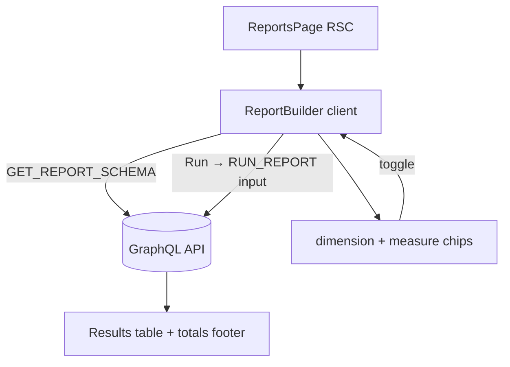

# Reports

**Last updated:** 2026-08-17 — **Feature:** `src/features/reports/`

## Overview

The self-serve report builder. The vendor picks dimensions (group-by) and measures, chooses a date-range preset, and runs a report; the result renders as a table with a grand-total footer. Measures that need the storefront event pipeline (sessions, conversion) appear disabled. Backed by the back-end `report-builder` engine (a safe, parameterized query compiler).

## Screens / routes

| Route | Purpose |
|-------|---------|
| `/store/[shopSlug]/analytics/reports` | The report builder + results table |

## How it works

## Components

| Component | What it shows |
|-----------|--------------|
| `ReportBuilder` | Root client island. Fetches the registry (`reportSchema`), holds the selected dimensions/measures + preset, runs `runReport` via `useLazyQuery`, and renders the results table. |
| `Chip` (inline) | A toggle for a dimension/measure; disabled when the dimension cap is reached or a measure is `pending_event_pipeline`. |

## State & forms

No `useUnsavedBarStore` — the builder is a query tool, not an edit screen. Local state: selected `dimensions[]`, `measures[]`, and a `RangePreset` (reused from the analytics feature). "Run" commits the selection to a `runReport` call; the result table reads `columns` + `rows` + `totals` and formats money columns with the report's `currency`.

## GraphQL operations

| Operation | Type | Purpose |
|-----------|------|---------|
| `AnalyticsReportSchema` | Query | The dimension/measure palette (drives the chips) |
| `AnalyticsRunReport` | Query | Run a report (`dimensions`, `measures`, `start`, `end`, `limit`) |

(The back-end also exposes saved-report CRUD; the v1 UI does not yet surface saving.)

## Validation

None client-side beyond the dimension cap and disabled chips; the back-end validates the spec (allow-list, value-kind, cost gate) and returns `report_*` validation errors.

## Main files

- `src/features/reports/api/queries.ts` — `GET_REPORT_SCHEMA`, `RUN_REPORT`
- `src/features/reports/types.ts` — `ReportSchema`, `ReportResult`, response types
- `src/features/reports/components/report-builder.tsx` — the builder + results table
- `src/app/store/[shopSlug]/analytics/reports/page.tsx` — route shim

## Notes

- v1 is order-level (sales by payment method / shipping method / country / day / week / month). Product/category dimensions are a back-end fast-follow.
- Sessions/conversion measures render disabled ("with traffic analytics") until the storefront event pipeline ships.
- Saving/pinning reports is supported by the API but not yet wired into this UI.
- Loading states are `<Bones>` (`shared/components/bones.tsx`), captured from the real DOM by `npm run bones` — there is no hand-written skeleton on this screen; a name with no committed capture shows nothing on the very first load and then measures itself, so every later load draws real bones. Bone names: `report-builder-controls`. See [02_build_startup](../02_build_startup/README.md).
