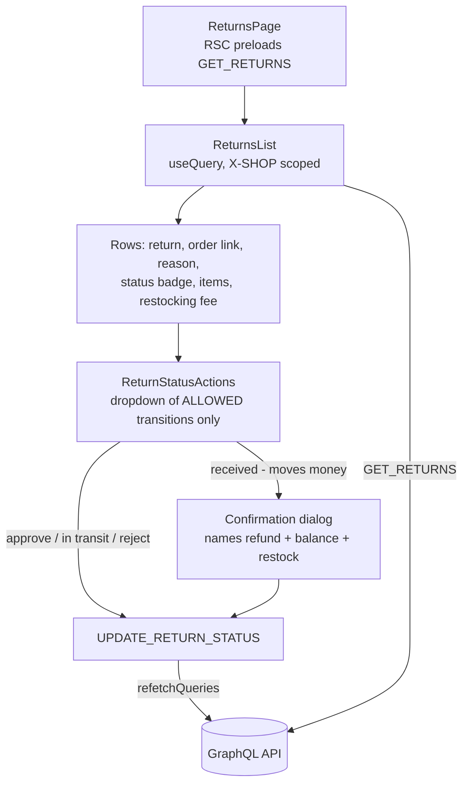

# Returns (RMA)

**Last updated:** 2026-09-28 — **Feature:** `src/features/returns/`

## Overview

The returns queue is where a merchant works the merchandise returns (RMAs) customers have raised against their shop. Each return is a request to send specific order lines back; the merchant approves it, marks the goods in transit, and finally marks them received — at which point the back-end issues the refund automatically, net of the shop's restocking fee, and puts the restock-flagged lines back into inventory.

Returns are **customer-initiated**: the storefront calls `createReturn`, and the vendor API only advances an existing one. So there is no "new return" button here — the merchant's job is to work the queue, not to open it. A return is also distinct from a plain refund: a refund issued from the order screen is a standalone credit, while a return is a lifecycle with goods physically coming back.

## Screens / routes

| Route | Purpose |
|-------|---------|
| `/store/[shopSlug]/orders/returns` | The RMA queue: every return raised against the shop, with its status action |

Reachable from the sidebar under Orders → Returns.

## How it works

## Components

| Component | What it shows |
|-----------|--------------|
| `ReturnsList` | White list card with Linear chrome: status view tabs and compact search over the loaded page, then return number, link to the order, reason, status badge, item count, restocking fee (only once set), requested date, and the status action. Skeleton while loading; an empty state explaining the flow when the shop has none |
| `ReturnStatusActions` | Dropdown offering **only** the transitions the back-end's state machine allows from the current status. `received` is routed through a confirmation dialog naming its three effects; every other transition fires directly |

## State & forms

No editing screen, so no contextual save bar. Transitions are immediate mutations followed by `refetchQueries`, with a `sileo` toast on success or failure — the same pattern as the order status actions.

## GraphQL operations

| Operation | Type | Purpose |
|-----------|------|---------|
| `Returns` | Query | The queue (page 1, limit 50). Scoped to the active shop by the `X-SHOP` header the Apollo link attaches |
| `UpdateReturnStatus` | Mutation | Advance a return. `RECEIVED` is the transition that issues the refund |

`createReturn` is deliberately **not** defined here — it is a customer/storefront operation and a vendor calling it would be rejected.

## Validation

The lifecycle is guarded in two places. `lib/status.ts` holds `RETURN_TRANSITIONS`, a mirror of the back-end's `VALID_RETURN_TRANSITIONS`, so the UI never offers a transition the server would reject with `invalid_transition`. The server enforces the same table regardless.

**The status casing is asymmetric and is the feature's one real trap.** A return *reads* its status back lowercase (`in_transit`) but the mutation only *accepts* the GraphQL enum, which is uppercase (`IN_TRANSIT`). Feeding a status straight from a row back into the mutation therefore fails. Every write goes through `toReturnStatusInput()`, and that is unit-tested.

## Main files

- `src/features/returns/api.ts` — `GET_RETURNS`, `UPDATE_RETURN_STATUS` (shared `ReturnFields` fragment)
- `src/features/returns/types.ts` — `ReturnEntry`, `ReturnLineItem`, and the two status types (the lowercase one it reads, the uppercase one it writes)
- `src/features/returns/lib/status.ts` — the transition table, `toReturnStatusInput()`, `movesMoney()`, and the badge variants (no words)
- `src/features/returns/lib/__tests__/status.test.ts` — pins the transition table against the back-end's and covers the casing trap
- `src/features/returns/components/returns-list.tsx` — the queue table + empty state
- `src/features/returns/components/return-status-actions.tsx` — allowed transitions + the money confirmation

## Notes

- `received` is the only transition that moves money, so it is the only one behind a confirmation. Rejecting a return moves no money and needs none.
- The restocking fee column stays empty until the goods are received — the back-end sets `restocking_fee_cents` at that point, when it withholds the fee from the refund.
- The queue fetches up to 50 returns in one call with no server search or paging. The chrome row filters that page in the client. There is no per-return detail screen; the row links to the order instead.
- The refund a return issues appears on the order's refunds card (the return carries its `refund_id`), so the money trail stays visible from the order.
- The queue reads `returns.*` (en + ar); `RETURN_STATUS_LABEL` and `RETURN_ACTION_LABEL` are gone. A status badge reads `returns.views.<status>`, a transition's menu item and toast `returns.actions.<target>`, and the dropdown and the received confirmation `returns.statusActions.*`.
