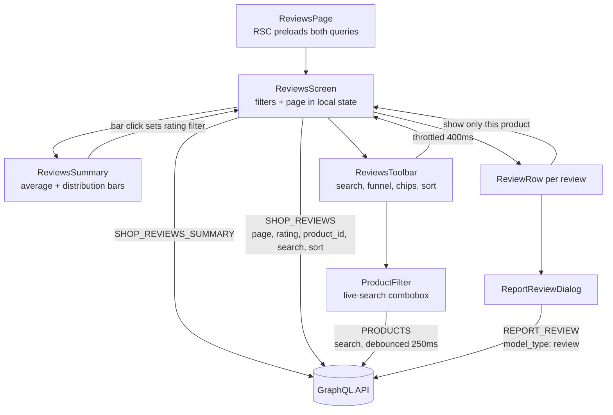

# Reviews

**Last updated:** 2026-09-26 — **Feature:** `src/features/reviews/`

## Overview

The reviews screen is where a merchant reads what customers said about the products they bought: the shop's rating average and its 5→1 distribution, then the reviews themselves with the reviewer, the comment, any photos, and the product they are about.

It is **read-only apart from one action**. A merchant cannot delete a review of their own shop — `deleteReview` is gated on `manage_all_shops`, which no vendor holds — so the single write here is reporting a review to the platform for moderation. A shop able to delete its own one-star reviews would make every rating on the platform meaningless, so the merchant reports and an admin decides.

## Screens / routes

| Route | Purpose |
|-------|---------|
| `/store/[shopSlug]/reviews` | The review queue: summary card, filters, the paged list |

Reachable from the sidebar under Customers → Reviews.

## How it works

## Components

| Component | What it shows |
|-----------|--------------|
| `ReviewsScreen` | Owns the filter and page state, runs both queries, and picks between the first-load skeleton, the error state, the empty state and the list. Keeps `previousData` on screen while a filter change is in flight |
| `ReviewsSummary` | Average to one decimal, five distribution bars drawn in CSS, and three counts (last 30 days, with photos, reported). Each bar is a button that sets the rating filter; clicking the active one clears it |
| `ReviewsToolbar` | Compact search, funnel (rating / product), chip row, sort as a display icon, Clear on the chip row |
| `ProductFilter` | Single-select popover combobox over the shop's products, searched server-side (`products`, newest first, 20 rows, 250 ms debounce). The trigger shows "All products" or the selected product's thumbnail and name; an X beside it clears the product alone. Fetches nothing until opened |
| `ReviewRow` | One review: avatar, name, email, stars, the comment, photo thumbnails, the product chip linking to the product page, the helpful count, and the actions menu — view product, **show only this product** (narrows the list to the row's product; hidden while that product is already the filter or the product is gone), report |
| `ReportReviewDialog` | Optional reason (500 chars) plus submit. Says plainly that the review stays visible and an admin decides |
| `ReviewsEmpty` | Two different nothings — a shop with no reviews at all, and a filter that matched none |
| `RatingStars` | Five stars, `rating` of them filled. Pinned `dir="ltr"` — a star row is a quantity, not a direction |

## State & forms

No editing screen, so **no contextual save bar**. Filters live in local `useState` and are sent to the server, not applied client-side: `rating`, `product_id`, `search` and `sort` are all evaluated by `shopReviews`, so there is no client row model and no TanStack table here. Search is throttled through `useThrottledCallback` (400 ms) so typing does not fire a query per keystroke; changing any filter resets the page to 1. The product filter is held as a whole `ReviewProductFilter` (`id`, translated `label`, `image`) rather than a bare id, so the toolbar chip renders without a second lookup; the query sends only `product_id`. Both ways of setting it — picking in the toolbar, or "show only this product" on a row — go through the same two mappers in `lib/reviews.ts`, so the same product is never labelled two ways. None of the filters is in the URL. Reporting is a single explicit mutation with a `sileo` toast, refetching only the summary so the merchant keeps their place in the list.

## GraphQL operations

| Operation | Type | Purpose |
|-----------|------|---------|
| `ShopReviews` | Query | The queue, filtered and paged server-side. Ownership-gated; scoped by the `X-SHOP` header the Apollo link attaches |
| `ShopReviewsSummary` | Query | Average, distribution and the three counts. Unfiltered on purpose — it is the denominator the filters read against |
| `ReportReview` | Mutation | `createAbusiveReport` with `model_type: "review"` |
| `Products` | Query | The product filter's search — the products feature's own `GET_PRODUCTS`, called with `{ search, limit: 20, sort_by: NEWEST }` and skipped until the popover opens |

The public `reviews` query is deliberately **not** used: it runs behind `OptionalJwtGuard` and returns bare ids, so a screen built on it would show a column of cuids and could never show who wrote what.

## Validation

Nothing is authored here, so there is no zod schema. The one input — the report reason — is optional and capped at 500 characters client-side; an empty reason is sent as `undefined` rather than an empty string.

Two guards worth knowing: an empty distribution bar is disabled unless it is the active filter (otherwise filtering to a rating that drops to zero traps the merchant on an empty list), and `sharePercent` returns `0` rather than `NaN` for a shop with no reviews — a `NaN` width renders as a full bar, which would make an empty shop look five-starred.

## Main files

- `src/features/reviews/api.ts` — the two queries and the report mutation
- `src/features/reviews/lib/reviews.ts` — page size, rating/sort values, `ratingTone`, `sharePercent`, `productHref`, the two product-filter mappers
- `src/features/reviews/components/reviews-screen.tsx` — state, queries, and the list states
- `src/features/reviews/components/reviews-summary.tsx` — average + distribution bars as the rating filter
- `src/features/reviews/components/product-filter.tsx` — the single-select product combobox
- `src/features/reviews/components/review-row.tsx` — one review card
- `src/features/reviews/components/report-review-dialog.tsx` — the moderation escalation

## Notes

- Money is not involved anywhere on this screen, so none of the `format` money helpers appear.
- Product names arrive as the multilang blob and go through `translatable()`; a review outlives a hard-deleted product, so `product` can be null and the row says so.
- Photos render with `next/image` and `unoptimized` — the URLs come from arbitrary attachment hosts, which the optimizer would otherwise need `remotePatterns` entries for.
- The reviewer is the shop's customer (`customer_id` on the review; the back-end names a customer who gave no name by their number). Search matches the comment, the reviewer's name, their email and their number. It does not match the product name: that column is an unindexed multilang JSON blob, so filtering on it means a full scan per keystroke. Narrowing to a product is the `product_id` filter instead, which the back-end applies inside the shop predicate — a foreign id yields an empty page, never another shop's rows.
- `ProductFilter` passes `shouldFilter={false}` to cmdk on purpose: the rows are already the server's answer, and cmdk's default would match the typed text against each row's `value` (the product id) and hide every one of them. It is a fresh single-select control rather than a reuse of the collections/coupons/draft-order picker dialogs, which stage a multi-select and hand a list back on Add.
- A hard-deleted product cannot be filtered on from either end: the picker never lists it and the row's menu offers nothing when `product` is null.
- The RSC preload in `app/store/[shopSlug]/reviews/page.tsx` sends `product_id: null` explicitly — the variables must match the screen's initial `useQuery` variables exactly or the client asks a second time.
