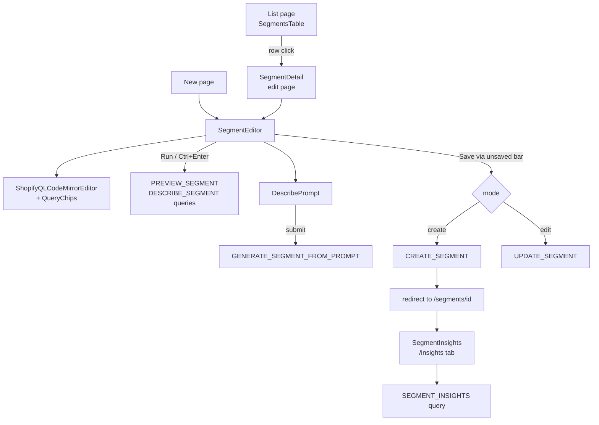

# Segments

**Last updated:** 2026-09-28 - **Feature:** `src/features/segments/`

## Overview

Segments lets vendors define named groups of customers using a ShopifyQL-style query language. Vendors write or generate a filter query, preview matching customers on demand, save the segment, and inspect analytics on a dedicated Insights tab. Saved segments can be bulk-deleted and are associated with coupons.

## Screens / routes

| Route | Purpose |
|---|---|
| `/store/[shopSlug]/segments` | Paginated list of all segments with search, sort, and bulk delete |
| `/store/[shopSlug]/segments/new` | Create a new segment in the ShopifyQL editor |
| `/store/[shopSlug]/segments/[id]` | Edit an existing segment (name, description, query) |
| `/store/[shopSlug]/segments/[id]/insights` | Analytics dashboard for a saved segment |

## How it works

## Components

| Component | What it shows |
|---|---|
| `SegmentsTable` | TanStack Table list with client-side sort, search, and pagination (fetches all at once) |
| `SegmentsHeader` | Page title + "Create segment" button |
| `SegmentsToolbar` | Global search input wired to TanStack Table `globalFilter` |
| `SegmentsBulkBar` | Appears on row selection; fires `BULK_DELETE_SEGMENTS` |
| `SegmentsRowActions` | Per-row dropdown with Edit and Delete actions |
| `DeleteSegmentDialog` | Confirmation dialog before deleting a single segment |
| `SegmentEditor` | Orchestrator for the create/edit page; owns the form, unsaved bar, undo/redo, preview, and AI prompt |
| `ShopifyQLCodeMirrorEditor` | CodeMirror 6 editor with ShopifyQL syntax highlighting, linting, and autocomplete |
| `QueryChips` | Visual chip overlay for WHERE conditions; mutates the AST and re-serializes to text |
| `EditorStatsBar` | Preview count, Run button, undo/redo, collapse toggle, and Templates shortcut |
| `DescribePrompt` | AI natural-language-to-query input (pill and inline variants); calls `GENERATE_SEGMENT_FROM_PROMPT`. While generating it shows `ShiningText` (`@repo/ui/components/shining-text`) — the same swept-highlight waiting text the AI assistant and the image studio use |
| `RefinementPanel` | AI-generated summary of the current preview with up to 3 narrowing suggestions |
| `TemplatesPicker` | Modal with categorized preset queries |
| `CustomersPreview` | Sample table of matching customers from the last run; each row's secondary line and the local search read the `email` column, not `meta.email` |
| `SaveSegmentDialog` | Dialog that captures the segment name on first save in create mode |
| `SegmentInsights` | Insights tab: size-history chart, KPI grid, subscription ratios, top-country/city/language lists |

## State & forms

**Zustand store — `useSegmentEditorStore`** (`stores/editor-store.ts`): holds editor chrome state — `collapsed`, `templatesOpen`, `debouncedQuery`, and `runNonce`. Reset on route change via a `useEffect` calling `store.reset(initialQuery)`.

**react-hook-form** with `zodResolver(segmentFormSchema)`: owns `name`, `description`, and `query`. `isDirty` drives the contextual save bar.

**Contextual save bar** (`useUnsavedBarStore`): registered in `SegmentEditor` whenever `isDirty` is true. In create mode the bar label is "Unsaved segment" and Save opens `SaveSegmentDialog` to capture a name before calling `CREATE_SEGMENT`. In edit mode Save calls `UPDATE_SEGMENT` directly and resets the form with `form.reset()` on success.

**Manual-run model**: preview and describe queries fire only when the user presses Run (or Ctrl+Enter). `debouncedQuery` only advances on Run; `hasUnrunChanges` surfaces an "unrun" indicator in the stats bar.

**Undo/redo**: local history stack in `lib/use-query-history.ts`; undo/redo write back to the `query` field via `form.setValue`.

**URL sync**: `?segment_query=` is kept in sync with `debouncedQuery` via `router.replace`.

## GraphQL operations

| Operation | Type | Purpose |
|---|---|---|
| `CustomerSegments` | Query | Paginated list of segments for the table |
| `CustomerSegment` | Query | Single segment by ID for the edit page |
| `PreviewCustomerSegment` | Query | Count + sample customers matching a draft query |
| `SegmentTemplates` | Query | Preset query templates grouped by category |
| `CustomerSegmentFilters` | Query | Filter catalog for editor autocomplete |
| `DescribeCustomerSegment` | Query | Human-readable description of the current query |
| `CustomerBaseCount` | Query | Total contact count; used to compute the segment's percentage of base |
| `SegmentInsights` | Query | Analytics: size history, KPIs, subscription ratios, top geo/language lists |
| `ExplainCustomerSegment` | Query | AI summary and refinement suggestions (throttled 10 req/min/IP) |
| `CreateCustomerSegment` | Mutation | Persist a new segment |
| `UpdateCustomerSegment` | Mutation | Save edits to an existing segment |
| `DeleteCustomerSegment` | Mutation | Delete a single segment |
| `BulkDeleteCustomerSegments` | Mutation | Delete multiple segments; returns `deletedCount` |
| `GenerateCustomerSegmentFromPrompt` | Mutation | AI: convert a plain-language description to a validated ShopifyQL query |

## Validation

`segmentFormSchema(t)` (zod) in `validations/segment.ts`, built from a `segments.validation` translator so its messages follow the dashboard language: `name` required max 255 chars; `description` optional max 500 chars; `query` required min 1 char (ShopifyQL syntax validated server-side via the preview query).

## Main files

- `src/features/segments/components/segment-editor.tsx` — create/edit page orchestrator
- `src/features/segments/components/segments-table.tsx` — list page with TanStack Table
- `src/features/segments/components/insights/segment-insights.tsx` — insights tab content (avg/median spend arrive as `avgTotalSpentCents`/`medianTotalSpentCents`, integer cents since 2026-09-12; scaled once and formatted in the shop's currency)
- `src/features/segments/stores/editor-store.ts` — Zustand editor chrome store
- `src/features/segments/api/queries.ts` — all GraphQL queries
- `src/features/segments/api/mutations.ts` — all GraphQL mutations
- `src/features/segments/validations/segment.ts` — zod schema

## Notes

- Every string on these screens reads `segments.*` (en + ar). ShopifyQL itself is not translated: the FROM / SHOW / WHERE / ORDER BY frame, field names, operators and keywords are syntax the merchant types. The editor's lint messages come from a byte-for-byte copy of the back-end parser, so `lib/shopifyql/cm-linter.ts` maps each known engine message to a `segments.diagnostics` key and falls back to the engine's English for one it does not know.
- The AI describe prompt, the refinement chips and the template names follow the dashboard language (the editor passes its locale; the back-end accepts `ar`). Filter-field descriptions come back as `{en, ar}` on `customerSegmentFilters` and the editor shows the dashboard's side. Before 2026-09-28 they were always English.
