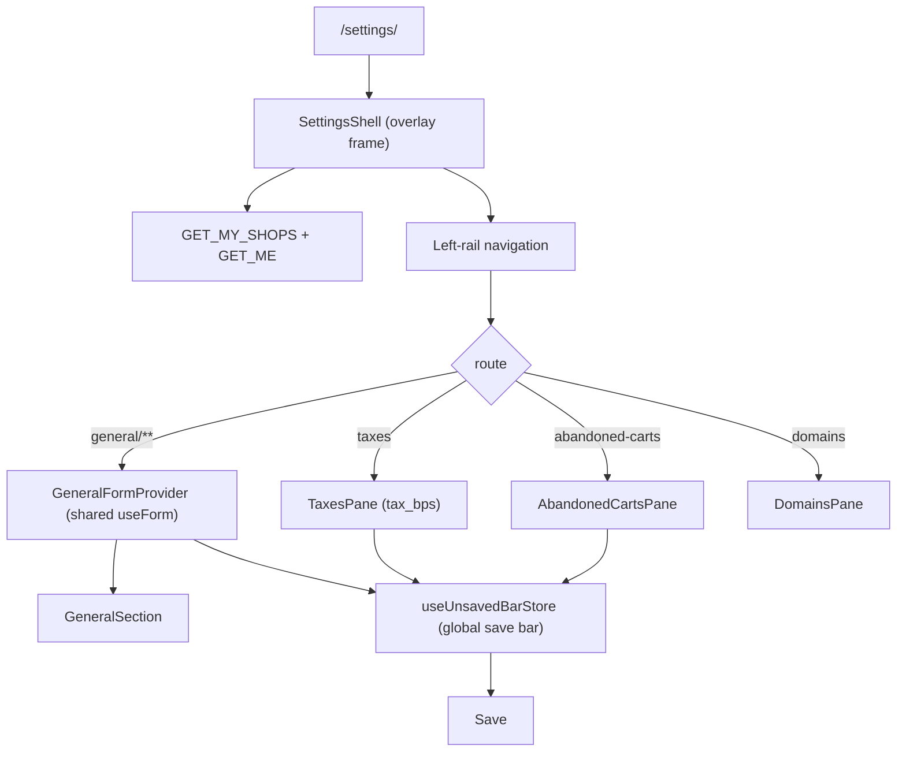

# Settings

**Last updated:** 2026-10-08 - **Feature:** `src/features/settings/`

## Overview

Settings is a full-screen overlay mounted above the dashboard for store configuration. It renders a sticky left-rail navigation with 23 sections: eleven functional (**General**, **Plan**, **Payments**, **Abandoned cart reminders**, **Shipping and delivery**, **Taxes and duties**, **Notifications**, **WhatsApp**, **Telegram**, **Domains**, **Policies**) and 12 placeholder screens. Every section is mapped to its own URL under `/settings/<section>`.

General contains two sub-panes (**Store contact details**, **Brand**) and an **Edit store address** dialog (for a Saudi shop: region, city and district pickers over the bundled MOMRAH tables in `shared/geo`, each storing the English name — see `src/shared/geo/README.md`), all sharing a single form provider so changes survive sub-route navigation and commit via a single Save. The foot of General also holds the **Delete store** danger zone — a confirm dialog that soft-deletes the current shop and returns the vendor to `/shops`.

## Screens / routes

All routes live under `src/app/store/[shopSlug]/settings/`:

| Route | File | Renders |
|---|---|---|
| `/settings` | `page.tsx` | Redirects to `general`; translates legacy `?section=` query |
| `/settings/general` | `general/page.tsx` | `GeneralSection` |
| `/settings/general/contact` | `general/contact/page.tsx` | `StoreContactPane` |
| `/settings/general/brand` | `general/brand/page.tsx` | `BrandPane` |
| `/settings/plan` | `plan/page.tsx` | `PlanPane` (forwards to `/plan/[shopSlug]` if `?billing=` present) |
| `/settings/shipping` | `shipping/page.tsx` | `ShippingPane` (see [shipping](shipping.md)) |
| `/settings/taxes` | `taxes/page.tsx` | `TaxesPane` — shop-wide `tax_bps` fallback |
| `/settings/abandoned-carts` | `abandoned-carts/page.tsx` | `AbandonedCartsPane` — automatic recovery emails |
| `/settings/notifications` | `notifications/page.tsx` | `NotificationsSettings` |
| `/settings/shein` | `shein/page.tsx` | `SheinPane` — business model, and either a fixed amount per item or a percentage. An ILS shop with no saved row starts at 5 ILS per item |
| `/settings/domains` | `domains/page.tsx` | `DomainsPane` |
| `/settings/domains/[domainId]` | `domains/[domainId]/page.tsx` | `DomainDetailPane` — one custom domain's setup screen |
| `/settings/<other>` | `[section]/page.tsx` | `SectionPlaceholderPane` |

## Diagram

## Components

- **`SettingsShell`:** Overlay frame with searchable left rail nav, header title, and Escape-to-close.
- **`GeneralFormProvider`:** Wraps `general/**` in a shared `useForm`, contextual save bar, and `useLeaveGuard`.
- **`TaxesPane`:** Shop-wide sales-tax fallback; saves `updateShop({ tax_bps })`. Value-based dirty + contextual save bar.
- **`AbandonedCartsPane`:** Enable switch + the editable reminder steps (`AbandonedCartsCadenceEditor`; T+1h / T+24h / T+72h by default) for the existing `abandoned_checkout` setting. Stages locally; Save is the contextual bar (`upsertSetting`). Not a clone of the marketing list — a link opens `/marketing/carts`. A missing row is the default cadence, switched on.
- **`DomainsPane` / `DomainDetailPane` / `PlatformDomainPane`:** Custom and platform domain setup.
- **`SectionPlaceholder`:** Informational placeholder for roadmap settings sections.

## State & forms

- `react-hook-form` in `GeneralFormProvider` across General sub-routes.
- `TaxesPane` stages a local percent string; dirty compares clamped bps to `shop.tax_bps`.
- `AbandonedCartsPane` stages the enable flag; dirty compares it to the parsed setting. Steps are displayed, not edited.
- Unsaved changes use `useUnsavedBarStore` and `useLeaveGuard`.
- Active section is derived from `usePathname()`.

## GraphQL operations

| Operation | Type | Purpose |
|---|---|---|
| `MyShops` (`GET_MY_SHOPS`) | Query | Shops for current user including `tax_bps` and settings. |
| `UpdateShop` (`UPDATE_SHOP`) | Mutation | Persists partial shop configuration, including `tax_bps`. |
| `DeleteShop` (`DELETE_SHOP`) | Mutation | Soft-deletes the current shop. |
| `AbandonedCheckoutSetting` / `UpsertAbandonedCheckoutSetting` | Query / Mutation | Shop `abandoned_checkout` cadence. Owned by the abandoned-carts feature; this pane is the merchant editor. |
| Domain ops | Query / Mutation | List, configure, verify, promote, remove shop domains. |

## Notes

- **Taxes (P05-T09):** API field is basis points; the pane shows percent. Orders snapshot tax cents at create — changing `tax_bps` does not rewrite past invoices.
- Shell queries (`MyShops`, `GetMe`) use `useSuspenseQuery`; Domains detail is client-fetched with live DNS.
- The Policies pane reads `settings.policies.*` (en + ar). Its suggested templates live in `settings.policies.templates.*` with the store's name as `{shop}` (`templates.defaultShopName` until the shop has loaded), so an applied template is written in the dashboard's language.
