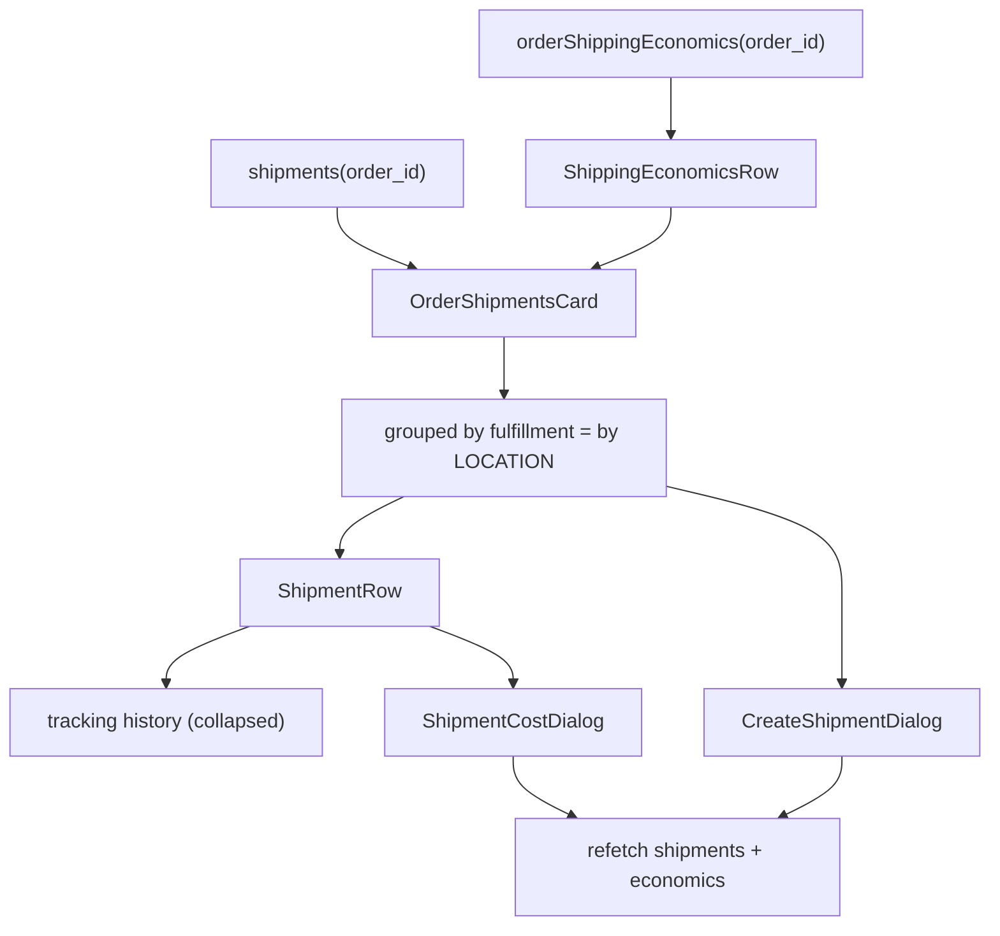

# shipments

**Last updated:** 2026-09-28 - **Feature:** `apps/vendor/src/features/shipments/`

## Overview

The physical half of an order: what actually left the building, where it is, and
what it cost.

It exists because the back-end had been writing shipments, packages, tracking
history and carrier cost for a while and **nothing in the product showed any of
it**. A fulfillment could be created and then no screen would let a vendor book
the carrier for it, read the tracking a webhook had recorded, or say what the
delivery cost them.

Three things are kept apart here, and that separation is the feature:

- **Fulfillment** — the decision of which lines leave which location.
- **Shipment** — the parcel that carries them out, booked through a provider.
- **Cost** — what the carrier billed, which is not what the customer paid.

## Screens / routes

| Route | Screen |
|-------|--------|
| `/store/[shopSlug]/orders/[id]` | `OrderShipmentsCard`, directly under the fulfillment card. Not its own route — a shipment has no meaning apart from the order it belongs to. |

## Diagram

## Components

- **`OrderShipmentsCard`** — groups shipments by the fulfillment each executes.
  Grouped rather than listed flat because that grouping **is** the
  multi-location story: a split order carries one fulfillment per warehouse, and
  a vendor packing it needs "these three from Ramallah, those two from the main
  warehouse" rather than five undifferentiated rows. A fulfillment with no
  shipment shows as an empty group with its own create action — that is the case
  the screen exists for.
- **`ShipmentRow`** — provider, status, tracking link, label, boxes, cost, and
  the actions. History is collapsed: it is append-only and a carrier re-sends
  everything on each poll, so it is the longest thing here and the least often
  needed — but it is the only thing that answers "why did this sit for three
  days". Like the whole card it reads `shipments.*` (en + ar); a status with
  no `shipments.status.*` message, on the row or in the history, shows the raw
  value rather than the key path.
- **`ShippingEconomicsRow`** — charged / cost / gap, as three separate figures.
- **`CreateShipmentDialog`** — books a shipment; packages optional.
- **`ShipmentCostDialog`** — records what the carrier billed.

## State & forms

Local `useState` per dialog, seeded with **adjust-state-during-render** keyed on
the row it belongs to, so an input never shows the previous shipment's figure
for a frame.

**No contextual save bar**, same reasoning as the shipping settings pane: these
are entity actions behind an explicit dialog button, and nothing persists until
it is pressed.

Mutations `refetchQueries` both reads rather than patching the cache — a
shipment write changes the order's economics too, and the two must not drift.

## GraphQL operations

| Operation | Type | Notes |
|-----------|------|-------|
| `shipments(order_id, limit)` | Query | Includes packages and tracking events. |
| `orderShippingEconomics(order_id)` | Query | Staff-only; a customer is refused. |
| `createShipment` | Mutation | `packages` optional — omitting books one unmeasured box. |
| `cancelShipment` | Mutation | Tells the carrier first, then marks the row. |
| `refreshShipmentTracking` | Mutation | Appends; never replaces. |
| `setShipmentActualCost` | Mutation | Records the figure as `manual`. |
| `updateShipmentStatus` | Mutation | Also appends a `manual` history entry. |

## Validation

Cost must be a non-negative number. **An empty field cannot be saved**, and that
is deliberate: empty means the invoice has not arrived, zero means it genuinely
cost nothing, and conflating them is how a margin report comes to show a shop
subsidising the entire delivery fee on every order it has no invoice for.

Package dimensions are rounded to whole units (grams, millimetres) and a box
left entirely blank is dropped rather than sent as an empty row.

## Main files

- `components/order-shipments-card.tsx` — the card, and the grouping.
- `components/shipment-row.tsx` — one shipment and its actions.
- `components/shipping-economics-row.tsx` — the three figures.
- `components/create-shipment-dialog.tsx`, `components/shipment-cost-dialog.tsx`.
- `types.ts` — shapes plus `canCancel`, `canRefreshTracking`,
  `totalWeightGrams`, all tested.
- `api.ts` — two reads and five mutations.

## Notes

**The client mirrors server refusals rather than discovering them.**
`canCancel` hides the action on a delivered shipment, and `canRefreshTracking`
hides it for merchant-managed delivery. Both are UX only — the server refuses
either way — but a control that fails on click tells the merchant they did
something wrong when the product knew all along.

**`manual` is labelled "delivered by the shop", not "no carrier".** It is a real
business mode the merchant chose, and it can never result from a failed carrier
call because that path throws. See
`back-end/docs/features/shipping-providers.md`.

**Carrier cost never reaches the customer.** The server omits it from
`ShipmentEntry` for a customer and refuses `orderShippingEconomics` outright, so
there is no field here to leak. `ShippingEconomicsRow` renders nothing on error
for the same reason — that strip is not for them.

**`totalWeightGrams` ignores unweighed boxes rather than counting them as zero**,
so a partial weight is not reported as a precise one.
