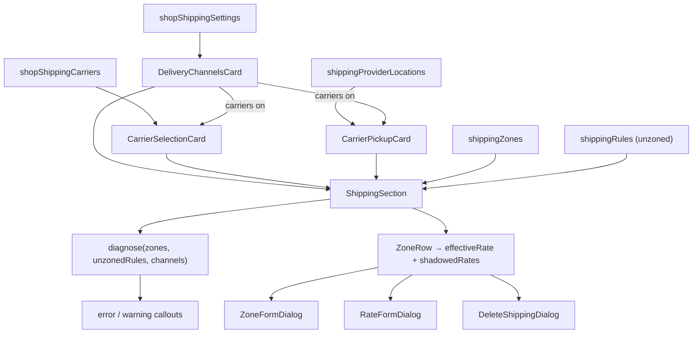

# shipping

**Last updated:** 2026-10-09 - **Feature:** `apps/vendor/src/features/shipping/`

## Overview

Settings → Shipping and delivery manages two core decisions:
- **Who delivers:** `Shop.shipping_mode` (merchant-managed vs. carrier on OTO account).
- **What the customer pays:** Shipping **zones** (destination groups) and **rates** charged to reach them.

Connecting a carrier does not modify customer delivery rates; the zones card remains active in both modes. The screen makes `selectShippingRule` matching rules transparent via live diagnostic callouts.

## Screens / routes

| Route | Screen |
|-------|--------|
| `/store/[shopSlug]/settings/shipping` | `ShippingSection` — carrier settings (`ShippingProvidersSection`) above zones and rates. |

## Diagram

## Components

- **`ShippingProvidersSection`:** Hosts carrier configuration. Renders dependent cards (`CarrierSelectionCard`, `CarrierPickupCard`) only when carrier account is usable (`carrier_available`: enabled AND verified).
- **`DeliveryChannelsCard`:** Independent toggles for shop delivery and live carrier rates, plus assumed item weight (visible when carriers are on). Staged via global save bar.
- **`CarrierSelectionCard`:** Carrier list with toggles. Defaults to all carriers enabled (`using_platform_defaults`).
- **`CarrierPickupCard`:** Registers warehouse pickup locations (`enableCarrierPickup`). Surfaces warehouses missing a city, as carriers require origin city to price.
- **`CarrierAccountCard`:** Carrier credential form generated from provider catalog. Tracks `touched` fields to prevent posting masked secrets back to the API. Enable toggle requires successful verification.
- **`ShippingSection`:** Main pane assembling diagnostics, quick-start, zones, and unzoned rates. Preloaded server-side via `PreloadQuery`.
- **`ZoneRow`:** Renders a single zone, its destination badges, active effective rate, and dimmed shadowed rates.
- **`ZoneFormDialog`:** Zone creation and editing. Disallows creating a duplicate catch-all zone.
- **`RateFormDialog`:** Rate editor (fixed, tiered, or free) with optional delivery promise range ("3–5 days") frozen at purchase.
- **`DeleteShippingDialog`:** Deletion modal for zones and rates. Refuses deleting the last rate of a zone (prompts deleting the zone instead).
- **`NationalAddressField`:** Resolves Saudi National Address codes to validated address structures for pickup locations.

## State & forms

- Dialog state is managed locally via `useState` and seeded during render via `{ open, entity }` tracking.
- Carrier toggles and assumed weight integrate with the global contextual save bar (`useUnsavedBarStore`).
- Zone and rate CRUD operations execute immediately via modal actions and trigger Apollo `refetchQueries`.

## GraphQL operations

| Operation | Type | Notes |
|-----------|------|-------|
| `shippingZones` | Query | Retrieves all zones with nested rates. |
| `shippingRules(page, limit)` | Query | Reads unzoned fallback rates (`zone_id: null`). |
| `createShippingZone` / `updateShippingZone` / `deleteShippingZone` | Mutation | Zone mutations; requires `MANAGE_OWN_SHOP` or `MANAGE_ALL_SHOPS`. |
| `createShippingRule` / `updateShippingRule` / `deleteShippingRule` | Mutation | Rate mutations under the same permissions. |
| `shopShippingSettings` | Query | Fetches shipping mode, `provider_ready`, and `carrier_available`. |
| `updateShopShippingMode` | Mutation | Toggles shipping mode (requires verified provider account). |
| `shopShippingCarriers` / `setShopShippingCarriers` / `resetShopShippingCarriers` | Query / Mutations | Manages enabled carrier subset. |
| `updateDeliveryChannels` | Mutation | Updates delivery channel switches and assumed item weight. |
| `shippingProviderAccounts` / `upsertShippingProviderAccount` / `verifyShippingProviderAccount` | Query / Mutations | Carrier account credentials and verification. |
| `shippingProviderLocations` / `enableCarrierPickup` | Query / Mutation | Warehouse pickup registration and branch mapping. |

## Key business rules

- **Zones win over unzoned rates:** The moment any zone exists, unzoned rates are ignored and rendered dimmed.
- **Missing catch-all is fatal outside a city market:** A zone set without a catch-all (a zone with no countries specified) fails checkout for unlisted destinations. A Palestine shop matches by city (`shipping_match: CITY`) and only delivers inside the country, so that error is not shown.
- **Newest rate applies:** Only the most recently created rate on a zone is charged (`rules[0]`); additional rates are shadowed.
- **Rate-less zones block checkout:** A zone without at least one rate triggers `destination_excluded` at checkout.
- Zone country chips reuse the coupons picker. Names come from `countryLabel` (coupons' `_data/countries.ts`) over the shared `regionName` (`src/shared/lib/country-name.ts`, `Intl.DisplayNames`), then the bundled geo table, then the code; ISO codes are stored unchanged. PS reads "Palestine" / «فلسطين».
- The pane reads `settings.shipping.*` (en + ar); the carrier pickup and delivery channel cards read `settings.shipping.pickup` / `settings.shipping.channels`. Lists (diagnostic zone names, a zone's countries and states, warehouses missing a city) are joined by `formatList(items, locale)` (`lib/zones.ts`, `Intl.ListFormat`) rather than a hard-coded Arabic comma.
