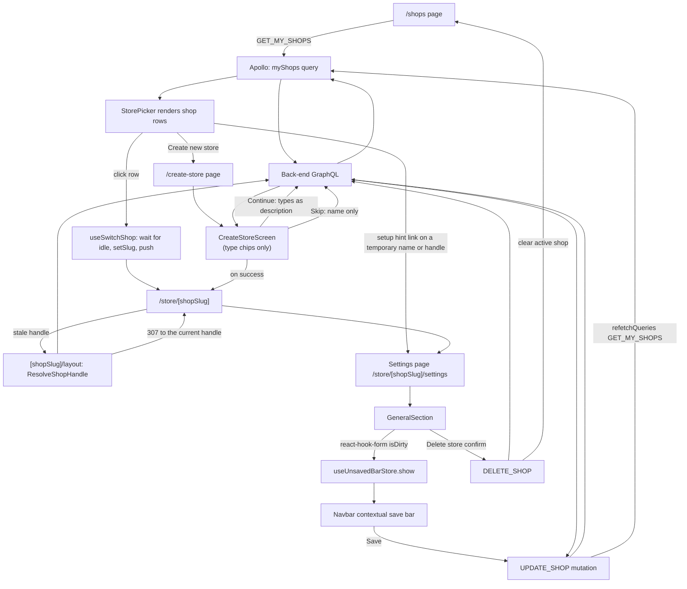

# Shops

**Last updated:** 2026-09-24 - **Feature:** `src/features/shops/`

## Overview

Shops lets a vendor select which store to manage, create a new store, and edit that store's basic settings (name, contact info, address). After login (password, OTP, or Google / Apple), `ensureVendorShop` opens an existing shop or — when `myShops` is empty — mints the same temporary name/handle `/create-store` uses and sends the vendor straight to `/store/{slug}`. It also returns every handle the account holds, which is how sign-in refuses a `?redirect=` into another account's shop (see [auth](auth.md)). The picker remains for vendors who already own more than one shop.

The picker is a single card on `ShaderBackground` (`@repo/ui`), the same mesh-drift ground `AuthShell` puts behind every login screen, under a fixed dark scrim: a greeting addressed to the signed-in user, an account menu at the top end (who is signed in, change password, language, log out), then one scrollable list of stores with a status filter and a search box above it and the create-store row pinned below it. It is a list rather than a grid of cards because a vendor with several stores is scanning names, and stores are frequently named alike -- so each row carries its storefront URL (`{host}/{slug}`) under the name, which is the only line that is guaranteed to differ. A store still carrying the name or handle creation gave it gets one link on its row to the settings pane that changes it. From `Settings > General` inside any dashboard the vendor can edit the shop profile and save via the global contextual save bar, and soft-delete the current shop from the danger zone at the foot of that pane.

Registering via the signup wizard still creates the shop in `completeVendorSignup`. Social / password / OTP sign-in that finds zero shops calls `createShop` (which promotes `customer` → `vendor`) through `ensureVendorShop`, then refreshes the access token so dashboard permissions land.

`/create-store` **collects nothing that blocks creation**. It asks one question -- what the vendor wants to do -- and both of its buttons create the shop there and then: Continue sends the selected type chips as the description, Skip sends none. The shop is still created under a temporary name (`createStore.temporaryName`, localized) for the API, but the screen only shows neutral copy (`createStore.temporaryNote`) -- it does not advertise the placeholder. Name, description, address and contact are edited from `Settings > General` once the vendor is inside.

Both screens stand in `StoreFrame` -- brand at the top start, one slot at the top end, the question centred on the shader ground, a white card under it -- so picking a store and creating one are the same picture.

## Screens / routes

| Route | Purpose |
|---|---|
| `src/app/page.tsx`, `src/app/store/page.tsx` | `/` hands off to `/store`, which opens the shop this browser used last if the signed-in account still holds it, else the account's first, else `/shops`. `/` never reads `active_shop_slug` itself: the cookie outlives the session that wrote it, and after an account switch it named the previous account's shop |
| `src/app/shops/page.tsx` | Shop picker — renders `StorePicker`, which lists all shops for the authenticated user |
| `src/app/create-store/page.tsx` | Create a shop: one question, two buttons, both of which create it |
| `src/app/store/[shopSlug]/layout.tsx` | Server layout over every dashboard screen. Renders nothing of its own; it redirects a retired handle to the shop's current one |
| `src/app/store/[shopSlug]/settings/page.tsx` | Shop settings (delegates to `SettingsPage` from `src/features/settings/`) |

## How it works

## Components

| File | What it shows |
|---|---|
| `src/features/shops/components/store-frame.tsx` (`StoreFrame`) | The frame both store screens stand in: `ShaderBackground` ground under a fixed scrim, brand at the top start, an `action` slot at the top end, title and subtitle centred, a white card, and an optional `aside` hung off the card's outer edge |
| `src/features/shops/components/store-type-picker.tsx` (`StoreTypePicker`) | The type chips `/create-store` and signup's last pane share |
| `src/features/shops/components/create-store-screen.tsx` (`CreateStoreScreen`) | Continue, Skip, Back, a neutral setup note (no placeholder name), and `StoreTypePicker` |
| `src/features/shops/components/store-picker.tsx` (`StorePicker`) | Greeting header (name from `GET_ME`) with the account menu at the top end (name and email, Change password, a language radio group, Log out), then a white card holding the filter dropdown (All / Active / Inactive), a search box matching name and slug with a `/` badge, the scrolling store list (logo or initials, name, storefront URL, a status pill on anything not active, and on a store still on its temporary name or handle a link to the pane that changes it), and the "Create new store" row |
| `src/app/shops/page.tsx` (`ShopsPage`) | Renders `StorePicker` and nothing else |
| `src/app/create-store/page.tsx` (`CreateStorePage`) | Renders `CreateStoreScreen` and nothing else |
| `src/features/settings/components/general-section.tsx` (`GeneralSection`) | Accordion rows for business details, contact info, and address; read-only sections for store defaults, order ID format, order processing, store assets, resources, and transfer store; danger-zone soft-delete for the current shop |
| `src/features/settings/components/delete-shop-dialog.tsx` (`DeleteShopDialog`) | Confirm dialog naming the shop, explaining soft delete / platform restore, then `DELETE_SHOP` + clear active shop + `/shops` |

## State & forms

**Zustand stores:**

- `useActiveShopStore` (`src/shared/stores/active-shop.ts`) — holds the active shop `slug`. `setSlug` writes to in-memory state, `localStorage`, and a non-httpOnly cookie (`active_shop_slug`) so server-side Apollo can read it. `hydrate()` is called from `ApolloWrapper` after mount.
- `useUnsavedBarStore` (`src/shared/stores/unsaved-bar`) — drives the navbar contextual save bar in `GeneralSection`.

**react-hook-form:**

- `CreateStoreScreen` holds the selected chips in one `useState` and no form library: there is no free text on the screen and nothing to validate. Both buttons call the same `create(selected)` (no save bar needed for creation).
- `GeneralSection` uses `useForm` with server data as `defaultValues`. `isDirty` triggers `useUnsavedBarStore.show()`; `reset()` is Discard; `handleSubmit` feeds `onSave`. Only fields that changed from the server snapshot are sent in the mutation payload. After a successful save, `apollo.refetchQueries` re-syncs server state and `reset()` collapses the bar.

**Contextual save bar pattern:** `GeneralSection` follows the mandatory pattern from `AGENTS.md` — registers the bar while dirty, tears it down on unmount, and computes dirty by comparing staged values against the server snapshot (value-based, not key-presence).

## GraphQL operations

| Operation | Type | Purpose |
|---|---|---|
| `MyShops` | Query | Fetch all shops owned by the current user, including logo, settings, balance, owner, and counts |
| `ResolveShopHandle` | Query | `shop(slug)` reduced to `id` and `slug`. Asks what shop a handle names today, so `[shopSlug]/layout.tsx` can redirect a retired one |
| `CreateShop` | Mutation | Create a new shop; returns the new shop's id, name, slug, and settings |
| `UpdateShop` | Mutation | Update an existing shop by slug; accepts `UpdateShopInput` with partial name and/or settings |
| `DeleteShop` | Mutation | Soft-delete the shop by slug (`deleted_at` + `is_active: false`). Owner-scoped; no vendor hard-delete |

## Validation

No Zod schema. `/create-store` has no free-text input left to validate -- its only control is a fixed set of chips -- and the update flow validates server-side. `CreateShopInput` still requires a non-empty `name`, which is what the temporary name satisfies.

## Main files

- `src/features/shops/api/queries.ts` — `GET_MY_SHOPS` GraphQL query
- `src/features/shops/api/mutations.ts` — `CREATE_SHOP`, `UPDATE_SHOP`, and `DELETE_SHOP` GraphQL mutations
- `src/features/shops/types.ts` — `Shop`, `CreateShopResponse`, `MyShopsResponse` TypeScript types
- `src/features/shops/components/store-frame.tsx` — the shared frame for `/shops` and `/create-store`
- `src/features/shops/components/store-picker.tsx` — the picker: account menu, filter, search, keyboard model, rows and hints
- `src/features/shops/components/create-store-screen.tsx` — the create flow
- `src/features/shops/lib/temporary-store.ts` — `mintTemporaryHandle`, and recognises a store still on its temporary name or generated handle
- `src/features/shops/lib/store-types.ts` — the stored type-chip values shared with signup
- `src/features/shops/lib/canonical-path.ts` — `canonicalStorePath` and `resolveCanonicalSlug`, the two pure decisions behind the stale-handle redirect
- `src/shared/hooks/use-switch-shop.ts` — the one way to move the dashboard to another shop

## Notes

- After `CreateShop` succeeds, the page calls `refreshAccessToken()` so the new vendor role is reflected in the JWT before redirecting to the dashboard. This is load-bearing, not cosmetic: permissions are signed into the access token at login, so the token that created the shop still says `customer` with an empty permissions array, and every shop-scoped mutation on the dashboard would fail on it. The refresh is wrapped in a `try/catch` — an existing vendor creating a second shop needs no new claims.
- The `active_shop_slug` cookie is written by the middleware on every `/store/[shopSlug]` navigation and is used by server-side Apollo to set the `X-SHOP` header for shop-scoped queries. Static siblings are excluded by name (`STATIC_SHOP_SEGMENTS` in `src/shared/lib/shop-path.ts`, read through `shopSlugOfPath` by both the proxy and sign-in): `/store/change-password` sits where a slug sits and used to write `active_shop_slug=change-password`, which server-side Apollo then sent as `X-SHOP`.
- **Switching shops goes through `useSwitchShop` (`src/shared/hooks/use-switch-shop.ts`) and nowhere else.** It is not a navigation with a store write beside it: writing `useActiveShopStore` is what `ShopCacheBoundary` watches, and it answers with `client.clearStore()`, which rejects everything still in the link chain with Apollo's "Store reset while query was in flight". That rejection is minted by the QueryManager rather than sent through the link chain, so the error link never sees it — it lands on the reader, and for a `useSuspenseQuery` that means thrown at render, i.e. an error page. So the hook waits for the chain to go idle first (`createInflightTracker`, a counting link at the head of the chain in `apollo/client.tsx`, capped at `SHOP_SWITCH_SETTLE_MS`), then writes the store, then navigates. The order is fixed both ways: the Apollo shop link reads the store first, so pushing before the write sends the new page's first fetch out under the old `X-SHOP`. The three call sites are the header menu, the picker row, and the handle rename in `Settings > Domains`.
- **`ShopSwitchBoundary` (`src/shared/components/shop-switch-boundary.tsx`) catches what ordering cannot.** A request that outlives the settle cap, and browser Back/Forward between two shops' URLs (where `AppSidebar` mirrors the URL into the store in an effect that runs after the new page has already fetched), both end with the cache clear cancelling a fetch a suspense reader holds. Thrown from `DashboardShell` that has nowhere to go — `store/error.tsx` is below the layout and this app has no `app/error.tsx`, so it reaches the unstyled `global-error.tsx`. The boundary wraps `DashboardShell` in `src/app/store/layout.tsx`, keeps only store-reset errors, paints the shell skeleton, re-renders once, and resets on the next path. Everything else it rethrows, so a genuine failure still reaches Sentry. `store/error.tsx` does the same for page-level suspense queries: a store-reset error retries once and shows a spinner instead of "Something went wrong".
- **A retired handle is redirected to the current one by `src/app/store/[shopSlug]/layout.tsx`.** `/store/<old>/products` never broke — `ShopHeaderGuard` matches `X-SHOP` against `shop_slug_history` and `shop(slug)` resolves it — but the dashboard did not know it was on a stale address, and three things read the slug off the URL and disagreed: the header's switcher found no active shop, `useSettingsShop` fell back to `shops[0]`, and `useShopCurrency` priced the screen in the platform default. The layout compares the URL slug against `myShops`, asks `ResolveShopHandle` only when it is not one of them, and redirects (307, because a handle can change again) to `canonicalStorePath`, which keeps the rest of the path so `/store/old/products/mug` lands on `/store/new/products/mug`. The full path reaches the layout through the `x-vendor-pathname` header the middleware sets. `resolveCanonicalSlug` returns null for every uncertain case, including the loop guard: a canonical slug that is not itself one of the vendor's current slugs would bounce forever.
- The picker treats a store as **active** only when `is_approved && is_active` -- the two flags gate different things and either one being off means nobody can shop there. Anything else carries a pill saying which: amber "Pending approval" when the platform has not approved it, grey "Suspended" when it is approved but switched off. The filter defaults to **All** rather than Active: a vendor whose only store is still awaiting approval would otherwise land on an empty list.
- The store types are stored in English whatever the interface language is -- they are sent to the server as the new shop's description -- so `STORE_TYPES` holds the stored values and a separate map holds their label keys.
- The temporary name is localized because the vendor may still see it on the **picker** until they rename it — creation itself never shows it. The **handle is not derived from it** -- every skipped store would share one -- so the screen mints a UUID handle instead (`mintTemporaryHandle()`, 48 bits of `crypto.randomUUID()`), which is also what the reference does. Name and handle are changed separately afterwards, from `Settings > General` and `Settings > Domains`.
- The account chip at the top end is a menu (`shops.accountMenu`): name and email, Change password (`/store/change-password`), a language radio group over `SUPPORTED_LOCALES` through `useChangeLocale`, and Log out through `useLogout` with the same toast the dashboard header shows. "Switch account" is log out then sign in, so one item covers it. The menu portals out of the card, so its colours are spelled out (`bg-white text-zinc-900`) rather than read from the theme tokens: the picker paints its own ground and is the same picture in light and dark.
- `/` (or Cmd/Ctrl+K) from anywhere on the page focuses the search box. The listener is on `window` and yields whenever the key is already claimed -- an editable target, or an open menu or dialog (Base UI portals those, so the check is by role, not ancestry). ArrowDown from the box enters the list; the arrows walk the row buttons (`button[data-shop]`, so a hint link beside a row is skipped), Home/End jump, ArrowDown wraps from the last row, and ArrowUp on the first row returns to the box rather than wrapping. Escape clears the search first and blurs second. The `/` badge on the box is `aria-hidden` and goes once there is text.
- `lib/temporary-store.ts` recognises the two states creation leaves a store in by shape, because the server marks neither: `isTemporaryName` matches every locale's `createStore.temporaryName` (a store created under Arabic UI and viewed under English is still called by the Arabic placeholder; a test pins both message files into the list so a rename cannot drift), and `isTemporaryHandle` matches the twelve-hex handle `mintTemporaryHandle()` mints, with the server's `-1` collision suffix. One hint per row, name first, linking to `Settings > General` or `Settings > Domains`. It is a sibling of the row button, not a child -- a link inside a button is invalid HTML -- and calls `setSlug` on click so the dashboard opens scoped to that store.
- Several sections in `GeneralSection` (store defaults, order ID format, order processing, store assets, resources, transfer store) are display-only and not yet wired to mutations.
- **Soft-delete from Settings > General.** The danger zone at the foot of the pane opens `DeleteShopDialog`, which calls `deleteShop(slug)` for the current shop only. Ownership is enforced on the back-end (`manage_own_shop` + owner). After success the dialog clears `useActiveShopStore`, refetches `myShops`, and `router.replace("/shops")` so nothing keeps an `X-SHOP` for a store the vendor can no longer open. Open orders refuse the delete (`SHOP_HAS_ACTIVE_ORDERS`). Restore is admin-only via `restoreShops` on `/shops` in the admin console (status filter **Deleted**). There is no vendor hard-delete.
