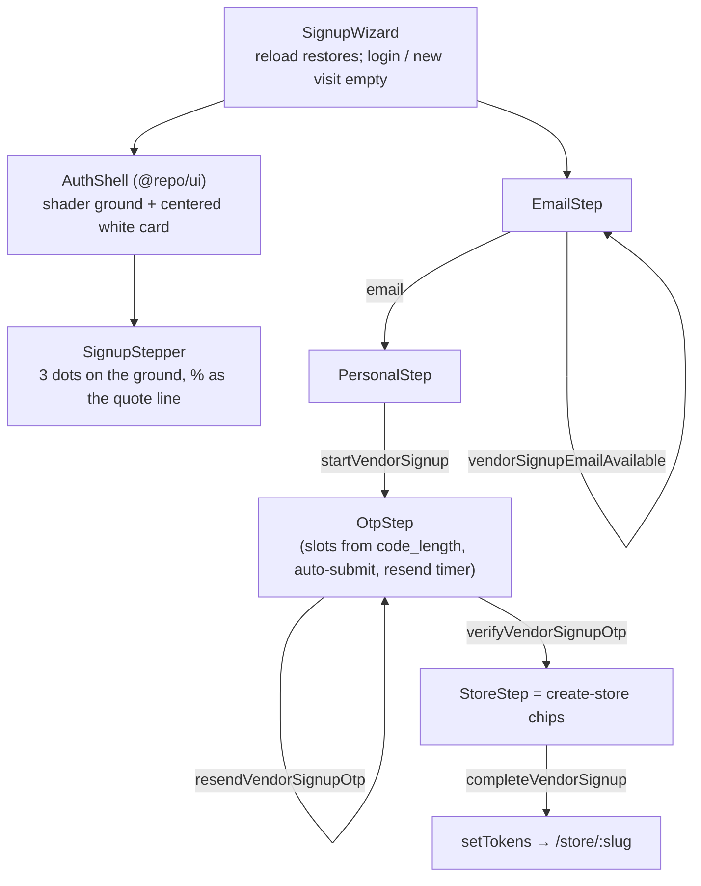

# Vendor signup

**Last updated:** 2026-10-08 — **Feature:** `src/features/signup/`

## Overview

`/register` — the wizard a shop owner walks to get an account, a store and a dashboard. Four panes: email, personal info, a one-time code, then the same store-type question as `/create-store`.

**The login frame, plus progress.** Since 2026-08-11 the first three panes wear `AuthShell` from `@repo/ui` — the same white-card-on-dark-shader-ground composition as `/login` — with the signup-specific parts arriving through slots: the step row (`SignupStepper`) on the ground between the headline block and the card, the completion figure as the shell's quote line, and a wider card (`wide`). The last pane leaves that frame and renders `StoreFrame` instead, identical to `/create-store`. Verifying the code is *not* a milestone — you are not further along for having received a message — so it shares the "Your info" dot, which is what keeps the step row steady while the OTP pane swaps in.

It sits outside the `(auth)` route group on purpose: the wizard passes its own shell slots (step row, percent, back-to-login) instead of taking the layout's. `/register` was already public in `proxy.ts`, so the guard needed no change.

**No password is ever asked for**, matching the design. `completeVendorSignup` creates the account without one; the vendor signs in afterwards from `/verify-otp`, or sets a password through forgot-password. The email pane's second button therefore offers "sign in with a code" rather than a social provider this app does not have.

**Nothing exists until the last pane submits.** Every step before it hands back a signed draft token from the server. A **reload** of `/register` still restores the pane from `sessionStorage`, so leaving the tab to read an SMS does not throw the vendor back to step one. A new visit — Login → Create, closing the browser, Chrome restoring the tab — starts at the email pane with empty fields. `/login` and `/verify-otp` also **discard** that key on arrival. On success the returned tokens already carry the `vendor` role, so the page lands straight on `/store/{slug}`.

## Screens / routes

| Route | Purpose |
|---|---|
| `/register` | The whole wizard. Which pane is open is component state, not a URL — a half-filled signup is not a place you should be able to link someone to. |

Reached from `/login`, and from the rail's "Back to login" in the other direction.

`/verify-otp` wears the identical frame with the identical layout slots — see [auth](auth.md). It is one click from the email pane's "sign in with a code", and every entry screen is now one design language, so the hand-off is seamless.

## How it works

## Components

| Component | Role |
|---|---|
| `SignupWizard` | Owns the pane, the collected values and the draft token. Persists them to `sessionStorage` so a **reload** of `/register` keeps the place; a new visit and `/login` / `/verify-otp` discard that key so Create is a new wizard. |
| `AuthShell` (`@repo/ui`) | The shared entry frame: dark `ShaderBackground` ground, brand/eyebrow/headline above the centered white card, chips below. `wide` widens the card for these panes. |
| `SignupStepper` | The three milestones as dots joined by a rule, on the ground above the card. Titles only. Every dot is the same size in a fixed-height row — "you are here" is the fill, never the diameter — so the rule stays straight and the three titles share one baseline whichever step is open. The rule between two steps lights only once the later of the two is reached, so the first pane shows none lit against its 0%. |
| `EmailStep` / `PersonalStep` / `OtpStep` | The first three panes, each its own form, opening with `AuthHeading` and built from `Field`/`AuthInput`/`AuthSubmit`. `OtpStep` submits as soon as every slot is filled; Verify stays as a fallback. `EmailStep` stacks its controls in a `FieldGroup`, as both login screens do. |
| `StoreStep` | Last pane. After country, it asks how the shop will use Zaydak and sends `business_model`. Description chips stay `category`. A shopping-agent shop skips the chips. Temporary name and UUID handle are sent without being shown. |
| `PhoneField` | Country picker joined to the national number, skinned like `AuthInput`. Holds the ISO code, not the dial code — `+1` is shared, so the dial code alone cannot pick the flag. |

## State & forms

No Zustand store of its own beyond `useAuthStore.setTokens` on success. Each pane is an independent `react-hook-form` + `zodResolver`; the wizard holds what has been answered and lifts each pane's result on submit.

The save-bar rules in `AGENTS.md` do not apply — this is a creation wizard, not an editing screen, and each pane's button *is* the explicit save.

`sessionStorage` (`vendor-signup-progress`), not `localStorage`: a **reload** of `/register` restores the pane (`shouldRestoreSignupProgress` keys off Navigation Timing `type === "reload"`), which is what lets an SMS detour keep the OTP screen. Closing the tab, opening `/register` again, or Chrome restoring the session is a `navigate` and starts empty. `/login` and `/verify-otp` call `clearSignupProgress` on mount (and on `pageshow`, for the back-forward cache) and the Create link clears it again on click, so Login → Create never resumes a half-filled wizard. A stored entry naming a pane past the OTP without a draft token falls back to the first pane rather than rendering an empty card.

## GraphQL operations

| Operation | Where | Purpose |
|---|---|---|
| `vendorSignupEmailAvailable` | `EmailStep` | Catches a taken address before the vendor names a store. `network-only` — the answer goes stale the moment someone else signs up. |
| `startVendorSignup` | `PersonalStep` | Sends the code and returns the draft. |
| `resendVendorSignupOtp` | `OtpStep` | Rotates the draft; the wizard keeps the newest token. |
| `verifyVendorSignupOtp` | `OtpStep` | Marks the draft verified. |
| `completeVendorSignup` | `StoreStep` | Creates the user, the shop and the session. `store_name` is the localized temporary name; `store_slug` is a UUID handle; optional identity fields are omitted. |

## Validation

`validations/signup.ts` — one schema factory per pane that still asks a question, `signupEmailSchema(t)` and `signupPersonalSchema(t)`, each built from a `signup.validation` translator so its messages follow the dashboard language. `signupPersonalSchema(t)` holds `country_code` (ISO alpha-2) plus a national number; `toInternationalPhone` joins them and strips the local leading zero, so `055…` is sent as `+96655…`. The last pane has no Zod schema: like `/create-store` it is type chips only, and `store_name` is filled with `createStore.temporaryName`.

The OTP pane renders one slot per digit of `draft.code_length`, and its schema is built per draft by `signupOtpSchemaFor(length, t)` (the six-digit `signupOtpSchema` constant is gone). Neither is a constant: the code length is a platform setting an admin changes from the console, and a form asking for six digits when four were sent can never be completed.

## Main files

- `components/signup-wizard.tsx` — the pane machine, its persistence, and the `AuthShell` slots
- `lib/progress.ts` — `sessionStorage` read/write/clear; restore only on reload
- `components/signup-stepper.tsx` — the step row on the ground
- `components/steps/*.tsx` — the four panes
- `validations/signup.ts` — the schemas and the phone helpers
- `api.ts` — the five operations
- `lib/steps.ts` — the milestone-to-pane mapping and the percentages

## Notes

- The wizard reads `signup.*` (en + ar); the store pane reads `createStore.*` like `/create-store`, and `PhoneField`'s country button reads `signup.phoneField`.
- Completing every OTP slot on the third pane submits `verifyVendorSignupOtp` immediately; the Verify button stays as a fallback. Same latch and in-flight lock as `/verify-otp`.
- The back-end counterpart is [back-end/docs/features/vendor-signup.md](../../../../back-end/docs/features/vendor-signup.md).
- The black ground (`#0a0a0a`, owned by `AuthShell`) and the white card are fixed colours rather than theme tokens: this is one committed brand moment and the card must read white regardless of theme. Everything else uses logical properties, so the frame mirrors under `dir="rtl"` from the same markup.
- **Where the code arrives is not this app's decision.** The admin console owns the channel (email by default), the code length, the lifetime and the resend cooldown; every draft response carries what was actually used, and the pane renders from that rather than assuming. See [back-end/docs/features/otp.md](../../../../back-end/docs/features/otp.md).
- `/create-store` still exists for an existing account adding another shop. Signup's last pane is that screen (same chips, neutral setup note, temporary name only in the mutation); only the mutation differs.
- **PS country name is unified as «فلسطين» / "Palestine".** Signup (`signup.countries.PS` and the wizard list), customer form, coupon and shipping-zone pickers, and `geoLabel` (`AR_NAME_OVERRIDES`) all show «فلسطين» in Arabic, matching `regionName` (CLDR short form).
