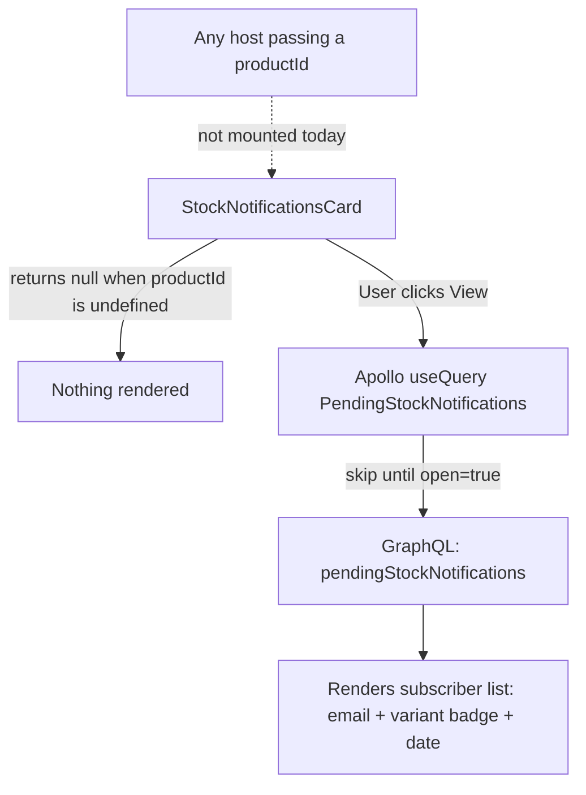

# Stock Notifications

**Last updated:** 2026-09-28 - **Feature:** `src/features/stock-notifications/`

## Overview

Vendors use this feature to see which customers are waiting for an out-of-stock product to come back in stock. A collapsible card lists every pending subscriber (only email and sign-up date are shown). The list is read-only in the vendor app; customers subscribe via a storefront form. When a vendor restocks the product, the backend fires notifications and removes the subscribers from this list automatically.

**The card is currently not mounted anywhere.** It was rendered by `ProductForm` on the product edit page until 2026-09-06, when it was removed to shorten that screen. The component, its query and its types are unchanged and still exported from the feature barrel, so re-mounting it is a one-line import.

## Screens / routes

None. The card has no route of its own and is no longer rendered by any screen. Its previous host was the product edit page (`src/app/store/[shopSlug]/products/[slug]/edit/page.tsx` → `EditProductView` → `ProductForm`).

## How it works

## Components

| Component | Location | What it shows |
|-----------|----------|---------------|
| `StockNotificationsCard` | `components/stock-notifications-card.tsx` | Collapsible card, currently unmounted. Collapsed by default. When opened, fetches and lists pending back-in-stock subscribers (email, optional variant badge, sign-up date). Displays a skeleton while loading, an empty-state message if there are no subscribers, and a subscriber count badge in the header only while the panel is open and rows are present. |

## State & forms

No Zustand store. No react-hook-form. No save bar — the card is read-only.

Local state: a single `open` boolean (`useState`) controls whether the panel is expanded and whether the Apollo query fires. The query uses `fetchPolicy: "cache-and-network"` so the list refreshes on each open without blocking the initial render.

## GraphQL operations

| Operation | Type | Purpose |
|-----------|------|---------|
| `PendingStockNotifications` | Query | Fetches pending back-in-stock subscribers for a given `product_id` and optional `variation_option_id`. Returns `id`, `email`, `product_id`, `variation_option_id`, `customer_id` (the shop's customer, when a signed-in shopper subscribed), and `created_at` for each row. Excludes already-notified subscribers. |

## Validation

None. The card is read-only and fires no mutations.

## Main files

- `src/features/stock-notifications/api.ts` — `GET_PENDING_STOCK_NOTIFICATIONS` GraphQL query
- `src/features/stock-notifications/types.ts` — `StockNotification` interface and `PendingStockNotificationsResponse` type
- `src/features/stock-notifications/components/stock-notifications-card.tsx` — the sole UI component
- `src/features/stock-notifications/index.ts` — public barrel export

## Notes

- The card returns `null` when `productId` is undefined, so it is safe to include in `ProductForm` for the create-mode page — it simply does not render. That is what made removing it from the form a pure deletion of two lines.
- The Apollo query is skipped until the panel is opened (`skip: !productId || !open`), keeping the product edit page's initial load unaffected by this feature.
- `variation_option_id` is `null` for simple products and set to the specific variant id for variable products; the card shows a `variant` badge on those rows.
- Subscribe and unsubscribe mutations are storefront-only and are not present in the vendor app.
- The card reads the `stockNotifications.*` namespace (en + ar), and sign-up dates are formatted in the active locale (`toLocaleDateString(locale)`).
- Rows disappear from this list automatically when the backend's `StockNotificationsService.claimRestockSubs` fires on restock (available quantity going from 0 to positive). The count visible here is always the "still waiting" pool.
