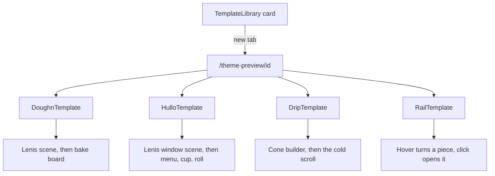

# Storefront templates

**Last updated:** 2026-10-07 — **Feature:** `src/features/storefront-templates/` (picker and preview). Presentation: `packages/storefront-templates`.

## Overview

Complete storefront designs a merchant can preview from Online Store → Themes. Six ship today: doughn, hullo, drip, rail, personne, and jurat.

**doughn** is a one-page bakery that opens like a shop at 4 a.m. Scrolling rolls the shutter up, the sun rises, the camera walks through the door, and each loaf flies from its basket onto a live bake board; then a visit card and a closing shutter. Sample shop: doughn, Jeddah, in English and Arabic.

**hullo** is a walk-up coffee window. A loader fills a cup, then scrolling lands the wordmark on the wall and walks through the window. Below that: a filterable menu, a cup builder, a camera roll you can drag, and a hanging hours sign. The theme preview's order tray prints a pickup ticket and charges nothing. A shop on this template paints its products on the menu and sends the tray to checkout. Sample shop: hullo, Riyadh, in English.

**drip** is a gelato bar in Jeddah. A loader rolls the first scoop onto a cone or into a clear cup. Scoops in the cup fill from the floor and show through the glass, and only the top crown clears the rim. The cone holds three. The cup stays the smaller glass, at the size that holds three, through three scoops, and a fourth swaps in the larger glass, which holds five. Switching to the cone drops any scoops past three. Prices run 16, 26, 34, 42 and 50 SAR, and a crown is 4. Below that: the case, a pinned scroll through how the gelato is made, and a visit card. English and Arabic are the demo's own toggle. Sample shop: DRIP, Jeddah.

**rail** hangs eight drawn pieces on a clothing rail. Hover turns one to face you and the others step aside; a click opens front and back. On a narrow screen, swipe moves along the rail. Sample shop: Rail. The pieces are drawn in the component.

**personne** is a Paris tailoring house. A coat on an empty hanger fills out as you scroll, then six pieces wait on a rail you can drag. Picking one up opens a fitting room. The pieces are mesh art bundled with the template, not catalogue rows. Sample shop: Personne, Paris.

**jurat** (جرعة فن) is an oud workshop in Riyadh. Scroll builds one instrument rib by rib on the bench, then the wall of five ouds, live strings, accessories, and a repair ticket. The ouds and sound are bundled art, not catalogue rows. Sample shop: جرعة فن, Riyadh.

The cards are examples, not a theme the merchant applies. Preview opens `/theme-preview/[templateId]` in a new tab and shows that sample. Contact us goes to Settings → WhatsApp, the screen where the merchant messages Zaydak. The library does not write `storefront_template`. The templates and their checkout frames live in `@repo/storefront-templates`. This feature keeps the picker, the preview routes, and the theme-editor hook. The storefront imports the same components and passes the live catalogue and cart in. A shop that already has one still shows In use on that card. A doughn shop's public home still renders that template: `storefront_theme` fills the street copy and photos, and an empty field keeps the sample in `content.ts`. The shop's own name replaces the sample wordmark when the theme has not set a brand. The visit card and the map use the store address, and the clock uses `shops.timezone` when one is set. Opening hours and the measured basket art stay the sample. The merchant of a drip shop's public home reads that builder's `storefrontProductComposition` for the cone (names, cut-outs, ladder). The theme preview still uses the sample in `data.ts`. A rail shop's public home hangs that shop's products. A hullo shop's public home paints `storefrontProducts` on the menu cards and `addToCart` sends the tray to checkout. The theme preview of hullo still uses the sample in `content.ts`. The cup builder, camera roll and hours sign stay that sample on the live shop too. Each template also has a checkout frame. A shop whose `storefront_template` is one of the four sees that frame at checkout; the preview of it is `/theme-preview/[templateId]/checkout`.

The art and the sample copy for doughn, hullo and drip come from the Genesis Works demos. Get permission or replace them before a merchant goes live with those three. Rail's pieces are drawn in the component.

## Screens / routes

| Route | File |
|-------|------|
| `/store/[shopSlug]/online-store/themes` (Theme library section) | `components/template-library.tsx`, rendered by `theme-editor/components/themes-page.tsx` |
| `/theme-preview/[templateId]` | `src/app/theme-preview/[templateId]/page.tsx` |
| `/theme-preview/[templateId]/checkout` | `src/app/theme-preview/[templateId]/checkout/page.tsx` |

The preview lives outside `store/` because a template owns the window's scroll and cannot render inside `DashboardShell`. `/theme-preview` is a protected prefix in `src/proxy.ts`, so it needs a session; it reads no shop data. It opens in a new tab and hides the dashboard's grain overlay (`data-dashboard-texture` in the root layout).

## How it works

## Components

| Component | Purpose |
|-----------|---------|
| `TemplateLibrary` | One card per example: thumbnail, name, description, Preview (new tab) and Contact us. A card already on the shop says In use. |
| `DoughnTemplate` | Root: language, alarm loader, scroll wiring, bag and menu state, closing shutter. |
| `AlarmLoader` | Counts 3:00 to 4:00 with real image and font loading, rings, flies the 4:00 into the nav clock. |
| `Street` | Renders the scene's layers once; `scene/street-scene.ts` moves them on every scroll frame. |
| `BakeBoard` | Cards with a live status chip (oven, warm, fresh, later, tomorrow) on shop time, and a peek slider. |
| `VisitCard` / `ClosingShutter` | Open or shut with a countdown; the shutter pulled down over the last screen. |
| `MenuRoll` / `BagSheet` | Kraft-paper menu; bag with quantities, pickup slot and a paper ticket (nothing is sent). |
| `HulloTemplate` | The coffee window. React owns the markup; `behavior.js` runs the demo's motion on it. |
| `DripTemplate` | The gelato bar. React owns the markup; `behavior.js` runs the cone, the bag, and the cold scroll. |
| `RailTemplate` | The clothing rail. React places the pieces and turns the one under the pointer. |
| `*CheckoutFrame` | Each template's checkout. Doughn lifts the shutter onto a paper slip, drip drops a scoop onto the total, rail hangs the order on the spring, hullo prints a ticket. |

## State & forms

Per-frame values never go through React: each scene writes styles straight to the elements. On doughn, discrete story state (clock minute, caption, nav look) is a small store read with `useSyncExternalStore`, so only the nav and captions re-render. Shop time is a shared once-a-second clock per time zone. The visitor's language is kept in `localStorage` (`doughn.lang`) and read without an effect. Bag, menu and loader state are local `useState`; the bag form is a demo and stores nothing. Hullo keeps its cup, lights and shutter in the behavior module (`localStorage` key `hullo-theme`); the React tree does not re-render while you scroll. On a live hullo shop the window cards and the tray are the storefront's catalogue and cart. Drip keeps language and vessel in `localStorage` (`drip.lang`, `drip.vessel`). The theme preview's demo receipt stays in `drip.bag`. A live drip shop does not: the storefront passes the cart query and clears that key.

## GraphQL operations

`shop(slug)` reads `storefront_template` so the library can mark a card already in use. The library does not call `updateShop`. The public home still reads `storefront_theme` for doughn and keeps the sample in `content.ts` wherever a field is empty. Story minutes and opening hours stay there too. The visit address, the map and the clock zone come from the shop when it has them. A hullo shop's home reads `storefrontProducts` for the menu. The preview, and the cup builder, keep `content.ts`. A drip shop's home renders `DripTemplate`. When the shop has a `drip-gelato` product with assembly rules, the cone reads `storefrontProductComposition` (cut-out or catalogue photo, names, ladder). Otherwise it keeps `data.ts`. Checkout sends that selection with `addToCart`. A rail shop's home hangs `storefrontProducts`. The theme preview of rail still uses the eight drawn pieces.

## Validation

On doughn the bag name is required (trimmed, `<>&"` stripped) and a honeypot field drops bot submissions. Content must have exactly eight items, one per basket in the art; the scene tests pin the basket layout and that captions share story minutes across languages. On hullo the preview tray refuses an empty order and a blank cup name, and prints a ticket that charges nothing. A live shop skips the cup name and calls `addToCart` for menu lines. A built cup is refused there, because its price is the sample formula. On drip the bag asks for a name before the demo receipt; nothing is submitted.

## Main files

- `src/features/storefront-templates/registry.ts` — ids and thumbnails for the picker
- `src/features/storefront-templates/components/template-library.tsx`
- `src/app/theme-preview/[templateId]/page.tsx`
- `packages/storefront-templates/src/doughn/doughn-template.tsx`
- `packages/storefront-templates/src/hullo/hullo-template.tsx`
- `packages/storefront-templates/src/drip/drip-template.tsx`
- `packages/storefront-templates/src/drip/data.ts`
- `packages/storefront-templates/src/drip/behavior.js`
- `packages/storefront-templates/src/rail/rail-template.tsx`

## Notes

- Storefront copy lives in `content.ts`, not the next-intl catalogues: it is the shop's own words, like a product name. Dashboard copy (library title, card text) is under `themeEditor.library`.
- Doughn's styles are CSS Modules, unlayered, so they beat the dashboard's `@layer base` reset. Hullo, drip and rail stylesheets are unlayered too, and every selector sits under `.hullo-tpl`, `.drip-tpl` or `.rail-tpl`. Language and direction live on that root, because `<html lang dir>` belongs to the dashboard.
- Fonts are loaded with `next/font/google` in this app (`features/storefront-templates/*-fonts.ts`) and passed into the template. The package does not call `next/font`. Doughn's stacks use each face's own family without next/font's Arial fallback, which would otherwise paint Arabic words inside Latin stacks.
- `geometry.ts` was measured on the art; replacing an image means re-measuring.
- Outside production the template exposes `window.__site` (`setP`, `setScroll`, `setNow`, …) for screenshot scripts.
- The package depends on `lenis` and `gsap`. It does not import storefront or vendor feature code. Checkout frames take `lang` as a prop.
