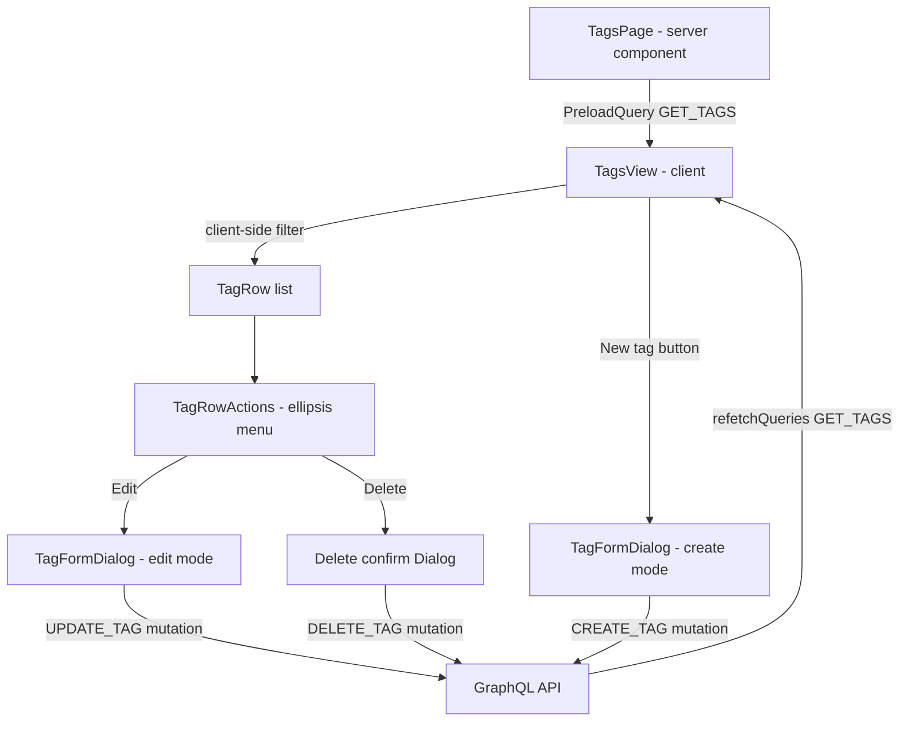

# Tags

**Last updated:** 2026-09-28 — **Feature:** `src/features/tags/`

## Overview

Tags are flat, bilingual (English + Arabic) labels that merchants attach to products for quick filtering and merchandising (e.g. "summer", "new"). The tags screen lets a merchant list, search, create, edit, and delete tags for the current shop. All create/edit operations happen in a modal dialog that submits on explicit Save — there is no contextual save bar because editing is dialog-scoped, not inline.

## Screens / routes

| Route | File |
|-------|------|
| `/store/[shopSlug]/products/tags` | `src/app/store/[shopSlug]/products/tags/page.tsx` |

## How it works

## Components

| Component | Purpose |
|-----------|---------|
| `TagsView` | Page shell — fetches all tags via `useSuspenseQuery`, holds client-side search state, renders the tag list or an empty state, and opens `TagFormDialog` for creation. |
| `TagRow` (internal) | Single row inside `TagsView` — shows a generic tag icon, translated name, slug, and product count. |
| `TagFormDialog` | Dual-mode modal (create / edit) backed by react-hook-form + zod. Submits `CREATE_TAG` or `UPDATE_TAG` and refetches the list on success. |
| `TagRowActions` | Ellipsis dropdown per row — opens `TagFormDialog` in edit mode or a delete-confirmation `Dialog` that fires `DELETE_TAG`. |

## State & forms

No Zustand stores are used. All state is local React (`useState`) inside each component.

`TagFormDialog` uses `react-hook-form` with `zodResolver(tagFormSchema)`. `defaultValues` are derived from the tag prop (splitting the `TranslatedText` object into flat `name_en` / `name_ar` / `details_en` / `details_ar` fields). The form resets via `form.reset(defaultValues)` each time the dialog opens.

The contextual save bar (`useUnsavedBarStore`) is **not used** here. Create/edit mutations fire only when the user clicks the dialog's own "Create" or "Save changes" button, satisfying the no-auto-save requirement without the global bar.

## GraphQL operations

| Operation | Type | Purpose |
|-----------|------|---------|
| `Tags` | Query | Fetch paginated tag list (`page`, `limit`) — called with `limit: 100` |
| `Tag` | Query | Fetch a single tag by slug (defined but not called by any component) |
| `CreateTag` | Mutation | Create a new tag with bilingual name, optional slug, icon, and details |
| `UpdateTag` | Mutation | Update an existing tag by id |
| `DeleteTag` | Mutation | Hard-delete a tag by id |

## Validation

`tagFormSchema` (`src/features/tags/validations/tag.ts`) enforces:

- `name_en` — required, non-empty string (trimmed)
- `name_ar` — required, non-empty string (trimmed)
- `slug` — optional; when provided must match `/^[a-z0-9-]*$/i` (letters, numbers, dashes only)
- `icon` — optional string
- `details_en` / `details_ar` — optional strings

## Main files

- `src/features/tags/api/queries.ts` — `GET_TAGS`, `GET_TAG_BY_ID`
- `src/features/tags/api/mutations.ts` — `CREATE_TAG`, `UPDATE_TAG`, `DELETE_TAG` (uses `TagFields` fragment)
- `src/features/tags/components/tags-view.tsx` — list page with client-side search
- `src/features/tags/components/tag-form-dialog.tsx` — create/edit modal
- `src/features/tags/components/tag-row-actions.tsx` — per-row edit/delete menu
- `src/features/tags/validations/tag.ts` — `tagFormSchema` + `TagFormInput` type
- `src/features/tags/types.ts` — `Tag`, `TagsResponse`, `CreateTagInput`, `UpdateTagInput`, response interfaces

## Notes

- Every string here reads `tags.*` (en + ar); `tagFormSchema(t)` takes a `tags.validation` translator. `tags.productCount` carries all six Arabic plural forms — with only `one`/`other` it produced "منتج ١" and "٥٠ منتجات".
- `GET_TAG_BY_ID` (query by slug) is defined in `api/queries.ts` but is not called by any component in this feature — it may be used externally (e.g. a storefront).
- All mutations pass `refetchQueries: [{ query: GET_TAGS, variables: { page: 1, limit: 100 } }]` with `awaitRefetchQueries: true`, so the list is always up to date after any write.
- The `name` and `details` fields on the `Tag` type are `string | TranslatedText`. `translatable()` picks the dashboard language (Arabic when the dashboard is Arabic, falling through to the other side only when that side is empty).
- Slug is auto-generated server-side when left blank on creation.
- A tag can also be created from outside this feature: the product form's tag picker offers `Add "<what was typed>"` when the search matches nothing, and calls the same `CreateTag` with the same refetch. It sends **one** locale, chosen from the text's own script, because a name typed there is one word in one language and copying it into both columns would show Latin text to Arabic customers. The picker refuses a name that already matches an option exactly, which is the only guard against a shop collecting duplicate tags. That picker's own copy — its label, its "Add tags" opener, its search placeholder, the "Frequently used" / "Other tags" headings and the failure toast — lives in `products.tags.*`, not here: it is part of the product form. The tags list chrome (`TagsView` title, search, empty state, product count) reads `tags.*` via `useTranslations`.
