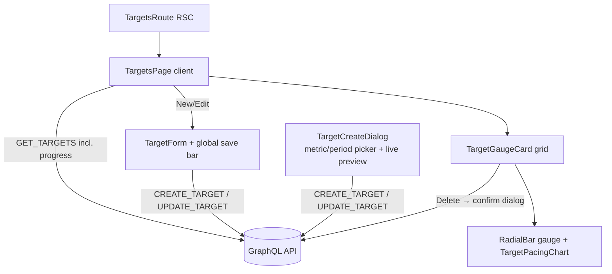

# Targets

**Last updated:** 2026-09-29 — **Feature:** `src/features/targets/`

## Overview

Sales goals. A merchant sets a target for one metric (total/net/gross sales, orders, AOV, net profit, or returning-customer rate) over a period (this week/month/quarter/year, or a custom range), and each target renders as a radial **attainment gauge** with current-vs-goal figures, a run-rate **projection**, time-elapsed, and — for additive metrics — a **pacing chart** (cumulative actual vs a linear "on pace" line). Net-profit gauges flag "profit estimated" when some sold products lack a cost. Status (Upcoming / In progress / Achieved / Not achieved) is computed live by the back-end, never stored. There are two entry points: the dedicated targets page (full-page `TargetForm` on the mandatory global contextual save bar, via the shared `TargetFormFields`) and the analytics overview, whose "Try targets" menu opens `TargetCreateDialog` — a Shopify-style **bottom drawer** (a base-ui Dialog styled as a bottom sheet that slides up) holding a two-column layout with a searchable metric picker, a time-period selector, and a **live preview gauge** (name, Draft status, resolved period, days-left) that updates as you type. Both entry points share the same zod schema and `useTargetSubmit` pipeline.

## Screens / routes

| Route | Purpose |
|-------|---------|
| `/store/[shopSlug]/analytics/targets` | Targets list (gauge grid) + inline create/edit form |
| `/store/[shopSlug]/analytics` | "Try targets" menu (Create / Suggested → `TargetCreateDialog`) + embedded gauge cards (see [analytics.md](analytics.md)) |

## How it works

## Components

| Component | What it shows |
|-----------|--------------|
| `TargetsPage` | Root island. Fetches `targets` (with live `progress`), toggles between the gauge grid and the form, owns the delete mutation. |
| `TargetGaugeCard` | Per-target radial attainment gauge, current/goal/projected/elapsed stats, status badge, pacing chart (when paceable), estimated-profit note, edit/delete + confirm dialog. |
| `TargetPacingChart` | recharts line chart: cumulative actual (teal) vs the linear on-pace reference (dashed slate), unit-aware axis/tooltip. Axis dates are named in the dashboard language (`formatBucketLabel(…, locale)`); grid and ticks are theme tokens so they hold on the dark card. |
| `TargetForm` | Full-page create/edit form (react-hook-form + zod). Registers the global save bar while dirty. |
| `TargetFormFields` | The shared goal fields (name, metric, period, value with unit suffix, custom dates, activate) used by the full-page `TargetForm`. |
| `TargetCreateDialog` | Shopify-style two-column create/edit **bottom drawer** (base-ui `Dialog` styled as a bottom sheet in `ui/drawer.tsx`, slides up via tw-animate) from the analytics overview — same schema/submit pipeline; "Save to dashboard" gated on the live values, "Add to dashboard" toggle maps to active/draft. Always mounted (open toggles) so the enter/exit animation runs. |
| `TargetMetricPicker` / `TargetPeriodPicker` | The dialog's searchable metric combobox and time-period selector (Week/Month/Quarter/Year/Custom, resolved to a labelled window). |
| `TargetPreviewCard` | Live preview gauge in the dialog — reads the in-progress form values (no server round trip) via `resolvePeriodPreview`. |
| `useTargetSubmit` | Mutation hook — builds the wire input (value → cents/count/bps), fires create/update, maps server validation errors to fields, sileo toasts. |

## State & forms

`TargetForm` follows the mandatory contextual save bar (see [AGENTS.md](../../AGENTS.md)): edits stage in react-hook-form; while `isDirty` it registers `useUnsavedBarStore` with `onSave`/`onDiscard`; Save fires one mutation, refetches, and returns to the list. The value field stays a string and is converted to the metric's wire unit at submit (`majorToCents` for money, `percentToBps` for rate). `TargetsPage` holds `editing: Target | "new" | null`.

## GraphQL operations

| Operation | Type | Purpose |
|-----------|------|---------|
| `AnalyticsTargets` | Query | List targets with live `progress` (gauges) |
| `AnalyticsTarget` | Query | One target with `progress` |
| `AnalyticsCreateTarget` | Mutation | Create a goal (derives the window server-side in the shop tz) |
| `AnalyticsUpdateTarget` | Mutation | Edit a goal |
| `AnalyticsDeleteTarget` | Mutation | Soft-delete a goal |

## Validation

`targetFormSchema(t)` (zod, `validations.ts`), built from a `targets.validation` translator so its messages follow the dashboard language: name required; `value` a positive number; a rate goal cannot exceed 100%; a `CUSTOM` period requires start + end with end after start. The back-end re-validates (value > 0, rate ≤ 10000 bps, window, per-shop cap) and returns field-mapped errors (`targetValue` → the `value` field).

## Main files

- `src/features/targets/api/queries.ts` — the five operations + fragments
- `src/features/targets/lib/targets.ts` — metric/period options, unit formatting, value↔wire conversion, status colours
- `src/features/targets/lib/period-preview.ts` — `resolvePeriodPreview` (period → window + label + days-left) for the live preview
- `src/features/targets/components/target-gauge-card.tsx` — gauge + stats + pacing + delete
- `src/features/targets/components/target-form.tsx` + `target-form-fields.tsx` + `use-target-submit.ts` — full-page create/edit
- `src/features/targets/components/target-create-dialog.tsx` + `target-metric-picker.tsx` + `target-period-picker.tsx` + `target-preview-card.tsx` — the analytics two-column modal
- `src/app/store/[shopSlug]/analytics/targets/page.tsx` — route shim

## Notes

- Every string on the targets page and in the create drawer reads `targets.*` (en + ar).
- `progress` is a live field resolver; the list selects it, so cost is O(active targets) — the back-end caps a shop at 24 targets.
- Pacing lines render only for additive metrics; net-profit and returning-rate targets show the gauge + projection but no cumulative line (documented back-end limitation).
- Fixed periods target the **current** period (anchor = now) in the shop's timezone; only `CUSTOM` exposes date pickers.
- Loading states are `<Bones>` (`shared/components/bones.tsx`), captured from the real DOM by `npm run bones` — there is no hand-written skeleton on this screen; a name with no committed capture shows nothing on the very first load and then measures itself, so every later load draws real bones. Bone names: `targets-grid`. See [02_build_startup](../02_build_startup/README.md).
