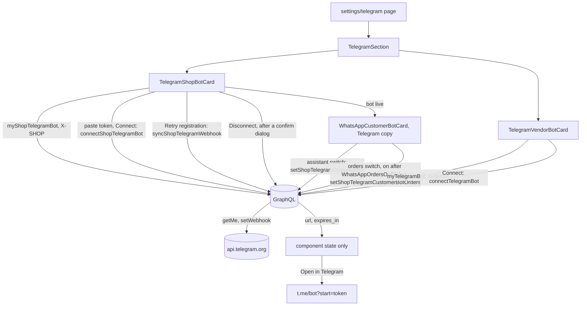

# Telegram

**Last updated:** 2026-09-25 - **Feature:** `src/features/telegram/`

## Overview

Settings → Telegram: two bots, two scopes, one screen. The **shop's own bot**, which customers write *to*, and the **Zaydak assistant**, which the vendor writes to from their own Telegram account. Each is under its own heading, the shop's first — the same discipline the WhatsApp screen keeps between the shop's number and the platform's, and for the same reason: a merchant who conflates the two hands a customer the wrong bot.

**Both halves are shop-scoped, and none of their operations takes a shop id.** The assistant binds a Telegram account to the store whose Connect was pressed — the pairing token carries the shop — and the shop bot binds a BotFather token to the shop in `X-SHOP`. The assistant half was account-scoped until 2026-09-05, with the store chosen from buttons inside Telegram; that reported a sibling store's binding on this store's page, where a vendor reads it as "this store is connected". **One Telegram account serves one store**: connecting from a second store moves it, which the consent line now says.

**There is no form and no save bar on either card.** The assistant's writes are a button that mints a link and a button that disconnects. The shop bot's is a token pasted once and a Connect that asks Telegram whose token it is before anything is stored — a consent moment like the WhatsApp scan, not an edit. Once that bot is live, its card also carries the WhatsApp screen's two switches, the customer assistant and **Take orders in the chat**; each change is one request, sent at once or after a confirm dialog, never staged. The server never returns the token, masked or otherwise, so there is nothing to seed an input with and nothing for a `touched` set to decide.

## Screens / routes

| Route | Component | Notes |
|---|---|---|
| `/store/[shopSlug]/settings/telegram` | `TelegramPane` → `TelegramSection` | A static sibling of `[section]`, like WhatsApp. Not server-preloaded: the assistant query asks Telegram for the bot's live handle, and the pairing link must be minted by the click that uses it. |

## Diagram

## Components

- `TelegramSection` — the two headings and their order. Owns nothing.
- `TelegramShopBotCard` — the shop's bot. Status pill (`live` connected, `fault` when Telegram accepted the token but refused the webhook, `off` otherwise), the three BotFather steps, the token field with the server's shape check mirrored client-side, consent above Connect, the connected box with the handle labelled as the store's own, Open, and Disconnect behind a confirm dialog. Shows `last_error` — Telegram's own words — above the form when the webhook was refused, with **Retry registration** beside Connect again: it re-registers from the token the server already holds, so nothing is pasted.
- `WhatsAppCustomerBotCard`, `WhatsAppBotOffDialog`, `WhatsAppOrdersOnDialog` — borrowed from the WhatsApp feature and rendered by `TelegramShopBotCard` on a connected bot only, with `namespace="settings.telegram.shopBot.bot"`: WhatsApp's rules, Telegram's copy. The assistant is off by default and the first visit after connecting asks rather than showing a switch; it turns on with no confirm, and a live one turns off through the off dialog. **Take orders in the chat** is a second row that appears only under a live assistant. Turning it on opens `WhatsAppOrdersOnDialog` in Telegram's own words: the customer shares their phone number with a button, then gets a summary with every price and must confirm it; they pay with the store's methods and are never asked for card details in the chat; each order appears in Orders marked as placed on Telegram. Turning it off needs no dialog.
- `TelegramVendorBotCard` — the assistant. Status pill (`fault` when the platform has no bot, `off` not connected **for this store**, `live` connected), the handle labelled as Zaydak's, consent, Connect, the minted link with Open and Copy, the connected-account box saying it answers about this store only, Disconnect as a ghost, and the read-only line. Both cards reuse `WhatsAppStatusPill`.

## State & forms

**The pairing link lives in component state and nowhere else** — not the Apollo cache, not a store, not the URL. It is a one-time credential: whoever opens it binds *their* Telegram to this Zaydak account. It is fetched only by the Connect click, shown once, and forgotten on unmount. The Connect button disappears while a link is on screen, because pressing it again would mint a second token and orphan the one being shown.

**The shop token lives in the input and nowhere else.** Cleared on success; never read back from the server. A refused connect re-reads the status so the card shows the reason the server kept on the row, not only the toast that went by. `detailOf` pulls Telegram's words from `extensions.detail` for the toast, since the message itself is only the translated error code.

**The orders switch waits for the plan in one direction only.** `useFeature("ai.agent.checkout")` decides whether it can be turned on: without the capability it is disabled with a "not included in your plan" note, and it is also disabled while the plan is loading. A switch that is already on stays live whatever the plan says, so a shop whose plan lost the capability can still turn it off; the server refuses only `enabled: true` (`FEATURE_NOT_AVAILABLE`).

**Turning ordering on re-registers the bot's webhook on the server**, asking Telegram for button presses (`callback_query`) as well as messages, so the Confirm button under a chat order summary reaches even a bot connected before those buttons existed. When Telegram refuses the re-registration, the error toast carries its words (`detailOf`, as for Connect) and the card re-reads the bot: the server has marked it disconnected with the reason in `last_error` and left the switch off, so the card shows its attention state, with Retry registration, and hides the assistant card until the bot is live again. Copy lives under `settings.telegram.shopBot.bot.orders.*` (en + ar).

Both statuses are read `cache-and-network`. Whether the assistant ask has been answered is component state, as on WhatsApp. No Zustand store is involved.

## GraphQL operations

| Operation | Kind | Used by |
|---|---|---|
| `myTelegramBot` | query | the assistant card, on mount and after disconnect |
| `connectTelegramBot` | mutation | assistant Connect |
| `disconnectTelegramBot` | mutation | assistant Disconnect |
| `myShopTelegramBot` | query | the shop card, on mount and after every mutation |
| `connectShopTelegramBot(input)` | mutation | shop Connect and Connect again |
| `syncShopTelegramWebhook` | mutation | Retry registration, on a refused webhook |
| `disconnectShopTelegramBot` | mutation | the shop confirm dialog |
| `setShopTelegramCustomerBot(enabled)` | mutation | the assistant ask and switch |
| `setShopTelegramCustomerBotOrders(enabled)` | mutation | the orders switch — document `SetShopTelegramCustomerBotOrders` (`SET_SHOP_TELEGRAM_CUSTOMER_BOT_ORDERS`); on after the confirm dialog, off at once |

All nine are `manage_own_shop` and require `X-SHOP` plus the ownership guard. Every shop-bot operation selects the same fields (`SHOP_BOT_FIELDS`), which include the new `ai_orders_enabled`, so every read and write of the bot carries the switch's state. Contract: `back-end/docs/features/api/telegram.md`.

## Validation

`TOKEN_SHAPE` (`^\d{5,}:[A-Za-z0-9_-]{30,}$`) mirrors the server's `ConnectShopTelegramBotInput`, so a pasted `@username`, a `t.me` link, or the token inside a sentence is refused before a request leaves. The assistant's mutations take no arguments, by design — one accepting a Telegram id would let a signed-in vendor bind somebody else's account to their own.

## Main files

- `src/features/telegram/components/telegram-shop-bot-card.tsx` — the shop's bot, Retry registration, and the two switches it borrows from WhatsApp.
- `src/features/whatsapp/components/whatsapp-orders-on-dialog.tsx` — the shared on-confirm; its `namespace` prop selects Telegram's copy.
- `src/features/telegram/components/telegram-vendor-bot-card.tsx` — the assistant, and why the link is state.
- `src/features/telegram/components/telegram-section.tsx` — the heading discipline and the order.
- `src/features/telegram/api.ts` — the nine operations, and the two scopes.
- `src/features/telegram/types.ts` — the result shapes; `ShopTelegramBot` carries `ai_orders_enabled` and no token.
- `src/features/telegram/components/__tests__/telegram-section.test.tsx` — pins that nothing is minted or sent on mount, the shape gate, the handle labels, the confirm before disconnect, and the orders switch (absent while the assistant is off, confirmed on, not confirmed off, locked without the plan).

## Notes

- Consent sits above each Connect button rather than in a footnote, for the reason the WhatsApp screen puts its QR consent there: this is a moment where the vendor grants something.
- The assistant's Disconnect is a ghost with no confirmation (Connect re-links in a minute); the shop bot's goes through a dialog, because reconnecting needs the token again and the merchant may not have it to hand.
- `bot_username` null on the assistant means the platform has no Telegram configured — not the vendor's fault, so the card says so and renders no Connect button.
- What the orders switch allows happens in the chat, not on this screen: the assistant asks the customer to share their number with a one-key reply keyboard, and the summary carries Confirm and Cancel buttons. An order placed there carries `placed_via = telegram_assistant` and a Telegram mark in [orders](orders.md). See `back-end/docs/features/chat-checkout.md`.
- The Telegram ordering path has not been walked end to end against a live bot yet; the card is covered by component tests.
- Not yet implemented: displaying the pairing link as a QR (a QR *of a link*, not a pairing QR, and the screen must say so).
