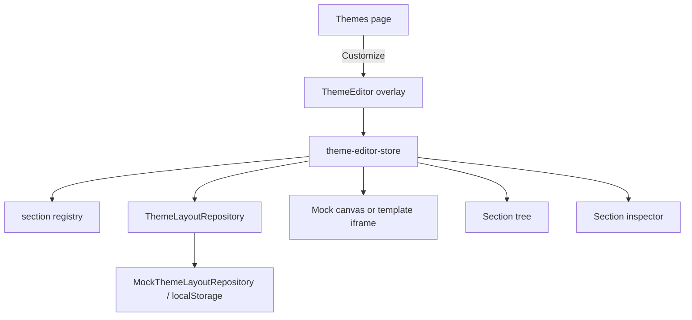

# Theme editor

**Last updated:** 2026-10-06 — **Feature:** `src/features/theme-editor/`

## Overview

Vendor merchants visually arrange the storefront homepage from Online Store → Themes → Customize. The editor is a full-viewport overlay with a section tree, mock live preview, and settings inspector. Persistence is mock-only (`ThemeLayoutRepository` → `MockThemeLayoutRepository` in `localStorage`). Brand colors, name, logo and contact stay in Settings; the layout JSON stores section instances and merchant intent, not hex values or GraphQL.

## Screens / routes

| Route | File |
|-------|------|
| `/store/[shopSlug]/online-store/themes` | `src/app/store/[shopSlug]/online-store/themes/page.tsx` |
| `/store/[shopSlug]/online-store/editor?template=home` | `src/app/store/[shopSlug]/online-store/editor/page.tsx` |
| `/store/[shopSlug]/online-store/navigation` | coming-soon placeholder |
| `/store/[shopSlug]/online-store/preferences` | coming-soon placeholder |

## How it works

## Components

| Component | Purpose |
|-----------|---------|
| `ThemesPage` | Current theme card (Zaydak Default) and Customize, then the theme library (`TemplateLibrary`, see [storefront-templates](storefront-templates.md)). |
| `ThemeEditor` | Full-screen shell: hydrate, leave-guard, three-pane / one-surface layout. Header, tree, preview and inspector are separate surfaces with a gap between them — not fused borders. |
| `EditorHeader` | Exit, Home template selector, grouped undo/redo and device switcher, Save, Publish. |
| `SectionTree` / `SectionTreeItem` | Ordered sections, visibility, move up/down, duplicate, remove. Header and Footer are locked chrome rows, distinct from the template list. |
| `AddSectionDialog` | Categorized searchable add list; hides singletons already on the page. |
| `SectionInspector` | Per-type settings; links out to Brand / General. |
| `ThemeSettings` | Informational brand colors and identity. |
| `MockThemePreview` | Click-to-select canvas for a shop still on the default theme; hidden placeholders and honesty warnings. |
| `TemplatePreviewFrame` | When the shop has chosen a template, an iframe of `/theme-preview/[templateId]` in that canvas's place, sized to the device. |

## State & forms

Zustand `useThemeEditorStore` owns `layout`, `savedLayout`, selection, device, undo/redo (50), and Save/Publish. Dirty is value-based (`layoutsEqual`). The editor does not use the global unsaved bar; it has its own Save / Publish and arms `useLeaveGuard` while dirty. Header and Footer in the tree are read-only placeholders.

## GraphQL operations

None. The UI talks only to `ThemeLayoutRepository`. The mock implementation keys `zaydak_theme_layout:{shopSlug}:{template}` and models draft vs published. A later GraphQL class can replace `getThemeLayoutRepository()` without changing tree, inspector, or chrome.

## Validation

The section registry gates add / duplicate / remove (hero is not removable; hero, facets, values, story are singletons). Layout JSON uses instance IDs plus an `order` array. Merchant-facing copy never shows IDs, enum keys, or GraphQL.

## Main files

- `src/features/theme-editor/types.ts` — layout contract and repository interface
- `src/features/theme-editor/state/theme-editor-store.ts`
- `src/features/theme-editor/api/theme-layout-repository.ts`
- `src/features/theme-editor/lib/section-registry.ts`
- `src/features/theme-editor/components/theme-editor.tsx`
- `src/features/theme-editor/components/preview/mock-theme-preview.tsx`

## Notes

- Do not import storefront `home/*` into Vendor. A shop that has chosen a template previews it in an iframe of `/theme-preview/[templateId]`. A shop on the default theme still uses the section canvas, because that template has no section anchors.
- Reorder is keyboard Move up/down; the grip is visual-only until a shared sortable primitive exists.
- The mock preview keeps storefront header and footer as canvas chrome, with template sections spaced between them so selection rings do not collide.
- The overlay sits above the dashboard header (`z-[45]`) so the site header cannot paint through it, and below dialogs (`z-50`) so Save-leave and Add section stay reachable.
- Arabic UI uses Tajawal; Latin UI uses the SF system stack. Preview canvas type stays with the mock storefront.
- Backend handoff: [theme-editor-backend-integration.md](../../../../docs/theme-editor-backend-integration.md).
