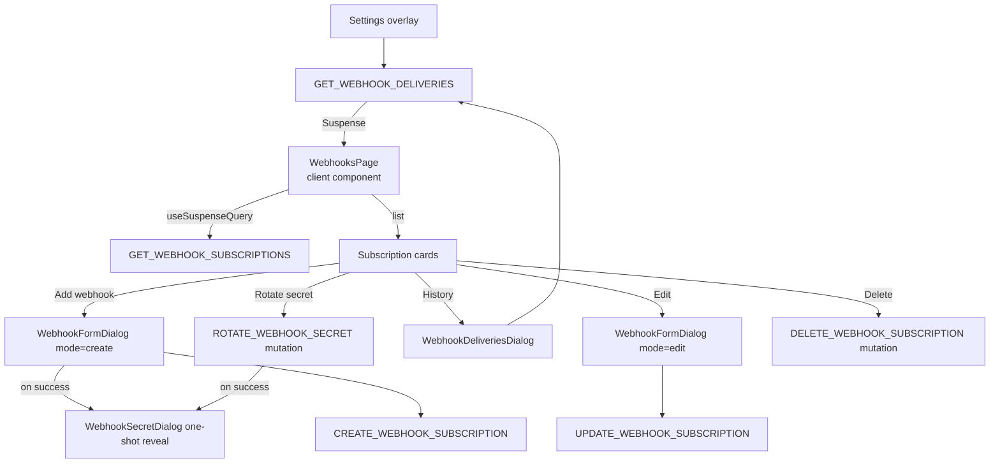

# Webhooks

**Last updated:** 2026-09-28 - **Feature:** `src/features/webhooks/`

## Overview

Vendors manage HTTPS endpoints that the platform POSTs to whenever a subscribed event fires (orders, products, inventory). Each subscription is signed with HMAC-SHA256; the receiver verifies the `X-Webhook-Signature` header. Vendors can create, edit, pause, delete, and rotate secrets for subscriptions, and inspect the last 50 delivery attempts per subscription.

## Screens / routes

There is no standalone webhooks route. `WebhooksPage` is rendered inline inside **Settings → Notifications → Webhooks** (matching Shopify, where webhooks live under Notifications). Reached via the dashboard header cog → Notifications → the Webhooks menu row.

## How it works

## Components

| Component | What it shows |
|---|---|
| `webhooks-page.tsx` | The full subscription list; one card per subscription with URL, active/paused badge, subscribed event chips, description, and action buttons (History, Rotate secret, Edit, Delete). Handles delete and rotate mutations directly. |
| `webhook-form-dialog.tsx` | Modal dialog for creating or editing a subscription. Fields: URL, event checkboxes (7 events), description textarea, and (edit-only) active toggle via `AppleSwitch`. Validates client-side before firing the mutation. |
| `webhook-deliveries-dialog.tsx` | Read-only table of the last 50 delivery attempts for one subscription. Columns: When, Event, Status, HTTP, Attempts, Note. Statuses: PENDING, SUCCEEDED, FAILED, ABANDONED. |
| `webhook-secret-dialog.tsx` | One-shot reveal modal shown immediately after create or rotate. Displays the plaintext secret with a copy button. Vendor must check an acknowledgement checkbox before the Done button is enabled; the secret is never re-fetchable after closing. |

## State & forms

There is no Zustand store and no react-hook-form in this feature. The form dialog uses plain `useState` for `url`, `events`, `description`, and `isActive`. It is re-seeded during render (tracked by a `seededFrom` state value) whenever the dialog opens or is pointed at another row, not from an effect.

The feature does not use the contextual save bar pattern. Create and edit happen inside dialogs with their own Save/Cancel buttons that fire mutations directly on submit.

## GraphQL operations

| Operation | Type | Purpose |
|---|---|---|
| `WebhookSubscriptions` | Query | Fetch all webhook subscriptions for the current shop |
| `WebhookDeliveries` | Query | Fetch up to 50 recent delivery records for one subscription |
| `CreateWebhookSubscription` | Mutation | Register a new endpoint; returns the plaintext secret once |
| `UpdateWebhookSubscription` | Mutation | Edit URL, events, description, or active state |
| `RotateWebhookSecret` | Mutation | Generate a new signing secret; returns the new plaintext secret once |
| `DeleteWebhookSubscription` | Mutation | Remove a subscription and cancel pending deliveries |

## Validation

No Zod schemas. Validation in `webhook-form-dialog.tsx` is inline, each failure a toast worded from `webhooks.form.*`, enforcing:
- URL is non-empty
- URL starts with `http://` or `https://`
- At least one event is selected

## Main files

- `src/features/webhooks/components/webhooks-page.tsx` — list page and delete/rotate logic
- `src/features/webhooks/components/webhook-form-dialog.tsx` — create/edit dialog
- `src/features/webhooks/components/webhook-deliveries-dialog.tsx` — delivery history dialog
- `src/features/webhooks/components/webhook-secret-dialog.tsx` — one-shot secret reveal dialog
- `src/features/webhooks/api/queries.ts` — `GET_WEBHOOK_SUBSCRIPTIONS`, `GET_WEBHOOK_DELIVERIES`
- `src/features/webhooks/api/mutations.ts` — create, update, rotate, delete mutations
- `src/features/notifications/components/notifications-settings.tsx` — hosts `WebhooksPage` inline (`view === "webhooks"`) behind a `Suspense` boundary

## Notes

- Secrets are write-once: the server only returns the plaintext secret on create or rotate. The `WebhookSecretDialog` enforces acknowledgement before closing; losing the secret requires rotation as the only recovery.
- Retry cadence is server-controlled (15-minute reaper). The UI offers no manual retry button.
- The 7 supported event types (`INVENTORY_ADJUSTED`, `ORDER_CREATED`, `ORDER_PAID`, `ORDER_CANCELLED`, `PRODUCT_CREATED`, `PRODUCT_UPDATED`, `PRODUCT_DELETED`) are hardcoded in the form dialog rather than fetched via introspection.
- `WebhooksPage` uses `useSuspenseQuery`; because it is mounted lazily (only when the Webhooks sub-section is opened) it has no `PreloadQuery` — the `NotificationsSettings` `Suspense` boundary shows a skeleton while the subscriptions load. Shop scoping is server-side via the `X-SHOP` header.
- Every string reads `webhooks.*` (en + ar); the secret dialog reads `webhooks.secretDialog`. Event chips, the form's event checkboxes and delivery rows show labels (`webhooks.events.*`, `webhooks.deliveryStatus.*`). An event or status the app has no message for falls back to its code (an event lowercased, underscores folded to spaces on the chips) rather than a key path.
