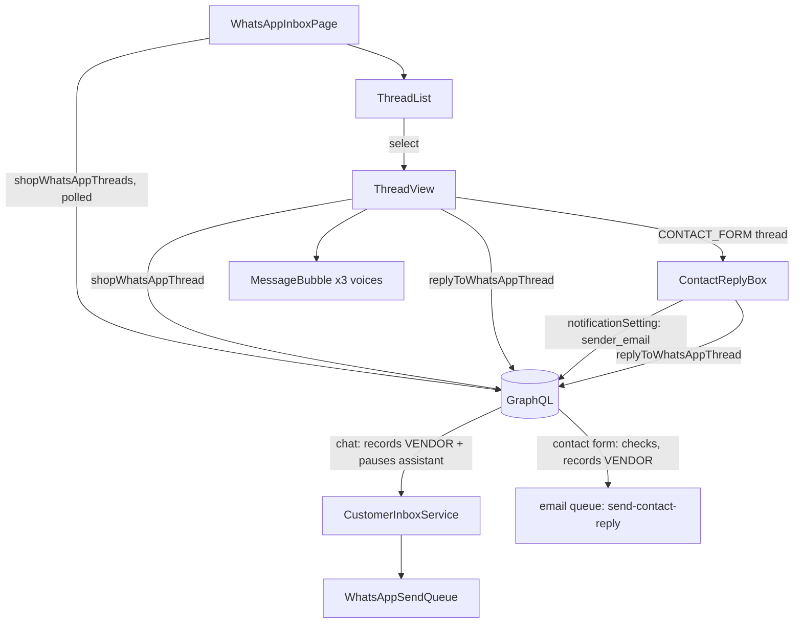

# WhatsApp Inbox

**Last updated:** 2026-10-04

## Overview

Conversations customers started on the shop's own WhatsApp number, its Telegram bot or the storefront contact form, and the box that answers them. A contact-form thread is answered **by email** (2026-10-01).

**This is the screen the customer assistant was missing.** The bot answers in the merchant's name, on the merchant's own number, and until this existed there was nowhere to read what it had said — the data carried three distinguishable voices and nothing rendered them. A merchant who cannot read their own thread cannot judge whether to leave the assistant on.

**It is not the `conversations` inbox with a filter**, and the difference is who is allowed to look. That surface asks "is this user a participant" — the right question when both sides are accounts. A WhatsApp customer has no account and no participant row, so these threads are scoped by **shop ownership** instead: `manage_own_shop` + `X-SHOP` + `ShopOwnershipGuard`, the chain the rest of the shop surface uses.

## Screens / routes

| Route | What it shows |
|---|---|
| `/store/[shopSlug]/whatsapp-inbox` | Thread list beside the open conversation. On a phone, one at a time. |

Reached from **Customers** in the sidebar rather than beside Settings → WhatsApp: that screen is where a number is connected, this is where the people who wrote to it are read. One is configuration, the other is work.

**Not server-preloaded**, unlike the customers table beside it. That list is a catalogue and a stale first paint costs nothing; this is a conversation somebody may be waiting in. The client query is `cache-and-network` with a 30-second poll, which is the honest shape for a screen whose whole job is to be current.

## Diagram

## Components

| Component | Role |
|---|---|
| `WhatsAppInboxPage` | The two panes, and which one a phone shows. |
| `ThreadList` | Who is waiting, and whether the assistant has stood back. |
| `ThreadView` | One conversation and the reply box. The header's "via …" line names the thread's channel — WhatsApp, Telegram or Contact Form — and the AI controls (Stop / Resume AI replies, the blocked chip) render only on a channel an assistant answers, so not on a contact-form thread (2026-10-02). |
| `ContactReplyBox` | The reply box on a contact-form thread: the answer goes by email. Names the shop's sender email the customer's answer will reach, warns when it is unverified, and without one shows a link to Settings → Notifications instead of a box. Its own component so `ThreadView`'s hook order is the same on every channel (2026-10-01). |
| `MessageBubble` | The three voices, kept visually apart. On a merchant's email reply (`emailReply`, decided by `ThreadView`) the meta line also says whether the email has left: Sending…, Sent or Not sent yet (2026-10-04). |
| `ThreadOrders` | The orders the conversation placed through the chat checkout, under the header: number, total and status, each a link to the order page. Draws nothing for a thread that never ordered (2026-09-30). |

**`MessageBubble` is where the feature's point lives.** The assistant and the merchant share a side — to the customer both came from the shop — but never a colour: the merchant's words are solid, the assistant's are a tinted outline with its name on them. The test asserts they *differ* rather than asserting a palette, so the property survives a redesign.

## State & forms

**No staged state and no save bar.** This is an action screen: a message is sent or it is not, and there is no draft to reconcile against a server value. The reply box is local state cleared on success.

**One send per click** (2026-10-02). Both reply boxes keep a synchronous in-flight `ref` beside the mutation's `loading`: `loading` disables the button only after React has re-rendered, and a double-click lands before that, which on a contact-form thread was two emails from the platform's domain each spending the shop's ceilings. The server independently treats the same text to the same thread inside a minute as one reply, so the guard here is the first line, not the only one.

**Whether an email reply has left** (2026-10-04). Each message now carries `sent_at`, and `lib/delivery.ts` turns it into one of three states for a merchant's reply on a contact-form thread: **Sending…** (null, and the reply is younger than two minutes), **Sent** (the email worker handed it to the mail server — accepted, not delivered, which the hover hint says), and **Not sent yet** in amber (still null after two minutes, which in practice means every attempt failed; the hint says to send it again). The email worker sends after the mutation returns and nothing pushes "it left" to the screen, so while the newest reply is inside that window `ThreadView` polls the thread every five seconds (`startPolling`), and stops when the reply is stamped or the window ends. **Only that bubble shows a state**: `sent_at` is null for good on a customer's message and on anything sent inline (a merchant's Telegram reply), so reading null as "unsent" anywhere else would be wrong.

**Replying on a chat thread pauses the assistant**, and the screen says so *above* the box rather than letting a merchant find out afterwards. The pause is the server's doing — a human is now in the thread, and a bot answering underneath them would contradict the person who just spoke.

The list's `unanswered_count` answers "who is still waiting": customer messages since anyone on the shop's side last replied, **with the assistant counting as the shop**. A thread the bot already answered is not waiting even though nobody has read it, and badging it would send merchants to conversations that are already handled.

## GraphQL operations

| Operation | Type | Notes |
|---|---|---|
| `shopWhatsAppThreads` | Query | Paged list. Numbers arrive masked. |
| `shopWhatsAppThread` | Query | One thread with its messages, oldest first (each with `sent_at`, nullable), and `orders`: what it placed, newest first. Polled every 5s only while an email reply is still on its way. |
| `replyToWhatsAppThread` | Mutation | Records a `VENDOR` message, pauses the assistant, queues the send. Answers **queued**, not sent. On a contact-form thread it emails the reply instead and pauses nothing; refusals: `CONTACT_REPLY_SENDER_EMAIL_REQUIRED`, `CONTACT_REPLY_RATE_LIMITED`, `CONTENT_REJECTED`. |
| `notificationSetting` | Query | Read by `ContactReplyBox` for `sender_email` / `sender_verified`, the existing document from `features/notifications/api.ts`. |
| `resumeWhatsAppAssistant` | Mutation | Clears the pause. Shown only while one is in effect. |

**Nothing here takes a phone number.** The reply names a *thread* and the server resolves the destination from it — a mutation accepting a destination would let a signed-in vendor send from their shop's number to anybody at all.

## Validation

Only the reply body: non-empty, 4000 characters, server-side. **Deliberately not run through `sanitizeForPrompt`** — this text is the merchant's own words going to their own customer and never reaches a model, and sanitizing would collapse the line breaks of somebody typing an address or a list.

## Main files

- `src/features/whatsapp-inbox/components/whatsapp-inbox-page.tsx` — the two panes.
- `src/features/whatsapp-inbox/components/message-bubble.tsx` — the three voices.
- `src/features/whatsapp-inbox/components/thread-view.tsx` — the conversation and the reply.
- `src/features/whatsapp-inbox/components/contact-reply-box.tsx` — the email reply on a contact-form thread.
- `src/features/whatsapp-inbox/lib/delivery.ts` — which bubble is an email reply, and its sending / sent / not-sent state.
- `src/features/whatsapp-inbox/api.ts` — the three operations, and why none takes a number.
- `src/app/store/[shopSlug]/whatsapp-inbox/page.tsx` — the route.

## Notes

- Every string on the inbox reads `whatsappInbox.*` (en + ar); each message's sender label (Customer / AI assistant / You) comes from `whatsappInbox.voice`.
- Numbers are masked at the API boundary. The customer never gave theirs to the shop as a form field — they wrote to a number — so the last digits identify the thread without putting a member of the public's full number on a screen that gets screenshotted into support chats.
- The phone layout shows one pane at a time rather than shrinking both: a merchant checking a customer on the move wants the conversation full width, and a narrow thread beside a list nobody is reading serves neither.
- **A live SSE stream, not polling** (this line said the opposite until 2026-09-21). `useWhatsAppInboxStream` mints a one-shot ticket through `whatsAppInboxTicket`, opens an `EventSource` — which cannot send headers, hence the ticket — and refetches on each notification. It was **shipped but permanently broken**: the ticket document selected `expires_at`, which does not exist on `WhatsAppInboxTicketData` (it is `ttl_seconds`), so the mutation failed validation, the hook's `silentErrors` `catch` swallowed it, and the stream reconnected forever without ever opening.
- **Resume is a button, not a guess.** A pause otherwise ends only on the clock, so a thread the merchant already resolved would stay unanswered for the rest of the day. It appears beside the paused badge and nowhere else.
- **This feature's documents escape codegen, and two shipped broken because of it.** `api.ts` interpolates a shared selection set (`${THREAD_FIELDS}`), and `graphql-codegen` extracts `gql()` arguments *statically* — so a template carrying a `${...}` is invisible to it. `ShopWhatsAppThreads` appears zero times in the generated `gql.ts`; `MyUsageEvents`, which interpolates nothing, appears three. A wrong field name here is therefore not a build error but a runtime failure with no type and no test to catch it. Besides the ticket above, `markWhatsAppThreadRead` passed `conversation_id:` where the argument is `id:` and put a `{ success }` selection set on a `Boolean!`, so marking a thread read never worked either. `src/shared/api/__tests__/documents.schema.test.ts` now validates every **built** `DocumentNode` this module exports against `back-end/src/schema.gql` — built rather than scanned, because `gql` resolves the interpolation at import time and a source-scanning check would share the codegen's blind spot exactly.
- **Stop AI replies / Resume AI replies.** One button in the thread header, beside the pause controls, plus a chip in both the list and the header. It withholds the assistant and nothing else: the customer's messages still arrive, still count as unanswered, and **the reply box stays enabled** — blocking says "do not spend my AI on this person", not "I never want to hear from them", and the merchant answering by hand on exactly the threads they blocked is the normal case. Nothing is said to the blocked person. **Not shown on a contact-form thread** (2026-10-02): no assistant answers that channel, so the button offered to switch off something that was never on.
- **The header's end-side row now always renders**, and that is load-bearing rather than cosmetic. It used to exist only inside the `paused` branch, which was fine while Resume was the only thing in it — a Block control placed there would have been invisible on every unpaused thread, which is almost all of them. `__tests__/thread-view.block.test.tsx` pins it.
- **The blocked chip outranks both of its neighbours** in the list. A blocked thread is not paused-until-a-clock, and "Answered by the assistant" would describe something that is no longer going to happen.
- **An amber "Hitting limits" chip is a nudge, not a verdict.** The server stamps it when a visitor trips the hourly throttle, their share of the shop's month, or the unproductive-streak mute — and **never blocks anybody by itself**, because a real customer having a bad day looks identical to a squatter from its side. The chip names which ceiling, a line above the reply box says what the merchant can do, and the Block control is right there. It disappears once they block or reply by hand, since both answer the question it asks.
- The two mutations take a `conversation_id`, never an identity — the server resolves the contact from a thread already scoped to this shop, so a vendor cannot blocklist a number they have never spoken to.
- **The "via …" label follows `channel`** (2026-10-02). It used to be contact-form-else-WhatsApp, so every Telegram thread read "via WhatsApp". `whatsappInbox.thread.viaTelegram` was added in both languages.
- **Replying to a contact-form sender by email** (2026-10-01). From is always the platform address as "<shop> via Zaydak" — the shop name cleaned server-side and never the platform's own brand (2026-10-02); Reply-To is the notification `sender_email`, so the customer's answer lands in the merchant's mailbox, not here — inbound email is not built. The email links to the storefront contact page, and a message sent from there joins this thread. No assistant answers this channel, so the box says nothing about a pause. The server caps it at 30/hour and 100/day per shop and 10/day per recipient, and moderates the text. `__tests__/thread-view.contact-reply.test.tsx` pins the box.
- Not yet implemented: attachments; replies arriving back by email; a bounced state for an email reply (the provider tells the platform nothing about bounces, so "Sent" means handed to the mail server); a delivery state on WhatsApp and Telegram bubbles.
