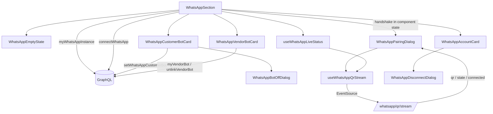

# WhatsApp

**Last updated:** 2026-09-25

## Overview

Settings → WhatsApp holds **two numbers, and they are never the same number**. The shop's own is the one the vendor pairs and their *customers* write to. Zaydak's is the one the platform owns, the vendor never pairs, and *they* write to. They sit under separate headings, never share a card, and only the first has connection controls — a merchant who conflates them hands a customer the wrong number.

Two things shape the shop's half. Linking is a **consent moment**, not a toggle: scanning grants the platform access to the vendor's entire WhatsApp account — every conversation on it, not only the ones about their shop — so the consent text sits above the button and no code is fetched until the button is pressed. And disconnection is **routine**: phones go flat, devices get unlinked, WhatsApp drops an idle session after about a fortnight. "Disconnected" is a normal state with a way out, never a red failure.

The customer assistant is a third decision, separate from both. Pairing does not switch it on: `ai_enabled` defaults to false and the card **asks** after a successful scan, because a bot enabled by the act of connecting means the first a merchant hears of it is a customer receiving an answer they never wrote. Letting that assistant **take orders in the chat** is a fourth, shown only while the assistant is on, and here it is turning the switch *on* that is confirmed: from then on an order can appear in the store that the merchant never saw being made.

## Screens / routes

| Route | What it shows |
|-------|---------------|
| `/store/[shopSlug]/settings/whatsapp` | The store number's status card (or the empty state), the Customer AI bot card once connected, and the Zaydak vendor bot card. The QR is a dialog over it. **This is the only WhatsApp route** — the assistant's own settings screen was removed when enrolment stopped needing a pairing flow. |

A static sibling of the settings `[section]` catch-all, and deliberately **not** server-preloaded the way the Plan pane is: `myWhatsAppInstance` reconciles against the live Evolution server on every read, so a server render would report a connection state as of build time to a screen whose whole job is to be current.

## Diagram

## Components

- **`WhatsAppSection`** — the pane, and the only place the two numbers are laid out relative to each other. Holds the handshake returned by `connectWhatsApp` in component state.
- **`WhatsAppEmptyState`** — before anything exists. Answers the four wrong assumptions (a second SIM, an application form, a disqualified number, typing it in) that each cost a merchant this screen.
- **`WhatsAppAccountCard`** — one card, four session states (`connecting`, `connected`, `disconnected`, `error`). Not four cards: a merchant returning after a drop needs the same object having changed.
- **`WhatsAppCustomerBotCard`** — the assistant switch, and the **ask** that precedes it. Both states carry their consequence in full; "off" is not "nothing happens". Its optional `orders` prop adds a second row, **Take orders in the chat**, with its own switch under the topics while the assistant is on. `WhatsAppSection` passes it, and so does `TelegramShopBotCard`, which renders the same component for the shop's Telegram bot (see [telegram](telegram.md)).
- **`WhatsAppBotOffDialog`** — confirms turning a live assistant off. Leads with what keeps working, because "turn off AI" reads to a merchant like "turn off WhatsApp".
- **`WhatsAppOrdersOnDialog`** — confirms turning ordering **on**, the mirror of the one above, listing three facts: the customer is sent a summary with every price and must reply to confirm it; they pay with the methods the store takes — cash on delivery, a card on a secure payment page, or a bank transfer the merchant reviews — and no card details are ever asked for in the chat; each order appears in Orders marked as placed on WhatsApp. Turning ordering off needs no dialog. Its `namespace` prop (default `settings.whatsapp.bot`) is how the Telegram bot card shares it with Telegram's own copy (`settings.telegram.shopBot.bot`).
- **`WhatsAppVendorBotCard`** — the platform assistant, whole. Deliberately quieter than the card above it, and carries no pairing control: which phone may write, a `wa.me` link, and an unlink. Its pill reports **this store's enrolment**, never the platform's uptime — see Notes.
- **`WhatsAppPairingDialog`** — the only place a QR appears: three numbered steps, the code, its lifetime drawn, and the success screen in the same surface.
- **`WhatsAppDisconnectDialog`** / **`WhatsAppTestDialog`** — unchanged in intent; the first names the consequence rather than asking a generic "are you sure", the second sends one real message through the production queue.
- **`useWhatsAppQrStream`** / **`useWhatsAppLiveStatus`** — the SSE hook, and the thin wrapper that keeps a settled screen current.

## State & forms

No staged form and no save bar: this is an action screen, not an editing one — every control is a single explicit request, so there is nothing to stage.

The handshake lives in component state and dies with the dialog. **Not the Apollo cache, not a store, not the URL** — whoever holds a QR or a pairing code can link their own device to the vendor's WhatsApp account. The status query is `cache-and-network` for the same reason a cache is wrong here: it cannot know the phone died.

**The order switch waits for the plan in one direction only.** Its gate is `useFeature("ai.agent.checkout")`: without the capability the switch is disabled with a "not included in your plan" note, and it is also disabled while the plan is still loading. A switch that is already **on** stays live whatever the plan says, so a shop that lost the capability can always turn it off — the server holds the same line, refusing only `enabled: true`. Copy lives under `settings.whatsapp.bot.orders.*` (en + ar).

**`ai_enabled: false` is ambiguous and the screen resolves it locally.** It means both "never asked" and "asked, and they said no", and the row has nothing separating them. Rather than a column for a distinction that matters for a few seconds after a scan, `WhatsAppSection` remembers the answer for as long as it is mounted: the ask shows once, and answering either way settles the card into its switch. A reload shows the settled card, which is right — a merchant who reloaded has already seen the question.

**`useWhatsAppLiveStatus` is the same stream carrying a different thing.** In the dialog it carries a *credential* that is useless once stale; on the settled screen it carries a *fact* — the session dropped, or came back — so an open tab does not need a refresh to find out. It costs almost nothing because the endpoint's poll loop is `takeWhile(state !== 'connected')`: on a connected session it stops after one tick and what remains is a Redis subscription waiting on the inbound webhook's `connection.update`. It reports a *change*, never a state — the caller re-reads the query, so a dropped frame costs a refetch rather than a wrong badge. It is off while the pairing dialog is up, because that dialog runs its own subscription on the same channel and the endpoint caps connections per shop.

The QR `<Image>` is `unoptimized`: the src is a data URL that changes every twenty seconds and is never the same twice, so there is nothing to cache and routing it through the optimizer would put a live credential in its cache directory. The bar beneath it is a CSS keyframe (`pairing-code-life`, in `globals.css`) restarted by `key={qr}` rather than a timer — a still QR gives a merchant no way to tell a live code from a frozen screen, and a decoration should not cost a re-render a tick.

## GraphQL operations

| Operation | Type | Notes |
|---|---|---|
| `myWhatsAppInstance` | Query | `available` + the instance (or null). Number arrives masked. |
| `connectWhatsApp` | Mutation | Returns the first QR, once. |
| `requestWhatsAppPairingCode` | Mutation | Recreates the instance server-side — Evolution binds the number at creation. Replaces the QR rather than sitting beside it. |
| `setWhatsAppCustomerBot` | Mutation | The assistant switch. Returns the whole instance, so the card settles on the server's answer rather than the switch's position. |
| `setWhatsAppCustomerBotOrders` | Mutation | The take-orders switch (`SET_WHATSAPP_CUSTOMER_BOT_ORDERS`). Refused with `FEATURE_NOT_AVAILABLE` when turning it on without `ai.agent.checkout`; turning it off always works. Returns the whole instance; `INSTANCE_FIELDS` includes `ai_orders_enabled`, so every instance read carries it. |
| `disconnectWhatsApp` | Mutation | Logs out; deletes nothing, and does not touch `ai_enabled`. |
| `whatsAppQrTicket` | Mutation | One-shot, 30-second, shop-scoped SSE ticket. |
| `sendWhatsAppTest` | Mutation | One real message through the production queue. Answers **queued**, not sent. |
| `myVendorBot` | Query | The platform number, and the handset enrolled **for this shop** (`link`, singular, null until its QR is scanned). Shop-scoped through `X-SHOP`. |
| `unlinkVendorBot` | Mutation | Revokes this shop's handset. Takes no argument. Not destructive in effect — scanning this shop's WhatsApp enrols it again. |

All of them are `manage_own_shop` + `X-SHOP` + ownership. See `back-end/docs/features/api/whatsapp.md` and `api/vendor-bot.md`.

## Validation

Only the pairing-code form: a phone in full international form (`+?[\d\s\-()]{8,25}`), validated server-side. A local number has no WhatsApp account to bind to, so the country code is required rather than inferred; punctuation is accepted and stripped by the API.

## Main files

- `src/features/whatsapp/components/whatsapp-section.tsx` — the pane and the two-number layout.
- `src/features/whatsapp/components/whatsapp-account-card.tsx` — the four session states.
- `src/features/whatsapp/components/whatsapp-customer-bot-card.tsx` — the switch and the ask.
- `src/features/whatsapp/components/whatsapp-pairing-dialog.tsx` — steps, QR, pairing code, success.
- `src/features/whatsapp/lib/connection.ts` — the shop card's state, derived once.
- `src/features/whatsapp/lib/assistant.ts` — the assistant card's state, keeping `available` and `link` apart.
- `src/features/whatsapp/use-whatsapp-qr-stream.ts` / `use-whatsapp-live-status.ts`
- `src/features/whatsapp/api.ts` / `types.ts`

## Notes

The linked-device limit is stated **before** the scan, not explained after it. WhatsApp allows four, and it is the phone that refuses — nothing reaches our server to be reported — so a vendor whose scan silently does nothing has no other way to find out why.

**Disconnect and Delete are different actions and the screen never merges them.** Disconnect logs the session out; the row, the instance name and `ai_enabled` all survive, so reconnecting is one scan. There is no vendor-facing delete — `teardown` runs when the shop itself goes away.

`setWhatsAppCustomerBot` writes the flag and nothing else. It is independent of `status` in both directions: set while connected, untouched by a disconnect, and still set when the number is scanned back in — a vendor who turned the assistant off did not turn it off *until their phone next goes flat*.

**The flag now has a consumer.** `WhatsAppInboundService.onCustomerMessage` files every inbound message into the shop's inbox and, when `ai_enabled` is true, hands it to the customer assistant. The assistant has no tool that places an order: with **Take orders in the chat** on, it can send a priced summary, and only the customer's own "yes", read by rule before any model runs, places the order (see `back-end/docs/features/chat-checkout.md`). The flag is read in the **worker** rather than captured when the job is queued, so a merchant switching the assistant off catches the messages already in flight, not just the next ones. See `back-end/docs/features/customer-bot.md`.

What the card promises about "off" is therefore literally true: the message is stored before any decision about the bot is made, so a merchant who declines still gets their inbox.

**The assistant card reports this store, and the pill was where that went wrong.** `myVendorBot` returns two facts that read alike and mean different things: `available` is *the platform paired its own assistant number* — true for every vendor the moment an admin does it — and `link` is *a handset is enrolled for this store*. The pill rendered the first, directly beneath a card where the same word means "your customers can reach you", so a store created a minute ago showed a green "Connected". `assistantState` (`lib/assistant.ts`) derives the three states apart and `whatsapp-section.test.tsx` pins them.

The other half of the fix is on the server: `myVendorBot` is now scoped by `X-SHOP` and returns `link` rather than `links`, so a sibling store's handset never reaches this screen at all. A handset serves one store — the one whose QR it scanned — and scanning a second store's QR moves it. That is forced by WhatsApp identifying a sender by number alone against a single platform assistant number, so the card says the assistant answers about this store only, and names the second handset as the way to have two.

**The assistant has no settings screen of its own any more.** `/settings/vendor-bot` existed to hold a pairing flow — a six-digit code the vendor sent from their handset. Enrolment moved into the shop's own QR scan, which already proves the account and the phone, so the screen had nothing left to *do*: what remained was three facts and one button, and they belong beside the number they are about. `features/vendor-bot/` survives as operations and types only, kept separate because the *binding* it describes is a different object from a WhatsApp session — a handset on the platform's number, not a store's own line.

The rail entry lives in `features/settings/components/settings-sections.ts` and its slug in `features/settings/lib/routes.ts`; the pane is re-exported through `settings-panes.tsx` like Plan and Shipping.
