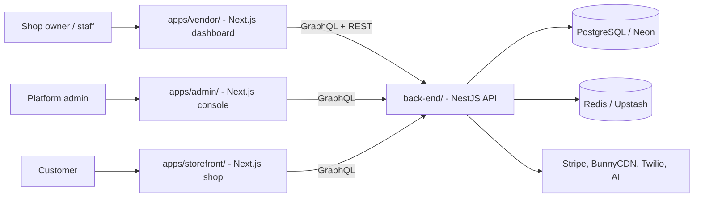

# Zaydak Documentation

This repo is a Turborepo monorepo: an API, and three Next.js apps that talk to it. Start here, then open the matching app's `docs/` folder and read its numbered sections top to bottom.



| App | What it is | Docs |
|-----|------------|------|
| `back-end/` | NestJS + GraphQL + REST + Prisma API. Owns all data and business logic. Standalone — not an npm workspace. | [back-end/docs/](../back-end/docs/) |
| `apps/vendor/` | Next.js 16 dashboard where shop owners manage products, orders, inventory, and more. Port 3001. | [apps/vendor/docs/](../apps/vendor/docs/) |
| `apps/admin/` | Next.js 16 platform console for `admin` / `super_admin`. Port 3002. Sends no `X-SHOP` header. | [apps/admin/README.md](../apps/admin/README.md) |
| `apps/storefront/` | Next.js 16 customer shop. Port 3003. Every URL is shop-scoped by its first segment (`/{shopSlug}`), so one deployment serves every storefront. | [apps/storefront/README.md](../apps/storefront/README.md) |

Shared code lives in `packages/`: `@repo/ui` (components + design tokens), `@repo/eslint-config`, `@repo/typescript-config`.

## How they connect

- Each frontend sends GraphQL to the back-end at `NEXT_PUBLIC_GRAPHQL_URL` (default `http://localhost:3000/graphql`).
- Requests carry a Bearer access token and an `X-SHOP` header naming the current shop (from the URL slug). The admin console sends no `X-SHOP`; the storefront derives it from the first path segment and sends no token at all until the customer signs in.
- GraphQL types in the frontend are generated from the back-end schema (`back-end/src/schema.gql`) by codegen.

## Run both locally

Install once: `npm install` at the repo root (covers `apps/*` and `packages/*`), plus `cd back-end && npm install` for the API, which has its own lockfile.

```bash
# Terminal 1 - API (port 3000)
cd back-end && npm run start:dev

# Terminal 2 - dashboard (port 3001)
npx turbo run dev --filter=vendor

# Terminal 3 - admin console (port 3002)
npx turbo run dev --filter=admin

# Terminal 4 - customer storefront (port 3003)
npx turbo run dev --filter=storefront
```

`npx turbo run dev` with no filter starts all three frontends at once.

Postgres, Redis and the API can also run as containers instead of the first
terminal — `docker compose up -d --build` at the repo root, and they stay up
across reboots. See [local-docker-stack.md](local-docker-stack.md) for what
changes when they do.

## Where to look

| You want to... | Go to |
|----------------|-------|
| Understand what the product is, who it serves, and what actually differentiates it (Arabic) | [zaydak-overview-ar.md](zaydak-overview-ar.md) |
| Follow the production readiness plan: feature freeze, ordered phases, acceptance evidence, and release gates (Arabic) | [production-readiness/README.md](production-readiness/README.md) |
| Run Postgres, Redis and the API as containers | [local-docker-stack.md](local-docker-stack.md) |
| Point a Vercel preview at that local API through ngrok | [vercel-local-api-ngrok.md](vercel-local-api-ngrok.md) |
| Ship to production for the first time | [go-live-checklist.md](go-live-checklist.md) |
| See what code nothing reaches (files, exports, deps, i18n keys) | [dead-code-audit.md](dead-code-audit.md) |
| See every AI surface, what each one may read or write, and what gates it | [ai-surface-audit.md](ai-surface-audit.md) |
| Review carrier shipping end to end — flows, decisions, and what is NOT proven | [reviews/oto-shipping-review.md](reviews/oto-shipping-review.md) |
| See what the RTL audit of the shared primitives fixed, and what still needs a browser | [reviews/2026-09-12-rtl-shared-primitives-audit.md](reviews/2026-09-12-rtl-shared-primitives-audit.md) |
| See every change of in-chat checkout releases 4 and 4.1 and phase 1 of phone-first identity, file by file, with how it was verified (Arabic) | [reviews/2026-09-25-chat-checkout-phone-identity-ar.md](reviews/2026-09-25-chat-checkout-phone-identity-ar.md) |
| Understand the API, data model, jobs, deploy | [back-end/docs/](../back-end/docs/) |
| Understand the dashboard, screens, editing flow | [apps/vendor/docs/](../apps/vendor/docs/) |
| Understand the customer shop, its routes and its shop scoping | [apps/storefront/README.md](../apps/storefront/README.md) |
| Deep, per-feature detail | [back-end/docs/features/](../back-end/docs/features/) + [apps/vendor/docs/features/](../apps/vendor/docs/features/) + [apps/storefront/docs/features/](../apps/storefront/docs/features/) |
| The rules for editing screens (save bar) | [apps/vendor/AGENTS.md](../apps/vendor/AGENTS.md) |
| Maintenance rules for these docs | [CLAUDE.md](../CLAUDE.md) |
