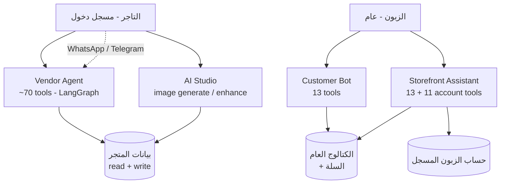
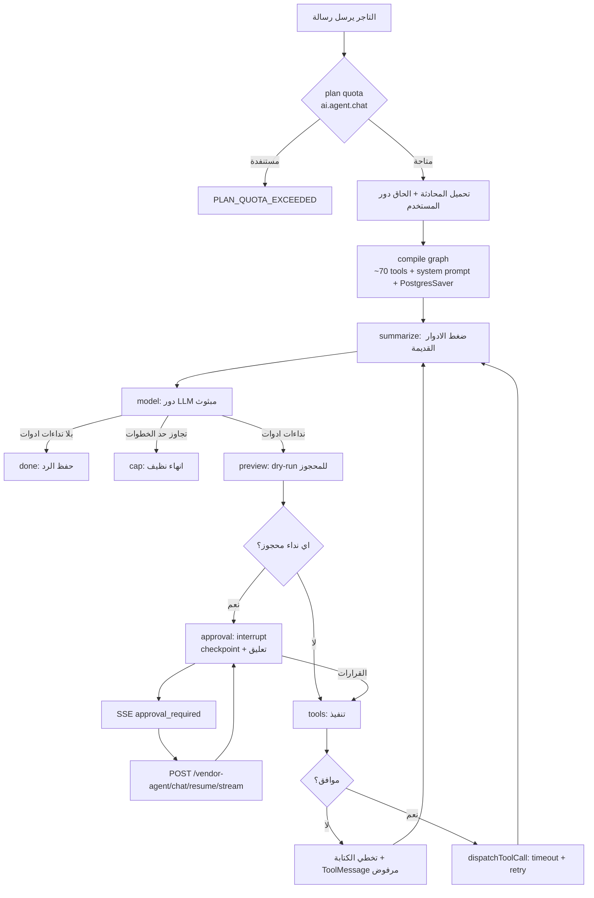

# تقرير الـ AI في المنصة — الأدوات، التدفقات، والفرص الجاهزة

**آخر تحديث:** 2026-09-07
**النطاق:** كل ما هو مبني في الكود اليوم. حيث يوجد شيء مبني لكن غير موصول، مكتوب أنه كذلك بدل وصف النية.

هذا التقرير يجيب على ثلاثة أسئلة:

1. **شو الأدوات (tools) الموجودة، ولمين؟** — قائمة كاملة لكل سطح AI.
2. **كيف يمشي كل flow، وشو الطبقات اللي بيمرّ فيها؟** — الحماية، الخطة، القناة، الموافقة.
3. **شو المبني الجاهز اللي مش موصول؟** — وهذا هو القسم الأهم عملياً (القسم السادس).

> **مرجع مكمّل:** [ai-surface-audit.md](ai-surface-audit.md) هو تدقيق أمني كُتب في 2026-09-04. هذا التقرير أحدث منه ويصحّح نقطة واحدة فيه (`AutoCategorizeService` صار موصولاً بعده).

---

## 1. الخريطة العامة

المنصة فيها **4 أسطح AI فعّالة**، وسطح خامس محذوف. كلها تشترك في نفس عميل الـ LLM — `ChatModelService` — الذي يقرّر المزوّد (Groq أو OpenRouter) والموديل من صف واحد في `integration_configs` يضبطه الأدمن من `/integrations/ai-chat`.

| السطح | الموديول | من أين يُوصل إليه | الأدوات | يكتب على DB؟ | مفتاح الحصة |
|---|---|---|---|---|---|
| **Vendor Agent** ("Sidekick") | `back-end/src/vendor-agent/` | `/store/[slug]/ai` + واتساب + تلغرام | **~70** | نعم — منتجات، كولكشنز، كوبونات، مخزون، bulk، tags | `ai.agent.chat` |
| **Customer Bot** | `back-end/src/customer-bot/` | رقم واتساب المتجر + بوت تلغرام المتجر | **13** | سلة + عنوان فقط | `ai.agent.customer` |
| **Storefront Assistant** | `back-end/src/storefront-assistant/` | بانل داخل المتجر (`shop-shell.tsx`) | **13 + 11** | سلة + عنوان فقط | `ai.agent.customer` |
| **AI Studio (صور)** | `back-end/src/ai/image/` | `/content/files/studio` + فورم المنتج | 13 عملية GraphQL | يكتب ميديا | `ai.image.generate` |
| ~~Sidekick chat~~ | `src/chat/` | — | ~~78~~ | — | **محذوف 2026-09-04** |

**لا يوجد أي سطح AI في لوحة الأدمن.** الأدمن يضبط المزوّدين (`/integrations/ai-chat`, `/integrations/ai-media`) ويقرأ جانب التكلفة على `/analytics` — لكن لا يوجد مساعد موجّه للأدمن.

---

## 2. Vendor Agent — السطح الوحيد الذي يملك صلاحية كتابة حقيقية

هذا المكان الوحيد في المنصة الذي يستطيع فيه LLM أن يغيّر بيانات متجر. الـ runtime هو **LangGraph `StateGraph`** محفوظ على Postgres عبر `PostgresSaver`، مع namespace للـ threads اسمه `vendor:<conversationId>`.

### لماذا LangGraph بدل حلقة `for` عادية؟

الحلقة القديمة لم يكن فيها مكان تتوقف عنده. الـ StateGraph يشتري ثلاثة أشياء لم تكن الحلقة قادرة عليها بنيوياً:

- **Approval interrupts** — خمس أدوات bulk/غير قابلة للتراجع تعلّق التشغيل *داخل عقدة* حتى يجيب إنسان. سابقاً كان هذا جملة في البرومبت، وجملة في البرومبت شيء يستطيع الـ prompt injection أن يجادله.
- **ذاكرة دائمة** — الأدوار القديمة تُضغط في ملخّص متدحرج بدل `history.slice(-10)` الذي كان يرميها بصمت.
- **الاستئناف** — التشغيل المعلّق هو حالة في Postgres، فالقرار يمكن أن يصل على request أو process أو instance مختلف.

### 2.1 الأدوات، مجموعة بمجموعة

المصدر: `back-end/src/vendor-agent/tools/tool-registry.ts`

الأدوات تُباع **بالمجموعة، لا بالأداة الفردية**. لا أحد يشتري "أداة البحث"؛ الناس تشتري "المساعد مسموح له يلمس التحليلات". هذا يبقي مصفوفة الخطط عند 9 مفاتيح بدل 70+.

| المجموعة | الأدوات | يحتاج entitlement إضافي |
|---|---|---|
| `catalog_read` | `search_products` · `get_product` · `list_collections` · `list_system_categories` · `list_coupons` · `get_coupon` · `get_low_stock_products` · `inventory_history` · `list_inventory_locations` · `set_task_plan` | — |
| `catalog_write` | `create_product` · `update_product` · `prepare_delete_product` · `delete_product` · `create_collection` · `update_collection` · `prepare_delete_collection` · `delete_collection` · `add_product_to_collection` · `remove_product_from_collection` · `create_coupon` · `update_coupon` · `prepare_delete_coupon` · `delete_coupon` · `create_tag` | `catalog.products` · `catalog.collections` · `discounts.coupons` (على أدوات الإنشاء) |
| `bulk_ops` | `bulk_update_price` · `bulk_update_tags` · `export_products_csv` · `import_products_csv` | `catalog.bulk_operations` (على الأولَين فقط — CSV لم يعد قدرة مدفوعة) |
| `analytics` **(23 أداة)** | `get_shop_stats` · `get_top_products` · `get_yearly_sales` · `get_category_sales` · `get_custom_range_stats` · `get_conversion_funnel` · `get_peak_hours` · `get_product_trends` · `get_daily_digest` · `get_product_performance` · `get_profit_breakdown` · `get_revenue_forecast` · `get_store_health` · `get_wishlist_demand` · `get_review_summary` · `get_abandoned_carts` · `get_customer_segments` · `get_return_rates` · `get_price_suggestions` · `get_stock_forecast` · `get_bundle_suggestions` · `compare_products` · `get_customer_questions` | `analytics.reports` (ما عدا `get_customer_questions`) |
| `inventory` | `set_inventory` · `transfer_inventory` | `inventory.transfers` (على النقل فقط) |
| `orders` | `get_orders` · `get_order` · `get_shipments` · `get_refund_requests` · `get_fulfillment_speed` · `get_shop_balance` — **كلها قراءة** | — |
| `marketing` | `get_flash_sales` · `suggest_campaign` · `suggest_notification` — **اقتراحات؛ لا شيء منها يُرسل** | — |
| `ai_content` | `generate_product_description` · `generate_product_seo` · `translate_product_content` · `generate_faq` · `draft_review_reply` | `ai.text.generate` · `ai.text.seo` · `ai.text.translate` |
| `ai_media` | `generate_product_image` | `ai.image.generate` |

**قاعدتان مهمتان في هذا الملف:**

1. **الأداة لا تأخذ مفتاح حصة خاص بها.** `generate_product_image` يستدعي `ImageGenService.generate` الذي يقيس أصلاً على `ai.image.generate`. لو أعطيناها مفتاحاً منفصلاً، نفس المال يُحسب مرتين — متجر اشترى 200 صورة يقدر يصرف 200 في الاستوديو و200 أخرى عبر الشات.
2. **`requires: []` هو الجواب الصادق للأدوات القرائية.** هي مدفوعة أصلاً بطلب `ai.agent.chat` الذي استدعاها؛ قياسها ثانيةً يحاسب مرتين على turn واحد.

**تنبيه:** مجموعة `ai_content` هي **المجموعة الوحيدة التي تصرف استدعاء LLM ثانياً** داخل نفس الـ turn.

### 2.2 ما تشتريه كل خطة

| Tier | طلبات/يوم | أقصى خطوات | ذاكرة | المجموعات |
|---|---|---|---|---|
| FREE | 200 | 5 | لا | `catalog_read` |
| BASIC | 200 | 5 | لا | + `catalog_write` |
| GROW | 500 | 10 | نعم | + `analytics` · `inventory` · `orders` |
| ADVANCED | 2,000 | 20 | نعم | + `bulk_ops` · `ai_media` · `marketing` · `ai_content` |
| PLUS | بلا حد | 40 | نعم | الكل |

`orders` تنزل عند GROW لا ADVANCED لأن "وين طلب 1042" هو السؤال الأكثر طرحاً على المساعد؛ خطة تجاوب على كل شيء إلا هذا تُقرأ **معطّلة** لا محدودة.

### 2.3 الطبقات الست التي يمر بها كل tool call

كل طبقة مستقلة — الأداة لازم تعدّيها كلها.

#### الطبقة 1 — الهوية والنطاق

`vendorAgentChat` محمي بـ `JwtAuthGuard` + `@RequirePermissions(MANAGE_OWN_SHOP)` + `ShopHeaderGuard` + `RequireShopGuard` + `ShopOwnershipGuard`، مع throttle 30 طلب/دقيقة.

كل أداة تستلم `userId` و `shopId` من الـ context المحمي، **أبداً** من شيء كتبه الموديل أو التاجر. معرّف متجر داخل رسالة هو نصّ فقط ولا يصل إلى أي استعلام.

> `ShopOwnershipGuard` أُضيف في 2026-08-12 وكان أوسع حالة من نمط أمني متكرر: 14 عملية على `MANAGE_OWN_SHOP` + `ShopHeaderGuard` بلا شيء يربط "own" بالمتجر الموجود في الهيدر — أي أن تاجراً كان يقدر يوجّه `X-SHOP` نحو ضحية ويشغّل المساعد على متجرها.

#### الطبقة 2 — الخطة (`tool-registry.ts`)

المجموعات التسعة أعلاه. **ملاحظة مقصودة:** أداة لا يعرفها الـ registry **تُمرَّر**. الـ registry يبوّب ما تبيعه الخطة، وهو ليس قائمة تنفيذ. هذا متعمّد — أداة جديدة لم يصنّفها أحد يجب أن تستمر بالعمل بدل أن تنكسر بصمت على كل متجر. (طبقتا القناة والموافقة تفشلان مغلقتين، فالحماية موجودة.)

#### الطبقة 3 — القناة (`channel-tool-policy.ts`)

قائمتا سماح متداخلتان، وكلتاهما تتخلّف إلى المنع:

- **مستوى القناة** — قناة غائبة عن `CHANNEL_ALLOW_LISTS` تحصل على **لا شيء**.
- **مستوى الأداة** — أداة غير مذكورة داخل قائمة القناة تُرفض.

`WEB` (الداشبورد) ترجع مبكراً وتسمح بالكل — هذا السطح بُنيت له كل أداة، والتقييد هناك إعادة تقرير لما قررته الخطة أصلاً. واتساب وتلغرام يتشاركان مجموعة قراءة مضيّقة (`CHAT_READ_ONLY`).

**مُستبعد عن كل قنوات الشات عمداً:** `set_task_plan` (يرسم checklist في الداشبورد) · `export_products_csv` / `import_products_csv` (ملف لا تحمله القناة) · `generate_product_image` (يحاسب توليد صورة مقصودة لفورم).

> درس مدفوع: `list_system_categories` كانت ناقصة من هذه القائمة بينما البرومبت يوجّه الموديل إليها مباشرة. Groq يتحقق من كل tool call مقابل `request.tools`، فأول سؤال عن تصنيف على تلغرام أفشل الـ turn كاملاً بـ `tool call validation failed` بدل أن يتدهور. أي قراءة يسمّيها البرومبت **يجب** أن تكون هنا.

#### الطبقة 4 — Approval interrupt (`graph/approval-policy.ts`)

خمس أدوات تُعلّق تشغيل LangGraph داخل عقدة حتى يجيب إنسان:

`bulk_update_price` · `bulk_update_tags` · `import_products_csv` · `set_inventory` · `transfer_inventory`

وعلى قنوات الشات تُضاف أربع كتابات مباشرة لنفس البوابة: ثلاث كتابات كولكشن + `create_tag`.

ثلاثة من الخمسة تُشغَّل **dry-run أولاً** في عقدة `preview`، فبطاقة الموافقة تقتبس نطاق أثر محسوباً على السيرفر ("247 منتج") بدل تخمين الموديل. الحل يفشل مغلقاً مرتين: معرّف نداء غير مطابق يُحتسب رفضاً، وكذلك payload قرارات مشوّه.

**هذه خاصية runtime لا تعليمة برومبت** — "سوّيها بدون ما تسأل" المحقونة لا تجد شيئاً تجادله.

#### الطبقة 5 — الحذف على مرحلتين

`delete_product` / `delete_collection` / `delete_coupon` لا تعمل وحدها. الـ `prepare_delete_*` المقابلة تُصدر token أحادي الاستخدام في Redis (TTL 60 ثانية) مربوطاً بالفعل والكيان والمستخدم والمتجر، ويحمل لقطة من الصف. خطوة الاستهلاك ترفض token تغيّر كيانه تحته.

هذا **لم يُنقل عمداً** إلى آلية الـ interrupt: الـ token هو أيضاً إثبات ضد الـ replay، وهو ما لا يوفّره الـ interrupt.

#### الطبقة 6 — وساطة الفورم

`create_*` / `update_*` للمنتجات والكولكشنز والكوبونات **لا تكتب شيئاً من المساعد على الداشبورد**. ترجع نيّة `navigate_to_form`، والتاجر يضغط Save على الفورم الحقيقي. **الفورم هو الموافقة.**

على قناة شات، `ChatActionRunner` يحوّل الـ prefill إلى نفس مُدخل الخدمة، يعرضه كبطاقة، ويؤكّده عبر نفس دالة الخدمة التي يستدعيها الـ mutation الخاص بالفورم.

`create_tag` هو الكتابة الكتالوجية المباشرة الوحيدة غير الموسَّطة بفورم على الداشبورد، والاستثناء محدود: الوسم اسم و slug، بلا سعر ولا مخزون ولا صفحة تواجه الزبون.

### 2.4 تدفق turn كامل

**الذاكرة (الضغط المتدحرج):** عقدة `summarize` تعمل قبل كل دور موديل ولا تفعل شيئاً حتى تتجاوز النافذة 24 رسالة؛ فوق ذلك تضغط كل ما هو أقدم من آخر 12 في حقل `summary`. القطع يقع **دائماً قبل `HumanMessage` مباشرة** — القطع بين `AIMessage` يحمل `tool_calls` وبين `ToolMessage` أجوبتها ينتج طلباً يرفضه المزوّد صراحةً، أي أنه يعطب الـ thread بدل أن يقلّصه.

**تكلفة الـ turn:** `UsageTracker` (LangChain callback) يركب كل استدعاء LLM في الدور — حلقة المساعد **و** المُلخِّص، لأن الضغط صرف على نفس الدور. `cost_cents` يأتي من `usage.cost` الخاص بـ OpenRouter (مطلوب عبر `usage: {include: true}`) ومُقرَّب **للأعلى** كي لا يُنقص الدفتر أبداً.

---

## 3. Customer Bot + Storefront Assistant — دماغ واحد، ناقلان

`StorefrontAssistantService` هو **ناقل (transport)** فوق `CustomerBotService`، وليس مساعداً ثانياً. كل ما يقرّر ما يُقال — الأدوات، البرومبت، تنظيف الحقن، مصيدتا المخرجات — يعيش في `CustomerBotService` ومشترك مع واتساب.

مساعد ويب منفصل كان سيضاعف السطح الذي يصل فيه غريب إلى موديل، وكان الاثنان سيتباعدان أول مرة يُصلَح أحدهما.

**الفروق الأربعة كلها سطحية:**

| الفرق | البانل | واتساب/تلغرام |
|---|---|---|
| التنفيذ | متزامن (شخص ينتظر spinner)، مع SSE اختياري | من طابور (لا أحد ينتظر) |
| المخرجات | **بطاقات منتجات** مهيكلة | جملة نصية |
| الهوية | **توكن JWT** | رقم هاتف |
| التخزين | **لا شيء** — النص في المتصفح | thread في inbox التاجر |

### 3.1 الأدوات الثلاث عشرة (على كل القنوات)

| الأداة | ماذا تفعل |
|---|---|
| `search_products` | الكتالوج العام فقط — `findAllStorefront`، PUBLISH + نشط، `where` صارم، `select` صريح |
| `get_shop_info` | تفاصيل المتجر العامة |
| `lookup_national_address` | يحلّ رمز العنوان الوطني السعودي |
| `save_delivery_address` | يحفظ عنواناً محلولاً (لا يحفظ غير المحلول أبداً) |
| `send_login_link` | يرسل رابط دخول سحري |
| `request_shop_owner` | يسجّل تصعيداً؛ المعالج يوقف المساعد ويرفع الحدث |
| `add_to_cart` | كتابة سلة، الكمية مقصوصة 1–10، المنتج يُعاد فحصه مقابل المتجر و PUBLISH |
| `get_my_account` | تفاصيل الزبون المسجّل |
| `find_coupons` | أكواد الخصم التي يعرضها هذا المتجر |
| `browse_faqs` | الأسئلة الشائعة المنشورة |
| `get_active_sales` | التخفيضات الفلاشية الجارية الآن |
| `get_return_policy` | سياسة الإرجاع والاستبدال |
| `get_answered_questions` | أسئلة المنتجات التي أجاب عنها المتجر |

**الحد ليس أن الموديل أُمر بالتصرّف** — بل أن كل قراءة تمرّ عبر نفس مسار الكود الذي يستعمله المتجر العام. `findAllStorefront` **لا يستطيع** تسريب سعر التكلفة حتى لو طُلب منه: الـ mapper المُنمَّط لا يملك `cost_per_item_cents` ليُرجعه.

### 3.2 الأدوات الإحدى عشرة الإضافية — بانل المتجر فقط

`track_order` · `reorder_previous` · `get_refund_status` · `get_my_wishlist` · `get_loyalty_points` · `get_spending_summary` · `get_payment_methods` · `get_my_addresses` · `get_my_notifications` · `get_my_product_alerts` · `get_cart_summary`

البوابة في `customer-bot.channel-policy.ts` هي **شرطان، كلاهما مطلوب**:

1. القناة هي `panel`، **و**
2. `userId` محلول من توكن تلك القناة نفسها.

**القاعدة التي يوجد هذا الملف لأجلها: أداة الحساب تحتاج حساباً، والرقم ليس حساباً.**

`userId` مشتقّ من الهاتف حقيقي — المعالج يحلّه فعلاً من الرقم الذي وصلت منه الرسالة — لكنه يعرّف **جهازاً** لا شخصاً. المشغّلون يعيدون تدوير الأرقام، وانتحال الشريحة يأخذها. جيّد كفاية لتقرير "سلة مَن نكتب فيها"، وهو خطأ قابل للتصحيح؛ غير كافٍ لقراءة سجل مشتريات، وهو خطأ غير قابل للتصحيح.

**التطبيق بأن الأدوات لا تُبنى أصلاً، لا بأنها تُرفض:** لا رفض يجادله حقن، ولا مسبار يفرّق بين "غير مسجّل" و"قناة خاطئة". قائمة الأدوات ببساطة أقصر.

كل استعلام حساب أيضاً مقيّد بالمتجر حيثما يحمل الصف واحداً (`Order`, `Refund`, `NotifyLog`, `Cart`) — بانل متجر X يعرض لزبون طلباته من متجر Y يخبر زبون التاجر أين يتسوّق أيضاً. `get_payment_methods` يرجع العلامة وآخر أربعة أرقام فقط.

### 3.3 مصيدتا المخرجات

- `detectSuspiciousOutput` — يبحث عن أشكال بيانات اعتماد.
- `customer-bot.leak.ts` — يمسك الموديل وهو يسرد تفكيره/قواعده بدل أن يجيب.

الثانية موجودة لأنها **شُحنت كتسريب حقيقي**: زبون استلم الـ system prompt وجرد الأدوات حرفياً على رقم التاجر نفسه.

هذا أيضاً سبب أن الـ SSE في البانل **يحمل التقدّم لا التوكنات**: كلتا المصيدتين تحكمان على ردّ **مكتمل** فقط. بثّ التوكنات كما ينتجها الموديل يضع التسريب على الشاشة ثم يكتشف أنه تسريب — وهذا ليس فحصاً. لذلك `askStream` يبعث `tool_start` و `products` أثناء الدور، والنص مرة واحدة كاملاً في إطار `answer` الأخير. البانل يكشفه تدريجياً، وهي نفس تجربة القراءة بلا نفس الخطر.

### 3.4 حصص الزبائن

| Tier | ردود/شهر | أقصى جولات أدوات |
|---|---|---|
| FREE | **0** (مطفأ) | — |
| BASIC | 500 | 3 |
| GROW | 2,000 | 3 |
| ADVANCED | 10,000 | 5 |
| PLUS | بلا حد | 5 |

شهرية لا يومية لأن حركة الزبائن متذبذبة، ومنفصلة عن حصة التاجر كي لا يأكل يوم سبت مزدحم مخصّصه. البانل عليه throttle إضافي 20/دقيقة لكل IP — وهو أوسع سطح يمكن الوصول إليه في المنتج.

### 3.5 حدّان مهمّان

- **لا توجد أداة طلبات على قناة هاتفية.** أسئلة الطلبات تذهب للتاجر عبر `request_shop_owner`.
- **المساعد يقدر يملأ سلة ويحفظ عنواناً لكن لا يقدر ينشئ طلباً.** `createOrder` محمي بـ `JwtAuthGuard` ولا توجد أداة طلب عمداً. الزبون يُنهي على صفحة الدفع، والسلة والعنوان جاهزان.

---

## 4. الـ AI الذي يعمل في الخلفية (بلا شات)

| الخدمة | الحالة | الوصف |
|---|---|---|
| **Product Enrichment** | يعمل | طابور `product-enrichment` على كل إنشاء/تعديل منتج، يملأ `ai_keywords`, `brand`, `target_audience`. **يملأ الفراغات فقط** ولا يستبدل قيمة كتبها تاجر. و**يفحص قبل أن يصرف**: منتج لا ينقصه شيء يرجع قبل استدعاء الموديل. |
| **Embedding Sync** | يعمل | `triggerEmbedding` (أدمن) — دفعات من 5، مقارنة SHA-256 لتخطّي غير المتغيّر، upsert في `product_embeddings` (pgvector). |
| **Search Pipeline** | يعمل داخلياً | تطبيع عربي + CAMeL lemmatize، ثم استخراج نية، ثم 5 مسارات متوازية (vector · keyword · tag · category · trigram)، ثم دمج RRF، ثم إعادة ترتيب cross-encoder. للمسجّلين مزج 80/20 بين embedding الاستعلام ومتجه تفضيلاتهم. |
| **Proactive Insights** | يعمل | 3 كواشف (`low-stock`, `sales-drop`, `trending-product`) تكتب في `ai_insights` وتظهر في `InsightsCard` بالداشبورد. سقف 3 رؤى/يوم/متجر لمنع إرهاق التنبيهات، ونافذة إزالة تكرار 12 ساعة. |
| **Attribute Suggestion** | يعمل (فرونت + باك-إند) | `suggestProductAttributes` — يقترح قيم metafields من اسم ووصف المنتج. **مجاني على كل خطة عمداً.** |
| **Alt Text** | يعمل | `suggestFileAlt` من `apps/vendor/src/features/files/components/file-detail-sheet.tsx` |
| **Content / Image Moderation** | جزئي | مربوط بتوليد الصور و vendor-agent فقط |
| **Python AI sidecar** | يعمل | `/api/ai/embed` · `/api/ai/rerank` · `/api/ai/preference-vector` · `/api/ai/arabic/analyze` · `/api/ai/arabic/lemmatize` — خلف circuit breaker (يفتح فوق 50% أخطاء في نافذة 60 ثانية، يُعاد بعد 30) |

---

## 5. ضوابط التكلفة العابرة للأسطح

| الضابط | النطاق | الملف |
|---|---|---|
| حصة الخطة | لكل متجر، لكل مفتاح قدرة | `plans/entitlements.service.ts` |
| حدّ معدّل المستخدم | لكل مستخدم/ميزة، ساعة + يوم، Redis | `ai/ai-rate-limiter.service.ts` |
| ميزانية المنصة | سقف يومي بالسنت عبر كل المتاجر | `ai/ai-budget.service.ts` |
| GraphQL throttle | لكل IP | `common/guards/throttle.guard.ts` |
| سقف الخطوات | لكل turn، من tier الخطة | `vendor-agent/graph/nodes/cap.node.ts` |

**تكلفة كل ميزة بالسنت:** `embed` 1 · `rerank` 2 · `moderation` 3 · `image` 4 (محجوز ثم يُصحَّح) · `vision` 5 · `chat` 25 · `content` 50.

**كل ميزة LLM تتدهور بدل أن ترمي خطأ** عند غياب مزوّد مضبوط: `ChatModelService.model()` يرجع `null` والمستدعي يسقط إلى جواب مبني على قواعد.

> لماذا معرّف الموديل إعداد لا كود: Groq تقاعدت `llama-3.3-70b-versatile` و `llama-3.1-8b-instant` بلا إشعار. كل استدعاء LLM في المنصة بدأ يجيب `404 model_not_found`، ولأن `AgentService` يلتقط الأخطاء ويستبدلها بجملة لطيفة، تدهورت **بصمت** كلٌّ من: الشات، التصنيف، الإشراف، الكوبونات، الأسئلة الشائعة، تحليل المشاعر، واستخراج النية — بينما الكونسول ما زال يعرض مفتاحاً صالحاً.

---

## 6. الجاهز الذي يمكن ربطه بالـ AI

هذا القسم هو الأهم عملياً. كل ما يلي **مبني ويعمل** لكنه غير موصول.

### 6.1 `aiSearch` و `aiRecommendations` — مبنيّان بالكامل، ولا تطبيق واحد يستدعيهما

**أقوى فرصة موجودة.** الـ pipeline كامل (بحث هجين + RRF + rerank + متجه التفضيلات) والاستعلامان حيّان على الـ schema، لكن البحث في `apps/vendor` و `apps/admin` و `apps/storefront` يعطي **صفر استدعاءات** خارج ملفات `generated/graphql.ts`.

الستورفرونت ما زال يستعمل `storefrontProducts` بفلترة نصية عادية — وهذه بالضبط المشكلة التي أُصلحت لمساعد المتجر في 2026-09-04 (متجر يبيع *MacBook Air M3* كان يقول للناس إنه لا يملك لابتوبات).

**العمليتان المتاحتان:**

| العملية | المدخلات | الحماية |
|---|---|---|
| `aiSearch` | `query`, `language`, `min_price`, `max_price`, `in_stock`, `shop_id`, `limit` (1–50) | `OptionalJwtGuard` + `ShopHeaderGuard`، 20 طلب/دقيقة لكل IP |
| `aiRecommendations` | `product_id?`, `strategy?` (`similar` / `trending` / `hybrid`), `shop_id?`, `limit` | نفسها |

**الربط الجاهز:**

- بحث الستورفرونت ← `aiSearch` (يدعم العربي كاملاً عبر CAMeL والتطبيع)
- "منتجات مشابهة" في صفحة المنتج ← `aiRecommendations(strategy: "similar")`
- "الأكثر رواجاً" في هوم المتجر ← `aiRecommendations(strategy: "trending")`
- شخصنة للزبون المسجّل ← `strategy: "hybrid"` (الافتراضي، ويمزج متجه تفضيلاته)

**انتبه:** الستورفرونت يستعمل `<PreloadQuery>` + `useSuspenseQuery` للصفحات العامة. `useQuery` **يُبطل الفائدة كلياً** — لا يعلّق، فالـ server render يرجع `loading: true` ويشحن skeleton.

### 6.2 ~~`suggestProductAttributes` غير مربوطة~~ — تصحيح: مربوطة وتعمل

`back-end/src/category-attributes/attribute-suggestion.service.ts` يقرأ العنوان والوصف اللذين كتبهما التاجر فعلاً، ويعرض قيم الـ metafields.

**لماذا هذا مهم:** النصف الآخر موجود منذ فترة — الأدمن يقيّم صفوف `CategoryAttributeDefinition` لكل تصنيف، والفورم يعرضها. لكن **لا أحد يملأها**: العطر عنده 14 حقلاً محتملاً وتاجر جاء لينشر منتجاً لا يجيب على أيٍّ منها، فالفلاتر التي تُبنى عليها (`attribute-filter.compiler.ts`) لا تطابق شيئاً والكتالوج غير قابل للفلترة مهما كان المخطط جيداً.

**مجاني على كل خطة عمداً** — القيم هي ما يجعل الكتالوج قابلاً للفلترة والتصنيف يستحق العناية، فالمنصة تريد كل متجر ينتجها، بما فيها المتاجر المجانية التي كتالوجاتها غير القابلة للفلترة هي المشكلة أصلاً. ما يحدّه هو حدّ معدّل المستخدم وميزانية المنصة اليومية.

> ⚠️ **تصحيح (2026-09-07).** النسخة الأولى من هذا التقرير قالت إن هاي الـ mutation لا يستدعيها أي فرونت. **غلط** — البحث كان على `suggestAttributes` بدل الاسم الفعلي `suggestProductAttributes`.

**الواقع: الفيتشر مكتملة وشغّالة بالكامل.**

| الطبقة | الملف |
|---|---|
| Mutation | `apps/vendor/src/features/products/api/mutations.ts` — `SUGGEST_PRODUCT_ATTRIBUTES` |
| Hook | `.../components/form/cards/use-attribute-suggestions.ts` |
| UI | `.../components/form/cards/attribute-values-card.tsx` — بلوك "N suggestions available / Accept all" مع retry |
| مركّبة في | `.../components/form/product-form.tsx` |
| اختبارات | `.../components/__tests__/use-attribute-suggestions.test.tsx` |

فلا شغل مطلوب هنا. الشيء الوحيد اللي بقي صحيح من هذا القسم هو أن `ai.catalog.generate_attributes` مفتاح معرّف في مصفوفة الخطط ولا يفحصه أحد — وهذا **مقصود** هنا (مجاني على كل خطة)، فالقرار الصحيح له هو **حذفه من مصفوفة الخطط**، لا تفعيله — خطة تعرض حدّاً لميزة مجانية هي وعد كاذب.

### 6.3 ~~خمس خدمات AI يتيمة~~ — ✅ محذوفة (2026-09-07)

التحقيق قلب التوصية الأصلية. ما لقيناش خمس مزايا مستنية التشغيل — لقينا خمس خدمات **إمّا مكرَّرة أو أسوأ من اللي بيشحن**:

| الخدمة | ليش انحذفت |
|---|---|
| `SalesForecastService` | `get_revenue_forecast` كُتب **تحديداً ليحلّ محلها** وتعليقه بيقول: الطريقة القديمة "طبّقت مُضاعِف اتجاه على ثلاثة أشهر، وهذا خط مستقيم مُلبَّس كنموذج". ربطها كان تراجعاً. |
| `DynamicPricingService` | `get_price_suggestions` بيرجّع **اتجاهات لا أسعار** عمداً ("لا تقتبس سعراً جديداً كأنه محسوب"). هاي كانت ترجّع `PriceSuggestion` محسوباً — اللي عقد تلك الأداة نفسه بيمنع عرضه. |
| `SmartCouponService` | `suggestBundles` مكرِّرة لـ `get_bundle_suggestions`، و`suggestCoupons` متداخلة مع `suggest_campaign`. والأخطر: `autoCreateCoupon` **بيكتب كوبوناً مباشرة على قاعدة البيانات** — بلا بوابة خطة، بلا approval interrupt، بلا audit log، بلا idempotency. ربطها كان بيعيد بالضبط صنف الكتابة غير المحروسة اللي التصميم ذو الست طبقات موجود لمنعه. |
| `ChurnPredictionService` | مُصنِّف heuristic بـ192 سطر، متجاوَز بـ`src/customer-segments/` — محرك RFM ناضج فيه `AT_RISK` جاهزة، وقالب شريحة، و`predicted-spend-tier.service.ts`، و`segment-insights.service.ts`، وشاشة `/segments`. |
| `AutoFaqService` | `generateFaqSuggestions` مكرِّرة لأداة `generate_faq` الشغّالة، اللي كمان عندها الحدّ الصحيح: "التاجر بيضيف الأسئلة من شاشة الـ FAQ — إنت ما بتقدر تحفظ". |

**الدرس:** الخدمة اليتيمة مش ميزة مجانية. أربعة من الخمسة كانوا نسخاً أقدم وأخشن من شي المنصة أعادت بناءه صح، والخامس كان ثغرة. وجودهم في قائمة providers كان بيُقرأ كقدرة كامنة وهو خطر كامن.

~1,440 سطر انحذفوا. محفوظين في git عند `3da4ceb7`.

> **ملاحظة:** `AutoCategorizeService` — اللي التدقيق القديم عدّها سادسة — **مربوطة فعلاً** عبر `ProductEnrichmentService` في عامل الطابور.

### 6.4 أحد عشر مفتاح قدرة ميت — ولا واحد منهم بدّه "أضف فحص"

**تسعة مفاتيح صارت مُنفَّذة** اليوم (كانت ستة): `ai.text.rewrite` و`ai.text.summarize` جو مع نقل محرر Tiptap، و`ai.vision.alt_text` على مساره الحيّ.

الأحد عشر الباقية **كل واحد منها غير قابل للتنفيذ لسبب محدد**، مش لإهمال:

| المفتاح | مسار حيّ؟ | ليش الحصة لكل متجر أداة خاطئة | الحكم |
|---|---|---|---|
| `ai.image.edit` / `remove_background` / `upscale` | عبر enhance | بتشتغل داخل enhance run بيحجز أصلاً `ai.image.generate`. مفتاح ثانٍ = حجز مزدوج لنفس استدعاء المزوّد — نفس الخطأ اللي `tool-registry.ts` بيوثّقه | دمج |
| `ai.vision.analyze` | `enhance-vision.service.ts` | قراءة vision مخبّأة بتركّب برومبت الـ enhance. حجز الـ run بيغطيها | دمج |
| `ai.search.semantic` | **نعم** — `findAllStorefront` | **مسار عام، بلا مصادقة، مرة لكل عرض صفحة كتالوج.** استنفاده بيوقّف بحث المتجر عن زبائنه هو، وأي غريب بيقدر يستنفد حصة منافس بمجرد فتح متجره. هاي ثغرة تخريب لا حدّ | حذف |
| `ai.recommendation.generate` | **نعم** — `findStorefrontRecommendations` | نفس المسار العام، وصارت SQL خالصة (pgvector + سلوك) بلا أي صرف AI يُقاس | حذف |
| `ai.embedding.generate` | `EmbeddingSyncService` | مدفوعة بـ`triggerEmbedding` اللي بيحتاج `MANAGE_ALL_SHOPS` وبيكنس المنصة كلها. مش استهلاك متجر لتُحاسب عليه | حذف |
| `ai.catalog.generate_attributes` | **نعم** — `suggestProductAttributes` | مجانية على كل خطة بقرار صريح. مفتاح بيعلن حدّاً على ميزة مجانية عمداً هو وعد كاذب | حذف |
| `ai.catalog.generate_description` | لا | مكرَّر — `generate_product_description` بيحاسب على `ai.text.generate` | حذف |
| `ai.catalog.generate_products` | لا | توليد منتجات بالجملة غير موجود وغير مخطَّط | حذف |
| `ai.catalog.generate_variants` | لا | غير موجود | حذف |

**واكتشاف جانبي مهم: حذف مفتاح كان عملية من خطوتين، والثانية كانت ناقصة.** `seed-plans.ts` كان بيعمل upsert للمفاتيح الموجودة بالـ registry فقط وما بيلمس الباقي — فحذف مفتاح كان بيخلّي صفّه في جدول `features` بـ`is_active: true`: لسه ظاهر في محرر الخطط، لسه ماسك صفوف `PlanEntitlement`، وما عاد موثّقاً في الكود. هاي نفس مشكلة "مباع وغير مُنفَّذ" من الاتجاه المعاكس.

✅ **انصلحت:** الـ seed صار **يعطّل** (لا يحذف) أي صفّ مفتاحه غادر الـ registry. التعطيل مقصود — `PlanEntitlement` بيتتالى على حذف `Feature`، فالحذف الصلب كان بيرمي حدوداً ضبطها أدمن بصمت. و`EntitlementsService` و`featureCatalog()` أصلاً بيفلتروا على `is_active`، فالتقاعد بيسري من أول تشغيل seed بلا migration.

**تنفيذ التسعة خلص. تقاعد الأحد عشر قرار تسعير ولسه ما انتخذ** — الآلية جاهزة والأحكام فوق.

### 6.5 ~~محرر Tiptap AI يتجاوز الباك-إند~~ — ✅ منفّذ (2026-09-07)

`apps/vendor/src/app/api/ai/editor/route.ts` يستدعي **Groq مباشرة** من Next.js بمفتاح `GROQ_API_KEY` بيئي، ويُستدعى من `apps/vendor/src/shared/lib/editor-ai.ts` عبر `ai-menu.tsx` و `ai-ask-button.tsx`.

ما يفوته:

- لا حصة خطة، ولا حدّ معدّل، ولا ميزانية منصة
- لا إشراف (moderation) على المخرجات
- لا يحترم مزوّد `/integrations/ai-chat` — لو غيّر الأدمن المزوّد، المحرر يبقى على Groq
- لا يسجّل في `usage_events` ولا `ai_usage`، فلا يظهر على `/analytics` للأدمن
- مفتاح API في بيئة الفرونت-إند بدل الخزنة المشفّرة `SecretCryptoService`

وأفعاله — `improve` · `shorten` · `extend` · `simplify` · `translate-en` · `translate-ar` · `custom` — تطابق **بالضبط** مفاتيح `ai.text.rewrite` و `ai.text.summarize` و `ai.text.translate` الميتة.

> ✅ **منفّذ 2026-09-07.** الـ route محذوف، وحلّ محلّه `aiEditorTransform` — mutation في `back-end/src/ai/content/ai-editor.resolver.ts` خلف سلسلة الحراس الكاملة (JWT + `MANAGE_OWN_SHOP` + X-SHOP + ownership + throttle).
>
> **وأفعاله السبعة صارت تحاسب على أربعة مفاتيح**، ثلاثة منها كانت ميتة:
>
> | الفعل | المفتاح |
> |---|---|
> | `IMPROVE` / `EXTEND` / `SIMPLIFY` | `ai.text.rewrite` |
> | `SHORTEN` | `ai.text.summarize` |
> | `TRANSLATE_EN` / `TRANSLATE_AR` | `ai.text.translate` |
> | `CUSTOM` | `ai.text.generate` |
>
> المحاسبة **بالأحرف**: حجز قبل استدعاء الموديل من تقدير المدخل، ثم commit بالطول الفعلي للردّ. وكل مسار فشل يعمل release — لا مزوّد، ردّ فارغ، rate limit، أو مخرج محجوب — فالمتجر لا يدفع ثمن عطل.
>
> ملاحظة معمارية: `runAiEditorAction` **احتفظ بتوقيعه**، لأن مستدعييه (`ai-menu.tsx` و `ai-ask-button.tsx`) من سقالة Tiptap المعفاة في `eslint.config.mjs` — فالـ Apollo client يصل عبر `shared/lib/auth/apollo-bridge.ts` (نفس الجسر اللي `clearApolloCache` بستعمله) بدل argument جديد يمسحه أول sync.
>
> بقيت **11 مفتاحاً** ميتاً بدل 14 — انظر 6.4.

### 6.6 ~~المحتوى المُنشأ من المستخدمين غير مفحوص~~ — ✅ المراجعات والأسئلة مفحوصة (2026-09-07)

`ContentModerationService` موجود ويعمل — لكنه **ليس** مربوطاً بـ:

- `reviews` (المراجعات)
- `questions` (أسئلة المنتجات)
- `feedbacks`
- `abusive-reports`
- `conversations` (رسائل الزبون والتاجر)

تكلفة الفحص 3 سنت والخدمة جاهزة ومستعملة أصلاً في مسارين.

> ✅ **منفّذ جزئياً 2026-09-07.** `UgcModerationService` مربوط بـ `ReviewsService.create` و `QuestionsService.create`.
>
> ثلاث قواعد هي الفيتشر كلها:
>
> 1. **يفشل مفتوحاً في كل اتجاه** — عطل، ميزانية مستنفدة، rate limit، حكم `degraded`: كلها تُنشر. رفض مراجعة زبون شرعية لأن فوترتنا معطلة ضرر فوري على التاجر.
> 2. **يرفض `block` فقط، لا `flag_for_review`** — ما في عمود حالة إشراف على `Review`/`Question`، فما في وين تُحجز المُعلّمة ولا شاشة تعرضها.
> 3. **يُبقي طبقة الـ regex** — عكس كل مستدعٍ موجود. هناك الـ URL رابط لوحة ناولناه للتاجر؛ هنا الـ URL داخل مراجعة غريب هو بالضبط إشارة السبام. نفس الخدمة، إعداد معاكس، والسبب هو **مين بيكتب**.
>
> **بقي غير مفحوص:** `feedbacks`، `abusive-reports`، و`DirectMessage` في inbox الزبائن.

### 6.7 لا يوجد سطح AI للأدمن

الأدوات الإدارية الثمانية القديمة (`withdrawal_manager`, `refund_approval`, …) محذوفة ومحفوظة في git history عند `1934615:back-end/src/chat/tools/admin/`. كانت أحدّ اكتشاف في التدقيق: أدوات تحرّك أموالاً خلف فحص دور فقط، بلا بوابة خطة وبلا approval interrupt.

**لو أُعيدت، تحتاج الاثنين قبل أي شيء آخر.**

---

## 7. ترتيب مقترح للأولويات

| # | المهمة | الجهد | الأثر |
|---|---|---|---|
| ~~1~~ | ~~ربط `aiSearch` ببحث الستورفرونت~~ | — | ✅ **منفّذ 2026-09-07** — في `findAllStorefront`؛ صفر تغيير فرونت |
| ~~2~~ | ~~ربط `aiRecommendations`~~ | — | ✅ **منفّذ 2026-09-07** — `storefrontRecommendations` + رفّ PDP ورفّ الهوم |
| ~~3~~ | ~~زر "اقترح القيم" في فورم المنتج~~ | — | **منفّذ أصلاً** — خطأ في التقرير، انظر 6.2 |
| ~~4~~ | ~~نقل محرر Tiptap AI إلى الباك-إند~~ | — | ✅ **منفّذ 2026-09-07** — `aiEditorTransform`؛ الـ route محذوف |
| ~~5~~ | ~~حسم الخدمات الخمس اليتيمة~~ | — | ✅ **محذوفة 2026-09-07** — كلهن مكرَّرة أو أسوأ مما يشحن؛ انظر 6.3 |
| ~~6~~ | ~~فحص المفاتيح~~ | — | ✅ **تسعة مُنفَّذة + آلية التقاعد جاهزة**؛ تقاعد الـ 11 قرار تسعير — انظر 6.4 |
| ~~7~~ | ~~`ContentModerationService` على المراجعات والأسئلة~~ | — | ✅ **منفّذ 2026-09-07** — `UgcModerationService`؛ انظر 6.6 |
| ~~8~~ | ~~تفعيل `ai.vision.alt_text`~~ | — | ✅ **منفّذ 2026-09-07** — حجز لكل صورة قبل استدعاء الـ vision |

**كل بنود القائمة الأصلية خلصت.** الباقي قرارات أو شغل جديد ظهر أثناء التنفيذ:

| # | ما بقي | نوعه |
|---|---|---|
| أ | تقاعد الأحد عشر مفتاحاً من مصفوفة الخطط | **قرار تسعير** — الآلية جاهزة، الأحكام في 6.4 |
| ب | `feedbacks` و`abusive-reports` و`DirectMessage` لسه بلا فحص إشراف | شغل صغير |
| ج | `flag_for_review` بيُنشر ويُسجَّل فقط — الطابور بدّه عمود `moderation_status` وشاشة | شغل متوسط |
| د | `AltTextService` بيقرأ `OPENROUTER_API_KEY` من البيئة مباشرة، فبيتجاهل مزوّد الأدمن مثل ما كان يعمل الـ route المحذوف | يحتاج `ChatModelService` يبني موديل vision |
| هـ | رفّ الرواج بيرتّب أقلية الحركة: كل كتّاب `user_behavior_events` مشروطون بـ`userId` مسجّل | شغل متوسط |
| و | لا يوجد سطح AI للأدمن (6.7) | لم يتغيّر |
---

## 8. المراجع

**وثائق:**

- [docs/ai-surface-audit.md](ai-surface-audit.md) — تدقيق أمني، 2026-09-04
- [back-end/docs/features/ai.md](../back-end/docs/features/ai.md) — البحث والتوصيات والإثراء
- [back-end/docs/features/vendor-agent.md](../back-end/docs/features/vendor-agent.md)
- [back-end/docs/features/customer-bot.md](../back-end/docs/features/customer-bot.md)
- [back-end/docs/features/storefront-assistant.md](../back-end/docs/features/storefront-assistant.md)
- [back-end/docs/features/ai-image.md](../back-end/docs/features/ai-image.md)
- [back-end/docs/features/vendor-bot.md](../back-end/docs/features/vendor-bot.md)
- [TODO.md](../TODO.md) — قسم "AI & Sidekick" فيه **118 بنداً مفتوحاً**

**ملفات المصدر الأساسية:**

- `back-end/src/vendor-agent/tools/tool-registry.ts` — ما تكلّفه كل أداة بلغة الخطط
- `back-end/src/vendor-agent/tools/channel-tool-policy.ts` — ما يعمل خارج الداشبورد
- `back-end/src/vendor-agent/graph/approval-policy.ts` — الـ interrupts الخمسة
- `back-end/src/customer-bot/customer-bot.tools.ts` — أدوات الزبون الأساسية
- `back-end/src/customer-bot/customer-bot.channel-policy.ts` — لماذا أداة الحساب تحتاج جلسة
- `back-end/src/plans/feature-registry.ts` — مفاتيح القدرة العشرون
- `back-end/src/ai/chat-model.service.ts` — حلّ المزوّد
