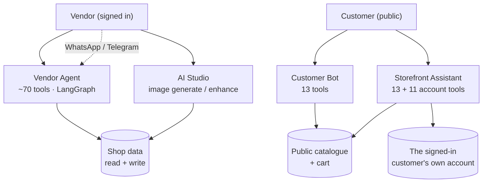

# AI surface audit

**Last updated:** 2026-09-07

What the platform has built on top of an LLM, who can reach each piece, and
exactly what each one is permitted to do. Written as a comparison because the
answer differs sharply per surface: one can write to the database, one can read
the public catalogue and a signed-in customer's own account, and one can do
neither.

Scope: what exists in the code today. Where something is built but unreachable,
it says so rather than describing the intent.

**Changed since the first pass (2026-09-04).** The Sidekick chat module
(`src/chat/`, 78 tools, no frontend caller) has been deleted and its tools
redistributed. Three of the findings this document opened with are closed; the
detail is in "What the audit found, and what happened to it" at the end.

## The four AI surfaces

| Surface | Module | Reached from | Tools | Can write? | Metered by |
|---|---|---|---|---|---|
| **Vendor Agent** ("Sidekick") | `vendor-agent/` | `/store/[slug]/ai`, WhatsApp, Telegram | ~70 | Yes — products, collections, coupons, inventory, bulk, tags | `ai.agent.chat` |
| **Customer Bot** | `customer-bot/` | Shop's WhatsApp number, shop's Telegram bot | 13 | Cart + address only | `ai.agent.customer` |
| **Storefront Assistant** | `storefront-assistant/` | Panel on the shop's own site | 13 + 11 account | Cart + address only | `ai.agent.customer` |
| **AI Studio** (image) | `ai/image/` | `/content/files/studio`, product forms | n/a | Writes generated media | `ai.image.generate` |

The admin console has **no AI surface at all**. It configures AI providers
(`/integrations/ai-chat`, `/integrations/ai-media`) and reads the cost side of
usage on `/analytics`, but there is no admin-facing assistant.

---

## 1. Vendor Agent — the only surface with real write authority

The one place an LLM can change shop data. Everything below is a permission
layer it passes through, in order. Each layer is independent; a tool has to
clear all of them.

### Layer 1 — Identity and scope

`vendorAgentChat` is `JwtAuthGuard` + `@RequirePermissions(MANAGE_OWN_SHOP)` +
`ShopHeaderGuard`, throttled to 30 requests/minute. Every tool receives the
`userId` and `shopId` from that guarded context, never from anything the model
or the vendor typed. A shop id in a message is text; it reaches no query.

### Layer 2 — Plan (`tool-registry.ts`)

Tools are sold as nine **groups**, never individually — `config.tools` on
`ai.agent.chat` is an allow-list of these:

| Group | Tools | Also needs |
|---|---|---|
| `catalog_read` | `search_products`, `get_product`, `list_collections`, `list_system_categories`, `list_coupons`, `get_coupon`, `get_low_stock_products`, `inventory_history`, `list_inventory_locations`, `set_task_plan` | — |
| `catalog_write` | create/update/delete for products, collections, coupons (plus the `prepare_delete_*` half of each) and collection membership | `catalog.products`, `catalog.collections`, `discounts.coupons` on the create tools |
| `bulk_ops` | `bulk_update_price`, `bulk_update_tags`, `export_products_csv`, `import_products_csv` | `catalog.bulk_operations`, `catalog.import_export` |
| `analytics` | the original five (`get_shop_stats`, `get_top_products`, `get_yearly_sales`, `get_category_sales`, `get_custom_range_stats`) plus 18 absorbed reads — digest, funnel, peak hours, trends, performance, health, profit, forecast, reviews, abandoned carts, wishlist demand, stock forecast, return rates, segments, questions, price suggestions, bundles, compare | `analytics.reports` |
| `inventory` | `set_inventory`, `transfer_inventory` | `inventory.transfers` on the transfer |
| `ai_media` | `generate_product_image` | `ai.image.generate` |
| `orders` | `get_orders`, `get_order`, `get_shipments`, `get_refund_requests`, `get_fulfillment_speed`, `get_shop_balance` — all reads | — |
| `marketing` | `get_flash_sales`, `suggest_campaign`, `suggest_notification` — proposals; none of them sends | — |
| `ai_content` | `generate_product_description`, `generate_product_seo`, `translate_product_content`, `generate_faq`, `draft_review_reply` | `ai.text.generate`, `ai.text.seo`, `ai.text.translate` |

What each plan tier actually buys:

| Tier | Requests/day | Max steps | Memory | Tool groups |
|---|---|---|---|---|
| FREE | 200 | 5 | no | `catalog_read` |
| BASIC | 200 | 5 | no | + `catalog_write` |
| GROW | 500 | 10 | yes | + `analytics`, `inventory`, `orders` |
| ADVANCED | 2,000 | 20 | yes | + `bulk_ops`, `ai_media`, `marketing`, `ai_content` |
| PLUS | unlimited | 40 | yes | all nine |

`orders` lands at GROW rather than ADVANCED because "where is order 1042" is the
question a growing shop asks the assistant most, and a tier that answers
everything except that reads as broken rather than as limited.

A tool the registry does not know is **allowed** through. The registry gates
what a plan sells; it is not the execution allow-list. That is deliberate — a
new tool nobody has classified must keep working rather than break silently for
every shop.

### Layer 3 — Channel (`channel-tool-policy.ts`)

Two nested allow-lists, both defaulting to denial. `WEB` (the dashboard) returns
early and allows everything; `WHATSAPP` and `TELEGRAM` share one narrowed set;
any channel not in the map gets **nothing**.

Off every chat channel on purpose: `set_task_plan` (draws a dashboard checklist),
`export_products_csv` / `import_products_csv` (a file the channel cannot carry),
`generate_product_image` (bills a generation for an image meant for a form).

### Layer 4 — Approval interrupt (`approval-policy.ts`)

Five tools suspend the LangGraph run inside a node until a human answers:
`bulk_update_price`, `bulk_update_tags`, `import_products_csv`, `set_inventory`,
`transfer_inventory`. On a chat channel four direct writes are added to the same
gate: three collection writes and `create_tag`.

This is a runtime property, not a prompt instruction — an injected "do it
without asking" has nothing to argue with. Three of the five are dry-run first,
so the card quotes a server-computed blast radius ("247 products") rather than
the model's guess. Resolution fails closed twice: an unmatched call id counts as
not approved, and so does a malformed decisions payload.

### Layer 5 — Two-phase deletes

`delete_product` / `delete_collection` / `delete_coupon` cannot run alone. The
matching `prepare_delete_*` mints a single-use Redis token (5 min TTL) bound to
the action, entity, user and shop, carrying a snapshot of the row. The consume
step refuses a token whose entity changed underneath it.

`create_tag` is the one direct catalogue write that is not form-mediated on the
dashboard, and the exception is bounded: a tag is a name and a slug, with no
price, no stock and no customer-facing page. `bulk_update_tags`, which puts tags
on products in bulk, stays gated.

### Layer 6 — Form mediation

`create_*` / `update_*` for products, collections and coupons **write nothing
from the agent on the dashboard**. They return a `navigate_to_form` intent and
the vendor presses Save on the real form. The form is the approval. On a chat
channel `ChatActionRunner` converts the prefill into the exact service input,
shows it as a card, and commits through the same service method the form's own
mutation calls.

### Also bounded by

Step cap per plan tier (`cap.node.ts` closes the transcript cleanly so a capped
run cannot brick the thread), per-user rate limits, a platform cost budget in
cents (`ai-budget.service.ts`), prompt sanitizing on untrusted text, and
`ContentModerationService` on the way in.

---

## 2 & 3. Customer Bot and Storefront Assistant — one brain, two transports

`StorefrontAssistantService` is a transport over `CustomerBotService`. The
tools, the prompt, the sanitizing and both output tripwires are shared. What
differs is shallow: the panel is synchronous and returns product cards, WhatsApp
answers off a queue; identity comes from a token in one and a phone number in
the other; the panel stores nothing.

**Thirteen tools on every channel, and the shortness is still the security design:**

| Tool | What it does |
|---|---|
| `search_products` | Public catalogue only — `findAllStorefront`, PUBLISH + active, hard `where`, explicit `select` |
| `get_shop_info` | Public shop details |
| `lookup_national_address` | Resolves a Saudi National Address code |
| `save_delivery_address` | Stores a resolved address (never an unresolved one) |
| `send_login_link` | Sends a magic link |
| `request_shop_owner` | Records an escalation; the processor pauses the thread and raises the event |
| `add_to_cart` | Cart write, quantity clamped 1–10, product re-checked against shop + PUBLISH |
| `get_my_account` | The signed-in customer's own details |
| `find_coupons` | Discount codes this shop is offering |
| `browse_faqs` | The shop's published FAQ |
| `get_active_sales` | Flash sales running now |
| `get_return_policy` | The shop's return and exchange policy |
| `get_answered_questions` | Product questions the shop has already answered |

The five browse tools were absorbed from Sidekick. All of it is already on the
storefront, so answering needs no identity — but each is pinned to `shop_id`
unconditionally, which the flash-sale tool was not before the port: it listed
every shop's promotions on the platform through one merchant's assistant.

The boundary is that every read runs through the same code path the public
storefront uses — not that the model was told to behave. `findAllStorefront`
cannot leak cost price even if asked: the typed mapper has no
`cost_per_item_cents` to return.

**There is deliberately no order tool on a phone channel.** A phone number is
not authentication. Order questions go to the merchant through
`request_shop_owner`.

**On the storefront panel there are eleven, because identity there is a token.**
`track_order`, `reorder_previous`, `get_refund_status`, `get_my_wishlist`,
`get_loyalty_points`, `get_spending_summary`, `get_payment_methods`,
`get_my_addresses`, `get_my_notifications`, `get_my_product_alerts` and
`get_cart_summary` are built only when the channel is `panel` **and** a `userId`
resolved from a JWT is present (`customer-bot.channel-policy.ts`).

The distinction is the one that matters. A phone-derived `userId` is real and the
processor genuinely resolves one — it has to, so the cart it fills has an owner.
But that identifies a *handset*: carriers reassign numbers and SIM swap takes
them. Good enough to decide whose cart to write to, which is recoverable; not
good enough to read a purchase history to, which is not.

Enforcement is that the tools are **not built**, not that they are refused: no
denial for an injection to argue with, and no probe that separates "signed out"
from "wrong channel". Every account query is also shop-scoped wherever the row
carries one (`Order`, `Refund`, `NotifyLog`, `Cart`) — shop X's panel showing a
customer their orders from shop Y tells the merchant's own customer where else
they shop. `get_payment_methods` returns brand and last four digits only.

`shopId` is pinned by the instance the message arrived on, upstream of anything
a customer can write. `userId` is resolved by the processor from the phone the
message arrived on — never from what the model or the customer says.

**Two output tripwires.** `detectSuspiciousOutput` looks for credential shapes;
`customer-bot.leak.ts` catches the model narrating its own reasoning. The second
exists because it shipped as a real leak — a customer received the system prompt
and tool inventory verbatim on the merchant's own number.

Quota: `ai.agent.customer`, monthly (customer traffic is spiky), separate from
the vendor's own so a busy Saturday cannot eat it. **Off on FREE** (limit 0).
The storefront panel is additionally throttled 20/min per IP — the widest
reachable surface in the product.

| Tier | Replies/month | Max tool rounds |
|---|---|---|
| FREE | 0 | — |
| BASIC | 500 | 3 |
| GROW | 2,000 | 3 |
| ADVANCED | 10,000 | 5 |
| PLUS | unlimited | 5 |

---

## 4. AI Studio — image generation and enhancement

`generateProductImage`, `enhanceImage`, `enhanceImageShots`, plus presets, styles
and run history. All `@RequirePermissions(MANAGE_OWN_SHOP, MANAGE_ALL_SHOPS)`.

The only AI surface that reserves quota **before** the provider is called and
settles the true cost after (`reserveMonthlyQuota` then `trueUpCost`), because
the price is not knowable until the provider answers. A run that produced
nothing consumes no allowance. `ImageModerationService` and
`ContentModerationService` sit on the path.

Note the deliberate absence of a second quota key: `generate_product_image` in
the vendor agent maps to `ai.image.generate`, the same key the Studio spends. A
tool-specific key would let one shop spend its 200 images twice.

---

## 5. Sidekick chat — deleted

`src/chat/` held 78 tools and the largest tool surface in the repo, and nothing
in the three apps called it. It was still live on the API, so any authenticated
caller could reach it with a hand-written query — including eight admin tools
that moved money (`withdrawal_manager`, `refund_approval`) behind a role check
alone, with no plan gate and no approval interrupt.

It is gone. `sendMessage`, `myConversations`, `conversationMessages` and
`deleteConversation` were removed from the schema (67 lines), and the module was
deleted along with its orchestrator, LangGraph pipeline, intent classifier,
handlers and memory layer.

Three parts of it were live and were moved out first, not deleted:

| Was | Now | Why it stayed |
|---|---|---|
| `chat/proactive/` | `src/proactive/` | Feeds the `insights` query and the vendor dashboard's `InsightsCard` |
| `chat/language-detector.ts` | `common/helpers/language-detector.ts` | Imported by five files including `vendor-agent.service.ts` |
| `chat/tools/tool-defaults.ts` | `common/constants/tool-defaults.ts` | `products.service.ts` reads `LOW_STOCK_THRESHOLD` |

`src/conversations/` is untouched — that is direct customer-to-vendor messaging,
not Sidekick.

**Where the 78 went.** Sixteen were deleted rather than ported: eight admin tools
with no home (no admin AI surface exists, and money-moving tools behind a role
check were the sharpest finding in this audit), and eight duplicates of tools the
Vendor Agent already had (`create_product`, `update_product`, `delete_product`,
`create_coupon`, `list_coupons`, `top_products`, `low_stock_alert`,
`sales_summary`). `chat_analytics` measured usage of the assistant being deleted.
The rest were rewritten — not moved — into the LangChain tool shape: ~34 to the
Vendor Agent, 16 to the Customer Bot.

Two classes of bug were fixed in the rewrite rather than carried across. The
originals returned **pre-formatted bilingual markdown**, because in Sidekick the
tool result *was* the reply; the ported tools return JSON and the model composes,
so two hard-coded languages are no longer a ceiling. And several filtered on
`ctx.shopId ? {shop_id} : {}` — shop scope applied only when it happened to be
present, which is dead weight in a context that always has one and a
whole-marketplace read in a context that does not. Every ported `where` names the
shop unconditionally.

---

## What is sold but not enforced

The plan registry defines **20 AI capability keys**. **Nine are enforced** as of
2026-09-07 — three originally, three added by the `ai_content` tool group, and
three more today (`ai.text.rewrite` and `ai.text.summarize` when the rich-text
editor moved off its frontend Groq route, `ai.vision.alt_text` on the live
`suggestAttachmentAlt` path).

| Key | Enforced? | Where |
|---|---|---|
| `ai.agent.chat` | yes | `vendor-agent.service.ts` |
| `ai.agent.customer` | yes | customer-bot processors, `customer-bot.quota.ts`, `storefront-assistant.service.ts` |
| `ai.image.generate` | yes | `image-gen.service.ts` (and referenced by the agent tool registry) |
| `ai.text.generate` | yes | `tool-registry.ts`, `ai-editor.service.ts` (CUSTOM action) |
| `ai.text.translate` | yes | `tool-registry.ts`, `ai-editor.service.ts` |
| `ai.text.seo` | yes | `tool-registry.ts` |
| `ai.text.rewrite` | **yes** (new) | `ai-editor.service.ts` — improve / extend / simplify |
| `ai.text.summarize` | **yes** (new) | `ai-editor.service.ts` — shorten |
| `ai.vision.alt_text` | **yes** (new) | `attachments.resolver.ts` — reserved per image before the vision call |

### The eleven that remain, and why none of them is simply "add a check"

The examination that closed the orphaned-services finding produced something
more useful than a to-do list: **every AI path that should be metered per shop
now is.** What is left is eleven keys, each unenforceable for a specific,
nameable reason. None of them wants a `reserve()` call added.

| Key | Live path? | Why a per-shop quota is the wrong instrument | Verdict |
|---|---|---|---|
| `ai.image.edit` | via enhance | Runs inside an enhance run that already books `ai.image.generate`. A second key double-books one provider call — the exact bug `tool-registry.ts` documents. | fold |
| `ai.image.remove_background` | via enhance | Same. | fold |
| `ai.image.upscale` | via enhance | Same. | fold |
| `ai.vision.analyze` | `enhance-vision.service.ts` | The cached vision read that composes an enhance prompt. The run's own `ai.image.generate` booking already covers it. | fold |
| `ai.search.semantic` | **yes** — `findAllStorefront` | **Public, unauthenticated, once per catalogue page view.** Exhausting it would take a shop's search down for its own customers, and any stranger could exhaust a competitor's by loading their storefront. That is a griefing vector, not a limit. | delete |
| `ai.recommendation.generate` | **yes** — `findStorefrontRecommendations` | Same public path, and it is now pure pgvector / behaviour SQL with no AI spend to meter at all. | delete |
| `ai.embedding.generate` | `EmbeddingSyncService` | Driven by `triggerEmbedding`, which requires `MANAGE_ALL_SHOPS` and sweeps the whole platform. Not a shop's consumption to bill. | delete |
| `ai.catalog.generate_attributes` | **yes** — `suggestProductAttributes` | Free on every plan by an explicit decision: the values are what make a catalogue filterable, so the platform wants every shop producing them. A key advertising a limit on a deliberately free feature is a false promise. | delete |
| `ai.catalog.generate_description` | no | Redundant — `generate_product_description` bills `ai.text.generate`. | delete |
| `ai.catalog.generate_products` | no | Bulk product generation does not exist and is not planned. | delete |
| `ai.catalog.generate_variants` | no | Does not exist. | delete |

**Removing a key is a two-step operation, and the second step was missing.**
`prisma/seed-plans.ts` upserted only the keys the registry still defines and
never touched the rest, so deleting one from `feature-registry.ts` would have
left its `features` row `is_active: true` — still listed in the admin plan
editor, still holding `PlanEntitlement` rows, and no longer documented anywhere
in code. That is the same "sold but enforced nowhere" failure arrived at from
the opposite direction.

The seed now deactivates any row whose key has left the registry, and
**deactivates rather than deletes**: `PlanEntitlement` cascades on `Feature`
delete, so a hard delete would silently drop limits an admin had configured.
`EntitlementsService` and `featureCatalog()` both already filter on `is_active`,
so retirement takes effect on the next seed run with no migration and no code
change.

Enforcing the nine is done. **Retiring the eleven is a pricing decision and has
not been taken** — the mechanism is ready and the verdicts are above.

## What was built and connected to nothing — closed 2026-09-07

Six services were instantiated and exported by `AiModule` and injected by
nobody. **One was wired, five were deleted.**

`AutoCategorizeService` (`ai/categorization/`) is no longer orphaned: it is
called by `ProductEnrichmentService` in the `product-enrichment` queue worker,
which fills `ai_keywords`, `brand` and `target_audience` on every product save.

The other five are gone (deleted at `3da4ceb7`, ~1,440 lines). The investigation
that closed this finding did not find five features waiting to be switched on —
it found five services that were **either duplicated by something already
shipping, or worse than it**:

| Service | Why it went |
|---|---|
| `SalesForecastService` | `get_revenue_forecast` in `insights.tools.ts` was written specifically to replace it and says so in a comment: the old method "applied a trend multiplier over three months of data, which is a straight line dressed as a model". Wiring it would have been a regression. |
| `DynamicPricingService` | `get_price_suggestions` deliberately returns **directions, not prices** ("Never quote a new price as if it were calculated"). This returned a computed `PriceSuggestion`, which that tool's own contract forbids surfacing. |
| `SmartCouponService` | `suggestBundles` duplicated `get_bundle_suggestions`; `suggestCoupons` overlapped `suggest_campaign`. And `autoCreateCoupon` **wrote a coupon straight to the database** — no plan gate, no approval interrupt, no audit log, no idempotency. Wiring it would have re-introduced exactly the class of unguarded money-adjacent write the six-layer agent design exists to prevent. |
| `ChurnPredictionService` | A 192-line heuristic scorer, superseded by `src/customer-segments/` — a mature RFM engine that already ships an `AT_RISK` group, a segment template for it, `predicted-spend-tier.service.ts`, `segment-insights.service.ts` and a `/segments` screen. |
| `AutoFaqService` | `generateFaqSuggestions` duplicated the shipping `generate_faq` tool, which additionally carries the right boundary — "the vendor adds FAQs from the FAQ screen — you cannot save it". |

The lesson worth keeping: **an orphaned service is not a free feature.** Four of
these five were older, cruder versions of something the platform had already
rebuilt properly, and the fifth was a security hole. Their existence in
`AiModule`'s provider list read as latent capability and was latent risk.

Wired and working, by contrast: `AiContentService` (two Sidekick tools),
`ContentModerationService` / `ImageModerationService` (image gen and the vendor
agent), `UserProfileService`, `SearchAnalyticsService`, `VectorStoreService`,
`EmbeddingStoreService`, `BehaviorStoreService`, `EmbeddingSyncService`,
`AgentService`, `ChatModelService`.

---

## Provider and model

One provider row in `integration_configs` (`AI_CHAT`), AES-256-GCM encrypted,
configured at `/integrations/ai-chat`. Groq or OpenAI behind one interface —
both speak the OpenAI wire protocol. The **model id is configuration, not code**,
because Groq retired two models with no notice and every LLM call in the
platform started returning `404 model_not_found` while the console still showed
a valid key. A `fast_model` serves classification and extraction.

`AI_MEDIA` (Replicate) is one row for both image and video, carrying an explicit
`off` provider so disabling generation cannot silently fall back to
`REPLICATE_API_TOKEN` in `.env`.

Every LLM feature degrades rather than throws when no provider is configured:
`ChatModelService.model()` returns `null` and callers fall back to a
rule-derived answer.

## Cross-cutting cost controls

| Control | Scope | File |
|---|---|---|
| Plan quota | per shop, per capability key | `plans/entitlements.service.ts` |
| Per-user rate limit | per user, per feature, hour + day, Redis | `ai/ai-rate-limiter.service.ts` |
| Platform budget | daily cents ceiling across all shops | `ai/ai-budget.service.ts` |
| GraphQL throttle | per IP | `common/guards/throttle.guard.ts` |
| Step cap | per turn, from the plan tier | `vendor-agent/graph/nodes/cap.node.ts` |

Budget feature costs in cents: `embed` 1, `rerank` 2, `moderation` 3, `image` 4
(reserved, then trued up), `vision` 5, `chat` 25, `content` 50.

## What the audit found, and what happened to it

| Finding | Status |
|---|---|
| Sidekick's 78 tools reachable over GraphQL with no frontend caller | **Closed** — module deleted, four operations removed from the schema |
| Eight admin tools moving money behind a role check alone | **Closed** — deleted; there is no admin AI surface to host them |
| 17 of 20 AI capability keys defined and enforced nowhere | **Closed as far as code can** — nine enforced; the remaining eleven are each unenforceable for a named reason (double-booking, a public path, or a deliberately free feature) and the seed can now retire them. Which to retire is a pricing call. |
| Six AI services built and injected by nobody | **Closed** — one was wired (`AutoCategorizeService`), five deleted; see the section above |
| Seven Prisma models orphaned by the deletion | **Closed** — `Conversation`, `ChatMessage`, `AiMemory`, `ToolExecution`, `ToolOutcome`, `AgentPlan`, `AgentPlanStep` removed from the schema; the table drop is `prisma/migrations/manual/2026-09-04-drop-sidekick-tables.sql`, applied by hand because it destroys data |
| A tool unknown to the registry is allowed through (fail-open) | **Open, and deliberate** — the registry gates what a plan *sells*; it is not the execution allow-list. Channel policy and approval policy both fail closed |

## Main files

- `back-end/src/vendor-agent/tools/tool-registry.ts` — what each agent tool costs in plan terms
- `back-end/src/vendor-agent/tools/channel-tool-policy.ts` — what runs off the dashboard
- `back-end/src/vendor-agent/graph/approval-policy.ts` — the five interrupts
- `back-end/src/customer-bot/customer-bot.tools.ts` — the customer's core eight
- `back-end/src/customer-bot/customer-bot.channel-policy.ts` — why an account tool needs a session
- `back-end/src/vendor-agent/tools/{orders,insights,marketing,content}.tools.ts` — the absorbed tools
- `back-end/src/plans/feature-registry.ts` — all 20 AI capability keys
- `back-end/src/ai/chat-model.service.ts` — provider resolution
