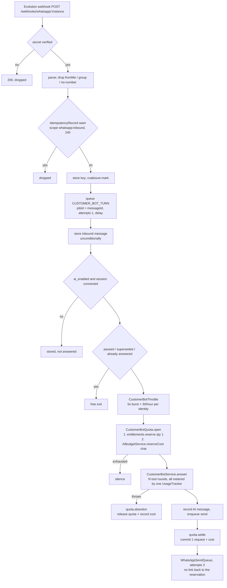

# Zaydak AI Usage & Quota System — Architecture Audit

**Last updated:** 2026-09-20
**Scope:** `back-end/` — AI usage accounting, quota enforcement, and platform cost tracking.
**Status:** findings F1–F11 have since been addressed; see
[the corrective plan](zaydak-ai-usage-corrective-plan.md) for what changed and
[the gap analysis](zaydak-outbound-entitlement-gap-analysis.md) for the re-verified matrix.
This document is kept as the record of what was found, in the state it was found in.
**Method:** static inspection of the current `main` tree plus execution of the existing Jest unit suites. No code, schema, or configuration was modified.

> **The reference specification was not supplied.** The prompt refers to an attached
> `Outbound Reply Entitlement — Implementation Spec v1`. No such file exists in this
> repository and none was attached to the session. This audit therefore compares Zaydak
> against the eighteen requirements enumerated in the prompt itself. Any requirement of the
> real document that is not in that list is **UNVERIFIED** by definition.

---

## 1. Executive answers

| Question | Answer |
|---|---|
| What system already exists? | A complete reserve/commit/release entitlement ledger in Postgres, plus a separate platform-wide daily spend cap, plus per-caller Redis throttles. It is not a stub. |
| What is the billable unit? | **One `request` per answered agent turn.** Not tokens, not LLM calls, not outbound messages. |
| Is AI consumption reliably limited by subscription? | For the WhatsApp, Telegram, storefront-panel and vendor-agent surfaces, yes. **Not** for the negotiation assistant, which is unmetered. |
| Can concurrent customers overspend a merchant's quota? | No. The ceiling is a single `INSERT … ON CONFLICT … WHERE` statement. Proven by inspection, not by an executed concurrency test. |
| Can the same reply be charged twice? | Not on the quota counter (`usage_events.handle_id` is UNIQUE). A replayed *abandoned* turn can write a duplicate cost row. |
| Are OpenRouter token and USD costs recorded accurately? | Tokens yes. USD is captured accurately into `meta.cost_usd`, but the `cost_cents` **integer** column rounds a typical sub-cent turn to zero, and three reporting surfaces read that column. |
| Can WhatsApp or Telegram bypass the quota? | No. Both go through one shared `CustomerBotQuota`. |
| Can Redis or worker failures corrupt balances? | Redis cannot — quota lives in Postgres. A worker crash mid-turn strands a reservation until the period rolls. A Redis outage silently disables the platform daily budget on 14 call sites. |
| What genuinely needs fixing? | Six confirmed issues, listed in §7 and planned in the corrective plan. |

---

## 2. What exists, and where

| Concern | Implementation | File |
|---|---|---|
| Entitlement resolution | `EntitlementsService.resolve` — plan → override → deny, Redis-cached map, 600s TTL | `src/plans/entitlements.service.ts:215` |
| Atomic quota booking | `reserve` → `incrementCounter` | `src/plans/entitlements.service.ts:439`, `:1030` |
| Settlement | `commit` / `release` / `record` | `:526`, `:594`, `:659` |
| Durable ledger (read) | `UsageLedgerService` | `src/plans/usage-ledger.service.ts` |
| Period windows | `periodWindow` — subscription-anchored MONTH/YEAR, UTC DAY | `src/plans/period.ts:100` |
| Capability catalog | `FEATURE_REGISTRY` | `src/plans/feature-registry.ts` |
| LLM token/cost capture | `UsageTracker` (LangChain callback) | `src/ai/usage-tracker.ts:98` |
| Platform daily spend cap | `AiBudgetService.reserveCost` | `src/ai/ai-budget.service.ts:102` |
| Per-caller AI throttle | `AiRateLimiterService.enforce` | `src/ai/ai-rate-limiter.service.ts:100` |
| Per-customer bot throttle | `CustomerBotThrottle.mayAnswer` | `src/customer-bot/customer-bot.throttle.ts:64` |
| Customer-bot quota facade | `CustomerBotQuota` | `src/customer-bot/customer-bot.quota.ts` |
| Inbound dedupe | `IdempotencyService` + BullMQ `jobId` | `src/idempotency/idempotency.service.ts`, `src/whatsapp/inbound/whatsapp-inbound.service.ts:290` |
| Observability | Langfuse spans, cost passed through as USD only | `src/common/observability/langfuse-cost.ts` |
| Spend anomaly alerting | `AiSpendSpikeService.sweep` | `src/plans/ai-spend-spike.service.ts` |
| Manual recovery | `resetShopUsage` (audited admin mutation) | `src/plans/plans-admin.service.ts:525` |

Two storage models exist side by side, and the distinction is load-bearing:

- **COUNTER** capabilities (`ai.agent.customer`, `ai.agent.chat`, `ai.text.*`) hold a row in `usage_counters` keyed `(shop_id, feature_key, period_start)`. That row is the quota.
- **DERIVED** capabilities (`ai.image.generate`) count their own domain rows instead; `reserve()` refuses them outright (`entitlements.service.ts:458`) and the owning module holds the line with a `pg_advisory_xact_lock` (`image-gen.service.ts:2140`).

`usage_events` is append-only attribution and is never aggregated to enforce anything.

---

## 3. The AI reply lifecycle, as actually implemented



**Order of operations, confirmed:** entitlement check and quota reservation both happen
**before** the model runs (`customer-bot.processor.ts:228`, `telegram-customer.processor.ts:236`).
Settlement happens after generation but **before delivery is attempted**.

**Telegram is the same path.** `telegram-customer.processor.ts` mirrors WhatsApp step for
step and shares `CustomerBotQuota`, `CustomerBotThrottle` and `CustomerBotCoalescer`. There is
no second copy of the accounting trio — that duplication was already removed.

**Channels sharing the quota.** WhatsApp, Telegram and the storefront panel all charge
`ai.agent.customer` (`customer-bot.quota.ts:16`, `storefront-assistant.service.ts:56`). The
vendor-facing assistant charges a deliberately separate `ai.agent.chat`, period `DAY`
(`vendor-agent.service.ts:204`), so a busy Saturday of customer questions cannot eat the
merchant's own assistant allowance. The WhatsApp vendor bot routes through
`VendorAgentService.chat` (`vendor-bot.processor.ts:160`) and therefore shares the vendor key.

**One inbound message is not one LLM call.** A turn runs up to `maxSteps` tool rounds
(`customer-bot.service.ts:462-476`), each invoke carrying the same `UsageTracker`, plus one
in-turn retry on a transient provider fault (`chat-invoke.helper.ts`, `MAX_ATTEMPTS = 2`).
All of that is **one** billable request and the full real cost. A burst of messages is
coalesced into one turn. A turn may emit **two** WhatsApp bubbles — the reply plus a cart
claim link (`customer-bot.processor.ts:356`) — still one unit. Static fallback copy and
merchant-typed messages consume nothing.

---

## 4. Quota enforcement — findings against the twelve questions

1. **Does every billable execution check entitlement first?** Every path except negotiation. See §7, F2.
2. **Is deduction atomic?** Yes.
   ```sql
   INSERT INTO usage_counters (...) VALUES (...)
   ON CONFLICT (shop_id, feature_key, period_start)
   DO UPDATE SET used = usage_counters.used + $n
   WHERE usage_counters.used + $n <= $limit
   RETURNING used
   ```
   (`entitlements.service.ts:1050`). Postgres evaluates the guard while holding the row lock; no rows returned means refused. The INSERT branch is safe because a batch larger than the whole limit is rejected before the query (`:481`).
3. **Can two requests see the same remaining allowance?** They can *read* it, but they cannot both *win* — the read is not what authorizes.
4. **Can the system consume more than allocated?** Only through the two fail-open paths (§7, F9) and the unmetered negotiation path.
5. **Mechanism?** Postgres `ON CONFLICT … WHERE` for COUNTER capabilities; `pg_advisory_xact_lock` for the DERIVED image path. No Lua, no Redis counters in the enforcement path.
6. **Correct shop and period?** `shop_id` comes from the authenticated instance/shop context; `period_start` from `periodWindow(period, now, subscription.current_period_start)`.
7. **Tenant isolation?** The counter's composite key includes `shop_id`; the Redis entitlement cache key is `entitlements:shop:<shopId>`. No shared counters.
8. **Customer- vs vendor-facing separated?** Yes, deliberately — two keys, two periods.
9. **Enforced before expensive execution?** Yes.
10. **On exhaustion?** WhatsApp/Telegram answer with **silence** (message still stored and visible to the merchant). The storefront panel raises `TOO_MANY_REQUESTS`. The vendor agent returns a typed refusal the dashboard renders.
11. **Can an exhausted shop still generate paid responses?** Through negotiation, yes.
12. **On Redis unavailability?** `readCache` falls through to Postgres (`:920`), so entitlements still resolve and quota still holds. `CustomerBotThrottle` fails open by design. `AiRateLimiterService` fails open **and skips the budget reservation** — see F1. On Postgres unavailability the reservation throws and the turn does not run.

---

## 5. Idempotency and double charging

Four independent layers, in order:

| Layer | Mechanism | Scope | Lifetime |
|---|---|---|---|
| Transport | `IdempotencyRecord(key = messageId / update_id, scope)` | per channel | 24h |
| Queue | BullMQ `jobId = messageId`, `attempts: 1` | while the job exists | until `removeOnComplete` |
| Conversation | `alreadyAnswered(conversationId, question)` | per thread | conversation history |
| Ledger | `usage_events.handle_id` UNIQUE | permanent | permanent |

`commit` inserts the ledger row **first** inside the transaction, so a replay aborts on the
unique violation before the counter adjustment runs (`entitlements.service.ts:551-576`).
`release` is idempotent the same way. Both swallow `P2002` and return.

**BullMQ retries cannot duplicate accounting on the inbound side** because both customer-bot
queues are `attempts: 1`. The in-turn retry (`invokeChatWithRetry`) makes a second LLM call
under the same reservation and the same tracker — correct on both counts.

**Weaknesses found:**

- `IdempotencyService.lookup` then `.store` is **not atomic** (`idempotency.service.ts:23-77`). Two simultaneous duplicate deliveries can both miss. In practice the BullMQ `jobId` collapses them, so this has not been reachable — but the guarantee rests on a queue option rather than on the database.
- `CustomerBotQuota.abandon` calls `entitlements.record` with **no `dedupe_key`** (`customer-bot.quota.ts:244`). Every other `record` call site namespaces one. A replayed abandon writes a second cost row. This affects reported platform cost only, never the merchant's quota.
- The ledger has **no idempotency key tied to the inbound message**. `handle_id` is a fresh `randomUUID()` per reservation. If both transport layers were bypassed, the same customer message would reserve and commit twice with no database-level defence.

---

## 6. Token and dollar cost accuracy

`UsageTracker.handleLLMEnd` (`usage-tracker.ts:105`) was clearly hardened against the
streaming double-count risk and the current code holds up:

- It picks **canonical** token counts from `message.usage_metadata` / `llmOutput.tokenUsage` first — the single terminal chunk — rather than from `response_metadata.usage`, which LangChain sums across chunks.
- When a cost-bearing shape is found, it derives a duplication `factor` and requires **both** prompt and completion ratios to agree on the same integer multiple before dividing (`:168-187`). That strictness is what stops a legitimate multi-call turn being mistaken for a duplicated one.
- The no-cost fallback folds exactly one shape and returns (`:201-205`), so Groq-style responses cannot be folded twice.
- `providerExtensions` sends `usage: {include: true}` **only** to OpenRouter (`:20-24`), after a Groq 400 took every agent turn down.

Multi-call correctness is real: every tool round and the vendor agent's summarizer attach the
same tracker, so one turn's `cost_usd` is the sum of its calls.

Langfuse is **observability only**. `toLangfuseCostDetails` passes exact USD and returns
`undefined` when the provider reported nothing (`langfuse-cost.ts:41`). It feeds no billing
path, so it cannot double-count.

**The real accuracy defect is the storage unit, not the capture.** `usage_events.cost_cents`
is `Int`. A customer-bot turn costing $0.000125 yields `cost_cents = 0.0125`, and both write
paths round it:

- `commit`: `Math.max(0, Math.round(opts.cost_cents))` — `entitlements.service.ts:558`
- `record`: `Math.max(0, Math.round(entry.cost_cents ?? 0))` — `entitlements.service.ts:672`

The precision survives only because `settle` also writes `meta.cost_usd`
(`customer-bot.quota.ts:172`). Consequently the repository now has **two answers for the same
question**:

| Surface | Reads | Accurate? |
|---|---|---|
| `aiSpendByShop` / `aiSpendByPlan` | raw SQL over `meta->>'cost_usd'`, falling back to `cost_cents` (`usage-ledger.service.ts:529-558`) | yes |
| `usageSummary` / `myUsageSummary` | `_sum: { cost_cents }` (`:145`) | **understated, often to zero** |
| `usageTopShops` | `_sum: { cost_cents }` (`:181`) | **understated** |
| `AiSpendSpikeService` | `_sum: { cost_cents }` with a 500¢ floor | **never fires for sub-cent traffic** |

`abandon` is worse: it rounds to zero **and** omits `cost_usd` from `meta`
(`customer-bot.quota.ts:252-256`), so the raw-SQL path has nothing to fall back to. Provider
spend on failed customer turns is lost from every report.

The vendor agent's failure path (`releaseTurn`, `vendor-agent.service.ts:1524`) writes no
`usage_events` row at all — only the platform budget is trued up. So vendor-agent spend on
failed turns is also absent from `/analytics`, asymmetrically with the customer bot.

Attribution itself is sound: shop, agent (`feature_key`), user and `ref_type`/`ref_id` are all
carried from `reserve` through to the committed row, with the settling caller allowed to
override (`entitlements.service.ts:562-566`).

---

## 7. Confirmed issues

Each was verified by reading the executing code path. Severity reflects financial or
operational impact. **All eleven have since been fixed or explicitly decided** — this section
is the diagnosis, not the current state.

### F1 — CRITICAL: a Redis outage silently disables the platform daily AI budget

- **Root cause:** `AiRateLimiterService.enforce` catches a Redis failure and `return`s (`src/ai/ai-rate-limiter.service.ts:125-134`), skipping `await this.budget.reserveCost(...)` at `:153`. The in-code comment at `:127-129` asserts the opposite ("Budget guard above is DB-backed so that side is still enforced") — the reservation is *below*, not above.
- **Reproduction:** stop Redis; call any of the 14 `enforce` call sites (vendor agent chat, image generation, content generation, alt text, moderation, store-import enrich, storefront panel). Every call proceeds, and `ai_usage.total_cost_cents` never increments.
- **Impact:** `AI_DAILY_BUDGET_USD` stops existing for the duration of the outage, on every surface except the customer bot (which calls `reserveCost` directly). Unbounded provider spend.
- **Minimal fix:** move the `reserveCost` call out of the try/catch's early return — set a flag and fall through, or restructure so the budget reservation is unconditional.
- **Regression test:** mock the Redis client to throw; assert `budget.reserveCost` was still called exactly once.

### F2 — CRITICAL: the negotiation assistant is an unauthenticated, unmetered LLM path

- **Root cause:** `NegotiationAiService` makes real `model.invoke` calls (`src/negotiation/negotiation-ai.service.ts:288-292`) and captures a `UsageTracker` **used only for Langfuse tracing**. The snapshot never reaches `EntitlementsService` or `AiBudgetService`, and `AiRateLimiterService` is not called. There is no `usage_events` row, no entitlement key, no `@RequireFeature`.
- **Reachability:** `startNegotiation`, `sendNegotiationMessage` and the offer mutations are guarded by `OptionalJwtGuard, ShopHeaderGuard, RequireShopGuard` only (`src/negotiation/negotiation.resolver.ts:182, 199, 235`) — a signed-out storefront visitor can drive them.
- **The one bound is bypassable.** `assertDailyCap` returns early when the caller supplies neither an account nor a guest key (`src/negotiation/negotiation.service.ts:1170`), and `guest_key` is a caller-supplied nullable argument (`negotiation.resolver.ts:204`). Omitting it, or rotating it, defeats the cap. It is also a non-atomic count-then-check, and it caps *sessions* while `sendNegotiationMessage` bills per message (LLM calls at `negotiation.service.ts:328, 512, 688`, bounded only by `max_rounds`, default 5).
- **Impact:** an exhausted merchant still generates paid AI content; the platform daily cap cannot see it; `/analytics` understates real spend by whatever negotiation costs.
- **Minimal fix:** route the three `phrase*` calls through the existing `ai.agent.customer` reservation (or a new registry key), and gate on `rateLimiter.enforce(userId ?? sess:<guest_key>, 'chat')`. Make `assertDailyCap` refuse rather than return when no identity is supplied.
- **Regression test:** an exhausted `ai.agent.customer` shop must get the template fallback, not an LLM call; a caller with no `guest_key` must be refused.

### F3 — HIGH: `usage_events.cost_cents` rounds a typical turn to zero

- **Root cause:** integer column plus `Math.round` at `entitlements.service.ts:558` and `:672`. Detailed in §6.
- **Impact:** `usageSummary`, `usageTopShops` and the spike detector report near-zero AI cost for high-volume chat shops. The admin AI spend matrix disagrees with the usage summary on the same screen. Margin analysis against subscription price is wrong.
- **Minimal fix:** make `meta.cost_usd` mandatory on every AI write path (including `abandon`), and move `summary`, `topShops` and `AiSpendSpikeService` onto the same `meta->>'cost_usd'` expression `queryAiSpendGrouped` already uses. A schema change to numeric cents is the larger alternative and is not required to make the reports agree.
- **Regression test:** a shop with 1,000 turns at $0.0002 must report $0.20, not $0.00, from every reporting surface.

### F4 — MEDIUM: `abandon` writes a non-idempotent, cost-losing ledger row

- **Root cause:** `CustomerBotQuota.abandon` calls `record` with no `dedupe_key` and no `cost_usd` in `meta` (`src/customer-bot/customer-bot.quota.ts:244-257`).
- **Impact:** duplicate cost rows on replay; and, combined with F3, the cost it was written to preserve is lost anyway.
- **Minimal fix:** pass `dedupe_key: \`cbot-abandon:${conversationId}:${messageId}\`` and add `cost_usd` to `meta`.

### F5 — MEDIUM: `ai_usage.feature_breakdown` loses concurrent updates

- **Root cause:** `AiBudgetService.trackCallOnly` reads `feature_breakdown`, mutates it in Node, and writes the whole JSON back (`src/ai/ai-budget.service.ts:279-306`). `total_cost_cents` uses an atomic `increment`; the breakdown does not.
- **Reach:** every `trueUpCost` call, and — critically — the **entire** reservation path whenever `AI_DAILY_BUDGET_USD` is unset or zero (`:118-121`).
- **Impact:** per-feature platform spend attribution drifts low under concurrency. The daily cap itself is unaffected.
- **Minimal fix:** use the same `jsonb_set` expression `reserveCost` already has (`:139-149`) instead of a read-modify-write.

### F6 — MEDIUM: no refund on permanent delivery failure

- **Root cause:** `quota.settle` runs at `customer-bot.processor.ts:318`, after `enqueueText` at `:282` but before any delivery attempt. `WhatsAppSendProcessor` has no reference to the reservation and no refund path (`src/whatsapp/outbound/whatsapp-send.processor.ts`).
- **Impact:** a merchant is charged one request for a reply that was never delivered. The blast radius is bounded — the processor already refuses to answer when the session is not `connected` (`:153`) — so this only bites when the session drops between generation and send, or when the provider rejects permanently after three attempts.
- **Decision required, not just a fix.** If Zaydak's unit is "one AI execution", charging is *correct* and this is a documentation gap. If it is "one delivered reply", a compensating `record` with a negative-intent marker is needed. The current code and its comments claim the former; the documentation should say so explicitly.

### F7 — MEDIUM: a worker crash strands a reservation with no ledger row

- **Root cause:** `reserve` increments the counter immediately (`entitlements.service.ts:491`). A `SIGKILL` between `quota.open` and `settle`/`abandon` leaves `usage_counters.used` incremented with no `usage_events` row. The docblock at `:437` states this openly: "an abandoned reservation stays charged until the period rolls."
- **Recovery available:** only the manual, audited `resetShopUsage` admin mutation (`plans-admin.service.ts:525`). There is no periodic reconciliation, no outbox, no sweep.
- **Impact:** small and self-healing at period rollover, but invisible — the counter and the ledger disagree and nothing reports the difference.
- **Minimal fix:** a daily reconciliation that compares `usage_counters.used` against `SUM(usage_events.quantity)` for the same window and alerts on drift. Repairing automatically is the wrong default; knowing is not.

### F8 — MEDIUM: two different "month" definitions

- **Root cause:** `ai.image.generate` counts from a **calendar** month (`image-gen.service.ts:2035-2038`), while COUNTER capabilities use the **subscription-anchored** window (`period.ts:100-128`).
- **Impact:** a shop subscribing on the 20th gets its image allowance reset on the 1st and its chat allowance on the 20th. Correct for neither reading; surprising for the merchant.
- **Minimal fix:** pass the subscription anchor into `monthStart()` via the entitlement resolution the module already performs.

### F9 — MEDIUM: three deliberate fail-opens answer unmetered

`customer-bot.quota.ts:104`, `storefront-assistant.service.ts:346-378` and
`VendorAgentService.reserveTurn` all treat "no entitlement row" as **unmetered**, not denied.
The reasoning is written out and is sound — shipping a new key must not switch a live feature
off for every existing shop. But per the memory note *"a feature 403ing on every plan means the
entitlement rows were never seeded"*, an unseeded `plan_entitlements` table is a realistic
production state, and in that state the customer bot answers strangers for free, indefinitely,
with the platform budget as the only ceiling. **Minimal fix:** keep the behaviour, add an
alert — a `warn` that fires once per shop per day is enough to make the state visible.

### F10 — LOW: outbound sends retry without an idempotency key

`WhatsAppSendQueue.enqueueText` adds no `jobId` (`whatsapp-send.queue.ts:45`) and the queue
default is `attempts: 3` with exponential backoff (`queues/queues.module.ts:32`). A network
timeout after the provider accepted a message delivers it twice. Billing is unaffected — the
charge is per execution — but the customer sees a duplicate bubble.

### F11 — LOW: `IdempotencyService` lookup-then-store is not atomic

`idempotency.service.ts:23-77`. Mitigated in practice by the BullMQ `jobId`, but the guarantee
should rest on the unique index, not on a queue option that `removeOnComplete: true` releases.

---

## 8. Reconciliation and recovery

| Failure | Recovery today |
|---|---|
| Redis data loss | No impact on quota — Postgres is authoritative. Entitlement cache repopulates; throttle counters reset (a bounded over-allowance of replies, not of money). |
| Postgres unavailable | `reserve` throws; the turn does not run. Correct fail-closed. |
| Worker crash mid-turn | Reservation stranded. See F7. |
| Lost usage event | `commit`'s ledger insert and counter update are in one `$transaction` (`:550`), so they cannot diverge. A failed `record` is logged and dropped (`:676`) — by design, but silently. |
| Quota deducted, ledger write fails | Impossible for `commit`; the two are transactional. |
| LLM succeeded, delivery failed | Charged. See F6. |
| Mid-period upgrade | `current_period_start` moves, so `periodWindow` yields a new `period_start` and a **fresh counter row** — the allowance resets. Old rows are orphaned and never cleaned. This is plausibly intended for an upgrade; it is also how a repeated re-subscription would reset a quota. Not currently tested or documented. |

**Postgres is unambiguously the source of truth for remaining quota.** Redis holds only the
resolved entitlement *map* (with an explicit comment that the counter is never cached,
`entitlements.service.ts:210-213`) and the two throttles.

---

## 9. Test evidence

Executed on 2026-09-20:

```
npx jest "enforcement|entitlements.service|usage-tracker|ai-budget|usage-ledger|period.spec|customer-bot|telegram-customer|provider-extensions"

Test Suites: 1 failed, 17 passed, 18 total
Tests:       239 passed, 239 total
```

- **17 suites, 239 tests pass.** `plans/enforcement.spec.ts` is genuinely thorough: it covers `reserve` batch atomicity, the empty-result refusal, `maxBatch`, the DERIVED refusal, commit overrun, commit/release idempotency on `P2002`, ledger attribution, and `record`'s replay drop.
- **All of it uses a mocked Prisma client.** The atomicity claim is verified as *"exactly one `$queryRaw` was issued"* (`enforcement.spec.ts:215`) and *"an empty result raises `PLAN_QUOTA_EXCEEDED`"* (`:217-229`). That proves the service's contract with the database. It does **not** prove Postgres semantics under concurrency.
- **`customer-bot/telegram-customer.processor.spec.ts` does not execute.** It fails at module load: `jose/dist/webapi/index.js … SyntaxError: Cannot use import statement outside a module`, pulled in transitively via `cart-claim.service.ts` → `auth.service.ts` → `social-token.verifier.ts`. `package.json`'s Jest block has no `transformIgnorePatterns` entry for `jose`. This is a pre-existing environment defect, not a test failure — but it means **Telegram's quota behaviour has no executing test**, and `npm test` reports a red suite that is easy to read as unrelated.
- **`test/concurrency/` exists and is real**, gated behind `DATABASE_URL_TEST` against an isolated Postgres on port 55432. It covers invoice numbers, coupon global caps, atomic rollback, refund approval races and balance credit-once. **It contains nothing for `usage_counters`, entitlements, or AI quota.** The one place in the repo equipped to prove the central concurrency guarantee does not exercise it.

---

## 10. What this audit did not verify

- The reference specification itself (not supplied).
- Live provider behaviour — no paid LLM calls were made and no customer messages were sent.
- Real Postgres concurrency on `usage_counters` — the harness exists but no such test is written.
- Redis-outage behaviour in a running system — F1 is confirmed by code path, not by an executed fault injection.
- Behaviour of `back-end/` under lint: it is not a turbo workspace and its CI job runs no lint.
