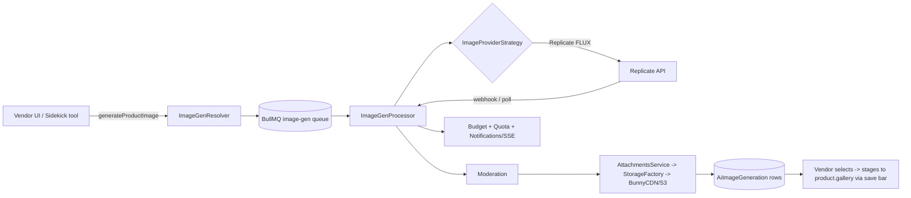

# Future Feature — AI Product Image Generation (Replicate first)

**Status:** ✅ Implemented 2026-07-17 (Phases 1–5). See [`back-end/docs/features/ai-image.md`](../../back-end/docs/features/ai-image.md) + [`api/ai-image.md`](../../back-end/docs/features/api/ai-image.md) for the live reference; residual follow-ups (output-image moderation, SSE progress, quota counter, model-version pinning, stuck-job sweep) are tracked in the repo-root `TODO.md`. Note: the payment "Strategy Pattern" this plan meant to mirror does not exist in the codebase — the provider seam follows the SMS/Alert adapter shape instead.
**Created:** 2026-07-17
**Owner:** Osama
**Scope decisions (locked):** Provider abstraction (Strategy Pattern, mirrors the payment-provider plan) · **Replicate** as the first provider (FLUX.1 `schnell`/`dev` for text→image, FLUX Kontext for edit/img2img) · asynchronous generation via **BullMQ + Replicate webhook** · every generated image is persisted through the existing `AttachmentsService`/`StorageFactory` (BunnyCDN/S3) — never hot-linked from Replicate · cost tracked in the existing `ai_usage` ledger under a new per-image category · extensible to other providers (OpenAI `gpt-image-1`, Stability, Fal) as new strategies.

---

## Context — why this change

The system today generates **text** with AI but has **no image generation** anywhere:

- **Text AI exists.** `AiContentService` calls Groq LLaMA via `@langchain/groq` for product descriptions and SEO ([ai-content.service.ts](../../back-end/src/ai/content/ai-content.service.ts)). The wider `src/ai/` module already has budget tracking (`ai-budget.service.ts`, the `ai_usage` table, `AI_DAILY_BUDGET_USD`), per-category rate limiting (`ai-rate-limiter.service.ts`), a prompt sanitizer (`ai-sanitizer.helper.ts`), and a moderation module. All of this is **token/text-shaped** — there is no image cost model, no image category, no image provider.
- **Image storage exists but is upload-only.** `AttachmentsController` (`POST /attachments`) takes multipart uploads through `StorageFactory` (local / S3 / BunnyCDN drivers), generates a thumbnail, and writes an `Attachment` row (`disk`, `path`, `url`, `thumbnail`, `context`). Product images live on `Product.image` (`Json { id, original, thumbnail }`) and `Product.gallery` (`Json [{ id, original, thumbnail, color? }]`). **Everything that produces an image today starts from a user file upload** — there is no code path that ingests an image from a remote URL or a generated binary.
- **No image provider, key, or module.** No `REPLICATE_API_TOKEN`, no `src/ai/image/`, no `replicate` dependency, no `generateProductImage` operation, nothing in the vendor UI or the Sidekick agent.

**Goal:** let a shop owner type a prompt (or supply a reference photo) and get product-ready images generated by Replicate, moderated, stored on our own CDN with a thumbnail, and attached to a product's `image`/`gallery` — all behind a provider abstraction so we can swap or add engines later, and all metered by the same budget/quota machinery that guards the text AI.

> ⚠️ **Top viability risks to validate before Phase 2:** (1) **Cost.** Image generation is priced per-image (cents), not per-token — one careless UI can burn the daily budget fast; the per-shop monthly cap in Phase 3 is not optional. (2) **Latency.** FLUX `dev`/Kontext take seconds to tens of seconds; the current request/response HTTP shape does not fit — async (queue + webhook) is mandatory, not a nice-to-have. (3) **Commercial licensing.** Confirm the chosen model's output license permits commercial resale imagery before shipping.

---

## Overall architecture

A new `src/ai/image/` layer sits behind the same seams the text AI uses. A vendor mutation enqueues a BullMQ job; the worker calls the resolved provider strategy (Replicate) which either **polls** the prediction or registers a **webhook**; on completion the worker pulls the output bytes, runs them through moderation, pipes them into `AttachmentsService` (so they land on BunnyCDN/S3 with a thumbnail exactly like an upload), writes an `AiImageGeneration` row, decrements quota, records `ai_usage` cost, and notifies the vendor over the existing SSE/notifications channel. The vendor then picks winners and stages them onto the product `gallery` through the normal contextual save bar — generation never mutates the product directly.



---

## Backend

### Data model (`back-end/prisma/schema.prisma`) — new

- **New `AiImageGeneration`**: `id`, `shop_id` (relation to `Shop`, cascade), `user_id`, `provider` (enum `ImageProviderType`: REPLICATE / OPENAI / STABILITY / FAL), `model` (e.g. `black-forest-labs/flux-schnell`), `mode` (enum `ImageGenMode`: TEXT_TO_IMAGE / IMAGE_TO_IMAGE / EDIT / BACKGROUND_REMOVE / UPSCALE), `prompt`, `negative_prompt String?`, `params Json` (size, count, seed, guidance…), `reference_attachment_id String?` (for img2img/edit), `status` (enum `ImageGenStatus`: QUEUED / RUNNING / SUCCEEDED / FAILED / MODERATED_OUT / CANCELED), `provider_prediction_id String?` (Replicate `id`, for webhook correlation + idempotency), `error String?`, `cost_cents Int @default(0)`, `product_id String?` (optional link if generated in a product context), timestamps + `deleted_at`. Indexes on `shop_id`, `status`, `provider_prediction_id` (unique), `[shop_id, created_at]`.
- **New `AiImageResult`** (one row per output image — a request can yield N): `id`, `generation_id` (relation, cascade), `attachment_id` (relation to `Attachment` — the CDN copy is the source of truth), `seed String?`, `selected Boolean @default(false)`. Index on `generation_id`.
- **Reuse `Attachment`.** Generated images are ordinary attachments with `context = "ai-generated"` (plus the normal `shop_id`). No new storage columns — they already carry `url` + `thumbnail`.
- **Reuse `ai_usage`.** Add image rows to the existing spend ledger (see Budget below) rather than a parallel table, so one daily cap covers text + image.

### Env / config (new)

- `REPLICATE_API_TOKEN` — required to enable the feature; boot guard mirrors the OpenAI/Stripe pattern (feature disabled, not a crash, if absent — matches how `AiContentService` no-ops without a key).
- `REPLICATE_WEBHOOK_SECRET` — HMAC verification of the Replicate webhook (see webhook idempotency work already done for Stripe).
- `AI_IMAGE_DEFAULT_MODEL` (default `black-forest-labs/flux-schnell`), `AI_IMAGE_MONTHLY_CAP_PER_SHOP`, `AI_RATE_LIMIT_IMAGE_HOUR` / `_DAY` (new rate-limit category), `AI_IMAGE_COST_CENTS_<MODEL>` mapping (per-image price table).

### Provider abstraction (`back-end/src/ai/image/`) — new

```
image-provider.interface.ts    # ImageProviderStrategy + DTOs
image-provider.registry.ts     # Map<type, strategy> via DI
image-gen.service.ts           # orchestration: validate -> quota -> enqueue -> map rows
image-gen.processor.ts         # BullMQ worker: call strategy, moderate, persist, notify
image-gen.resolver.ts          # GraphQL surface
image-gen.controller.ts        # POST /webhooks/replicate (webhook receiver)
model-registry.ts              # allow-list of models per mode + cost + capabilities
strategies/replicate.strategy.ts
strategies/openai-image.strategy.ts   # later
```

- **Interface** `ImageProviderStrategy`: `type`, `capabilities()`, `supportedModes()`, `createPrediction(input)`, `getPrediction(id)`, `parseWebhook(payload, sig)`, `fetchOutputBytes(result)`, `estimateCostCents(model, count)`.
- **`replicate.strategy.ts`** wraps the `replicate` npm client. `createPrediction` uses `predictions.create` **with `webhook` + `webhook_events_filter: ['completed']`** (not blocking `run()`), so the worker returns immediately and completion arrives via the controller. A poll fallback (`getPrediction`) covers webhook loss. Model + input map come from `model-registry.ts` (never trust a client-supplied model string — allow-list only).
- **Registry** `resolveProvider()` returns the shop's configured provider or the platform default (Replicate). Same shape as the payment-provider registry so the two read alike.

### Budget, quota, moderation (reuse existing)

- **Budget:** extend `ai-budget.service.ts` with an `image` category; the processor records `cost_cents` into `ai_usage` on success. The existing `AI_DAILY_BUDGET_USD` gate then throttles image + text together; add a **per-shop monthly image cap** (new) checked in `image-gen.service` before enqueue.
- **Quota:** reuse `vendor-agent/quota.service.ts` pattern for a per-shop image quota (plan-based).
- **Rate limit:** add `image` to `ai-rate-limiter.service.ts` with `AI_RATE_LIMIT_IMAGE_HOUR/_DAY`.
- **Moderation:** run the prompt through `ai-sanitizer.helper.ts` + the moderation module **before** enqueue, and run each output image through image moderation **before** it is persisted/shown (status `MODERATED_OUT` if rejected). Never surface an unmoderated generated image.

### API (GraphQL, `image-gen.resolver.ts`)

| Operation | Type | Input | Returns | Auth |
|---|---|---|---|---|
| `generateProductImage` | Mutation | `GenerateImageInput` (prompt, mode, model?, count 1–4, size, negativePrompt?, referenceAttachmentId?, productId?) | `AiImageGenerationEntry` (status QUEUED + id) | Vendor, `X-SHOP`, `manage_own_shop`, quota + budget gate |
| `aiImageGeneration` | Query | `id` | `AiImageGenerationEntry` (status + results when done) | Vendor, `X-SHOP`, shop-scoped |
| `aiImageGenerations` | Query | filter (status, productId, paging) | `[AiImageGenerationEntry]` | Vendor, `X-SHOP` |
| `cancelImageGeneration` | Mutation | `id` | `Boolean` | Vendor, `X-SHOP` |
| `selectAiImageResults` | Mutation | `generationId`, `resultIds[]` | `[AiImageResultEntry]` | Vendor, `X-SHOP` — marks winners (attaching to the product stays a normal product update via the save bar) |

- **Live progress** rides the **existing notifications/SSE** channel (a `notification` row per state change), reusing the vendor-agent SSE ticket pattern — no new socket. FE can also poll `aiImageGeneration`.
- **Webhook** `POST /webhooks/replicate` verifies `REPLICATE_WEBHOOK_SECRET`, is **idempotent on `provider_prediction_id`** (a repeat delivery is a no-op), and hands off to the processor's completion path.

---

## Frontend (`apps/vendor`)

- **Product image section — "Generate with AI".** In the product form's media area, a button opens an AI panel: prompt textarea, mode selector (text→image / from a reference image already in the gallery / remove background / upscale), count (1–4), size/aspect, optional negative prompt. Submitting calls `generateProductImage`, shows a skeleton grid, and subscribes to progress. Finished images render as selectable tiles; picking them **stages** them into `gallery` through the existing contextual **save bar** (never auto-saves — per `apps/vendor/AGENTS.md`).
- **Sidekick tool `generate_product_image`.** A new vendor-agent tool so "make me 3 lifestyle photos for this product" works in chat. Follows the established **`navigate_to_form`/prefill** pattern — the agent produces the request and hands results to the product media panel; it does not write the product directly (same money-safety-by-construction discipline used for coupons/products). A `ResultCardShell`-based card shows the generated tiles inline in the work log.
- **Quota/cost visibility.** Show remaining monthly image quota and a soft "this uses AI credits" note in the panel; disable the button with a clear message when quota/budget is exhausted (mirror `AI_BUDGET_EXCEEDED`).
- **i18n.** All labels in `ar.json` + `en.json`; Arabic must read native, not translated.
- **Codegen.** New operations added to the feature's `api.ts` as `TypedDocumentNode`s after `npm run codegen`.

---

## Phased rollout

1. **Phase 1 — provider seam + persistence.** `replicate` dep, `REPLICATE_API_TOKEN`, `image-provider.interface`, `model-registry`, `replicate.strategy`, and the **URL→Attachment ingestion** helper (pull remote/generated bytes → `StorageFactory` → thumbnail → `Attachment`). Prove one text→image round-trips to BunnyCDN. No UI.
2. **Phase 2 — async + API.** BullMQ `image-gen` queue + processor, webhook controller with idempotency, `AiImageGeneration`/`AiImageResult` models, the five GraphQL operations, SSE progress. Wire moderation + prompt sanitizer.
3. **Phase 3 — cost & abuse controls.** `ai_usage` image category + per-shop monthly cap + image rate-limit category + plan-based quota. Load-test the budget gate.
4. **Phase 4 — vendor UI.** Product-form AI panel, selectable results, save-bar staging, quota display, i18n.
5. **Phase 5 — Sidekick + edit modes.** `generate_product_image` agent tool + result card; FLUX Kontext img2img/edit, background removal, upscale.
6. **Phase 6 — second provider.** `openai-image.strategy` (`gpt-image-1`) behind the same interface to prove the seam.

## Risks & open questions

- **Cost runaway** — per-shop monthly cap + count ≤ 4 + allow-listed models are the guardrails; log every generation's `cost_cents` and alert at a budget %.
- **Latency / webhook loss** — webhook is primary, poll is the fallback; a stuck `RUNNING` job past a TTL is swept to `FAILED` and quota is refunded.
- **Moderation of outputs** — needs a real image-moderation path, not just prompt filtering; decide provider (Replicate has NSFW-flagging models; or a dedicated classifier).
- **Licensing** — confirm commercial-use rights of FLUX outputs for resale imagery before Phase 4.
- **Storage growth** — generated-but-unselected images accumulate; add a retention sweep (delete `ai-generated` attachments with no selected result after N days).
- **Reference-image safety** — img2img from a user upload could reproduce copyrighted/real people; keep the same upload validation and moderation on the reference.

## Main files (to be created)

- `back-end/src/ai/image/image-provider.interface.ts`
- `back-end/src/ai/image/strategies/replicate.strategy.ts`
- `back-end/src/ai/image/image-gen.{service,processor,resolver,controller}.ts`
- `back-end/src/ai/image/model-registry.ts`
- `apps/vendor/src/features/products/**` (AI image panel) + `apps/vendor/src/features/vendor-agent/**` (tool + card)

## Notes

- Reuses, does not fork: `AttachmentsService`/`StorageFactory` (persistence), `ai-budget`/`ai-rate-limiter`/`ai-sanitizer`/moderation (guards), the notifications/SSE channel (progress), the BullMQ+Redis infra (async), and the payment-provider Strategy Pattern (shape). The only genuinely new machinery is the provider strategy, the two tables, and the remote-bytes→Attachment ingestion helper.
- **Do not** hot-link Replicate output URLs into products — they expire; always persist to our CDN first.
