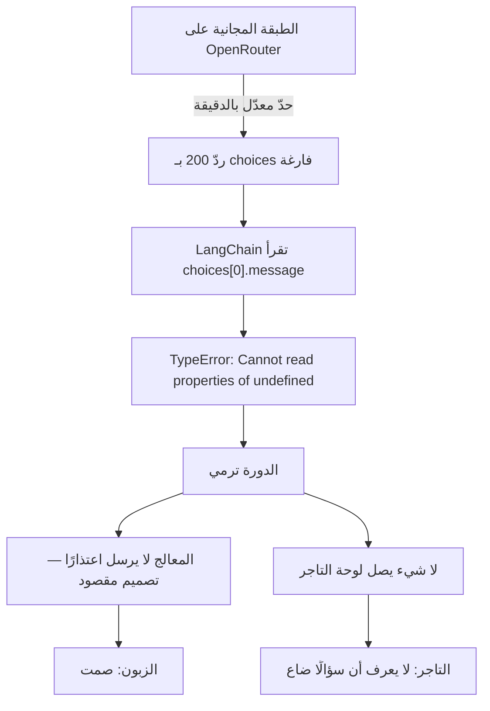

# بوت العملاء يسكت — تحليل السبب الجذري

**آخر تحديث:** 2026-09-01
**الحالة:** 🟡 **مُرقَّع جزئيًا** — التجميع وإعادة المحاولة والرسالة المقروءة شُحنت 2026-09-01. السبب الجذري (لا بديل للمزوّد) **قائم**.
**اكتُشف:** 2026-09-01 من بلاغ تاجر: «ببعت مسجات وبوت واتس ما برد عليا»
**الملفات:** [`customer-bot/`](../../back-end/src/customer-bot/) · [`chat-invoke.helper.ts`](../../back-end/src/ai/chat-invoke.helper.ts) · [`chat-model.service.ts`](../../back-end/src/ai/chat-model.service.ts)
**التوثيق:** [`back-end/docs/features/customer-bot.md`](../../back-end/docs/features/customer-bot.md)

---

## ١. الخلل في جملة واحدة

المنصّة تعامل نموذج اللغة على أنه **تابعٌ دائم التوفّر**، وهو طرف ثالث متذبذب — فحين يرفض المزوّد الاستجابة، تموت الدورة ويحصل الزبون على **صمت**، ولا يعلم التاجر أن سؤالًا وصله أصلًا.

واللافت أن **كل طرف ثالث آخر في هذا الكود معالَج بشكل صحيح**: إرسال واتساب يمرّ بطابور له بديل بريدي، والإشعارات تُسلَّم تحت `Promise.allSettled` فانقطاع قناة لا يوقف الأخرى، ومختصِر الروابط **لا يرمي أبدًا** — يُعيد الرابط الطويل. نموذج اللغة هو التكامل الوحيد بلا بديل وبلا مسار تدهور.

---

## ٢. ما رآه التاجر، وما رأيناه في اللوج

البلاغ كان «ما رد عليا». اللوج بعد نشر الإصلاحات الأولى:

```
3:52:37  ✅ ردّ    burst=7
3:53:21  ✅ ردّ    burst=2
3:53:58  ✅ ردّ    burst=3
3:54:33  ⚠️  provider returned no completion — retrying once in 1200ms
3:54:35  ❌ الإعادة فشلت أيضًا → صمت
```

ثلاث دورات نجحت وواحدة سقطت. والسؤال الذي سقط — «في تخفيضات على منتجات معيّنة؟» — **لا علاقة لمضمونه بالسقوط**؛ أُعيد إنتاج العطل بنفس السؤال حرفيًا: ينجح مرّة ويسقط التي تليها.

---

## ٣. سلسلة الأسباب



**الحلقة الأولى:** الموديل المضبوط `nvidia/nemotron-3-super-120b-a12b:free`. الطبقة المجانية تخنق بالمعدّل، وحين تخنق تُرجع `200` بمظروف فيه `error` و`choices` **فارغة** — لا خطأ HTTP.

**الحلقة الثانية — ولماذا ضاع الوقت هنا:** عميل LangChain يقرأ `response.choices[0].message` بلا فحص، فيصير الخطأ:

```
Cannot read properties of undefined (reading 'message')
```

وهذه الرسالة **تشير إلى كودنا وهي عن المزوّد**. أي قارئ يبدأ بتفتيش الـprompt والأدوات والتغييرات الأخيرة — وكلّها سليمة.

**الحلقة الثالثة:** `CustomerBotProcessor` لا يرسل اعتذارًا عند الفشل، وذلك **قرار سليم في محلّه**: «آسف ما قدرت أجاوب» باسم التاجر لعميله أسوأ من أن يردّ التاجر بعد عشر دقائق. لكنّه صُمِّم لنموذج يُنتج جوابًا رديئًا، لا لمزوّد لا يُجيب أصلًا.

**الحلقة الرابعة:** لا شيء يُعلم التاجر. الرسالة مخزّنة في صندوق الوارد، لكن بلا أي علامة على أن المساعد حاول وفشل.

---

## ٤. ثلاثة أعطال منفصلة بدت عطلًا واحدًا

بلاغ التاجر كان واحدًا، وتحته ثلاثة أشياء مختلفة، ويستحقّ الفصل بينها لأن كلًّا منها له علاج مختلف:

| ما بدا | ما كان فعلًا | العلاج |
|---|---|---|
| «يردّ على كل رسالة على حدة» | كل فقاعة دورة مستقلّة | تجميع الدفعة — **شُحن** |
| «مرّة يردّ ومرّة لا» | خنق معدّل على الطبقة المجانية | سلسلة بدائل — **لم يُبنَ** |
| «ردّ عليّ بتفكيره» | الحلقة تقرأ «لا استدعاء أداة» كـ«انتهى الجواب» | `detectReplyLeak` — **شُحن** |

وكان بينها تفاعل خبيث: قبل التجميع، حين يعضّ `CustomerBotThrottle`، تُجاب **الفقاعة الأولى** ويُسقَط ما بعدها — فمن يكتب «مرحبا» ثم «بدي آيفون ١٥» يُحيَّا ويضيع سؤاله بلا أثر. أسوأ من ثلاثة ردود.

---

## ٤-ب. سبب صمت ثانٍ، مختلف تمامًا (اكتُشف بعد النشر)

بعد إصلاح ما سبق، أبلغ التاجر بصمت جديد — وكان سببه **مغايرًا كليًا** لخنق المزوّد، ويستحق التمييز لأن العَرَض واحد والعلاج مختلف.

الخيط من الإنتاج:

```
"شو في بلمتجر عندك"  → ✅ عدّد المنتجات
"ماك بوك شو سعرو"    → ✅ أعطى السعر
"شو تفاصيل"          → ✅ أعطى تفاصيل وعرض المزيد
"بدي مواصفات"        → ❌ صعّد، وأسكت المساعد ٢٤ ساعة
```

**«بدي مواصفات» بيانات كتالوج** — لا علاقة لها بطلب ولا حساب. وما حدث أن `search_products` كانت تُسقط الوصف من إسقاطها: تُرجع الاسم والسعر والتوفّر فقط. فلم يكن لدى الموديل ما يجيب به، وقاعدة التصعيد في الـprompt كانت واسعة — «أي شيء لا تستطيع رؤيته» — فقرأ **حقلًا ناقصًا** على أنه سبب لتسليم المحادثة.

ثم ضاعف `ai_paused_until = 24 ساعة` الكلفة: تصعيد واحد خاطئ يُسكت المساعد يومًا كاملًا على ذلك الزبون.

**ثلاثة إصلاحات، كلٌّ لطبقة:**

- الأداة تُرجع `description` و`brand` (مقصوصَين، وهما منشوران أصلًا على صفحة المنتج العامّة). الوصف لم يُحذف لسبب أمني — كان سهوًا.
- قاعدة التصعيد ضاقت إلى شيئين فقط: سؤال عن طلب/توصيل/دفع/استرداد/حساب، أو طلب صريح لموظف بشري. ونصّ الـprompt يقول صراحةً إن **نقص التفصيل يُقال ولا يُصعَّد**.
- النافذة صارت **ثلاث ساعات** بدل أربع وعشرين — تحدّ كلفة التصعيد الخاطئ ببعض يوم عمل، وتبقى أطول بكثير من أي تبادل حيّ. والمخرجان الأهم من الساعة قائمان: ردّ التاجر يجدّد النافذة، و`resumeWhatsAppAssistant` تنهيها.

تُحقّق بنفس السؤال الذي أسقط الخيط: `escalated=null`، والجواب صار «بيجي بشاشة 13.3 بوصة، معالج M3…».

---

## ٥. ما شُحن بالفعل (2026-09-01)

- **تجميع الدفعة** — `CustomerBotCoalescer`: الرسالة تُخزَّن فور وصولها، ويتأخّر **الردّ** ست ثوانٍ؛ آخر رسالة في الدفعة هي التي تُجيب، و`pendingCustomerTurn` تقرأ كل ما قاله الزبون منذ آخر كلام للمتجر كنصّ واحد. أُثبت في الإنتاج: `burst=7`.
- **إعادة محاولة داخل الدورة** — [`chat-invoke.helper.ts`](../../back-end/src/ai/chat-invoke.helper.ts). داخل الدورة لا على الطابور: `attempts: 1` باقية لأن ردًّا يصل بعد تراجع BullMQ ينزل تحت سؤالٍ تجاوزه الزبون، بينما الإعادة هنا تحدث والشخص ما زال يرى «يكتب…».
- **رسالة خطأ تقول الحقيقة** — `asReadableError` تستبدل رسالة المكتبة المضلِّلة بـ«المزوّد لم يُرجع أي إكمال»، مع الاحتفاظ بالأصل في `cause`.

---

## ٦. لماذا هذا ترقيع لا حلّ

**إعادة المحاولة على نفس الموديل عديمة الجدوى عند حدّ المعدّل.** الحدّ بالدقيقة، والإعادة بعد **١.٢ ثانية** تقع داخل النافذة المخنوقة نفسها — وهذا ما شوهد حرفيًا في اللوج أعلاه: المحاولة والإعادة سقطتا خلال ثانيتين.

الإعادة تُنقذ من عطل لحظي، ولا تُنقذ من خنق. **الإعادة يجب أن تُغيّر شيئًا.**

وتكبير المهلة إلى عشر ثوانٍ أو خمس عشرة يمسك حدّ الدقيقة، لكنّه يُجلس الزبون ربع دقيقة — وهو ما اشتكى منه التاجر أصلًا («طول كثير عليا»). لا يوجد ضبط لهذا الرقم يُرضي الطرفين ما دام الموديل مجانيًا.

---

## ٧. الحلّ الجذري

### أ. سلسلة بدائل — لا إعادة الشيء نفسه

`AI_CHAT` يحمل اليوم `model` و`fast_model`. يُضاف `fallback_model`، ويُرجع `ChatModelService` **سلسلة** بدل موديل واحد، فتصير `invokeChatWithRetry` «جرّب الأساسي ثم اسقط إلى البديل».

شرط لا يُتجاوز: **البديل يجب أن يكون مدفوعًا**. بديل مجاني يقع في الحفرة نفسها.

وفيه ربح مجاني: شاشة `/integrations` في الأدمن **مبنيّة كليًا من `integrationProviders`** — الحقول وتلميحاتها من السيرفر — فحقل جديد في السجلّ يظهر في الواجهة **بلا أي كود frontend**.

### ب. الموديل يتبع الخطّة

اليوم **كل المتاجر تتشارك موديلًا واحدًا** والمنصّة تتحمّل الكلفة. وعلى طبقة مجانية يتحوّل ذلك إلى **ندرة مشتركة**: متجر نشيط واحد يخنق بقيّة المتاجر.

`EntitlementsService` والخطط جاهزة. الربط: خطّة مجانية ← موديل رخيص، خطّة مدفوعة ← الموديل الجيّد. فتتبع الكلفةُ الإيرادَ بدل أن تعاكسه.

### ج. الكلفة تُقاس

`ai.agent.customer` تعدّ **طلبات بكلفة صفر**. النصف الآخر من `/analytics` مبنيّ أصلًا (`usageSummary` و`usageTopShops` بـ`cost_cents`) لمزوّدين آخرين — بوت العميل وحده لا يغذّيه. وبلا ذلك يظهر هامش المنصّة على القناة **صفرًا**، ولا يُسعَّر ما لا يُقاس.

### د. الفشل يصير مرئيًا في الطرفين

- **قاطع دورة**: بعد N فشل في نافذة، تُوقَف المحاولات لفترة ويُرفع تنبيه عبر `AlertService` (موجود). بدونه تدفع كل رسالة في كل متجر كامل التأخير لتفشل.
- **الدورة الفاشلة تصل صندوق الوارد معلَّمة**: الرسالة مخزّنة أصلًا، والناقص علامة وعدّاد. التاجر يرى «سؤال لم يُجَب» ويردّ بيده.

هذه شبكة الأمان التي تجعل أي عطل مزوّد **غير قاتل للتجارة**.

---

## ٨. الترتيب المقترح

1. **(أ) سلسلة البدائل** — الوحيد الذي يُصلح العطل القائم، وأصغرها. يحتاج قرارًا: **أي موديل مدفوع يكون البديل؟**
2. **(د) الفشل المرئي** — مع أي مزوّد سيتكرّر الفشل، والصمت المزدوج (لا الزبون يعلم ولا التاجر) هو الخسارة الحقيقية.
3. **(ب) و(ج) معًا** — كلاهما عن اقتصاد الميزة، ومن المنطقي أن يُعملا في دفعة واحدة.

---

## ٩. قرار مفتوح

حين تفشل الدورة نهائيًا: **هل يُرسَل للزبون شيء أم يبقى الصمت؟**

التصميم الحالي يسكت عمدًا، والحجّة قائمة: اعتذار باسم التاجر لعميله أسوأ من أن يردّ التاجر متأخّرًا. الميل الحالي هو **البقاء صامتًا تجاه الزبون وتنبيه التاجر وحده** — لكنه قرار منتَج لم يُحسم بعد.
