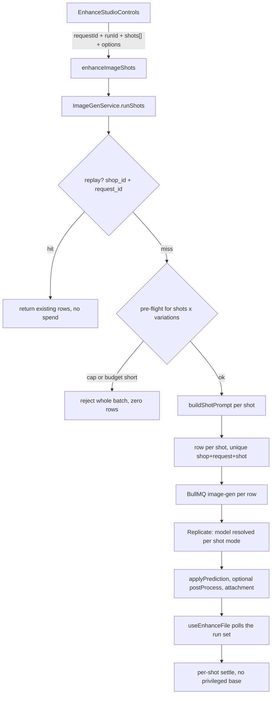

# Extra shots — plan

**Status:** Shipped, except the Pro-HD quality tier and the `on_model` acceptance eval
**Last updated:** 2026-08-14
**Backlog:** `TODO.md` — the halai-parity Enhance Studio follow-ups entry

## Overview

The AI Studio panel has an **Outputs** section: a checkbox grid
(`enhance-studio-controls.tsx`, the `SectionLabel` reading `t("outputs")` above the grid)
fed by `enhanceStyles.shots`, with the batch ceiling from
`enhanceStyles.max_shots_per_run` and the remaining monthly quota from
`enhanceStyles.monthly_usage`. It replaced two inert `· Soon` cards. This file was the
plan for that work and is now the record of what it turned into.

**What the feature is:** the vendor checks one or more outputs and clicks once. Each
checked shot produces one image. "Enhance original" is pre-checked and is itself a shot —
it holds no privileged position in the API, the run state, or the results UI.

**What it is not:** a multi-output call. `flux-2-pro` has `maxCount: 1`, so N shots means
N predictions, N `AiImageGeneration` rows, N monthly-cap units and N × cost.

Note the two axes are orthogonal and both already modelled: **shots** differ by prompt, so
they are always separate requests on any provider; **outputs per shot** is the existing
`count` / `AiImageResult[]` relation. A provider that returns four images per request
returns four variations of one shot, which the schema already handles. What shipped adds a
third axis the plan did not have: `variationCount` (1 / 4 / 8), which fires the same prompt
several times so the vendor can compare.

## Constraint that shapes the design

The shared identity block **is** split, in `enhance-blocks.ts`:
`PRODUCT_IDENTITY_BLOCK` and `FRAME_IDENTITY_BLOCK` are separate exported constants
(they used to be one `IDENTITY_BLOCK` in `enhance-styles.ts`, which no longer defines it).

That block mixed two different guarantees:

| Guarantee | Clauses | Must hold for |
|---|---|---|
| **Product identity** | source of truth, identical shape/material/colors/logos, micro-detail legible, do not redesign | every shot, always |
| **Frame identity** | preserve the original camera angle and perspective | shots declaring `preservesFrame` |

A model-view shot re-photographs the product in a person's hands. It cannot preserve the
camera angle — that is the point of the shot. So the invariant was **split**, not
loosened. The invariant walker now lives in `enhance-blocks.spec.ts` (not
`enhance-styles.spec.ts`): it asserts product identity in every composition across styles
**and** shots, holds it at ≥20% of the prompt, and asserts frame identity present exactly
where the shot declares `preservesFrame`. `enhance-styles.spec.ts` keeps the pinned
`STANDARD_PROMPT`, which is unchanged — silent prompt drift had already caused two
production bugs here.

## Architecture



## Back-end — what shipped

### 1. The invariant split — shipped

`enhance-blocks.ts` exports `PRODUCT_IDENTITY_BLOCK` and `FRAME_IDENTITY_BLOCK`
separately, plus a shared `FRAMING_BLOCK` a shot can override (`social` overrides it with
`SOCIAL_LAYOUT_BLOCK`). The default one-click look is byte-identical.

### 2. Shot registry (`enhance-shots.ts`) — shipped, larger than planned

`EnhanceShotSpec` exists, with more fields than the plan named. Beyond `id`, `labelKey`,
`descriptionKey`, `capabilities` (`preservesFrame` / `requiresHuman` / `usesStyleOptions`)
and `aspectRatio`, it carries:

- `designs` — an optional design vocabulary the shot offers (`social` only today).
- `flag` — an env var that must read exactly `'true'` for the shot to be offered or run.
  Declared here, evaluated in `ImageGenService` (`isShotAvailable`) so the gate is testable.
- `mode` — the `ImageGenMode` the shot runs in, `EDIT` by default. A shot naming another
  mode is a **transform, not a re-photograph**: `runShots` resolves the model per shot, so
  a mixed run fires two different models at two different prices in one batch.
- `postProcess` — a deterministic transform applied to the provider's bytes before ingest
  (`enhance-post.ts`), for the class of result a sampling process cannot guarantee: exact
  canvas, exact margins.
- `build(options)` — a closure composing the shot's prompt, replacing the plan's flat
  `opening` / `framing` / `scene` / `closing` / `lightingNoun` fields.

**Six** shots ship, not the two the plan sketched: `enhance`, `social` (4:5), `on_model`
(3:4, flagged), `cutout` (`BACKGROUND_REMOVE`), `square` (`BACKGROUND_REMOVE` +
`postProcess: 'square'`) and `upscale` (`UPSCALE`). `ENHANCE_SHOT_IDS` feeds the DTO
allow-list; ids stay plain `String`, not a GraphQL enum, so adding a shot is backend-only.

Unplanned but shipped alongside: a design vocabulary for `social` —
`ENHANCE_SOCIAL_DESIGNS` (five archetypes: `color_block`, `spotlight`, `editorial`,
`duotone`, `split_frame`), `DEFAULT_SOCIAL_DESIGN = 'color_block'`, `resolveSocialDesign`
— plus vision seeding: `resolvePalette` names the product's dominant colours from the
image analysis, and `ON_MODEL_SCENES` picks a scene from the analysed product category.

**Deliberately not added: `supportedCategories`.** There is no site that could evaluate it.
The panel only runs in the Files media library, where there is no product context — the
product form passes no `aiSection`. Gating server-side means reading product fields via
`productId`, which is never ownership-validated; TODO.md
already rejected that shape as a cross-shop disclosure oracle. A field nothing evaluates
reads to the next contributor as "gating exists". **Precondition for adding it:** the panel
runs somewhere the product's category is already known client-side, and the gate is
declared a UX hint, never a security boundary.

### 3. The mutation — shipped as one input object

```graphql
enhanceImageShots(input: EnhanceImageShotsInput!): AiImageGenerationsResponse!
```

`EnhanceImageShotsInput` (`dto/enhance-image-shots.input.ts`) carries `attachmentId`,
`requestId` (required idempotency key, ≤64 chars), `shots`
(`@ArrayNotEmpty @ArrayUnique @IsIn(ENHANCE_SHOT_IDS)`, `@ArrayMaxSize(MAX_SHOTS_PER_RUN)`),
`options`, `productId`, and three fields the plan never named: `runId` (groups every row of
one submit for review rebuilding), `referenceAttachmentIds` (extra angles of the same
product, capped at `MAX_REFERENCE_IMAGES - 1`) and `variationCount`.

The plan's `1..3` cap is gone. `MAX_SHOTS_PER_RUN = ENHANCE_SHOTS.length` — the literal `3`
was expressing "the current registry size" and became a restriction the moment the registry
grew. The per-shop ceiling the panel shows is `ImageGenService.effectiveMaxShots`, the
smaller of that constant and the shop's plan batch.

Results come back in registry order. **No entry is privileged** — the caller reads each
row's `shot` field. Guard chain: `JwtAuthGuard + PermissionsGuard + ShopHeaderGuard +
RequireShopGuard + ShopOwnershipGuard` (one guard more than the plan listed).

`enhanceImage` is sugar over the same service method —
`runShots(attachmentId, [DEFAULT_ENHANCE_SHOT], …)[0]` — so the two paths cannot drift.

### 4. Idempotency — shipped, with one premise corrected

`AiImageGeneration` gained `shot` and `request_id` columns and a unique on
`(shop_id, request_id, shot)`. `runShots` looks up `{ shop_id, request_id }` first; a hit
returns the existing rows and spends nothing, and the unique is the real guard — two
concurrent submits race to the insert and the loser replays.

**The plan's "`request_id` is the run key" premise is wrong and the schema says so.** A
multi-variation run suffixes the key per variation (`<id>:0`, `<id>:1`) to keep the unique
satisfiable, and a batch mints a fresh one per source. Both are correct for idempotency and
both make the column useless for "which rows are one review", so a separate `run_id` column
carries that grouping.

A column rather than `params.enhance.shot` because the composite unique needs it, and
because outcome telemetry joins on it — a JSON key is the wrong shape for both.

### 5. Whole-batch pre-flight — shipped

`runShots` validates every shot id before any spend, asserts the monthly cap once for the
full batch, and reserves budget for the whole batch in one atomic statement.
`AiBudgetService.reserveCost(feature, costCentsOverride?, units = 1)` takes the unit count;
the `INSERT … ON CONFLICT` gates `total_cost_cents + cost * units <= cap` and increments
`call_count` by `units`. The rate limiter passes `shots × variations`.

**Not doing:** renaming to a generic `reserveGenerationCapacity({type, units, metadata})`.
The `type` dimension already exists and is already recorded — `ai_usage.feature_breakdown`
is keyed by feature. What is missing is a **per-call event row**, and `metadata` has nowhere
to land: `ai_usage` is one global row per day (`date @unique`, and no `shop_id` at all), so
sub-keying `feature_breakdown` would put unbounded cardinality in a JSON blob rewritten by
`jsonb_set` on every AI call in the platform. Per-feature attribution is a table, not a
parameter — filed separately, not blocking this work.

### 6. Quota on the query the panel already loads — shipped

`enhanceStyles` returns `data` (styles), `shots`, `monthly_usage` and `max_shots_per_run`,
at zero extra round-trips. It now **requires `X-SHOP`** — it used to be shop-free static
registry data, but the panel has to know there is no room for three before offering three
checkboxes.

## Front-end — what shipped

### 7. The quota error message — shipped

The regex in `use-enhance-file.ts` that could never match `'Validation failed'` is gone.
The hook imports `useAiImageError` from `shared/lib/ai-image-errors.ts`, which is now a thin
alias re-exporting `usePlanError` / `isQuotaError` from `plan-errors.ts` — one table serving
every metered capability.

### 8. Multi-run hook — shipped

`useEnhanceFile` tracks a run set (`ShotRun[]`, exported and consumed by
`enhance-batch-studio.tsx`) rather than a single id, polls each id and settles each
independently. Every shot can fail on its own, including `'enhance'`. The `requestId` is
generated once per submit and reused across retries of that submit, so a network retry
replays instead of double-charging. The single-run `pollRef` guard is gone.

### 9. Results UI — shipped

`EnhanceCompare`'s wipe slider is only meaningful for the `'enhance'` shot — same frame,
same angle. Review is `enhance-canvas.tsx` with `enhance-compare.tsx` beside it:
`'enhance'` succeeded gets the compare slider (Replace original / Keep both / Discard);
every other shot, and `'enhance'` when it is not in the run, gets save-to-library / discard.

### 10. Panel — shipped

The dead cards are a real **Outputs** checkbox grid fed by `enhanceStyles.shots`, with
`Enhance original` pre-checked. Each non-enhance entry shows its forced ratio; the panel's
Aspect ratio selector applies to shots whose `usesStyleOptions` is true. Zero checked
disables the CTA. The `Pro HD · Soon` stub was deleted with it — nothing in the panel
mentions a quality tier today.

## Shipping order

### Phase 1 — Social post: shipped

A social post is a **re-frame of the same photograph**: vertical 4:5, scroll-stopping
composition, deliberate negative space for a caption overlay. It keeps the camera angle, so
`preservesFrame: true` and it inherits the full identity guarantee. It has its own framing
block (`SOCIAL_LAYOUT_BLOCK`) because the shared one says "centered naturally", which fights
"leave space at the top".

**The empty area is phrased positively.** FLUX.2 Pro has no negative-prompt support and
naming a thing to avoid tends to summon it — `Do not place text or logos in the empty space`
contains "text" and "logos" and is exactly the shape that backfires. The block asks for the
outcome instead: an even, uninterrupted area of backdrop across the upper third. Every
design archetype added later has to satisfy that same block, which is the rule
`ENHANCE_SOCIAL_DESIGNS`' header states.

### Phase 2 — Model view: code shipped, flag off

> **Status: code shipped as the `on_model` shot, behind `AI_IMAGE_ON_MODEL_ENABLED`
> (`"false"` in `.env.example` and `.env.development`). The eval below has NOT been run,
> and the flag must stay off in vendor-facing environments until it has.** Full build
> status, decisions and remaining work: [on-model-shot.md](on-model-shot.md). The env flag
> is this section's "decide whether that gap blocks the shot" made operable: the platform
> now has a switch instead of a comment. Settled since: the model is generated rather than
> uploaded, and gender/crop are inferred from the product rather than selected.

Of the three risks this section listed, one is closed and two are not:

1. **Product fidelity.** Open. Re-rendering a snack tub into a hand is exactly the "restyle
   the product" failure the identity block exists to prevent. This is what the eval measures.
2. **Category fit.** Open. "Worn" means apparel, jewelry, watches, bags. "Held" means small
   goods. A sofa or a 500g tub has no natural model shot, and no category gate is available
   (see §2), so the shot has to be good enough to offer unconditionally or not at all.
3. **No output-image moderation.** Closed. `back-end/src/ai/moderation/image-moderation.service.ts`
   classifies generated bytes before they are persisted, gated on
   `AI_IMAGE_OUTPUT_MODERATION_ENABLED`. Its verdict contract mirrors
   `ContentModerationService`: `degraded: true` means the classifier did not answer, and the
   caller chooses the posture — an `on_model` result with no verdict is dropped.

## What remains

Two items, and only two.

1. **The `on_model` acceptance eval.** Not run; it is the blocker on the flag, not a
   follow-up. Run 15–20 representative catalog images through the prompt and count how many
   keep the label legible and the product geometry intact. Below ~70%, delete the shot
   rather than ship it. It needs catalog images (none live in the repo — they are behind the
   shops' CDN), a configured `REPLICATE_API_TOKEN`, and roughly one US dollar of provider
   spend per iteration at ~$0.045 per image.
2. **A Standard / Pro-HD quality tier.** Unbuilt. There is no `pro_hd` / `qualityTier`
   anywhere in `back-end/src/ai/image/` or `apps/vendor/src/features/files/` — the old
   teaser stub was deleted rather than implemented, so this is a new tier to design, not a
   stub to fill.

Two things the older backlog text still lists as remaining have in fact shipped, and are
recorded here so nobody re-derives it:

- **Batch enhance from multi-select.** `enhance-batch-studio.tsx` (`EnhanceBatchStudio`),
  routed from `ai-studio-page.tsx` when `batchIds` is non-empty, with `?ids=` / `?run=` URL
  state and an entry in `files-bulk-bar.tsx`.
- **A draggable light-direction control.** `enhance-studio-controls.tsx` renders
  `CameraAngleController` with a `directionToAngle` / `angleToDirection` mapping. The
  6-button grid is gone.

## Test coverage

- `enhance-blocks.spec.ts` — the invariant walker across styles **and** shots: product
  identity present and ≥20% share in every composition, frame identity present exactly where
  `preservesFrame`, no negative phrasing, prompt under `IMAGE_PROMPT_MAX_LENGTH`.
- `enhance-styles.spec.ts` — `STANDARD_PROMPT` still pinned verbatim.
- `enhance-shots.spec.ts` — per-shot pins: aspect ratios valid, both lookup keys present,
  and the `requiresHuman` ⇒ `flag` pairing.
- `image-gen.service.spec.ts` — a batch that trips the cap creates zero rows and books zero
  budget; an unknown or flag-disabled shot id rejects before any spend; the same `requestId`
  twice returns the first batch's rows and books nothing the second time.

## Docs updated

- `back-end/docs/features/ai-image.md` — done (shots in the enhance flow).
- `back-end/docs/features/api/ai-image.md` — done (`enhanceImageShots` contract,
  idempotency semantics, the extended `EnhanceStylesResponse`).
- `back-end/docs/features/api/README.md` — done (operation row).
- `apps/vendor/docs/features/files.md` — done (the panel no longer has teaser cards).

## Resolved

The base enhance is no longer mandatory (it was an open question in the first draft). A
vendor who wants only a social post pays for one image. This also removes the privileged
base from the API, the run state and the results UI, which is what makes per-shot failure
handling fall out for free instead of needing a special case.
