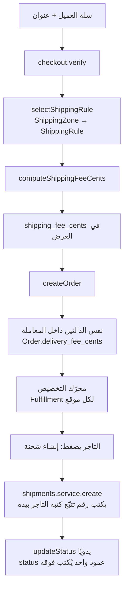
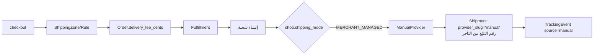
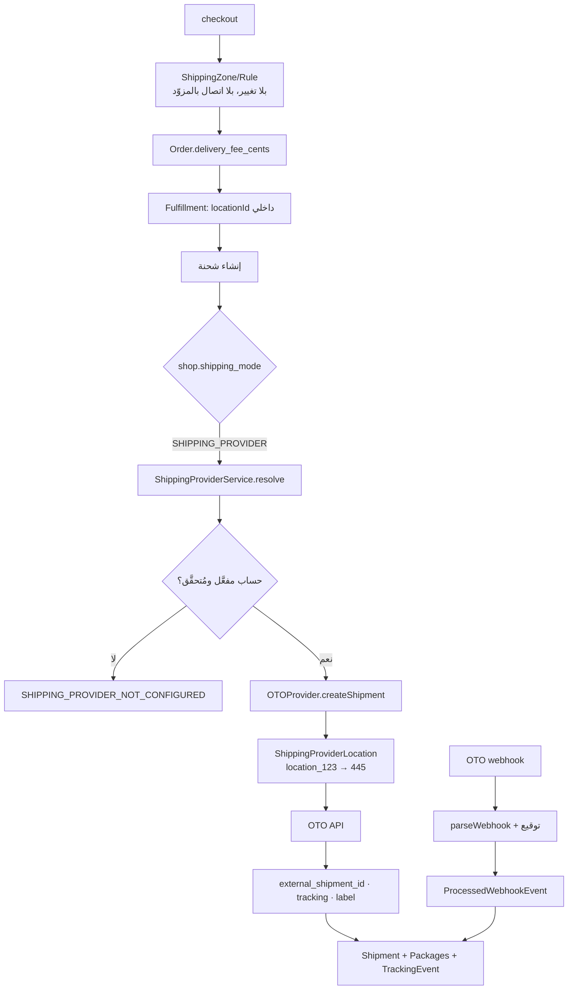

# PHASE 5 — Shipping Mode + Provider Abstraction · تقرير ما قبل التنفيذ

**Last updated:** 2026-08-22
**الحالة:** ✅ **مكتملة — مطبَّقة على القاعدة المحلية · الإنتاج لم يُمَسّ**
**السياق:** [الخطة المتبقية](multi-location-remaining-plan.md) · [التصميم الأصلي](multi-location-fulfillment-and-shipping.md)

> **حُدِّث بعد التنفيذ (2026-08-22).** وافقتَ على الـ delta وعلى إزالة `provider_response` وعلى أن الوضع على مستوى المتجر يكفي، فنُفِّذت المرحلة كاملة. الـ migration في `back-end/prisma/migrations/manual/2026-08-21-shipping-providers.sql`، **مطبَّق على القاعدة المحلية بنجاح** (2026-08-22) ومعه migration‑ا PHASE 1 اللذان لم تكن المحلية قد استلمتهما. **الإنتاج لم يُمَسّ بقرارك.**
>
> ما يلي هو التصميم كما اعتُمد، وقد نُفِّذ كما هو. الوثيقة المرجعية للسلوك الفعلي صارت [`back-end/docs/features/shipping-providers.md`](../../back-end/docs/features/shipping-providers.md).

كل ما يلي مبني على فحص الكود الفعلي، لا على الوثائق.

> **تصحيح لنسخة سابقة من هذا الملف.** كانت تعامل `manual` كـ *ارتداد صامت* عند غياب مزوّد. هذا **خطأ**: `MERCHANT_MANAGED` وضع عمل يختاره التاجر صراحةً. النسخة الحالية تفصل المفهومين — انظر §9.

---

# القسم ١ — إجابات الأسئلة العشرة

### 1. أين `ShippingZone` و`ShippingRule` وحساب الشحن؟

| الملف | الدور |
|---|---|
| [`shipping-zone.helper.ts:81`](../../back-end/src/shipping/shipping-zone.helper.ts) | `selectShippingRule(db, shopId, destination)` — يختار المنطقة الأخصّ (states > countries > catch-all، والتعادل بأقلّ `priority`)، ثم أحدث rate band فيها. متجر له مناطق ولا تطابق أيٌّ منها ⇒ `null` = **لا يشحن إلى هناك**. متجر بلا مناطق ⇒ ارتداد قديم لأحدث قاعدة بلا `zone_id`. |
| [`shipping-fee.helper.ts:24`](../../back-end/src/shipping/shipping-fee.helper.ts) | `computeShippingFeeCents(rule, {subtotalCents, totalGrams})` — `free` · `percentage` (bps) · `weight_based` (أساس + كل كغم مُقرَّب لأعلى) · `fixed`. ثم عتبة `min_order_cents` تصفّر الرسم. |
| `shipping.service.ts` / `shipping.resolver.ts` | 6 mutations + 2 queries لإدارة المناطق والقواعد. الـ mutations `MANAGE_OWN_SHOP` + `X-SHOP`؛ القراءتان `OptionalJwtGuard` لأن الواجهة تحتاجهما. |

**ملاحظة معمارية مهمة:** الدالتان **نقيّتان ومشتركتان**، ولهما مستدعيان اثنان فقط — الـ checkout وإنشاء الطلب. هذا مقصود ومكتوب في تعليق الملف: «حتى لا يفترق السعر المعروض عن السعر المحسوب». **هذا التصميم لن يُمَسّ.**

### 2. أين يحسب الـ checkout رسم الشحن؟

[`checkout.service.ts:338-374`](../../back-end/src/checkout/checkout.service.ts#L338-L374). التسلسل:

```
shipping_address → selectShippingRule(prisma, shopId, {country,state})
                 → لو null: shipping_available = false
                 → لو موجود: تجميع weight_grams × qty (تخطّي requires_shipping=false)
                 → computeShippingFeeCents(...)
                 → كوبون free_shipping قد يصفّره
                 → ضريبة الشحن (on_shipping) بعد الكوبون
```

ونظيره عند الكتابة: [`orders.service.ts:1850`](../../back-end/src/orders/orders.service.ts#L1850) — نفس الدالتين، **داخل المعاملة**، وبتجميع لكل متجر في السلة متعدّدة المتاجر (`shippingByShop`). الناتج `serverShippingFeeCents` وهو ما يُكتب في `Order.delivery_fee_cents`، ولا يُوثَق برسم يرسله العميل.

### 3. أين تُنشأ `Shipment` اليوم؟

[`shipments.service.ts:142`](../../back-end/src/shipments/shipments.service.ts#L142) — **يدوي بالكامل**:

```ts
const row = await this.prisma.shipment.create({
  data: {
    fulfillment_id, order_id, shop_id,
    tracking_number: input.tracking_number,   // يكتبه التاجر بيده
    delivery_company: input.delivery_company, // نصّ حرّ
    status: 'pending',
  },
});
```

لا اتصال بأي طرف خارجي، لا ملصق، لا تسعير. و`updateStatus` يكتب `status` ويضبط الطوابع الزمنية ويُطلق `SHIPMENT_EVENTS.UPDATED` لإشعار العميل.

### 4. كيف ترتبط `Fulfillment` بـ `Shipment`؟

بُني في PHASE 1 وهو **جاهز لما نحتاجه**:

```
Order 1─n Fulfillment (location_id NOT NULL, واحد لكل موقع)
            │
            └─1─n Shipment (fulfillment_id, Cascade)
                     │
                     └─1─n ShipmentLineItem ──> FulfillmentLineItem
```

`createShipment` يقرأ الـ fulfillment بنطاق المتجر ويشتقّ منه `order_id` و`shop_id` — فلا يستطيع تاجر أن يعلّق شحنة على طلب غيره. **`ShipmentLineItem` مُنشأ وغير مستخدَم** — أُضيف في PHASE 1 تحسّبًا لهذه المرحلة بالضبط.

### 5. كيف تُمثَّل `InventoryLocation`؟

[`schema.prisma:942`](../../back-end/prisma/schema.prisma#L942). `id` هو cuid داخلي، ومعها **عنوان كامل** (`address_line1/2`, `city`, `state`, `zip`, `country` ISO-3166-1, `phone`) وثلاث رايات: `is_default` · `is_active` · `fulfills_online_orders`.

**هذا يعني أن عنوان الاستلام موجود مسبقًا** — لا نحتاج نموذج عنوان جديد لأجل الناقل.

### 6. كيف يُستخدم `IntegrationConfig` اليوم؟

**منصّي، لا لكل متجر.** [`schema.prisma:5457`](../../back-end/prisma/schema.prisma#L5457): `type` (enum من 6 قيم) + `provider` (slug) + `credentials` (ظرف AES-256-GCM) + `is_enabled`، **وصفّ واحد مفعَّل لكل `type` للمنصّة كلها** (فهرس جزئي فريد في migration يدوي).

⇒ **لا يصلح لاعتمادات الشحن**، لأنها لكل تاجر. لكن ما يُعاد استخدامه هو النمط لا الجدول:
- `SecretCryptoService` في `src/common/crypto/` — وحدته **global**، فمتاحة بلا استيراد.
- `provider-registry.ts` — كتالوج يصف `fields` (وأيّها سرّي) و`schema` و`verify`، **والواجهة تُرسم منه**. إضافة مزوّد = مدخل في السجلّ، وتكلفتها على الواجهة صفر.

### 7. ما الحقول الموجودة التي يمكن إعادة استخدامها بدل إضافة جديد؟

| موجود | يُعاد استخدامه كـ | ملاحظة |
|---|---|---|
| `Order.delivery_fee_cents` | **`customerShippingCharge`** | **PHASE 7 لا يحتاج عمودًا جديدًا لهذا المفهوم** |
| `Shipment.provider_response` `Json?` | الحمولة الخام من المزوّد | موجود **ولا يكتبه أحد**. ⚠️ **مُعرَّض عبر GraphQL** — انظر R1 |
| `Shipment.tracking_number` / `tracking_url` / `status` / `estimated_delivery` / `shipped_at` / `delivered_at` / `cancelled_at` | كما هي | تُملأ من المزوّد بدل يد التاجر |
| `Shipment.delivery_company` | **اسم العرض** فقط | يبقى، ويُضاف `provider_slug` كمفتاح آلي. لا يُحذف |
| `ShipmentLineItem` | محتوى الشحنة | مبنيّ في PHASE 1، غير مستخدَم |
| `ProcessedWebhookEvent` | idempotency للـ webhooks | نمط جاهز ومُختبَر في `stripe-webhook.controller.ts` |
| `Product.weight_grams` · `hs_code` · `country_of_origin` | وزن ومعطيات جمركية | **موجودة** — الأبعاد وحدها ناقصة |
| `InventoryLocation.*` العنوان | عنوان الاستلام | لا نموذج عنوان جديد |
| `SecretCryptoService` (+ AAD) | تشفير الاعتمادات | يدعم مفتاحًا سابقًا للتدوير |

**عمودان لن أعيد استخدامهما، عمدًا:**

- **`Order.logistics_provider String?`** — **عمود ميّت**: مرجعه الوحيد بُعد في `report.registry.ts`. مغرٍ، لكن **الحبيبية خاطئة**: الطلب قد يحمل عدّة fulfillments من مواقع مختلفة، ولا شيء يمنع مستقبلًا اختلاف الناقل بينها. قرار المزوّد ينتمي للشحنة. **يُترك كما هو.**
- **`Shop.shipping Json? // { type, city_rules }`** — عمود قديم ميّت أيضًا. حشر وضع الشحن فيه يعني قيمة لا تُفهرَس ولا تُتحقَّق ولا تُجمَّع عليها التحليلات. **enum مصرَّح أوضح وأرخص.**

### 8. ما أقلّ schema delta مطلوب؟

**١ enum + ١ عمود على `Shop` + ٤ جداول + ٤ أعمدة على `Shipment`.** التفصيل الكامل في القسم C. كل شيء **إضافي**: لا حذف، لا تحويل نوع، لا `NOT NULL` على جدول قائم، لا backfill.

**ما استبعدتُه من مسوّدتي السابقة بحثًا عن الأقلّ:**
- **أبعاد المنتج** (`length_mm`/`width_mm`/`height_mm`) → **PHASE 6**. مزوّد `manual` لا يحتاجها، و`ShipmentPackage` يقبل أبعادًا مكتوبة يدويًا. إضافة ٣ أعمدة nullable لاحقًا تكلفتها صفر.
- **`Shipment.shipping_mode`** → **غير مطلوب**، انظر §9.

### 9. كيف يُمثَّل `MERCHANT_MANAGED` مقابل `SHIPPING_PROVIDER`؟ 🔑

**هذا هو القرار الجوهري في المرحلة، ومربط الفرس فيه أنهما ليسا نفس المستوى:**

```
ShippingMode   ← قرار عمل يتّخذه التاجر     (على Shop، صريح، افتراضه MERCHANT_MANAGED)
ShippingProvider ← تنفيذ يُختار كنتيجة له  (manual | oto | aramex …)
```

`MERCHANT_MANAGED` **تُحَلّ إلى** المزوّد `manual` — لكن هذا **نتيجة اختيار صريح، لا ارتداد**. الفرق ليس لفظيًا؛ يظهر في ثلاثة سلوكيات قابلة للملاحظة:

1. **الوضع يعلو على وجود الحساب.** متجر في `MERCHANT_MANAGED` وله حساب OTO مفعَّل **يبقى يدويًا**. وجود اعتمادات لا يغيّر وضع عمل.
2. **`SHIPPING_PROVIDER` بلا حساب صالح = خطأ، لا ارتداد.** `createShipment` يرمي `SHIPPING_PROVIDER_NOT_CONFIGURED`. الارتداد الصامت هنا يعني أن تاجرًا يظنّ أن OTO تشحن له بينما الشحنات تتراكم يدويًا بلا ملصق.
3. **السجلّ يميّزهما.** `Shipment.provider_slug = 'manual'` تعني «التاجر اختار التوصيل بنفسه»، ولا يمكن أن تنتج عن مسار مزوّد فاشل — لأن ذلك المسار يرمي.

**لماذا لا عمود `shipping_mode` على `Shipment`؟** لأن التكافؤ `MERCHANT_MANAGED ⟺ provider_slug='manual'` **مُلزَم عند نقطة الحلّ الوحيدة ومُختبَر**. عمود ثانٍ يعني مصدرَي حقيقة يمكن أن يختلفا، وهو عيب لا ميزة. `provider_slug` وحده يجيب «كم شحنة وصّلناها بأنفسنا؟» بدقّة تامة. (لو ظهر يومًا مزوّد ثانٍ داخل الوضع اليدوي، يُضاف العمود حينها.)

**أين يعيش الوضع؟** عمود enum على `Shop` وليس جدول `ShopShippingConfig` منفصل — الفارق join على مسار ساخن مقابل عمود واحد، و«أقلّ تغيير ممكن» يرجّح العمود. لو احتاج الأمر مستقبلًا وضعًا لكل موقع، ينتقل إلى جدول حينها.

**فخّ مُتجنَّب:** `Fulfillment.status` بقي `String` لأن تحويل قيم قائمة (`'success'`) إلى enum بحروف كبيرة يُفشل النشر. هنا العمود **جديد بقيمة افتراضية** فلا قيم قائمة تُحوَّل ⇒ **enum آمن**. (وPostgres 11+ لا يعيد كتابة الجدول عند إضافة عمود بافتراضي غير متقلّب.)

### 10. كيف تنعكس واجهة Shipping & Delivery الحالية على النموذج؟

الشاشة اليوم [`shipping-section.tsx`](../../apps/vendor/src/features/shipping/components/shipping-section.tsx) (448 سطرًا) داخل `settings/shipping` تعرض المناطق وrate bands وتشخّص ثلاث حالات «تبدو صحيحة ولا تُحصّل شيئًا» (`lib/zones.ts`).

**تبقى كما هي حرفيًا، ويُضاف فوقها قسم واحد:**

```
Settings → Shipping & Delivery
├── [جديد] وضع الشحن            ← radio: أتولّى التوصيل | مزوّد شحن
├── [جديد، يظهر في وضع المزوّد] حساب المزوّد + ربط المواقع
└── [كما هو] المناطق والأسعار    ← يبقى ظاهرًا وفعّالًا في **كلا** الوضعين
```

النقطة التي يجب ألّا تُخطئها الواجهة: **بطاقة المناطق والأسعار لا تُخفى في وضع المزوّد.** إخفاؤها يوحي بأن OTO تسعّر العميل، وهي لا تفعل — ما يدفعه العميل يبقى من `ShippingZone`/`ShippingRule`. البطاقة تكسب سطرًا توضيحيًا فقط.

وقاعدة تفاعل واحدة: **لا يُسمح بالتبديل إلى وضع المزوّد قبل نجاح `verify` لحساب واحد** — وإلّا اشترى العميل ولم تُنشأ شحنة.

---

# القسم A — البنية الحالية



الخلاصة: **التسعير ناضج ومشترك ومُختبَر. التنفيذ يدوي بالكامل.** ولا شيء بينهما يحتاج إعادة كتابة — ما ينقص طبقة فوق `Shipment` فقط.

---

# القسم B — البنية المقترحة

## B.1 وضع `MERCHANT_MANAGED` (الافتراضي، وكل متجر قائم اليوم)



**لا استدعاء خارجي في أي نقطة.** السلوك مطابق لليوم، بفارق أن الشحنة صارت تحمل `provider_slug` وسطر تتبّع بدل عمود يُكتب فوقه.

## B.2 وضع `SHIPPING_PROVIDER` + OTO



## B.3 الطبقة الجديدة

```
src/shipping-providers/                    ← لا يعرف شيئًا عن التسعير
├── shipping-provider.interface.ts          # العقد
├── shipping-provider.registry.ts           # slug → spec (fields/schema/verify)
├── shipping-provider-account.service.ts    # اعتمادات لكل متجر + تشفير + verify
├── shipping-provider-location.service.ts   # الربط بالمعرّف الخارجي
├── shipping-provider.service.ts            # الحلّ: shop → mode → provider
├── providers/manual.provider.ts            # MERCHANT_MANAGED
└── types/                                  # DTOs محايدة تمامًا
```

```ts
export interface ShippingProvider {
  readonly slug: string;
  verify(creds: ProviderCredentials): Promise<VerifyResult>;
  rate(req: RateRequest): Promise<RateQuote[]>;              // معرَّفة، غير مستخدَمة في PHASE 5
  createShipment(req: CreateShipmentRequest): Promise<ProviderShipment>;
  cancelShipment(req: CancelShipmentRequest): Promise<void>;
  track(req: TrackRequest): Promise<TrackingSnapshot>;
  parseWebhook(raw: Buffer, headers: Record<string, string>): ProviderWebhookEvent | null;
}
```

`CreateShipmentRequest` يتكلّم لغة النطاق حصرًا — `locationId` داخلي، عنوان، سطور، طرود. **المزوّد هو من يترجم `locationId` إلى معرّفه الخارجي**، والنواة لا ترى `445` أبدًا.

---

# القسم C — الـ schema delta بالضبط

## C.1 enum جديد + عمود على `Shop`

```prisma
enum ShippingMode {
  MERCHANT_MANAGED
  SHIPPING_PROVIDER
}

model Shop {
  shipping_mode ShippingMode @default(MERCHANT_MANAGED)
  shipping_provider_accounts ShippingProviderAccount[]
}
```

## C.2 `ShippingProviderAccount` — اعتمادات لمتجر واحد

```prisma
model ShippingProviderAccount {
  id       String @id @default(cuid())
  shop     Shop   @relation(fields: [shop_id], references: [id], onDelete: Cascade)
  shop_id  String
  provider String                            // registry slug

  credentials String                         // ظرف AES-256-GCM، AAD = account id
  is_enabled  Boolean @default(false)
  is_sandbox  Boolean @default(true)         // الافتراضي sandbox عمدًا

  last_verified_at  DateTime?
  last_verify_error String?

  locations  ShippingProviderLocation[]
  shipments  Shipment[]

  created_at DateTime  @default(now())
  updated_at DateTime  @updatedAt
  deleted_at DateTime?

  @@unique([shop_id, provider])              // حساب واحد لكل مزوّد لكل متجر
  @@index([shop_id, is_enabled])
  @@index([deleted_at])
  @@map("shipping_provider_accounts")
}
```

> «حساب واحد مفعَّل لكل متجر» **لا يُفرَض بفهرس** — الفهرس الجزئي غير قابل للتعبير في Prisma (نفس سبب `IntegrationConfig`). يُفرَض في الخدمة داخل معاملة، ويوثَّق.

## C.3 `ShippingProviderLocation` — جدار المعرّفات الخارجية

```prisma
model ShippingProviderLocation {
  id          String @id @default(cuid())
  account     ShippingProviderAccount @relation(fields: [account_id], references: [id], onDelete: Cascade)
  account_id  String
  location    InventoryLocation @relation(fields: [location_id], references: [id], onDelete: Cascade)
  location_id String

  external_location_id String              // branchId — لا يظهر خارج هذا الجدول أبدًا
  is_enabled           Boolean @default(true)

  created_at DateTime @default(now())
  updated_at DateTime @updatedAt

  @@unique([account_id, location_id])
  @@index([location_id])
  @@map("shipping_provider_locations")
}
```

## C.4 `ShipmentPackage` — الطرود المادية

```prisma
model ShipmentPackage {
  id          String   @id @default(cuid())
  shipment    Shipment @relation(fields: [shipment_id], references: [id], onDelete: Cascade)
  shipment_id String

  weight_grams Int?
  length_mm    Int?
  width_mm     Int?
  height_mm    Int?

  tracking_number String?                   // بعض النواقل: رقم لكل صندوق
  label_url       String?

  created_at DateTime @default(now())
  updated_at DateTime @updatedAt

  @@index([shipment_id])
  @@map("shipment_packages")
}
```

## C.5 `ShipmentTrackingEvent` — تاريخ لا عمود متغيّر

```prisma
model ShipmentTrackingEvent {
  id          String   @id @default(cuid())
  shipment    Shipment @relation(fields: [shipment_id], references: [id], onDelete: Cascade)
  shipment_id String

  status      String
  description String?
  occurred_at DateTime
  source      String   @default("provider")  // provider | manual | system
  raw         Json?                          // لا يُعرَّض عبر GraphQL — R1

  created_at DateTime @default(now())

  @@index([shipment_id, occurred_at])
  @@map("shipment_tracking_events")
}
```

## C.6 أعمدة على `Shipment` — كلها nullable

```prisma
model Shipment {
  provider_account    ShippingProviderAccount? @relation(fields: [provider_account_id], references: [id], onDelete: SetNull)
  provider_account_id String?
  provider_slug        String?    // NULL على الصفوف القديمة = manual قديم
  external_shipment_id String?
  label_url            String?

  packages        ShipmentPackage[]
  tracking_events ShipmentTrackingEvent[]

  @@index([provider_account_id])
  @@index([provider_slug, status])
  @@index([external_shipment_id])
}
```

## C.7 الحصيلة

| النوع | العدد | التفصيل |
|---|---|---|
| enum جديد | 1 | `ShippingMode` |
| جداول جديدة | 4 | accounts · locations · packages · tracking events |
| أعمدة على جداول قائمة | 5 | `Shop.shipping_mode` + 4 على `Shipment` |
| أعمدة محذوفة | **0** | |
| أنواع مُحوَّلة | **0** | |
| `NOT NULL` على جدول قائم | **0** | |
| Backfill | **لا شيء** | |
| `prisma db push` على النشر | ✅ يمرّ | إضافي بالكامل، فلا `--accept-data-loss` |
| التراجع | إسقاط ٤ جداول و٥ أعمدة ونوع | يعيد الحالة تمامًا |

---

# القسم D — تغييرات GraphQL / API

## D.1 الوضع

| العملية | النوع | الحماية | الملاحظة |
|---|---|---|---|
| `shopShippingSettings` | Query | `JwtAuthGuard` + `X-SHOP` | `{ mode, provider_ready, active_provider_slug }` — **بلا أسرار** |
| `updateShopShippingMode(mode)` | Mutation | `MANAGE_OWN_SHOP` + `X-SHOP` | يرفض `SHIPPING_PROVIDER` بلا حساب مُتحقَّق: `NO_VERIFIED_PROVIDER_ACCOUNT` |

## D.2 حسابات المزوّد

| العملية | الملاحظة |
|---|---|
| `shippingProviderCatalog` | يُرجع `fields`/`help`/`secret` من السجلّ — الواجهة تُرسم منه، فمزوّد جديد يكلّفها صفرًا |
| `shippingProviderAccounts` | **مقنَّعة** (`••••1234`) — لا استجابة تحمل اعتمادًا |
| `upsertShippingProviderAccount` | ما يُحفَظ يقرّره `touched[]` لا مقارنة نصوص — فلا يمكن إعادة إرسال القناع كاعتماد |
| `verifyShippingProviderAccount` | استدعاء حيّ؛ يكتب `last_verified_at` / `last_verify_error` |
| `setShippingProviderAccountEnabled` | تفعيل واحد يعطّل البقية داخل معاملة |
| `deleteShippingProviderAccount` | soft delete؛ يُرفض إن كان الوضع `SHIPPING_PROVIDER` وهو الوحيد المفعَّل |

## D.3 ربط المواقع

`shippingProviderLocations` · `mapShippingProviderLocation(location_id, external_location_id)` · `unmapShippingProviderLocation`.

`ShippingProviderLocationEntry` يحمل `external_location_id` — **وهذا مقصود**: التاجر هو من يدخله ويجب أن يراه. القاعدة ليست إخفاءه، بل ألّا يصير مفتاحًا خارج جدوله.

## D.4 الشحنات

| العملية | الحالة |
|---|---|
| `createShipment` | **موجود** — يُضاف `packages: [ShipmentPackageInput!]` **اختياري**. الاستدعاءات القائمة لا تتغيّر |
| `cancelShipment(id)` | جديد — يمرّ عبر المزوّد ثم يكتب الحالة |
| `refreshShipmentTracking(id)` | جديد — `track()` عند الطلب |
| `ShipmentEntry.tracking_events` | حقل متداخل جديد (بلا `raw`) |
| `ShipmentEntry.packages` | حقل متداخل جديد |
| `ShipmentEntry.provider_slug` / `label_url` / `external_shipment_id` | حقول جديدة |
| `ShipmentEntry.provider_response` | ⚠️ **يُزال من الـ GraphQL** — انظر R1 |

## D.5 REST

`POST /webhooks/shipping/:provider` — جسم خام (`rawBody` كما في Stripe)، تحقّق توقيع داخل `parseWebhook`, dedup عبر `ProcessedWebhookEvent(provider, event_id)`. **PHASE 6** — لا مزوّد يرسل webhooks في 5.

---

# القسم E — مسار الـ checkout

## E.1 `MERCHANT_MANAGED`

```
عنوان → selectShippingRule → computeShippingFeeCents → delivery_fee_cents
```

**بلا أي تغيير. ولا سطر جديد.**

## E.2 `SHIPPING_PROVIDER` + OTO

```
عنوان → selectShippingRule → computeShippingFeeCents → delivery_fee_cents
```

**بلا أي تغيير أيضًا — وهذا ليس سهوًا بل هو التصميم.**

الـ checkout **لا يستدعي المزوّد إطلاقًا**، لثلاثة أسباب:

1. **السعر ليس من شأن المزوّد.** ما يدفعه العميل قرار تجاري للتاجر عبر `ShippingZone`. تكلفة OTO الحقيقية شأن آخر يُعالَج في PHASE 7.
2. **الاقتران بالكمون.** `verifyCheckout` يُستدعى عند كل تعديل عنوان؛ ربطه بطرف خارجي يعني أن انقطاعه يمنع الشراء.
3. **`verify` يجب أن يعادل `create`.** الدالتان مشتركتان بين المسارين لهذا السبب بالضبط؛ استدعاء مسعّر خارجي عند أحدهما فقط يفتح فجوة عرض/تحصيل.

`rate()` معرَّفة في الواجهة ولا تُستدعى في PHASE 5. متى استُخدمت مستقبلًا فكـ**مصدر تكلفة** لـ PHASE 7، أو كخيار صريح يفعّله التاجر — لا كبديل تلقائي عن مناطقه.

**الاستثناء الوحيد المسموح لاحقًا:** إذا لم يخدم المزوّد وجهةً، يمكن للـ checkout أن يقرأ ذلك **من ربط المواقع المخزَّن محليًا**، لا باستدعاء حيّ.

---

# القسم F — مسار إنشاء الشحنة

```
1. التاجر → createShipment(fulfillment_id, packages?)
2. جلب الـ fulfillment بنطاق المتجر (موجود)  →  order_id, shop_id, location_id
3. ShippingProviderService.resolve(shopId):
     mode = MERCHANT_MANAGED  → ManualProvider
     mode = SHIPPING_PROVIDER → الحساب المفعَّل
                                لا حساب / غير مُتحقَّق → SHIPPING_PROVIDER_NOT_CONFIGURED  ← يرمي
4. الربط: location_id → external_location_id
     غير مربوط → LOCATION_NOT_MAPPED  ← يرمي، ولا يرتدّ لفرع افتراضي
5. بناء CreateShipmentRequest (لغة نطاق بحتة)
6. provider.createShipment()  ← **خارج أي معاملة قاعدة بيانات**، بمهلة
7. معاملة قصيرة: Shipment + Packages + TrackingEvent(source='provider')
8. AuditLog + SHIPMENT_EVENTS.UPDATED (الحالي)
```

**ثلاث قواعد ملزمة:**

- **الاستدعاء الخارجي خارج المعاملة.** طرف بطيء داخل معاملة يمسك أقفالًا حتى ينتهي — وهي نفس أقفال `inventory_levels` التي أقفلناها في PHASE 4.
- **الفشل يترك الشحنة قابلة لإعادة المحاولة** (`status='pending'`, `external_shipment_id=null`) وبخطأ صريح. لا صفّ يوحي بنجاح، ولا ارتداد إلى يدوي.
- **`ManualProvider` لا يكذب.** لا يخترع رقم تتبّع ولا ملصقًا؛ يكتب ما أدخله التاجر ويسجّل `source='manual'`.

**PHASE 5 متزامنة بمهلة.** طابور BullMQ موجود ويستحقّ النظر في PHASE 6، حين يصير الاستدعاء حقيقيًا.

---

# القسم G — التوافق الخلفي

| ما قد يكسر | لماذا لا يكسر |
|---|---|
| متاجر تشحن يدويًا اليوم | `shipping_mode` افتراضه `MERCHANT_MANAGED` ⇒ **كل متجر قائم يبقى على وضعه بلا هجرة ولا قرار** |
| المناطق والأسعار الحالية | لا تُمَسّ. نفس الجداول، نفس الدالتين، نفس الاستدعاءين |
| `createShipment` القائم | `packages` اختياري؛ التوقيع الحالي يعمل كما هو |
| شحنات موجودة | `provider_slug = NULL` تُقرأ كـ manual قديم. لا backfill |
| `delivery_company` النصّي | يبقى ويُعرَض. `provider_slug` يُضاف بجانبه لا بدلًا منه |
| الـ checkout | صفر تغيير سلوكي في كلا الوضعين |
| النشر | إضافي بالكامل ⇒ `prisma db push` يمرّ |
| الواجهة الحالية | بطاقات المناطق تبقى كما هي؛ يُضاف قسم فوقها |

**لا حقل قائم يصير مطلوبًا. لا migration مُدمِّر. لا هجرة إعدادات.**

---

# القسم H — الاختبارات

**عقد المزوّد** — `shipping-provider.contract.spec.ts`: كل مزوّد مسجَّل يجتاز نفس الـ suite (شكل الإرجاع · معالجة الخطأ · احترام المهلة · عدم تسريب حقول خاصّة به في `ProviderShipment`).

**حلّ الوضع** — وهو قلب المرحلة:
- `MERCHANT_MANAGED` ⇒ `manual` **حتى مع وجود حساب OTO مفعَّل**.
- `SHIPPING_PROVIDER` + حساب مفعَّل ⇒ ذلك المزوّد.
- `SHIPPING_PROVIDER` + بلا حساب ⇒ **يرمي**، ولا يُرجع `manual` أبدًا.
- `SHIPPING_PROVIDER` + حساب غير مُتحقَّق ⇒ يرمي.
- حساب متجر آخر ⇒ **لا يُحلّ إطلاقًا** (عزل).

**المزوّد اليدوي** — تكافؤ: مدخلات اليوم تُنتج صفّ `Shipment` مطابقًا لما تنتجه `shipments.service` الآن، زائد `provider_slug='manual'` وسطر تتبّع.

**الاعتمادات** — التشفير عند الحفظ · الفكّ عند القراءة · **لا استجابة GraphQL تحوي `credentials`** (لقطة على الـ schema) · القناع لا يُحفَظ كاعتماد · AAD يمنع نقل صفّ بين متجرين.

**الربط** — موقع غير مربوط ⇒ `LOCATION_NOT_MAPPED` · لا ارتداد لفرع افتراضي · `external_location_id` لا يظهر في أي استجابة خارج `ShippingProviderLocationEntry`.

**حارس تسرّب المفردات** (CI): `grep -riE "\boto\b|aramex|\bspl\b" src/orders src/inventory src/checkout src/fulfillment-allocation src/shipping` = **فارغ**.

**التوافق الخلفي** — `createShipment` بلا `packages` يعمل · شحنة بـ `provider_slug=NULL` تُقرأ · متجر بلا `shipping_mode` مصرَّح يُقرأ `MERCHANT_MANAGED`.

**Webhooks (PHASE 6)** — توقيع خاطئ يُرفض · حدث مكرّر يُبتلع مرة · محاولة سابقة فاشلة يُسمح بإعادتها (نفس دلالات Stripe).

**تكامل** — `MERCHANT_MANAGED` من الطلب حتى التسليم بلا أي استدعاء خارجي (بمُراقِب يؤكّد صفر نداءات).

---

# القسم I — المخاطر

| # | الخطر | الحدّ منه |
|---|---|---|
| **R1** 🔴 | **`Shipment.provider_response` مُعرَّض عبر GraphQL كـ `GraphQLJSON` اليوم.** العمود فارغ الآن، فما إن يبدأ مزوّد بالكتابة فيه حتى تتسرّب حمولته الخام — وقد تحمل رموزًا أو معطيات حساب — إلى كل من يقرأ الشحنة. **عيب قائم يتحوّل إلى ثغرة في اللحظة التي نملأ فيها العمود.** | **يُزال الحقل من `ShipmentEntry` ضمن PHASE 5، قبل أي كتابة.** `raw` على أحداث التتبّع لا يُعرَّض أصلًا |
| **R2** 🔴 | **الوضع والحساب يفترقان** — تاجر ينتقل إلى `SHIPPING_PROVIDER` ثم يعطّل حسابه ⇒ كل شحنة تفشل | التعطيل مرفوض ما دام آخر حساب مفعَّل والوضع مزوّد؛ ومؤشّر `provider_ready` ظاهر في الإعدادات |
| **R3** 🟠 | **استدعاء خارجي داخل معاملة** يمسك أقفال PHASE 4 | قاعدة صريحة (§F) + مراجعة كود |
| **R4** 🟠 | **الواجهة تُخفي المناطق في وضع المزوّد** فيظنّ التاجر أن OTO تسعّر | البطاقة تبقى في الوضعين، بسطر توضيحي |
| **R5** 🟠 | **`delivery_company` يتفرّع** عن `provider_slug` فتتناقض التحليلات | الشحنات المُنشأة عبر مزوّد تشتقّ اسم العرض من السجلّ، ولا تقبله من المدخل |
| **R6** 🟡 | **الوضع على مستوى المتجر** — تاجر يريد مستودعًا بمزوّد وفرعًا يدويًا | مقبول الآن؛ نقطة التوسّع جدول `ShopShippingConfig` لاحقًا. **موثَّق كي لا يُكتشف كمفاجأة** |
| **R7** 🟡 | **`rate()` تُستخدم بالخطأ لتسعير العميل** فينشأ نظام تسعير ثانٍ | غير مستدعاة في PHASE 5؛ توثيق أنها **مصدر تكلفة** لا مصدر رسم |
| **R8** 🟡 | **`SECRETS_ENCRYPTION_KEY` غير مضبوط على الإنتاج** ⇒ الاعتمادات تُشفَّر بـ `APP_SECRET`، وتدويره يُتلفها | **مسدود بالفعل**: [go-live-checklist](../go-live-checklist.md) Step 1 يفرض الترتيب. لكنه شرط قبلي لهذه المرحلة |
| **R9** 🟡 | تعارض enum عند النشر (فخّ `Fulfillment.status`) | العمود **جديد بافتراضي** فلا قيم تُحوَّل — الفخّ لا ينطبق |

---

# ما يُنفَّذ في PHASE 5، وما ينتظر 6/7

## ✅ PHASE 5 — الطبقة العامة

1. **`ShippingMode` على `Shop`** — الوضع الصريح، افتراضه `MERCHANT_MANAGED`، مع mutation ترفض التبديل بلا حساب مُتحقَّق.
2. **واجهة `ShippingProvider`** بالدوال الستّ + سجلّ المزوّدين.
3. **`ShippingProviderAccount`** — لكل متجر، مشفّرة بـ AAD، sandbox/production، verify، enable/disable، وقناع لا يُرجع سرًّا.
4. **`ShippingProviderLocation`** — الربط، وهو جدار المعرّفات الخارجية.
5. **`ManualProvider`** كتنفيذ لـ `MERCHANT_MANAGED` — **لا كارتداد**.
6. **`ShipmentPackage`** — طرود متعدّدة بوزن وأبعاد ورقم تتبّع وملصق.
7. **`ShipmentTrackingEvent`** — تاريخ بمصدر (`provider`/`manual`/`system`) بدل عمود يُكتب فوقه.
8. **أعمدة `Shipment`** الأربعة + إعادة توجيه `createShipment` عبر المزوّد المحلول.
9. **🔴 إزالة `provider_response` من الـ GraphQL** — قبل أن يكتب فيه أي مزوّد.
10. **حارس CI للمفردات** + suite العقد + اختبارات حلّ الوضع.
11. **قسم واحد جديد في واجهة Shipping & Delivery** فوق المناطق، لا بدلًا منها.

## ⏸️ PHASE 6 — OTO

`OTOProvider` من **وثائق OTO الرسمية، بلا تخمين شكل الطلب/الاستجابة** · متحكّم الـ webhook + `ProcessedWebhookEvent` · **أبعاد المنتج** (`length_mm`/`width_mm`/`height_mm`) لأن OTO تحتاجها للوزن الحجمي · النظر في تحويل الاستدعاء إلى BullMQ · كل مفردات OTO داخل `providers/oto/` حصرًا.

## ⏸️ PHASE 7 — المال

`actualShippingCost` (حقيقة من المزوّد، الأرجح على `Shipment`) · `customerShippingCharge` = **`Order.delivery_fee_cents` الموجود، بلا عمود جديد** · `merchantShippingSubsidy` = `max(0, actual − charge)` **مشتقّ لا يُكتب** · تقرير هامش الشحن في الأدمن.
**تُقترَح schema delta منفصلة وتُراجَع قبل أي migration** — نفس القاعدة.

## ❌ خارج النطاق تمامًا

إعادة كتابة `ShippingZone`/`ShippingRule` · تسعير المزوّد للعميل · استدعاء أي مزوّد من الـ checkout · وضع شحن لكل موقع · مسّ `Order.logistics_provider` أو `Shop.shipping`.

---

## المطلوب منك الآن

1. **الموافقة على الـ delta** في القسم C (enum + ٤ جداول + ٥ أعمدة، إضافي 100%).
2. **تأكيد R1** — إزالة `provider_response` من `ShipmentEntry`. تغيير كاسر للـ schema، ولا مستهلك له اليوم لأن العمود فارغ، لكنه قرارك.
3. **تأكيد أن وضع الشحن على مستوى المتجر يكفي الآن** (R6).

وعند موافقتك: يُطبَّق على القاعدة المحلية أولًا، ولا يُلمس الإنتاج قبل نجاحها.
