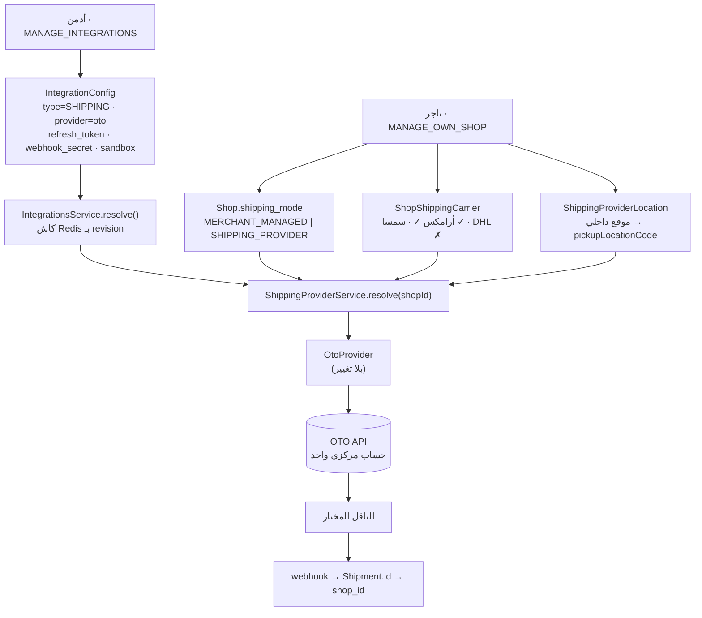

# PHASE 6-B — Central OTO Account · تقرير ما قبل التنفيذ

**Last updated:** 2026-08-24
**الحالة:** 🟢 **APPROVED — with implementation gates (§١٥) · التحقّق المشروط تمّ (§0.5) · التنفيذ يبدأ بترتيب §٨**
**السياق:** [الخطة المتبقية](multi-location-remaining-plan.md) · [مقترح PHASE 5](multi-location-phase-5-proposal.md) · [سلوك المزوّدين اليوم](../../back-end/docs/features/shipping-providers.md)

كل ما يلي مبني على فحص الكود الفعلي في هذه النسخة العاملة، لا على الوثائق — وقد وُجد في الوثائق نفسها تناقضان يُصحَّحان مع التنفيذ (§12.4).

> **قيد الموافقة (2026-08-24):** «تحقّق من عقد OTO الرسمي وافحص كل مسار يعتمد على الجدولين قبل تعديل `ShippingProviderLocation` أو تنفيذ الحجز ثنائي الخطوة. احفظ التوافق العكسي للشحنات التاريخية. لا تحذف ولا تُعِد توظيف صفوف الحسابات قبل التحقّق من أعداد الإنتاج ومراجعه.»
>
> نتائج هذا التحقّق في §0.5، **وقد غيّرت دلتا المخطّط**: لم يعد هناك أي تعديل على مفتاح `ShippingProviderLocation` (§5.3).

---

# ٠.٥ نتائج التحقّق المشروط

> **قائمة الإغلاق:** [`oto-remaining.md`](oto-remaining.md) — ما تبقّى بعد اكتمال الكود، مرتّبًا بما يحجز غيره. هذه الوثيقة تصف الخطة؛ تلك تصف ما يفصلها عن اختبار شامل.

## أ. عقد OTO — مؤكَّد من توثيقهم، والحجز ثنائي الخطوة قابل للتنفيذ

| النداء | العقد المؤكَّد |
|---|---|
| `POST /rest/v2/createOrder` | `createShipment: false` مسموح — يُنشئ الطلب ويعيد `otoId` بلا حجز |
| `GET /rest/v2/getDeliveryOptions` | `?orderId=` **أو** `?city=` — **واحد منهما فقط، لا كلاهما**. يعيد تغطية عقود شركات التوصيل النشطة على الحساب |
| `POST /rest/v2/createShipment` | `orderId` (إلزامي) · **`deliveryOptionId` (اختياري)** · `pickingType` (`PICKUP_BY_DC` \| `BRANCH_DROP_OFF`) · `whoPays` |
| `POST /rest/v2/dcList` | كل شركات التوصيل المتكاملة مع OTO — كتالوج عام |
| `POST /rest/v2/checkOTODeliveryFee` | خيارات مسعَّرة لوجهة: `deliveryOptionId` · `deliveryCompanyName` · `price` · `avgDeliveryTime` … |

✅ **الخلاصة:** الحجز ثنائي الخطوة **مدعوم رسميًّا** — `deliveryOptionId` حقل مصرَّح به في `createShipment`، و`getDeliveryOptions?orderId=` هو الخطوة الوسطى تحديدًا. لا تخمين.

**اكتشافان إضافيان يغيّران الكود القائم:**

1. 🔴 **`cancelShipment` ≠ `cancelOrder`.** الـ adapter اليوم يلغي عبر `POST /rest/v2/cancelOrder {orderId}`، بينما التوثيق يعرّف `POST /rest/v2/cancelShipment {orderId, shipmentId}` لإلغاء **الشحنة** وحدها. تحت الحجز ثنائي الخطوة يصير الفرق حقيقيًّا: إلغاء الشحنة يجب ألّا يلغي الطلب في OTO. **يُصحَّح ضمن الخطوة ٤.** وقيد موثَّق: لا إلغاء بعد `picked up`.
2. **مصدر قائمة الناقلين للتاجر** هو تغطية عقود **الحساب المركزي** (`getDeliveryOptions` / `checkOTODeliveryFee`)، لا `dcList` العامّ — عرض ناقل لا عقد لنا معه يَعِد التاجر بما لا يمكن حجزه.

## ب. أعداد الصفوف — المحلّية صفر، والإنتاج بيدك

| | المحلّية (مؤكَّد) | الإنتاج |
|---|---|---|
| `shipping_provider_accounts` | **0** (لا صفوف إطلاقًا) | لم يُقَس — انظر أدناه |
| `shipping_provider_locations` | **0** | لم يُقَس |
| `shipments` بمرجع حساب | **0** | لم يُقَس |
| `shipments` بـ`provider_slug` | 4 كلها `null` (قديمة) | — |
| متاجر بـ`shipping_mode` | 17 كلها `MERCHANT_MANAGED` | — |

⚠️ **`back-end/.env` لم يعد يشير إلى Neon** — كلا الملفين (`.env` و`.env.development`) يشيران الآن إلى `localhost:5432`. هذا **تحسّن أمني** (لم تعد أوامر Prisma تصيب الإنتاج افتراضيًّا) لكنه **يُبطل تحذيرًا صريحًا في `back-end/CLAUDE.md`** ما زال يقول العكس — يُصحَّح مع التنفيذ (§12.4).

نتيجته أن **رابط الإنتاج لم يعد في المستودع**، فلا أستطيع عدّ صفوفه. للتشغيل من طرفك على Neon (قراءة فقط):

```sql
SELECT provider, COUNT(*) FROM shipping_provider_accounts GROUP BY provider;
SELECT COUNT(*) FROM shipping_provider_locations;
SELECT COUNT(*) FROM shipments WHERE provider_account_id IS NOT NULL;
```

**لكن هذا لم يعد حاجزًا** — انظر الفقرة (ج).

## ج. جرد المسارات — والنتيجة: دلتا المخطّط صارت إضافية بالكامل

جرد كل مستهلك للجدولين:

| الجدول | المستهلكون | الاتساع |
|---|---|---|
| `ShippingProviderAccount` | `ShippingProviderAccountService` (كل الاستعلامات) · `secret-rotation.service` (التدوير) · `shipping-webhooks.controller` (بحث الحساب) · `shipping-provider-location.service:34` (تأكيد الملكية) · 2 DTO | محصور |
| `ShippingProviderLocation` | **`ShippingProviderLocationService` وحدها** (7 استعلامات، كلها داخل ملف واحد) + 3 حقول `account_id` في DTOs + تمرير `account.id` من `resolve()` | **محصور جدًّا** |

**ولأن سطح الاستهلاك بهذا الضيق، أعدتُ تصميم دلتا الخطوة ٣ لتكون إضافية بالكامل** (§5.3): `account_id` **يبقى بمفتاحه الأجنبي وصفوفه**، ويُضاف بجانبه `shop_id` + `provider`، ويُرخى القيد على `account_id` ليقبل NULL للصفوف الجديدة.

✅ **الأثر:** لا حذف ولا إعادة توظيف ولا هجرة بيانات — **فأعداد صفوف الإنتاج لم تعد تحكم سلامة التغيير**، بل صارت معلومة تشغيلية فقط. هذا يلبّي قيدك حرفيًّا: *«Preserve historical account references; introduce the new merchant-scoped mapping without breaking old shipments.»*

---

# ٠. الطلب والحكم

**الطلب:** أن تعمل زيداك كمنصّة SaaS مثل سلة/زد — **حساب OTO واحد تملكه المنصّة**، والتاجر يختار الناقلين المتاحين لمتجره فقط، بلا أن يرى توكنًا أو مفتاح توقيع أو نقطة نهاية.

**الحكم:** الطلب صحيح معماريًّا و**لا يهدم PHASE 5**. التعارض ينحصر في **حقل واحد**: `ShippingProviderAccount.shop_id`. كل ما عداه — الواجهة، السجلّ، جدار المواقع، `Shop.shipping_mode`, حارس العزل — يبقى كما هو.

**لكن الفحص كشف ما هو أكبر من نقل الملكية**، ولم يذكره الطلب: البنية الحالية **لا تستطيع** تنفيذ «التاجر يفعّل أرامكس ويعطّل DHL» مهما نقلنا الاعتمادات. السبب في §٢، وهو العمل الحقيقي في هذا التحويل.

---

# ١. ما وجدته في الكود

## 1.1 البنية المركزية موجودة أصلًا — ولا يجب اختراع ثانية

المنصّة تملك **بالفعل** نموذجًا ناضجًا لاعتماد تملكه المنصّة، ويُدار من كونسول الأدمن:

| المكوّن | الموجود اليوم | المرجع |
|---|---|---|
| الجدول | `integration_configs` — `type` + `provider` + `credentials` مشفّرة + `is_enabled` + `last_verified_at` + `last_verify_error` | [`schema.prisma:5713`](../../back-end/prisma/schema.prisma) |
| النوع | `enum IntegrationType { SMS EMAIL STORAGE PAYMENT MONITORING AI_MEDIA WHATSAPP }` | [`schema.prisma:5697`](../../back-end/prisma/schema.prisma) |
| الصلاحية | `MANAGE_INTEGRATIONS` — أدمن فقط، على كل عملية | [`integrations.resolver.ts:63`](../../back-end/src/integrations/integrations.resolver.ts) |
| الواجهة | كونسول الأدمن `/integrations/[type]` — **يُرسم من `integrationProviders` تلقائيًّا**، فالنوع الجديد لا يكلّف الواجهة شيئًا | `apps/admin/src/features/integrations/` |
| التشفير | `SecretCryptoService` (AES-256-GCM + AAD) · قناع على كل قراءة · التدوير يغطّي الجدول | `secret-crypto.service.ts` |
| الحلّ وقت الاستخدام | `IntegrationsService.resolve(type)` + كاش Redis مفتاحه `revision` — فلا استعلام لكل نداء | [`integrations.service.ts:111`](../../back-end/src/integrations/integrations.service.ts) |
| القيد | فهرس جزئي: **صفّ واحد مفعَّل لكل `type`** | `2026-08-09-integration-configs.sql` |

**الاستنتاج المُلزم:** اعتمادات OTO المركزية مكانها **هنا**، لا في جدول جديد ولا في `ShippingProviderAccount` بـ`shop_id` مُفرَّغ. الكلفة الحقيقية: قيمة enum واحدة + spec في سجلّ التكاملات.

## 1.2 أين يفترض الكود «التاجر يملك OTO»

| الموضع | الافتراض الحالي | يتغيّر؟ |
|---|---|---|
| `ShippingProviderAccount.shop_id` — FK + `@@unique([shop_id, provider])` + فهرسان | الحساب مملوك لمتجر | ✅ **جذر التعارض** |
| `ShippingProviderAccountService` — 8 دوال كلّها `(shopId, …)`: `listForShop` · `upsert` · `setEnabled` · `remove` · `enabledAccount` … | الاعتماد يُقرأ ويُكتب لكل متجر | ✅ ينقسم |
| `ShippingProviderService.resolve(shopId)` → `enabledAccount(shopId)` | «حساب المتجر المفعَّل» يقرّر المزوّد | ✅ يقرأ من التكامل المركزي |
| `shipping-providers.resolver.ts` — 9 عمليات تحت `MANAGE_OWN_SHOP` + `X-SHOP` | التاجر يدير الاعتمادات | ✅ ينقسم بين أدمن/تاجر |
| `ShippingProviderLocation.account_id → Account` | الربط يمرّ عبر حساب التاجر | ✅ يُعاد توجيهه، والمعنى يبقى |
| `Shipment.provider_account_id` | «أي اعتماد حجز هذه الشحنة» | ⚠️ يصير ثابتًا للجميع |
| `applyProviderEvent(accountId, …)` — العزل بـ`provider_account_id` | لكل تاجر حسابه | 🔴 **يصير فحصًا فارغًا** — §٤ |
| واجهة التاجر: `carrier-account-card.tsx` (توكن + Verify + sandbox) | التاجر يُدخل التوكن | ✅ **يُحذف** |
| `shipping-mode-card.tsx` — يشترط حسابًا مُتحقَّقًا للمتجر | البوابة على حساب التاجر | ✅ تصير بوابة المنصّة |
| `OtoProvider` — يقرأ `ctx.credentials` فقط ولا يعرف من أين جاءت | — | ❌ **لا يتغيّر** (وهذا مكسب التجريد) |
| `Shop.shipping_mode` | قرار عمل يختاره التاجر | ❌ صحيح كما هو |
| `ShippingProvider` interface (6 دوال) | لغة الدومين | ❌ |
| `domain-isolation.spec` — `oto` لا تدخل orders/inventory/allocation | — | ❌ يبقى ملزمًا |

## 1.3 ثغرة صغيرة تُغلق مجانًا

`upsert` يتحقّق أن الـ slug **مسجَّل**، لكنه لا يفرض `isCarrier` — فحساب لـ`manual` قابل للإنشاء نظريًّا رغم أنه لا يظهر في منتقي التاجر. تُغلق ضمن التحويل.

---

# ٢. الاكتشاف الحرج — من يختار الناقل اليوم؟

هذا لبّ المسألة، وهو أهمّ من نقل الملكية:

```
اليوم:
  createOrder({ createShipment: true })
        └── OTO تختار شركة التوصيل من قواعد حساب التاجر داخل لوحة OTO
```

في النموذج المركزي **لا توجد لوحة OTO لكل تاجر** — الحساب واحد، وقواعده واحدة. فإن بقي `createShipment: true`، سيشحن **كل تجّار المنصّة** بالناقل نفسه الذي تختاره قواعدنا المركزية، ويصير صندوق «☑ أرامكس ☐ DHL» زينةً لا أثر لها.

**المطلوب — الحجز يصير خطوتين:**

```
1. createOrder({ createShipment: false })          → otoId
2. checkOTODeliveryFee / getDeliveryOptions        → [deliveryOptionId, deliveryCompanyName, price, ETA]
3. تصفية بما فعّله التاجر عندنا (ShopShippingCarrier)
4. createShipment({ orderId, deliveryOptionId })   → الحجز الفعلي
```

نتيجتان:

- **الحجز نداءان لا واحد** — تغيير سلوك حقيقي في الـ adapter، يستحق قرارك الصريح.
- **`rate()` تكتسب أول مستدعٍ حقيقي لها.** ظلّت ميتة عمدًا منذ PHASE 5، وتصير الآن مصدر قائمة الخيارات. **القاعدة تبقى كما هي: تكلفة تاجر، لا سعر عميل** — ما يدفعه المشتري يظلّ من `ShippingZone`/`ShippingRule` وحدها.

**حالة عدم وجود خيار مسموح** (التاجر عطّل كل ما تعرضه OTO لتلك الوجهة): يُرمى خطأ مسمّى (`NO_ENABLED_CARRIER_FOR_DESTINATION`) — لا ارتداد صامت إلى اختيار OTO، على نفس منطق `SHIPPING_PROVIDER_NOT_CONFIGURED` في PHASE 5.

---

# ٣. النموذج المستهدف



**الفصل المقصود:** الاعتماد قرار منصّة · الوضع قرار تاجر · الناقلون قرار تاجر · الربط قرار تاجر · التسعير للعميل يبقى `ShippingZone`/`ShippingRule` بلا مساس.

## 3.1 «افتراضات زيداك» أم «تخصيص» — الحالة الافتراضية للتاجر

التاجر لا يُجبَر على اختيار ناقلين ليبيع:

```
إعدادات الشحن للتاجر
├── ● استخدم افتراضات زيداك     ← لا صفوف في ShopShippingCarrier إطلاقًا
│                                  كل ناقل تغطّيه عقودنا مسموح
└── ○ تخصيص
    ├── أرامكس ✓   سمسا ✓   DHL ✗
    ├── الخدمات (لاحقًا)
    └── ربط المواقع
```

**«غياب الصفوف = اسمح بالكل» وليس «امنع الكل».** لهذا وزن عملي: متجر جديد يشحن من اللحظة الأولى، ولا يتحوّل إضافة جدولٍ جديد إلى بوابة صامتة تمنع كل الحجوزات لأن أحدًا لم يضغط زرًّا. والتخصيص يبدأ من أول ناقل يعطّله التاجر.

**وهذه قاعدة دومين مُلزمة، لا سلوك تنفيذ** (مراجعة 2026-08-24). الدلالة تُكتب باسمها الصريح في خدمة اختيار الناقل — *لا صفوف = كل ناقل تغطّيه عقود المنصّة مسموح · وجود صفوف = المفعَّل وحده يمرّ* — **وتُثبَّت باختبارين مستقلّين** (§١١)، أحدهما على كل فرع. بدون التثبيت، أقرب قراءة بديهية لمطوّر لاحق هي «لا صفوف = لا ناقلين»، وتنفيذها يكسر الشحن عن كل متجر جديد على المنصّة بصمت.

---

# ٤. الويبهوك — يجب إعادة كتابة العزل بصدق

اليوم `applyProviderEvent` يشترط `provider_account_id = accountId` ([`shipments.service.ts:784`](../../back-end/src/shipments/shipments.service.ts)). تحت الحساب المركزي **كل الشحنات تحمل القيمة نفسها**، فالشرط يصير دائم التحقق.

**ليست ثغرة أمنية** — البحث بـ`Shipment.id` دقيق أصلًا، ونحن نرسل `orderId = Shipment.id` (قرار PHASE 6 يدفع ثمنه الآن). لكن **التعليق سيكذب على قارئه**، وهذا وحده سبب كافٍ لإعادة الكتابة:

```
webhook → Shipment.id → Shipment.shop_id → التاجر
```

و`:accountId` في المسار يصير **معرّف تكامل المنصّة**، لا حساب تاجر. المسار يبقى شكلًا كما هو (`/webhooks/shipping/oto/{id}`) فلا يتغيّر ما سُجِّل لدى OTO، ويبقى كل ما بُني: توقيع HMAC · مفتاح غائب = رفض · إزالة تكرار insert-to-lock · الحالات النهائية لا تُنزَّل · الكلمات الخام في السجلّ والحكم المعرَّب وحده يحرّك الحالة.

**مكسب جانبي:** تسجيل الويبهوك يصير **مرة واحدة للمنصّة** بدل مرّة لكل تاجر — وهو البند الذي كان مسجَّلًا كمتابعة يدوية.

---

# ٥. دلتا المخطّط المقترحة

| # | التغيير | النوع | الخطر |
|---|---|---|---|
| 1 | `IntegrationType += SHIPPING` | enum | إضافي · صفر |
| 2 | جدول `ShopShippingCarrier` — `shop_id` · `provider` · `carrier_code` · `is_enabled` · (`service_code` لاحقًا) · `@@unique([shop_id, provider, carrier_code])` | جدول جديد | صفر بيانات |
| 3 | `ShippingProviderLocation`: **يُضاف** `shop_id` + `provider` (nullable)، ويُرخى `account_id` ليقبل NULL. **المفتاح الأجنبي والصفوف القائمة تبقى كما هي.** فهرس فريد جديد `[shop_id, provider, location_id]` بجانب القديم | إضافي + إرخاء قيد | **منخفض، لا صفر** — بياناته صفر لكن منطقه مزدوج العنونة (§5-ب) |
| 4 | `ShippingProviderAccount` **تبقى ولا تُحذف** — تُعلَّم مهجورة ويتوقّف الكتابُ فيها | لا تغيير بنيوي | صفر · `Shipment.provider_account_id` التاريخي يبقى صالحًا |
| 5 | `Shipment.provider_account_id` يبقى للقديم؛ الجديد يُعرَّف بـ`provider_slug` + `shop_id` | لا تغيير | صفر |

**ما لن يحدث، صراحةً:** لا حذف جدول · لا إفراغ بيانات · **لا نسخ للاعتماد المركزي في صفّ لكل تاجر** — وهو الفخّ الذي حذّرتَ منه، ولو فُعِل لعاد بنا إلى نقطة الصفر باسم جديد.

**كيف تُقرأ الخريطة بعد التغيير:** الصفّ الجديد يُكتب بـ`(shop_id, provider)`؛ والقراءة تفضّله وترتدّ إلى `account_id` للصفوف التاريخية. فشحنة قديمة حُجزت بحساب تاجر تبقى قابلة للتفسير كاملةً، وصفّ ربط قديم يبقى صالحًا — وهذا نصّ قيدك.

## ٥-ب. خطر «المفتاحين معًا» في `ShippingProviderLocation` — منخفض، لا صفر

التصنيف نُزِّل من «صفر» عمدًا (مراجعة 2026-08-24): غياب الصفوف يصفّر خطر **البيانات**، لكنه لا يصفّر خطر **المنطق** — الجدول سيعيش بنظامَي عنونة في آن (صفوف تاريخية معرَّفة بـ`account_id`، وصفوف جديدة بـ`shop_id + provider`)، وكل نقطة التقاء بينهما تُثبَّت باختبار لا بافتراض (§١١):

- صفّ قديم بـ`account_id` يبقى قابلًا للقراءة والحلّ بعد الهجرة.
- الفهرسان الفريدان — القديم والجديد — يعملان معًا بلا تعارض على الكتابة.
- `resolve()` لا يخلط ربط متجرٍ بمتجر: القراءة بـ`(shop_id, provider)` أولًا، والارتداد إلى `account_id` **لا يعبر حدود المتجر** — صفّ حساب تاجرٍ آخر لا يُحلّ أبدًا.
- متجر جديد لا يستطيع استعمال صفّ ربط تاريخي يخصّ متجرًا آخر.
- **التراجع ممكن ومحدود:** الدلتا عمودان nullable + فهرس + إرخاء NOT NULL؛ التراجع إسقاطها، وإعادة تشديد `account_id NOT NULL` تصحّ ما دام لم يُكتب صفّ جديد بـNULL — أي أن نافذة اللارجوع تبدأ عند أول كتابة جديدة، لا عند الهجرة نفسها.

## خطر البيانات — شبه معدوم، ويجب إثباته لا افتراضه

`oto` أُضيفت إلى السجلّ **اليوم في هذه النسخة العاملة ولم تُنشر بعد**، وقبلها كان `manual` وحده (`isCarrier: false`) فلا يظهر في منتقي التاجر أصلًا. أي أنه **لا يمكن أن يوجد صفّ حساب OTO لأي تاجر على الإنتاج**.

⚠️ **محاولتي عدّ الصفوف على الإنتاج فشلت** (اتصال Prisma 7 من سكربت مستقلّ). العدّ هو **الخطوة صفر الإلزامية** قبل أي migration، لا افتراضًا:

```sql
SELECT provider, COUNT(*) FROM shipping_provider_accounts GROUP BY provider;
SELECT COUNT(*) FROM shipping_provider_locations;
SELECT COUNT(*) FROM shipments WHERE provider_account_id IS NOT NULL;
```

---

# ٦. سطح الـ API — قبل وبعد

| العملية | اليوم | بعد التحويل |
|---|---|---|
| اعتمادات OTO (حفظ/تحقّق/تفعيل/حذف) | `upsertShippingProviderAccount` … — تاجر · `MANAGE_OWN_SHOP` | `saveIntegration` / `verifyIntegration` / `setIntegrationEnabled` القائمة — **أدمن · `MANAGE_INTEGRATIONS`** (بلا عمليات جديدة) |
| كتالوج المزوّدين | `shippingProviderCatalog` | يبقى · يُضاف إليه `ready` من التكامل المركزي |
| الناقلون المتاحون للوجهة | ✗ غير موجود | `shippingCarriers` جديد — تاجر · قراءة من OTO عبر الاعتماد المركزي |
| تفعيل/تعطيل ناقل | ✗ غير موجود | `setShopShippingCarriers` جديد — تاجر |
| ربط المواقع | `mapShippingProviderLocation` / `unmap…` | يبقى · التحقّق يصير على `shop_id` مباشرة بدل ملكية الحساب |
| وضع الشحن | `updateShopShippingMode` | يبقى · البوابة تصير «التكامل المركزي جاهز» |

**قاعدة مُلزمة تبقى:** لا يعود أي ردّ يحمل `refresh_token` ولا `webhook_secret` ولا `access_token` — لا للتاجر ولا للأدمن (القناع فقط)، وهو سلوك `IntegrationsService` القائم.

---

# ٧. الواجهات

**كونسول الأدمن:** `/integrations/shipping` — **يُرسم تلقائيًّا** من الـ spec. الكلفة: إدخال في `features/integrations/nav.ts` + ترجمتان.

**لوحة التاجر — الشكل المستهدف:**

```
الشحن والتوصيل
──────────────────────────────
وضع الشحن:  ○ أُوصّل بنفسي   ● عبر شركات الشحن

OTO — شحن متعدد الناقلين          الحالة: متصل عبر زيداك ✓

الناقلون المتاحون لمتجرك:
  ☑ أرامكس     ☑ سمسا     ☐ DHL     ☐ ناقل

مواقعك:
  مستودع الرياض  →  [اختر موقع الاستلام في OTO]
  مستودع جدة     →  [اختر موقع الاستلام في OTO]
```

**يُحذف:** بطاقة الاعتمادات كاملة (توكن · Verify · مبدّل sandbox).
**يُضاف:** قائمة الناقلين بصناديق اختيار، وشارة حالة للقراءة فقط.
**يبقى:** بطاقة الوضع · بطاقة ربط المواقع · بطاقات المناطق والأسعار (لا تُمَسّ).

---

# ٧.٥ تقدّم التنفيذ — 2026-08-24

| الخطوة | الحالة | ما شُحن |
|---|---|---|
| ١ — بوابة صفر | 🟡 **جزئي** | المحلّية مقيسة (صفر في الجداول الثلاثة) · **الإنتاج بيدك** (§0.5-ب): رابطه لم يعد في المستودع. الدلتا إضافية فلا شيء يُحذف، لكن **نشر migration المواقع على الإنتاج ينتظر قراءتك** |
| ٢ — الاعتماد المركزي | ✅ **مُنجزة** | `IntegrationType.SHIPPING` + spec `oto` في سجلّ التكاملات (رمز التحديث · مفتاح التوقيع · مبدّل sandbox) · `verify` = تبادل التوكن نفسه الذي يستعمله المحوِّل، **بتعريف واحد** في `oto.api.ts` · لا إرسال تجريبي (أرخص طلب من مجمِّع شحن هو ساعٍ حقيقي مفوتَر) · شاشة الأدمن `/integrations/shipping` تُرسم تلقائيًّا + أيقونة وترجمتان · migration الـ enum مطبَّقة محليًّا |
| ٣ — `resolve()` مركزي | ✅ **مُنجزة** | الوضع أولًا ثم القدرة (الترتيب المقدّس محفوظ) · الاعتماد من `IntegrationsService.resolve(SHIPPING)` · `accountId: null` بدل معرّف وهمي · `isSandboxCreds` يقرأ المبدّل من مكان واحد · **الرفض يسمّي صاحب المشكلة** (§12.2 صار اختبارًا لا ملاحظة) · ربط المواقع صار `(shop, provider)` مع ارتداد للقديم **لا يعبر حدود المتجر** · `providerReadiness`/`setMode` على بوابة المنصّة |
| ٤ — اختيار الناقل + الحجز ثنائي الخطوة | ✅ **مُنجزة** | جدول `ShopShippingCarrier` + `ShopShippingCarrierService` وقاعدة «لا صفوف = اسمح بالكل» (`null` ≠ `[]`، والثانية رفضٌ حقيقي لا ارتداد) · `createOrder({createShipment:false})` ثم `getDeliveryOptions?orderId=` ثم `createShipment({orderId, deliveryOptionId})` — الاختيار صار قرار التاجر لا قواعد OTO · `carriers(ctx)` تقرأ عقود الحساب من `getDeliveryOptions` لا من `dcList` · `carrierCode(name)` مشتقّ (أول كلمة، أحرف صغيرة) فلا يُيتّم تغييرُ اسمٍ تجميليّ اختيارَ التاجر · وجهة بلا خيار مسموح ترفض بـ`NO_ENABLED_CARRIER_FOR_DESTINATION` · **تصحيح لِما ورد في §0.5-أ:** `cancelShipment` يبقى على `cancelOrder` لأننا نحجز طلب OTO واحدًا لكل `Shipment` — وُثّق بدل أن يُبدَّل عمياءً |
| ٥ — الويبهوك | ✅ **مُنجزة** | `POST /webhooks/shipping/:provider` يتحقّق من توقيعه باعتماد المنصّة (`IntegrationConfig(type=SHIPPING)`) · المسار القديم `:provider/:legacyAccountId` ما زال يجيب **ويتجاهل** المقطع الثاني فلا تحتاج عناوين مسجَّلة سلفًا إعادة تسجيل · **العزل يُشتقّ لا يُدَّعى:** الشرط `{ id: evt.shipmentId, provider_slug }` ثم يُقرأ `shop_id` من الصف المطابق — فحص `provider_account_id` صار خاويًا تحت حساب مشترك فاستُبدل بدل أن يُبقى زينةً · 401 لا 200 عند مزوّد مجهول أو اعتماد غير موصول أو توقيع مزوَّر · إزالة التكرار على `(provider, event_id)` بإدراج-قفل كما هي |
| ٦ — واجهة التاجر | ✅ **مُنجزة** | **`carrier-account-card.tsx` حُذف** — لا توكن ولا مفتاح توقيع ولا sandbox في لوحة التاجر · `carrier-selection-card.tsx` جديدة: مفاتيح لكل ناقل، ولافتة `using_platform_defaults` تُظهر الكل مُفعَّلًا (الشبكة الفارغة كانت ستقول لمتجرٍ يشحن بكلّ شيء إنه لا يشحن بشيء)، وتحذير قبل إطفاء الجميع، وتخزين محلّي ثم حفظ واحد — لا حفظ تلقائي عند كل نقرة · `shipping-providers-section.tsx` صارت: الوضع + الناقلون + ربط المواقع، والأخيران في وضع `SHIPPING_PROVIDER` فقط |

**الفحوصات بعد ٢ و٣:** 4217 اختبارًا / 250 suite خضراء · `check:di` سليم · `schema:check` محدَّث · صفر أخطاء lint · البناء نظيف.

⚠️ **migration المواقع (`2026-08-24-shipping-location-shop-scoped.sql`) لم تُطبَّق محليًّا بعد** — Docker متوقّف (`ECONNREFUSED`). الملف مكتوب ومراجَع، ويُطبَّق بأمر واحد متى شغّلته.

---

# ٨. ترتيب التنفيذ

1. **بوابة صفر — عدّ صفوف الإنتاج** (§٥): النتائج **تُوثَّق في §0.5-ب قبل أول migration يلمس جداول الشحن** (أي قبل الخطوة ٤). الدلتا إضافية فلا شيء يُحذف، لكن القاعدة تبقى: لا هجرة قبل قراءة موثَّقة — «معلومة تشغيلية» لا تعني «تُتجاوز».
2. **الاعتماد المركزي** — enum + spec + الأدمن (تلقائي) + التدوير يغطّيه أصلًا بلا عمل إضافي.
3. **`resolve()`** يقرأ الاعتماد من `IntegrationsService`، ويبقى ترتيبه المقدّس: **الوضع أولًا ثم القدرة** — فلا يُولَد ارتداد صامت (سبب وجود هذا الترتيب موثَّق في PHASE 5).
4. **اختيار الناقل** — الجدول + العمليتان + **الحجز ثنائي الخطوة** في الـ adapter (§٢).
5. **الويبهوك** — العزل من `Shipment.shop_id` (§٤).
6. **واجهة التاجر** — حذف بطاقة الاعتمادات، وإضافة الناقلين.
7. **الاختبارات والوثائق** — بالتوازي مع كل خطوة، لا بعدها.

---

# ٩. البنود السبعة المتبقية من PHASE 6

| البند | الحكم | السبب |
|---|---|---|
| Sandbox E2E | **CHANGE** | يصير على الاعتماد المركزي من كونسول الأدمن، لا من شاشة التاجر. الخطوات نفسها، الممثّل مختلف. |
| تدوير التوكن المكشوف | **KEEP** 🔴 | لا يتغيّر بهذا التحويل — يُحذف من OTO ويُولَّد بديل، ويُدخَل **مرة واحدة** في الأدمن. |
| تسجيل الويبهوك | **CHANGE** | من «مرة لكل تاجر» إلى **مرة واحدة للمنصّة** — تبسيط كبير يلغي بندًا تشغيليًّا متكرّرًا. |
| مفتاح توقيع الويبهوك | **CHANGE** | يصير اعتمادًا مركزيًّا واحدًا يُطلب من دعم OTO مرة واحدة. |
| COD على الطلب المقسّم | **KEEP** (الخيار B) | §١٠ |
| أبعاد المنتج (API + نموذج التاجر) | **KEEP** | مستقلّ تمامًا عن الملكية. الأعمدة موجودة؛ يتبقّى الكشف والتحقّق واستخدامها كارتداد للطرد. |
| خريطة `orderStatus` | **DEFER** | تنتظر أول ردّ حقيقي من sandbox — لا تُشدَّد على حمولة لم تُرَ. |

---

# ١٠. COD على الطلب المقسّم — توصيتي: الخيار B

**السلوك الحالي:** الطلب المقسّم على شحنتين يضع مبلغ التحصيل كاملًا على أول شحنة تُحجَز.

**الخيار A — منع COD عند التقسيم:** يمنع بيعًا مشروعًا. التقسيم قرار مخزون داخلي لا يفهمه العميل ولا يتحكّم به، والدفع عند الاستلام هو الغالب في السوق السعودي — فالخسارة مبيعات حقيقية مقابل نظافة نظرية.

**الخيار B — الإبقاء (توصيتي):** أن يجمع أوّل ساعٍ كامل المبلغ قاعدة تشغيلية شائعة ومفهومة، والبديل (تقسيم التحصيل) يحتاج دعمًا من الناقل لا نملكه.

**الشرط على الخيارين:** **يُوثَّق صراحةً ويُثبَّت باختبار** — لا يتغيّر سلوك مالي بصمت، ولا يبقى قاعدةً غير مكتوبة. لو رفضت التوصية، تنفيذ الخيار A سطران في `createOrder`.

---

# ١١. الاختبارات

**تتغيّر:** `shipping-provider.service.spec` · `shipping-provider-account.service.spec` · `shipping-provider-location.service.spec` · `shipping-webhooks.controller.spec` · `shipments.service.spec` (`applyProviderEvent`) · `oto.provider.spec` (الحجز ثنائي الخطوة) · اختبارات واجهة التاجر.

**تبقى بلا مساس:** `domain-isolation.spec` · `manual.provider.spec` · `shipping-fee.helper.spec` · `shipping-zone.helper.spec` · كل اختبارات التسعير.
**تكسب حالة:** `secret-rotation.service.spec` (النوع الجديد).

**تُضاف:**

| المحور | ما يُثبَّت |
|---|---|
| الاعتماد المركزي | يُستعمل فعلًا · التاجر لا يستطيع تجاوزه · **لا يظهر في أي ردّ** |
| عزل المستأجرين | تاجر لا يصل تهيئة/ربط/ناقلي تاجر آخر |
| اختيار الناقل | مفعَّل ⇒ يُقبل · معطَّل ⇒ يُرفض · لا خيار مسموح ⇒ خطأ مسمّى |
| **قاعدة «لا صفوف = اسمح بالكل»** (§3.1) | اختباران مستقلّان يحرسان الدلالة من القراءة المعكوسة: لا صفوف ⇒ كل ناقل تغطّيه العقود يمرّ · وجود صفوف ⇒ المفعَّل وحده يمرّ |
| ربط المواقع | مربوط ⇒ يُحجز · غير مربوط ⇒ `LOCATION_NOT_MAPPED` · ربط تاجر آخر ⇒ يُرفض |
| **تعايش مفتاحَي المواقع** (§٥-ب) | صفّ قديم بـ`account_id` يُحلّ · صفّ جديد بـ`shop_id` يُحلّ · الارتداد لا يعبر حدود المتجر · الفهرسان الفريدان معًا بلا تعارض |
| الويبهوك | توقيع صحيح ⇒ يُقبل · خاطئ ⇒ 401 · بلا مفتاح ⇒ رفض · مكرّر ⇒ يُتجاهل · **سياق تاجر خاطئ ⇒ يُرفض** · حالة نهائية ⇒ لا تُنزَّل |
| الحجز | `orderId = Shipment.id` · `deliveryOptionId` من اختيار التاجر · العنوان والعملة وCOD والأصناف صحيحة |

---

# ١٢. المخاطر والتوافق العكسي

## 12.1 كسر العزل باسم المركزية 🔴
الخطر الأكبر. التخفيف: العزل يُشتقّ من `Shipment.shop_id` صراحةً (§٤)، ويُثبَّت باختبار «سياق تاجر خاطئ يُرفض» قبل اعتبار البند منجزًا.

## 12.2 حساب واحد = نقطة فشل واحدة
اعتماد واحد معطّل يوقف الشحن عن **كل** تجّار المنصّة، بدل تاجر واحد. التخفيف: `verify` دوري + رسالة خطأ تميّز «المنصّة غير متصلة» عن «متجرك غير مهيّأ» — فلا يطارد التاجر عطلًا ليس له.

## 12.3 فوترة OTO تصير على المنصّة
تبعة **تجارية لا تقنية**، لكن يجب أن تُقال: كل شحنات المنصّة تُفوتَر على حساب زيداك. ما يجعلها محتملة هو أن PHASE 7 مبنيّة أصلًا: `actual_cost_cents` + `cost_source` + `orderShippingEconomics` تقيس التكلفة مقابل المحصَّل لكل طلب. **ما ينقص: تقرير هامش شحن على مستوى المنصّة في الأدمن** — كان بندًا مؤجَّلًا، ويصير بهذا التحويل شرطًا تشغيليًّا لا رفاهية.

## 12.4 تناقضان في وثائقنا — كلاهما صُحِّح (2026-08-24)

1. ✅ [`multi-location-remaining-plan.md`](multi-location-remaining-plan.md): العنوان كان يقول «PHASE 6 شُحنت» والقسم ٥ ما زال «لم تبدأ». أُعيدت كتابة القسم ٥: شُحنت، ثم أُعيد تشكيل ملكيّتها في 6-B، مع إثبات أن قواعده الثلاث صمدت.
2. ✅ **[`back-end/CLAUDE.md`](../../back-end/CLAUDE.md)** كان يحذّر أن `.env` يوجّه كل أوامر Prisma إلى Neon البعيدة. **تُحقِّق منه بالقراءة:** سطر Neon **معطَّل بتعليق**، والقيمة الفعّالة `localhost:5432` — أي عكس ما ادّعاه التحذير تمامًا، وهو ما جعل عدّ صفوف «إنتاج» يُرجع أرقامًا محلّية. صُحِّحت الملاحظة، ولم تُقلَب فحسب: السطر يبعد إزالةَ تعليقٍ واحدة عن التصويب إلى الإنتاج مرّة أخرى، فصار النصّ يطلب **التحقّق قبل كل تشغيل** (`node -e "require('dotenv').config();console.log(new URL(process.env.DATABASE_URL).hostname)"`) بدل أن يَعِد بوجهةٍ ثابتة. تحذير أمني كاذب أخطر من غيابه — والوعد الثابت هو ما كذب.

## 12.5 التوافق العكسي
الشحنات القديمة تحمل `provider_slug = 'manual'` و`provider_account_id = null` — لا يمسّها شيء. `MERCHANT_MANAGED` يبقى الوضع الافتراضي لكل المتاجر الـ17، فلا متجر يتغيّر سلوكه بلا فعل صريح من صاحبه.

---

# ١٣. معيار القبول

لا يُعتبر التحويل مكتملًا حتى يمرّ هذا المسار كاملًا:

```
أدمن يضبط OTO مرة واحدة في /integrations/shipping  →  Verify ✓
        ↓
تاجر يفتح الشحن  →  يرى «متصل عبر زيداك ✓» بلا أي توكن
        ↓
يفعّل أرامكس وسمسا · يعطّل DHL
        ↓
يربط مستودع الرياض بموقع استلام في OTO
        ↓
عميل يشتري  →  السعر من مناطق التاجر وأسعاره (بلا مساس)
        ↓
التاجر ينشئ شحنة  →  الحجز يذهب لأرامكس تحديدًا، لا لما تختاره OTO
        ↓
الويبهوك يعود  →  يصيب الشحنة الصحيحة والتاجر الصحيح
```

---

# ١٤. القرارات — محسومة

| القرار | الحكم | الحالة |
|---|---|---|
| **الحجز ثنائي الخطوة** (§٢) | ✅ معتمَد | مؤكَّد من توثيق OTO (§0.5-أ): `deliveryOptionId` حقل مصرَّح به |
| **COD على الطلب المقسّم** (§١٠) | ✅ الخيار B — الإبقاء | يُوثَّق صراحةً ويُثبَّت باختبار، فلا يبقى قاعدة مالية غير مكتوبة |
| **`ShippingProviderLocation`** | ✅ **لا تعديل على المفتاح** | أُعيد تصميمها إضافيةً بالكامل (§5.3) بعد جرد المسارات |
| **حذف/إعادة توظيف صفوف الحسابات** | ❌ لا يحدث | الجدول يبقى، والكتابة فيه تتوقّف فقط |

**بقي بيدك وحدك (لا يمنع التنفيذ):** عدّ صفوف الإنتاج (§0.5-ب) للعلم التشغيلي · وتدوير توكن OTO المكشوف قبل إدخال الاعتماد المركزي.

التنفيذ يمضي بترتيب §٨، بأقلّ تغيير ممكن، مع الحفاظ على تجريد PHASE 5، وعزل مفردات OTO عن النواة، وعزل المستأجرين، وعدم تسريب أي اعتماد.

---

# ١٥. بوابات الاعتماد — مراجعة 2026-08-24

الاعتماد **«APPROVED — with implementation gates»** لا اعتمادًا مطلقًا. لا يُعلن اكتمال التحويل قبل إغلاق العشرة، وكل بوابة تحيل إلى القسم الذي يغلقها:

| # | البوابة | أين تُغلق |
|---|---|---|
| 1 | أعداد الإنتاج موثَّقة في §0.5-ب قبل أول migration | §٨ خطوة ١ |
| 2 | اعتمادات OTO تدخل `IntegrationConfig` — لا جدول جديد ولا `shop_id` مُفرَّغ | §١.١ · §٨ خطوة ٢ |
| 3 | `ShippingProviderAccount` لا يُحذف ولا يُعاد توظيفه | §٥ بند ٤ · §١٤ |
| 4 | `ShopShippingCarrier` هو مصدر قرار الناقل — وقاعدة «لا صفوف = اسمح بالكل» مثبَّتة كقاعدة دومين باختبارين | §3.1 · §١١ |
| 5 | `createOrder` يخرج بـ`createShipment: false` | §٢ |
| 6 | `deliveryOptionId` هو ما يحدّد الناقل فعليًّا في `createShipment` | §٢ · §0.5-أ |
| 7 | عزل الويبهوك يُشتقّ من `Shipment.shop_id` | §٤ |
| 8 | لا اعتماد في أي ردّ API — لا للتاجر، وللأدمن القناع فقط | §٦ |
| 9 | اختبار cross-tenant إلزامي قبل إغلاق أي بند | §١١ · §12.1 |
| 10 | sandbox E2E يثبت أن **اختيار التاجر هو ما حُجز** — «فعّل أرامكس ⇒ OTO حجزت أرامكس تحديدًا»، لا مجرد نجاح الشحنة | §١٣ (المسار يتضمّنها نصًّا) |
