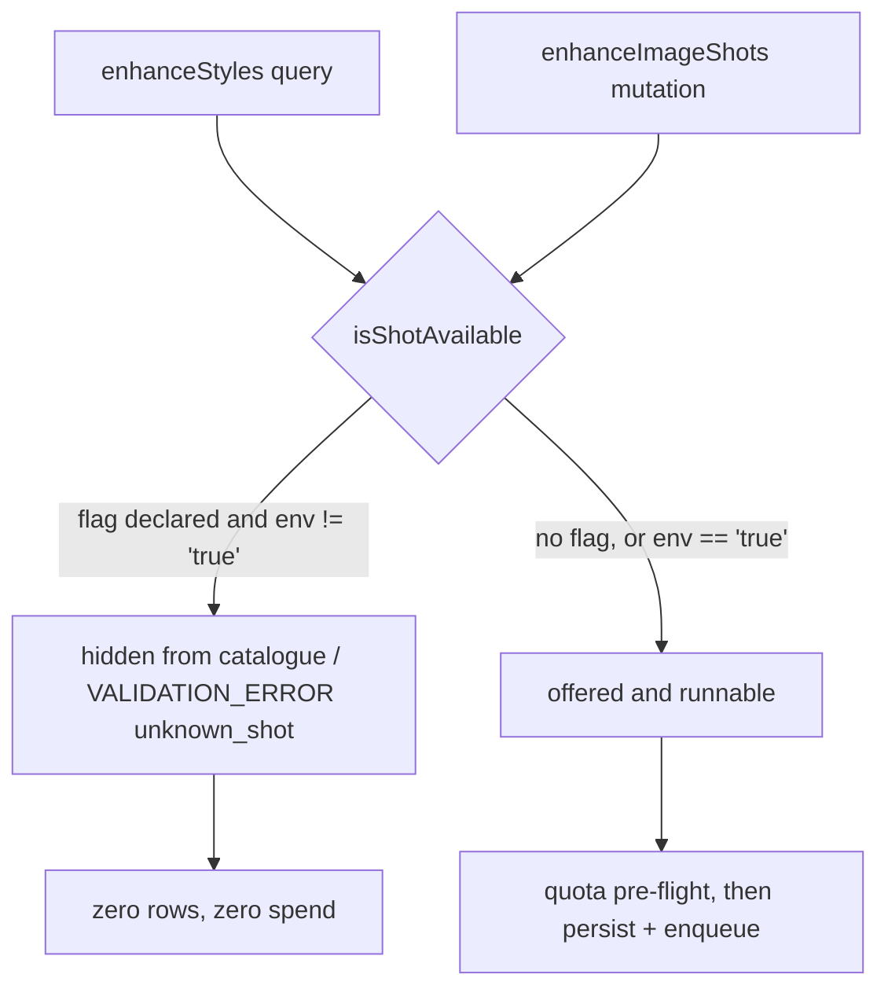

# On-model shot (`on_model`) — build status

**Last updated:** 2026-07-21

**Status: code complete and merged, gated off by default, NOT released. The
acceptance eval has not been run.** Phase 2 of
[extra-shots.md](extra-shots.md). This file records what was built, what was
decided, and what still has to happen before the flag can be turned on.

## What it is

A shot in the enhance registry that re-photographs an existing product image
with a person presenting the product. The person is **generated from the
prompt** — there is no human reference image anywhere on this pipeline, so no
real person's likeness is ever sent to the provider.

It reuses the `enhanceImageShots` path unchanged: same idempotency key, same
whole-batch quota pre-flight, same one-row-one-provider-request shape, same
polling. Adding it required no new mutation, no new input field, no schema
change, and no frontend change.

## What was built

| Piece | Where | What |
|---|---|---|
| The shot | `enhance-shots.ts` | `EnhanceShotSpec` with `preservesFrame: false`, `requiresHuman: true`, `usesStyleOptions: false`, forced `3:4`, `flag: 'AI_IMAGE_ON_MODEL_ENABLED'` |
| Who the person is | `enhance-blocks.ts` | `SAUDI_MODEL_BLOCK` |
| How the product sits in frame | `enhance-blocks.ts` | `MODEL_PRODUCT_RELATION_BLOCK` |
| Composer slot | `enhance-blocks.ts` | optional `model` part, placed after the identity blocks |
| Flag declaration | `enhance-shots.ts` | `EnhanceShotSpec.flag` — the env var name only |
| Flag evaluation | `image-gen.service.ts` | `isShotAvailable()` — the single place it is read |
| Labels | `i18n/{en,ar}/lookup.json` | `enhance_shot.on_model` + `_desc` |

`MODEL_PRODUCT_RELATION_BLOCK` replaces two shared blocks that cannot apply
here. `FRAMING_BLOCK` says "remove the room and everything else around the
product", which would delete the model. `STAGING_BLOCK` requires every added
element to stay "clearly smaller and less prominent than the product", which is
not merely wrong but unsatisfiable for a person standing next to a watch. The
focal-hierarchy guarantee survives, restated as support rather than shrinkage,
and the "preserving its original proportions" clause is carried over verbatim
because the composition invariant asserts it in every prompt.

## The gate

`AI_IMAGE_ON_MODEL_ENABLED` must read exactly `"true"`. `1`, `TRUE` and `yes`
all fail closed, which is deliberate for a content gate.

The gate runs in both directions on purpose. Filtering the catalogue alone is
not a gate — a client that never loads the panel can post the shot id straight
to GraphQL, and the DTO's `@IsIn(ENHANCE_SHOT_IDS)` allow-lists every registry
id whatever the flag says, so that the published schema does not change when an
operator flips the switch. The rejection therefore also lives in `runShots`,
before any quota or budget call. A batch containing a disabled shot is refused
whole: zero rows, zero spend, including for the shots in the set that were
legal.

A disabled shot reports `VALIDATION_ERROR` / `unknown_shot` — the same code an
unrecognised id gets. To a vendor an unreleased shot and a typo are the same
thing, and distinguishing them would advertise a surface the platform has
deliberately not offered.

## Decisions taken

| Decision | Choice | Why |
|---|---|---|
| Human reference image | None. The model is generated | Keeps `referenceAttachmentId` singular and unchanged; no real likeness crosses the provider |
| Model gender and crop | Inferred from the product | Same reasoning as the `lifestyle` scene: the model can see what it is holding, a vendor dropdown cannot. A watch wants a wrist, an abaya wants a figure |
| Regional look | Saudi / Gulf, pinned in the prompt | The platform's market. Held in a named block so a second regional variant is a one-constant change |
| Coverage | Modest and fully covered, pinned server-side | Safety control, not a style note — see the gap below |
| Frame identity | Dropped (`preservesFrame: false`) | Changing the viewpoint is the entire product of the shot. Product identity stays unconditional |
| Aspect ratio | Forced `3:4` | An on-model reshoot composed to a square catalog source wastes the frame on background |
| Release | Behind an env flag | The eval has not been run and there is no output-image moderation |

## What remains

### 1. The acceptance eval — this is the blocker

Not yet run. [extra-shots.md](extra-shots.md) and `TODO.md` both define it as a
precondition, not a follow-up:

> Run 15–20 representative catalog images through the prompt and count how many
> keep the label legible and the product geometry intact. Below ~70%, delete the
> shot rather than ship it.

Nothing about writing the code answered this. It is a measurement over real
catalog images, and it has not been made. **Do not turn the flag on in a
vendor-facing environment before it has.**

What is needed to run it: 15–20 representative product images (none exist in the
repo; they live behind the shops' CDN), a configured `REPLICATE_API_TOKEN`, and
roughly one US dollar of provider spend per iteration at ~$0.045 per image.

### 2. Risks the code does not resolve

- **Category fit.** "Worn or held" fits apparel, jewelry, watches and bags. A
  sofa or a 500g tub has no natural model shot. The prompt asks the model to
  infer the crop from the product, which is a mitigation, not a gate.
- **No safe category gate exists.** The panel runs in the media library, which
  has no product context, and gating server-side would mean reading product
  fields through `productId`, which is never ownership-validated and is rejected
  in `TODO.md` as a cross-shop disclosure oracle. So the tile is offered for
  every product or for none.

### 3. Output-image moderation — now a live gap

Only the prompt is moderated. Generated bytes are ingested unexamined; an empty
or provider-filtered result becomes `MODERATED_OUT`, but that is the provider's
filter, not ours. The coverage clause shapes the request and does not inspect
what comes back, so a vendor pointing this shot at a swimwear listing is
mitigated, not stopped. This is the real precondition for removing the flag
rather than merely turning it on for one shop.

## Test coverage

`enhance-blocks.spec.ts` walks every style and every shot against the shared
invariants, so the new shot is covered by all of them without new assertions:
the prompt cap, the identity share floor, product identity present everywhere,
frame identity present exactly where declared, and no negative phrasing.

`enhance-shots.spec.ts` adds the shot-specific pins: that it re-shoots without
licence to redesign, that gender and crop are inferred, that modest coverage is
present, that it carries focal hierarchy without the staging or framing blocks,
and that it forces portrait. The former `ships no human-generating shot yet`
test is replaced by `gates every human-generating shot behind an env flag`,
which keeps the pairing true for the next human shot as well.

`image-gen.service.spec.ts` covers the gate itself: hidden from the catalogue
when off, listed when on, opened only by the exact string `"true"`, rejected by
`runShots` without spending, and the whole batch refused when one shot is
disabled.

Measured at the time of writing: the composed prompt is 2416 characters against
a 2800 cap, and the identity share is 21% against a 20% floor. The share is the
binding constraint, not the cap — roughly 100 more characters on this shot turns
the invariant red, which is the intended behaviour and not a nuisance.

## Files changed

- `back-end/src/ai/image/enhance-blocks.ts` — two new blocks, `model` composer slot
- `back-end/src/ai/image/enhance-shots.ts` — `flag` field, the `on_model` spec
- `back-end/src/ai/image/image-gen.service.ts` — `isShotAvailable`, applied in the catalogue and in `runShots`
- `back-end/src/i18n/{en,ar}/lookup.json` — two label keys each
- `back-end/.env.example` — the flag, documented and defaulted off
- `back-end/src/ai/image/{enhance-shots,image-gen.service}.spec.ts` — the tests above
- `back-end/docs/features/ai-image.md`, `back-end/docs/features/api/ai-image.md` — feature and contract docs
- `TODO.md`, `docs/future-features/extra-shots.md` — status corrected to reflect the open eval

No frontend change. Shots are served by the registry and the panel renders
whatever it is given, so a gated shot simply does not appear. No GraphQL schema
change, so no codegen run.
