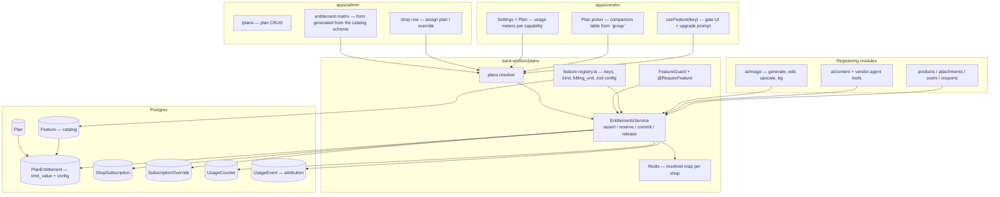

# Future Feature — Entitlements Platform (plans, capabilities & metered quotas)

**Status:** Built — phases 1-6 shipped (registry, schema, seed, drift gate, resolution, read API, enforcement engine, gated call sites, admin console API + UI, vendor plan screen, self-serve Stripe billing). Still unwired by design: `catalog.bulk_operations`, `staff.accounts` (blocked on a `ShopMembership` model), and the `ai.text.*` / `ai.catalog.*` / `ai.vision.*` families (blocked — those services are not built). Current behaviour lives in [`back-end/docs/features/plans.md`](../../back-end/docs/features/plans.md); this document is the design record.
**Created:** 2026-08-04
**Owner:** Shahd
**Shipped so far:** `back-end/src/plans/` + the Prisma models + `npm run seed:plans` + `EntitlementsService` + six read queries. **Nothing enforces yet** — the hardcoded caps are still the only limits, and `myUsage` reports `used: 0` because nothing writes counters. See [`back-end/docs/features/plans.md`](../../back-end/docs/features/plans.md).
**Scope decisions (locked 2026-08-04):** A **general entitlements engine**, not an AI-plans feature — every module registers its capabilities in one catalog and calls one service · **flat catalog of dotted capability keys**, one row per operation (`ai.image.generate`, `ai.text.translate`, `catalog.products`) · **`billing_unit` per capability** so the unit of metering is data, not code · **hybrid entitlement value: an enforced scalar column + a typed `config` JSON** for the non-metered knobs · config shapes declared in a **code registry**, not free-form · `reserve`/`commit`/`release` so estimated units (characters, tokens) settle on actuals · **agent tools map to existing capabilities, they do not get their own quota keys** — one gate in `dispatchToolCall` covers all 37 · plans assigned by an admin, Stripe billing deferred to phase 6 · downgrade freezes the capability read-only, never blocks, never deletes.

---

## Context — why this change

Every shop is created today with no notion of a commercial tier. There is no `Plan`, no `Subscription`, no `plan_id` on `Shop` ([schema.prisma:357](../../back-end/prisma/schema.prisma)), and nothing in the guard chain asks "is this shop allowed to run this operation".

What exists instead is four unrelated caps, each hardcoded and each applied identically to every shop:

| Layer | Where | Shape | Problem |
|---|---|---|---|
| Per-user abuse throttle | [ai-rate-limiter.service.ts:21](../../back-end/src/ai/ai-rate-limiter.service.ts) | `FALLBACKS: Record<AiFeature, {perUserPerHour, perUserPerDay}>`, Redis | Keyed on user, not shop. Correct as an abuse guard — should stay. |
| Platform daily spend | [ai-budget.service.ts:19](../../back-end/src/ai/ai-budget.service.ts) | One **global** `AiUsage` row per UTC day, `AI_DAILY_BUDGET_USD` | Not per-tenant at all. One shop's spend trips `AI_BUDGET_EXCEEDED` for everyone. |
| Per-shop monthly image cap | [image-gen.service.ts:1624](../../back-end/src/ai/image/image-gen.service.ts) | `AI_IMAGE_MONTHLY_CAP_PER_SHOP` env, counts `ai_image_generations` rows | Same number for every shop. Read-then-check, so it races. Images only. |
| Per-shop agent day cap | [quota.service.ts:57](../../back-end/src/vendor-agent/quota.service.ts) | `VENDOR_AGENT_DAILY_LIMIT`, Redis `INCR` | Same number for every shop. A second, unrelated implementation of the line above. |

Also hardcoded and plan-blind: `MAX_SHOTS_PER_RUN` (the batch ceiling, baked into `@ArrayMaxSize()` decorators in `dto/enhance-image-shots.input.ts`) and `ImageModelSpec.maxCount` / `costCentsPerImage` per model ([model-registry.ts](../../back-end/src/ai/image/model-registry.ts)).

**The AI surface is already large and still growing** — image generate/edit, enhance shots, vision analysis, content generation, embeddings, reranking, semantic search, and ~37 agent tools ([src/vendor-agent/tools/](../../back-end/src/vendor-agent/tools/)). A design that treats "AI" as one feature with one number cannot price any of it. Each operation has its own cost, its own natural unit, and its own reason to be gated.

The frontend is ahead of the backend. The settings overlay already ships a `plan` and a `billing` section (`settings-sections.ts`), both `SectionPlaceholder`, with `en`/`ar` copy in place. The AI Studio already renders a live quota meter off `enhanceStyles.monthly_usage` and already encodes the *0-vs-null* rule (`lib/__tests__/run-cost.test.ts`). And [ai-image-errors.ts](../../apps/vendor/src/shared/lib/ai-image-errors.ts) already carries a `FEATURE_NOT_AVAILABLE` code that **no server ever raises**.

**Goal:** one entitlements engine that answers, for any shop and any capability: *is it allowed*, *how much is left*, and *under what settings*. Every module — AI, catalog, storage, staff, analytics — registers into the same catalog and calls the same service, so shipping a new capability is a registry entry plus a seed row, never a change to the plan machinery.

---

## The catalog — one row per operation

A capability key is `<domain>.<resource>.<action>`. The key names **the operation the code performs**; a separate `group` column names **where it renders in the pricing table**. Keeping those independent is what lets the comparison table be reorganised for marketing without renaming anything the code references.

```
ai.image.generate            QUOTA    image      ai.image.edit               QUOTA  image
ai.image.remove_background   QUOTA    image      ai.image.upscale            QUOTA  image
ai.text.generate             QUOTA    character  ai.text.translate           QUOTA  character
ai.text.rewrite              QUOTA    character  ai.text.summarize           QUOTA  character
ai.text.seo                  QUOTA    request
ai.catalog.generate_products QUOTA    product    ai.catalog.generate_description  QUOTA  product
ai.catalog.generate_variants QUOTA    variant    ai.catalog.generate_attributes   QUOTA  product
ai.vision.analyze            QUOTA    image      ai.vision.alt_text          QUOTA  image
ai.agent.chat                QUOTA    request    ai.search.semantic          QUOTA  request
ai.embedding.generate        QUOTA    document   ai.recommendation.generate  QUOTA  request

catalog.products             LIMIT    product    catalog.collections         LIMIT  collection
catalog.bulk_operations      BOOLEAN             catalog.import_export       BOOLEAN
staff.accounts               LIMIT    seat       storage.files               LIMIT  byte
discounts.coupons            LIMIT    coupon     analytics.reports           BOOLEAN
inventory.transfers          BOOLEAN             marketing.abandoned_checkout BOOLEAN
```

**The `ai.` prefix is load-bearing, not cosmetic.** It marks the set of capabilities that spend real money at a model provider, and that set alone needs `release`/`commit` on failure, per-call cost attribution, provider allow-lists, and layering under the rate-limiter and budget guards. `catalog.products` (how many products may exist) and `ai.catalog.generate_products` (how many the model may create this month) are genuinely different mechanisms and must not share a prefix.

### `billing_unit` — the unit `quantity` is counted in

Agreed, and it carries a consequence worth naming: **the unit decides whether the caller can know the quantity up front.**

| Unit | Known before the call? | Reservation pattern |
|---|---|---|
| `image`, `product`, `variant`, `request`, `document`, `seat`, `coupon` | Yes | `reserve(n)` → work → `release(n)` on failure |
| `character`, `token`, `byte` | **No** | `reserve(estimate)` → work → `commit(actual)` |

`ai.text.translate` billed per character cannot be reserved exactly: you know the source length, not the output length, and a rewrite or summarize is worse. So the engine needs a third verb. `commit(handle, actual)` adjusts the counter by `actual − reserved` and is what makes `billing_unit` more than documentation. Designing this in now is the whole point of the field — retrofitting `commit` later means auditing every call site.

Reservation is capped: `commit` may raise usage above the limit by at most the overrun of one call, never by an unbounded amount, so a runaway generation cannot silently consume a year of quota. If `actual` exceeds `reserved` by more than a configured tolerance the call is failed and the reservation released.

---

## Entitlement value — scalar column **plus** typed config

Here is where I would not go all the way to a JSON blob, and the reason is narrow but decisive.

**Keep the enforced number as a real column.** `reserve` is the hot path and it must stay one atomic statement:

```sql
INSERT INTO usage_counters (id, shop_id, feature_key, period_start, period_end, used)
VALUES ($1, $2, $3, $4, $5, $6)
ON CONFLICT (shop_id, feature_key, period_start)
DO UPDATE SET used = usage_counters.used + $6
WHERE usage_counters.used + $6 <= $7
RETURNING used;
```

Push `$7` into a JSON blob and the comparison becomes `(config->>'monthlyQuota')::int`, which is untyped at the boundary, un-indexable, and fails *open* on a typo — `config->>'monthlyQouta'` is `NULL`, `used + n <= NULL` is `NULL`, the `WHERE` never matches, and depending on how you handle "no row returned" you either lock everyone out or hand out unlimited quota. A misspelled key must not be able to change what a customer paid for.

**So the rule, stated once and enforced everywhere:**

> The single scalar the **engine** enforces lives in `limit_value`. `config` holds only the knobs the engine does **not** compare numerically.

| Key | `limit_value` | `config` |
|---|---|---|
| `ai.image.generate` | `1000` (images/month) | `{ maxBatch: 20, providers: ["replicate","fal","gemini"], hd: true }` |
| `ai.text.translate` | `100000` (characters/month) | `{ languages: 5 }` |
| `ai.catalog.generate_products` | `5000` (products/month) | `{ maxBatch: 100 }` |
| `catalog.products` | `500` | `{}` |
| `storage.files` | `53687091200` (bytes) | `{}` |
| `analytics.reports` | `null` | `{ exportFormats: ["csv","xlsx"] }` |

`limit_value = null` means **unlimited**. Deliberately *not* the `0 = unlimited` convention of `AI_IMAGE_MONTHLY_CAP_PER_SHOP` — `0` must mean "zero allowed" so a plan can genuinely exclude a metered capability. The vendor UI already has a tested helper for this translation (`remainingImages`).

### Config shapes live in code, not in the database

A free-form `config` column becomes untyped mud within two months: nobody knows which keys a capability accepts, the admin form cannot be built, and a typo is silent. So each capability declares its config in a **typed registry** that is the single source of truth:

```ts
// back-end/src/plans/feature-registry.ts
export const FEATURE_REGISTRY = {
  'ai.image.generate': {
    group: 'ai_images',
    kind: 'QUOTA',
    billingUnit: 'image',
    period: 'MONTH',
    estimated: false,
    config: z.object({
      maxBatch: z.number().int().min(1).max(MAX_SHOTS_PER_RUN).default(4),
      modelTier: z.enum(['standard', 'premium']).default('standard'),
      providers: z.array(z.enum(IMAGE_PROVIDER_IDS)).default(['pollinations']),
      maxResolution: z.number().int().default(1024),
      allowTransparent: z.boolean().default(false),
      allowCustomPrompt: z.boolean().default(true),
    }),
  },
  'ai.text.translate': {
    group: 'ai_text',
    kind: 'QUOTA',
    billingUnit: 'character',
    period: 'MONTH',
    estimated: true,              // -> reserve/commit, not reserve/release
    config: z.object({
      languages: z.number().int().min(1).nullable().default(5),
      modelTier: z.enum(['standard', 'premium']).default('standard'),
    }),
  },
  'ai.vision.analyze': {
    group: 'ai_vision', kind: 'QUOTA', billingUnit: 'image', period: 'MONTH',
    config: z.object({
      maxImagesPerCall: z.number().int().default(5),
      maxMegapixels: z.number().default(2),
      allowPdf: z.boolean().default(false),
      allowVideo: z.boolean().default(false),
    }),
  },
  'ai.agent.chat': {
    group: 'ai_agent', kind: 'QUOTA', billingUnit: 'request', period: 'DAY',
    config: z.object({
      maxSteps: z.number().int().min(1).max(HARD_MAX_STEPS).default(5),
      maxContextTokens: z.number().int().default(64_000),
      memory: z.boolean().default(false),
      stream: z.boolean().default(true),
      tools: z.array(z.enum(TOOL_GROUP_IDS)).default(['catalog_read']),
    }),
  },
  'catalog.products': {
    group: 'core', kind: 'LIMIT', billingUnit: 'product',
    config: z.object({}),
  },
} as const satisfies Record<string, CapabilitySpec>;

export type FeatureKey = keyof typeof FEATURE_REGISTRY;
```

**`modelTier`, not an id list.** `allowedModels: ["*"]` looks convenient but it is a standing grant over models that do not exist yet: add a model next month that costs 50× more and every plan carrying the wildcard silently gets it, retroactively, with no pricing decision. Model ids also churn — a plan pinned to `gemini-2.5-flash` breaks when that id is retired. A `tier` survives both: the model registry declares each model's tier, the plan grants a tier, and promoting an expensive model into `standard` is a deliberate one-line change with a code review attached. `ImageModelSpec` already carries `costCentsPerImage`, so it is the natural home for `tier`. An explicit `providers` allow-list stays alongside it for the cases where the constraint is commercial rather than about capability.

This buys four things at once:

1. **Compile-time keys.** `@RequireFeature('ai.image.generat')` fails to build. Mirrors how `permissions.enum.ts` pins permission strings.
2. **Typed config reads.** `entitlements.config(shopId, 'ai.image.generate').maxBatch` is `number`, not `unknown`.
3. **Validated writes.** The admin mutation parses the submitted config through the capability's own zod schema — an unknown key is rejected at the API, never persisted.
4. **A generated admin form.** A `featureCatalog` query serialises each schema (`zod-to-json-schema`) so `entitlement-matrix.tsx` renders the right control per capability with no hardcoded form per key. **Schema in code, form derived — no drift.**

`IMAGE_PROVIDER_IDS` is derived from the existing [model-registry.ts](../../back-end/src/ai/image/model-registry.ts), so a plan cannot grant a provider that does not exist, and deleting a model surfaces as a type error in the registry rather than a runtime 422 after the vendor has been charged.

**`maxBatch` has a concrete blocker worth knowing before phase 3:** `MAX_SHOTS_PER_RUN` is currently enforced by `@ArrayMaxSize(MAX_SHOTS_PER_RUN)` in `dto/enhance-image-shots.input.ts` — a class-validator decorator evaluated at class-definition time, so it can never be per-plan. The DTO decorator has to stay as the absolute platform ceiling, and the per-plan check moves into the service. The effective batch is `min(plan.maxBatch, ImageModelSpec.maxCount, MAX_SHOTS_PER_RUN)`.

---

## Agent tools — mapped to capabilities, not given their own keys

The agent exposes ~37 tools ([src/vendor-agent/tools/](../../back-end/src/vendor-agent/tools/)), and they must be gateable per plan. But **a tool must not get its own quota key**, and the reason is concrete rather than aesthetic.

[generate-product-image.tool.ts](../../back-end/src/vendor-agent/tools/generate-product-image.tool.ts) calls `ImageGenService.generate` directly — its own docblock says it goes "through the same moderation + budget + per-shop monthly-cap guards as the GraphQL mutation". Give that tool a separate `ai.agent.tools.image` key with its own quota and **the same money is metered by two counters**: a shop that bought 200 images can spend 200 in the AI Studio *and* 200 more through the chat. Every future tool that wraps a metered service inherits the same bug.

So the registry maps a tool to the capabilities it **exercises**, and those are existing keys:

```ts
// back-end/src/vendor-agent/tools/tool-registry.ts
export const TOOL_REGISTRY = {
  generate_product_image: { group: 'ai_media',      requires: ['ai.image.generate'] },
  create_product:         { group: 'catalog_write', requires: ['catalog.products'] },
  bulk_update_price:      { group: 'bulk_ops',      requires: ['catalog.bulk_operations'] },
  import_products_csv:    { group: 'bulk_ops',      requires: ['catalog.import_export'] },
  get_shop_stats:         { group: 'analytics',     requires: ['analytics.reports'] },
  transfer_inventory:     { group: 'inventory',     requires: ['inventory.transfers'] },
  search_products:        { group: 'catalog_read',  requires: [] },
} as const satisfies Record<string, ToolSpec>;
```

`requires: []` is the honest answer for read-only tools — they are already paid for by the `ai.agent.chat` request that invoked them, and metering them separately would charge twice for one turn.

**Selling granularity is `group`, not the individual tool.** Nobody buys "the search tool"; they buy "the agent can touch analytics". `config.tools` on `ai.agent.chat` is an allow-list of **groups** (`catalog_read`, `catalog_write`, `bulk_ops`, `analytics`, `inventory`, `ai_media`), which keeps the plan matrix at six switches instead of thirty-seven. A tool becomes its own capability key only when it is genuinely sellable on its own — `catalog.bulk_operations` and `catalog.import_export` qualify, and note they are then gated identically whether reached from the dashboard or from the chat, which is the behaviour you want.

The check is therefore two conditions: the tool's `group` is in `config.tools`, **and** every key in `requires` resolves allowed (plus a `reserve` when it is metered).

### Where the gate goes

Two places, for two different reasons.

**1. Bind time — filter the tool list.** `VendorAgentService.buildTools()` ([vendor-agent.service.ts:965](../../back-end/src/vendor-agent/vendor-agent.service.ts)) assembles the array handed to the model. Filtering it by entitlement means **the model never sees a tool it cannot use** — no wasted context tokens describing it, and no turn burned on a call that was always going to be refused.

**2. Dispatch time — the real gate.** `dispatchToolCall` ([tool-dispatcher.ts:38](../../back-end/src/vendor-agent/agent/tool-dispatcher.ts)) already describes itself as the "single source of truth for 'execute one LLM-issued tool call'", and both the streaming and non-streaming agents drive it (`graph/nodes/tools.node.ts:75`). **One insertion point covers all 37 tools**, and every future one inherits it. Bind-time filtering is not sufficient on its own: a model can hallucinate a tool name, and entitlements can change mid-conversation.

```
tool_call → resolve tool → [TOOL_REGISTRY lookup → group allowed? requires allowed? reserve?] → invoke
```

### A denied tool must return a failure, never throw

This is the detail that turns a feature into an incident if it is missed. The dispatcher's contract is that **every** tool call gets a `ToolMessage` back. `cap.node.ts` exists solely because an `AIMessage` holding `tool_calls` that nobody answered is checkpointed, and an OpenAI-compatible provider then rejects every subsequent request on that thread — its own comment: *"it would brick the whole conversation thread from that point on"*.

So an entitlement denial returns the existing `{ ok: false, error, hint }` shape that `asFailure()` already recognises — the same path business-rule failures use today. The `hint` is written for the model, not the vendor: *"This tool is not available on the shop's plan. Do not retry it; tell the vendor it requires an upgrade."* Without the hint the agent retries the same forbidden tool until it hits the step cap.

### `maxSteps` is a cost multiplier, not a UX knob

The step cap already exists — `cap.node.ts` plus the `AGENT_MAX_STEPS` i18n key — so making it per-plan is wiring an existing knob to config, not new machinery. But it changes what a metered "request" costs: `VendorAgentQuotaService`'s own comment notes each chat call "costs at least one OpenRouter request (often more when tools loop)". A plan with `maxSteps: 20` buys requests that cost roughly four times a plan with `maxSteps: 5`, while both are metered as one `ai.agent.chat` unit.

Keep metering per request — it is the unit vendors understand — but treat `maxSteps` as the thing that bounds the blast radius, and write the **actual** step count and cost into `UsageEvent` so the pricing can be corrected from data rather than guesswork. **"Unlimited steps" should not exist**: an unbounded loop is an unbounded bill on a fixed-price request. Enterprise gets a high number, not `null`, and `HARD_MAX_STEPS` stays as the platform ceiling above every plan.

### Future capabilities

`ai.video.generate`, `ai.audio.transcribe`, `ai.voice.clone`, `ai.ocr.scan` need no change to any of this — a registry entry declaring `kind`, `billing_unit`, `period` and a zod config, a generated seed row per tier, and one `reserve` call. The admin matrix picks them up from `featureCatalog`, and the vendor's usage list renders them from the same query. That is the whole point of putting the shapes in a registry.

---

## Architecture



---

## Backend

### Data model (`back-end/prisma/schema.prisma`)

**`Plan`** — `id`, `code` (unique), `name`/`name_ar`, `description`/`description_ar`, `monthly_price_cents`, `yearly_price_cents`, `currency` (default `SAR`), `trial_days`, `is_public`, `is_active`, `sort_order`, soft delete. Money is **integer cents** end to end, matching `Withdrawal.amount_cents`.

**`Feature`** — the catalog, **synced from `FEATURE_REGISTRY` by the seed, never hand-created**. `id`, `key` (unique), `group`, `name`/`name_ar`, `description`/`description_ar`, `kind` (`BOOLEAN|LIMIT|QUOTA`), `billing_unit`, `period` (`NONE|DAY|MONTH|YEAR`), `is_estimated`, `is_active`, `sort_order`. A key only means something because code references it, so admins edit *values*, never keys.

**`PlanEntitlement`** — `plan_id`, `feature_id`, `enabled`, `limit_value` (`Int?`, null = unlimited), `config` (`Json`, validated against the registry schema on write), `@@unique([plan_id, feature_id])`. **A missing row denies.**

**`ShopSubscription`** — `shop_id`, `plan_id`, `status` (`TRIALING|ACTIVE|PAST_DUE|CANCELED|EXPIRED`), `interval`, `current_period_start`, `current_period_end`, `trial_ends_at`, `cancel_at_period_end`, `canceled_at`, `price_cents_snapshot` (a later plan price change must not silently reprice an existing subscriber), `external_ref` (`String?`, the Stripe subscription id, null until phase 6). Rows are kept as history; a partial unique index enforces one live subscription per shop:

```sql
CREATE UNIQUE INDEX shop_subscription_one_live ON shop_subscriptions (shop_id)
  WHERE status IN ('TRIALING','ACTIVE','PAST_DUE');
```

`Shop` gains only the relation — **no `plan_id` column on `Shop`**. The subscription owns the link so period, status and history have one home.

**`SubscriptionOverride`** — `shop_id`, `feature_id`, `enabled?`, `limit_value?`, `config?`, `expires_at?`, `note`, `created_by`. Grants one shop 500 extra images for a month without minting a bespoke plan. Every support team needs this within weeks of launch.

**`UsageCounter`** — `shop_id`, `feature_key` (denormalized string, not an FK — the counter must survive a catalog edit), `period_start` (`Date`), `period_end`, `used` (`Int`), `reserved` (`Int`, in-flight reservations for estimated units), `@@unique([shop_id, feature_key, period_start])`. **Postgres, not Redis** — a paid quota is a commercial fact and must survive a cache flush. The existing Redis counters stay where they are, for abuse throttling, where fail-open is the correct behaviour.

**`UsageEvent`** — append-only, and now **phase 3, not optional**: `shop_id`, `feature_key`, `quantity`, `billing_unit`, `cost_cents`, `ref_type`/`ref_id`, `user_id`, `created_at`. With one metered capability you can reconcile from the counter; with twenty you cannot answer "why did this shop burn its quota" without the events. This also closes the per-call AI spend attribution item in `TODO.md` — today `ai_usage` is one global row with no `shop_id`.

**`storage.files` needs no new column** — `Attachment.size` is already `Int` bytes ([schema.prisma:2842](../../back-end/prisma/schema.prisma)), so the `LIMIT` check is a `SUM(size)` over the shop's non-deleted attachments.

### `back-end/src/plans/` — new module

```
plans.module.ts
feature-registry.ts        # THE source of truth: keys, kind, billing_unit, zod config
plans.service.ts           # Plan / PlanEntitlement CRUD + config validation
subscriptions.service.ts   # subscribe, change, cancel, period roll
entitlements.service.ts    # resolve / assert / reserve / commit / release
entitlements.guard.ts      # FeatureGuard + @RequireFeature
usage.service.ts           # counters + UsageEvent writes
plans.resolver.ts
dto/ types/ *.spec.ts
```

**One uniform call shape for every module** — the point of the whole exercise:

```ts
await entitlements.assert(shopId, 'analytics.reports');
await entitlements.assertLimit(shopId, 'catalog.products', { quantity: 1 });

const h = await entitlements.reserve(shopId, 'ai.image.generate', { quantity: 5 });
try   { const out = await run(); await entitlements.commit(h, { quantity: out.length }); }
catch { await entitlements.release(h); }

const h2 = await entitlements.reserve(shopId, 'ai.text.translate', { quantity: estimateChars(products) });
await entitlements.commit(h2, { quantity: actualChars, costCents });
```

`commit` is idempotent on the handle id, so a retried processor cannot double-count. `release` is safe to call twice.

**Resolution order:** unexpired `SubscriptionOverride` → `PlanEntitlement` → **deny**. Config merges shallowly, override over plan. Shops with no subscription resolve against a seeded `FREE` plan carrying today's env numbers.

**Caching** follows `RolePermissionsService`, but in **Redis** rather than in-process — the app runs multiple replicas and a stale entitlement map is a revenue bug. **Cache the resolved map; never cache the counter.** `used` is read from Postgres on every reserve.

### `FeatureGuard` + `@RequireFeature`

Mirrors `PermissionsGuard`, with one deliberate difference documented in the code: **`FeatureGuard` matches with `.every()`, not `.some()`.** `PermissionsGuard` matching on `.some()` is a known sharp edge in this repo (root `CLAUDE.md`).

```
JwtAuthGuard -> PermissionsGuard -> ShopHeaderGuard -> RequireShopGuard -> FeatureGuard
```

**The guard is boolean-only.** Quotas are never enforced in the guard: only the service knows the quantity, and only the service can commit or release. Enforcing quota in a guard is the standard way this kind of system starts double-charging.

### Enforcement order

For one AI image generation, four independent gates fire in this order:

1. **`FeatureGuard`** — does the plan include the capability → `FEATURE_NOT_AVAILABLE`
2. **`AiRateLimiterService`** — per-user abuse throttle, plan-independent, **unchanged** → `AI_RATE_LIMIT_EXCEEDED`
3. **`EntitlementsService.reserve`** — the shop's paid quota and `maxBatch` → `PLAN_QUOTA_EXCEEDED` / `PLAN_BATCH_EXCEEDED`
4. **`AiBudgetService.reserveCost`** — platform-wide spend guard, **unchanged** → `AI_BUDGET_EXCEEDED`

Gates 2 and 4 protect the platform and stay. Gate 3 is the commercial one. Cheapest and most specific first, so a vendor over their plan quota is told exactly that instead of hitting a platform error they cannot act on.

### Migration of existing caps

| Today | Becomes |
|---|---|
| `AI_IMAGE_MONTHLY_CAP_PER_SHOP` (`monthlyCap()`) | `ai.image.generate` QUOTA/MONTH, unit `image` |
| `VENDOR_AGENT_DAILY_LIMIT` (`VendorAgentQuotaService`) | `ai.agent.chat` QUOTA/DAY, unit `request` |
| `MAX_SHOTS_PER_RUN` per-run ceiling | `config.maxBatch`; the DTO decorator stays as the platform ceiling |
| `enhanceStyles.max_shots_per_run` | resolved per plan, same field name — no frontend change |

`getMonthlyUsage` keeps its name and signature so `enhanceStyles.monthly_usage` stays wire-compatible and the AI Studio needs no change in the same release; it becomes a thin call into `getUsage(shopId, 'ai.image.generate')`. `VendorAgentQuotaService` is deleted once `ai.agent.chat` is live — its fail-open-on-Redis-outage behaviour does **not** carry over.

### API

| Operation | Type | Auth |
|---|---|---|
| `plans`, `featureCatalog` | Query | `OptionalJwtGuard` — public pricing table + config schemas |
| `myPlan`, `myEntitlements` | Query | `JwtAuthGuard` + `ShopHeaderGuard` |
| `myUsage` | Query | same — counters for every metered capability, one round trip |
| `changePlan`, `cancelSubscription` | Mutation | same + `MANAGE_OWN_SHOP` |
| `createPlan` / `updatePlan` / `deletePlan` | Mutation | `MANAGE_PLANS` |
| `setPlanEntitlements` | Mutation | `MANAGE_PLANS` — the whole matrix for one plan in one call |
| `assignShopPlan`, `setSubscriptionOverride` | Mutation | `MANAGE_PLANS` |
| `shopSubscriptions`, `shopUsage` | Query | `MANAGE_PLANS` |

**New permission `MANAGE_PLANS`** in `permissions.enum.ts`, granted to `admin` and `super_admin`. Not reusing `MANAGE_ALL_SHOPS`: per root `CLAUDE.md`, a resolver gated on `MANAGE_ALL_SHOPS` alongside `MANAGE_OWN_SHOP` is reachable by any vendor because of the `.some()` match.

`myEntitlements` returns the **resolved** map including config — never raw plan rows. The vendor UI must not re-implement override precedence.

### Error codes

| Code | When |
|---|---|
| `FEATURE_NOT_AVAILABLE` | The plan does not include the capability. Already exists client-side; nothing raises it yet. |
| `PLAN_QUOTA_EXCEEDED` | Metered consumption would exceed `limit_value` for the period. |
| `PLAN_LIMIT_REACHED` | A stock count would exceed a `LIMIT` entitlement. |
| `PLAN_BATCH_EXCEEDED` | The request exceeds `config.maxBatch` / `maxImagesPerCall` for this plan. |
| `PLAN_OPTION_NOT_ALLOWED` | A config allow-list rejects the choice (model tier, provider, resolution, language count, custom prompt). |
| `PLAN_TOOL_NOT_AVAILABLE` | An agent tool's group is not in `config.tools`, or a `requires` key is denied. **Returned to the model as `{ ok: false, error, hint }` — never thrown.** |
| `PLAN_COMMIT_OVERRUN` | Actual consumption exceeded the reservation beyond tolerance. |
| `PLAN_NOT_FOUND` / `SUBSCRIPTION_NOT_FOUND` / `SUBSCRIPTION_ALREADY_ACTIVE` | Mutation errors. |

Every code gets `en`/`ar` entries in `src/i18n/{en,ar}/common.json`. Per the convention in [ai-image-errors.ts](../../apps/vendor/src/shared/lib/ai-image-errors.ts), **copy is owned client-side and never echoed from the server** — the code rides in `extensions.validation_errors[0].code` and `AppException.validation` hardcodes `message` to `'Validation failed'`. Quota messages must not leak platform-internal figures the way `AI_BUDGET_EXCEEDED` does today.

### Catalog drift — the operational risk of a large catalog

Twenty-five capabilities across five plans is 125 entitlement rows, and **a missing row denies**. Left unmanaged, adding a capability silently switches it off for every existing customer. Three guards:

1. `FEATURE_REGISTRY` declares a **default entitlement per plan tier**, so the seed is generated rather than hand-written.
2. A **CI check** fails the build when a registry key has no entitlement row on an active plan, unless the registry marks it `deniedByDefault: true`.
3. The seed is **idempotent and additive** — it inserts missing rows and never overwrites an admin-edited value.

---

## Downgrade behaviour (locked)

A shop moving to a smaller plan is **never blocked and never has data deleted**.

- **`LIMIT`** — the downgrade goes through, existing rows untouched, the capability goes **read-only** until the count is back under the ceiling: creates raise `PLAN_LIMIT_REACHED`, edits and deletes stay allowed (deleting is how they get back under). `assertLimit` produces this for free, since it compares the *current* count against the *current* entitlement.
- **`QUOTA`** — the current period runs out at the old number; the new limit applies at the next period roll. **A shop that already used 400 of 500 images is not retroactively over quota** on a plan allowing 200.
- **`config`** — applies immediately (a downgraded `maxBatch` or provider list takes effect on the next call). Nothing is retroactive because nothing is stored under it.

`changePlan` returns the resulting frozen capabilities so `change-plan-dialog.tsx` can name them before the vendor commits.

---

## Frontend

### Vendor — `apps/vendor/src/features/plan/`

The `plan` section already exists in `settings-sections.ts` with `en`/`ar` copy; wiring it is a one-line change at [settings-page.tsx:206](../../apps/vendor/src/features/settings/components/settings-page.tsx) next to the existing `general` / `notifications` branches.

```
plan/
├── index.ts, types.ts
├── api/{index,queries,mutations}.ts
├── components/
│   ├── plan-section.tsx          # current plan + usage meters grouped by `group`
│   ├── plan-picker-dialog.tsx    # the comparison table
│   ├── plan-compare-table.tsx    # rows from featureCatalog, no hardcoded feature list
│   ├── usage-meter.tsx           # one bar: used / limit / unit / resets on
│   ├── change-plan-dialog.tsx    # confirm, and name what freezes
│   └── upgrade-prompt.tsx        # inline "your plan doesn't include this"
└── lib/
    ├── use-entitlements.ts       # useFeature(key) -> { allowed, limit, used, remaining, config }
    ├── format-unit.ts            # 1000 character -> "1,000 characters"; byte -> "50 GB"
    ├── entitlements.ts
    └── __tests__/
```

**Changing a plan is an immediate action — never the save bar.** `AGENTS.md` mandates staged edits for *editing screens*; a plan change is a confirmed transaction, the same call the payments design doc makes for Stripe Connect.

`useFeature` reads **one** cached `myEntitlements` query — one query for the whole app, not one per capability, or every gated button becomes a round trip. Refetch after `changePlan` and after any mutation that consumes quota.

`usage-meter.tsx` renders **from the catalog**, so a new capability appears in the vendor's usage list with no frontend change. `format-unit.ts` is where `billing_unit` pays off in the UI: "820 / 1,000 images" vs "48,210 / 100,000 characters" vs "31.2 / 50 GB" all come from the same component.

**Reuse, do not reinvent:** `remainingImages` in [files/api/queries.ts](../../apps/vendor/src/features/files/api/queries.ts) already implements the null-vs-zero rule with tests. Generalize it into `plan/lib/entitlements.ts` as `remaining(usage)` and have the files feature import it.

**Errors:** generalize [ai-image-errors.ts](../../apps/vendor/src/shared/lib/ai-image-errors.ts) into `shared/lib/plan-errors.ts`, adding the new codes to the existing `FEATURE_NOT_AVAILABLE`. Keep `isAiQuotaError`'s signature so the product-form AI panel and the AI Studio keep working; a quota error routes to `upgrade-prompt.tsx` with a link to the picker.

### Admin — `apps/admin/src/features/plans/`

Flat layout matching `withdrawals`/`commissions`: one `api.ts` with a header docblock stating the backend auth reality, `types.ts`, `validations.ts`, `components/`, colocated `__tests__/`. Operations prefixed `Admin*` to avoid colliding with vendor operation names against the same SDL.

```
plans/
├── api.ts, types.ts, validations.ts
├── components/
│   ├── plans-table.tsx
│   ├── plan-form-dialog.tsx        # name, prices, trial, visibility
│   ├── entitlement-matrix.tsx      # capabilities x value, grouped, collapsible
│   ├── config-field.tsx            # ONE component, renders from the JSON Schema
│   └── assign-plan-dialog.tsx      # put a shop on a plan / set an override
└── __tests__/validations.test.ts
```

`config-field.tsx` is the piece that makes a 25-capability matrix maintainable: it switches on the JSON Schema type from `featureCatalog` (`boolean` → switch, `integer` → number input with the unit label, `array of enum` → multi-select) so **no capability ever needs its own admin form**. That is the payoff of declaring config shapes in the registry.

Routes `app/plans/{layout,page}.tsx`. **The route must be added to `proxy.ts`'s `matcher`** — a route absent from it is never seen by the guard. Prices are entered in major units and converted to cents at the network boundary, never in a render, exactly as `commissions-table.tsx` documents.

---

## Phases

| # | Phase | Ships |
|---|---|---|
| 1 | **Registry & schema** | `feature-registry.ts` with the full capability set; Prisma models + partial unique index; generated idempotent seed + CI drift check; `MANAGE_PLANS`. **No enforcement.** |
| 2 | **Resolution** | `resolve` + Redis cache; `plans`, `featureCatalog`, `myPlan`, `myEntitlements`, `myUsage`. Read-only. |
| 3 | **Engine** | `FeatureGuard` + `@RequireFeature`; atomic `reserve`/`commit`/`release`; `UsageEvent`; migrate `ai.image.generate` + `ai.agent.chat` + `maxBatch`; delete `VendorAgentQuotaService`. |
| 3b | **Agent gate** | `TOOL_REGISTRY` mapping all 37 tools to capabilities and groups; entitlement filter in `buildTools()`; the gate in `dispatchToolCall` returning `{ ok: false, error, hint }`; per-plan `maxSteps` wired to the existing cap node; step count + cost into `UsageEvent`. |
| 4 | **Breadth** | Register the remaining capabilities module by module — text, catalog, vision, embeddings, then the non-AI keys (`catalog.products`, `catalog.bulk_operations`, `staff.accounts`, `storage.files`, `discounts.coupons`, `inventory.transfers`). Each is a registry entry + one call site. |
| 5 | **UI** | Vendor Settings > Plan + meters + upgrade prompts; admin `/plans` + generated entitlement matrix. |
| 6 | **Billing** | Stripe subscriptions driving `ShopSubscription.status` via webhook through `external_ref`; rides on the payment-provider abstraction ([payment-providers-stripe-connect.md](payment-providers-stripe-connect.md)). Optional `overage_allowed` / `overage_price_cents`. |

Phases 1–4 are backend-only and each is independently shippable. **A shop with no subscription resolves to `FREE`, seeded with today's env values, so phase 3 is a no-op for every existing shop on the day it deploys.**

---

## Open decisions

1. **Trial handling.** A 3-month trial at a token price: `TRIALING` status on a real subscription with a discounted `price_cents_snapshot`, or a separate promo layer? *Recommendation: `TRIALING` + snapshot. A promo layer is a second pricing engine.*
2. **Quota scope: shop or user.** `UsageCounter` is keyed on `shop_id`, so staff share one pool. *Recommendation: shop-only. Per-seat quotas need the `ShopMembership` model from `TODO.md`, which does not exist yet.*
3. **Rollover and overage.** *Recommendation: neither before phase 6. Both are `PlanEntitlement` columns added later without touching the resolver.*
4. **Currency.** *Recommendation: single `Plan.currency` for now; a `PlanPrice` child table if multi-currency is ever needed.*
5. **Do text capabilities meter characters or requests on day one?** Characters are the honest unit but need `estimateChars` at every call site. *Recommendation: ship `ai.text.*` as unit `request` in phase 4 and switch to `character` once `commit` has run in production for the image path — the field makes the switch a seed change, not a redesign.*

---

## Docs to write (mandatory, same change)

- `back-end/docs/features/plans.md` + `back-end/docs/features/api/plans.md` + rows in both READMEs
- `apps/vendor/docs/features/plan.md` + row in its README
- Update `back-end/docs/features/ai-image.md` and `vendor-agent.md` when their caps move (phase 3)
- A `## Entitlements platform` section in `TODO.md` with the six phases as `- [ ]` items

---

## Main files

**New:** `back-end/src/plans/*`, `back-end/src/vendor-agent/tools/tool-registry.ts`, `back-end/prisma/seeds/plans.seed.ts`, `apps/vendor/src/features/plan/*`, `apps/admin/src/features/plans/*`, `apps/admin/src/app/plans/*`.

**Edited:** [schema.prisma](../../back-end/prisma/schema.prisma) · [permissions.enum.ts](../../back-end/src/common/enums/permissions.enum.ts) · [error-codes.enum.ts](../../back-end/src/common/enums/error-codes.enum.ts) · `src/i18n/{en,ar}/common.json` · [image-gen.service.ts:1624-1692](../../back-end/src/ai/image/image-gen.service.ts) · `src/ai/image/dto/enhance-image-shots.input.ts` (batch ceiling) · [model-registry.ts](../../back-end/src/ai/image/model-registry.ts) (export provider ids + add `tier`) · [tool-dispatcher.ts:38](../../back-end/src/vendor-agent/agent/tool-dispatcher.ts) (the one gate) · [vendor-agent.service.ts:965](../../back-end/src/vendor-agent/vendor-agent.service.ts) (`buildTools` filter) · `src/vendor-agent/graph/build.ts` + `deps.ts` (per-plan `maxSteps`) · [quota.service.ts](../../back-end/src/vendor-agent/quota.service.ts) (deleted) · [settings-page.tsx:206](../../apps/vendor/src/features/settings/components/settings-page.tsx) · [ai-image-errors.ts](../../apps/vendor/src/shared/lib/ai-image-errors.ts) · [files/api/queries.ts](../../apps/vendor/src/features/files/api/queries.ts) · `apps/admin/src/proxy.ts` (matcher) · `apps/*/src/shared/messages/{en,ar}.json`.
