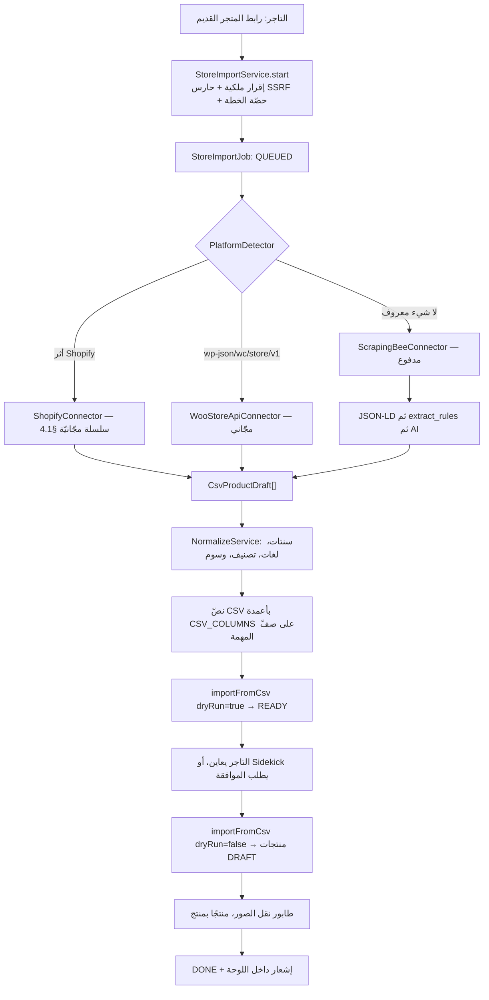

# استيراد المتجر — خطة «AI Store Migration»

**Last updated:** 2026-09-14
**الحالة:** قيد التنفيذ — **P0 شُحنت** (`back-end/src/store-import/`، و`common/security/ssrf-guard.ts`، و`prisma/migrations/manual/2026-09-14-store-import-tables.sql`)، وما بعدها اقتراح. ولا يزال **لا يوجد أي كود استخراج ولا موصّل منصّات**: `grep -rin "scrap\|cheerio\|playwright\|puppeteer" back-end/src` يعيد صفر نتائج، وقائمة اعتماديات الـAPI لا تحوي أي مكتبة استخراج. والموجود قبل هذه الخطّة هو نصف الميزة الآخر — مسار CSV كامل، ومُطبِّع Shopify، وحارس SSRF، وناقل صور.
**نقطة الدخول موجودة ومكتوب عليها أنها فارغة:** [import-products-dialog.tsx:239-241](../../apps/vendor/src/features/products/components/list/import-products-dialog.tsx#L239-L241) فيه خيار راديو `value="platform"` نصّه الحرفي `"Not yet implemented. Export a CSV from that platform and upload it here."` — هذه الخطة هي ملء ذلك الخيار.
**الوحدة الجديدة:** `back-end/src/store-import/`
**التوثيق المطلوب عند التنفيذ:** `back-end/docs/features/store-import.md` + `back-end/docs/features/api/store-import.md` + تحديث `apps/vendor/docs/features/products.md` و`back-end/docs/features/vendor-agent.md`
**الأثر على بوت البائع:** القسم ١٢ بالكامل — ثلاث أدوات، واحدة في `GATED_TOOLS`، واثنتان ممنوعتان على قنوات المحادثة بالتصميم.
**المراجعة:** جولتان. الأولى أضافت **قسمًا كاملًا** — هوية المنتج المصدر بين عمليتَي استيراد (§6)، وهي الفجوة المعماريّة الوحيدة التي كان لا بدّ من سدّها قبل كتابة سطر واحد — ومعها فصل «قيد النقل» عن «فشل النقل» (§9.1)، وسقف بايتات للـCSV بعد أن تبيّن أن تقدير الحجم الأصلي متفائل (§5)، وحفظ رصيد المزوّد ولقطة تسعيره لا تكلفته المشتقّة وحدها (§7.1)، ورفع تجميد واجهة الموصّل (§4)، ومهمّة تقليم (§10.1)، ومرحلة **P1.5**.
والثانية أصلحت **تناقضًا داخليًّا كان يجعل P1 فخًّا**: القرار ٣.٤ يمنع النشر قبل نقل الصور، وجدول المراحل كان يؤجّل البوّابة إلى P2 بينما P1 يكتب المنتجات — فانتقلت البوّابة إلى P1 وصارت ثابتةَ خدمة تراها المسارات الأربعة إلى `PUBLISH` بما فيها النشر المجدول (§9.2). ومعها: موصّل Shopify صار **سلسلة استراتيجيّات** لأن `products.json` ليس عقدًا موثَّقًا (§4.1)، و`source_host` صار المضيف المحلول لا حذفًا أعمى لـ`www` (§6.4)، وحاجز `max_cost` عند المزوّد بجانب حاجزنا (§7.1). وتُحقّق من ربط الخريطة في الكود نفسه — `product_id` موجود ويُملأ، وفيه فخّ التشغيل الجاف (§6.3).
والثالثة أغلقت عيبَين كان كلٌّ منهما يُفسد ضمانةً وضعتها الجولة الثانية. **مهمّة التقليم كانت ترفع بوّابة النشر بعد ٦٠ يومًا** — لأن البوّابة مبنيّة على *غياب* صفّ، والتقليم يحذف صفوفًا — فصارت لا تمسّ `PENDING` أبدًا، ومعها حاصدٌ يمنع «عالق إلى الأبد» من أن يكون الثمن (§10.1). و**كتابة المنتج وكتابة هويّته كانتا عمليّتين منفصلتين**، بينهما نافذة انهيار تُنتج الكتالوج بلا هويّة الذي يمنعه القرار ٣.٨؛ صارتا داخل معاملة `importFromCsv` نفسها عبر خطّاف (§6.6). ومعهما: **P1 وحدها ليست إصدارًا للتجّار** — أوّل إصدار حقيقيّ هو P1 + P2 (§17).

---

## 1. الخلاصة التنفيذية

التاجر يعطينا رابط متجره القديم، ونحن نملأ كتالوجه بدل أن يُدخل ٣٢٧ منتجًا يدويًا.

**والنصف الصعب مبني أصلًا.** كل ما هو مؤلم في استيراد كتالوج — طيّ صفوف SKU في منتج
واحد بمتغيّراته، توليد slug فريد، ربط المجموعات والوسوم، كتابة المخزون، تقرير سطرًا
بسطر، تشغيل جاف يسبق الكتابة — مكتوب ومُختبَر في
[products-csv.service.ts](../../back-end/src/products/csv/products-csv.service.ts) منذ
أن شُحن استيراد CSV. الاستخراج من موقع لا يحتاج أن يعرف شيئًا من ذلك.

ومن هنا **القرار الذي تقوم عليه الخطة كلها**:

```text
الاستخراج لا يكتب منتجات.
الاستخراج يكتب CSV قانونيًّا بأعمدة CSV_COLUMNS.
ثم importFromCsv يعمل عليه كما هو، بلا سطر واحد جديد في كاتب المنتجات.
```

المكسب من هذا ليس اختصارًا في الوقت. هو أن الطريقين — «رفعتُ ملفًا» و«امسح متجري» —
**ينتهيان إلى نفس تقرير `CsvImportResult` حرفيًّا**، فلا ينشأ كاتب منتجات ثانٍ ينحرف
عن الأول بعد ثلاثة أشهر. ويكسب التاجر معه مخرجًا حقيقيًا: يستطيع **تنزيل الـCSV** الذي
أنتجه المسح، يصلّح فيه ثلاثة أسعار في Excel، ويرفعه من نفس النافذة.

**وScrapingBee ليست الخطوة الأولى بل الأخيرة.** متجر Shopify يخدم بيانات منتجاته
علنًا وبلا مفتاح — عبر واجهة Ajax الموثّقة `/products/{handle}.js` مقرونةً بخريطة
منتجاته، ومع مسار سريع غير موثَّق (`products.json`) يُجرَّب ولا يُبنى عليه (§4.1).
WooCommerce تخدم `/wp-json/wc/store/v1/products` بالمثل حين تكون مفتوحة. وكلاهما
بيانات منظّمة ومجّانية وأدقّ من أي استخراج من HTML، فالموصّل العام مدفوع الثمن هو ما
يُستدعى **حين تفشل الطرق المجّانية**، لا قبلها.

**والصور هي أخطر جزء، لا الاستخراج.** ٣٢٧ منتجًا تعني ~١٢٨٤ صورة على CDN متجر لن
يبقى. ربطها كما هي يعني متجرًا يفرغ يوم يوقف التاجر اشتراكه القديم. ونقلها يعني ١٢٨٤
طلبًا صادرًا من داخل شبكتنا إلى عناوين اختارها شخص آخر — وهو تعريف SSRF. الحارس لهذا
مكتوب أصلًا في
[remote-image.guard.ts](../../back-end/src/attachments/remote-image.guard.ts) ولا يجوز
الالتفاف عليه.

**والسؤال الذي لا يحلّه كود:** لا نستطيع تقنيًّا إثبات أن `old-store.com` ملك لمن يمسحه.
القسم ١٥ يعالج هذا بإقرار + سجلّ تدقيق + حدّ معدّل + احترام `robots.txt`، ويسمّي
مسار التصعيد (إثبات DNS TXT) بدل أن يتظاهر بأن المسألة غير موجودة.

**والمسح الثاني ليس المسح الأوّل.** التاجر يستورد اليوم، ثم يعيد المسح بعد أسبوع.
مطابقة الـslug وحدها — وهي ما يفعله `importFromCsv` اليوم — تنكسر في اللحظة التي يعيد
فيها التاجر تسمية منتج في زيدك، فيصير لديه نسختان من كل ما لمسه. §6 يسدّ هذا بجدول
هوية مستقلّ، **دون أن يغيّر سطرًا في كاتب المنتجات**.

---

## 2. ما هو مبني فعلاً ويُعاد استخدامه

هذا الجدول نصف الخطة. كل سطر فيه قطعة موجودة تمنع كتابة قطعة جديدة.

| الموجود | الملف | ماذا يعني للاستيراد |
|---|---|---|
| كاتب المنتجات من CSV، بتشغيل جاف وتقرير سطرًا بسطر | [products-csv.service.ts:230](../../back-end/src/products/csv/products-csv.service.ts#L230) `importFromCsv` | **الهدف النهائي لكل موصّل.** لا يُعدَّل، ويُستدعى كما هو |
| الشكل القانوني لمنتج قبل الكتابة | [shopify-csv.mapper.ts:81](../../back-end/src/products/csv/shopify-csv.mapper.ts#L81) `CsvProductDraft` | ما يُنتجه كل موصّل. ليس `Prisma.ProductCreateInput` |
| طيّ صفوف SKU في منتج بمتغيّراته | [shopify-csv.mapper.ts:480](../../back-end/src/products/csv/shopify-csv.mapper.ts#L480) `groupIntoProducts` | Shopify تعيد المتغيّرات مصفوفة أصلًا — نفس الطيّ، بلا كتابته ثانية |
| قلب سعر العرض (`Price` مقابل `Compare-at`) | نفس الملف، شرح الصنف | `products.json` تحمل نفس الالتباس بنفس الاتجاه |
| أعمدة CSV وترميز متعدّد اللغات | [product-csv.schema.ts](../../back-end/src/products/csv/product-csv.schema.ts) | `CSV_COLUMNS` هي عقد الإخراج، و`price_cents` عدد صحيح لا نصّ |
| حارس SSRF على رابط يختاره غيرنا | [remote-image.guard.ts](../../back-end/src/attachments/remote-image.guard.ts) | يمرّ منه `source_url` وكل رابط صورة وكل قفزة إعادة توجيه |
| جلب صورة من رابط وتخزينها | [attachments.controller.ts:69](../../back-end/src/attachments/attachments.controller.ts#L69) `POST /attachments/from-url` | ناقل الصور جاهز؛ ما ينقص جدولته |
| طوابير BullMQ وحجّة صريحة لكل واحد | [queue.constants.ts](../../back-end/src/queues/queue.constants.ts) | طابور جديد، وحجّته مكتوبة هناك أصلًا لـ`DOMAIN_SWEEP` |
| اعتمادات مزوّد مُعمّاة بـAES-256-GCM وشاشة تُبنى من السجلّ | [provider-registry.ts:1473](../../back-end/src/integrations/provider-registry.ts#L1473) | مفتاح ScrapingBee ينتمي هنا، لا إلى `.env` |
| عدّاد الإنفاق الذي تقرؤه شاشة الأدمن | `UsageEvent.cost_cents` — [schema.prisma:6206](../../back-end/prisma/schema.prisma#L6206) | تكلفة المسح تظهر في `/analytics` بلا عمل إضافي |
| صفّ مهمة طويلة بحالة وتكلفة وخطأ | `AiImageGeneration` — [schema.prisma:3445](../../back-end/prisma/schema.prisma#L3445) | القالب الحرفي لـ`StoreImportJob` |
| تصنيف تلقائي إلى تصنيف النظام + كلمات مفتاحية | [product-enrichment.service.ts](../../back-end/src/ai/enrichment/product-enrichment.service.ts) عبر `AutoCategorizeService` | نصف «التطبيع بالذكاء الاصطناعي» موجود، وقاعدته «يملأ فراغًا ولا يستبدل قيمة» |
| مقاطعة موافقة داخل عقدة LangGraph | [approval-policy.ts:30](../../back-end/src/vendor-agent/graph/approval-policy.ts#L30) `GATED_TOOLS` | ما يجعل «اعتمِد قبل ٣٢٧ كتابة» خاصيّة وقت تشغيل لا نصيحة في برومبت |
| قائمة سماح لكل قناة، افتراضها المنع | [channel-tool-policy.ts](../../back-end/src/vendor-agent/tools/channel-tool-policy.ts) | أداة جديدة **ممنوعة** على WhatsApp وTelegram حتى يسمّيها أحد |
| بحث DNS عن سجلّات TXT | [dns-inspector.service.ts](../../back-end/src/shop-domains/dns/dns-inspector.service.ts) | مسار التصعيد لإثبات الملكية، إن لزم — الكود قائم |

وما **لا** يوجد، ويجب ألّا يُفترض وجوده:

- **لا قرص خاص ولا رابط موقّع.** كما وثّق [bank-transfer-offline-payment.md](./bank-transfer-offline-payment.md) §8: `main.ts` يخدم شجرة `uploads/` كاملة بلا حارس، والإنتاج على BunnyCDN يخدم منطقة التخزين بأكملها. كل ما يُرفع عامّ بالتعريف — وهذا يقرّر أين يُخزَّن الـCSV الوسيط (القسم ٥).
- **لا حقول مصدر على `Product`.** لا `source` ولا `external_id` — لا عمود جديد على أكثر جدول قراءةً في النظام. لكن الهوية نفسها **ضرورية** ولا تُستغنى عنها؛ مكانها جدول ربط مستقلّ، و§6 يشرح لماذا هذا أقوى من عمود لا أضعف منه.
- **لا متصفّح مُدار.** لا Playwright ولا Puppeteer. هذا بالضبط ما نشتريه من ScrapingBee بدل تشغيله داخل حاوية الـAPI.

---

## 3. القرارات المقفولة

هذه ليست تفضيلات. كل واحدة منها تمنع خطأً بعينه.

**٣.١ المُخرَج الوسيط CSV قانوني، لا كائن في الذاكرة.**
الموصّل ينتج `CsvProductDraft[]`، ثم يُسلسَل إلى نصّ CSV بأعمدة `CSV_COLUMNS`، ويُحفظ
على صفّ المهمة. ما يليه هو `importFromCsv` غير معدَّل. البديل — أن يكتب الموصّل
منتجات مباشرة — ينتج كاتبًا ثانيًا للمنتجات، وهو أسوأ نتيجة ممكنة هنا: مسارَان
للتحقّق، مسارَان لتوليد الـslug، وتقريران مختلفان لنفس الملف.

**٣.٢ الرسمي أولًا، والمدفوع أخيرًا.**
ترتيب المحاولة ثابت: `products.json` (Shopify) ثم Store API (Woo) ثم ScrapingBee. متجر
Shopify واحد يُستورد اليوم بصفر تكلفة مزوّد، ويثبت خطّ الأنابيب كلّه قبل أن يُنفَق ريال.

**٣.٣ كل منتج يهبط `DRAFT`، دائمًا.**
`importFromCsv` يقبل `publishNew`؛ على هذا المسار تُمرَّر `false` وتُثبَّت في الخدمة لا
في الواجهة. سعر يُقرأ خطأً من صفحة يصير عرضًا خاسرًا منشورًا، وهذا ليس شيئًا يُصلَح
بمراجعة لاحقة.

**٣.٤ الصور تُنقَل ولا تُربَط، والبوّابة على المنتج لا على المهمّة.**
وإلى أن تُنقَل، المنتج مسودّة برابط المتجر القديم. القراران متلازمان: مسودّة برابط
أجنبي حالة متّسقة، ومنشور برابط أجنبي قنبلة موقوتة.

لكن **«قيد النقل» يمنع و«فشل النقل» لا يمنع.** بوّابة على مستوى المهمّة تعني أن صورة
واحدة يردّ لها CDN المصدر `404` تُجمّد ألفي منتج سليم إلى الأبد — وهي حالة عالقة لا
يملك التاجر منها مخرجًا. فالمنتج يُمنع نشره ما دامت صوره **في الطابور**، ويُرفع المنع
لحظة تصل كل صورة إلى حالة نهائية، ناجحةً كانت أم فاشلة. ما فشل يُعرض على التاجر ليقرّر:
يعيد المحاولة، أو يحذف الصورة، أو ينشر بما بقي. §9 يفصّل.

**٣.٥ المال يُحوَّل مرّة واحدة، في المُطبِّع.**
`4,599.00 SAR` و`٤٬٥٩٩` و`4.599,00` كلّها تصير `459900` قبل أن تلمس أي شيء آخر. لا
قسمة على ١٠٠ في أي مكان لاحق — وهي القاعدة نفسها التي فرضتها هجرة السنتات في
2026-09-12 على المستودع كلّه.

**٣.٦ المسح لا يكتب شيئًا، والاعتماد وحده يكتب.**
خطوتان منفصلتان بمعرّف مهمة بينهما. هذا ما يجعل المعاينة ممكنة، والموافقة ذات معنى،
وإعادة المحاولة آمنة.

**٣.٧ لا مفتاح ScrapingBee في `.env` على مسار التاجر.**
حساب واحد يخدم كل المتاجر، مثل `SHIPPING` تمامًا. الاعتماد في `integration_configs`،
ومعمّى، ولا يعود في أي استجابة.

**٣.٨ كل منتج مستورَد يُسجَّل بهويّته المصدريّة، من أوّل استيراد.**
لا استثناء، ولا راية تُطفئه. كتالوج استُورد بلا تسجيل هوية هو كتالوج **لا يمكن
استرجاع هويّته لاحقًا** — لا من الصفوف ولا من السجلّات — فالمسح الثاني عليه يبني نسخًا
مكرّرة ولا شيء يستطيع ربطها بأصلها. ولهذا **الكتابة في جدول الهوية تشحن في P1 مع أوّل
استيراد حقيقي، والقراءة منه (كشف التكرار) تشحن في P1.5**: تأجيل الكتابة يُنتج دَينًا لا
يُسدَّد، وتأجيل القراءة يُنتج ميزة ناقصة فقط.

**٣.٩ المخلّفات تنتهي صلاحيّتها، والهويّة لا تنتهي.**
الـCSV والتقرير وصفوف الوسائط مخلّفات تشغيل تُقلَّم بعد ٦٠ يومًا. وصفّ المهمّة نفسه
(الرابط، المنصّة، الأعداد، التكلفة، الإقرار) وجدول الهوية **لا يُقلَّمان أبدًا**: الأوّل
أثر تدقيق، والثاني هو ما يجعل المسح القادم ممكنًا. §10 يفصّل.

---

## 4. المعمارية — طبقة الموصّلات



**الكاشف (`PlatformDetector`) يقرّر مرّة واحدة ويُخزّن قراره.** الترتيب:

| المنصّة | الفحص | التكلفة |
|---|---|---|
| Shopify | أثر المنصّة في الصفحة (`cdn.shopify.com`، `Shopify.theme`) أو وجود `sitemap_products_*.xml` | مجّاني |
| WooCommerce | ترويسة `Link: <…/wp-json/>` أو `<meta name="generator" content="WooCommerce…">` | مجّاني |
| Salla / Zid | الاسم المضيف المعروف، أو أثر أصول المنصّة في الصفحة | مجّاني |
| عام | لا شيء ممّا سبق | **مدفوع** |

الكاشف يعمل دائمًا حتى حين يختار التاجر منصّة يدويًا، لكنه لا يتجاوز اختياره — يُسجَّل
الخلاف على صفّ المهمة، لأن «قال Shopify وليس كذلك» تشخيص مفيد حين يعود المسح بصفر
منتجات.

**اكتشاف الروابط على المسار العام** بترتيب تفضيل صريح، وكلّه قبل أي طلب مدفوع:
`sitemap_products*.xml` ثم `sitemap.xml` ثم خلاصة RSS/Atom إن وُجدت ثم زحف محدود من
صفحات الأقسام. السقف على عدد الروابط المكتشفة هو `MAX_IMPORT_ROWS` نفسه (٥٠٠٠، مثبَّت
في [products-csv.service.ts:87](../../back-end/src/products/csv/products-csv.service.ts#L87))
— لأن ما يتجاوزه سيُرفض في نهاية الخطّ على أي حال، ودفع ثمن استخراجه هدر محض.

### 4.1 موصّل Shopify سلسلة استراتيجيّات، لا نقطة نهاية واحدة

`/{host}/products.json` **ليس عقدًا**. واجهة Ajax الموثّقة عند Shopify هي
`/products/{handle}.js` للمنتج الواحد؛ أمّا `products.json` على مستوى المتجر فيعمل على
كثير من المتاجر ولا توثّقه Shopify بوصفه سطحًا عامًّا يُبنى عليه. وبناء موصّل الإنتاج
على سلوك غير موثَّق يعني ميزةً تنكسر يومًا بلا إشعار ولا سبب ظاهر.

فالموصّل سلسلة، والأولى فيها **تحسين لا أساس**:

| # | الاستراتيجيّة | الطلبات لـ٣٢٧ منتجًا | الحال |
|---|---|---|---|
| ١ | `products.json?limit=250&page=N` | ٢ | **غير موثّقة.** مسار سريع، يُجرَّب ويُتخطّى بصمت إن لم يُجدِ |
| ٢ | `sitemap_products_*.xml` ← `/products/{handle}.js` لكل handle | ~٣٢٨ | **موثّقة.** أبطأ ومجّانيّة، وهي الأرضيّة الحقيقيّة |
| ٣ | Storefront API برمز من التاجر | ٢ | العقد الرسميّ. يحتاج مصادقة، فهو P6 |

**والقاعدة الحاكمة: استراتيجيّة تعود بصفر ليست `NO_PRODUCTS`، بل «جرّب التالية».**
`STORE_IMPORT_NO_PRODUCTS` لا يُرفع إلّا بعد استنفاد السلسلة كلّها. بدون هذه القاعدة،
متجر Shopify سليم أُغلق عنده `products.json` يُقرأ متجرًا فارغًا — وهو أسوأ عطل ممكن
هنا: جواب واثق وخاطئ.

والاستراتيجيّة ٢ تعني ~٣٢٨ طلبًا إلى خادم التاجر نفسه، فتمشي بمهلة بين الطلبات وبتوازٍ
محدود. هي أبطأ بمرّات، ولا تكلّف شيئًا، والمهمّة في طابور أصلًا لا أحد ينتظرها.

**واجهة كل موصّل واحدة:**

```ts
export interface StoreConnector {
  readonly platform: StoreImportPlatform;
  /** هل يستطيع هذا الموصّل خدمة هذا المضيف؟ يقرّر الكاشف. */
  detect(host: string): Promise<boolean>;
  /** روابط المنتجات، أو معرّفاتها — حسب ما تقتضيه المنصّة. */
  discover(ctx: ConnectorContext): Promise<string[]>;
  /** الشكل القانوني وحده. لا Prisma هنا، ولا اتصال بقاعدة البيانات. */
  extract(urls: string[], ctx: ConnectorContext): Promise<CsvProductDraft[]>;
  /** ما أنفقه الاستخراج. صفر وأصفار للموصّلات المجّانية. */
  spend(): { requests: number; credits: number; cost_cents: number };
}
```

`extract` لا يرى `PrismaService` ولا `shopId`. هذا مقصود: موصّل لا يستطيع الكتابة هو
موصّل يُختبَر بملفّ ثابت ولا يمكن أن يُفسد كتالوجًا.

**وهذه الواجهة ليست عقدًا مجمَّدًا قبل P3.** `Promise<CsvProductDraft[]>` صحيحة لـ٣٢٧
منتجًا وخطِرة لخمسة آلاف: القيد الحقيقي ليس الشبكة بل **الذاكرة** — خمسة آلاف مسودّة،
كلٌّ بوصفين بلغتين قد يبلغان بضعة كيلوبايتات، تبقى كلّها حيّة في مصفوفة واحدة داخل عامل
Node إلى أن ينتهي الاستخراج بأكمله. والـCSV يُبنى تراكميًّا على أي حال، فلا سبب يمنع
الاستخراج من أن يصبّ فيه على دفعات:

```ts
extract(urls: string[], ctx: ConnectorContext): AsyncIterable<CsvProductDraft[]>;
```

لا يُغيَّر في P1 — تغيير شكل واجهة قبل قياس الحجم الحقيقي تخمين — لكنه **يُعلَن الآن**
حتى لا يُبنى فوق الشكل الحالي ما يصعب فكّه: لا يُمرَّر `CsvProductDraft[]` كاملًا إلى
أكثر من دالّة واحدة، وتوليد الـCSV يقبل دفعة لا مصفوفة منذ السطر الأوّل.

---

## 5. مخطّط المخزون

ثلاثة جداول، ولكلٍّ منها عمر مختلف — وهذا هو الفرق الذي يقرّر أيّها يُقلَّم:

| الجدول | ما هو | يُقلَّم؟ |
|---|---|---|
| `StoreImportJob` | تشغيلة واحدة: الرابط، الحالة، الأعداد، التكلفة، الإقرار | صفّه **لا**، ومخلّفاته (CSV، تقرير) **نعم** بعد ٦٠ يومًا |
| `StoreImportProductMap` | **هويّة**: أي منتج في زيدك يقابل أي منتج في المصدر | **أبدًا** — §6 |
| `StoreImportMedia` | صفّ لكل صورة، بحالتها وخطئها | النهائيّة منها فقط. و`PENDING` **أبدًا** — هي بوّابة نشر حيّة، §10.1 |

ولا يوجد `StoreImportItem` لكل منتج: السطور الفردية موجودة أصلًا داخل التقرير الذي
يعيده `importFromCsv`، وتكرارها جدولٌ يختلف عن مصدره.

```prisma
enum StoreImportPlatform {
  AUTO
  SHOPIFY
  WOOCOMMERCE
  SALLA
  ZID
  GENERIC
}

enum StoreImportStatus {
  QUEUED
  DISCOVERING
  EXTRACTING
  NORMALIZING
  /// المسح انتهى، الـCSV جاهز، ولم يُكتب شيء بعد. هنا يعاين التاجر.
  READY
  IMPORTING
  /// المنتجات كُتبت. الصور قد تكون ما تزال في الطابور — انظر images_pending.
  DONE
  FAILED
  CANCELLED
}

model StoreImportJob {
  id      String @id @default(cuid())
  shop    Shop   @relation(fields: [shop_id], references: [id], onDelete: Cascade)
  shop_id String
  user_id String

  source_url String
  /// ما طلبه التاجر. AUTO هو الافتراضي.
  requested_platform StoreImportPlatform @default(AUTO)
  /// ما قرّره الكاشف. الخلاف بينهما تشخيص، لا خطأ.
  detected_platform  StoreImportPlatform?

  status StoreImportStatus @default(QUEUED)

  discovered_urls Int @default(0)
  products_found  Int @default(0)
  skus_found      Int @default(0)

  /// الـCSV القانوني الذي أنتجه المسح. عمود TEXT وليس مرفقًا، لأن المستودع
  /// لا يملك قرصًا خاصًّا ولا رابطًا موقّعًا (راجع bank-transfer §8): مرفق
  /// يعني كتالوج تاجر كاملًا بتكاليفه على رابط عامّ يخمّنه أي أحد.
  csv String? @db.Text

  /// حجمه بالبايت، مقيسًا لا مقدَّرًا — انظر سقف CSV_MAX_BYTES أدناه.
  csv_size_bytes Int?

  /// متى تُمحى المخلّفات (csv, report, صفوف الوسائط). الصفّ نفسه يبقى.
  artifact_expires_at DateTime?

  /// CsvImportResult الخاص بالتشغيل الجاف، ثم الخاص بالاعتماد بعده.
  report Json?

  // ── ما أنفقه المزوّد. ثلاثة أرقام لا رقم واحد — §7.1 ──────────────────
  /// عدد الطلبات الفعليّة التي غادرت إلى المزوّد.
  provider_requests Int @default(0)
  /// وحدة محاسبة المزوّد نفسه. هي الحقيقة؛ والسنتات مشتقّة منها.
  provider_credits  Int @default(0)
  /// جدول التسعير كما كان لحظة التنفيذ. بدونه لا يمكن تفسير مهمّة قديمة.
  pricing_snapshot  Json?
  /// المشتقّ: credits × لقطة التسعير. صفر على Shopify وWoo.
  cost_cents        Int @default(0)

  // ── الوسائط: ثلاثة عدّادات، لأن «قيد النقل» ليس «فاشلًا» — §3.4 و§9 ───
  images_found       Int @default(0)
  images_pending     Int @default(0)
  images_transferred Int @default(0)
  images_failed      Int @default(0)

  /// إقرار التاجر بملكية المتجر المصدر. مطلوب دائمًا — راجع §15.
  /// حقل منفصل عمدًا كي ينضمّ إليه verified_owner لاحقًا بلا هجرة مؤلمة.
  attested_owner Boolean @default(false)

  error       String?
  finished_at DateTime?
  created_at  DateTime  @default(now())
  updated_at  DateTime  @updatedAt

  @@index([shop_id, created_at])
  @@index([status])
  /// مهمّة التقليم تمسح على هذا العمود وحده.
  @@index([artifact_expires_at])
  @@map("store_import_jobs")
}
```

**وسقف البايتات قيد مستقلّ عن سقف الصفوف، لأن التقدير الأوّل كان متفائلًا.**
«٥٠٠٠ صفّ ≈ ٢ ميجابايت» صحيح لكتالوج نصّه قصير؛ ووصف منتج بصيغة HTML في لغتين يبلغ
بسهولة ٤–٨ كيلوبايت، فيصير السقف نفسه ٤٠ ميجابايت — وهو ما لا يوضَع في عمود ولا يُمرَّر
في استجابة GraphQL. فيُقاس الحجم أثناء البناء ويُقطع عند `CSV_MAX_BYTES` (٨ ميجابايت)
برمز `STORE_IMPORT_CSV_TOO_LARGE` ونصيحة التجزئة نفسها. وحين يوجد في المستودع تخزين
كائنات خاصّ، ينتقل المخلَّف إليه ويصير هذا العمود مؤشّرًا — وهي هجرة عمود واحد، لا
إعادة تصميم.

```prisma
/// حالة نقل صورة واحدة. صفّ لكل صورة، لا عدّاد مجمّع — لأن السؤال الذي
/// يطرحه التاجر هو «أي صورة فشلت؟» لا «كم فشلت؟».
enum StoreImportMediaStatus {
  PENDING
  DONE
  FAILED
  /// أسقطها التاجر عمدًا. حالة نهائيّة لا تُعاد المحاولة عليها.
  SKIPPED
}

model StoreImportMedia {
  id      String @id @default(cuid())
  job     StoreImportJob @relation(fields: [job_id], references: [id], onDelete: Cascade)
  job_id  String
  shop_id String

  /// المنتج الذي كُتب فعلًا. مرجع فضفاض، كعادة Attachment/Product هنا.
  product_id String
  source_url String
  /// ترتيبها في المعرض. الصورة 0 هي الرئيسة.
  position   Int    @default(0)

  status        StoreImportMediaStatus @default(PENDING)
  attachment_id String?
  error         String?
  attempts      Int     @default(0)

  created_at DateTime @default(now())
  updated_at DateTime @updatedAt

  /// نفس الصورة لنفس المنتج في نفس المهمّة تُكتب مرّة. معالج يُعاد
  /// تشغيله لا ينتج معرضًا مضاعفًا.
  @@unique([job_id, product_id, source_url])
  /// «ما الذي ما زال في الطابور لهذا المنتج؟» — سؤال بوّابة النشر.
  @@index([product_id, status])
  @@index([job_id, status])
  @@map("store_import_media")
}
```

وجدول الهوية — `StoreImportProductMap` — في §6، حيث يُشرح لماذا هو هناك ولماذا لا
يلمس كاتب المنتجات.

ملاحظتان على الهجرة: المستودع يطبّق SQL يدويًّا عبر `prisma/migrations/manual/`
و`apply-manual-migrations.cjs`، وهذه الجداول تتبع نفس المسار — **ملفًّا واحدًا**، لأن
الثلاثة تُقرأ معًا ونصفُها في الإنتاج دون نصفها الآخر حالة لا معنى لها. ولا علاقة لأيّها
بـ`Product` إطلاقًا — لا عمود جديد ولا علاقة عكسية، تمامًا كما يفعل `AiImageGeneration`
مع `product_id` كمرجع فضفاض.

---

## 6. هويّة المنتج المصدر — ما يجعل المسح الثاني ممكنًا

### 6.1 لماذا مطابقة الـslug لا تكفي

`importFromCsv` يطابق اليوم على `id` ثم `slug`. فيبدو للوهلة الأولى أن إعادة مسح متجر
Shopify تعيد نفس الـhandles فتُطابَق تلقائيًّا. هذا صحيح في الحالة الوحيدة التي لا يمسّ
فيها أحد شيئًا، وينهار في كل ما عداها:

| ما يحدث فعلًا | النتيجة بمطابقة الـslug |
|---|---|
| التاجر يعيد تسمية «هودي أسود» في زيدك بعد الاستيراد | الـslug تغيّر → **نسخة ثانية** في المسح القادم |
| المتجر المصدر يعدّل الـhandle | الـslug تغيّر → **نسخة ثانية** |
| التاجر يستورد من مصدرين مختلفين، وفي كليهما `black-t-shirt` | منتجان مختلفان يتطابقان → **دمج خاطئ** |
| الـslug مشغول أصلًا، فيولّد `generateUniqueSlug` لاحقة `-2` | الهويّة انشقّت بصمت، ولا شيء يعرف أنها واحدة |

الحالتان الأخطر ليستا التكرار بل **الدمج الخاطئ والانشقاق الصامت**: الأولى تكتب فوق
منتج لا علاقة له بالمصدر، والثانية تُنتج كتالوجًا لا يمكن إصلاحه لاحقًا لأن لا شيء فيه
يحمل أثر مصدره.

### 6.2 الجدول

```prisma
model StoreImportProductMap {
  id String @id @default(cuid())

  /// مُقيَّدة بالمتجر، لا بالمصدر وحده. وكالة تنقل عميلين، أو فرعان
  /// لعلامة واحدة، قد يستوردان من نفس المضيف — وهويّة تتسرّب بين
  /// مستأجرَين أسوأ من غياب الهويّة.
  shop    Shop   @relation(fields: [shop_id], references: [id], onDelete: Cascade)
  shop_id String

  /// المضيف المصدر **النهائي بعد إعادة التوجيه**، حروفًا صغيرة وبلا منفذ.
  /// ليس تحويلًا نصّيًّا لما كتبه التاجر — انظر 6.4.
  source_host String

  /// معرّف المصدر لهذا المنتج. رقم Shopify، أو معرّف Woo، أو — على
  /// المسار العام الذي لا معرّفات فيه — بصمة SHA-256 للرابط القانوني.
  external_id String

  /// المنتج في زيدك. مرجع فضفاض: حذف المنتج لا يحذف أثر أنه استُورد.
  product_id String

  /// أي مهمّة آخر ما كتبت هذا الصفّ. تشخيص لا هويّة.
  last_job_id String

  first_seen_at DateTime @default(now())
  last_seen_at  DateTime @updatedAt

  @@unique([shop_id, source_host, external_id])
  @@index([shop_id, product_id])
  @@map("store_import_product_map")
}
```

### 6.3 كيف يعمل دون أن يمسّ كاتب المنتجات

وهذه هي النقطة التي تحفظ القرار ٣.١ سليمًا. الجدول **لا يُقرأ عند الكتابة**، بل **قبل
بناء الـCSV**:

```text
CsvProductDraft (يحمل external_id من الموصّل)
        ↓
IdentityResolver: ابحث في الخريطة عن (shop, host, external_id)
        ↓
وُجد ومنتجه حيّ؟  →  اكتب معرّفه في عمود `id` من CSV_COLUMNS
لم يوجد؟          →  اترك `id` فارغًا
        ↓
importFromCsv كما هو — يطابق على `id` أوّلًا، كما يفعل منذ اليوم الأوّل
```

أي أن الهويّة تدخل عبر **عمود موجود في المخطّط أصلًا**. لا فرع جديد في المطابقة، ولا
معامل جديد على `importFromCsv`، ولا مسار ثانٍ للكتابة. وهذا أيضًا ما يجعل الميزة قابلة
للاختبار: تشغيلان بنفس الخريطة يجب أن ينتجا `created: 0, updated: N`.

**والكتابة في الخريطة تحدث بعد الاعتماد الناجح**، بربط `row_number` من تقرير
`CsvImportRowResult` مع `external_id` الذي أنتج ذلك الصفّ — ونحن من بنى الـCSV، فنعرف
أي سطر يخصّ أي مسودّة يقينًا لا تخمينًا.

**وهذا مُتحقَّق منه في الكود، لا مفترَض.** `CsvImportRowResult` يحمل `product_id`
فعلًا ([products-csv.service.ts:42](../../back-end/src/products/csv/products-csv.service.ts#L42))،
ويُملأ على المسارين: `createdId` عند الإنشاء
([:973](../../back-end/src/products/csv/products-csv.service.ts#L973)) و`existing.id`
عند التحديث ([:888](../../back-end/src/products/csv/products-csv.service.ts#L888)).
فلا حاجة إلى بحث ثانٍ بالـslug — وهو بالضبط ما كان سيعيدنا إلى المشكلة التي يحلّها هذا
القسم.

**لكن فيه فخًّا واحدًا وجب تسميته:**

```ts
let createdId: string | undefined;
if (!ctx.dryRun) { /* ... tx.product.create ... */ }   // :913-914
```

على **تشغيل جاف**، صفّ `create` يعود بـ`product_id: undefined` — لا يوجد منتج بعد.
فبناء الخريطة من تقرير تشغيل جاف يسجّل صفر هويّات لكل منتج جديد **بلا خطأ واحد**، ثم
يكتشف المسح القادم أن لا شيء مسجَّل فيبني نسخًا مكرّرة. الخريطة تُكتب من تقرير
**الاعتماد** حصرًا، ولهذا اختبارٌ في §18.

وبالمناسبة، السطر الذي يسبقه مباشرة هو الدليل الحيّ على §6.1: `generateUniqueSlug`
([:902](../../back-end/src/products/csv/products-csv.service.ts#L902)) يحوّل تصادم
الـhandle إلى `mug-1`. الـslug انشقّ، والهويّة لم تنشقّ.

### 6.6 المنتج وهويّته يُكتبان معًا أو لا يُكتبان

«اكتب المنتجات، ثم اكتب الخريطة من التقرير» فيه نافذة انهيار:

```text
importFromCsv → COMMIT ✓   (٣٢٧ منتجًا في قاعدة البيانات)
        ↓
انقطاع: العامل مات، الاتصال سقط، النشر أُعيد
        ↓
الخريطة لم تُكتب ✗
```

والنتيجة بالضبط ما يقول القرار ٣.٨ إنه لا يجوز أن يقع: **كتالوج مستورَد بلا هويّة، لا
تُسترجَع بأثر رجعيّ.** و`idempotency(job.id)` لا يسدّها — هو يمنع اعتمادًا ثانيًا، ولا
يجعل الكتابتين ذرّيّتين.

**والكود يسمح بالحلّ بلا إعادة هيكلة، لأن الاستيراد كلّه معاملة واحدة أصلًا:**

```ts
await this.prisma.$transaction(run, { timeout: 60_000 });   // :482
```

فيكفي أن يقبل `importFromCsv` خطّافًا يعمل **داخل `tx` نفسه**:

```ts
importFromCsv({
  dryRun: false,
  // يُستدعى بعد كتابة كل منتج، بنفس عميل المعاملة.
  onProductWritten: ({ tx, rowNumber, productId, action }) => { /* … */ },
  // ويُفرَّغ مرّة واحدة قبل الـCOMMIT.
  beforeCommit: async (tx) => { /* … */ },
})
```

```text
BEGIN
  ├─ Product create/update      ← كاتب المنتجات، كما هو
  ├─ StoreImportProductMap      ← الهويّة
  └─ StoreImportMedia (PENDING) ← بوّابة النشر (§9.2)
COMMIT     أو     ROLLBACK
```

**وهذا لا يكسر «كاتب منتجات واحد».** `importFromCsv` يبقى الوحيد الذي يلمس `Product`؛
الخطّاف نقطة امتداد داخل معاملته، لا كاتبًا ثانيًا — ولا يعرف شيئًا عن المنتجات، إنما
يكتب جدولين لا يلمسهما أحد غيره.

**لكن الخطّاف يجمع ولا يكتب، ويُفرَّغ دفعةً واحدة.** المهلة ٦٠ ثانية مكتوبة في السطر
نفسه، واستيراد خمسة آلاف منتج يعمل تحتها اليوم؛ فـ`upsert` لكل صفّ يعني عشرة آلاف
ذهاب وإياب إضافيّة تلتهم تلك الميزانية وتُفشل الاستيراد كلّه من أجل بيانات مساعدة. فما
يفعله `onProductWritten` هو دفع سطر إلى مصفوفة في الذاكرة، و`beforeCommit` يكتبها في
ثلاث جُمل: `createMany({ skipDuplicates })` للهويّات الجديدة، و`updateMany` واحدة تلمس
`last_seen_at` و`last_job_id` للقديمة، و`createMany` لصفوف الوسائط. نفس الذرّيّة،
وثلاث جُمل بدل عشرة آلاف.

**والخطّاف لا يُوصَل إطلاقًا على تشغيل جاف** — المسار الجاف يمرّر `this.prisma` لا
`tx` ([:480](../../back-end/src/products/csv/products-csv.service.ts#L480)) — وهو
الحارس البنيويّ لفخّ 6.3 أعلاه: لا يوجد مسار كود يبني الخريطة من تشغيل جاف.

### 6.4 ثلاث حالات تُحسم الآن لا لاحقًا

**المنتج حُذف في زيدك.** صفّ الخريطة يشير إلى منتج عليه `deleted_at`. القراءة تعامله
كغير موجود فيُنشأ منتج جديد، ويُعاد كتابة صفّ الخريطة على المعرّف الجديد. البديل — أن
يُحدَّث منتج محذوف — هو إحياء شيء قرّر التاجر التخلّص منه.

**المنتج اختفى من المصدر.** الخريطة تحمله والمسح الجديد لا يعيده. **لا يُحذف شيء
تلقائيًّا، أبدًا.** يُعرض في تقرير المسح بوصفه «موجود عندك وغير موجود في المصدر»،
والقرار للتاجر. حذف تلقائي مبنيّ على مسح فشل نصفه هو أسوأ ما يمكن أن تفعله هجرة.

**المسار العام لا معرّفات فيه.** البصمة تُحسب من الرابط القانوني بعد تجريده من
الاستعلام والشظيّة والشرطة الأخيرة. وهذه هويّة **أضعف** بصراحة: تغيير بنية روابط المتجر
المصدر يكسرها فيُقرأ المنتج على أنه جديد. هذا انحدار مقبول وموثَّق، لا عيب مخفيّ —
و`source_host` جزء من المفتاح تحديدًا كي لا يتصادم رابطان متشابهان من متجرين.

**و`source_host` يُحلّ ولا يُشتقّ نصيًّا.** حذف `www.` عميانيًّا خطأ لسببين: `www.x.com`
و`x.com` **قد** يكونان موقعين مختلفين، والأهمّ أن فرق الاسم الحقيقيّ نادرًا ما يكون
`www` — متجر يكتب التاجر عنوانه فيُعيد توجيهه إلى `shop.x.com` أو إلى نطاق آخر تمامًا
هو الحالة الشائعة. فالقيمة المخزَّنة هي **المضيف الذي انتهى إليه الطلب فعلًا** أثناء
الاكتشاف، حروفًا صغيرة وبلا منفذ، وتُجمَّد على صفّ المهمّة بجانب `source_url` كما كتبه
التاجر — الأوّل مساحةُ الأسماء، والثاني ما يُعرض له.

ويبقى انحدار واحد مكشوف: متجر مصدر **يغيّر** اسمه القانوني بين مسحين يُقرأ كمصدر جديد،
فتعود الخريطة فارغة. لا يُعالَج تلقائيًّا — تخمين «هذان المضيفان نفس المتجر» هو بالضبط
الدمج الخاطئ الذي تمنعه 6.1 — لكنه **مرئيّ لا صامت**: شاشة إعادة الاستيراد تقول
«٠ منتجًا سبق استيراده» لكتالوج يعرف التاجر أنه استورده، وهي إشارة يقرأها ويخبرنا بها.

### 6.5 ما يفتحه هذا لاحقًا

هجرة تدريجيّة حقيقيّة: مسح ثانٍ يصير قابلًا لأن يقول «١٢ جديدًا، ٣٠٠ بلا تغيير، ١٥
تغيّر سعرها» بدل أن يكون قمارًا. لا يُبنى في هذه الخطة، لكنه يصير ممكنًا بلا هجرة بيانات
— وهو الفرق كلّه بين تسجيل الهويّة الآن وتسجيلها بعد أن يستورد ألف تاجر.

---

## 7. ScrapingBee — الغلاف والتكلفة والأمان

**النوع الجديد:** `IntegrationType.SCRAPING`، المزوّد `scrapingbee`.

```ts
const scrapingbee: ProviderSpec = {
  type: IntegrationType.SCRAPING,
  provider: 'scrapingbee',
  name: 'ScrapingBee',
  fields: [
    { key: 'api_key', type: 'password', required: true, secret: true },
    // سقف الرصيد الشهري: ما يحمي من فاتورة، لا من خطأ.
    { key: 'monthly_credit_cap', type: 'number', required: false, secret: false },
  ],
  envFallback: (config) => {
    const api_key = config.get<string>('SCRAPINGBEE_API_KEY');
    return api_key ? { api_key, monthly_credit_cap: '' } : null;
  },
  // نقطة الحساب/الاستخدام مجّانية؛ أي عملية كشط حقيقية تستهلك رصيدًا.
  // نفس منطق verify في مزوّد Replicate بالضبط.
  verify: async (creds) => { /* GET /usage */ },
};
```

ويُضاف إلى **موضعين معًا أو لا يُضاف**:
[`SUPPORTED_TYPES`](../../back-end/src/integrations/provider-registry.ts#L1473) في
الخلفية، و[`INTEGRATION_TYPES`](../../apps/admin/src/features/integrations/nav.ts) في
شاشة الأدمن. نوع في أحدهما دون الآخر يعني إمّا شاشة بلا مزوّد أو مزوّدًا بلا شاشة.

**لا «إرسال تجريبي» لهذا النوع** — `supportsTestSend` تعيد `false`، لأن أرخص طلب كشط
يستهلك رصيدًا فعليًّا. وهذا هو المنطق نفسه الموثَّق لـ`AI_MEDIA` في `CLAUDE.md`:
الفحص كلّه في `verify`.

**ومزوّد `off`**، تمامًا كما في `AI_MEDIA`. بدونه، تعطيل صفّ ScrapingBee يعيد النظام
إلى `SCRAPINGBEE_API_KEY` في البيئة بينما الشاشة تقول «موقوف» — وهو أسوأ شكل من أشكال
الإنفاق: إنفاق يظهر مطفأً.

### 7.1 التكلفة تُقاس ولا تُقدَّر — وتُحفظ بوحدة المزوّد لا بوحدتنا

ScrapingBee يحاسب بالرصيد لكل طلب، وتكلفة الطلب ترتفع مع تشغيل JavaScript ومع البروكسي
المميّز. فالغلاف يعدّ **الطلبات والرصيد**، ويحفظ معهما **لقطة جدول التسعير** الذي
استُعمل، ثم يشتقّ السنتات:

```text
provider_requests  = 340      ← ما غادر فعلًا
provider_credits   = 1,700    ← وحدة المزوّد. هذه هي الحقيقة.
pricing_snapshot   = { credits_per_request: {js:5, plain:1},
                       cents_per_credit: 0.09,
                       table_version: "2026-09" }
cost_cents         = 153      ← مشتقّ، ويُحسب مرّة واحدة
```

**ولا يُعاد حساب تكلفة مهمّة قديمة بجدول اليوم.** سعر الرصيد يتغيّر، والخطط تتغيّر،
وصفّ عمره سنتان يجب أن يبقى قابلًا للتفسير بما كان صحيحًا يوم نُفِّذ. حفظ السنتات وحدها
يعني رقمًا لا أحد يستطيع مراجعته: لا يُعرف أكان غاليًا لأن المتجر كبير أم لأن السعر
ارتفع. وهذا بالضبط ما تحميه اللقطة.

والسنتات وحدها هي ما يُثبَّت على `UsageEvent` — لأنها العدّاد الذي تقرؤه شاشة الأدمن،
والوحدة التي يفهمها باقي النظام:

```ts
{ feature_key: 'catalog.store_import',
  ref_type: 'store_import_job', ref_id: job.id,
  quantity: productsFound, cost_cents: spent }
```

والمقابل المباشر لهذا أن **شاشة `/analytics` في كونسول الأدمن تعرض الرقم بلا أي عمل**:
`usageSummary` و`usageTopShops` تجمعان `cost_cents` أصلًا، و«أعلى المتاجر تكلفة» يقود
بنقرة إلى `/subscribers/[shopId]/usage`. متجر يمسح خمسين متجرًا في شهر يظهر هناك من
تلقاء نفسه.

**وحاجزان لا حاجز واحد، والثاني لا يستطيع كودنا تجاوزه.**

الأوّل عندنا، على شاكلة `AiBudgetService`: سقف رصيد لكل مهمّة وسقف شهري على مستوى
المنصّة، كلاهما يقطع **مبكّرًا** لا بعد فوات الأوان — وهي العبارة المكتوبة في
[ai-budget.service.ts](../../back-end/src/ai/ai-budget.service.ts) نفسه.

والثاني عند المزوّد: ScrapingBee يقبل `max_cost` على الطلب الواحد، فيُمرَّر دائمًا.
الفرق بينهما جوهريّ — حاجزنا يحمي من **إنفاق كثير**، وحاجزه يحمي من **خطأ في كودنا**:
حلقة لا تنتهي أو راية ترقية خاطئة تجعل طلبًا واحدًا أغلى مئة ضعف، وحاجزنا يعدّ الطلبات
لا أثمانها فلا يرى ذلك حتى تصل الفاتورة. سقف عند الطرف الذي يحاسب هو الوحيد الذي لا
يعتمد على صحّة حساباتنا.

**وعلى المسار العام، ترتيب الاستخراج داخل الصفحة الواحدة:**

1. **JSON-LD أولًا.** أغلب قوالب المتاجر تبثّ `<script type="application/ld+json">`
   بـ`"@type":"Product"` يحمل `name`, `sku`, `brand`, `offers.price`,
   `offers.priceCurrency`, `availability`, `image[]`. هذا جواب منظَّم بلا محدّدات
   CSS تُصان لكل موقع على حدة — وهو أكبر فارق دقّة على هذا المسار.
2. **Microdata / OpenGraph** حين لا يوجد JSON-LD.
3. **`extract_rules`** من ScrapingBee: محدّدات صريحة، تُجرَّب على أنماط القوالب الشائعة.
4. **نموذج لغوي**، وللحقول التي بقيت فارغة وحدها — لا لإعادة قراءة ما قُرئ.

---

## 8. التطبيع، وأين يدخل الذكاء الاصطناعي بالضبط

**الحتميّ أولًا، والنموذج ثانيًا.** ترتيب ليس تفضيلًا: النموذج يكلّف، ويتغيّر جوابه
بين استدعاءين، فتشغيله على ما يمكن حسمه بقاعدة هدر ومصدر عدم استقرار في آنٍ.

المرحلة الحتميّة:

- **السعر.** رموز عملات، فواصل آلاف، أرقام هندية-عربية (`٤٬٥٩٩`)، ونمطان متضادّان
  للفاصلة العشرية (`4,599.00` مقابل `4.599,00`). تُحسم بقواعد، وتُختبَر بجدول حالات.
- **المتغيّرات.** `groupIntoProducts` يتولّى الطيّ. الموصّل لا يعيد تنفيذه.
- **العملة.** تُقرأ من `offers.priceCurrency` أو من إعداد المتجر، ولا تُخمَّن. متجر
  مصدره بعملة تختلف عن `Shop.currency` يُوقف وتُطلب من التاجر إجابة — تحويل العملات
  قرار تجاري لا قرار استيراد.
- **الحالة والمخزون.** `availability` تصير `quantity` و`track_quantity`.

ثم المرحلة النموذجية، وقاعدتها الحاكمة **منسوخة حرفيًّا من
[product-enrichment.service.ts](../../back-end/src/ai/enrichment/product-enrichment.service.ts)**:

> **يملأ فراغًا، ولا يستبدل قيمة قُرئت من الصفحة أبدًا.**

هذا ما يمنع «التطبيع الذكي» من أن يصير تخريبًا ذكيًّا:

```text
المقروء من الصفحة:  Apple iphone17pro MOBILE BLACK 256gb
                             ↓  نموذج، على الفراغات وحدها
العنوان:            Apple iPhone 17 Pro 256GB — Black      (كان فارغًا؟ لا → يُقترح ولا يُكتب)
system_category_id: عبر AutoCategorizeService الموجود      (كان فارغًا → يُكتب)
الوسوم:             Apple, iPhone, Smartphone              (كانت فارغة → تُكتب)
الوصف العربي:       يُترجَم عبر AiContentService            (كان فارغًا → يُكتب)
السعر:              لا يُلمَس. أبدًا.                        (النموذج لا يخترع مالًا)
```

والعنوان حالة خاصّة تستحقّ التسمية: هو **ليس** فارغًا، فلا يُكتب فوقه. يُعرض كاقتراح
في المعاينة بجانب الأصل، والتاجر يقبل جملةً أو يرفض. «نظّف كل العناوين» زرّ واحد،
لكنه زرّ يضغطه إنسان.

**والقياس لا يُضاعَف.** نداءات هذه المرحلة تُحتسب على مفاتيح `ai.*` الموجودة
(`ai.catalog.generate_description`، `ai.text.translate`)، **ولا يُستحدث لها مفتاح
خاصّ**. وهذه هي القاعدة المكتوبة في رأس
[tool-registry.ts](../../back-end/src/vendor-agent/tools/tool-registry.ts) نفسه: أداة
تلفّ خدمة مقيسة لا تأخذ مفتاح حصّة خاصًّا بها، وإلّا حُوسب المال مرّتين.

---

## 9. الصور — أخطر جزء

ثلاث حقائق تحكم هذا القسم:

1. **الربط المباشر يعمل اليوم ويفشل غدًا.**
   [app-image.tsx](../../apps/vendor/src/shared/components/app-image.tsx) يشتقّ
   `unoptimized` من الـsrc، فمضيف غير مُدرَج يُعرض بدل أن يرمي — وهذا بالضبط ما يجعل
   العطل صامتًا: المتجر يبدو سليمًا حتى اليوم الذي يوقف فيه التاجر اشتراكه القديم.
2. **النقل عملية ضخمة.** ~١٢٨٤ جلبًا لمتجر متوسّط. لا مكان لهذا داخل معاملة الاستيراد
   ولا داخل طلب GraphQL.
3. **كل رابط منها مدخل غير موثوق.** جاء من صفحة اختارها التاجر، وقد تكون مُخترَقة أو
   مصنوعة. `assertPublicHttpUrl` وتتبّع كل قفزة إعادة توجيه على حدة — لأن التحقّق من
   الرابط المكتوب وحده يسمح لمضيف عامّ بأن يحوّلنا إلى عنوان خاصّ.

**التصميم:** بعد أن يُكتب المنتج، يُنشأ صفّ `StoreImportMedia` لكل صورة بحالة
`PENDING`، وتُجدوَل مهمة `TRANSFER_IMPORT_IMAGES` لكل منتج تستدعي
`AttachmentsService.uploadFromUrl` صورةً صورة وتنقل صفّها إلى `DONE` أو `FAILED`.

**وحصّة التخزين تُفحص قبل الجلب لا بعده.** `storage-usage.ts` موجود، والخطة تحمل
سقفًا للتخزين؛ سحب ١٢٨٤ صورة ثم اكتشاف تجاوز السقف يترك المتجر في حالة لا يريدها أحد.

### 9.1 بوّابة النشر: «قيد النقل» تمنع، و«فشل» لا تمنع

هذا هو الفرق بين ميزة تُستعمل وميزة تعلق. بوّابة على مستوى المهمّة — «لا نشر ما دام
`images_pending > 0`» — تعني أن صورة واحدة يردّ لها CDN المصدر `404` **تُجمّد ألفي منتج
سليم إلى الأبد**، لأن العدّاد لن يبلغ صفرًا أبدًا ولا يملك التاجر ما يفعله حياله.

فالبوّابة على **المنتج**، وشرطها حالة نهائيّة لا حالة ناجحة:

```text
لهذا المنتج صفوف وسائط status = PENDING ؟
        ↓ نعم                      ↓ لا
   النشر ممنوع              النشر مسموح
   (النقل جارٍ)             ولو فشل بعضها
```

وما فشل يُعرض للتاجر في قائمة «تحتاج انتباهًا» تحمل الرابط والخطأ، وأمامه ثلاثة
أفعال: يعيد المحاولة على صورة بعينها، أو يسقطها (`SKIPPED`، حالة نهائيّة لا يُعاد
عليها)، أو يتركها وينشر بما بقي. ومنتج فشلت كل صوره منتج بلا صور — قبيح، لكنه قرار
إنسان لا حالة عالقة.

وعدّادات المهمّة الثلاثة (`images_transferred` / `images_failed` / `images_pending`)
مشتقّة من هذه الصفوف ومحفوظة عليها للقراءة الرخيصة. شريط التقدّم يقرأ الأوّل والثالث،
ولافتة «١٧ صورة لم تصل» تقرأ الثاني — ولا شيء منها بوّابة.

### 9.2 البوّابة ثابتةُ خدمة، لا شاشة — وتشحن في P1

هنا كانت الخطة تناقض نفسها، والتناقض وحده كان يكفي لجعل P1 فخًّا. القرار ٣.٤ يقول
«لا نشر قبل النقل»، وجدول المراحل كان يؤجّل البوّابة إلى P2 بينما P1 يكتب المنتجات.
فماذا يمنع التاجر بعد استيراد P1 من فتح المنتج والضغط على «نشر» من شاشة المنتجات
العاديّة؟ لا شيء. فيُنشر كتالوج كامل على صور CDN متجر لن يبقى، وهو بالضبط ما وُجد
القرار ٣.٤ ليمنعه.

**فالحدّ الأدنى ينتقل إلى P1:** إنشاء صفوف `StoreImportMedia` بحالة `PENDING` لحظة
الاعتماد (سطر لكل رابط صورة — لا نقل، لا عامل، لا تخزين)، وبوّابة النشر معها. و P2 يضيف
العامل والإعادة والإسقاط وقائمة «تحتاج انتباهًا» وفحص الحصّة، فوق أساس آمن أصلًا.

**والبوّابة في الخدمة لا في الشاشة**، لأن الشاشة ليست المسار الوحيد إلى `PUBLISH`:

| مسار إلى النشر | تراه بوّابة في الواجهة؟ |
|---|---|
| زرّ «نشر» في شاشة المنتج | نعم |
| تغيير الحالة جماعيًّا من قائمة المنتجات | لا |
| `APPLY_SCHEDULED_PUBLISH` — النشر المجدول، وهو مهمّة في طابور | **لا. لا واجهة أصلًا** |
| `update_product` من بوت البائع | لا |

الصفّ الثالث وحده يُسقِط أي بوّابة واجهيّة: مهمّة مجدولة تقلب الحالة داخل عامل لا شاشة
فيه ولا تاجر. فالفحص يعيش حيث تُكتب `status`، ويرفع `PRODUCT_MEDIA_PENDING` — ومن
هناك يراه المسارات الأربعة بلا أن يتذكّرها أحد.

**والمرحلة الأولى تشحن بلا نقل، بوضوح لا بصمت:** المنتجات مسودّات بروابط المتجر
القديم، والنشر مرفوض لأن الصور لم تبدأ رحلتها بعد، والشاشة تقول ذلك بجملة واحدة تسمّي
السبب وتعد بالنقل. هذا متّسق مع القرار ٣.٤، ويجعل P1 قابلة للشحن وحدها.

---

## 10. الطابور والتقدّم

**طابور خاصّ به: `QUEUE_NAMES.STORE_IMPORT`.** والحجّة مكتوبة أصلًا في
[queue.constants.ts](../../back-end/src/queues/queue.constants.ts) عن `DOMAIN_SWEEP`
و`BILLING_SWEEP`: كل وحدة عمل هنا نداء HTTP خارجي يستغرق دقائق، ووضعها على طابور
مشترك يعني أن متجرًا بطيئًا واحدًا يحتجز العامل الوحيد فتفوت كل نافذة خلفه موعدها.

| المهمة | تُعيد المحاولة؟ | لماذا |
|---|---|---|
| `DISCOVER_STORE` | نعم | خريطة موقع تردّ 503 خطأ عابر |
| `EXTRACT_PRODUCTS` | نعم، بتراجع أسّي | نفس السبب، والتكلفة تُحتسب لكل محاولة فعليّة |
| `COMMIT_STORE_IMPORT` | **لا** | يكتب منتجات. إعادة عمياء تعني كتالوجًا مضاعفًا |
| `TRANSFER_IMPORT_IMAGES` | نعم | صورة واحدة تفشل لا تُفسد شيئًا؛ تُعاد وحدها |
| `REAP_STALE_IMPORT_MEDIA` | لا حاجة — مسح دوريّ | ينقل `PENDING` العالقة إلى `FAILED` فلا تبقى بوّابة مرفوعة بلا سبب (§10.1) |

والتفريق بين الصفّين الثاني والثالث هو نفسه التفريق المكتوب في نفس الملف بين
`WHATSAPP_SEND` و`VENDOR_BOT_INBOUND`: ما يجب أن يصل يُعاد، وما يجب ألّا يتكرّر لا يُعاد.
وللاحتياط، الاعتماد مُطابِق للمعرّف (idempotent على `job.id`) عبر خدمة الـidempotency
الموجودة — الحزام إلى جانب الحمّالات. ونقل الصور يُعاد بأمان لسبب مستقلّ: مفتاح
`@@unique([job_id, product_id, source_url])` يجعل معالجًا يُعاد تشغيله يكتب الصفّ نفسه
لا معرضًا مضاعفًا.

### 10.1 التقليم — المخلّفات تُمحى والأثر يبقى

المهمّة تُخلّف نصّ CSV وتقريرًا وصفوف وسائط، وأغلبها بلا قيمة بعد أسابيع من انتهائها.
فمهمّة `PRUNE_STORE_IMPORT_ARTIFACTS` تمسح على `artifact_expires_at` (٦٠ يومًا بعد
الانتهاء) وتُفرّغ `csv` و`report`.

**لكن صفوف الوسائط ليست مخلَّفًا كلّها، وهنا كان أخطر عيب في النسخة السابقة.**

بوّابة النشر في §9.2 تقوم على **غياب** صفّ `PENDING`. ومهمّة تقليم تحذف صفوف الوسائط
تُنتج هذا:

```text
منتج  →  StoreImportMedia = PENDING  →  النشر ممنوع ✓
                    ↓ ٦٠ يومًا
          التقليم يحذف الصفّ
                    ↓
       لا يوجد صفّ PENDING  →  النشر مسموح ✗
```

البوّابة تُرفع من تلقاء نفسها، بلا حدث ولا سجلّ ولا شيء يبدو خاطئًا — والمنتج يُنشر
على صورة CDN متجر انتهى اشتراك صاحبه قبل شهرين. وهو انهيار **صامت ومؤجَّل**، أسوأ نوع.

والدرس أعمّ من هذه المهمّة، ويُكتب هنا قاعدةً عامّة:

> **لا تُبنَ بوّابة أمان على غياب صفّ يُسمح لشيء ما بحذفه.**

فتُطبَّق في ثلاثة مواضع، لا في التقليم وحده:

1. **التقليم لا يمسّ صفًّا غير نهائيّ.** الشرط صريح `status: { not: PENDING }`، لا
   «احذف ما يخصّ هذه المهمّة».
2. **المخلَّفات الثقيلة تُقلَّم مستقلّةً عن الوسائط.** `csv` و`report` هما الميجابايتات،
   وصفّ الوسائط بضع مئات من البايتات. ربطُ الاثنين يعني أن مهمّة عالقة بصفّ واحد تمنع
   تفريغ ملفّها أبدًا — تسريبٌ حقيقيّ ثمنًا لحلّ وهميّ.
3. **وصفّ مهمّة لا يُحذف ما دامت له وسائط `PENDING`.** العلاقة `onDelete: Cascade` على
   `job_id` مسار حذفٍ ثانٍ يصل إلى نفس النتيجة، ولا ينفع أن يُغلق أحد البابين.

**والوجه الآخر للقاعدة: «لا تحذف `PENDING` أبدًا» وحدها تستبدل انفتاحًا صامتًا بمنعٍ
صامت.** صفّ بقي `PENDING` لأن العامل مات هو منتج لا يستطيع التاجر نشره ولا يفهم لماذا.
فتلزمها مهمّة مقابلة: `REAP_STALE_IMPORT_MEDIA` تنقل كل صفّ تجاوز مهلته (٢٤ ساعة بلا
تقدّم في `attempts`) إلى `FAILED`. عندها تصير الحالة نهائيّة، فترتفع البوّابة ويظهر
السطر في قائمة «تحتاج انتباهًا» بخطئه — أي أن التاجر يرى مشكلة بدل أن يصطدم بجدار.
وهذه المهمّة من عائلة موجودة في `JOB_NAMES` أصلًا: `REAP_EXPIRED_STOCK_RESERVATIONS`
و`RECONCILE_IMAGE_GENERATIONS` تفعلان الشيء نفسه لحالات عالقة أخرى.

```text
PENDING ──(نجح النقل)──→ DONE      ┐
        ──(فشل النقل)──→ FAILED    ├─ نهائيّة: تُقلَّم بعد ٦٠ يومًا
        ──(أسقطها التاجر)→ SKIPPED  ┘
        ──(٢٤ ساعة بلا تقدّم)──→ FAILED   ← الحصاد: لا حالة عالقة إلى الأبد
```

**وموضعها على `TOKEN_CLEANUP` لا على `STORE_IMPORT`** — وهذا ليس تناقضًا مع حجّة
الطابور المستقلّ أعلاه بل تطبيق لها: تلك الحجّة أن عملًا يستغرق دقائق ويغادر إلى طرف
ثالث لا يُوضع مع عمل يستغرق أجزاء من الثانية. والتقليم من النوع الثاني تمامًا —
احتفاظ محلّي بصفوف، بلا نداء خارجي — أي إخوة `PRUNE_OLD_NOTIFICATIONS` و
`PRUNE_OLD_USAGE_EVENTS` الموجودَين هناك.

**وما لا يُقلَّم أبدًا:** صفّ `StoreImportJob` نفسه — الرابط، المنصّة، الأعداد،
التكلفة، الإقرار — لأنه أثر تدقيق يجيب لاحقًا عن «من مسح ماذا ومتى». و
`StoreImportProductMap` بأكمله، لأنه ليس مخلَّفًا أصلًا بل هويّة: تقليمه يعيد المشكلة
التي وُجد ليحلّها. وكل صفّ وسائط `PENDING`، للسبب أعلاه.

| ما هو | يُقلَّم بعد ٦٠ يومًا؟ |
|---|---|
| `csv` + `report` | نعم — وهما كل الحجم تقريبًا |
| `StoreImportMedia` النهائيّة (`DONE`/`FAILED`/`SKIPPED`) | نعم |
| `StoreImportMedia` بحالة `PENDING` | **لا.** بوّابة نشر حيّة |
| صفّ `StoreImportJob` | لا — أثر تدقيق |
| `StoreImportProductMap` | لا — هويّة |

**والتقدّم يُستقصى ولا يُبثّ.** `storeImportJob(id)` تُقرأ كل ثانيتين من شاشة التقدّم.
لا SSE هنا — على عكس مسار الوكيل — لأن الاستيراد يمتدّ دقائق إلى عشرات الدقائق والتاجر
سيغلق التبويب. البثّ يعني اتصالًا مفتوحًا لمهمّة لا أحد يشاهدها. وحين تنتهي، **إشعار
داخل اللوحة** هو ما يعيده.

---

## 11. الواجهة في لوحة البائع

**المكان موجود.** [import-products-dialog.tsx](../../apps/vendor/src/features/products/components/list/import-products-dialog.tsx)
يحمل `source` بقيمتين `"csv" | "platform"`، والثانية نصّها اليوم «غير منفّذة». تُفعَّل،
ويصير `Step` عندها `"url" → "scanning" → "conflict" → "preview"`.

**والقاعدة المكتوبة في رأس تلك النافذة تنطبق حرفيًّا على هذا المسار:** المعاينة هي
التشغيل الجاف **للخلفية نفسها**، لا قراءة ثانية في المتصفّح. قراءة ثانية تعني أن
التاجر يوافق على تفسير للملف ويحصل على تفسير آخر.

**والمهمّة الطويلة لا تعيش في نافذة منبثقة.** النافذة تبدأ المهمّة وتُغلق؛ ومسار
`/store/[shopSlug]/products/import/[jobId]` يملك التقدّم والمعاينة والاعتماد. نافذة
يجب أن تبقى مفتوحة اثنتي عشرة دقيقة هي نافذة ستُغلق.

```text
استيراد متجرك الحالي

رابط المتجر:  https://mystore.com
المنصّة:      ● كشف تلقائي   ○ Shopify   ○ WooCommerce   ○ سلة   ○ زد   ○ أخرى

☑ أُقرّ بأنني مالك هذا المتجر أو مخوَّل بنقل بياناته

                                      [ افحص المتجر ]
────────────────────────────────────────────────────
تمّ الكشف: Shopify ✓

منتجات  327      أقسام   18
متغيّرات 745      صور   1,284

[ عاين المنتجات ]   [ نزّل CSV ]   [ استورد الكل كمسودّات ]
```

وشاشة التقدّم تعرض المراحل بالاسم — اكتشاف، استخراج، تطبيع، كتابة، نقل الصور — لأن
«٧٨٪» وحدها لا تقول أين تقف ولا كم بقي. وبعدها لافتة الصور التي لم تصل، بروابطها
وأخطائها، وأزرار «أعد المحاولة» و«أسقِط» لكل واحدة (§9.1).

**وخطوة `conflict` تتغيّر طبيعتها بعد §6.** في مسار CSV هي تخمين مبنيّ على تطابق
handles؛ هنا تصير حقيقة مقروءة من جدول الهويّة:

```text
هذا المصدر سبق أن استوردتَ منه في ١ رمضان.

312  منتجًا سبق استيراده        ○ حدّثها بما في المصدر   ● اتركها كما هي
 15  منتجًا جديدًا              ← ستُضاف
  4  منتجات عندك ولم تعد في المصدر
      ↳ لن يُحذف شيء تلقائيًّا. [ اعرضها ]
```

والسطر الأخير هو الفرق بين هجرة وأداة تخريب: المسح لا يحذف، مهما بدا واثقًا.

---

## 12. الربط ببوت البائع (Sidekick)

هذا القسم هو ما يجعل الميزة **AI Store Migration** لا «استيراد منتجات».

### 12.1 ثلاث أدوات، وحدودها

| الأداة | المجموعة | `requires` | محجوبة بموافقة؟ | القناة |
|---|---|---|---|---|
| `scan_store` | `bulk_ops` | `catalog.store_import` | لا — لا تكتب شيئًا | **WEB فقط** |
| `get_store_import` | `bulk_ops` | `[]` | لا — قراءة | WEB + المحادثة |
| `commit_store_import` | `bulk_ops` | `[]` | **نعم** | **WEB فقط** |

وكل خانة في هذا الجدول مشتقّة من قاعدة قائمة في الكود، لا من ذوق:

- **`scan_store` تسمّي مفتاح الحصّة لأنها تُنفق** رصيد مزوّد.
  **و`commit_store_import` لا تسمّي شيئًا** لأنها تُمارس `importFromCsv`، وهو مُقاس
  أصلًا بسقف `catalog.products`. مفتاح ثانٍ بجانبه يعني حجز المال مرّتين لعملية واحدة —
  وهو الخطأ الذي يشرح رأس `tool-registry.ts` أنه موجود أصلًا لمنعه.
- **`commit_store_import` تدخل [`GATED_TOOLS`](../../back-end/src/vendor-agent/graph/approval-policy.ts#L30)**
  بجانب `import_products_csv` مباشرة: نفس نصف قطر الانفجار (مئات الصفوف بنداء واحد)،
  ونفس التراجع اليدوي. وتدخل معها `DRY_RUNNABLE`، فتحمل بطاقة الموافقة رقمًا **حسبه
  الخادم** — «٣٢٧ منتجًا، ٧٤٥ متغيّرًا، ١٬٢٨٤ صورة» — بدل أن تعيد على التاجر جملته.
  هذا هو الفرق بين موافقة تحمل معلومة وموافقة هي مطبّ سرعة.
- **المنع على قنوات المحادثة ليس سطرًا يُكتب، بل غياب سطر.**
  [channel-tool-policy.ts](../../back-end/src/vendor-agent/tools/channel-tool-policy.ts)
  قائمة سماح على مستويين وافتراضها المنع، فأداة لا يسمّيها أحد ممنوعة تلقائيًّا على
  WhatsApp وTelegram. والسبب أن اعتماد ٣٢٧ كتابة من فقاعة محادثة — حيث لا يرى التاجر
  جدول المعاينة — هو بالضبط الموافقة التي تُضغط انعكاسيًّا.
- **و`get_store_import` تُضاف إلى `CHAT_READ_ONLY`** لأنها «وين وصل الاستيراد؟»: سؤال
  يُسأل من الهاتف بعيدًا عن المكتب، من عائلة «وين وصل الطلب ١٠٤٢» التي وُجدت القناة
  لأجلها. وإضافتها هناك واجبة لا اختيارية إن ذكرها البرومبت: مزوّد مثل Groq يتحقّق من
  نداءات الأدوات مقابل `request.tools` ويُفشل الدور كلّه — وهي العلّة الموثَّقة التي
  أسقطت أوّل سؤال تصنيف على Telegram.

### 12.2 القاعدة الحاسمة: الأداة لا تنتظر المهمّة

`scan_store` **تبدأ المهمّة وتعود فورًا**:

```jsonc
{ "ok": true, "job_id": "cl…", "status": "QUEUED", "detected_platform": "SHOPIFY" }
```

مسحٌ يستغرق دقائق، ونداء الأداة تحت مهلة `tool-timeout.ts`. أداة تنتظر النتيجة تموت
عند المهلة، ويرى التاجر فشلًا بينما المهمّة تعمل فعلًا في الخلفية — وهو أسوأ شكل ممكن
من الفشل: فشل معلَن لعمل ناجح.

فالنموذج يخبر التاجر أن المسح بدأ، ويعرض `get_store_import`. وبينهما `ctx.progress`
عبر `progressReporter()` — لنفس السبب الموثَّق في
[import-products-csv.tool.ts](../../back-end/src/vendor-agent/tools/import-products-csv.tool.ts):
حلقة بلا خانق تضع آلاف إطارات SSE على السلك لنداء أداة واحد. و`progress.final()`
تُقتبَس من أرقام الخدمة نفسها، لأن الخانق يبتلع آخر إطار دائمًا، وشريط متجمّد عند ٩٧٪
تحت بطاقة منتهية يُقرأ كتعليق.

### 12.3 التسليم إلى الشاشة

`FormTarget` في
[form-intents.ts](../../back-end/src/vendor-agent/chat-actions/form-intents.ts#L19)
يكتسب `store_import`، فتعيد الأداة نيّة `navigate_to_form` تفتح شاشة المهمّة على
معرّفها. هذا هو المسار النظيف الذي تسلّم به محادثة عملًا إلى واجهة: النموذج يجهّز،
والتاجر يقرّر على شاشة تُريه ما يقرّر عليه.

### 12.4 البرومبت

سطران يُضافان إلى [vendor-agent.prompt.ts](../../back-end/src/vendor-agent/agent/vendor-agent.prompt.ts)،
على شاكلة تعليمة CSV القائمة («دائمًا `dry_run` أوّلًا»):

1. الاستيراد **مرحلتان**: `scan_store` ثم — بعد أن يرى التاجر الأرقام —
   `commit_store_import`. لا يُدمجان.
2. **النموذج لا يخترع بيانات منتج أبدًا.** ما لم يقرأه المستخرِج يبقى فارغًا ويُسأل
   عنه التاجر. سعر «مفيد» يخمّنه النموذج هو وضع الفشل الوحيد الذي لا يكتشفه أحد قبل
   أوّل طلب خاسر.

### 12.5 السياق

`VendorToolContext.services` في
[types.ts](../../back-end/src/vendor-agent/tools/types.ts) يكتسب
`storeImport: StoreImportService`، ولا شيء غير ذلك.

---

## 13. الخطط والحصص

مفتاح واحد جديد في [feature-registry.ts](../../back-end/src/plans/feature-registry.ts)،
في مجموعة `core` بجانب `catalog.bulk_operations`:

```ts
'catalog.store_import': {
  group: 'core',
  kind: 'LIMIT',
  billingUnit: 'import',
  name: 'Store import',
  nameAr: 'استيراد متجر',
  description: 'How many stores may be scanned and imported per month.',
  descriptionAr: 'كم متجرًا يمكن مسحه واستيراده شهريًّا.',
  config: noConfig,
  defaults: { FREE: 0, BASIC: 1, GROW: 5, ADVANCED: 20, PLUS: true },
},
```

`FREE: 0` قرار وليس إغفالًا: كل مسح على المسار العام يُنفق رصيد مزوّد حقيقيًّا، وخطّة
مجّانية تمسح خمسين متجرًا هي فاتورة. والرقم يُحجز عند البدء ويُسوّى عند الانتهاء — نفس
شكل الحجز-ثمّ-التسوية الذي يستعمله توليد الصور، لأن الثمن هنا أيضًا غير معروف قبل
انتهاء العمل.

---

## 14. شاشة الأدمن

**`/integrations/scraping` تكتب نفسها.** النموذج كلّه يُبنى من `integrationProviders`
— التسميات، النصوص المساعدة، أي الحقول سرّية — فكلفة هذه الشاشة على تطبيق الأدمن هي
سطر في `INTEGRATION_TYPES` وأيقونة، لا أكثر.

**والتكلفة تظهر في `/analytics` بلا عمل إضافي**، لأن الموصّل يثبّت `cost_cents` على
`UsageEvent`. وهذا هو المكسب الكامل من استعمال العدّاد القائم بدل بناء عدّاد ثانٍ: نصف
التكلفة في شاشة الأدمن — وهو ما يميّزها أصلًا عن شاشة البائع — يمتدّ ليشمل الاستيراد
مجّانًا.

---

## 15. الأمان والملكية

**١٥.١ SSRF على `source_url` نفسه.** الرابط مدخل من التاجر، والخلفية تجلبه. يمرّ من
`assertPublicHttpUrl` قبل أي طلب، وتُفحص كل قفزة إعادة توجيه على حدة. بلا هذا، حقل «رابط
متجرك القديم» هو `http://169.254.169.254/` أي نقطة بيانات وصفية للسحابة، بردّ يعود
إلى التاجر بوصفه «نتيجة مسح».

والدالة موجودة فعلًا في `src/common/security/ssrf-guard.ts` وتعطي أكثر مما يفترضه هذا
القسم: فهي تُعيد العناوين التي حُلَّت، ويرافقها `pinnedDispatcher` يثبّت الاتصال على
العنوان الذي تحقّقنا منه للتوّ — وهو ما يغلق نافذة إعادة الربط بين الفحص والجلب، لا
مجرّد فحص الرابط قبلهما. (النسخة في `attachments/remote-image.guard.ts` هي نفس الفكرة
مخصّصة للصور؛ الأولى هي الصحيحة لرابط ليس صورة.)

**١٥.٢ ملكية المتجر المصدر — ما نستطيعه وما لا نستطيعه.**
لا يوجد فحص تقنيّ يثبت أن `old-store.com` ملك لمن يمسحه. فالمرحلة الأولى:

- **إقرار صريح** يُخزَّن على `attested_owner`، وبنصّ يحمل مسؤوليةً لا مجرّد مربّع.
- **صفّ `AuditLog`** يسمّي المستخدم والمتجر والرابط والوقت. `AuditLogService` قائم.
- **حدّ معدّل** لكل متجر ولكل مضيف مصدر: كتالوج واحد يُمسح مرارًا من متاجر مختلفة نمط
  يستحقّ التوقّف عنده.
- **احترام `robots.txt`** على المسار العام، ومهلة بين الطلبات. المسارات الرسمية
  (`products.json`) تخدم نفسها علنًا وليست محلّ سؤال.

**ومسار التصعيد مُسمّى ومكتوب كوده أصلًا:** إن ظهر سوء استعمال، يُطلب سجلّ `TXT` على
النطاق المصدر — و[dns-inspector.service.ts](../../back-end/src/shop-domains/dns/dns-inspector.service.ts)
يقرأ سجلّات TXT اليوم للنطاقات المخصّصة. لا تُبنى هذه المرحلة الآن، لكنها تُصمَّم
لأجلها: `attested_owner` حقل منفصل تحديدًا كي ينضمّ إليه `verified_owner` بلا هجرة
مؤلمة.

**١٥.٣ السرّ لا يعود أبدًا.** قاعدة سجلّ التكاملات قائمة: حقل سرّي يُقنَّع (`••••1234`)
وما يُرسَل يُقرَّر بمجموعة `touched` لا بمقارنة نصوص، فلا يمكن لقناع أن يُرسَل بوصفه
اعتمادًا.

---

## 16. رموز الأخطاء

| الرمز | متى | ما تفعله الواجهة |
|---|---|---|
| `STORE_IMPORT_URL_BLOCKED` | الرابط خاصّ أو غير قابل للحلّ (§15.1) | «هذا العنوان غير صالح» — ولا تفاصيل شبكيّة |
| `STORE_IMPORT_UNREACHABLE` | المصدر لا يستجيب أو يردّ 4xx/5xx | اعرض ردّ المضيف، واقترح إعادة المحاولة |
| `STORE_IMPORT_NO_PRODUCTS` | الاكتشاف عاد بصفر روابط **بعد استنفاد سلسلة الاستراتيجيّات** (§4.1) | اقترح اختيار المنصّة يدويًّا، أو رفع CSV |
| `PRODUCT_MEDIA_PENDING` | محاولة نشر منتج ما زالت صوره في الطابور (§9.2) | «الصور قيد النقل» + عدد المتبقّي. يُرفع من الخدمة، فيراه النشر المجدول أيضًا |
| `STORE_IMPORT_TOO_LARGE` | الروابط المكتشفة > `MAX_IMPORT_ROWS` | اقترح التجزئة حسب القسم |
| `STORE_IMPORT_CSV_TOO_LARGE` | المخلَّف تجاوز `CSV_MAX_BYTES` رغم أن الصفوف ضمن السقف | نفس النصيحة، وسبب مختلف: نصّ المنتجات لا عددها |
| `STORE_IMPORT_ARTIFACT_EXPIRED` | معاينة أو اعتماد على مهمّة قُلِّمت مخلّفاتها (§10.1) | «انتهت صلاحية هذا المسح» + زرّ إعادة مسح |
| `STORE_IMPORT_CURRENCY_MISMATCH` | عملة المصدر ≠ `Shop.currency` | ارفض الاستيراد كلّه. لا تحويل ولا استيراد للأرقام كما هي |
| `STORE_IMPORT_PROVIDER_UNAVAILABLE` | لا اعتماد ScrapingBee مفعّل | «المسار العام غير متاح حاليًّا» + بديل CSV |
| `STORE_IMPORT_BUDGET_EXCEEDED` | سقف المهمّة أو سقف المنصّة | رسالة صريحة، ولا محاولة صامتة |
| `PLAN_QUOTA_EXCEEDED` | استُنفد `catalog.store_import` | قائم أصلًا؛ يعيد استعماله بلا رمز جديد |
| `STORE_IMPORT_NOT_READY` | اعتماد على مهمّة ليست `READY` | زرّ معطّل، لا خطأ |

---

## 17. المراحل

**وأوّل إصدار للتجّار هو P1 + P2، لا P1 وحدها.** P1 آمنة للشحن هندسيًّا — تكتب، تسجّل
الهويّة، وتمنع النشر — لكنها تترك كل منتج مسودّةً لا يستطيع التاجر نشرها حتى يصل نقل
الصور. فهي **مرحلة داخليّة / تجريبيّة**: تُشحن خلف راية، ويُختبر عليها دورة الحياة
والهويّة وعدم التكرار على متاجر حقيقيّة، ولا تُفتح للتجّار قبل P2. هذا وصف للجدول، لا
تغيير فيه.

| المرحلة | ما تشحنه | لماذا في هذا الموضع |
|---|---|---|
| **P0** | مفتاح الخطة، نوع `SCRAPING`، **الجداول الثلاثة** (المهمّة، الهويّة، الوسائط)، فحص SSRF على `source_url`، سجلّ التدقيق، الإقرار | حواجز الحماية قبل أوّل طلب صادر، لا بعده. والمخطّط كلّه دفعة واحدة لأن إضافة الهويّة بأثر رجعيّ مستحيلة |
| **P1** | موصّل Shopify **بسلسلة استراتيجيّاته** (§4.1) + طابور + الـCSV القانوني + `importFromCsv` + **كتابة** صفوف الهويّة + صفوف `StoreImportMedia` بحالة `PENDING` + **بوّابة النشر في الخدمة** + خطوة الرابط في النافذة + شاشة التقدّم | **بلا ScrapingBee.** يثبت خطّ الأنابيب بصفر تكلفة مزوّد. والخريطة والبوّابة هنا لا لاحقًا: الأولى دَين لا يُسدَّد (§3.8)، والثانية هي ما يمنع P1 من أن تكون فخًّا (§9.2) |
| **P1.5** | **قراءة** الهويّة: كشف التكرار، شاشة إعادة الاستيراد، تقرير «لم يعد في المصدر» + مهمّة التقليم + استرجاع الفشل | أصعب ما يُضاف بعد أن يبدأ التجّار فعلًا. يشحن قبل أن يكبر عدد الكتالوجات المستورَدة، لا بعده |
| **P2** | عامل النقل الفعليّ + الإعادة و`SKIPPED` + قائمة «تحتاج انتباهًا» + فحص حصّة التخزين | يبني فوق أساس آمن أصلًا: البوّابة والصفوف موجودتان منذ P1، وهذا يرفع المنع لا ينشئه |
| **P3** | موصّل ScrapingBee + مستخرِج JSON-LD + قياس الرصيد + شاشة الأدمن | المسار العام، وقد صار له خطّ أنابيب مُثبَت يهبط عليه |
| **P4** | مرحلة التطبيع النموذجية (تصنيف، وسوم، ترجمة، اقتراح عنوان) | تحسين فوق مسار يعمل، لا شرط لعمله |
| **P5** | أدوات Sidekick الثلاث + البرومبت + `navigate_to_form` | **بعد P4 عمدًا:** أداة تلفّ خطًّا غير مكتمل تُعلّم النموذج شكلًا سيتغيّر |
| **P6** | Woo / سلة / زد + موصّل Shopify المصادَق (Storefront API) | لكلٍّ منها مصادقة تاجر خاصّة، وهي مشروع مستقلّ |

**وتنبيه واحد على Woo يُدوَّن الآن لا لاحقًا:** نقطة `products` في Store API **تستبعد
المتغيّرات افتراضيًّا**، وتُجلَب بـ`type=variation`. من يغفلها يحصل على عدد منتجات صحيح
تمامًا وعدد SKUs ناقص — وهو عطل لا يُكتشف إلّا بعد أن يبيع التاجر، لأن لا شيء فيه يبدو
خاطئًا.

---

## 18. الاختبارات

- **`shopify-json.mapper.spec.ts`** — ملفّ ثابت من `/products.json` حقيقي، إلى
  `CsvProductDraft[]`، بما فيه قلب `compare_at_price` الذي يوثّقه مُطبِّع CSV أصلًا.
- **`price-parse.spec.ts`** — جدول حالات: `4,599.00` · `4.599,00` · `SAR 4,599` ·
  `٤٬٥٩٩` · `1 234,56 د.إ`. كلّها إلى سنتات صحيحة.
- **`store-import-ssrf.spec.ts`** — `source_url` يساوي `http://169.254.169.254/`
  و`http://10.0.0.5:6379/` وعنوانًا عامًّا يعيد التوجيه إلى خاصّ: الثلاثة تُرفض.
- **اختبار القاعدة الذهبيّة** — نفس الكتالوج عبر المسارين (رفع CSV مصدَّر، ومسح) ينتج
  **نفس** `CsvImportResult`. هذا الاختبار وحده هو ما يحرس القرار ٣.١ عبر الزمن.
- **`store-import-identity.spec.ts`** — وهو أهمّ ملفّ هنا، أربع حالات:
  مسح ثانٍ بلا أي تغيير ينتج `created: 0, updated: N`؛ ومنتج أُعيدت تسميته في زيدك
  يُطابَق رغم اختلاف الـslug؛ ومصدران مختلفان يحملان `black-t-shirt` لا يتطابقان؛
  ومنتج عليه `deleted_at` يُنشأ من جديد ولا يُحيا.
- **`store-import-media.spec.ts`** — صورة واحدة تفشل من عشر: المنتج يصبح قابلًا للنشر،
  و`images_failed` يساوي ١، ولا شيء يبقى `PENDING`. ومعالج يُعاد تشغيله لا يضاعف المعرض.
- **`publish-gate.spec.ts`** — منتج عليه صفّ وسائط `PENDING` يُرفض نشره من **أربعة**
  مداخل: الشاشة، التغيير الجماعي، `APPLY_SCHEDULED_PUBLISH`، و`update_product` من
  البوت. الرابع هو المهمّ: هو الوحيد الذي لا تحرسه واجهة.
- **`identity-from-dry-run.spec.ts`** — بناء الخريطة من تقرير تشغيل جاف يجب أن **يفشل
  صراحةً**، لا أن يكتب صفر صفوف بصمت (§6.3).
- **`shopify-strategy-chain.spec.ts`** — متجر يردّ `404` على `products.json` ويخدم
  خريطة منتجات سليمة: النتيجة منتجات، لا `NO_PRODUCTS`.
- **`prune-store-import-artifacts.spec.ts`** — التقليم يُفرّغ `csv` و`report` والوسائط
  النهائيّة، ويترك صفّ المهمّة وكامل جدول الهويّة. وحالته الحاسمة:
  `it('never prunes PENDING media rows')` — مهمّة عمرها ٩٠ يومًا وفيها صفّ `PENDING`
  تخرج من التقليم بملفّ مُفرَّغ وبوّابة نشر **قائمة**. هذا الاختبار هو البوّابة نفسها.
- **`import-atomicity.spec.ts`** — فشلٌ مُقحَم داخل `beforeCommit`: لا منتج واحد في
  قاعدة البيانات بعده. الحالة المستحيلة التي يحرسها هي «منتج بلا صفّ هويّة» (§6.6).
- **`reap-stale-import-media.spec.ts`** — صفّ `PENDING` عمره ٤٨ ساعة بلا تقدّم يصير
  `FAILED`، والمنتج يصير قابلًا للنشر، والسطر يظهر في «تحتاج انتباهًا».
- **`csv-size-cap.spec.ts`** — كتالوج ضمن سقف الصفوف وفوق سقف البايتات يُرفض برمزه
  الخاصّ، لا برمز «صفوف كثيرة» المضلّل.
- **`channel-tool-policy.spec.ts`** — الموجود يمسك السجلّ بالبرومبت؛ الأدوات الثلاث
  تُضاف إليه: اثنتان مرفوضتان على قنوات المحادثة، وواحدة مقبولة.
- **`approval-policy.spec.ts`** — `commit_store_import` تقاطع، وتحمل أرقامًا من تشغيل
  جاف حقيقي.
- **`store-import.processor.spec.ts`** — الاعتماد مرّتين على نفس `job.id` يكتب مرّة.

---

## 19. ما لا نبنيه

- **لا مزامنة حيّة ولا مرآة مستمرّة.** هجرة لمرّة واحدة. المرآة تعني حلّ تعارضات
  ومصدرَي حقيقة للسعر، وهي منتج آخر بالكامل. وجدول الهويّة في §6 **يجعلها ممكنة لاحقًا
  بلا هجرة بيانات** — وهذا حدّ ما نفعله الآن: نترك الباب مفتوحًا ولا ندخله.
- **ولا حذف تلقائي، بأي حال.** منتج اختفى من المصدر يُعرض ولا يُمسّ (§6.4). مسحٌ فشل
  نصفه ثم حذف ما «لم يجده» هو الطريقة الوحيدة لجعل هذه الميزة أسوأ من الإدخال اليدوي.
- **لا استيراد للطلبات ولا للعملاء** في هذه الخطة. بيانات شخصية لأطراف ثالثة، ولها
  أسئلة موافقة خاصّة بها.
- **لا متصفّح نشغّله نحن.** هذا ما يُشترى من المزوّد.
- **لا استيراد يبدأه الأدمن نيابةً عن متجر.** هو بالضبط الشكل الذي يجعل الإقرار في
  §15.2 بلا معنى.
- **لا نشر تلقائي.** أبدًا، ولا خلف راية.
