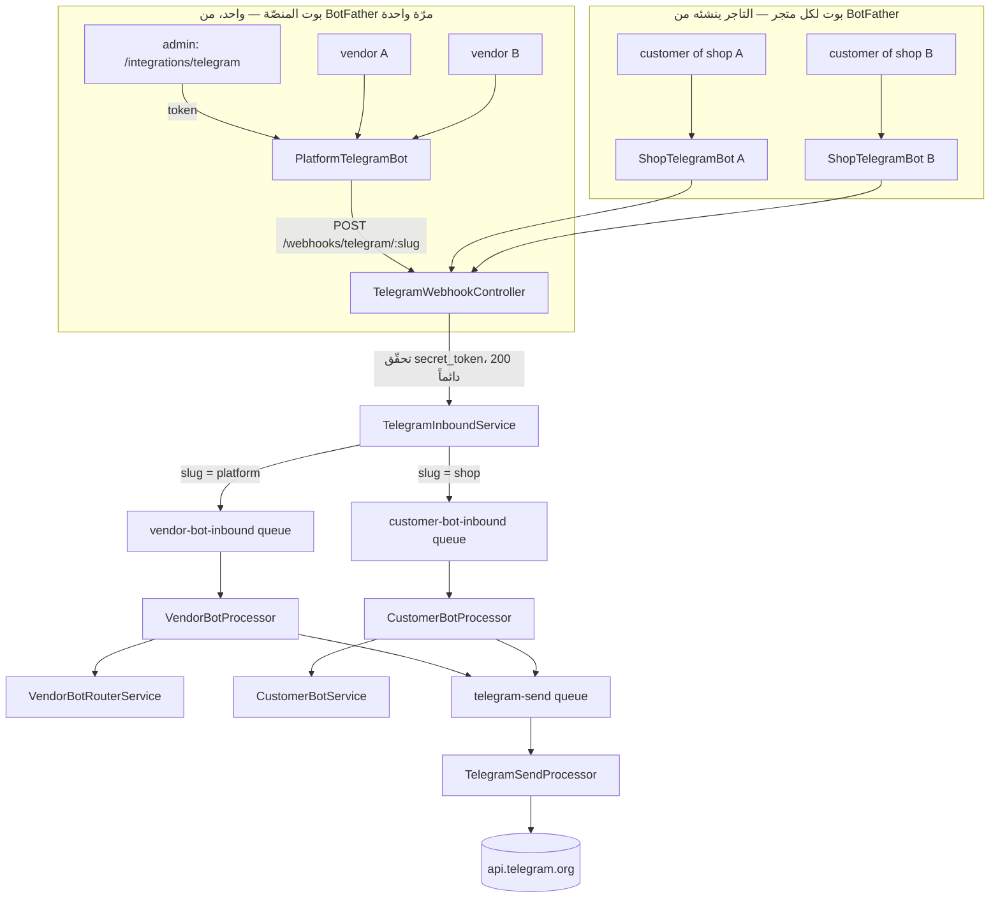

# Telegram كقناة — تحليل جدوى ومعمارية

**Last updated:** 2026-09-25
**قائمة المهام:** [telegram-channel.todo.md](./telegram-channel.todo.md) — التنفيذ والمطلوب من المشغّل.
**الحالة:** كل المراحل شُحنت حتى 2026-09-04 — التفصيل في قائمة المهام. و**الشراء داخل محادثة بوت المتجر شُحن 2026-09-25** (الإصدار 4 من الشراء عبر المحادثة، بعد WhatsApp)، ومعه عُكس رفض `request_contact` — راجع §5.2 و§15. كتب هذا المستند حين لم يكن في المشروع أي كود Telegram (`grep -rin telegram src prisma` يعيد سطرين: تعليق في [tool.interface.ts](../../back-end/src/chat/tools/tool.interface.ts) وقيمة في قائمة مصادر الإحالة).

---

## 1. الخلاصة التنفيذية

Telegram **قناة جديدة على معمارية قائمة، لا نظام جديد**. كل ما هو صعب في قناة محادثة
مبني ومُختبَر بالفعل — العقل، الأدوات، الصندوق الوارد، الطوابير، الـidempotency، عزل
المستأجرين، كواشف التسرّب، سقوف الإنفاق. Telegram تضيف **ناقلاً** فقط.

والطوبولوجيا الصحيحة هي **نفس الانقلاب** الموجود اليوم بين
[whatsapp.md](../../back-end/docs/features/whatsapp.md) و
[vendor-bot.md](../../back-end/docs/features/vendor-bot.md):

```text
بوت واحد مملوك للمنصّة  →  مساعد البائع  →  كل التجّار
بوت لكل متجر            →  مساعد العميل  →  عملاء ذلك المتجر
```

البائع لا ينشئ بوتاً. المتجر ينشئ بوته الخاص لعملائه. هذا ليس تفضيلاً — هو ما تفرضه
هوية المُرسِل: على بوت المتجر يُعرَف المتجر قبل أن يُعرَف المُرسِل، وعلى بوت المنصّة لا
يُعرِّف البوتُ أحداً، فالمُرسِل يحلّ **حساباً** ثم يُسأل عن أي متاجره يقصد.

**لكن Telegram ليست WhatsApp بواجهة أخرى.** أربعة فروق تُغيّر التصميم لا التنفيذ:

1. **لا جلسة ولا QR.** الاعتماد هو *token* من BotFather، لا هاتف مقترن. فلا `reconcile`
   مقابل مزوّد يملك الحالة، ولا بثّ SSE لرمز يتجدّد كل 20 ثانية، ولا `PlatformInstanceService`.
   نصف تعقيد [whatsapp.md](../../back-end/docs/features/whatsapp.md) يختفي.
2. **لا رقم هاتف.** هوية Telegram هي `from.id` رقمية. الرقم غير متاح إطلاقاً ما لم
   يضغط المستخدم زرّ مشاركة جهة اتصال. هذا **يكسر** ثلاثة مسارات في مساعد العميل تعتمد
   اليوم على الرقم لحلّ الحساب — راجع §5.2.
3. **لا لحظة اقتران تُثبت شيئاً.** ربط البائع على WhatsApp يشتقّ برهانيه من مسح الـQR
   نفسه. لا مقابل لذلك هنا، فيلزم تدفّق ربط حقيقي عبر **deep link** — راجع §8.
4. **الأزرار تعمل فعلاً.** ملاحظة `customer-bot.md` أن `sendButtons` تنجح ثم تُسقَط
   بصمت لا تنطبق هنا. لكن الدرس الآخر في نفس الملف — أن القائمة المرقّمة أُزيلت لأنها
   بدت كردّ آلي هاتفي — يبقى قائماً.

**التكلفة التشغيلية صفر.** لا خادم Evolution، لا استضافة، لا رسوم لكل رسالة. ما تدفعه
هو استدعاءات النموذج وحدها، وهي مقيسة ومحدودة أصلاً عبر `UsageEvent` و`ai.agent.customer`.

**العقبة الوحيدة التي تُنتج ثغرة أمنية حقيقية** ليست في Telegram بل في كودنا:
`decideChannelAccess` مكتوبة كقائمة منع لا قائمة سماح على مستوى القناة. إضافة
`TELEGRAM` إلى `VendorAgentChannel` **تمنح البوت كامل الأدوات بما فيها الكتابة**، بسطر
واحد في ملف `schema.prisma` وبلا أي تحذير. راجع §5.1 — هذه أول ما يُصلَح، قبل أي كود Telegram.

---

## 2. ما هو مبني فعلاً وسيُعاد استخدامه

| الموجود | الملف | ماذا يعني لـTelegram |
|---|---|---|
| فرز الوارد وتحديد المستأجر من المسار | [whatsapp-inbound.service.ts](../../back-end/src/whatsapp/inbound/whatsapp-inbound.service.ts) | القالب الحرفي: تحقّق من السرّ، أجب 200 دائماً، لا عمل داخل الطلب |
| موزّع أحداث لا يرمي على شكل فاسد | [whatsapp-events.ts](../../back-end/src/whatsapp/inbound/whatsapp-events.ts) | يُقابله `telegram-updates.ts` |
| منع التكرار على معرّف المزوّد | `IdempotencyService` (scope + TTL) | `update_id` أنظف من معرّف رسالة WhatsApp: رقم متزايد لكل بوت |
| صندوق المتجر الوارد بثلاثة أصوات | [customer-inbox.service.ts](../../back-end/src/customer-bot/customer-inbox.service.ts) | يعمل كما هو بعد إضافة قيمة للـenum |
| دور المحادثة كاملاً | [customer-bot.service.ts](../../back-end/src/customer-bot/customer-bot.service.ts) | لا تعديل: البرومبت والأدوات والحدود مستقلّة عن الناقل |
| تجميع الدفعة في دور واحد | [customer-bot.coalesce.ts](../../back-end/src/customer-bot/customer-bot.coalesce.ts) | مطلوب هنا أكثر: Telegram أسرع، والكتابة على شكل فقاعات أشيع |
| سقف الاندفاع وسقف الفاتورة | [customer-bot.throttle.ts](../../back-end/src/customer-bot/customer-bot.throttle.ts) + `ai.agent.customer` | يعمل كما هو |
| كاشفا التسرّب والسرد | [customer-bot.leak.ts](../../back-end/src/customer-bot/customer-bot.leak.ts) | يعمل كما هو |
| تنقية كل نصّ غير موثوق | `sanitizeForPrompt` | يعمل كما هو، ويلزم بنفس القدر |
| عقل البائع | `VendorAgentService.chat({ channel })` | الوسيط الوحيد الجديد هو قيمة القناة |
| تشفير الأسرار AES-256-GCM | `SecretCryptoService` | يحمل الـbot token و`secret_token` بلا كود جديد |
| كتالوج المزوّدين ونموذج الفورم | [provider-registry.ts](../../back-end/src/integrations/provider-registry.ts) | إضافة نوع = إدخال واحد + `verify()`، والواجهة لا تتغيّر |
| نمط الطابور الصادر وحدّ إعادة المحاولة | [whatsapp-send.processor.ts](../../back-end/src/whatsapp/outbound/whatsapp-send.processor.ts) | نفس الشكل، تصنيف أخطاء مختلف — §10 |
| إخفاء المعرّفات في تقارير الفشل | نفس الملف (`onFailed`) | يلزم هنا أيضاً: `chat_id` معرّف شخصي |
| رابط المطالبة بالسلّة | [cart-claim.md](../../back-end/docs/features/cart-claim.md) | **المسار الوحيد** لتحويل مجهول إلى حساب على هذه القناة |

**لا شيء في القائمة أعلاه يحتاج إعادة كتابة.** ما يحتاج تعديلاً هو ثلاثة enums، سياسة
أدوات مكتوبة بالاتجاه الخاطئ، وطبقة نقل جديدة.

---

## 3. الطوبولوجيا



**البوت المركزي للتجّار: مرّة واحدة عند المنصّة.** يُنشأ من BotFather، ويُحفظ الـtoken
في وحدة التكاملات تحت `IntegrationType.TELEGRAM` — مشفّراً، مع `envFallback` على
`TELEGRAM_BOT_TOKEN` بنفس نمط Evolution. التاجر **لا ينشئ بوتاً ولا يرى اعتماداً**،
تماماً كما لا يرى مفتاح Evolution اليوم.

**بوت لكل متجر للعملاء.** العميل لا بدّ أن يعرف مع أي متجر يتحدّث، واسم البوت
(`@AcmeShopBot`) هو ما يقول ذلك. التاجر ينشئ البوت من BotFather ويلصق الـtoken في
`Settings → Telegram`، فيُخزَّن على صفّ `ShopTelegramBot` مشفّراً.

**تصحيح (2026-09-02):** قيل في هذا المستند إن Telegram لا تحتاج حقل «عنوان الاستدعاء» مثل Evolution. ذلك **خطأ**: التسجيل لكل بوت لا يعفي من معرفة العنوان لحظته، والعنوان خاصّية واحدة للنشر كلّه. فالحقل `webhook_base_url` موجود الآن على مدخل Telegram بنفس شكل Evolution، واحتياطيّه `TELEGRAM_CALLBACK_ORIGIN`. ما لا تحتاجه Telegram فعلاً هو **سرّ Evolution المشترك**، فالسرّ هنا لكل بوت ولا يكتبه أحد.

**لماذا الـtoken على الصفّ لا في `IntegrationConfig`:** `IntegrationConfig` منصّي
بالكامل — لا يحمل `shop_id`، ويسمح بصفّ واحد مفعّل لكل نوع. هذه هي نفس النتيجة التي
وصلت إليها خطة WhatsApp للـinstances لكل متجر، ونفس السبب الذي جعل `webhook_secret`
يعيش على `ShopWhatsAppInstance` لا في التكاملات.

---

## 4. أين تختلف Telegram عن WhatsApp — الجدول الحاسم

| | WhatsApp / Evolution | Telegram Bot API |
|---|---|---|
| الاعتماد | جلسة Baileys مقترنة بـQR | bot token ثابت من BotFather |
| مالك الحالة | المزوّد (لذلك `reconcile` على كل قراءة) | لا حالة تُوفَّق؛ الـtoken صالح أو ملغى |
| مفتاح المسار | `instance_name` | **يجب ألّا يكون الـtoken** — راجع §6 |
| مصادقة الوارد | سرّ لكل instance في ترويسة | `secret_token` في `setWebhook` → `X-Telegram-Bot-Api-Secret-Token` |
| عنوان الـwebhook | أي عنوان يصله Evolution (حتى محلّي) | **HTTPS إلزامي**، والمنافذ 443 / 80 / 88 / 8443 فقط |
| هوية المُرسِل | رقم E.164 | `from.id` رقمي؛ **لا رقم هاتف** |
| البدء بالمراسلة | أي رقم، ضمن نافذة 24 ساعة | **مستحيل** قبل أن يضغط المستخدم Start |
| الأزرار | `sendButtons` تنجح وتُسقَط بصمت | inline keyboards تعمل فعلاً |
| "يكتب…" | الاستدعاء يحجز المدّة بنفسه | `sendChatAction` فوري، ينتهي بعد ~5 ثوانٍ |
| طول الرسالة | عملياً بلا سقف | 4096 محرفاً |
| حدود المعدّل | غير معلنة | ~30/ث إجمالاً، ~1/ث لكل محادثة، و429 تحمل `retry_after` |
| منع التكرار | معرّف رسالة | `update_id` متزايد لكل بوت |
| التكلفة | استضافة Evolution + إشراف | صفر |
| صدى الرسائل الصادرة | `fromMe` يجب تصفيته | البوت لا يستقبل رسائله |

سطران في هذا الجدول يستحقّان قراراً لا تنفيذاً: **"لا رقم هاتف"** و**"مستحيل البدء
بالمراسلة"**. البقيّة تفاصيل نقل.

---

## 5. العقبات الحقيقية في الكود الحالي

### 5.1 سياسة أدوات القناة مكتوبة بالاتجاه الخاطئ — وهي ثغرة، لا تحسين

[channel-tool-policy.ts](../../back-end/src/vendor-agent/tools/channel-tool-policy.ts) تبدأ بـ:

```ts
if (channel !== VendorAgentChannel.WHATSAPP) return ALLOWED;
```

وتعليق الملف نفسه يقول، وبحقّ، إن القائمة قائمة **سماح** وإن الافتراضي للأداة غير
المدرجة هو المنع. لكن ذلك صحيح داخل قناة واحدة فقط. على مستوى **القناة** الملف قائمة
منع: كل قناة ليست WhatsApp مسموح لها بكل شيء، لأن WEB هو الحالة الوحيدة الأخرى اليوم.

النتيجة العملية: `TELEGRAM` تُضاف إلى الـenum في `schema.prisma`، فيحصل بوت Telegram
فوراً على `GATED_TOOLS` الخمس كلها — `bulk_update_price`, `bulk_update_tags`,
`import_products_csv`, `set_inventory`, `transfer_inventory` — وعلى كل أداة كتابة أخرى،
**بلا أي واجهة تُقرّر**. ولا اختبار يسقط، ولا تحذير يظهر.

وهذا يبقى ثغرة حتى بعد قرار السماح بالكتابة (§15): الفرق بين "الكتابة مسموحة بتصميم"
و"الكتابة مسموحة بالسهو" هو أن الأولى تمرّ بمسار موافقة مبني، والثانية تصل إلى نفس
الأدوات بلا مسار — فتتوقّف على مقاطعة لا جواب لها، و`chat()` ترفضها تلقائياً **بعد** أن
يكون النموذج قد أعلن أنه ينفّذها. الانقلاب مطلوب في الحالتين.

**الإصلاح يسبق أي كود Telegram**، وهو انقلاب في الشرط لا قائمة جديدة:

```ts
if (channel === VendorAgentChannel.WEB) return ALLOWED;
const allowed = CHANNEL_ALLOWED[channel] ?? EMPTY;   // غياب القناة = منع كامل
```

وبذلك تصبح قناة جديدة **بلا أدوات** حتى يُكتب لها جدول صراحةً، وهو الاتجاه الذي
يقصده الملف أصلاً. `channelAllowedTools` تحتاج نفس الانقلاب — يقرأها بانيا البرومبت
والاختبارات، ولو أعادت كل الأدوات لقناة غير معرّفة لأخبرت النموذج بوجود أدوات سيُرفض
استدعاؤها.

قائمة السماح الأولى لـTelegram هي **قائمة WhatsApp الـ12 للقراءة، زائد ما يفتحه قرار
الكتابة** — وهو أقلّ ممّا يبدو، لأسباب في الكود لا في Telegram. راجع §12.

### 5.2 هوية العميل: ثلاثة مسارات تعتمد على رقم لا وجود له

`CustomerBotProcessor` يحلّ حساب العميل من **الرقم الذي وصلت عليه الرسالة**، ويترتّب
على ذلك ثلاثة سلوكيات موثّقة في [customer-bot.md](../../back-end/docs/features/customer-bot.md):

1. الكتابة إلى سلّة العميل الحقيقية بدل سلّة ضيف.
2. إتاحة `get_my_account` — الاسم والبريد والعناوين المحفوظة.
3. إتاحة `lookup_national_address` و`save_delivery_address`، وهما **مقصورتان على عميل
   معروف** لأن الغريب لا مكان لديه لحفظ عنوان.

على Telegram لا يوجد رقم. والخيارات ثلاثة:

- **(أ) كل عميل غريب.** سلّة ضيف مفتاحها الخيط، ورابط مطالبة يُرسَل كرسالة ثانية،
  وأدوات الحساب والعنوان غير مُقيَّدة إطلاقاً. يعمل اليوم بلا كود جديد، وهو أضعف تجربة.
- **(ب) الربط عبر رابط المطالبة.** الرابط موجود ويسجّل الدخول فعلاً؛ ما ينقص هو أن
  نُخزّن، عند فتحه، الربط `(shop, telegram_user_id) → user_id`. يصبح العميل معروفاً من
  الزيارة الثانية فصاعداً، ويستعيد المسارات الثلاثة كاملة. **هذا هو المقترح.**
- **(ج) زرّ مشاركة جهة الاتصال.** `request_contact` يعيد الرقم موقّعاً من Telegram.
  مغرٍ لأنه يعيد التماثل مع WhatsApp، لكنه يطلب من غريب رقمه في أول تفاعل، ويعيد
  إدخال الافتراض الذي رفضه `customer-bot.md` صراحةً: **الرقم ليس مصادقة**. وكان الحكم:
  لا يُبنى.

  **عُكس هذا الحكم في 2026-09-25**، مع الإصدار 4 من الشراء عبر المحادثة، لأربعة أسباب:

  1. **الشراء داخل المحادثة يحتاج رقماً مُثبَتاً.** الطلب يوضع على الحساب الذي يفتحه رقم
     أثبته الناقل — القاعدة نفسها على WhatsApp. ورابط المطالبة (ب) يربط الخيط بحساب ولا
     يثبت رقماً، فلا يكفي وحده للشراء.
  2. **بطاقة `contact.user_id` فيها يساوي `from.id` للمُرسِل هي رقم المُرسِل نفسه**، وقد
     تحقّقت منه Telegram عند إنشاء الحساب. ورقم يُكتب نصّاً لا يُقبل أبداً.
  3. **لا تصل إلا بفعل صريح من العميل.** البوت يطلبها بلوح ردّ بمفتاح واحد («مشاركة رقمي»)
     يظهر تحت ردّ المساعد حين يستدعي `request_phone_share`. والمساعد موجَّه إلى طلبها حين
     يريد العميل أن يشتري هنا، والأداة لا تُعرض إلا في محادثة متجر شغّل استقبال الطلبات
     وتسمح به باقته، وليس لخيطها رقم بعد.
  4. **بطاقة لأيّ شخص آخر تُسقَط** — جهة من دفتر العناوين، أو بطاقة مُعاد توجيهها، أو بطاقة
     بلا `user_id` — كما يُسقَط أيّ مرفق.

  والاعتراض الثاني لم يسقط كلّه: الرقم ما زال **ليس مصادقة لقراءة حساب**. أدوات الحساب
  (`get_my_orders`، `track_order`، وغيرهما) لا تُعرض إلا في لوحة المساعد على موقع المتجر،
  خلف جلسة دخول، لا على WhatsApp ولا على Telegram. ما تغيّر أن خيط Telegram صار قادراً على
  إثبات رقم كما يثبته ناقل WhatsApp، فيُقرأ منذئذ في كل دور كما يُقرأ رقم مُرسِل WhatsApp.

  **أين يعيش اليوم:** `parseContact` في
  [telegram-updates.ts](../../back-end/src/telegram/inbound/telegram-updates.ts) (محادثة
  خاصّة، ومُرسِل ليس بوتاً، و`contact.user_id === from.id`، ثم فحص لشكل الرقم وحده: من 7
  إلى 15 رقماً)؛ والرقم على الخيط في `direct_conversations.verified_phone_e164`، لا يكتبه
  إلا العامل، من حقل في المهمّة لا يُملأ إلا من ناتج ذلك المحلّل؛ وأداة المساعد
  `request_phone_share` في
  [customer-bot.tools.ts](../../back-end/src/customer-bot/customer-bot.tools.ts).

الخيار (ب) يعني عمود ربط جديد لا أكثر — راجع §6 — ويُبقي القاعدة الحاكمة قائمة: الهوية
تُحلّ من **الخيط الذي وصلت عليه الرسالة**، لا من أي شيء قيل داخل المحادثة.

### 5.3 لا يمكن مراسلة عميل لم يبدأ المحادثة

Telegram لا تسمح لبوت بمخاطبة مستخدم لم يضغط Start. لا نافذة 24 ساعة تُفتح برسالة
واردة كما في WhatsApp — لا يوجد عنوان أصلاً قبل أول تفاعل.

أثره على [notifications.md](../../back-end/docs/features/notifications.md) مباشر: إضافة
`TELEGRAM` إلى `NotificationChannel` صحيحة، لكن الموزّع لا يستطيع اشتقاق الوجهة من
الطلب. الوجهة موجودة **فقط** إذا كان لهذا العميل خيط Telegram حيّ مع هذا المتجر. أي أن
القناة **اشتراكية بحكم البناء**: تصل إلى عدد أقلّ بكثير، لكن كل من تصله وافق عليها
صراحةً، وهو عكس مقايضة WhatsApp تماماً.

عملياً: `TelegramSendQueue` تأخذ `shopId` و`chatId`، والموزّع يبحث عن الخيط قبل
الإنتاج؛ لا خيط = لا مهمّة، لا سقوط إلى بريد. السقوط الاحتياطي في مسار WhatsApp موجود
لأن الرسالة كان **يُفترَض** أن تصل؛ هنا لم يكن هناك التزام أصلاً.

### 5.4 مؤشّر الكتابة لا يمكن أن يُعاد استخدامه

[whatsapp-typing.service.ts](../../back-end/src/whatsapp/outbound/whatsapp-typing.service.ts)
مبني على ثلاث حقائق عن `/chat/sendPresence` في Evolution، أولها أن **الاستدعاء يحجب
مدّته**، فالمزوّد يمسك النبضة والخدمة تدور عليها. `sendChatAction` في Telegram تعود
فوراً وتنتهي حالتها بعد خمس ثوانٍ تقريباً.

فالشكل ينقلب: مؤقّت محلّي كل ~4 ثوانٍ حتى ينتهي العمل. وما يبقى من الخدمة القائمة هو
**العقود لا التنفيذ**: أنها زينة لا تُفشِل دوراً، وأن رفضاً واحداً ينهي المؤشّر بهدوء،
وأن سقف 120 ثانية يمنع دوراً معلّقاً من ترك المؤشّر عالقاً. لا حاجة لسلسلة النبضات لكل
محادثة — علّتها أن نبضة WhatsApp تعيش بعد دورها، ونبضة Telegram لا تفعل.

الخلاصة: `TelegramTypingService` منفصلة، بنفس الواجهة `during(target, work)` وبتنفيذ
مقلوب. حشر الاثنين في خدمة واحدة يعني شرطاً على المزوّد داخل كل دالّة.

### 5.5 سقف 4096 محرفاً

ردود مساعد العميل قصيرة بحكم البرومبت، لكن أدوات البائع التحليلية تُنتج نصوصاً أطول.
التقسيم يعيش في مُحوّل الإرسال وحده — على حدود الأسطر، ثم الجُمل، ثم قسراً — لا في
منتِج المهمّة، وإلا تكرّر في كل مستدعٍ.

---

## 6. تغييرات المخطط

```prisma
enum DirectChannel        { WEB  WHATSAPP  TELEGRAM }
enum VendorAgentChannel   { WEB  WHATSAPP  TELEGRAM }
enum NotificationChannel  { EMAIL  SMS  WHATSAPP  TELEGRAM }
enum IntegrationType      { …  WHATSAPP  TELEGRAM }
```

**`ShopTelegramBot`** — صفّ لكل متجر، `shop_id` فريد، حذف متتالٍ مع المتجر.

| الحقل | ملاحظات |
|---|---|
| `shop_id` | فريد. للمتجر بوت واحد، بنفس منطق `ShopWhatsAppInstance`. |
| `bot_token` | ظرف AES-256-GCM. يُدخله التاجر مرّة، ولا تعيده أي عملية — الشاشة تُظهر قناعاً. |
| `bot_username` | `@AcmeShopBot`، يُقرأ من `getMe` بعد الحفظ ولا يُكتَب يدوياً. هو ما يُعرَض للعملاء. |
| `bot_id` | معرّف البوت الرقمي من `getMe`. فريد — يمنع لصق نفس الـtoken في متجرين. |
| `webhook_slug` | عشوائي، فريد، غير مشتقّ من أي شيء. هو ما يظهر في المسار. |
| `webhook_secret` | ظرف AES-256-GCM، يُولَّد مرّة ويُسلَّم لـ`setWebhook`. لا يراه أحد. |
| `status` | `disconnected` \| `active` \| `revoked`. نصّ لا enum، لنفس سبب `ShopWhatsAppInstance`. |
| `ai_enabled` | مفتاح المساعد، يُقرأ في العامل لا على المهمّة — نفس قاعدة `customer-bot`. |
| `last_error`, `last_ok_at` | الانقطاع حالة مسجَّلة لا خطأ. |

**`webhook_slug` هو أهمّ سطر في هذا الجدول.** الإغراء الطبيعي أن يكون المسار هو الـtoken
نفسه — فهو فريد، والوثائق الرسمية تقترحه. لكن الـtoken **اعتماد كامل**: من يملكه يقرأ كل
رسائل المتجر ويرسل باسمه. وهو حينها يمرّ في سجلّ كل وكيل عكسي، وفي كل أثر Sentry، وفي كل
تقرير خطأ. المسار يجب أن يكون معرّفاً **غير سرّي وقابلاً للاستبدال**، والسرّية كلها في
الترويسة — بنفس الفصل القائم بين `instance_name` و`webhook_secret` اليوم.

**`PlatformTelegramBot`** — صفّ واحد على الأكثر، بنفس حيلة `singleton` الفريد في
`PlatformWhatsAppInstance`. حقوله: `webhook_slug`, `webhook_secret`, `bot_username`,
`bot_id`, `status`. **الـtoken ليس هنا** بل في `IntegrationConfig` تحت
`IntegrationType.TELEGRAM` — فهو اعتماد منصّي، وهذا هو المكان الذي يُدار منه التدوير
والتحقّق والقناع في وحدة التكاملات.

**`TelegramLink`** — جدول جديد لهذه القناة، ولا يعيد استخدام `VendorBotLink`: ذاك مبني
على `phone_e164` وعلى فهرس فريد جزئي فوقه، ولا رقم هنا يوضع فيه.

**لكنه جدول جديد لا *حساب* جديد**، وهذا هو الفرق الذي يجب ألّا يُلبَس. السلسلة:

```text
Telegram user id  →  TelegramLink  →  User  →  المتاجر التي يملكها
```

نفس `User` الذي يدخل به إلى اللوحة، ونفس المتاجر. القناتان تتعايشان: بائع مربوط على
WhatsApp وTelegram معاً له صفّان يشيران إلى حساب واحد، وفكّ أحدهما لا يمسّ الآخر. ما
تكرّره الجداول هو **الهوية على القناة**، وهي المعلومة الوحيدة التي تختلف فعلاً.

**وسؤال مفتوح يترتّب على ذلك:** `active_shop_id` — المتجر المثبَّت — أيتبع القناة أم
الحساب؟ الصفّان منفصلان اليوم، فالتثبيت لكل قناة على حدة هو ما يحدث تلقائياً؛ ومشاركته
تعني نقله إلى `User` أو إلى جدول ثالث. لكل اتجاه ثمن حقيقي: التثبيت المشترك يجعل بائعاً
بدّل المتجر من هاتفه على WhatsApp يجد Telegram وقد بدّلت معه — وهو ما قد يُفاجئ — بينما
المنفصل يجعله يجيب عن سؤال "أي متجر" مرّتين. راجع §15.

| الحقل | ملاحظات |
|---|---|
| `user_id` | الحساب. حذف متتالٍ. |
| `telegram_user_id` | `from.id`. تقوله Telegram ولا يكتبه أحد. فريد على الصفوف الموثّقة وحدها (فهرس جزئي يدوي، كما في `2026-08-28-vendor-bot-link.sql`). |
| `verified_at` | يُضبط لحظة إنفاق رمز الربط. الوارد يطابق على `{ not: null }` — هذا هو حدّ الأمان. |
| `active_shop_id` | المتجر المثبَّت. `SetNull` عند حذف المتجر، فيُعيد البوت السؤال بدل فكّ الربط بصمت. |
| `last_message_at` | حارس التدفّق لكل مستخدم. |

**`DirectConversation.channel_identity`** موصوف اليوم بأنه رقم E.164. يصبح **معرّفاً
مُنطاقاً بالقناة**: `+9665…` على WhatsApp و`tg:123456789` على Telegram. الفهرس الفريد
الجزئي قائم على `(shop, channel, identity)` فيستوعب ذلك بلا تغيير، لكن التعليق على
العمود وأي كود يفترض شكل الرقم يجب أن يُحدَّث — وإلّا قرأ خيط Telegram كرقم هاتف مشوّه.

**عمود الربط من §5.2:** `DirectConversation.claimed_user_id`، يُكتب عند فتح رابط
المطالبة، ويقرؤه المعالج ليقرّر أعميرفٌ هذا العميل أم غريب. على الخيط لا على المستخدم،
لأن الربط بين *هوية على قناة* و*حساب*، وهو ما يجعله قابلاً للفكّ من طرف واحد.

---

## 7. الوحدات الجديدة

```text
src/telegram/
  telegram.interface.ts          — عقد الناقل: sendText, sendChatAction, setWebhook, getMe
  telegram.service.ts            — يحلّ الاعتماد لكل إرسال ويُخزّن على revision، كـSmsService
  telegram-api.client.ts         — HTTP رقيق حول api.telegram.org، وتصنيف الأخطاء
  bots/
    shop-bot.service.ts          — صفّ المتجر، getMe، setWebhook، deleteWebhook
    platform-bot.service.ts      — الصفّ المفرد، ونفس العمليات
    shop-lifecycle.listener.ts   — shop.deactivated → deleteWebhook (نفس حدث WhatsApp)
  inbound/
    telegram-updates.ts          — موزّع لما يرسله طرف ثالث؛ يرفض الشكل الفاسد بلا رمي
    telegram-webhook.controller.ts — المستقبِل: تحقّق، 200 دائماً، لا عمل في الطلب
    telegram-inbound.service.ts  — التحقّق من السرّ، الفرز على الـslug، منع التكرار
  outbound/
    telegram-send.{queue,processor,types}.ts
    telegram-typing.service.ts   — §5.4
  telegram.module.ts             — الناقل + البوتات (خارج رسم المصادقة)
  telegram-vendor.module.ts      — resolver التاجر
  telegram-admin.resolver.ts     — بوت المنصّة، خلف manage_integrations
```

**الانقسام بين `TelegramModule` و`TelegramVendorModule` ليس اختيارياً** — هو نفس السبب
الموثّق في `whatsapp.md`: وحدة تُعلن resolver خلف `JwtAuthGuard` تستورد `AuthModule`،
وهذه تصل إلى `IntegrationsModule` عبر مساري SMS والبريد. الفصل يُبقي العامل الصادر
قادراً على استيراد الناقل بلا رسم المصادقة. `npm run check:di` هو ما يمسك الخطأ.

**`vendor-bot` و`customer-bot` لا تُنسخان.** الوارد يُنتِج في **نفس** الطابورين
القائمين (`vendor-bot-inbound`, `customer-bot-inbound`)، ويحمل حقل `channel` على المهمّة.
المعالج يفرّق عند **الردّ** فقط: أي طابور صادر يُنتِج فيه، وأي خدمة كتابة يستدعي. ما دون
ذلك — التخزين، التجميع، السقوف، الكواشف، الدور — مشترك.

المقابل الذي يُدفَع: `CustomerBotInboundJob` و`VendorBotInboundJob` تصيران تمييزيّتين على
`channel`، والمهام القديمة في الطابور بلا الحقل. القراءة تُعامل الغياب كـ`WHATSAPP`،
وهو صحيح مؤقّتاً ويُحذف بعد دورة نشر.

---

## 8. بوت البائع: الربط عبر deep link

على WhatsApp البرهانان يأتيان مجّاناً من مسح الـQR: المسح يجري داخل جلسة موثّقة على
متجر يملكه البائع (الحساب)، والرقم تقوله WhatsApp لا البائع (الجهاز). لا مقابل لذلك
هنا، فالبرهانان يُصنَعان صناعةً:

```text
لوحة البائع (جلسة موثّقة، متجر مملوك)
        ↓  linkTelegramVendorBot → رمز عشوائي، مرّة واحدة، صلاحية 10 دقائق
https://t.me/ZaydakVendorBot?start=<token>
        ↓  البائع يضغط، Telegram ترسل /start <token>
TelegramInboundService: الـslug = platform
        ↓  ينفق الرمز ذرّياً (نجاح أول قارئ فقط)
TelegramLink { user_id من الرمز, telegram_user_id من Telegram, verified_at }
```

- **البرهان الأول (الحساب)** من الرمز: مُنتَج داخل جلسة موثّقة، ولا سبيل للحصول عليه
  دونها.
- **البرهان الثاني (الجهاز/الحساب على Telegram)** من `from.id`: تقوله Telegram في
  المتن الموقَّع بـ`secret_token`، ولا يكتبه أحد.

ثلاثة قيود تجعله سليماً: الرمز **يُنفَق مرّة** (تحديث شرطي على `used_at IS NULL`، لا
قراءة ثم كتابة)، و**ينتهي بعشر دقائق**، و`autoLink` **يرفض نقل** هوية Telegram موثّقة
بالفعل إلى حساب آخر — نفس قاعدة الخطّ المشترك في `VendorBotLinkService`.

**ولا يُستخدم `User.telegram_username` ولا أي مطابقة بالاسم.** اسم المستخدم على Telegram
قابل للتغيير وقابل لإعادة التسجيل بعد الإفراج عنه، وما يفتحه هنا هو كتالوج متجر
وإيراداته — وهو حرفياً السبب الذي رفض من أجله `vendor-bot.md` مطابقة `User.phone`.

**اختيار المتجر يستفيد من الأزرار.** متجر واحد يُثبَّت بصمت. عدّة متاجر تُعرَض كـinline
keyboard، وقيمة الزرّ **معرّف المتجر في `callback_data`** لا موضعه في قائمة. المطابقة
بالموضع في `vendor-bot.md` كانت التفافاً على قناة بلا أزرار؛ هنا الالتفاف غير لازم.
والقاعدة الحاكمة تصمد: المعرّف يأتي من زرّ **أنتجه الخادم** لمتاجر يملكها المرسِل،
وليس من نصّ يكتبه — لا يزال محظوراً أن يصل `shopId` من كلام.

**الرابط يجوز عرضه كـQR، وهو ليس اقتراناً.** رمز يحمل
`https://t.me/<bot>?start=<token>` ولا شيء غيره: يُرسَم في المتصفّح من نصّ الرابط نفسه،
لا يمرّ بالخادم، لا يتجدّد، ولا يفتح بثّاً. الفارق يستحقّ سطراً في الشاشة لأن الشكل
يوحي بغير ذلك — QR على WhatsApp يسلّم **حساب البائع كاملاً** لمن يمسحه، ولهذا لا يُخزَّن
أبداً و`ShopWhatsAppInstance` بلا عمود له؛ وهذا يفتح محادثة مع بوت لا أكثر. سرّيته
الوحيدة سرّية الرمز الذي بداخله: يُنفَق مرّة، وينتهي بعشر دقائق، ويجب ألّا يُلتقط في لقطة
شاشة تُشارَك — وهو نفس ما يقال عن الرابط، فالتمثيل لا يغيّر التهديد.

**المُرسِل المجهول يتلقّى جملة واحدة ثابتة**، لا نموذجاً — نفس القاعدة ونفس السبب:
اسم البوت المركزي معروف لكل من يقرأ شاشة الإعدادات، فبوت يجيب الغرباء هو نقطة LLM
مفتوحة على عنوان عام.

---

### الوصول محلّياً — وهو عكس إعداد WhatsApp تماماً

مؤكّد من توثيق Telegram: الـwebhook **HTTPS إلزاماً**، والمنافذ المقبولة أربعة فقط: **443، 80، 88، 8443**. و`secret_token` من 1 إلى 256 محرفاً من `A-Z a-z 0-9 _ -` لا غير — فـbase64 عادي يحمل `+` أو `/` أو `=` **يُرفَض**، والمولّد يجب أن يكون base64url بلا حشو.

وهذا **يقلب ما هو صحيح لـWhatsApp محلّياً**. Evolution تعمل في Docker على نفس الجهاز، فتصل إلى `http://host.docker.internal:3000` بلا نفق وبلا شهادة. خوادم Telegram على الإنترنت، ولا تعرف شيئاً عن شبكتك المحلّية — فـ**التطوير المحلّي يحتاج نفقاً HTTPS** (cloudflared أو ngrok)، وهو الشيء الوحيد في هذه القناة الذي يُكلّف إعداداً أكثر من WhatsApp بدل أقل.

البديل للتطوير وحده هو `getUpdates` (long polling)، ولا يحتاج عنواناً عامّاً إطلاقاً. لكنه **يستبعد الـwebhook للبوت نفسه** — لا يجتمعان — فهو مسار ثانٍ للوارد يحتاج صيانة ويختبر غير ما يعمل في الإنتاج. قرار مفتوح — راجع §15.

## 9. بوت العميل لكل متجر

التاجر ينشئ البوت من BotFather ويلصق الـtoken. الحفظ يفعل ثلاثة أشياء بالترتيب:
`getMe` (يثبت الـtoken ويجلب `bot_id` و`bot_username`)، توليد `webhook_slug` و
`webhook_secret`، ثم `setWebhook` عليهما.

**`getMe` قبل الحفظ لا بعده.** اعتماد محفوظ وخاطئ صامت حتى أول عميل حقيقي، وهذا بالضبط
ما تشرحه `provider-registry.ts` عن `verify`. و`bot_id` الفريد يمنع الحادثة الأشيع في
هذا التصميم: لصق نفس الـtoken في متجرين، فتذهب رسائل الأول إلى الثاني.

**مسار الرسالة مطابق لمسار WhatsApp، بفارق واحد في السطر الأول:** المتجر يُحلّ من
`webhook_slug` الذي وصل **في المسار وصودق عليه قبل أن يُقرأ بايت من المتن**. هذا هو حدّ
عزل المستأجرين بأكمله، وهو المكان الذي يجب ألّا يُقرأ فيه أي شيء من `message`.

ما يُصفّى قبل أن يصل إلى الطابور: كل ما ليس `message.chat.type === 'private'`، وكل
`edited_message`, `channel_post`, `my_chat_member`، والوسائط — تُتجاهَل لا تُخزَّن، بنفس
قاعدة WhatsApp: لا شيء يُودَع ولا شيء يُجاب. والمرفق الوحيد الذي يُقرأ هو بطاقة جهة اتصال
المُرسِل **نفسه** — راجع §5.2 (ج).

**تحديث (2026-09-25): بوت المتجر يرسل أزراراً ويستقبل `callback_query`.** كانت القائمة أعلاه
تضمّ `callback_query` (عدا مسار اختيار المتجر على بوت المنصّة)، وكان بوت المتجر يُسجَّل
لـ`message` وحدها ولا يرسل زرّاً. الشراء داخل المحادثة غيّر ذلك: تحت ملخّص الطلب زرّا inline،
«تأكيد الطلب» و«إلغاء»، و`callback_data` فيهما `co:<c|x>:<code>`، والرمز عشوائي لكل ملخّص لا
يُخزَّن منه إلا تجزئته في `chat_checkouts.confirm_nonce_hash`
([confirm-button.ts](../../back-end/src/chat-checkout/confirm-button.ts)). فكل تسجيل لبوت
المتجر — الربط، وإعادة المحاولة، والاستعادة بعد التعليق — يطلب الآن
`allowed_updates: ['message', 'callback_query']` (`SHOP_BOT_UPDATES`)، وتشغيل «استقبال
الطلبات في المحادثة» من إعدادات التاجر يعيد التسجيل، فيستقبل الضغطة حتى بوت رُبط قبل
الأزرار. الضغطة تُجاب فوراً بـ`answerCallbackQuery` بلا نصّ، وما لا يطابق شكل الزرّ يُسقَط،
والباقي مهمّة `telegram-customer-press` في طابور العميل. **والضغطة مفتاح بحث لا تخويل** — درس
§12 نفسه: الملخّص يُعاد توجيهه بأزراره، فالعامل لا ينفّذ إلا إذا جاءت الضغطة من المحادثة التي
أُرسل إليها الملخّص، وكان رقم الخيط المُثبَت يفتح الحساب الذي سُعِّر له.

**`ai_enabled` تُقرأ في العامل**، والتخزين غير مشروط ويسبق كل قرار. وعد شاشة الإعدادات
— أن الرسائل تصل وتظهر ولو كان المساعد مطفأً — ملك للقناة لا للناقل.

**الرابط أنظف هنا.** رابط المطالبة على WhatsApp نصّ يُلصق؛ على Telegram زرّ inline
واحد. وهو أيضاً ما يكتب `claimed_user_id` من §5.2، فتصبح الزيارة الثانية لعميل معروف.
**تصحيح (2026-09-25):** بُني الرابط نصّاً لا زرّاً، وTelegram تعرض العنوان رابطاً واحداً قابلاً
للضغط. وما يرسله بوت المتجر من أزرار نوعان فقط: زرّا تأكيد الملخّص وإلغائه أعلاه، ولوح الردّ
ذو المفتاح الواحد الذي يطلب الرقم (§5.2).

---

## 10. الصادر: الطابور وحدود المعدّل

نفس شكل `WhatsAppSendQueue`: نقطة دخول واحدة، والمهمّة تسمّي **المتجر** لا الـtoken —
لنفس السبب المكتوب في `whatsapp-send.types.ts`، فالـtoken قد يُدوَّر بين إنشاء المهمّة
وتنفيذها.

**تصنيف الأخطاء يختلف، وهو كل ما في العامل:**

| ردّ Telegram | القرار |
|---|---|
| `401 Unauthorized` | الـtoken ملغى. **لا إعادة محاولة** — تُوسم الحالة `revoked` ويُخطَر التاجر. |
| `403 Forbidden` (حجب البوت / حذف المحادثة) | العميل انسحب. **لا إعادة محاولة، ولا سقوط إلى بريد** — الانسحاب صريح، وتحويله إلى بريد التفاف عليه. |
| `429` مع `parameters.retry_after` | إعادة محاولة **بالمدّة التي قالها المزوّد**، لا بتراجع BullMQ. |
| `400 Bad Request` | خطأ برمجي (متن مشوّه، parse mode). لا إعادة محاولة؛ يُبلَّغ. |
| `5xx` / انقطاع شبكة | عابر. يُرمى إلى تراجع BullMQ. |

**حدود المعدّل حقيقية ومعلنة**: نحو 30 رسالة في الثانية إجمالاً، ونحو واحدة في الثانية
لكل محادثة. ذلك يعني `limiter` على الطابور و**مفتاح تجميع لكل محادثة**. الوعد بأن تصل
عشرون رسالة دفعةً واحدة هو 429 مضمون. WhatsApp لم تُلزمنا بذلك؛ Telegram تُلزم.

**لا شيء على هذا المسار يسجّل معرّفاً.** `SentryWorkerHost` يبلّغ `job.data` حرفياً،
و`chat_id` معرّف شخصي مستقرّ. تجاوز `onFailed` يُقنّعه ويستبدل المتن بطوله — نسخة حرفية
من قرار `whatsapp-send.processor.ts`.

---

## 11. الواجهات

**لوحة البائع — `Settings → Telegram`:** حقل token واحد، شريط الحفظ السياقي الإلزامي
(لا حفظ تلقائي)، وبعد الحفظ: اسم البوت، رابطه، حالة الـwebhook، مفتاح المساعد، وزرّ فصل.
الـtoken يُبذَر بقناع الخادم، وما يُرسَل يقرّره `touched` لا مقارنة نصوص — نفس قاعدة
شاشة التكاملات: **لا شيء يعيد إرسال القناع كاعتماد**.

**لوحة الأدمن — `/integrations/telegram`:** token بوت المنصّة، وأصل الاستدعاء، و`verify`
عبر `getMe`. لا `Send test`: الإرسال يحتاج `chat_id` لمستخدم بدأ المحادثة، والصفّ المنصّي
لا يملك واحداً — نفس منطق استثناء WHATSAPP في `supportsTestSend`، ونفس الحاجة إلى
`Sync webhooks` لأن الـwebhook مسجَّل لكل بوت على حدة وتغيير الأصل لا يبلغ أحداً.

**صندوق الوارد** يعرض خيوط Telegram جنباً إلى جنب مع WhatsApp بشارة قناة. لا شاشة
جديدة: `shopWhatsAppThreads` تُعمَّم إلى `shopInboxThreads` بمرشّح قناة اختياري، مع
إبقاء الاسم القديم عاملاً لدورة نشر واحدة.

---

## 12. الكتابة على القناة — ما يفتحه القرار وما لا يفتحه

**القرار: نعم للكتابة، بتأكيد بالأزرار (§15).** وقبل التنفيذ لا بدّ من فرز، لأن
"الكتابة" في هذا الكود **ثلاثة مسارات مختلفة**، ولكلٍّ منها جواب مختلف تماماً عن سؤال
"هل يكفي زرّ؟".

### (أ) الأدوات المبوّبة — هنا الزرّ هو بالضبط ما ينقص

[approval-policy.ts](../../back-end/src/vendor-agent/graph/approval-policy.ts) يعرّف
`GATED_TOOLS`: خمس أدوات — `bulk_update_price`, `bulk_update_tags`,
`import_products_csv`, `set_inventory`, `transfer_inventory` — يجمعها أن نطاق الأثر
غير محدود بجملة البائع وأن التراجع يدوي.

وهذه **مبنية بالكامل بالفعل**، وما ينقصها واجهة لا منطق:

- `buildApprovalRequest` يشغّل الأداة بـ`dry_run: true` (والخدمات تعامله كقراءة فقط)
  ويعيد `{ id, tool, args, facts, previewed }` — فالبطاقة تقول **«247 منتجاً»** محسوبة
  على الخادم، لا تقديراً من النموذج.
- الاستئناف `ApprovalDecision { id, approved }`، والمطابقة **بمعرّف الاستدعاء** لا باسم
  الأداة، لأن دوراً واحداً قد يُصدر استدعاءين للأداة نفسها.
- كل ما لا يُعرَف معرّفه **يُحتسَب رفضاً** داخل عقدة الموافقة. فلا يمكن لهذا المسار أن
  يوافق على شيء لم يُسأل عنه أصلاً.
- وإن كتب البائع رسالة جديدة بدل الضغط، `settleAbandonedApproval` **يرفض** المعلّق قبل
  معالجة رسالته. هذا سلوك قائم وصحيح لقناة محادثة، ويجب ألّا يُعامَل كعطب يُصلَح.

فـinline keyboard بزرّين هو حرفياً البطاقة الغائبة. **هذا ما يشتريه القرار.**

### (ب) الحذف — يعمل اليوم بلا آلية جديدة

`delete_*` ليست في `GATED_TOOLS` عمداً: لها التزام على مرحلتين عبر
[confirmation-token.service.ts](../../back-end/src/vendor-agent/confirmation-token.service.ts)
— `prepare_delete_*` يُصدر رمزاً، ثم `delete_*` يستهلكه. والرمز يُستعمل مرّة، وينتهي
بـ**60 ثانية**، ويحمل لقطة تكشف تعديلاً متزامناً (مجموعة نمت من 5 منتجات إلى 50 بين
التحضير والتنفيذ تُرفَض).

وهذا **بروتوكول نصّي أصلاً، لا واجهة**: سؤال، ثم «نعم»، ثم استهلاك. فهو محايد تجاه
القناة ويعمل على Telegram بلا سطر جديد — بل هو **أقوى** من بطاقة الموافقة، لأن الرمز
دليل ضدّ إعادة اللعب أيضاً.

الشيء الوحيد الذي يحتاج نظراً: **الستّون ثانية ضيّقة على هذه القناة.** نافذة التجميع
وحدها ستّ ثوانٍ، ويضاف إليها زمن النموذج وزمن إنسان يقرأ على هاتفه. القيمة اختيرت
لواجهة يُقرأ فيها السؤال فوراً. إمّا أن تُمدَّد لهذه القناة، وإمّا أن تُقبَل رسالة
«انتهت الصلاحية، اسألني ثانية» كسلوك متكرّر — وهو ليس فاسداً، لكنه قرار لا مصادفة.

### (ج) `create_*` / `update_*` — الزرّ لا يفتحها، ولا شيء وراءه ليُؤكَّد

هذه **لا تلمس قاعدة البيانات إطلاقاً**. تعيد `navigate_to_form` مع تعبئة مسبقة، والبائع
يضغط حفظ على النموذج الحقيقي. وكما يقول `approval-policy.ts` صراحةً: **النموذج هو
الموافقة**، وإضافة ثانية فوقه ضجيج.

فتشغيلها على Telegram ليس «تصميم تأكيد» بل **كتابة مسار التزام من الصفر لكل كيان**،
ومعه إعادة بناء التحقّق الذي يعيش اليوم في النموذج. عمل بحجم مشروع مستقلّ، وأثره يتجاوز
هذه القناة. **خارج نطاق الإصدار الأول**، ويبقى `navigate_to_form` على Telegram رابطاً
إلى الشاشة — وهو ما يفعله فعلاً وما يجب أن يقوله البرومبت بوضوح.

### ما يلزم بناؤه فعلاً

1. **`callback_data` محدود بـ64 بايت**، ويجب أن يحمل: المحادثة، ومعرّف الطلب، والقرار.
   لا يُضمن أن يتّسع. فالمحمول **مفتاح مبهم قصير** في Redis يفكّ إلى
   `{ conversationId, requestId, approved }`، بعمر مربوط بعمر نقطة التفتيش.
2. **إعادة تخويل الضاغط — وهي الهجمة الوحيدة التي تُدخلها الأزرار ولم تكن في WhatsApp.**
   رسالة Telegram **تُعاد توجيهها بأزرارها**، فمن يملك التحويلة يستطيع الضغط. لذلك
   `callback_query.from.id` يجب أن يُحلّ إلى `TelegramLink` موثّق يملك صاحبه هذه المحادثة
   **وهذا المتجر** — بنفس صرامة مسار الرسالة الواردة. الزرّ ليس تخويلاً؛ الضاغط هو.
3. **`resumeStream` مولّد غير متزامن** مصمّم للبثّ إلى المتصفّح. القناة تحتاج شقيقاً غير
   باثّ — كما أن `chat()` شقيق غير باثّ لمسار الدردشة — أو استنزافاً للبثّ داخل العامل.
4. **`answerCallbackQuery` خلال ثوانٍ**، وإلّا بقي المؤشّر يدور على جهاز البائع، ثم
   `editMessageReplyMarkup` لنزع الأزرار بعد القرار. النزع تحصين مزدوج لا أكثر: نقطة
   التفتيش ترفض القرار الثاني على أي حال، لكن بطاقة قابلة للضغط مرّتين تُربك من يقرؤها.
5. **قائمة سماح صريحة للكتابة**، لا فتح `GATED_TOOLS` جملةً. `import_products_csv` مثال
   على ما لا معنى له هنا: مدخله ملف، والقناة لا تسلّم ملفاً إلى أداة.

## 13. الأمان

القواعد الثلاث القائمة تنتقل حرفياً، وواحدة جديدة:

1. **المتجر يُحلّ من المسار المصادَق عليه، لا من المتن.** ولا يصل `shopId` من كلام أبداً.
2. **كل نصّ غير موثوق يمرّ بـ`sanitizeForPrompt`** — الرسالة، والتاريخ المُعاد تشغيله،
   واسم المتجر. حقن مركون في الرسالة الثالثة ليس أقلّ حياةً لأنه خُزِّن بأدب.
3. **كاشفا التسرّب والسرد يعملان على الخرج**، وأيّهما اشتعل يعني لا ردّ إطلاقاً.
4. **جديد: الـtoken لا يظهر في مسار ولا سجلّ ولا أثر.** المسار `webhook_slug`، والسرّية
   في الترويسة، والمقارنة `timingSafeEqual` بعد فحص الطول — لأن الرمي على اختلاف الطول
   هو بذاته كاشف طول.

و**كل تسليم يُجاب 200**، بما فيه السرّ الخاطئ والمتن غير القابل للتحليل. Telegram تعيد
المحاولة على أي شيء آخر، وتُبطئ الـwebhook تدريجياً — فـ4xx على تسليم "ليس لنا" يشتري
عشر نسخ منه ثم قناة أبطأ.

---

## 14. خطة على مراحل

| المرحلة | المحتوى | المخرج القابل للاختبار |
|---|---|---|
| **0** | انقلاب `decideChannelAccess` و`channelAllowedTools` إلى سماح على مستوى القناة + اختباراتها | قناة غير معرّفة = صفر أدوات. **يُشحن وحده، قبل أي كود Telegram.** |
| **1** | enums، هجرات يدوية، `TelegramApiClient`، `TelegramService`، مُحوّل + سجلّ مزوّد + `verify` | admin يحفظ token المنصّة ويتحقّق منه |
| **2** | `webhook_slug`/`secret`، المستقبِل، الموزّع، الفرز، منع التكرار | تسليم حقيقي يصل، يُسجَّل، ويُجاب 200 |
| **3** | `ShopTelegramBot`، شاشة البائع، `getMe` + `setWebhook`، التخزين في الصندوق | رسالة عميل تظهر في صندوق المتجر — بلا أي ردّ |
| **4** | ربط `CustomerBotProcessor`: تجميع، سقوف، الدور، الردّ، `TelegramTypingService` | مساعد المتجر يجيب على Telegram |
| **5** | deep link، `TelegramLink`، اختيار المتجر بالأزرار، ربط `VendorBotProcessor` | البائع يسأل عن مبيعاته من هاتفه |
| **6** | `claimed_user_id`، الحساب المعروف، أدوات العنوان، `NotificationChannel.TELEGRAM` | إشعار طلب يصل إلى عميل مشترك |
| **7** | الكتابة (§12): بطاقة موافقة بـinline keyboard، مفتاح Redis للـ`callback_data`، إعادة تخويل الضاغط، `resume` غير باثّ، قائمة سماح للكتابة | البائع يوافق على `bulk_update_price` من هاتفه ويرى «247 منتجاً» محسوبة على الخادم |

المرحلتان 0 و2 هما اللتان لا يجوز دمجهما مع غيرهما: الأولى ثغرة، والثانية حدّ العزل.

**والمرحلة 7 آخر الترتيب عمداً** رغم أنها قرار مُعتمَد. مسار الموافقة يستأنف دوراً
متوقّفاً في نقطة تفتيش، فهو يفترض أن كل ما قبله — الوارد، الربط، اختيار المتجر، الردّ —
يعمل. بناؤه قبل ذلك يعني تنقيح آلية موافقة فوق قناة لا تُوصِل رسالة بعد. والحذف (§12-ب)
لا ينتظر: هو بروتوكول نصّي يعمل من المرحلة 5، ما دامت `delete_*` مدرجة في قائمة السماح.

---

## 15. القرارات

### مُعتمَدة — 2026-09-02

1. **بوت المتجر ينشئه التاجر** من BotFather ويلصق الـtoken في إعدادات متجره. البديل —
   أن تنشئه المنصّة — يتطلّب Telegram Business أو حساباً وسيطاً، ولا API له.
2. **بوت واحد لكل متجر**، لا بوت للعملاء وآخر للموظفين. الثاني يضاعف الصفوف والأسرار
   مقابل تمييز يقوم به `DirectSender` بالفعل.

3. **هوية العميل: الخيار (ب)** — الربط عبر رابط المطالبة. عند فتحه يُخزَّن
   `(shop, telegram_user_id) → user_id`، فيصير العميل معروفاً من الزيارة الثانية:
   سلّته الحقيقية، و`get_my_account`، وأداتا العنوان. الخيار (ج) — زرّ مشاركة جهة
   الاتصال — رُفض يومها: الرقم ليس مصادقة، وطلبه من غريب في أول تفاعل يعيد إدخال الافتراض
   الذي رفضه `customer-bot.md`. **عُكس رفض (ج) في 2026-09-25** لأجل الشراء داخل المحادثة:
   الطلب يحتاج رقماً مُثبَتاً؛ وبطاقة جهة اتصال `contact.user_id` فيها يساوي `from.id` هي
   رقم المُرسِل نفسه كما تحقّقت منه Telegram عند إنشاء حسابه؛ ولا تصل إلا بفعل صريح من
   العميل، والبوت يطلبها بلوح ردّ بمفتاح واحد؛ وبطاقة أيّ شخص آخر تُسقَط. و(ب) باقٍ كما
   هو. التفصيل وأماكن الكود في §5.2.
4. **`active_shop_id` لكل قناة على حدة.** الصفّان منفصلان أصلاً، فلا كود إضافي. بائع
   بدّل المتجر على WhatsApp لا يجد Telegram وقد بدّلت معه دون أن يطلب.
5. **الاستعادة بعد التعليق تُعيد `setWebhook` تلقائياً.** الـtoken نجا من التعليق،
   و`ai_enabled` محفوظ على الصفّ، فالاستعادة تُرجع الحالة كما كانت بالضبط ولا تستأنف ما
   لم يكن مُشغَّلاً. يختلف عن WhatsApp لأن الجلسة هناك ذهبت فعلاً ولا شيء يُعيدها غير
   مسح جديد. عملياً: `shop.activated` حدث جديد و`ShopLifecycleListener` يسمعه.
6. **الكتابة مسموحة، بتأكيد بالأزرار** — خلافاً لاقتراح هذا المستند، وهو قرار مالك
   المنتج. **وما يفتحه أضيق ممّا يبدو، والتفصيل في §12:** الأدوات المبوّبة الخمس تُفتح
   فعلاً (المنطق مبني، والزرّ هو البطاقة الغائبة)، والحذف يعمل بلا آلية جديدة أصلاً
   (رمز تأكيد على مرحلتين، بروتوكول نصّي محايد تجاه القناة)، أمّا `create_*`/`update_*`
   فلا يفتحها زرّ: **لا مسار كتابة وراءها إطلاقاً** — تعيد `navigate_to_form` والنموذج
   هو الموافقة. تشغيلها يعني كتابة التزام من الصفر لكل كيان، وهو مشروع مستقلّ خارج نطاق
   هذه القناة.

### مفتوح — قرار صغير متبقٍّ

7. **التطوير المحلّي: نفق HTTPS أم `getUpdates`؟** (§8). المقترح: نفق، لأنه يختبر المسار نفسه الذي سيعمل في الإنتاج. `getUpdates` يوفّر النفق مقابل مسار وارد ثانٍ يُصان ولا يُختبر ما يُنشَر.
8. **عمر رمز تأكيد الحذف 60 ثانية** (§12-ب)، وهي قيمة اختيرت لواجهة يُقرأ فيها السؤال
   فوراً. على هذه القناة يضاف إليها التجميع وزمن النموذج وإنسان يقرأ على هاتفه. تُمدَّد
   للقناة، أم تُقبَل «انتهت الصلاحية، اسألني ثانية» كسلوك متكرّر؟

---

## 16. الحكم

Telegram أرخص وأبسط من WhatsApp على كل محور تقني: لا استضافة، لا جلسة، لا QR، لا
مصالحة حالة، لا نافذة 24 ساعة، وأزرار تعمل. العمل الحقيقي كله في أربعة أماكن ولا شيء
منها في Telegram نفسها — **انقلاب سياسة الأدوات** (§5.1)، و**هوية العميل بلا رقم**
(§5.2)، و**تعميم الصندوق والـenums** (§6)، و**بطاقة الموافقة** (§12).

والرابع هو أوّل ما تكسبه المنصّة كلها من هذه القناة لا Telegram وحدها: مسار الموافقة
المبوّب يعيش اليوم في بطاقة React ولا شيء غيرها. إخراجه إلى شكل محايد تجاه القناة يجعله
صالحاً لأي سطح قادم، وهو ما لم يكن ليُكتب لولا هذا القرار.

وأثمن ما يُشترى بهذه القناة ليس Telegram: هو أن تصبح "القناة" مفهوماً حقيقياً في هذا
الكود بدل أن تكون WhatsApp مكتوبة في كل مكان. القناة الثالثة تصير عندئذ مُحوّلاً
وجدولاً، لا خطّة من خمس عشرة صفحة.
