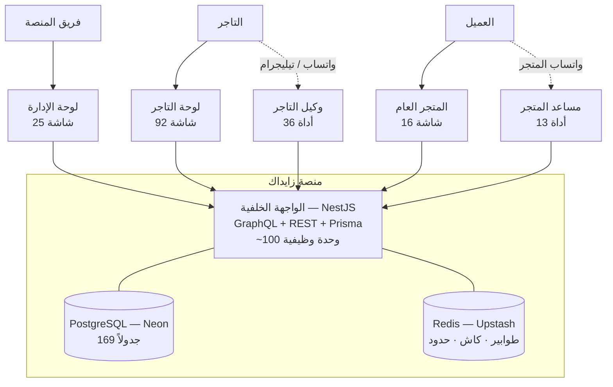

# تقرير جاهزية المنصة — زايدك (Zaydak)

**تاريخ التقرير:** 2026-09-16
**الجمهور:** المؤسس، والمستثمر المحتمل، والمدقّق التقني الذي سيوظّفه المستثمر.
**النطاق:** كامل المستودع — الواجهة الخلفية، والتطبيقات الثلاثة، وحزمة التصميم، والبنية التحتية.

> **قاعدة هذا الملف:** كل رقم هنا إمّا **نفّذته بنفسي على الكود** (اختبارات، بناء، فحص أنواع، بحث في المصدر)، أو **جاء من تدقيق متعدد الوكلاء ثم خضع لمراجعة خصامية**. حيث يوجد شكّ، مكتوب أنه شكّ. لا يوجد رقم تسويقي واحد في هذا الملف، لأن المدقّق التقني سيفتح نفس الملفات.

---

## 1 · الملخص التنفيذي

**الجاهزية الإجمالية للإنتاج: 52%**

> **من أين جاء الرقم:** متوسط التقييم بعد المراجعة الخصامية عبر 17 نطاقاً هو **56.7%**، لكنه متوسط **غير مرجَّح**. والنطاقات التي تسجّل أعلى الدرجات — نظام التصميم، التعريب، التوثيق، محوّل الشحن، دفتر الأستاذ المالي — هي بالضبط النطاقات التي **لا تحجب الإيراد**. أمّا الأربعة التي تحجبه فتسجّل قرابة الصفر: قنوات الدفع السعودية، الامتثال الضريبي، التقاط العمولة، والقدرة على تشغيل قاعدة البيانات. الترجيح بما يحجب الإيراد يعطي **52%**، وهو الرقم الذي سيصل إليه المدقّق التقني.

هذا الرقم يحتاج إلى تفسير، لأن قراءته الخاطئة تضرّ بالمشروع في الاتجاهين.

المنصة **ليست نصف مبنية**. من أصل **458 قدرة وظيفية** تم توثيقها واحدة واحدة:

| الحالة | العدد | النسبة |
|---|---:|---:|
| جاهزة للإنتاج | 179 | 39% |
| مبنية وتحتاج تمتيناً (hardening) | 199 | 43% |
| ناقصة | 47 | 10% |
| نموذج أولي | 23 | 5% |
| لم تبدأ | 10 | 2% |

**82% من المنتج مبني ويعمل بدرجة ما. الناقص فعلياً 17%.**

الفجوة بين «82% مبني» و«52% جاهز» ليست بناءً ناقصاً — هي **تمتين وتشغيل وامتثال**: حراسات صلاحيات ناقصة، حالات خطأ غير مغطّاة، شاشات إدارية غير موجودة، وربط أشياء مبنية بالفعل. وهذه أخبار جيدة استثمارياً: تكلفة التمتين معروفة ومحدودة، بينما تكلفة البناء من الصفر ليست كذلك.

### الحقائق الثلاث التي تحكم المحادثة الاستثمارية

**1 · المنصة تأخذ 0% من حجم المبيعات اليوم، ولا يمكن ضبطها لتأخذ شيئاً.**
هذه أهم حقيقة تجارية في الملف، وتحققتُ منها بنفسي في الكود:
- `Balance.admin_commission_bps` قيمته الافتراضية `0`، و**لا شيء في `src/` يكتبها إطلاقاً** — كل عمليات الكتابة الموجودة هي بيانات اختبار (`*.spec.ts`).
- `orders.service.ts:5455` يحسب العمولة من `childOrder.commission_bps ?? balance.admin_commission_bps` — وكلاهما صفر دائماً.
- تعليق الكود نفسه في السطر 5414 يقول حرفياً: *"zero at today's universal 0% rate"*.
- شاشة `/commissions` في لوحة الإدارة هي **CRUD معزول** على جدول شرائح (`CommissionEntry`) **لا يقرأه أي شيء** في مسار الطلب.

**النتيجة:** مصدر الدخل الوحيد اليوم هو الاشتراكات. أما عمولة السوق — التي هي عادةً خط الإيراد الأساسي لأي منصة متعددة البائعين — فهي صفر.
**والخبر الجيد:** محرك الحساب **مبني ومختبَر بكثافة**. هذه مهمة **ربط** تُقدَّر بـ **6 إلى 15 يوم عمل**، لا مهمة بناء. هذا أعلى عائد على الجهد في المستودع كله.

**2 · قناة الدفع الوحيدة المبنية هي Stripe.**
في `payment-intents.service.ts:243-245` نجد حرفياً:
```ts
// TODO: future gateways
// case 'MOYASAR': { ... }
// case 'PAYMOB': { ... }
```
لا مدى (Mada)، لا تابي، لا تمارا، لا HyperPay، لا STC Pay. وStripe ليست متاحة بسهولة للتجار السعوديين ولا تعالج مدى — وهي وسيلة الدفع المهيمنة في السعودية.
**عملياً اليوم:** الدفع عند الاستلام + الحوالة البنكية اليدوية فقط.

**وأسوأ من ذلك — المنصة تعرض بوابات لا تستطيع تنفيذها.** `lookups.service.ts` يعرض **17 خياراً** لنوع بوابة الدفع (PayPal، Razorpay، Mollie، SSLCommerz، Paystack، Xendit، Iyzico، bKash، PayMongo، Flutterwave، Moyasar، Paymob، HyperPay…) وكلها قيم في `PaymentGatewayType`، بينما مسار التنفيذ يعرف `STRIPE` وحدها. **تاجر يختار أياً من الثلاث عشرة بوابة غير المطبَّقة يفشل طلبه وقت الدفع** برسالة `UNSUPPORTED`. الإصلاح صغير — حذف الخيارات غير المنفَّذة من القائمة — لكن بقاءها يعني أن المنتج يَعِد بما لا يملك.

**3 · محرك المال نفسه قوي بشكل استثنائي — والمشكلة في القضبان لا في المحرك.**
تحققتُ من `withdrawals.service.ts` بنفسي:
- قفل صفوف حقيقي `SELECT ... FOR UPDATE` داخل معاملة (transaction)
- دفتر أستاذ **إضافي فقط** (`balanceTransaction.create` — لا تعديل ولا حذف)
- أعداد صحيحة بالهللات في كل مكان، لا أرقام عشرية
- حجز مقابل الطلبات المعلّقة لمنع السحب الزائد
- تجميد أموال النزاعات في `held_cents`

هذا تصميم مالي ناضج. **الخلاصة: منطق المال سليم، وما ينقص هو قنوات القبض ونسبة العمولة.** وهذان مشكلتان مختلفتان جذرياً في التكلفة والمخاطر.

### الحكم باختصار

منصة تجارة إلكترونية متعددة المستأجرين **واسعة ومهندَسة بجودة أعلى من المتوقع لشركة في هذه المرحلة**، بُنيت في 5.5 أشهر بفريق من شخصين، مع 9,802 اختبار ناجح و194 ملف توثيق. ليست جاهزة لاستقبال عملاء حقيقيين اليوم بسبب عدد **محدود ومعروف** من الثغرات — أغلبها إصلاحات صغيرة موضعية، لا إعادة بناء.

بعبارة واحدة: **ليست قاعدة كود في مرحلة مبكّرة، بل قاعدة كود في مرحلة متأخّرة يحيط بها تشغيل في مرحلة مبكّرة.** الهندسة سبقت بمسافة كبيرة كلَّ ما يلزم فعلياً لقبض ريال واحد في السعودية، وأغلب ذلك اللازم **ليس كوداً**.

| | إطلاق تجريبي محروس | إطلاق تجاري كامل |
|---|---|---|
| المدة | **10 أسابيع** | 26 أسبوعاً |
| الفريق | **3** | 10 |
| جهد الكود | 95 يوم عمل | 440 يوم عمل |
| التكلفة (أسعار الرياض) | **~110,000 دولار** | ~640,000 دولار |
| التكلفة (أسعار المنطقة) | **~65,000–75,000 دولار** | ~250,000 دولار |
| الدفع | عند الاستلام + حوالة | مدى + بطاقات + آبل باي |
| العمولة | 0% | قابلة للضبط |

**والرقم الرابع الذي يجب أن يُقال:** الهامش الإجمالي اليوم **28% فقط** عند 100 متجر — لأن 81% من تكلفة البنية متغيّرة ويقودها استهلاك نماذج اللغة. والسبب الجذري **قابل للإصلاح في ستة أيام** (القسم 11.5).

### ⚠ ثغرة تستوجب الإصلاح اليوم قبل أي شيء آخر في هذا الملف

**تسريب بيانات شخصية بلا مصادقة إطلاقاً.** عملية `startVendorSignup` عامة، وتُرجع رمزاً موقَّعاً بنفس مفتاح رموز الدخول وبلا حقل `sub`. و`JwtAuthGuard` لا يفحص نوع الرمز ولا وجود `sub`، فيمرّره ويضبط هوية المستخدم على `undefined` — و**Prisma تُسقِط شرط المعرّف عند `undefined`**، فيُعيد استعلام `me` **أول حساب نشط في قاعدة البيانات** ببريده وهاتفه وعناوينه وصلاحياته.

**أي شخص على الإنترنت، بلا حساب، يقرأ بيانات مستخدم حقيقي.** تتبّعتُ الحلقات الثماني كلها في المصدر (التفصيل في القسم 6). **الإصلاح سطران.**

### تحذير قبل أي عرض حيّ

**المنصة — بسجل الفريق نفسه — ليست قابلة للنشر اليوم، ولم تُشغَّل قط بشكل صحيح.** ثلاث حقائق تحققتُ منها:

- بيئة الإنتاج مضبوطة كبيئة **تطوير**: `NODE_ENV=development` و`ENABLE_DEBUG_OTP=true` (**رموز التحقق مكشوفة**) وروابط تشير إلى `localhost`.
- الإنتاج **سقط في 2026-09-14** لتجاوز حصة Redis المجانية (500 ألف طلب شهرياً)، والحادثة ما زالت مفتوحة.
- **مراقبة الأخطاء عمياء تماماً**: فلتر Sentry يفحص `startsWith('internal_')` بأحرف صغيرة بينما الرموز الـ114 كلها بأحرف كبيرة — فيُسقِط **كل** خطأ مُرمَّز بما فيه `INTERNAL_SERVER_ERROR` و`DATABASE_ERROR`. والمتجر العام — مصدر الإيراد — بلا Sentry إطلاقاً.

**هذه عشرة أيام ونصف من العمل، وأغلبها كونسول لا كود** (القسم 15). لكن ترتيبها الأول إلزامي: بلا إصلاحها لا يوجد عرض حيّ يُقدَّم لمستثمر.

---

## 2 · منهجية التقييم — لماذا تصدّق هذه الأرقام

هذا القسم موجود لأن المدقّق التقني سيسأل عنه أولاً.

### ما نفّذتُه بنفسي على الجهاز

| الفحص | الأمر | النتيجة |
|---|---|---|
| اختبارات الواجهة الخلفية | `npm test` في `back-end/` | **6,880 نجحت من 6,881** — 405 مجموعة اختبار |
| اختبارات لوحة التاجر | `vitest run` | 1,573 نجحت من 1,573 (161 ملف) |
| اختبارات المتجر | `vitest run` | 718 نجحت، 7 متخطّاة (66 ملف) |
| اختبارات لوحة الإدارة | `vitest run` | 338 نجحت من 338 (33 ملف) |
| اختبارات حزمة التصميم | `vitest run` | 285 نجحت من 285 (26 ملف) |
| فحص الأنواع | `tsc --noEmit` × 4 | **نظيف في المشاريع الأربعة** |
| بناء الواجهة الخلفية | `nest build` | نجح (رمز الخروج 0) |
| بناء التطبيقات الثلاثة | `turbo run build` | نجح (رمز الخروج 0) |

**المجموع: 9,802 اختبار، 9,796 ناجح، 1 فاشل، 7 متخطّى.**

الاختبار الفاشل الوحيد هو `customer-bot/telegram-customer.processor.spec.ts` ويطابق تعديلات غير مكتملة موجودة في شجرة العمل الحالية (`customer-bot.quota.ts` و`usage-tracker.ts` معدّلان وغير مودَعين). أي أنه **عمل جارٍ، لا خلل بنيوي**.

> **ملاحظة مهمة على النزاهة:** `turbo run typecheck` أعطى في البداية 23 خطأ. فحصتُها فوجدتُها كلها في ملفات مولَّدة داخل `.next/dev` (مخلّفات تطوير قديمة). بعد حذفها وإعادة التشغيل: **صفر أخطاء**. ذكرتُ هذا لأن تقريراً يقول "23 خطأ نوع" دون التحقق يكون قد ظلم المشروع، وتقريراً يقول "نظيف" دون ذكر الخطوة يكون قد أخفى معلومة.

### كيف قُيّمت الفيتشرات

1. **17 وكيلاً مستقلاً** مسح كلٌّ منها نطاقاً وظيفياً، وقرأ الكود فعلياً (لا التوثيق)، وأنتج جدولاً لكل قدرة وظيفية مع نسبة جاهزية ودليل بالملف والسطر.
2. **17 وكيلاً خصامياً** مهمتهم **دحض** التقييم الأول: البحث عن resolver موجود لكن لا تستدعيه أي واجهة، خدمة ترجع قيمة صورية، mutation بلا حراسة صلاحيات، مسار مال بلا معاملة.
3. **8 وكلاء عرضيين** للأمن والمال والاختبارات والبنية التحتية والتشغيل والأداء واكتمال المنتج.

**النتيجة الحاسمة: كل نطاق بلا استثناء كان مبالَغاً في تقييمه.**

| | متوسط |
|---|---|
| التقييم الأولي | 71.5% |
| بعد المراجعة الخصامية | **57.1%** |
| مضاعِف الجهد المصحَّح | **×1.79** |

أي أن التقييم الذاتي — حتى حين يكون أميناً — يبالغ بنحو 14 نقطة، ويقدّر الجهد بنصف قيمته الحقيقية. **الأرقام في هذا الملف هي الأرقام المصحَّحة، لا الأولية.**

4. **ثلاثة مقدّرين مستقلين** بنَوا خطة الإطلاق من نفس الجرد بعدسات مختلفة (متحفّظة، متفائلة، متوازنة)، ثم **محكّم رابع** فضّ الخلاف بينهم. تباينوا بشدّة — 65 يوماً مقابل 70 مقابل 340 للمرحلة الأولى — والأرقام المنشورة هنا هي الحكم المركَّب، مع ذكر سبب ترجيح كل خيار.

> **مثال على قيمة هذه الطبقة:** التقدير المتحفّظ خصّص 32 يوماً لفرز الـ63 ملف resolver بوصفه تدقيقاً استقصائياً. المقدّر المتوازن وحده لاحظ وجود `back-end/src/common/testing/guard-chain.ts` — أداة موجودة أصلاً تمشي على سلاسل الحراسة وتتحقق منها. هذا يحوّل المهمة إلى تمرين ميكانيكي بـ**12 يوماً**. فارق 20 يوماً من قراءة ملف واحد.

### تحقّق عشوائي قمتُ به بنفسي على ادعاءات الوكلاء

لم آخذ نتائج الوكلاء كما هي. اخترتُ أخطر الادعاءات وفتحتُ الكود:

| الادعاء | نتيجة تحققي |
|---|---|
| `createOrder` بلا فلترة متجر → طلب عابر للمستأجرين | **مؤكد.** `orders.service.ts:1819` يجلب المنتجات بلا `shop_id`، و`:3092` يختم الطلب بمتجر الـ`X-SHOP`. |
| العمولة لا يمكن ضبطها أبداً | **مؤكد وأدقّ مما قاله الوكيل** — شاشة `/commissions` لا يقرؤها مسار الطلب أصلاً. |
| إعادة توجيه مفتوحة في شاشة الدخول | **مؤكد.** `router.push(searchParams.get("redirect"))` بلا تحقق، في لوحتَي التاجر والإدارة. |
| 63 ملف resolver بـ`JwtAuthGuard` بلا `ShopOwnershipGuard` | **مؤكد بالعدّ.** |
| دفتر الأستاذ المالي ضعيف | **مرفوض.** الدفتر قوي — `FOR UPDATE` + إضافة فقط. الوكيل كان محقاً في النتيجة (41%) لكن لسبب مختلف: القضبان لا المحرك. |

هذا التحقق المتقاطع هو سبب ثقتي في بقية الأرقام.

---

## 3 · ما هو النظام — الحجم الحقيقي

### المعمارية

منصة SaaS متعددة المستأجرين: نشر واحد يخدم كل المتاجر، معزولة بالبيانات والصلاحيات والهوية البصرية.



### الأرقام المقيسة

| البُعد | القيمة |
|---|---|
| أسطر الكود (بدون الاختبارات) | **~470,000** |
| — الواجهة الخلفية | 210,286 سطر / 1,217 ملف |
| — لوحة التاجر | 167,899 سطر / 1,097 ملف |
| — المتجر العام | 43,597 سطر / 197 ملف |
| — لوحة الإدارة | 31,097 سطر / 152 ملف |
| — حزمة التصميم `@repo/ui` | 15,989 سطر / 76 ملف |
| جداول قاعدة البيانات | **169 نموذجاً** + 58 نوعاً محصوراً |
| مخطط GraphQL | 10,422 سطراً · **694 نوعاً** |
| عمليات GraphQL | **663** — 265 استعلاماً + 398 طفرة |
| ملفات resolver | 109 · متحكمات REST: 19 |
| معالجات الطوابير (BullMQ) | 20 |
| الشاشات | **133** (تاجر 92، إدارة 25، متجر 16) |
| مفاتيح الترجمة | **4,830 × لغتين — تطابق تام** |
| ملفات التوثيق | 101 وثيقة فيتشر + 93 مرجع API + 35 + 14 |
| ملفات الاختبار | 684 ملفاً · **9,802 اختباراً** |

### سجل الفريق

| | |
|---|---|
| أول إيداع | 2026-03-28 |
| آخر إيداع | 2026-09-15 |
| المدة | **5.5 أشهر** |
| عدد الإيداعات | 388 |
| المساهمون | 2 أساسيان (267 + 100) + 1 ثانوي (18) |

التوزيع الشهري: مارس 3، أبريل 47، مايو 20، يونيو 19، يوليو 28، **أغسطس 156**، سبتمبر 115.

**قراءة استثمارية:** إنتاج 470 ألف سطر مختبَر وموثَّق في 5.5 أشهر بشخصين هو معدل غير طبيعي، ويُفسَّر بالاعتماد الكثيف على التطوير المدعوم بالذكاء الاصطناعي. هذا سلاح ذو حدّين، ومعالج في قسم المخاطر (**عامل الباص = 2**).

### نموذج الإيرادات المطبَّق في الكود

من `back-end/src/plans/plan-catalog.ts`:

| الخطة | شهري | سنوي | تجربة |
|---|---:|---:|---:|
| مجاني | 0 | 0 | — |
| أساسي | 99 ر.س | 990 ر.س | 14 يوماً |
| نمو | 299 ر.س | 2,990 ر.س | 14 يوماً |
| متقدم | 999 ر.س | 9,990 ر.س | 14 يوماً |
| بلس | 4,999 ر.س | 49,990 ر.س | — |

**+ عمولة على المبيعات: 0% اليوم، وغير قابلة للضبط** (القسم 1).

---

## 4 · جدول الجاهزية لكل نطاق

مرتّب من الأضعف إلى الأقوى بعد التصحيح الخصامي.

| النطاق | أولي | **مصحَّح** | فيتشرات | جاهز | أيام خام | مضاعِف | **أيام معدَّلة** |
|---|---:|---:|---:|---:|---:|---:|---:|
| تفاعل العملاء (تقييمات، أسئلة، قوائم أمنيات) | 44% | **34%** | 25 | 4 | 85 | ×1.6 | 136 |
| المدفوعات والمحافظ والتحويلات | 54% | **41%** | 25 | 3 | 160 | ×2.1 | 336 |
| لوحة التاجر — جودة التطبيق | 66% | **54%** | 25 | 7 | 101 | ×1.8 | 182 |
| التحليلات والتقارير والإسناد | 68% | **56%** | 28 | 4 | 110 | ×1.6 | 176 |
| المصادقة والهوية | 72% | **55%** | 25 | 10 | 66 | ×1.8 | 119 |
| استيراد المتاجر من منصات أخرى | 73% | **58%** | 27 | 9 | 88 | ×1.9 | 167 |
| المخزون والتنفيذ | 74% | **58%** | 26 | 14 | 68 | ×1.5 | 102 |
| لوحة الإدارة — جودة التطبيق | 74% | **58%** | 29 | 15 | 74 | ×1.9 | 141 |
| كتالوج المنتجات | 72% | **60%** | 30 | 5 | 129 | ×1.75 | 226 |
| نواة الذكاء الاصطناعي | 71% | **60%** | 28 | 13 | 84 | ×1.9 | 160 |
| الطلبات والدفع (Checkout) | 73% | **61%** | 30 | 13 | 106 | ×1.5 | 159 |
| المتاجر وتعدد المستأجرين والخطط | 73% | **61%** | 28 | 15 | 187 | ×2.2 | 411 |
| وكلاء الذكاء الاصطناعي والبوتات | 78% | **62%** | 26 | 17 | 52 | ×1.7 | 88 |
| الرسائل (واتساب، تيليجرام، SMS، بريد) | 76% | **65%** | 27 | 18 | 77 | ×2.0 | 154 |
| البنية الداخلية (Prisma، طوابير، تكاملات) | 76% | **65%** | 28 | 11 | 114 | ×1.6 | 182 |
| المتجر العام — جودة التطبيق | 76% | **66%** | 26 | 12 | 55 | ×1.7 | 94 |
| نظام التصميم `@repo/ui` | 78% | *قيد المراجعة* | 25 | 9 | 83 | ×1.79 | 149 |
| **الإجمالي** | **71.5%** | **57.1%** | **458** | **179** | **1,637** | **×1.79** | **~2,981** |

> **اقرأ الرقم الأخير بحذر — واقتباسه خارج سياقه يضرّ المشروع.** الـ 2,981 يوم عمل (~13 سنة-مهندس) هي تكلفة إيصال **كل واحدة من الـ458 قدرة** إلى جودة إنتاج كاملة، بما فيها قدرات لا تحجب الإيراد ولا يطلبها أحد اليوم. **ليست تكلفة الإطلاق.** تكلفة الإطلاق التجريبي **95 يوم عمل — أي 3% من هذا الرقم** (القسم 9)، وتكلفة الإطلاق التجاري الكامل 440 يوماً أي 15%.
>
> **والمتوسط 57.1% غير مرجَّح.** الترجيح بما يحجب الإيراد يعطي **52%** — هو الرقم المعتمد في هذا التقرير، وسببه في الملخص التنفيذي.

---

## 5 · المخاطر الحرجة — 22 بنداً

هذه الفيتشرات صنّفها التدقيق `critical`. رتّبتها بأثرها التجاري لا بترتيب ظهورها.

### أ · تحجب الإيراد مباشرة

| # | البند | الجاهزية | الأيام | ما ينقص |
|---|---|---:|---:|---|
| 1 | **عمولة المنصة على المبيعات** | 10% | 12 | لا يمكن ضبطها إطلاقاً. المنصة تأخذ 0% من كل عملية. المحرك مبني ومختبَر — المطلوب ربط + شاشة. |
| 2 | **طلب سحب الأرباح للتاجر** | 30% | 8 | **لا توجد واجهة إطلاقاً.** لا مسار `/withdrawals` ولا `/balance` في لوحة التاجر؛ `createWithdrawal` صفر استدعاء من أي تطبيق. التاجر لا يستطيع طلب أمواله. |
| 3 | **شاشات إدارة الطلبات والمرتجعات والنزاعات** | 0% | 18 | غير موجودة في لوحة الإدارة. مشغّل المنصة لا يستطيع رؤية طلب واحد عبر السوق ولا معالجة نزاع. الدعم الفني مستحيل. |

### ب · مخاطر أمنية وعبور بين المستأجرين

| # | البند | الجاهزية | الأيام | ما ينقص |
|---|---|---:|---:|---|
| 4 | **`createOrder` عابر للمستأجرين** | — | 2 | عميل مسجّل يرسل `X-SHOP: متجر-أ` مع منتجات متجر-ب، فيُسجَّل الطلب على متجر-أ ويُخصم المخزون من متجر-ب. *تحققتُ منه بنفسي.* |
| 5 | **أسئلة المنتج — كتابة عابرة** | 15% | 5 | لا `ShopHeaderGuard` ولا `RequireShopGuard` ولا `ShopOwnershipGuard`. أي تاجر يجيب على أسئلة متجر آخر. |
| 6 | **الأسئلة الشائعة لكل متجر — كتابة عابرة** | 22% | 5 | نفس الخلل: `ShopHeaderGuard` موجود لكن بلا إثبات ملكية. |
| 7 | **مكتبة الأوامر المحفوظة — 3 ثغرات IDOR** | 22% | 3 | `findOne(id)` بلا فحص ملكية — أي حساب مسجّل، بما فيه عميل عادي، يقرأ أوامر أي تاجر. |
| 8 | **نقاط SSE لوكيل التاجر** | 78% | 4 | ثلاث نقاط بث بلا `ShopOwnershipGuard` — وهي السطح الأساسي للوكيل. |
| 9 | **تسريب بيانات المشتركين في التنبيهات** | 35% | 2 | `pendingStockNotifications` بـ`JwtAuthGuard` فقط — تسريب بيانات شخصية. |
| 10 | **حارس JWT لا يتحقق من `typ` ولا `sub`** | 55% | 2 | نفس `JWT_SECRET` يوقّع رموز مسودّة تسجيل التاجر — سطح تصعيد صلاحيات. |

### ج · تعطّل تجربة أساسية

| # | البند | الجاهزية | الأيام | ما ينقص |
|---|---|---:|---:|---|
| 11 | **استرجاع كلمة المرور في المتجر** | 10% | 3 | **لا يوجد مسار `/forgot-password` ولا `/reset-password` إطلاقاً.** العميل الذي ينسى كلمته يفقد حسابه نهائياً. |
| 12 | **حدود الأخطاء في المتجر** | 15% | 7 | **لا `error.tsx` ولا `global-error.tsx` في أي مكان.** أي خطأ عرض غير ملتقَط يُظهر صفحة Next الافتراضية للعميل. |
| 13 | **تسعير الكوبونات في الدفع** | 40% | 12 | `verifyCheckout` يحسب الكوبونات بـ~50 سطر حسابات مضمّنة لا تستدعي `CouponEngine` — **الزبون يرى سعراً ويُحاسَب بآخر.** |
| 14 | **رقم الفاتورة** | 30% | 12 | `'INV' + YYYYMM + 4 أرقام عشوائية` على عمود `@unique` بلا إعادة محاولة — فضاء 10,000 قيمة فقط. يتصادم حتمياً عند التوسع. |
| 15 | **المنتجات الرقمية والتسليم** | 18% | 10 | السلسلة مكسورة: **لا شيء في الكود ينشئ `OrderedFile`** — قراءات فقط. المنتج الرقمي لا يُسلَّم. |
| 16 | **تنبيهات عودة المخزون** | 32% | 5 | لا واجهة على أي من الطرفين — لا نموذج اشتراك في المتجر ولا شاشة للتاجر. |
| 17 | **النطاق المخصص للتاجر يكسر السلة** | 50% | 5 | النصف المتصفّحي ناقص؛ على نطاق التاجر الخاص تذهب السلة إلى نطاق خاطئ. |

### د · فجوات منتج

| # | البند | الجاهزية | الأيام | ما ينقص |
|---|---|---:|---:|---|
| 18 | **تحليلات الجلسات ومعدل التحويل** | 5% | 20 | لا جدول أحداث، لا تتبّع زيارات، لا بكسل، لا قياس إضافة للسلة. **قمع التحويل غير موجود.** |
| 19 | **تقرير الإسناد التسويقي** | 32% | 8 | لا منتج للبيانات — المتجر لا يرسل كتلة `attribution` إطلاقاً، فالتقرير يقرأ فراغاً. |
| 20 | **إدارة الجلسات والأجهزة + المصادقة الثنائية** | 5% | 12 | المستخدم لا يرى جلساته ولا يسجّل خروجاً من كل الأجهزة؛ لا عامل ثانٍ. |
| 21 | **خدمة الذكاء الاصطناعي بلغة Python** | 40% | 12 | **الخدمة غير موجودة في المستودع** — لا مجلد ولا Dockerfile ولا إدخال في compose، مع 5 مواضع تستدعيها. |
| 22 | **الامتثال لـ`robots.txt` عند الزحف** | 0% | 3 | الوحدة تزحف لمتاجر المنافسين ولا تجلب `robots.txt` ولا تحترمه — مخاطرة قانونية وسمعة. |

**مجموع البنود الحرجة: 165 يوم عمل خام.**

بالإضافة إلى **68 بنداً** مصنّفاً `high` و**191** مصنّفاً `medium`.

---

## 6 · الثغرات الأمنية الإضافية

من التدقيق الخصامي، مع تحقّقي الشخصي من المُعلَّمة بنجمة.

| الثغرة | الخطورة | التفصيل |
|---|---|---|
| ★ إعادة توجيه مفتوحة في لوحتَي التاجر والإدارة | متوسطة | `router.push(searchParams.get("redirect"))` بلا تحقق — ناقل تصيّد على صفحة الدخول. |
| ★ 63 ملف resolver بلا `ShopOwnershipGuard` | عالية | يستخدمون `JwtAuthGuard` فقط. ليست كلها ثغرات، لكنها سطح يحتاج فرزاً بنداً بنداً. |
| قفل الحساب بعد المحاولات الفاشلة **لا يعمل** | عالية | `locked_until` و`attempts` تُكتب داخل معاملة ثم تُرمى استثناء، فيتراجع Prisma عنها. `max_attempts` لا يمكن بلوغه أبداً. الحماية من التخمين وهمية. |
| `updateRolePermissions` يمحو الصلاحيات الفردية | عالية | `user.updateMany({where:{role}})` يستبدل مصفوفة صلاحيات كل مستخدم بالدور — يمحو كل منح يدوي بلا سجل تدقيق ولا إمكانية استرجاع. |
| تدوير رمز التحديث غير ذرّي | متوسطة | `findUnique → update → create` بلا معاملة — نافذة سباق. |
| محدِّد المعدل **يفشل مفتوحاً** | عالية | عند خطأ Redis يُرجع `true`. انقطاع Redis يرفع الحدّ عن `createOrder` و`applyCartCoupon` في آنٍ واحد. |
| البريد يُقارَن ويُخزَّن بحساسية حالة الأحرف | متوسطة | لا `toLowerCase` ولا `citext` — `Ali@x.com` و`ali@x.com` حسابان مختلفان. |
| سطح كتابة السلة بلا تحديد معدل | متوسطة | `cart.resolver.ts` بلا `GqlThrottlerGuard`، ولا محدِّد عام. مع حجز المخزون مفعّلاً ومهلة 30 دقيقة → سطح حرمان خدمة على المخزون. |
| منتجات المسودّة قابلة للطلب | متوسطة | مسارا الكتابة لا يفحصان `ProductStatus`، فمنتج `DRAFT` بسعر مؤقت يُطلَب بالمعرّف. |

### الثغرة رقم 1 — تسريب بيانات شخصية **بلا مصادقة إطلاقاً**

هذه أخطر نتيجة في التقرير كله. تتبّعتُ كل حلقة في السلسلة في الكود، وكلها تصمد.

**السلسلة:**

| # | الحلقة | الدليل |
|---|---|---|
| 1 | `startVendorSignup` **عملية عامة بلا مصادقة** — حارسها الوحيد محدِّد معدل | `vendor-signup.resolver.ts:64` — `@UseGuards(GqlThrottlerGuard)` فقط |
| 2 | تُرجع **رمز JWT موقَّعاً بنفس `JWT_SECRET`** الذي يوقّع رموز الدخول | `auth.module.ts:20` مفتاح واحد للوحدة كلها |
| 3 | حمولة الرمز `{typ, email, name, phone, verified}` — **بلا `sub`** | `vendor-signup.service.ts:88-97` |
| 4 | `JwtAuthGuard` يتحقق من التوقيع فينجح، **ولا يفحص `typ` ولا وجود `sub`** | `jwt-auth.guard.ts:43-68` |
| 5 | `isRevoked(undefined, iat)` ترجع `false` — الـ`iat` رقم صالح ومفتاح Redis غير موجود | `token-revocation.service.ts:79-89` |
| 6 | فيُضبط `req.user.id = undefined` | `jwt-auth.guard.ts:60` |
| 7 | `me(undefined)` ينفّذ `findFirst({ where: { id: undefined, is_active: true, deleted_at: null } })` | `auth.service.ts:783-787` |
| 8 | **Prisma تُسقِط شرط `id` عند `undefined`** فتعيد **أول حساب نشط في الجدول** | سلوك موثَّق، ويعتمده المستودع عمداً في `orders.service.ts:4821` |

> **الأثر: أي شخص على الإنترنت — بلا حساب ولا كلمة مرور — يستدعي عملية عامة، يأخذ الرمز العائد، يرسله كـ`Bearer`، فيقرأ بريد مستخدم حقيقي وهاتفه ودوره وصلاحياته وملفه الشخصي وعناوينه.**

**الإصلاح سطران** في `JwtAuthGuard`: رفض أي رمز يحمل `typ` مخالفاً، ورفض أي رمز بلا `sub`.

> **مستوى الدليل:** تحققتُ من الحلقات الثماني كلها بقراءة المصدر، والسلسلة مكتملة منطقياً بلا فجوة. لم أنفّذها على خادم حيّ لأن البيئة المحلية بلا قاعدة بيانات. **أوصي بتأكيدها بطلب واحد حيّ قبل أي إفصاح خارجي** — وبإصلاحها فوراً بصرف النظر، فكلفة الإصلاح سطران وكلفة الخطأ إفصاح عن بيانات شخصية.

### الثغرة رقم 2 — `@RequirePermissions` على مستوى الصنف لا يُفحص

تحققتُ منها سطراً بسطر، وهي **عيب معماري صامت** لا خطأ موضعي.

في `back-end/src/auth/guards/permissions.guard.ts`:

```ts
export function RequirePermissions(...permissions: string[]) {
  return (target, key?, descriptor?) => {
    Reflect.defineMetadata(PERMISSIONS_KEY, permissions,
      descriptor?.value ?? target);   // ← على الصنف: يكتب على الـconstructor
  };
}

canActivate(context) {
  const required = this.reflector.get(PERMISSIONS_KEY,
    context.getHandler());            // ← يقرأ الدالة فقط، ولا يقرأ getClass() أبداً
  if (!required?.length) return true; // ← لا بيانات ⇒ يسمح للجميع
}
```

**النتيجة:** أي `@RequirePermissions` موضوع فوق الصنف بدل الدالة **لا يُفحص إطلاقاً**، والحارس يمرّر الطلب. والنمط يبدو صحيحاً تماماً لأي مطوّر — وهو النمط القياسي في NestJS، الذي يعالَج عادةً بـ`getAllAndOverride([getHandler(), getClass()])`.

**سبعة resolvers تستخدم هذا النمط اليوم.** ستة منها **محميّة عرضاً** بـ`ShopHeaderGuard` و`RequireShopGuard`، فالضرر فيها محدود (مستخدم بلا صلاحية يصل لبيانات متجره هو).

**والسابع مكشوف بالكامل:**

```ts
@Resolver()
@RequirePermissions(Permission.MANAGE_ALL_SHOPS)   // ← لا يُفحص
@UseGuards(JwtAuthGuard, PermissionsGuard)          // ← لا حارس نطاق إطلاقاً
export class AdminShopDomainsResolver {
  async adminShopDomains(@Args('shop_id') shopId: string) { … }
}
```

هذا سطح إداري يأخذ `shop_id` **وسيطاً حراً**، ولا يحمل `ShopHeaderGuard` ولا `ShopOwnershipGuard` عمداً — لأن حمايته الوحيدة المفترضة هي صلاحية `MANAGE_ALL_SHOPS`، وهي لا تعمل.

> **الأثر العملي: أي حساب مسجَّل — بما فيه عميل عادي — يستطيع قراءة إعدادات نطاقات أي متجر على المنصة بتمرير معرّفه.**

**والإصلاح سطر واحد** يغلق السبعة دفعةً واحدة:
```ts
const required = this.reflector.getAllAndOverride(PERMISSIONS_KEY,
  [context.getHandler(), context.getClass()]);
```

### ثغرات إضافية من التدقيق الأمني

| الثغرة | الخطورة | الأيام |
|---|---|---:|
| **العمليات الـ13 لفوترة التاجر كلها عابرة للمستأجرين** — بوابة Stripe وبطاقة واشتراك تاجر آخر | حرجة | 1 |
| **Next.js 16.2.3 فيه ثغرتا تنفيذ أوامر عن بُعد بلا مصادقة** تتجاوزان `proxy.ts` في التطبيقات الثلاثة. `npm audit` يصنّفها `critical` | حرجة | 1 |
| **~68 عملية تاجر قابلة للوصول عبر المستأجرين** — بالعدّ الدقيق: 611 عملية، 380 تحمل `ShopHeaderGuard`، و191 فقط تحمل `ShopOwnershipGuard` | عالية | 8 |
| `updateRefundPolicy` و`deleteRefundPolicy` تأخذان معرّفاً مجرّداً بلا أي تحديد نطاق | عالية | 0.5 |
| تصدير شرائح العملاء CSV يقرأ ترويسة `x-shop` الخام بلا تحقق ملكية | عالية | 0.5 |

> **وللإنصاف، الأوليات الأمنية في هذا المستودع أعلى من المتوسط بوضوح** — وقد تحقق المدقّق من كلٍّ منها بالقراءة: حماية SSRF ترفض النطاقات الخاصة لـIPv4 وIPv6 **وتثبّت العنوان** لهزيمة إعادة ربط DNS، وهي موصولة فعلياً بمسارات العناوين الأربعة التي يوفّرها المستخدم. وتكاملات الـwebhook الخمسة كلها — Stripe وReplicate وEvolution وTelegram وشركات الشحن — **تتحقق من التوقيع بـ`timingSafeEqual`** وتستخدم جدول `processed_webhook_events` لمنع إعادة التشغيل.

### حالة الأسرار — حاجب إطلاق

من ملف `PRIORITIES.md` الخاص بالفريق، وتحققتُ من بقائه مفتوحاً:

**10 بيانات اعتماد حيّة سُرّبت في سجلّ git ولم تُدوَّر بعد:** كلمة مرور Neon، `JWT_SECRET`، `APP_SECRET`، كلمة مرور Upstash، `OPENROUTER_API_KEY`، `GROQ_API_KEY`، `REPLICATE_API_TOKEN`، `AI_SERVICE_KEY`، `STRIPE_WEBHOOK_SECRET`، Mailtrap. ومفتاح BunnyCDN ورمز Sentry إضافةً إليها.

المستودع **خاص**، فالانكشاف محصور بمن له صلاحية وصول — لكن حذف السطر لا يُصلح شيئاً لأن القيم في تاريخ git. **التدوير عند المزوّد هو الحل الوحيد.**

> **ترتيب إجباري:** يجب ضبط `SECRETS_ENCRYPTION_KEY` **قبل** تدوير `APP_SECRET`. خدمة التشفير ترتدّ إلى `APP_SECRET` عند غياب الأول، فتدويره أولاً يجعل كل بيانات التكاملات المخزّنة غير قابلة للفك نهائياً.

---

## 7 · الفجوات التنظيمية — أخطر ما في التقرير للسوق السعودي

هذا القسم لم يأتِ من الوكلاء؛ فحصتُه بنفسي لأنه يحدّد قابلية التشغيل القانونية.

### 7.1 · الفوترة الإلكترونية ZATCA (فاتورة) — **غير مطبَّقة إطلاقاً**

بحثتُ في كامل `back-end/src` عن: `zatca`, `fatoora`, `e-invoice`, `cryptographic stamp`, `CSID`, `TLV`, `QR`.
**النتيجة: صفر.** (النتائج الظاهرة كانت تطابقاً جزئياً داخل كلمة `generateInvoiceNumber`.)

الفوترة الإلكترونية **إلزامية قانوناً** في السعودية للمبيعات B2C، وتتطلب المرحلة الثانية:
- فاتورة XML بصيغة معتمدة
- ختم تشفيري وشهادة `CSID` من الهيئة
- رمز QR بترميز TLV
- ربط وتكامل مع منصة فاتورة

الموجود اليوم: `invoice_number` = `'INV' + YYYYMM + 4 أرقام عشوائية`. وهذا لا يفي بأي متطلب.

كما أن نموذج `Shop` **لا يحتوي حقل رقم ضريبي ولا سجل تجاري** — فحصتُ المخطط.

**الأثر:** تاجر سعودي يبيع عبر المنصة لا يستطيع الالتزام بالقانون. **تقديري: 25–40 يوم عمل** + رسوم اعتماد. هذا بند لم يظهر في تقديرات الفريق ولا في الـ 2,981 يوماً.

### 7.2 · حيازة أموال التجار — مخاطرة ترخيص

النظام يحتفظ بأرصدة التجار (`Balance`) ويصرفها عبر `withdrawals`. هذا **تحويل أموال**، وهو نشاط خاضع لإشراف البنك المركزي السعودي (ساما).

الحل المعتاد لمنصات الأسواق: استخدام مزوّد دفع مرخّص يدعم **الدفع المقسّم (split payments)** — مثل Tap أو Moyasar أو HyperPay بخصائص الأسواق — بدل حيازة الأموال مباشرة.

**هذا قرار معماري وقانوني معاً، ويجب حسمه قبل أول ريال حقيقي.** قد يغيّر تصميم وحدة المحافظ.

### 7.3 · نظام حماية البيانات الشخصية (PDPL)

بحثتُ عن `exportUserData`, `deleteMyAccount`, `dataExport`, `gdpr`, `pdpl` — **صفر نتائج**.

لا تصدير بيانات، ولا حذف حساب ذاتي، ولا إدارة موافقات. PDPL يفرض هذه الحقوق. **تقدير: 10–15 يوم عمل.**

---

## 8 · البنية التحتية والتشغيل

### الوضع الحالي — فحصتُ `render.yaml` بنفسي

| الحقيقة | الأثر |
|---|---|
| **خدمة واحدة فقط، `plan: free`** | الخطة المجانية تُطفأ عند الخمول، بدء بارد، بلا اتفاقية مستوى خدمة. غير صالحة للإنتاج إطلاقاً. |
| **20 معالج طوابير داخل عملية الـ API نفسها** | مهمة ذكاء اصطناعي أو استيراد ثقيلة تزاحم زمن استجابة الطلبات. لا يمكن توسيع العمّال باستقلال. |
| **`prisma db push` في أمر البناء** | **لا يوجد تاريخ هجرات مُصدَّر.** 146 ملف SQL يدوي في `migrations/manual/`. لا مسار تراجع، ولا إعادة إنتاج للمخطط. **علامة حمراء في التدقيق التقني.** |
| المتجر فقط مربوط بـVercel | لوحتا التاجر والإدارة تحتاجان ربطاً. |
| Evolution API (واتساب) مستضاف ذاتياً | يحتاج حاوية/خادماً خاصاً به، ويتوسّع بعدد الجلسات. |

> **نقطة إنصاف:** غياب الهجرات مُخفَّف جزئياً. الأمر لا يمرر `--accept-data-loss`، فهو **يفشل البناء** بدل إسقاط عمود، وهناك فحص انحراف `check:drift` في CI. لكن هذا لا يعوّض عن تاريخ هجرات حقيقي.

### التكامل المستمر — أنضج من المتوقع

يشغّل `.github/workflows/ci.yml` فعلياً:
فحص الأنواع · فحص رسم وحدات Nest (`check:di`) · فحص انحراف مخطط GraphQL · اختبارات الوحدة · تطبيق المخطط على قاعدة اختبار · البذر · فحص الانحراف · الفحص اللغوي · تحديث الأنواع المولَّدة · البناء · **ووظيفة دخان تطلب كل مسار محمي**.

**لكن لا يشغّل:** الفحص اللغوي للواجهة الخلفية، ولا اختبارات e2e، ولا اختبارات التكامل. ومجلد `e2e/` فيه ملفا مواصفات اثنان فقط.

### حاجبات تشغيلية مفتوحة

| الحاجب | الأثر |
|---|---|
| **قاعدة الإنتاج لم تُبذَر إطلاقاً** | `role_permissions` فارغ وكل صفوف استحقاقات الخطط مفقودة. **والاستحقاق المفقود يرفض** — أي أن كل قدرة مقيسة مُطفأة صامتة لكل متجر. |
| **مرسل Resend غير موثَّق** | `assertEmailDeliverable` **يرفض** `startVendorSignup` — **تسجيل التجار محجوب تماماً.** |
| مزوّد SMS = `console` | رمز التحقق يُكتب في سجل الخادم، لا يُرسل. لا قناة بديلة والبريد محجوب. |
| مشروعا Neon متضاربان | `.env.example` يوثّق مشروعاً وRender يشير لآخر. البذر يجب أن يهبط في الصحيح. |
| جذر مشروع Vercel خاطئ | `vendor` بدل `apps/vendor` — إرث من ترحيل Turborepo. |

**87 بنداً مفتوحاً** في `TODO.md`، يقدّر الفريق أن **26 منها عمل كونسول** لا كود.

---

## 9 · المسارات إلى الإنتاج — الإجابة على «كم المدة؟»

ثلاثة مقدّرين مستقلين بنَوا الخطة من نفس جرد الفجوات المتحقَّق منه، ثم حكَم بينهم محكّم رابع. تباينوا بشدّة على حجم المرحلة الأولى (65 يوماً مقابل 70 مقابل 340)، والأرقام أدناه هي **الحكم المُركَّب** بعد فضّ الخلاف.

### المسار صفر · إطلاق تجريبي محروس — بدعوة فقط

**الهدف:** 5 إلى 15 تاجراً مختارين يدوياً يبيعون لعملاء حقيقيين ويُدفع لهم، **بلا بطاقات إلكترونية إطلاقاً**. كل نمط فشل إمّا مستحيل، أو مُفصَح عنه تعاقدياً، أو يلتقطه إنسان خلال ساعات.

| | |
|---|---|
| جهد الكود | **95 يوم عمل** |
| المدة الزمنية | **10 أسابيع** |
| الفريق | **3 أشخاص** (المطوّران الحاليان + مهندس بنية تحتية) |
| التكلفة | **~110,000 دولار** |

**داخل النطاق:**
- إغلاق ثغرة `createOrder` العابرة للمستأجرين، وثغرات الكتابة العابرة (الأسئلة، الأسئلة الشائعة، الأوامر المحفوظة، نقاط بثّ الوكيل)
- فرز الـ63 ملف resolver — **وهنا التصحيح الأهم:** يوجد بالفعل `back-end/src/common/testing/guard-chain.ts` يمشي على سلاسل الحراسة ويتحقق منها. هذا يحوّل المهمة من تدقيق استقصائي (32 يوماً في التقدير المتحفظ) إلى تمرين ميكانيكي (**12 يوماً**)
- إصلاح قفل الحساب المعطّل، ومحدِّد المعدل الذي يفشل مفتوحاً، وتدوير الرموز غير الذرّي، و`updateRolePermissions`، وإعادة التوجيه المفتوحة، وتطبيع البريد
- تدوير الأسرار العشرة بالترتيب الإجباري + بذر قاعدة الإنتاج + توثيق مرسل البريد + مزوّد SMS حقيقي
- الخروج من خطة Render المجانية + فصل خدمة العمّال
- **أخذ لقطة أساس للمخطط (يوم واحد)** بينما القاعدة ما زالت فارغة — تأسيس تاريخ الهجرات كاملاً يؤجَّل، لكن اللقطة رخيصة الآن ومكلفة لاحقاً
- حدود الأخطاء في المتجر + استرجاع كلمة المرور

**خارج النطاق عمداً:**
- **أي دفع بالبطاقة** — لا مدى ولا فيزا ولا آبل باي. الدفع عند الاستلام والتحويل البنكي فقط، مُفصَح عنهما تعاقدياً
- **ZATCA** — تُعالَج **باختيار التجار لا بالكود**. التاجر المسجَّل ضريبياً الذي يحتاج فاتورة من المنصة **ليس تاجراً تجريبياً**. هذا القيد هو ما يوفّر ~90 يوماً، وهو قيد صارم لا تأجيل
- **العمولة تبقى 0%** طوال التجربة — أول خلل مالي في الإنتاج يجب أن يكون في مالك أنت، لا مال تاجر
- التسجيل الذاتي (بدعوة فقط يلغي فئة إساءة كاملة ويُغني عن التحقق الآلي من الهوية)
- تابي وتمارا وSTC Pay والمصادقة الثنائية وتحليلات الجلسات

### المسار الأول · الإطلاق التجاري — تسجيل ذاتي وإيراد مفعّل

**الهدف:** أي تاجر سعودي يسجّل بلا تدخّل بشري، ويقبض عبر مدى والبطاقات، ويصدر فاتورة ممتثلة، ويُحاسَب باشتراك — **وتستطيع المنصة أخذ نسبة من المبيعات.** أول حالة يملك فيها العمل أكثر من خط إيراد واحد.

| | |
|---|---|
| جهد الكود | **440 يوم عمل** |
| المدة الزمنية | **26 أسبوعاً** |
| الفريق | **10 أشخاص** |
| التكلفة | **~640,000 دولار** |

**البنود الثلاثة الكبرى، وهي مستقلة تماماً وتجري بالتوازي:**

| البند | الأيام | ملاحظة |
|---|---:|---|
| بوابة دفع سعودية واحدة كاملة (Moyasar أو HyperPay) | 20–25 | مدى + بطاقات + آبل باي. البنية موجودة (`payment-intents`، `@Idempotent`، الدفتر) — العمل هو ملء التعليق `// case 'MOYASAR'` + التحقق من توقيع الـwebhook + الاسترجاع الجزئي + مهمة المطابقة + الاعتماد الحيّ |
| **ربط محرك العمولة** | **6–15** | **أعلى بند قيمةً في الخطة كلها.** يحوّل 0% إلى نسبة قابلة للضبط. يشمل قيد `CHECK` يحدّ الـbps بين 0 و10000 — تعليق الكود نفسه في `orders.service.ts:5445` ينبّه أن نسبة سالبة تمنح أكثر من قيمة الطلب |
| **ZATCA المرحلة الثانية** | 25 | **عبر مزوّد مرخّص** (Wafeq أو ClearTax أو Zoho) لا تطويراً داخلياً — الداخلي ~45 يوماً. يشمل تسجيل CSID وتوليد UBL 2.1 ورمز QR بترميز TLV والختم التشفيري والأرشفة |

يضاف: شاشات إدارة الطلبات والمرتجعات والنزاعات (18)، واجهة سحب أرباح التاجر (8)، تسعير الكوبونات (12)، رقم الفاتورة (5)، والبنود عالية الخطورة الـ68.

**خارج النطاق:** تابي وتمارا — **وهذا أغلى استثناء في الخطة، لأنهما يحملان 40–50% من عمليات الدفع في التجارة الإلكترونية السعودية.**

### المسار الثاني · التوسع والانتشار الخليجي

| | |
|---|---|
| جهد الكود | **600 يوم عمل** |
| المدة الزمنية | **30 أسبوعاً** |
| الفريق | **14 شخصاً** |
| التكلفة | **~1,200,000 دولار** |

تحليلات الجلسات والقمع · الإسناد · المصادقة الثنائية · PDPL كاملاً · تاريخ هجرات حقيقي · نُسخ قراءة وتوفّر عالٍ · تتبّع موزّع ومناوبات · تابي وتمارا · تعدد البوابات مع تحويل عند الفشل.

### المسار الثالث · تكافؤ كامل مع سلة وزد وشوبيفاي

**~2,000 يوم عمل إضافية · 18 إلى 24 شهراً.** نقاط البيع، متجر التطبيقات، القوالب، تعدد العملات الحقيقي.

---

## 10 · الفريق المطلوب

### مرحلة الإطلاق التجريبي — 3 أشخاص

| الدور | العدد | الشهري (دولار) | لماذا |
|---|---:|---:|---|
| مهندس خلفي قائد | 1 | 9,000 | المؤسس/المطوّر الحالي — يملك السياق كاملاً |
| مهندس واجهات قائد | 1 | 9,000 | المؤسس/المطوّر الحالي |
| مهندس بنية تحتية / SRE | 1 | 11,000 | **الوظيفة الوحيدة الجديدة، وهي الأهم.** كل الحاجبات التشغيلية تقع هنا |

> **لماذا ثلاثة لا خمسة؟** هذه أقوى حجّة في التقديرات الثلاثة: **الموظَّف في الأسبوع الأول لا ينتج فعلياً قبل الأسبوع التاسع** — 4 إلى 6 أسابيع للتوظيف في سوق المنطقة، و4 إلى 6 أسابيع للتأقلم على 169 جدولاً و470 ألف سطر. إضافة مطوّرين لمرحلة مدتها 10 أسابيع **تبطئها** لأن وقت المؤسسَين يذهب للتدريب بدل الإنجاز.

### مرحلة الإطلاق التجاري — 10 أشخاص

| الدور | العدد | الشهري (دولار) |
|---|---:|---:|
| مهندس خلفي قائد | 1 | 9,000 |
| مهندس واجهات قائد | 1 | 9,000 |
| مهندس بنية تحتية / SRE | 1 | 11,000 |
| **مهندس مدفوعات وتقنية مالية** | 1 | 13,000 |
| مهندس خلفي خبير | 2 | 18,000 |
| مهندس واجهات خبير | 1 | 8,000 |
| مهندس جودة / SDET | 1 | 7,000 |
| مهندس أمن | 1 | 12,000 |
| امتثال وعمليات مالية | 1 | 8,000 |
| **الإجمالي** | **10** | **~105,000** |

> **الأسعار أعلاه بمعدّل مخلوط ~400 دولار/يوم-مهندس** (مزيج الرياض/متعاقدون إقليميون). **بأسعار الأردن أو مصر أو العمل عن بُعد داخل المنطقة تنخفض هذه الأرقام إلى الثلث تقريباً** — مهندس خلفي خبير بـ3,000–4,500 بدل 9,000. الفريق التجريبي نفسه يكلّف ~10,000 دولار شهرياً بدل 29,000. اختيار مكان التوظيف هو أكبر رافعة منفردة على معدل الحرق.

---

## 11 · التكلفة المالية

### 11.1 · التكاليف الخارجية لمرة واحدة

| البند | الدولار | ملاحظة |
|---|---:|---|
| اختبار اختراق من طرف ثالث | 9,000 | شركة إقليمية، أسبوعان. يشترطه عملياً أي مستحوذ دفع سعودي |
| تأسيس الشركة + سجل تجاري + تسجيل ضريبي + وثائق PDPL | 6,000 | |
| مراجعة امتثال ZATCA خارجية | 3,000 | |
| تسجيل ورسوم بوابة الدفع | 1,000 | |
| معرّف مرسل SMS مسجّل لدى هيئة الاتصالات + توثيق البريد | 1,000 | |
| نطاق وهوية بصرية | 600 | |
| **الإجمالي الخارجي** | **~20,600** | |

يضاف إليه **~159 يوم عمل هندسي** لمرة واحدة (إصلاح الثغرات الحرجة 55 يوماً، الهجرات 12، فصل العمّال 8، بوابة الدفع 20، ZATCA 25، ربط العمولة 6، توبولوجيا واتساب 10، وغيرها) — وهذه **محسوبة ضمن رواتب الفريق، فلا تُضاف مرتين**.

### 11.2 · التكلفة الشهرية للبنية التحتية

| المزوّد | الغرض | تجريبي | 100 متجر | 1,000 متجر |
|---|---|---:|---:|---:|
| **OpenRouter / Groq** | **نماذج اللغة** | **75** | **2,150** | **22,000** |
| Twilio (ثم مزوّد سعودي) | رسائل نصية | 25 | 320 | 3,500 |
| Moyasar / Stripe | رسوم تحصيل الاشتراكات | 18 | 150 | 1,450 |
| Neon | PostgreSQL + pgvector | 85 | 170 | 950 |
| Render | API + خدمة عمّال | 50 | 175 | 675 |
| Bunny.net | تخزين وتوزيع الصور | 10 | 50 | 610 |
| Vercel | 3 تطبيقات Next | 40 | 60 | 600 |
| Replicate | توليد الصور | 12 | 60 | 550 |
| Render (خدمة Python) | التضمينات وإعادة الترتيب | 25 | 85 | 400 |
| خادم Evolution (واتساب) | جلسات واتساب | 15 | 50 | 400 |
| Sentry | تتبّع الأخطاء | 26 | 60 | 300 |
| Google Gemini | الرؤية | 5 | 30 | 300 |
| OTO | وسيط الشحن | 0 | 80 | 300 |
| Resend | البريد | 20 | 20 | 200 |
| Upstash | Redis | 10 | 20 | 130 |
| ScrapingBee | استيراد المتاجر | 0 | 49 | 99 |
| **الإجمالي الشهري** | | **~416** | **~3,529** | **~32,464** |

> **Upstash يجب أن تكون خطة ثابتة لا «ادفع بالاستخدام»** — ملف `.env.example` في المستودع نفسه يحذّر من ذلك، لأن الطوابير تولّد عمليات كثيرة جداً.

### 11.3 · معدل الحرق والنقد اللازم للإطلاق

**أثناء البناء (~4 أشهر، الفريق التجريبي):**

| البند | الشهري |
|---|---:|
| الفريق (3 مهندسين + منتج جزئي + مؤسس) | ~31,000 |
| البنية التحتية (تجريبي + نسخة تجريب مطابقة) | ~670 |
| الأدوات (GitHub، Figma، Linear، مقاعد الذكاء الاصطناعي) | ~1,200 |
| **إجمالي الحرق** | **~32,900** |

**إجمالي النقد حتى الإطلاق التجريبي: ~152,000 دولار**
(4 أشهر × 32,900 = 131,600 + 20,600 تكاليف خارجية)

**بأسعار المنطقة (الأردن/مصر/عن بُعد): ~65,000–75,000 دولار.**

### 11.4 · اقتصاديات الوحدة — أخطر قسم في التقرير

سعر الصرف مثبّت: 3.75 ريال = 1 دولار. أساسي = 26.40$، نمو = 79.73$، متقدم = 266.40$، بلس = 1,333$.

**النتيجة تخالف الحدس، ويجب أن تُقال كما هي:**

| | 100 متجر | 1,000 متجر |
|---|---:|---:|
| الإيراد الشهري | 4,917$ | 49,172$ |
| تكلفة البنية | 3,529$ | 32,464$ |
| **الهامش الإجمالي المخلوط** | **28%** | **34%** |

بمزيج واقعي: 40 مجاني / 35 أساسي / 20 نمو / 4 متقدم / 1 بلس.

**هذه ليست بنية تكلفة SaaS.** من أصل 3,529 دولاراً عند 100 متجر، **670 فقط ثابتة** — أي أن **81% متغيّرة وتنمو مع كل متجر**. والتوسّع لا ينقذها: عند 1,000 متجر تبقى الثابتة 12.5% فقط من التكلفة.

**والأخطر: الهامش ينعكس كلما صعدت في الخطط.**

| الخطة | الإيراد | التكلفة المتوقعة | الهامش |
|---|---:|---:|---:|
| أساسي | 26.40$ | ~12.60$ | **52%** — صحّي |
| نمو | 79.73$ | ~47$ | **41%** — رفيع |
| متقدم | 266.40$ | ~247$ | **7%** — عند التعادل تقريباً |
| بلس | 1,333$ | **غير محدودة بنيوياً** | **مخاطرة مفتوحة** |

سبب الانعكاس: **وكيل التاجر**. على خطة «متقدم» يعمل بـ20 خطوة على نموذج متميّز، فتبلغ تكلفة 750 طلباً وحدها **195 دولاراً** من أصل 266. وعلى «بلس» فإن `ai.agent.chat` يحمل `limit: null` مع `HARD_MAX_STEPS = 40` وسياق 400 ألف رمز ونموذج متميّز — **أي أن السقف غير موجود**.

### 11.5 · السبب الجذري، وهو قابل للإصلاح في ستة أيام

تحققتُ بنفسي: **لا يوجد تخزين مؤقت للسياق (prompt caching) في أي مكان في المستودع** — البحث عن `cache_control` و`prompt_cach` و`ephemeral` لا يعطي نتيجة واحدة ذات صلة.

الوكيل يحمل ~36 أداة، ومخططاتها ~6,000 رمز **يُعاد إرسالها في كل خطوة من خطوات النموذج**، مع رسالة نظام ~1,500 رمز. على 20 خطوة يعني هذا إعادة إرسال ~150,000 رمز لا لزوم لها في المحادثة الواحدة.

**التخزين المؤقت للسياق يخفض تكلفة البادئة المتكررة بنحو 90%.** بستة أيام عمل — تخزين مؤقت + بوّابة تمرّر للنموذج الأدوات ذات الصلة بالنيّة فقط — ينتقل هامش «متقدم» من 7% إلى ما يقارب 60%.

**هذا ليس تفصيلاً تقنياً؛ هو الفرق بين نموذج عمل يعمل ونموذج لا يعمل.**

### 11.6 · مفاجأتان في الاتجاه المعاكس

ليس كل شيء سيئاً في التكلفة، واثنتان تستحقان الذكر لأنهما تخالفان الحدس أيضاً:

- **توليد الصور رخيص.** متجر على «أساسي» يستنفد حصته الشهرية كاملة (200 صورة) يكلّف **2.40 دولار** مقابل 26.40 إيراداً. حدود الصور مضبوطة جيداً.
- **توليد النصوص والترجمة وتحسين الظهور شبه مجاني.** استنفاد حصة «أساسي» كاملة (100 ألف حرف) يكلّف **~0.03 دولار**. وهي أبرز ما يُعرض في صفحة الأسعار.

**الخلاصة: القدرات المقيسة بالحروف والصور مُسعَّرة بشكل سليم. الخلل كله في وكيل المحادثة.**

### 11.7 · ما يفتحه ربط العمولة

الاشتراكات وحدها تجعل الإيراد خطياً بعدد التجار، وبهامش 28%. العمولة تربط الإيراد بنمو التجار أنفسهم، **وبتكلفة هامشية صفرية تقريباً** — لأن الطلب يُنشَأ أصلاً والحساب مبني ومختبَر.

عند 1,000 تاجر بمتوسط مبيعات 50,000 ريال شهرياً:

| | |
|---|---|
| حجم المبيعات الكلي | 50,000,000 ريال شهرياً |
| **عمولة 2%** | **1,000,000 ريال ≈ 267,000 دولار شهرياً** |
| مقابل إيراد الاشتراكات | 49,172 دولاراً شهرياً |

**العمولة تفوق الاشتراكات بأكثر من خمسة أضعاف، وتصل بهامش شبه كامل — وهي على بعد 6 إلى 15 يوم عمل.**

هذه هي الجملة الواحدة التي تُقال للمستثمر: *المحرك مبني ومختبَر، والصنبور مغلق، وفتحه أسبوعان.*
---

## 12 · نقاط القوة — ما يستحق الاستثمار فعلاً

وثّق التدقيق **115 نقطة قوة** محددة. أهمها استثمارياً:

### هندسة أعلى من المتوقع لهذه المرحلة

- **معاملة إنشاء الطلب**: ~2,000 سطر تعمل بمستوى عزل `Serializable` مع مساعد إعادة محاولة، وتسعير موثوق من الخادم، ومنع البيع الزائد عبر `updateMany ... WHERE quantity >= n` الشرطي، وقفل صفوف لحدود الكوبونات. التزامن معالَج كمواطن من الدرجة الأولى.
- **عزل المستأجرين يُطبَّق وقت الاستعلام لا بعد الجلب**: `buildAuthFilter` ينتج شرط `WHERE` قبل القراءة، فالتاجر الذي يستكشف طلبات متجر آخر يحصل على لا شيء بدل خطأ.
- **دفتر الأستاذ المالي**: `FOR UPDATE` + إضافة فقط + هللات صحيحة + حجز ضد السحب الزائد + تجميد النزاعات.
- **حماية SSRF حقيقية**: تحلّ العناوين بدل تحليل النصوص، وتتبع إعادة التوجيه — وهو ضروري لأن وحدة الاستيراد تزحف لعناوين يوفّرها المستخدم.
- **`TokenRevocationService`**: يحلّ مشكلة «المستخدم الموقوف يبقى عاملاً لساعة» بعلامة مائية في Redis لكل مستخدم بتعقيد O(1) بدل قائمة حظر رموز.

### انضباط اختباري وتوثيقي نادر

- **9,802 اختبار**، منها 6,881 في الواجهة الخلفية وحدها. 153 اختباراً على `OrdersService` فقط، و56 على `CheckoutService`، و48 سيناريو كوبون.
- **80% من الفيتشرات لديها اختبارات، و90% لديها توثيق.**
- **194 ملف توثيق** بمعيار موحّد، منها 93 مرجع عقد API كامل.
- **التعليقات في الكود سجل هندسي أمين**: أغلب الفروع غير البديهية تسمّي العلّة التي أنتجتها ونمط الفشل الذي تمنعه. هذه ذاكرة مؤسسية نادرة، وتخفض تكلفة ضمّ مطوّر جديد بشكل ملموس.

### تعريب حقيقي لا لاحق

**4,830 مفتاح ترجمة بتطابق تام بين العربية والإنجليزية في التطبيقات الثلاثة (0 مفقود).** الدعم من اليمين لليسار مبني في نظام التصميم لا مرقّع. هذا أول ما ينهار في المنتجات المعرَّبة لاحقاً، وهنا لم ينهر.

### ملاءمة حقيقية للسوق المحلي على الشحن

**تكامل OTO مبني بالكامل** — محوّل بـ1,364 سطراً ومواصفة اختبار بـ928 سطراً، يغطي أرامكس وسمسا وناقل وDHL، مع خدمة العنوان الوطني السعودي.

### التمايز التنافسي

- **وكيل تاجر بـ36 أداة** على LangGraph مع بثّ SSE، يعمل من واتساب وتيليجرام — أي أن المحادثة هي لوحة التحكم.
- **بوت عميل بـ13 أداة** يجيب المتسوّقين داخل واتساب المتجر ويملأ السلة.
- **استيراد متاجر من المنافسين** بمعمارية صحيحة: الاستخراج لا يكتب منتجات أبداً، وخريطة الهوية تمنع التكرار.
- **منصة تكاملات حقيقية**: 9 أنواع و16 مزوّداً معرّفين كبيانات مع مخططات تحقق وفحص حيّ، مشفّرة بـAES-256-GCM.

---

## 13 · المخاطر التي سيسألك عنها المستثمر

| # | المخاطرة | الخطورة | المعالجة |
|---|---|---|---|
| 1 | **عمولة 0% — نموذج العمل غير مفعّل** | حرجة | 12 يوم عمل. أعلى عائد في المستودع. افعلها قبل أي محادثة استثمار. |
| 2 | **عامل الباص = 2** | حرجة | مطوّران يملكان كل السياق، و470 ألف سطر بُنيت بمساعدة الذكاء الاصطناعي. التوثيق الممتاز يخفّف لكنه لا يلغي. وثّق قرارات المعمارية، ووظّف مبكراً، وتجنّب أن يغادر أحدهما قبل ضمّ بديل. |
| 3 | **الامتثال التنظيمي السعودي غائب** | حرجة | ZATCA غير مطبَّق إطلاقاً، ولا حقول ضريبية، ولا PDPL. 35–55 يوم عمل غير محسوبة في أي تقدير سابق. |
| 4 | **حيازة أموال التجار بلا ترخيص** | حرجة | قرار معماري وقانوني: الانتقال للدفع المقسّم عبر مزوّد مرخّص، أو الحصول على ترخيص. احسمه قبل أول ريال. |
| 5 | **لا قناة دفع محلية** | عالية | Stripe فقط، ولا مدى. 15–20 يوم عمل لـMoyasar أو Tap. |
| 6 | **البنية التحتية غير إنتاجية** | عالية | خطة مجانية، عمّال داخل الـAPI، لا تاريخ هجرات. 10–15 يوم عمل + عمل كونسول. |
| 7 | **10 أسرار مسرّبة غير مدوَّرة** | عالية | عمل كونسول بحت، لكن بترتيب إجباري. يوم واحد بتركيز. |
| 8 | **تسجيل التجار محجوب اليوم** | عالية | مرسل Resend غير موثَّق يرفض التسجيل فعلياً. لا أحد يستطيع الاشتراك الآن. |
| 9 | **هامش الخطط العليا سالب فعلياً** | **حرجة** | «متقدم» بهامش 7%، و«بلس» بلا سقف بنيوي (`limit: null` + 40 خطوة + سياق 400 ألف رمز + نموذج متميّز). **كلما نجحت في البيع صعوداً خسرت أكثر.** السبب: غياب التخزين المؤقت للسياق. 6 أيام عمل. |
| 10 | **13 بوابة دفع معروضة وغير مطبَّقة** | عالية | التاجر يختارها فيفشل الطلب وقت الدفع. الإصلاح نصف يوم، لكن بقاءها وعدٌ كاذب يظهر في أول عرض حيّ. |
| 11 | **بنية تكلفة غير SaaS** | عالية | 81% من تكلفة البنية متغيّرة. الهامش المخلوط 28% عند 100 متجر و34% عند 1,000 — أي أن التوسّع لا ينقذها وحده. يعالجها التخزين المؤقت + معايرة الحدود + ربط العمولة. |
| 12 | **واتساب يعمل بعميل غير رسمي** | عالية | Evolution/Baileys عميل ويب معكوس الهندسة يخالف شروط Meta. يعمل اليوم ويكلّف صفراً، لكنه **مسؤولية كامنة**: حظر الأرقام أو تغيير البروتوكول يوقف القناة التي هي أصل التمايز. الانتقال لـWhatsApp Cloud API يحوّلها إلى تكلفة لكل رسالة. |
| 13 | **لا تحليلات تحويل** | متوسطة | لا يمكن قياس القمع ولا إثبات الأثر للتاجر — وهو أحد أقوى أسباب البقاء على المنصة. 28 يوم عمل. |
| 14 | **لا اختبارات e2e في CI** | متوسطة | 9,802 اختبار وحدة ممتازة، لكن ملفَي e2e فقط ولا يعملان في CI. توظيف مهندس جودة يعالجها. |
| 15 | **إقامة البيانات خارج السعودية** | متوسطة | Render فرجينيا، Neon و Upstash شرق الولايات المتحدة. PDPL يضع قيوداً على نقل البيانات الشخصية خارج المملكة. راجعها قانونياً قبل التوسّع. |
| 16 | **تسريب بيانات شخصية بلا مصادقة** | **حرجة قصوى** | رمز مسودّة تسجيل عام يُقبل كرمز دخول، و`me` يعيد أول حساب نشط. **أي شخص على الإنترنت يقرأ بيانات مستخدم حقيقي. الإصلاح سطران — أصلحها اليوم.** |
| 17 | **`@RequirePermissions` على مستوى الصنف لا يُفحص** | **حرجة** | عيب معماري صامت: `AdminShopDomainsResolver` مكشوف لأي حساب مسجَّل. **الإصلاح سطر واحد يغلق سبعة resolvers.** |
| 18 | **Next.js 16.2.3 — ثغرتا RCE بلا مصادقة** | **حرجة** | تتجاوزان `proxy.ts` في التطبيقات الثلاثة. ترقية، يوم واحد. |
| 19 | **الإنتاج مضبوط كبيئة تطوير ورموز التحقق مكشوفة** | **حرجة** | `NODE_ENV=development` + `ENABLE_DEBUG_OTP=true` على الخدمة الحيّة. يومان عمل كونسول. **البند الأول قبل أي شيء آخر.** |
| 20 | **مراقبة الأخطاء عمياء** | **حرجة** | فلتر Sentry يُسقِط الـ114 رمز خطأ كلها (عدم تطابق حالة الأحرف)، والمتجر بلا Sentry أصلاً. **يومان، وأعلى أثر لكل يوم في التقرير.** |
| 21 | **متجر بلا صف `Balance` لا يكسب — بصمت** | عالية | صف الرصيد يُنشأ شرطياً فقط ولا بذرة تنشئه. المتجر يبيع ولا يُقيَّد له شيء. 1.5 يوم. |
| 22 | **ضريبة القيمة المضافة غير قابلة للضبط** | عالية | `Shop.tax_bps` صفر دائماً ولا شاشة تكتبه، بينما النسبة السعودية 15% التزام قانوني. 4 أيام. |
| 23 | **بحث المتجر والتحليلات يضربان سقفاً مبكراً** | عالية | بحث بمسح تسلسلي كامل وثلاثة استعلامات فرعية لكل صف؛ وتحليلات تجمع كل طلبات السنة في الذاكرة بلا `take`. 20 يوماً. |

---

## 14 · التوصيات — بالترتيب

### قبل أي محادثة استثمارية — خمسة أسابيع، ~31 يوم عمل

هذه الأربعة تغيّر ما تعرضه على المستثمر، لا ما تعرفه أنت فقط.

| # | العمل | الأيام | لماذا الآن تحديداً |
|---|---|---:|---|
| 0أ | **أصلح `PermissionsGuard` ليقرأ `getClass()` + رقّ Next.js** | 2 | **سطر واحد يغلق سبعة resolvers**، أحدها يكشف نطاقات أي متجر لأي حساب مسجَّل. والترقية تغلق ثغرتَي تنفيذ أوامر عن بُعد بلا مصادقة. لا يجوز عرض المنتج حيّاً قبلهما. |
| 0ب | **أعد ضبط بيئة الإنتاج + أصلح فلتر Sentry + اخرج من خطة Redis المجانية** | 4.5 | بدونها لا يوجد عرض حيّ أصلاً، ورموز التحقق مكشوفة، ولا أحد يرى خطأً واحداً حين يقع. |
| 1 | **اربط محرك العمولة** | 6–15 | تحوّل «منصة بلا نموذج عمل» إلى «منصة بنموذج عمل مفعّل». أعلى عائد على الجهد في المشروع كله بفارق كبير. |
| 2 | **فعّل التخزين المؤقت للسياق وبوّابة الأدوات** | 6 | ينقل هامش «متقدم» من 7% إلى ~60%. بدونه، شريحة أسعارك العليا تخسر مالاً وسيكتشفها المستثمر في نموذجه. |
| 3 | **احذف البوابات الثلاث عشرة غير المطبَّقة** | 0.5 | لئلا ينكسر العرض الحيّ أمام المستثمر. |
| 4 | **دوّر الأسرار + ابذر الإنتاج + وثّق مرسل البريد** | 3 | يفكّ حجب تسجيل التجار، ويجعل المنصة **قابلة للعرض الحيّ** أصلاً. بالترتيب الإجباري (`SECRETS_ENCRYPTION_KEY` أولاً). |

**بعد هذه الأربعة يصبح لديك منتج حيّ، بنموذج إيراد ظاهر، وبهامش يصمد أمام نموذج مالي.** وهذا يغيّر المحادثة الاستثمارية جوهرياً — من «منصة واعدة» إلى «منصة تعمل وتكسب».

### قبل أول عميل حقيقي — 10 أسابيع (المسار صفر)

5. أغلق الثغرات العابرة للمستأجرين وفرز الـ63 resolver (استخدم `guard-chain.ts` الموجود).
6. أصلح قفل الحساب ومحدِّد المعدل وتدوير الرموز و`updateRolePermissions`.
7. حدود الأخطاء في المتجر + استرجاع كلمة المرور.
8. اخرج من الخطة المجانية وافصل خدمة العمّال، وخذ لقطة أساس للمخطط بينما القاعدة فارغة.
9. **اختر تجاراً تجريبيين غير مسجَّلين ضريبياً** — هذا وحده يؤجّل ZATCA بلا مخاطرة قانونية.

### قبل الإطلاق التجاري — 26 أسبوعاً (المسار الأول)

10. بوابة سعودية واحدة (Moyasar/HyperPay) + ZATCA عبر مزوّد مرخّص + شاشات إدارة الطلبات — **بالتوازي، فهي مستقلة تماماً**.
11. احسم قرار حيازة الأموال قانونياً: دفع مقسّم عبر مزوّد مرخّص، أو ترخيص. **قبل أول ريال.**
12. واجهة سحب أرباح التاجر + تسعير الكوبونات + رقم الفاتورة.

### قبل التوسع

13. تحليلات الجلسات والقمع · PDPL · تابي وتمارا · تاريخ هجرات كامل · مناوبات ومراقبة.

---

## 15 · الواقع التشغيلي — ما لا يظهر في الكود

هذا القسم أضافه التدقيق العرضي (ثمانية وكلاء للأمن والمال والاختبارات والبنية والتشغيل والأداء واكتمال المنتج والمتراكم)، وهو **أخطر قسم عملياً** لأن كل ما فيه يحجب الإطلاق اليوم، وأغلبه ليس كوداً.

### 16.1 · بيئة الإنتاج مضبوطة كبيئة تطوير

من قائمة الفريق نفسه للإطلاق (`docs/go-live-checklist.md` الخطوة 7)، الخدمة الحيّة على Render تعمل اليوم بـ:

| الإعداد | القيمة الحيّة | الأثر |
|---|---|---|
| `NODE_ENV` | `development` | كل مسارات التشخيص مفتوحة |
| `ENABLE_DEBUG_OTP` | `true` | **رموز التحقق مكشوفة** — ثغرة مصادقة مباشرة |
| `ENABLE_DEBUG_MAGIC_LINK` | `true` | روابط الدخول السحرية مكشوفة |
| `FRONTEND_URL` · `SHORT_DOMAIN` · `UPLOAD_BASE_URL` | `localhost` | روابط البريد والصور تشير إلى جهاز غير موجود |

**هذا ليس تقصيراً في التمتين — هذه بيئة تطوير تحمل اسم الإنتاج.** أي تدقيق أمني يبدأ من هنا. الإصلاح: **يومان من عمل الكونسول**، لا كود.

### 16.2 · الإنتاج متوقف فعلياً منذ 2026-09-14

سجّل الفريق في `TODO.md` حادثتين ما زالتا مفتوحتين:

1. **حصة Redis المجانية أسقطت الإنتاج.** خطة Upstash المجانية محدودة بـ500,000 طلب **شهرياً**، وبعد تجاوزها ترفض **كل** أمر بما فيه `AUTH` نفسه:
   `ERR max requests limit exceeded. Limit: 500000, Usage: 500004`
   ومع وجود جدولة تنظيف دورية، فالسقف يُستهلك بلا حركة مستخدمين أصلاً. **وخاصية الإخلاء (eviction) مفعّلة** — أي أن Redis قد يحذف مفاتيح الطوابير تحت الضغط.
2. **انحراف Render عن `render.yaml`.** أمر البناء الذي شغّلته المنصة فعلياً لم يعد يتضمن `npm ci --include=dev` — أي أن **البناء الحيّ لم يعد يثبّت الاعتماديات**.

**الخلاصة الصريحة: المنصة — بسجل الفريق نفسه — ليست قابلة للنشر اليوم.** وهذه ثلاثة أيام عمل كونسول لا أكثر، لكنها يجب أن تُذكر لأن المستثمر سيطلب عرضاً حيّاً.

### 16.3 · مراقبة الأخطاء عمياء — وقد تحققتُ منها بالبرهان

خللان منفصلان يجعلان النظام أعمى عن أخطائه:

**الأول — الواجهة الخلفية تُسقِط كل خطأ مُرمَّز.** في `back-end/src/common/observability/sentry.ts:35`:

```ts
// Expected business errors — skip. Only report internal_* / unknown.
if (code && !code.startsWith('internal_')) return null;
```

لكن رموز الأخطاء في `common/enums/error-codes.enum.ts` **كلها بأحرف كبيرة** — `INTERNAL_SERVER_ERROR`, `DATABASE_ERROR`. و`'INTERNAL_SERVER_ERROR'.startsWith('internal_')` تساوي `false`.

**النتيجة: الـ114 رمز خطأ كلها تُسقَط، بما فيها أخطاء الخادم الداخلية وأخطاء قاعدة البيانات.** نيّة الشرط معكوسة تماماً بسبب اختلاف حالة الأحرف. **الإصلاح نصف يوم، والأثر هائل** — اليوم لا يصل Sentry أي خطأ تطبيقي إطلاقاً.

**الثاني — المتجر العام بلا مراقبة أصلاً.** `apps/storefront/package.json` يحتوي **صفر** إشارة إلى Sentry: لا اعتمادية، ولا `instrumentation.ts`، ولا `error.tsx`، ولا حدود أخطاء. **التطبيق الذي يولّد الإيراد هو الوحيد غير المراقَب.**

### 16.4 · خللان ماليان صامتان

| الخلل | الأثر | الأيام |
|---|---|---:|
| **متجر بلا صف `Balance` لا يكسب شيئاً — بصمت** | صف الرصيد يُنشأ فقط عند تمرير `input.balance` (`shops.service.ts:592`)، ولا بذرة تنشئه. المتجر الذي أُنشئ بلا رصيد يبيع ولا يُقيَّد له شيء. | 1.5 |
| **ضريبة القيمة المضافة غير قابلة للضبط من أي شاشة** | `Shop.tax_bps` هو `Int @default(0)`، و`tax_bps` لا يظهر في أي ملف غير مولَّد في التطبيقات الثلاثة. محرك الضرائب مكتمل على الخادم لكن **لا واجهة تضبطه** — فالضريبة صفر دائماً. في السعودية النسبة **15%** وهي التزام قانوني. | 4 |

### 16.5 · المنصة وسيط دفع بحكم الأمر الواقع

تأكيد ملموس لما ورد في القسم 7.2: كل أموال البطاقات تصل **كاملة** إلى حساب Stripe واحد للمنصة عبر جلسة دفع عادية **بلا `transfer_data` وبلا `application_fee_amount` وبلا Stripe Connect**. أموال التاجر ليست إلا قيداً محاسبياً داخلياً، يُفرج عنه بضغطة إنسان على «موافقة» ثم حوالة يدوية.

**لا تقسيم، ولا تحقق من هوية (KYC)، ولا فحص عقوبات.** هذا هو النشاط الذي يُنظّمه البنك المركزي، وهو **قرار معماري وقانوني يسبق أول ريال**، لا بند في قائمة مهام.

### 16.6 · سقفان في الأداء يُضربان مبكراً

| السقف | التفصيل | الأيام |
|---|---|---:|
| **بحث المتجر مسح تسلسلي كامل** | `searchStorefrontCandidateIds` يبني CTE يحسب `translate(lower(...))` فوق حقول JSONB مدموجة مع `string_agg` على وسوم المنتج، **وثلاثة استعلامات فرعية مترابطة لكل صف**. بلا فهرس يخدمه. يتدهور خطياً مع الكتالوج. | 8 |
| **التحليلات تُجمَّع في Node لا في SQL** | `getYearlySales` يجلب **كل طلب مكتمل في السنة** بلا `take` ثم يجمع في JavaScript، و`getCategorySales` يجلب كل منتج غير محذوف. متجر نشط واحد يكفي لإسقاط الشاشة أو استنفاد الذاكرة. | 12 |

يُضاف إليهما ما ورد في القسم 8: الـ20 معالج طوابير داخل عملية الـAPI نفسها، على نسخة مجانية، بمجمّع اتصالات من 20 اتصالاً فقط.

### 16.7 · تقييم النطاقات العرضية

| النطاق | الجاهزية | حاجبات | عالية |
|---|---:|---:|---:|
| التشغيل والمراقبة والدعم | **42%** | 3 | 11 |
| البنية التحتية والنشر والتوسّع | **45%** | 4 | 7 |
| الأداء وقابلية توسّع نموذج البيانات | **52%** | 3 | 7 |
| اكتمال المنتج تجارياً مقابل المنافسين | **55%** | 6 | 10 |
| واقعية المتراكم مقابل الكود | **55%** | 3 | 8 |
| صحّة المال | **62%** | 3 | 5 |

> **لاحظ الترتيب:** أضعف نطاقين هما **التشغيل والبنية التحتية** — لا الكود. وهذا يعزّز الحكم المركزي في هذا التقرير: المشكلة ليست أن المنتج غير مبني، بل أنه **لم يُشغَّل قط**.

### 16.8 · ما يعنيه هذا للجدول الزمني

لا تغيّر هذه النتائج المسارات في القسم 9 تغييراً جوهرياً — أغلبها كان محسوباً ضمن «عمل الكونسول» و«إصلاح الثغرات الحرجة». لكنها **تعيد ترتيب الأولوية داخل المسار صفر**:

1. إعادة ضبط بيئة الإنتاج وإطفاء رموز التشخيص — **يومان، وهو الآن البند الأول**
2. الخروج من خطة Redis المجانية وإطفاء الإخلاء — **نصف يوم**
3. إصلاح فلتر Sentry ووصل المتجر بالمراقبة — **يومان، وأثرهما أكبر من أي بند آخر بنفس الحجم**
4. إنشاء صف `Balance` لكل متجر + واجهة ضبط الضريبة — **ستة أيام**

**أربعة بنود، عشرة أيام ونصف، وتنقل المنصة من «غير قابلة للنشر وعمياء» إلى «حيّة ومُراقَبة».**

---

## 16 · الخلاصة في فقرة واحدة

**زايداك منصة تجارة إلكترونية متعددة المستأجرين، مبنية بجودة هندسية أعلى من المتوقع لشركة عمرها خمسة أشهر ونصف: 470 ألف سطر، 9,802 اختبار ناجح، 194 ملف توثيق، تعريب كامل بتطابق تام، وتكامل شحن سعودي حقيقي.** 82% من قدراتها مبنية وتعمل، لكن جاهزيتها المرجَّحة بما يحجب الإيراد **52%** — لأن الفارق **تمتين وتشغيل وامتثال، لا بناء**. هي قاعدة كود في مرحلة متأخّرة يحيط بها تشغيل في مرحلة مبكّرة.

تفصلها عن أول عميل حقيقي **عشرة أسابيع** وفريق من **ثلاثة** و**~110,000 دولار** بأسعار الرياض (أو ~70,000 بأسعار المنطقة)؛ وعن إطلاق تجاري كامل **26 أسبوعاً** وفريق من **عشرة**.

وأهم أربع حقائق فيها: **عمولة المبيعات — خط الإيراد الأساسي لأي سوق — مبنية ومختبَرة لكنها مغلقة، وفتحها أسبوعان**؛ و**هامش الخطط العليا سالب فعلياً بسبب غياب التخزين المؤقت للسياق، وإصلاحه ستة أيام**؛ و**لا توجد قناة دفع سعودية واحدة مطبَّقة** بينما تُعرض ثلاث عشرة بوابة لا تعمل؛ و**الامتثال التنظيمي (ZATCA وحيازة الأموال وPDPL) غائب تماماً** ويجب حسمه قبل أول ريال.

**الخلاصة الاستثمارية:** الجزء الصعب — المنتج — مبني فعلاً وبجودة عالية. الجزء المتبقّي معروف ومحدود ومُسعَّر، وأغلبه ليس كوداً. المخاطرة الحقيقية ليست «هل يستطيعون البناء؟» — فقد أثبتوا ذلك — بل **«هل يحوّلون منتجاً مبنياً إلى عمل مُشغَّل وممتثل ومربح؟»**، وهي مخاطرة تنفيذ وتشغيل لا مخاطرة هندسة.

---

## ملحق أ · تفصيل كل نطاق، قدرة قدرة

جدول كامل لكل واحدة من الـ **458 قدرة وظيفية** موثَّقة، مجمّعة بالنطاق، مرتّبة من الأقل جاهزية إلى الأعلى داخل كل نطاق، والنطاقات نفسها مرتّبة من الأضعف إلى الأقوى.

> **لماذا عمود «ما ينقص» بالإنجليزية:** هذا الملحق هو **مادة الإثبات** لا النص التسويقي. كل سطر فيه يشير إلى رمز أو ملف أو مسار في الكود، وأسماء الرموز والمسارات إنجليزية أصلاً. المدقّق التقني الذي سيوظّفه المستثمر سيفتح نفس الملفات ويطابق نفس الأسماء، وترجمة هذا العمود تكسر المطابقة وتضيف طبقة خطأ بلا فائدة. أمّا التحليل والقرارات والأرقام — وهي ما يقرؤه المستثمر — فعربية بالكامل في الأقسام 1 إلى 15.


### تفاعل العملاء — التقييمات والأسئلة وقوائم الأمنيات والإحالات والإشراف

| المؤشر | القيمة |
|---|---|
| التقييم الأولي | 44% |
| **بعد المراجعة الخصامية** | **34%** |
| مضاعِف الجهد المصحَّح | ×1.6 |
| عدد القدرات الموثَّقة | 25 |
| منها جاهزة للإنتاج | 4 |
| بنود حرجة | 2 |
| الأيام المتبقية (خام / معدَّلة) | 85 / **136** |

<details>
<summary><strong>أبرز الفجوات في هذا النطاق</strong></summary>

- **The review system has no customer input path.** `createReview` and `updateReview` are fully built, moderated and transactional, but nothing in any of the three shipped apps calls them — the storefront only reads. The same holds for `createQuestion`, `answerQuestion`, `toggleFeedback`, customer-side `createAbusiveReport` and `subscribeStockNotification`. Six of this domain's user-facing write operations exist only as schema, so the vendor review console is a well-built screen over a table nothing fills.
- **Two cross-tenant / PII holes that guards were meant to close.** `answerQuestion` has no shop guard and looks the row up by id alone, so any vendor can publish an answer on any competitor's product page (questions.resolver.ts:46-54, questions.service.ts:98-124). `pendingStockNotifications` is `JwtAuthGuard` only, so any authenticated account can dump the waiting-list email addresses for any product of any shop (stock-notifications.resolver.ts:76-104) — while the service's docblock explicitly delegates that check to the resolver. Neither module has a `resolver.spec.ts`, so the repo's own guard-chain walker, which does pin `ReviewsResolver`, never sees them.
- **Review integrity is unenforced.** Nothing verifies the reviewer bought the product: `order_id` is a required free string never checked against the caller's orders, and because uniqueness is keyed on (user, product, order_id), varying it yields unlimited reviews on any product. No `@MaxLength` on `comment`, `question` or `answer`, and no rate limiter on any of these mutations. For a marketplace whose ratings are the trust signal, this is the finding technical diligence flags first.
- **The moderation loop has no second half.** A vendor can report a review; the admin console lists reports read-only, showing bare cuids with no target content and no action button — and its model-type filter returns zero rows for every option because the UI sends `"Review"` while writers store `"review"`. `deleteReview` exists but has no caller, and would 500 from the admin app anyway because it dereferences `shop.id` while that app deliberately sends no `X-SHOP`. Reports have no unique key and no resolution status.
- **One mutation is broken in production and hidden by its own test.** `toggleFeedback` returns `row.updated_at.toISOString()` on a table with no `updated_at` column and a non-nullable SDL field; the unit test passes only because its fixture invents the column. The identical bug was found and fixed in `abusive-reports` — with a comment recording it — and never carried across.
- **Wishlist is not shop-scoped at the API,** so the storefront fetches one page of 24 items across every shop and filters client-side: a customer with more than 24 saved items silently loses rows from the shop they are standing in, and the page has no pagination. Separately there is no product rating aggregate anywhere, so no stars in the catalogue, no sort-by-rating and no `aggregateRating` in structured data.

</details>

| القدرة | % | الحالة | الخطورة | أيام | ما ينقص (الدليل) |
|---|---:|---|---|---:|---|
| متوسط تقييم المنتج في الكتالوج والترتيب وتحسين الظهور | 8 | لم تبدأ | متوسطة | 4 | There is no rating aggregate anywhere on the `Product` model — grep for `rating` in the Product block of prisma/schema.prisma and across back-end/src/products returns nothing. So product cards and the catalogue grid cannot show stars, there is no sort-by-rating and no filter-by-rating, and `ProductJsonLd` emits no `agg |
| تصويت "هل كان مفيداً" على التقييمات والأسئلة | 12 | نموذج أولي | عالية | 3 | The mutation throws on every call in production. `mapEntry` does `row.updated_at.toISOString()` (feedbacks.service.ts:21) but the `feedbacks` table has no `updated_at` column (schema.prisma:4374-4397) and `FeedbackEntry.updated_at` is non-nullable in the SDL (schema.gql:3102) — the write lands and the response then 500 |
| رد التاجر على أسئلة المنتج | 15 | ناقصة | حرجة | 5 | Cross-tenant write. The resolver carries no `ShopHeaderGuard`, no `RequireShopGuard` and no `ShopOwnershipGuard`, and the service looks the row up by `id` alone — `where: { id: input.id, ...SOFT_DELETE_WHERE }` — so any vendor on the platform can publish an answer on any other shop's product page, under that merchant's |
| سجل أرباح الإحالة | 18 | نموذج أولي | متوسطة | 14 | This is a manual bookkeeping table, not a referral programme. No referral code or link issuance, no attribution capture, no automatic earning creation on a subscription or order, and `referral_coupon_id` is a bare string with no FK to anything (schema.prisma:5446-5463). `markPaid` moves no money — it does not touch the |
| حذف تقييم بواسطة إدارة المنصة | 25 | ناقصة | عالية | 2 | No UI calls it in any of the three apps. Worse, it is unusable from the app that would call it: the resolver uses `ShopHeaderGuard` without `RequireShopGuard` and then dereferences `shop.id`, while `@CurrentShop()` returns `null` when no header is present (common/decorators/shop.decorator.ts:16-21) — and the admin cons |
| عرض أسئلة المنتج للزوار | 25 | ناقصة | متوسطة | 3 | No shop predicate at all — `ShopHeaderGuard` is present but the resolved shop is never used in the where clause, so the query is keyed on `product_id` alone and ignores tenancy. No storefront component renders it. Unanswered questions are mixed with answered ones with no filter, and the answerer is a bare `answered_by` |
| واجهات REST القديمة للتقييمات وقوائم الأمنيات | 25 | نموذج أولي | عالية | 1.5 | `ReviewsController` carries no `ShopHeaderGuard` — it reads the raw `x-shop` header and passes it straight in as a `shop_id`, so the slug form every client actually sends resolves to nothing, and the shop-bound-session check and is-active check the guard performs are both skipped (reviews.controller.ts:30-99). `Wishlis |
| أسئلة العملاء على المنتج — طرح السؤال | 28 | ناقصة | متوسطة | 4 | No UI in any of the three apps — grep for `createQuestion` finds only generated types. The service never checks that `product_id` belongs to the shop in `X-SHOP`, so a question can be filed against shop A's product carrying shop B's `shop_id`. `X-SHOP` is optional (no `RequireShopGuard`), so `shop_id` can be null and t |
| تعديل العميل لتقييمه | 30 | ناقصة | متوسطة | 3 | No UI anywhere. Moderation is not re-run on update — `ugcModeration.assertPublishable` is called in `create` only, so the documented UGC net is bypassed by posting a clean review and editing it into abuse. `UpdateReviewInput` has no `@MaxLength`. No edit window and no lock after a vendor has engaged with the review. |
| إبلاغ العملاء عن محتوى مسيء | 30 | ناقصة | متوسطة | 3 | No storefront UI — the only caller in the repo is the vendor console's report-a-review dialog, so customers cannot report anything. `model_type` / `model_id` are unvalidated free strings with no existence check and no enum. No unique key per (user, target), so the count is trivially inflatable by one actor in a loop, a |
| لوحة بلاغات الإساءة في وحدة تحكم المنصة | 32 | نموذج أولي | عالية | 6 | The model-type filter returns zero rows for every option. The UI sends capitalised values (`"Review"`, `"Shop"`, `"Product"`, `"User"` — types.ts:41-47) while every writer stores lowercase (`model_type: "review"` from the vendor dialog; schema comment lists "product", "review", "question", "shop") and the service match |
| كتابة تقييم للمنتج من العميل | 35 | ناقصة | عالية | 8 | No client in the repo calls it. A repo-wide grep for `createReview` finds only generated schema types in all three apps — the storefront has no review form, no entry point from an order, no photo uploader. So the platform can display reviews but cannot collect any. Separately, there is no verified-purchase check: `orde |
| لوحة المشتركين المنتظرين لتوفّر المنتج لدى التاجر | 35 | ناقصة | حرجة | 2 | PII exposure. `pendingStockNotifications` is `@UseGuards(JwtAuthGuard)` and nothing else — no permission, no `ShopHeaderGuard`, no `ShopOwnershipGuard` — while the service's own docblock says "Owner check is the resolver's concern". Any authenticated account, including an ordinary customer, can dump the email addresses |
| الاشتراك في التنبيه عند توفر المنتج | 40 | ناقصة | متوسطة | 3 | No storefront UI calls it — grep across all three apps finds only generated types and one comment. So nothing can ever subscribe, and the vendor panel reading the table will always be empty. Email is never verified (the service's own docblock says a confirm round-trip is out of scope), so one actor can subscribe someon |
| صور التقييمات والانتقال إلى جدول المرفقات | 45 | تحتاج تمتين | متوسطة | 3 | The dual-write is still live and the legacy column is still what the storefront reads — where it renders nothing. `ReviewPhoto.attachment_id` is a bare string with no FK to Attachment, contradicting the schema's own comment claiming the FK is the benefit, so dangling references cannot be caught at write time. No upload |
| تصعيد التاجر لتقييم إلى إدارة المنصة | 55 | تحتاج تمتين | متوسطة | 2 | The escalation goes nowhere actionable — see the admin console row. No dedupe: `AbusiveReport` has no unique key on (user, model_type, model_id) (schema.prisma:4401-4415), so one merchant clicking twice doubles `abusive_reports_count` and the "reported" headline. `message` is not length-capped server-side and is not mo |
| إرسال تنبيهات إعادة توفر المنتج | 62 | تحتاج تمتين | متوسطة | 2.5 | The claim is not actually exclusive: after the `updateMany`, the re-query selects `id IN (ids) AND notified_at IS NOT NULL`, which re-includes rows a concurrent worker stamped, so both workers can email the same subscriber — the opposite of what the docblock claims. The email's product link is `${FRONTEND_URL}/products |
| عرض تقييمات المنتج في واجهة المتجر | 68 | تحتاج تمتين | منخفضة | 3 | Review photos never render: the query selects the legacy `photos` JSON, which holds attachment ids (schema.prisma:2509-2513), while `imageRefs()` only accepts `{original}` objects and silently drops everything else (apps/storefront/src/shared/lib/multilang.ts:70-86). Fetched with `useQuery`, not `useSuspenseQuery`/`Pre |
| الفحص الآلي للمحتوى المكتوب من العملاء | 70 | تحتاج تمتين | متوسطة | 4 | Its own docblock claims four surfaces; only two call it. `updateReview` does not (a clean-then-edit bypass), and neither the abusive-report `message` nor review photos are checked. `flag_for_review` content is published and logged to stdout only — no queue, no `moderation_status` column, no screen — so a flagged item i |
| قائمة الأمنيات للعميل المسجّل | 70 | تحتاج تمتين | متوسطة | 2.5 | The API has no shop filter and the storefront compensates client-side: it fetches page 1 at limit 24 across every shop the customer has used, then filters to `entry.product.shop_id === shop.id` (wishlist-page.tsx:101-140). A customer with more than 24 saved items silently loses this shop's items off the end, the page h |
| إشعار التاجر عند وصول تقييم جديد | 78 | تحتاج تمتين | منخفضة | 1 | Emission is synchronous in-process, not a queued job, so a listener failure is only logged. Nothing branches on a low rating even though the event carries it. Unreachable today because nothing creates reviews. |
| قائمة أمنيات الزائر ودمجها عند تسجيل الدخول | 82 | جاهزة | منخفضة | 1 | The guest list stores product ids only and drops `variation_option_id`, so a saved variant is lost at handover — a documented, deliberate trade-off rather than a defect. No cap on the localStorage list size. |
| زر الحفظ في بطاقات المنتجات وصفحة المنتج | 84 | جاهزة | منخفضة | 1.5 | Per-product `inWishlist` queries rather than one batched "which of these ids are saved" call — a 24-tile grid issues 24 queries on a cold cache. No optimistic response, so the heart waits for the round trip. |
| طابور مراجعة التقييمات لدى التاجر | 86 | جاهزة | منخفضة | 2 | No vendor reply-to-review capability at all (no `Review.reply` column, no mutation) — the most expected merchant feature on this screen. No CSV export, no bulk actions. |
| ملخص التقييمات وتوزيع النجوم للتاجر | 88 | جاهزة | منخفضة | 0.5 | Nothing material for the screen itself; the numbers are only as meaningful as the review volume, which today is zero because there is no submission path. |

### المدفوعات والمحافظ والتحويلات

| المؤشر | القيمة |
|---|---|
| التقييم الأولي | 54% |
| **بعد المراجعة الخصامية** | **41%** |
| مضاعِف الجهد المصحَّح | ×2.1 |
| عدد القدرات الموثَّقة | 25 |
| منها جاهزة للإنتاج | 3 |
| بنود حرجة | 3 |
| الأيام المتبقية (خام / معدَّلة) | 160 / **336** |

<details>
<summary><strong>أبرز الفجوات في هذا النطاق</strong></summary>

- THE PLATFORM CHARGES NO COMMISSION AND CANNOT BE MADE TO. `Balance.admin_commission_bps` defaults to 0 and has no writer anywhere in src/ — no mutation, no admin screen, no seed; its only writer in repo history is a one-off SQL backfill. The admin /commissions screen is a complete, tested CRUD over a different table (`Commission`) that no money path reads. Every shop therefore sits at a 0% take rate permanently. This is the marketplace's revenue model and it is not connected. (back-end/prisma/schema.prisma:783; orders.service.ts:5455; TODO.md:1022)
- THE PAYOUT LOOP IS NOT CLOSED IN THE PRODUCT. A vendor has no screen to see their balance, no statement, and no way to request a withdrawal — `createWithdrawal` and `balanceTransactions` are correct, locked and tested, and have zero call sites in any of the three apps. On the admin side, approving a payout writes a ledger entry but no money moves: there is no bank file export, no bank API, no payment reference captured, and the approval screen does not even render the beneficiary details it queries. Between those two, a merchant cannot get paid through the product.
- CARD CHECKOUT REDIRECTS THE BUYER INTO THE WRONG APPLICATION. `createPaymentLink` never passes `successUrl`/`cancelUrl`, so StripeService falls back to `${FRONTEND_URL}/orders/{tracking}` — the vendor dashboard, which has no such route — and the mutation exposes no argument for the storefront to override it. The storefront also has no post-payment return handling at all. The webhook still marks the order paid, so no money is lost, but the buyer's card journey ends on a 404 in a different app. (stripe.service.ts:51-56; payment-intents.service.ts:222-233)
- THE TAX ENGINE IS UNREACHABLE AND THE INVOICE NUMBER IS UNSAFE. Two-axis VAT (product tax classes × destination geo rules, batched, tax-inclusive-aware, 26 tests) has no merchant UI — vendor Settings → Taxes renders the literal 'coming soon' placeholder, and tax classes have zero call sites. Separately, `generateInvoiceNumber()` is a 4-digit `Math.random()` against a UNIQUE column inside the order transaction: collisions become likely around ~120 orders/month and FAIL THE ORDER. `invoice_url` is never written, so no invoice is ever rendered, and there is no ZATCA e-invoicing — a legal requirement for VAT-registered Saudi sellers.
- THE CONCURRENCY GUARANTEES ARE ARGUED, NOT PROVEN. Every money invariant is defended by row locks and Serializable retries and asserted against mocks — but `back-end/test/concurrency/concurrency.e2e-spec.ts` is 100% `it.todo()` (coupon race, per-user cap race, refund double-approval race), and `test/e2e/order-lifecycle.e2e-spec.ts` implements only webhook replay. The credit-once partial unique index is written up but deliberately NOT created because production may already hold duplicates from when the double-credit path was live. So the strongest claims in this domain have never been executed against a database.
- THREE COMPLETE BACK-END CAPABILITIES HAVE NO UI AT ALL, AND ONE IS A LIABILITY. Customer wallet / store credit (22 tests) — no screen in any app, so `wallet_applied_cents` is always 0 and the wallet refund split never runs. Chargebacks/disputes (11 tests, held funds, evidence deadlines captured) — no screen, no evidence submission, so the platform can never contest a chargeback and neither vendor nor staff can see money being held. Enforceable refund policies — no screen, so every shop silently runs on the hardcoded `{30 days, 0% fee, not final sale}` default. Separately, COD credits the vendor's balance in full with no remittance or reconciliation leg, so the platform can pay out cash it has not collected.

</details>

| القدرة | % | الحالة | الخطورة | أيام | ما ينقص (الدليل) |
|---|---:|---|---|---:|---|
| عمولة المنصّة (نسبة السوق) | 10 | ناقصة | حرجة | 12 | THE RATE CAN NEVER BE ANYTHING BUT ZERO. `Balance.admin_commission_bps` is `@default(0)` and NOTHING IN src/ EVER WRITES IT — every hit is a read or a type declaration; its only writer in repo history is a one-off SQL backfill from a dropped legacy column. There is no GraphQL mutation, no admin screen and no seed. `is_ |
| وسائل الدفع المحفوظة للعميل | 15 | نموذج أولي | منخفضة | 8 | It is a metadata table, not a payment capability. `savePaymentMethod` accepts `method_key`, `last4`, `network`, `expires` and `fingerprint` straight from the client with no verification against Stripe and no SetupIntent — a caller can invent a card. Nothing in the codebase ever *charges* a saved method; every payment g |
| الفواتير الضريبية للطلبات | 28 | ناقصة | حرجة | 9 | CONFIRMED DEFECT AND A HARD SCALING CEILING: `generateInvoiceNumber()` is `'INV' + YYYYMM + String(Math.floor(Math.random() * 10000)).padStart(4,'0')` against a `@unique` column, called inside the order transaction. That is 10,000 values per month; by the birthday bound a collision becomes likely at roughly 120 orders/ |
| طلب سحب الأرباح من التاجر | 30 | ناقصة | حرجة | 8 | NO VENDOR UI EXISTS. There is no /withdrawals, /balance or /payouts route in the vendor app; `createWithdrawal` has zero call sites in any app; the string 'withdrawal' appears nowhere in the vendor's 3,000-line en.json. A merchant on this platform has no way to see what they have earned or ask for it. Beneficiary detai |
| محفظة العميل والرصيد المخزني | 32 | ناقصة | متوسطة | 9 | ZERO UI IN ALL THREE APPS. `myWallet`, `addWalletPoints`, `deductWalletPoints` and the `use_wallet_points` order input have no call sites anywhere. A customer cannot see or spend store credit; an admin cannot issue goodwill credit. Consequence: `wallet_applied_cents` is always 0 in production, so the carefully-built wa |
| إعدادات سياسة الاسترجاع (المدة ورسوم إعادة التخزين) | 40 | ناقصة | متوسطة | 4 | No UI anywhere — `refundPolicies`/`createRefundPolicy`/`updateRefundPolicy` have zero call sites in the vendor, admin or storefront apps. The vendor Settings → Policies pane edits `refund_policy`, a free-text legal page on the Shop, which is a completely different thing and is NOT what the returns engine reads. So in p |
| إدارة بطاقة أسعار العمولة (لوحة الإدارة) | 45 | تحتاج تمتين | عالية | 4 | The screen edits a table that nothing reads. `grep 'prisma.commission.' src/` outside src/commissions/ returns nothing — the money path reads `Balance.admin_commission_bps`, a different column on a different table. `min_balance_cents`/`max_balance_cents` describe a tier lookup ('which band does this shop fall into') th |
| النزاعات ومبالغ التجميد (Chargebacks) | 52 | تحتاج تمتين | عالية | 8 | NO UI ANYWHERE — `disputes`/`dispute` have zero call sites in all three apps, so neither a vendor nor platform staff can see that a chargeback exists, that their money is held, or that an evidence deadline is approaching. No evidence submission (no upload, no `stripe.disputes.update`), so the platform can never actuall |
| قواعد الضريبة حسب الوجهة (ضريبة القيمة المضافة) | 52 | تحتاج تمتين | عالية | 8 | NO MERCHANT UI. The vendor Settings → Taxes section renders `SectionPlaceholder` — literally the 'coming soon' component — so tax rules can only be created by hand-writing GraphQL. `taxes(page, limit)` with no X-SHOP header returns EVERY shop's tax rows, and `tax(id)` is `OptionalJwtGuard` with no shop scoping, so any  |
| فئات الضريبة للمنتجات | 52 | تحتاج تمتين | متوسطة | 6 | No UI at all — `taxClasses`, `createTaxClass`, `updateTaxClass`, `setDefaultTaxClass` and `deleteTaxClass` have zero call sites across the three apps, and the product form has no tax-class picker, so `Product.tax_class_id` can never be set through the product. The whole feature is unreachable to merchants. Only 8 tests |
| الدفع بالبطاقة عبر Stripe Checkout | 60 | تحتاج تمتين | عالية | 6 | CONFIRMED CUSTOMER-FACING BREAK: `createPaymentLink` never passes `successUrl`/`cancelUrl`, so StripeService falls back to `${FRONTEND_URL}/orders/{tracking}?payment=success` — FRONTEND_URL is the VENDOR dashboard (`.env.example:60` = localhost:3001), and that app has no `/orders/{tracking}` route. The buyer is redirec |
| التحقق من الدفع والتأكيد اليدوي | 60 | تحتاج تمتين | متوسطة | 3 | Unlike the webhook, `verifyPayment` does NOT cascade `payment-success` to child orders — a multi-shop order verified this way leaves its children in `payment-pending` forever. Not wrapped in a transaction and not idempotent against a concurrent webhook for the same session (both write the same values, so benign today,  |
| الدفع عند الاستلام | 60 | تحتاج تمتين | عالية | 10 | No remittance or reconciliation leg. The shop's balance is credited in full (net of commission) when the order reaches COMPLETED under `payment_settlement: 'platform'`, but nothing anywhere records the platform actually receiving that cash from the courier, and there is no carrier settlement statement, no cash-in-trans |
| دفتر أستاذ رصيد المتجر (كشف التسويات) | 62 | تحتاج تمتين | متوسطة | 7 | NO USER INTERFACE ANYWHERE. `balanceTransactions` has zero call sites across vendor, admin and storefront — a vendor cannot see their own statement and neither can platform staff. Only 3 unit tests. No opening-balance/period-close concept, no CSV export, no `adjustment` mutation (the type exists with no writer), and no |
| سجلات نوايا الدفع وأثر التدقيق | 70 | تحتاج تمتين | متوسطة | 4 | `payment_intent_info` is an untyped JSON blob with no schema, read back with `as any` in three services — a shape change is a silent runtime failure. Disputes resolve their order through a JSON-path query on that blob (`payment_intent_info: { path: ['stripe_payment_intent'] }`) with no supporting index, which will tabl |
| اعتماد السحب وقيد الصرف (الإدارة) | 72 | تحتاج تمتين | عالية | 9 | No money actually leaves the platform — approval is a ledger entry, and the bank transfer is a manual out-of-band action with no payment-file export (SARIE/ISO 20022), no bank API, no payment reference captured back on the row, and no proof-of-payment attachment. The admin table shows only a truncated shop id — no shop |
| سير عمل المرتجعات (RMA) | 72 | تحتاج تمتين | متوسطة | 7 | No customer UI — the storefront order detail has no 'request a return' control, so `createReturn` is unreachable by buyers and the RMA is effectively a vendor-side data-entry tool. No return shipping label generation, no carrier pickup booking, no return tracking (the `in_transit` state has nothing feeding it). No admi |
| مراجعة التحويلات البنكية لدى التاجر | 78 | تحتاج تمتين | متوسطة | 5 | No back-end tests. No vendor feature doc (`apps/vendor/docs/features/bank-transfers.md` absent). The vendor's GraphQL operations use raw `gql` from @apollo/client rather than the codegen tag, so they are untyped — a documented deviation from the repo's own pattern. No partial-payment support: a buyer who transfers the  |
| محرك تسوية أرباح التاجر عند اكتمال الطلب | 78 | تحتاج تمتين | متوسطة | 6 | The uniqueness guarantee is application-level only: the partial unique index `(shop_id, source_id) WHERE type IN ('sale','commission') AND source_type='order'` is written up but NOT created, because production may already contain duplicates from the period when the double-credit path was live — an audit is a pending hu |
| التحويل البنكي — رفع الإيصال من المشتري | 80 | تحتاج تمتين | متوسطة | 7 | ZERO back-end tests for the largest service in the domain (615 lines) — no spec file exists. No `back-end/docs/features/bank-transfers.md` and no `api/bank-transfers.md`, against the repo's own MANDATORY doc rule; only an Arabic design proposal in docs/future-features/. `receipt_purged_at` is read in three places and w |
| الحسابات البنكية للمتجر ورموز الآيبان | 80 | تحتاج تمتين | متوسطة | 5 | No tests at all (no spec for shop-payments.service.ts, no component tests in the vendor feature). No feature doc or API doc. `shopBankAccounts` is JwtAuthGuard-only (not customer-of-this-shop), so any authenticated account can enumerate any active shop's full IBAN and beneficiary name by setting the X-SHOP header — del |
| عزل المتاجر وصلاحيات الوصول عبر مسارات المال | 80 | تحتاج تمتين | متوسطة | 5 | Not uniform. `taxes.findOne` is `OptionalJwtGuard` with no shop predicate (any caller reads any shop's rule by id); `taxes.findAll` with no X-SHOP header returns every shop's rows. `shopBankAccounts` is JwtAuthGuard-only, so any authenticated account can pull any active shop's full IBAN and beneficiary name via the X-S |
| المبالغ المستردّة — الطلب والاعتماد والتسوية | 82 | جاهزة | منخفضة | 5 | No customer-facing UI — `createRefund` is reachable by the order's customer but the storefront has no refund-request screen, so in practice refunds are vendor-initiated only. No admin console screen either, so platform staff cannot see or intervene in refunds. A gateway failure leaves the refund APPROVED internally wit |
| إتاحة وسائل الدفع ومفاتيح البوابات لكل متجر | 85 | جاهزة | منخفضة | 2 | No tests. No docs. The toggle write filters keys by an inline allow-list rather than a DTO whitelist. There is no way for the platform to force a gateway off for a specific shop (e.g. a shop under fraud review) — the toggles are merchant-owned only. |
| استقبال أحداث Stripe ومنع التكرار | 88 | جاهزة | منخفضة | 3 | No `payment_intent.payment_failed` handler. No dead-letter/alert on a permanently failing event — the row stays `failed` and nothing surfaces it. No replay/reprocess admin tool. Webhook handlers write via several sequential `prisma.*` calls rather than one transaction, so a crash mid-handler leaves the event `failed` a |

### التحليلات والتقارير والإسناد التسويقي

| المؤشر | القيمة |
|---|---|
| التقييم الأولي | 68% |
| **بعد المراجعة الخصامية** | **56%** |
| مضاعِف الجهد المصحَّح | ×1.6 |
| عدد القدرات الموثَّقة | 28 |
| منها جاهزة للإنتاج | 4 |
| بنود حرجة | 2 |
| الأيام المتبقية (خام / معدَّلة) | 110 / **176** |

<details>
<summary><strong>أبرز الفجوات في هذا النطاق</strong></summary>

- **Attribution has no data source.** The storefront checkout never sends the `attribution` block (`apps/storefront/src/features/checkout/components/checkout-page.tsx:333-366`), so `buildOrderAttributionData(undefined)` stamps every order DIRECT. A fully built report, ad-spend manager, CAC/ROAS engine and channel chart all render a single meaningless row. There are also no marketing pixels of any kind in the storefront. ~4 engineer-days of UTM capture would switch the entire stack on.
- **No session/event pipeline.** Conversion rate, traffic sources, funnel drop-off and landing-page performance cannot be answered at all. `SESSIONS` and `CONVERSION` are declared report measures that hard-return null (`report.registry.ts:130-143`), and `conversion_rate_bps` is permanently null. The team's own PRIORITIES.md:298 says this puts '~half of Shopify's overview out of reach'. This is the largest single functional gap for an investor comparing against Shopify.
- **Two shipped screens are effectively unreachable or broken.** `/analytics/inventory` calls `useTranslations("inventoryAnalytics")` for a namespace that exists in neither `en.json` nor `ar.json`, so it renders raw message keys — and it is linked from nowhere in the app (`app-sidebar.tsx:117-127` lists four analytics children and inventory is not one). The segment CSV export navigates to `/api/v1/segments/…` on the Next.js origin, which has no such route and no rewrite, so it 404s.
- **Unbounded in-memory aggregation with no range cap.** `salesReport`, `customerAnalytics`, `inventoryAnalytics` and `attributionReport` all accept any date window (their DTOs carry only `@IsDate`) and load every matching order or product into the Node process with no `take` and no statement timeout — only the report builder got both. On a shared multi-tenant API one merchant's five-year request is an availability risk for everyone.
- **Entitlement gating covers one resolver out of nine.** `@RequireFeature` appears only on `AnalyticsResolver`. The report builder, targets, attribution, ad-spend, customer analytics, inventory analytics, insights and segments are all free on the FREE plan, contradicting the `analytics.reports` capability's own description.
- **Audit trail is platform-only and unbounded.** `AuditLog` has no `shop_id`, so merchants have no activity log for their own store; `activityLogs`/`activityLog` have no UI in either app; and the retention job the `is_sensitive` flag and its composite index were designed for does not exist, so the table grows forever.

</details>

| القدرة | % | الحالة | الخطورة | أيام | ما ينقص (الدليل) |
|---|---:|---|---|---:|---|
| الجلسات ومعدل التحويل وتحليلات زيارات المتجر | 5 | لم تبدأ | حرجة | 20 | Everything. There is no event/session table, no storefront instrumentation, no pageview or add-to-cart tracking, and no pixels. The team's own priority list is explicit: 'Analytics phase 3 — storefront event pipeline… ~half of Shopify's overview is out of reach until it lands'. For an investor this is the single larges |
| تصدير شريحة العملاء إلى ملف CSV | 25 | ناقصة | عالية | 2 | Two independent defects. (1) It is dead on the client. `use-segment-actions.tsx:52` navigates the browser to a relative `/api/v1/segments/<id>/export.csv?shopSlug=…` — that is the Next.js vendor app's origin, whose only API routes are `api/auth/{session,refresh,logout}`, and `next.config.ts:23` rewrites `/graphql` and  |
| التقارير المحفوظة (حفظ وتثبيت وإعادة تشغيل التقرير) | 28 | ناقصة | متوسطة | 4 | Zero user interface. None of the five operations appears anywhere in `apps/vendor` or `apps/admin` outside the generated schema types. This is the clearest case in the domain of a resolver that exists with no screen calling it — a vendor cannot save a report they built. |
| تقرير الإسناد التسويقي (الإيراد حسب القناة والمصدر والحملة) | 32 | نموذج أولي | حرجة | 8 | There is no data producer. The storefront checkout never sends the `attribution` block — `apps/storefront/src/features/checkout/components/checkout-page.tsx:333-366` builds the `CreateOrderInput` with products, addresses, shipping rule, coupons, gateway, contact, language, note and cart id, and no `attribution` field;  |
| تحليلات المخزون — تصنيف ABC والمخزون الراكد وأيام التغطية | 38 | ناقصة | عالية | 3 | The screen is not shippable. Both components call `useTranslations("inventoryAnalytics")` but that namespace does not exist in either en.json or ar.json (the catalogue has 40 namespaces and this is not one of them), and `i18n/request.ts` sets no `getMessageFallback` — so next-intl logs an error and renders raw key path |
| ضبط الاشتراكات على ميزات التحليلات | 40 | ناقصة | عالية | 2 | Exactly one resolver in the whole domain is gated. A repo-wide grep shows `@RequireFeature` appears nowhere in `back-end/src/attribution`, `back-end/src/customer-segments`, or any of the analytics sub-modules — so the report builder (whose own capability description says 'the full analytics suite and the custom report  |
| توقع شريحة الإنفاق ومطابقة سجلات العملاء | 50 | تحتاج تمتين | متوسطة | 2 | Neither runs automatically. Both are exposed only as manual GraphQL mutations (`recomputePredictedSpendTiers`, `reconcileCustomerContacts`) whose own comment says 'Designed to be hit by an external scheduler — no in-process cron', and no BullMQ scheduler registers them (unlike sales rollups and insights, which both do) |
| منشئ التقارير المخصصة (الأبعاد × المقاييس) | 52 | تحتاج تمتين | متوسطة | 7 | The UI is a fraction of the API. `apps/vendor/src/features/reports/api/queries.ts` wires only `reportSchema` and `runReport` — there is no filter UI, no sort UI, no CSV export and no saved-reports UI. Two of the ten measures (`SESSIONS`, `CONVERSION`) are declared `pending_event_pipeline` and hard-return `null` (report |
| سجل التدقيق وتتبع النشاط | 52 | تحتاج تمتين | متوسطة | 5 | Three structural gaps. The `AuditLog` model has no `shop_id` (schema.prisma:3620-3644), so there is no per-shop audit trail at all — a merchant cannot see who changed a price or cancelled an order in their own store, which is normally a compliance requirement for a commerce SaaS. `activityLogs` and `activityLog` have n |
| تحليل المبيعات حسب الفئة | 55 | ناقصة | متوسطة | 3 | Three real limitations. It takes no date window at all — it is all-time only while every other card on the same screen respects the picker, so the card silently contradicts its neighbours. It loads every product in the shop with no `take`. And the category name is emitted as `{ en: cat.name }` with an explicit comment  |
| تصدير بيانات التحليلات إلى CSV | 60 | تحتاج تمتين | منخفضة | 3 | It is the only export in the domain. The report builder, attribution report, customer analytics, inventory analytics and targets screens have none; the admin console has none; and the one segment export that does exist is broken (see its row). There is also no scheduled/emailed report. |
| محرك الأرباح — تكلفة البضاعة المباعة ورسوم البوابة وصافي الربح والهامش | 62 | تحتاج تمتين | عالية | 5 | The fee half is not production-wired. `payment_gateway_fees` is populated only by a hand-run file at back-end/prisma/migrations/manual/2026-06-30-profit-engine.sql:67, whose own comment says 'Rates are placeholders'. There is no seed script, no GraphQL type (`grep GatewayFee back-end/src/schema.gql` returns nothing) an |
| إدخال الإنفاق الإعلاني لحساب تكلفة الاكتساب والعائد على الإنفاق | 62 | تحتاج تمتين | متوسطة | 5 | Manual entry only — there is no Meta, Google, TikTok or Snap connector, so a merchant must retype spend every day. More importantly it is currently inert: because attribution is always DIRECT (row above), a spend row tagged PAID_SOCIAL never matches a revenue bucket, so CAC and ROAS resolve to null on every real order. |
| الرؤى الذكية الاستباقية (هبوط المبيعات، نقص المخزون، منتج رائج) | 70 | تحتاج تمتين | متوسطة | 4 | Only three detectors, all threshold heuristics rather than anomaly detection. `SalesDropDetector` hardcodes a '$100+ last week' floor in major units regardless of the shop's currency (sales-drop.detector.ts:55), so the floor is 100 SAR for one shop and 100 KWD for another. `analyzeShop`'s daily-limit window uses `setHo |
| شرائح العملاء — محرر ShopifyQL والمعاينة والشرائح المحفوظة | 70 | تحتاج تمتين | متوسطة | 7 | The UI is 100% English hardcoded — not one of the 27 segment components calls `useTranslations`, and there is no `segments` namespace in en.json or ar.json. On an Arabic-first GCC product this is a shipping blocker for half the market. `segmentInsights`' size-over-time is an admitted estimate derived from `Contact.crea |
| لوحة تحليلات المنصة وتكاليف المزودين (المشرف) | 72 | تحتاج تمتين | منخفضة | 4 | Thin compared to the vendor screen: no date-range picker (only a year for the bars), no filters, no comparison, no GMV/take-rate/net-revenue or cohort view of shops, no CSV export. There is no platform equivalent of the sales breakdown, so the marketplace's own margin is not on screen. Only one unit test on the formatt |
| لوحة كشف الأنشطة الشاذة للمنصة (المشرف) | 74 | تحتاج تمتين | منخفضة | 3 | Read-only: spotting a spike offers no action (no suspend/lock from the panel). No alerting — nothing pages anyone when a spike fires; it is only visible if an admin opens the page. Platform-wide only, with no per-shop view for the same reason the audit log has no `shop_id`. |
| ترتيب المنتجات حسب معدل التصريف | 75 | تحتاج تمتين | متوسطة | 2 | On-hand is the product's *current* aggregate quantity, so a window in the past is compared against today's stock — the rate is only meaningful for a recent window, and nothing on the card says so. The SELL_THROUGH_SCAN_CAP of 100 also means a product outside the top-100 by units can never appear even if its rate is 100 |
| تحليلات العملاء — الأفواج والقيمة الدائمة ومعدل التكرار وأفضل العملاء | 76 | تحتاج تمتين | متوسطة | 4 | Scale. `get()` runs a `groupBy(['customer_id'])` over all orders of all time with no limit (customer-analytics.service.ts:54-58) and `cohortMatrix` `findMany`s twelve months of orders into Node. For a shop with a large customer base both materialise very large result sets in the API process. No date-range cap on `Custo |
| سجلات العملاء (القائمة والتفاصيل والإنشاء والتعديل) | 76 | تحتاج تمتين | منخفضة | 3 | Only 3 i18n keys exist for the `customers` namespace and 5 of 8 components carry no `useTranslations` at all, so most of the screen is hardcoded English. No bulk actions, no CSV import/export of the customer list itself. |
| أعمدة الإيرادات الشهرية والسنوية | 80 | تحتاج تمتين | متوسطة | 1.5 | Loads every completed order of the year into memory to sum by month — a `groupBy` on a date expression would do it in SQL. Months are bucketed with `created_at.getMonth()` in the server's timezone, not the shop's, unlike every other series in the module; a late-December sale in Riyadh lands in the wrong month on a UTC  |
| الأهداف البيعية ومؤشر وتيرة التحقيق | 80 | تحتاج تمتين | منخفضة | 3 | Not gated by any plan entitlement (see the entitlement row below), so it is free on every tier. `anchor`/past-period targets exist in the input but have no UI; there is no per-bucket NET_PROFIT pacing line and no `Target.filter_json` scoping — all three are open as T5-38 in PRIORITIES.md:274. Frontend test coverage is  |
| تقرير المبيعات — التفصيل من الإجمالي إلى الصافي مع المقارنة بالفترة السابقة | 82 | تحتاج تمتين | متوسطة | 4 | No maximum window on `SalesReportInput` (dto/sales-report.input.ts has only @IsDate) and `computeTimeSeries`/`loadFeeOrders`/`computeReturningCustomerRate` all `findMany` every order in the window into Node memory with no `take`. A 5-year request on a busy shop is an unbounded heap load on a shared API — the report bui |
| مخطط المبيعات عبر الزمن بتجميع حسب المنطقة الزمنية للمتجر | 85 | تحتاج تمتين | متوسطة | 2 | Same unbounded `findMany` as the breakdown — no row cap, no statement timeout. Aggregation happens in Node rather than SQL, which is the one place in this module where a raw `GROUP BY date_trunc` would have been both faster and bounded. |
| بطاقة تنبيه انخفاض المخزون | 85 | جاهزة | منخفضة | 1 | Reads `Product.quantity` only — it does not consult the multi-location inventory tables, so a shop using locations sees an aggregate that may not match its inventory screens. |
| توزيع الطلبات حسب الحالة | 88 | جاهزة | منخفضة | 0.5 | The `period` argument is a free string coerced with `as` in the resolver (analytics.resolver.ts:77-83) rather than a GraphQL enum, so an unknown value silently degrades to all-time instead of erroring. |
| أفضل المنتجات حسب الطلبات أو المبيعات | 88 | جاهزة | منخفضة | 0.5 | Nothing material for the vendor screen. |
| بطاقات المؤشرات الرئيسية وذاكرة التجميع اليومي للمبيعات | 90 | جاهزة | منخفضة | 1 | Nothing material. The only residue is that the platform-wide (admin, no shop) path bypasses the rollup entirely and aggregates live. |

### استيراد المتاجر من المنصات الأخرى

| المؤشر | القيمة |
|---|---|
| التقييم الأولي | 73% |
| **بعد المراجعة الخصامية** | **58%** |
| مضاعِف الجهد المصحَّح | ×1.9 |
| عدد القدرات الموثَّقة | 27 |
| منها جاهزة للإنتاج | 9 |
| بنود حرجة | 1 |
| الأيام المتبقية (خام / معدَّلة) | 88 / **167** |

<details>
<summary><strong>أبرز الفجوات في هذا النطاق</strong></summary>

- **Zero real-world validation.** The repo's own backlog states nobody has run the progress screen against a real scan, nobody has made an AI call from the review screen against a real provider, and nobody has eyeballed the three screens in a browser. 443 back-end + 80 vendor tests all pass, but every one of them runs against fixtures and mocks. For an investor this is the single largest gap: the pipeline is provably self-consistent and unprovably correct against a real Shopify, WooCommerce or Salla store.
- **PRODUCT-scope leak turns 'import this one product' into a free whole-catalogue migration.** `products-json.strategy.ts` and `store-api.strategy.ts` never read `ctx.scope`, while `reserveForJob` deliberately books no quota unit for a PRODUCT job. The Sidekick `import_product` tool against a Shopify/Woo URL therefore crawls and imports the entire catalogue with no plan unit consumed — a billing bypass and an abuse-control hole in the one place the scope was invented to close.
- **robots.txt is not honoured at all.** The only mention in the module is a comment claiming the feature rests on honouring it. A product whose premise is fetching third-party websites on an unverified checkbox, with a bounded but real 300-page crawler, has no mechanism to respect a source's stated wishes. This is the compliance item most likely to be raised in due diligence.
- **Provider cost accounting is dead.** `store_import_jobs.cost_cents` and `pricing_snapshot` are never written by any code path — the in-memory ledger computes them and throws them away. Credits burned by a scan that then FAILS are persisted nowhere, so the monthly credit cap under-counts exactly the runaway spend it exists to bound, and no `UsageEvent` is emitted, so store-import COGS never reaches the admin console's /analytics despite the docs claiming it does.
- **`seed:plans` is not in the deploy, and this has already bitten once.** `catalog.store_import` shipped in the registry with no rows in the database and denied every scan on every tier including PLUS. CI seeds a fresh database and then checks drift, so the gate can only ever prove the registry is self-consistent — it can never prove a long-lived production database was re-seeded. Until `seed:plans` joins `sync:permissions` in `render.yaml`, store import can be 'shipped' and refuse 100% of traffic in production.
- **Salla and Zid — the two dominant Gulf platforms — have no connector**, and the review screen does not scale past the low hundreds of products (the full CSV is re-parsed in memory on every page-load and every save, overrides are lost on a re-scan, and there is no bulk fill for stock and category, the two fields no connector can ever produce).

</details>

| القدرة | % | الحالة | الخطورة | أيام | ما ينقص (الدليل) |
|---|---:|---|---|---:|---|
| موصّلا سلة وزد (أكبر منصّتين في الخليج) | 0 | لم تبدأ | عالية | 16 | Everything. Each needs an OAuth application registered with the platform (a commercial/account step, not only code), a token exchange, a catalogue reader and a mapper. For an Arabic-market migration product these are arguably the two connectors that matter most — a Salla merchant cannot migrate today except through the |
| الالتزام بملف robots.txt عند الزحف إلى متجر المصدر | 0 | لم تبدأ | حرجة | 3 | `robots.txt` is never fetched, parsed or obeyed anywhere in the module — the only occurrence of the word is a comment in guarded-fetch.ts claiming the feature 'rests on honouring robots.txt'. The doc repeats the claim as if partially true. For a product whose whole premise is our servers fetching third-party websites o |
| تشخيص الإخفاق: أثر الاستراتيجيات عند فحص لم يجد شيئًا | 22 | ناقصة | متوسطة | 2 | The trace is a local that is returned only on the success path, and `failJob` writes no `report` — so the ONE job that needs the diagnostic keeps nothing, and `strategy_trace` is null for exactly those rows. The field is in the schema and queried by the vendor app but rendered by no component. A merchant whose scan cam |
| محاسبة تكلفة المزوّد (الطلبات، الأرصدة، لقطة التسعير، والتكلفة بالسنتات) | 32 | ناقصة | عالية | 3 | `store_import_jobs.cost_cents` and `pricing_snapshot` are NEVER WRITTEN — the only writes to those names in the whole back-end are inside the in-memory ledger. `scanJob`'s READY update (service:512-535) persists only the two counters, so `cost_cents` is permanently 0 and the schema's own justification for keeping the s |
| معاينة تجريبية للملف المدمج قبل الاعتماد | 42 | ناقصة | متوسطة | 3 | No UI consumer exists — `storeImportPreview` and `preview_report` appear nowhere in apps/vendor outside the generated schema, so a merchant still approves a file nobody has rendered. No test covers `previewCommit`. It is a GraphQL Query that writes to the database (stamps `report.preview`), which is a contract smell an |
| مساعدة الذكاء الاصطناعي داخل شاشة المراجعة (تحسين/اختصار/ترجمة/اقتراح تصنيف) | 62 | تحتاج تمتين | متوسطة | 4 | TODO.md records no AI call has ever been made against a real provider from this screen. The actions are not gated on the plan before they are pressed — a shop whose plan excludes `ai.text.rewrite` finds out from an error toast. Bulk fill ('translate every product', 'suggest categories for this page') is deliberately ab |
| استراتيجية الاستخراج المدفوع عبر ScrapingBee مع ميزانية أرصدة لكل مهمة وشهريًا | 66 | تحتاج تمتين | عالية | 4 | Credits spent by a scan that then FAILS are never persisted — `scanJob` writes `provider_requests`/`provider_credits` only on the READY path (service:525), and `failJob` writes none, so a paid scan that ends in STORE_IMPORT_NO_PRODUCTS is invisible to both the job row and the monthly cap. TODO.md records the production |
| التطبيع بالذكاء الاصطناعي أثناء الفحص (الترجمة العربية، التصنيف، الوسوم) | 70 | تحتاج تمتين | متوسطة | 4 | `review/field-catalog.ts:140-143` still declares `name_ar`/`description_ar` as `neverScanned: true` with a comment saying the enrichment pass 'is written but not yet wired into the scan' — it IS wired now, so the review screen tells the merchant these columns can never be filled by a scan when they sometimes are. No ve |
| استحقاق الخطّة والحصّة الشهرية لعمليات الترحيل | 72 | تحتاج تمتين | عالية | 2 | `npm run seed:plans` is NOT part of the deploy. The key already shipped once with no `features`/`plan_entitlements` rows, which denied every scan on every tier including PLUS with a message that read 'Something went wrong. Please try again.' CI cannot catch it — it seeds a fresh database then runs `check:drift`, so the |
| مراجعة الكتالوج الممسوح وتحريره قبل الاعتماد | 74 | تحتاج تمتين | متوسطة | 6 | The whole CSV is parsed in memory on EVERY review request and every save (`scanned-products.ts` says so explicitly) — fine at the tens-to-low-hundreds it was scoped for, a real problem at 5,000 products. Overrides do not survive a re-scan (new job = new key), so an afternoon of typing is lost with no warning. Images ar |
| أدوات المساعد الذكي: فحص المتجر، استيراد منتج، متابعة المهمة، واعتماد الاستيراد | 74 | تحتاج تمتين | عالية | 3 | `import_product` is the delivery vehicle for the PRODUCT-scope leak: against a Shopify or WooCommerce store the chain's first strategy ignores `ctx.scope` and pulls the whole catalogue, while the scope path deliberately skips the quota reservation. A vendor asking Sidekick to 'import this one product' from a Shopify UR |
| موصّل WooCommerce (واجهة المتجر العلنية مع أرضية JSON-LD الاحتياطية) | 76 | تحتاج تمتين | عالية | 4 | Same PRODUCT-scope leak as Shopify: `store-api.strategy.ts` never reads `ctx.scope`, so `import_product` against a Woo store imports the whole catalogue with no quota booked. No real-store validation. Woo's price fields are strings in minor units on some configurations and major on others; the mapper picks one reading  |
| الأرضية المجانية العامة: خريطة الموقع وبيانات schema.org والزحف وقارئ حِمل الترطيب | 76 | تحتاج تمتين | متوسطة | 4 | No dedicated spec for `crawl-jsonld.strategy.ts` or `sitemap-jsonld.strategy.ts` themselves (the readers they compose are tested; the crawl loop is not). The crawl still widens to the whole host once the prefix frontier is exhausted. Identity on this path is a SHA-256 of the canonical URL, so a source that changes its  |
| موصّل Shopify (مسار products.json السريع مع خريطة الموقع كأرضية احتياطية) | 78 | تحتاج تمتين | عالية | 4 | Never run against a real Shopify store in this repository's record — TODO.md states plainly that nobody has run the progress screen against a real scan. Critically, `products-json.strategy.ts` does not consult `ctx.scope`, so a `PRODUCT`-scoped job (the Sidekick `import_product` tool) against a Shopify store pulls the  |
| شاشة التقدّم: سُلّم الحالة، عدّادات حيّة، وإلغاء | 78 | تحتاج تمتين | متوسطة | 3 | TODO.md states plainly that nobody has run this screen against a real scan — it needs the API, a queue and a store worth crawling. `strategy_trace` is queried by the vendor app and rendered by nothing. There is no jobs-history route: the only entry back into a past import is `StoreImportBanner`, which reads the most re |
| نقل الصور إلى تخزيننا مع كنس للمصالحة وإعادة محاولة لكل صورة | 79 | تحتاج تمتين | متوسطة | 4 | `skipStoreImportMedia` is published on the resolver and defined in the vendor API file but is called from NO component — the 'drop this image' decision is unreachable from the product. `needsAttention` lists only FAILED and SKIPPED, so a PENDING row nobody is coming for is invisible until the reaper fails it a day late |
| بيانات اعتماد الاستخراج في لوحة الإدارة (تكامل SCRAPING مع مفتاح الإيقاف) | 82 | تحتاج تمتين | متوسطة | 2 | TODO.md records the production key still lives in an env var rather than in the console, and that it needs rotating because it was pasted into a chat. The cap is enforced against `provider_credits` summed from job rows, which under-counts because failed scans persist no credits (see cost accounting). No admin visibilit |
| الكشف التلقائي عن المنصّة وسجل الموصّلات | 84 | تحتاج تمتين | متوسطة | 3 | Detection is string-matching on theme markers (`cdn.shopify.com`, `wp-content/plugins/woocommerce`) plus endpoint probes; it has never been measured against a corpus of real stores — there is no fixture suite of real-world homepages and no false-positive/false-negative number anywhere. A white-labelled Shopify with a s |
| مدخل الاستيراد: اختيار المصدر، عنوان المتجر والمنصّة والإقرار، ومسار رفع CSV | 84 | جاهزة | منخفضة | 2 | TODO.md: the three screens have not been eyeballed in a browser — in particular the dialog's footer radius, the flush inputs' focus ring under `.dark`, and the mirrored rail/`divide-x` hairlines under Arabic. No drag-and-drop validation of a non-UTF8 or BOM-heavy CSV from a real Shopify export beyond fixtures. |
| تقرير "لم يعد موجودًا في المصدر" (للاطّلاع فقط، دون أي مسار حذف) | 86 | جاهزة | منخفضة | 1 | Nothing material. The UI panel is minimal (a list with links) and there is no way for a merchant to act on it at all, which is the stated design. |
| خطّ الاعتماد والكتابة (على دفعات، قابل للاستئناف، غير قابل للتكرار) | 87 | جاهزة | متوسطة | 3 | A partial commit — batch 3 of 8 throws — leaves the job FAILED with 2,000 products written and no way to resume from the UI (the resume path only opens to a redelivery, and the commit job has `attempts: 1`). The merchant's remedy is a fresh scan, which the identity map makes safe but slow. `mergeImportResults` accumula |
| خريطة هويّة المصدر — إعادة الفحص تُحدِّث بدل أن تُكرِّر | 89 | جاهزة | متوسطة | 2 | `source_host` is resolved from where the request landed, not from what was typed — good — but `www.` is NOT stripped, so a store that answers at both spellings across two scans is two sources and the second scan duplicates everything. The schema comment on `StoreImportProductMap.source_host` says 'no www.', which contr |
| الاحتفاظ: تقليم المخرجات، وكنس الوسائط العالقة، ومصالحة عمليات النقل | 89 | جاهزة | منخفضة | 1 | Nothing material. Worth noting the pruner's selector is driven solely by `artifact_expires_at`, so any future report written outside a terminal transition (e.g. `report.preview` on a non-terminal job) can escape it. |
| بدء عملية الترحيل: إقرار الملكية، ثلاثة سقوف لمنع إساءة الاستخدام، وسجل تدقيق | 92 | جاهزة | منخفضة | 2 | Attestation is a checkbox and nothing more — the DNS-TXT `verified_owner` escalation named in the schema comment is not built (the column is reserved but absent). No admin/ops surface to review the refusal audit rows. |
| ملف CSV القياسي كمسار وحيد لكتابة المنتجات (رحلة ذهاب وإياب مطابقة بايت ببايت) | 92 | جاهزة | منخفضة | 1 | The CSV lives in a Postgres TEXT column up to 24MB; a 5,000-product bilingual-HTML catalogue is near that ceiling and every review page-load re-reads and re-parses it (see the review row). |
| توحيد النقود والعملة (سنتات صحيحة، أرقام عربية-هندية، وبوّابة اختلاف العملة) | 93 | جاهزة | منخفضة | 1 | A source stating no currency is imported as written — correct behaviour, but it means a silent USD store lands as SAR numbers with nothing to flag it. Only mitigation is the UI copy. |
| طبقة جلب محصّنة ضد SSRF (تحقق عند كل تحويل، تثبيت العناوين، وحدّ لحجم الاستجابة) | 94 | جاهزة | منخفضة | 1 | Nothing material for the threat model it states. Image transfer goes through a second path (`AttachmentsService.uploadFromUrl`), which has its own `assertPublicHttpUrl` but a different byte ceiling (15MB) and redirect policy — two fetchers with two policies is a drift risk rather than a defect today. |

### المخزون والتنفيذ والشحن

| المؤشر | القيمة |
|---|---|
| التقييم الأولي | 74% |
| **بعد المراجعة الخصامية** | **58%** |
| مضاعِف الجهد المصحَّح | ×1.5 |
| عدد القدرات الموثَّقة | 26 |
| منها جاهزة للإنتاج | 14 |
| بنود حرجة | 1 |
| الأيام المتبقية (خام / معدَّلة) | 68 / **102** |

<details>
<summary><strong>أبرز الفجوات في هذا النطاق</strong></summary>

- Two cross-tenant write holes of the same shape. `adjustInventory`/`setInventoryAvailable`/`editInventoryStock` verify the LOCATION belongs to the caller's shop but never the product/variation target, and `syncRollup`'s SQL (`onlineAvailableSum`) has no shop predicate — so a vendor can write stock against another shop's product and rewrite that shop's `quantity` and `in_stock`. Purchase orders are worse: `create()` validates neither the destination location nor the line targets against `shop_id`, and `order()`/`receive()` then bump `incoming` and adjust stock on whatever location id was supplied. `inventory-transfers` already has both checks (`assertLocationsInShop` + `assertTargetsInShop`); the pattern exists and was not applied in two modules.
- PII leak on `pendingStockNotifications`: `JwtAuthGuard` alone, no permission, no X-SHOP, no ownership — `listPending` takes only a product id, so any signed-in customer can enumerate the email addresses of every shopper waiting on any product in the marketplace.
- The Arabic half of the vendor inventory console does not exist. Eleven of twenty-three inventory UI files (items screen, locations, bulk editor, purchase orders, suppliers) have no `useTranslations` at all and there is no `inventory`/`suppliers`/`purchaseOrders` namespace in either message catalogue. Separately, `/analytics/inventory` calls a namespace (`inventoryAnalytics`) that is missing from BOTH en.json and ar.json, so every label on that screen renders as a raw key path today.
- No idempotency anywhere on the money- and carrier-touching writes. `createShipment` mints its own id and books the carrier before writing a row, so a double-clicked button is two labels and two pickups; `fulfillOrder`, `receivePurchaseOrder` and `receiveInventoryTransfer` are all incremental with no request key. The repo already ships an `IdempotencyService` (used by Stripe, Telegram, WhatsApp) and none of these use it.
- Built-and-unreachable capability. Back-in-stock notifications have a complete, tested back end and no UI on either side (no storefront form, vendor card mounted nowhere). `delivery-times` is a fully tested, fully documented module with zero consumers. The suppliers screen exists but its sidebar link is commented out. `transferInventory` and `adjustInventory` have no caller. Inventory Export/Import buttons ship `disabled`.
- Scale ceilings in the read paths. `listInventoryItems` loads every tracked product plus variations into Node and paginates in memory; `inventoryAnalytics` does the same; the bulk editor fires one `GET_INVENTORY_LEVELS` query per product row despite an `include_variations` argument built to avoid exactly that. Each is fine at a few hundred SKUs and a problem at ten thousand.

</details>

| القدرة | % | الحالة | الخطورة | أيام | ما ينقص (الدليل) |
|---|---:|---|---|---:|---|
| كتالوج أوقات التوصيل | 22 | نموذج أولي | منخفضة | 2 | No consumer anywhere. `deliveryTimes` / `deliveryTime` appear in no app outside the generated GraphQL types — no vendor screen creates them, no storefront screen reads them. The customer-facing delivery estimate actually comes from `ShippingRule.min/max_delivery_days`, which is a different field on a different model. ` |
| تنبيهات توفر المنتج للعملاء | 32 | ناقصة | حرجة | 5 | THERE IS NO UI ON EITHER SIDE. The storefront has no subscribe form anywhere — `subscribeStockNotification` appears only in generated types and in a comment in the footer. The vendor `StockNotificationsCard` is defined and exported but mounted by nothing (grep across apps/vendor returns zero non-feature-local reference |
| المحرر الجماعي للمخزون حسب الموقع | 52 | ناقصة | متوسطة | 4 | N+1 by construction: `ProductRows` fires one `GET_INVENTORY_LEVELS` query PER PRODUCT ROW (bulk-inventory-editor.tsx:219-224) — 50 rows is 50 GraphQL round trips, even though the API already supports `include_variations` to collapse them. No batch mutation: each cell is its own `setInventoryAvailable` call with no tran |
| تحليلات المخزون: تصنيف ABC والمخزون الراكد | 52 | تحتاج تمتين | متوسطة | 3 | The screen is broken in both languages: it calls `useTranslations("inventoryAnalytics")` and that namespace does not exist in en.json OR ar.json, so with no `getMessageFallback` configured every label renders as its raw key path ('inventoryAnalytics.kpi.sellThrough'). Reads the denormalised `Product.quantity` (sellable |
| دليل الموردين | 58 | تحتاج تمتين | متوسطة | 2 | The sidebar entry is COMMENTED OUT (app-sidebar.tsx:78-80) — the screen ships but a merchant cannot navigate to it. No service spec at all (the only module in this domain with zero tests). No input validation beyond Prisma types (email/phone unvalidated). Zero i18n. |
| أوامر الشراء من الموردين | 60 | تحتاج تمتين | عالية | 4 | CROSS-TENANT WRITE, worse than the inventory one: `create()` never validates `destination_location_id` or `supplier_id` against `shop_id`, and never validates line product/variation targets (purchase-orders.service.ts:243-310). The resolver passes them straight through (purchase-orders.resolver.ts:99-127). `order()` th |
| شاشة قائمة المخزون والعدادات | 63 | تحتاج تمتين | متوسطة | 6 | `listInventoryItems` loads EVERY tracked product of the shop with all its variations into Node memory, aggregates, filters and paginates in memory — no DB-level LIMIT (inventory.service.ts:1157-1400). Fine at 500 SKUs, a latency and memory problem at 20k. Export and Import buttons are rendered `disabled` — dead UI (inv |
| مكتبة الطرود وقوالب الصناديق | 68 | تحتاج تمتين | منخفضة | 2 | The presets are NOT used at booking time: `ShipmentsService.create` takes `input.packages` from the dialog or falls back to a single unmeasured box `[{}]` — so a merchant who configured a box library retypes dimensions per shipment, and the parcel declared to the carrier can differ from the one that was quoted. No `bac |
| تعديل المخزون والدلاء غير المتاحة وسجل التدقيق | 70 | تحتاج تمتين | عالية | 3 | CROSS-TENANT WRITE: the resolver verifies the LOCATION belongs to the shop but never verifies `product_id` / `variation_option_id` does. `validateTarget` only checks the XOR. A vendor can call `adjustInventory(location_id: <their own>, product_id: <a competitor's product>, delta: +1000)`; `findOrCreateLevel` creates th |
| حجز الشحنة وإصدار بطاقة الشحن | 76 | تحتاج تمتين | متوسطة | 3 | No request-level idempotency: a double-clicked Create Shipment books TWO carrier shipments with two labels and two pickups (the repo HAS an `IdempotencyService`, used by telegram/whatsapp/stripe, and shipments do not use it). The orphaned-carrier-booking window when the local transaction fails is acknowledged in the co |
| إدارة مواقع المخزون المتعددة | 78 | تحتاج تمتين | منخفضة | 3 | There is NO `setDefaultLocation` mutation anywhere in the codebase — the service comment at inventory.service.ts:1072 tells callers to use it and it does not exist, so a shop's default location can never be changed and therefore never deleted. The whole locations UI is hardcoded English (no `useTranslations`, no `inven |
| تحديث حالة الشحنة وإلغاؤها | 78 | تحتاج تمتين | متوسطة | 1.5 | `UpdateShipmentStatusInput.status` is `@IsString()` with no enum or whitelist — a vendor can set a shipment's status to any arbitrary string, which is then written to the row, appended to the tracking history and used to fire a customer notification. No state-machine validation on manual transitions (delivered → pendin |
| توزيع مبالغ الدفع عند الاستلام على الطرود | 80 | جاهزة | متوسطة | 3 | Documented known gap, unresolved: a PARTIALLY CANCELLED order's obligation is netted off `cancelled_*_cents` but the underlying `total_cents` is unchanged, so a courier can still be asked for more than is genuinely owed in edge cases the comment names. No COD settlement/reconciliation table — an unclaimed or uncollecte |
| منع البيع الزائد وتسوية الحجوزات | 82 | جاهزة | منخفضة | 2 | Repair is capped at 500 rows per run with no continuation. The negative-counter path has no runbook — it alerts and stops. `fulfill()` now throws INSUFFICIENT_COMMITTED_STOCK instead of skipping, which is correct but leaves a merchant with a hard failure and no in-product recovery. |
| تنفيذ الطلب والشحن من الموقع الصحيح | 83 | جاهزة | متوسطة | 3 | No idempotency key — a double-submitted fulfill dialog creates a second fulfillment (the ledger drain makes a full double unlikely but a partial-then-full sequence is reachable). INSUFFICIENT_COMMITTED_STOCK / NO_COMMITTED_STOCK_FOR_LINE surface as raw validation errors with no merchant-facing remedy. Legacy orders pre |
| قنوات التوصيل واختيار شركات الشحن | 83 | جاهزة | منخفضة | 1.5 | No per-carrier markup or surcharge control. No scheduling/cut-off-time configuration. |
| ربط حساب الناقل (أوتو) والتحقق منه | 84 | جاهزة | متوسطة | 3 | Only ONE real carrier is implemented (OTO) plus `manual`; the registry is built for more but there is no Aramex/SMSA/DHL adapter, and the service logs 'no registered implementation' for an enabled account of an unknown provider. No evidence in-repo of a live end-to-end sandbox booking. Credential rotation is manual. |
| تسجيل نقاط الاستلام والعنوان الوطني السعودي | 84 | جاهزة | منخفضة | 1.5 | Saudi-specific — no equivalent address registry for other markets, and `InventoryLocation.country` remains a free-text column normalised at the call site rather than at the source. No un-register / update-pickup flow beyond `syncCarrierPickup`. |
| سجل حركة المخزون والتدقيق | 85 | جاهزة | منخفضة | 1.5 | No export of the ledger; the internal post-mutation 'latest row' read deliberately skips the shop filter (safe — target already resolved). Limit hard-capped at 100 with no cursor pagination. |
| تسعير الناقل المباشر عند الدفع | 85 | جاهزة | متوسطة | 2.5 | Quote cache is in-process per instance, so a multi-instance deployment re-quotes. `rate()` is the merchant's COST quote for OTO and the customer price still comes from the option the merchant enabled — the distinction is documented but there is no merchant-facing markup control. Untracked products fall back to a 'guess |
| اقتصاديات الشحن: التكلفة الفعلية والهامش | 85 | جاهزة | منخفضة | 1.5 | Variance is per-order only — no aggregated shipping-margin report across orders or per carrier. Nothing reconciles the carrier's monthly invoice against recorded actuals. |
| مناطق الشحن وقواعد الأسعار | 86 | جاهزة | منخفضة | 2 | `shippingRule(id)` and `shippingZones` reads are `OptionalJwtGuard` + `ShopHeaderGuard` with no per-id shop scoping — any caller can read any shop's rate row by id. Low impact (rates are public at checkout) but it is an unscoped read. No bulk zone import. |
| تتبع الشحنات وويبهوك حالات الناقل | 87 | جاهزة | منخفضة | 2 | No scheduled polling fallback for shipments whose webhooks never arrive — `refreshTracking` is merchant-initiated only. No alerting on shipments stuck in `pending`. |
| أوامر نقل المخزون بين المستودعات | 88 | جاهزة | منخفضة | 2.5 | No idempotency key on `receiveInventoryTransfer` — receipts are incremental, so a double-submitted dialog double-receives up to the ordered quantity. No FE tests for the ~3,500 lines of transfer UI. Doc last updated 2026-08-12 while the service has moved on. |
| محرك توزيع التنفيذ متعدد المواقع | 88 | جاهزة | منخفضة | 2 | Proximity is a 4-tier city/state/country string match, not distance — `InventoryLocation` stores no coordinates (documented as a deliberate limitation). No cost or SLA input. `maxSplits` exists but no merchant-facing setting exposes it. |
| احتساب رسوم الشحن عند الدفع | 92 | جاهزة | منخفضة | 1 | Nothing material. Weight rounds up to whole kg with no dimensional-weight option. |

### لوحة إدارة المنصة — جودة التطبيق

| المؤشر | القيمة |
|---|---|
| التقييم الأولي | 74% |
| **بعد المراجعة الخصامية** | **58%** |
| مضاعِف الجهد المصحَّح | ×1.9 |
| عدد القدرات الموثَّقة | 29 |
| منها جاهزة للإنتاج | 15 |
| بنود حرجة | 1 |
| الأيام المتبقية (خام / معدَّلة) | 74 / **141** |

<details>
<summary><strong>أبرز الفجوات في هذا النطاق</strong></summary>

- No order / refund / return / dispute administration exists. The back-end exposes all of them with admin permissions and full feature docs; the console has screens for none. A platform operator cannot inspect one order or resolve one dispute, and disputes carry deadlines.
- The withdrawals screen — the app's only money-moving surface — does not render the payout destination. `details` and `note` are fetched and dropped; the table shows amount, status, method, a truncated shop UUID and a date. It also has no component test, and its delete guard is a UI patch over a live back-end defect that strands funds.
- No error boundaries and no frontend error monitoring. Zero error.tsx / global-error.tsx / not-found.tsx files in src/app, and no Sentry in an app whose job includes configuring the platform's Sentry DSN. Any uncaught render error is Next's default page with nobody notified.
- The CI dynamic-route smoke job is silently defeated. scripts/smoke-routes.mjs sends a stub cookie on the documented assumption that the guard never decodes the JWT — proxy.ts now does, so every authed admin route 307s to /login, renders nothing, and the job still passes. The exact 500-across-a-section class it was built for is uncovered, and /analytics, /moderation and six of nine integration types were never in the matrix anyway.
- The console is role-aware but not permission-aware. Every admin sees every sidebar entry and every action regardless of manage_plans / manage_integrations / manage_all_shops — and /users can create exactly that de-privileged account. Only the super_admin distinction is mirrored.
- All client-side validation messages are hardcoded English, in a product whose Arabic support is otherwise enforced by a key-parity test. The test cannot see them because they are not in the catalogs, and RTL has still never been verified in a browser on any admin screen.

</details>

| القدرة | % | الحالة | الخطورة | أيام | ما ينقص (الدليل) |
|---|---:|---|---|---:|---|
| إدارة الطلبات والاستردادات والمرتجعات والنزاعات | 0 | لم تبدأ | حرجة | 18 | There is no /orders, /refunds, /returns or /disputes route in the admin console. A platform operator cannot look at a single order across the marketplace, cannot action a refund, and cannot resolve a dispute — PRIORITIES T3-15 records that disputes additionally have no back-end mutation at all, so a disputes screen wou |
| بلاغات الإساءة | 45 | ناقصة | متوسطة | 4 | It is a dead-end viewer. There is no action of any kind — no dismiss, no resolve, no status, no assignment, and no way to reach or act on the reported entity. The target is a raw model_id UUID and the reporter a raw user_id, neither linked to /shops or /users, so acting on a report means copying a UUID into another scr |
| هيكل التطبيق والتنقل والمظهر ومعالجة الأخطاء | 52 | تحتاج تمتين | عالية | 4 | No error.tsx, no global-error.tsx, no not-found.tsx, no loading.tsx anywhere in src/app — an uncaught render error shows Next's default page and a bad URL shows the stock 404. No frontend error monitoring at all: the console configures the platform's Sentry DSN and does not report its own exceptions. `DashboardShell`/` |
| شذوذ سجل التدقيق | 55 | ناقصة | متوسطة | 3 | Three hardcoded English labels ('24 Hours', '48 Hours', '7 Days') sit outside the message catalogs, so they render in English on the Arabic console and the en/ar parity test cannot see them (audit-anomalies-view.tsx:33-37). `spike_multiplier: 5` is hardcoded with no control and no explanation on screen. There is no bro |
| إدارة طلبات السحب | 58 | تحتاج تمتين | عالية | 3 | The screen does not show where the money goes. `details` and `note` are selected by the query and never rendered — the table columns are amount, status, payment_method, a truncated shop_id and a date (withdrawals-table.tsx:196-215). An admin approves a real payout without seeing the bank/wallet destination, the shop na |
| إجراءات دورة حياة الاشتراك | 65 | تحتاج تمتين | عالية | 4 | Zero tests on the highest-blast-radius screen in the console — it can take a paying shop off Stripe billing permanently. The two destructive confirmations use raw `window.confirm()` (subscriber-detail.tsx:497,567) instead of the shared Dialog every other screen uses: unstyled, untranslatable, unstyleable in RTL, and bl |
| الثنائية اللغوية (إنجليزي/عربي) ودعم الاتجاه من اليمين لليسار | 70 | تحتاج تمتين | متوسطة | 3 | Every client-side validation message is hardcoded English across auth, users, plans and commissions zod schemas — an Arabic admin typing a bad password or an invalid plan code gets an English sentence under the field, and the parity test cannot catch it because those strings are not in the catalogs. Three hardcoded Eng |
| لوحة صحة الشحن | 72 | تحتاج تمتين | منخفضة | 1.5 | No tests. `details` is a JSON blob with no structured rendering. No history — the panel answers 'is it healthy now', not 'when did it break'. No alerting hook. |
| طلبات الانضمام كبائع | 72 | تحتاج تمتين | متوسطة | 2.5 | Row types are hand-written interfaces (features/moderation/types.ts:10-20) instead of being derived from codegen like every other feature — a schema change will not fail typecheck here. The applicant is shown as a raw user_id with no name, email or link to /users. No rejection reason is captured. No bulk. Filter is a b |
| استثناءات القدرات لكل متجر | 75 | تحتاج تمتين | متوسطة | 2 | No tests. No edit-in-place (an existing override is changed by re-adding it). `created_by` is shown as a raw id with no name resolution. Errors are raw server messages. |
| مصفوفة القدرات للخطة | 76 | تحتاج تمتين | متوسطة | 3 | Staged edits with no unsaved-changes guard — navigating away or switching tab silently discards a half-edited matrix (the app has no contextual save bar, unlike the vendor dashboard). No test for the matrix component or for the schema-driven config renderer. Errors surface as raw `(err as Error).message`. No diff/previ |
| محرر صلاحيات المستخدم | 78 | تحتاج تمتين | متوسطة | 2 | AVAILABLE_PERMISSIONS is a hand-maintained literal array in the frontend (types.ts:15-34) with no server catalog behind it — a permission added on the back-end is invisible here until someone edits this file, and one removed leaves a checkbox that writes a dead value. No test asserting the list matches the back-end Per |
| إدارة شرائح العمولة | 78 | تحتاج تمتين | متوسطة | 2 | No component test. No validation that the tier set is contiguous or non-overlapping — two tiers can be created covering the same balance band and nothing warns. No preview of which shops a tier would apply to. `language` is a free-text required field with no option list. |
| ربط مساعد واتساب للمنصة | 78 | تحتاج تمتين | متوسطة | 2 | No tests at all on a 143-line networking hook plus a 343-line card. Stream errors are reported as a generic in-place 'stream' message with no detail. Reconnect has no attempt ceiling — it will retry forever at 30s against a dead Evolution server. |
| سجل الاستهلاك والتكلفة لكل متجر | 80 | جاهزة | منخفضة | 1.5 | No tests. No CSV export from this ledger (the OTP log has one; this does not). No margin column pairing cost against the shop's subscription price, which is the question the screen is one step away from answering. |
| استعادة كلمة المرور | 82 | جاهزة | منخفضة | 1 | No component tests; English-only messages; policy duplicated in two files (features/auth/validations.ts and features/users/validations.ts) with slightly different wording, so they can drift. |
| تحليلات المنصة | 82 | جاهزة | منخفضة | 2 | No tests on the cards themselves. No export, no custom date range (only year, and 7/30/90 for cost), no MRR/churn/ARPU — the reporting an investor-facing platform eventually needs. `/analytics` is absent from the CI smoke route matrix even though it is the console's landing-adjacent screen. |
| لوحة التكاملات | 82 | جاهزة | متوسطة | 3 | The 755-line IntegrationSettings component has no render test — only its pure helpers are covered. Staged form with no unsaved-changes guard. No audit trail visible in the UI of who last changed a credential (updated_at only). Six of the nine types are absent from the CI smoke matrix (only email/sms/monitoring are smok |
| هيكل الجداول المشترك وشريط الفلترة | 82 | جاهزة | منخفضة | 2 | No column sorting, no column visibility, no faceted counts, no saved views (PRIORITIES T5-13, open). Each screen re-implements its own debounce and page-reset logic rather than sharing a hook. No virtualisation, so a 100-row export page or a wide table is all DOM. |
| إدارة الجلسة وتدوير الرموز وحارس المسارات | 85 | جاهزة | متوسطة | 1 | Access token is readable by JS (documented XSS trade-off). Signature is never verified client-side (documented; the back-end is the boundary). The CI smoke job is silently defeated by this file: scripts/smoke-routes.mjs sends `admin_access_token=smoke-test-not-a-real-token` on the stated assumption that the guard 'neve |
| إدارة المتاجر | 85 | جاهزة | منخفضة | 2 | No Edit action at all (the back-end exposes no adminUpdateShop — PRIORITIES T4-3 is still open), so an admin cannot fix a shop's name, slug or owner. No shops-table render test. No owner reassignment. Deletion refusal (SHOP_HAS_ACTIVE_ORDERS) surfaces only as a raw server message in a toast. |
| كتالوج خطط الاشتراك | 85 | جاهزة | منخفضة | 1.5 | No component test for the form or the table. Deleting a plan gives no indication of how many live subscribers it would strand before the server refuses. |
| قائمة المشتركين | 85 | جاهزة | منخفضة | 1 | No component test. Rows show history as well as the live subscription, which is intentional but has no visual separator for 'this is the current one'. |
| إعدادات سياسة رموز التحقق | 85 | جاهزة | منخفضة | 1 | No render test (types.test covers the bounds and dirty calculation only). No unsaved-changes guard on navigation away. |
| تسجيل الدخول برمز لمرة واحدة | 86 | جاهزة | منخفضة | 1 | Cooldown lives in localStorage so it is per-browser only; no test covering the two-step component; English-only zod messages. |
| تسجيل دخول المشرف وبوابة الصلاحية | 88 | جاهزة | منخفضة | 1.5 | All zod messages are hardcoded English (features/auth/validations.ts:13-27), so on the Arabic console every client-side validation error renders in English. No render test for the login screen itself. |
| عرض نطاقات المتجر | 90 | جاهزة | منخفضة | 0.5 | Nothing material. No re-verify action by design. |
| سجل رموز التحقق وكشف الرمز | 90 | جاهزة | منخفضة | 0.5 | Nothing material. PRIORITIES T2-16 still asks whether revealOtpCode should survive once delivery is reliable — a product decision, not a defect. |
| إدارة الحسابات | 92 | جاهزة | منخفضة | 0.5 | Nothing material for the screen itself. Row actions are not gated on the caller's `manage_users` permission, only on role — a de-privileged admin sees buttons that 403. |

### كتالوج المنتجات

| المؤشر | القيمة |
|---|---|
| التقييم الأولي | 72% |
| **بعد المراجعة الخصامية** | **60%** |
| مضاعِف الجهد المصحَّح | ×1.75 |
| عدد القدرات الموثَّقة | 30 |
| منها جاهزة للإنتاج | 5 |
| بنود حرجة | 1 |
| الأيام المتبقية (خام / معدَّلة) | 129 / **226** |

<details>
<summary><strong>أبرز الفجوات في هذا النطاق</strong></summary>

- The storefront's price-range and in-stock filters are sent by the UI and silently ignored by the server — `findAllStorefront` (back-end/src/products/products.service.ts:1264-1440) never reads min_price_cents, max_price_cents or stock_statuses, although the vendor `findAll` does (same file, 1060-1088). A shopper filters, the chip count moves, and the identical page comes back. The storefront doc claims the filters work.
- Digital product delivery is a broken chain, not a feature: nothing in the codebase ever creates an `OrderedFile`, so `generateDownloadLink` always throws FORBIDDEN; the `/api/downloads/:token` route it returns does not exist; and there is no vendor or customer UI for digital files at all. A shop selling downloads today cannot deliver them.
- Collections have no storefront surface. There is no /collections route, so a collection's authored name, image, description and SEO fields are never rendered or indexed, and the collection's own sort — including the drag-to-reorder MANUAL positions the vendor editor writes — is honoured only by the vendor-only `collectionItems` query. On the storefront a collection is just a `?collections=<id>` filter ordered by NEWEST.
- Several complete back-end capabilities have no screen: bulk price edit and bulk tag edit are reachable only through the AI agent, vendor-curated product relations are never rendered on the storefront, category-attribute definitions have no admin console, and there is no `restoreProduct` mutation or deleted-products view anywhere.
- Search and smart-collection membership will not scale as written. The keyword ranker builds a CTE over every matching product with three correlated subqueries per row and then applies `LIKE '%word%'` (products.service.ts:1855-1885), ignoring the existing tsvector column; `syncMembership` loads every matching product id into memory; `evaluateForProduct` runs two queries per ruled collection inside every product-save transaction.
- Two latent production hazards: `SystemCategoriesService.onModuleInit` throws and aborts boot in production if any product has a null `system_category_id` past the 2026-05-06 deadline, while the create input leaves that field optional — so one uncategorised product can fail a deploy; and the taxonomy plus attribute seeds are separate scripts not run by `npm run seed`, with 'execute production seeds' still open in TODO.md.

</details>

| القدرة | % | الحالة | الخطورة | أيام | ما ينقص (الدليل) |
|---|---:|---|---|---:|---|
| نموذج القراءة المُسطّح للمنتجات | 10 | نموذج أولي | متوسطة | 6 | No application code writes it and no query reads it. grep for ProductReadModel / product_read_model across back-end/src returns only a comment in category-attributes/types/attribute.types.ts:55. The table was backfilled once in April and has been drifting from the products table ever since — every catalogue and attribu |
| وحدات الخصائص والمصنّعين والمؤلفين القديمة | 12 | نموذج أولي | منخفضة | 4 | All three are dead code with no product linkage and no UI. Manufacturer and Author have no foreign key on Product at all (schema.prisma:4176-4228) — a product cannot be assigned a manufacturer or an author. The ProductAttribute pivot (schema.prisma:4164-4172) that joins Product to the legacy AttributeValue is never wri |
| البيع بالمزاد والبيع بالتفاوض | 15 | نموذج أولي | عالية | 12 | There is no auction engine. grep across the Prisma schema and back-end/src finds no Bid model, no placeBid mutation, no reserve-price logic, no auction close job and no negotiation thread. The storefront ignores sale_type entirely (grep across features/catalog returns nothing), so an AUCTION product renders a normal Ad |
| المنتجات الرقمية وتسليم الملفات | 18 | نموذج أولي | حرجة | 10 | The chain is broken in three places. (1) No code anywhere creates an OrderedFile — grep across back-end/src finds only reads in digital-files.service.ts and its spec — so no purchase ever grants an entitlement and generateDownloadLink always throws FORBIDDEN. The doc itself says an 'external order-fulfillment flow (out |
| مرشحات الكتالوج في واجهة المتجر (السعر والتوفر) | 35 | ناقصة | عالية | 3 | The price range and the in-stock filter are silently ignored by the server. `findAllStorefront` (products.service.ts:1264-1440) applies shop_ids, product_types, sale_types, tag_ids, search, system_category_id and collection_ids — and never reads min_price_cents, max_price_cents, stock_statuses or attribute_filters. Tho |
| عرض المجموعات في واجهة المتجر | 38 | ناقصة | عالية | 6 | There is no /collections or /collections/[slug] route in apps/storefront/src/app — a collection has no landing page, so its name, image, description, seo_title and seo_description (all authored in the vendor editor, all stored on the model) are never rendered and never indexed. Worse, the collection's own `sort` (Colle |
| إضافة وإزالة الوسوم بالجملة | 42 | ناقصة | متوسطة | 4 | No UI at all — reachable only through the vendor agent tool (vendor-agent/tools/bulk-update-tags.tool.ts:17). More seriously, `add_tag_ids` is never validated against the caller's shop: the mutation writes ProductTag pivot rows for any tag id supplied, so a vendor can attach another shop's tag or a platform-global tag  |
| المنتجات المرتبطة (البيع التكميلي والمتقاطع) | 42 | ناقصة | متوسطة | 4 | The storefront never calls it. grep for storefrontProductRelations across apps/storefront finds only the generated schema type; the PDP's related rail uses storefrontRecommendations (the pgvector/behaviour ranker) instead. So a merchant curates cross-sells that no customer ever sees. `storefrontProductRelations` also c |
| تعديل الأسعار بالجملة | 48 | ناقصة | متوسطة | 5 | There is no UI for it anywhere. The vendor list offers status flips only (products-bulk-actions.tsx:26-28 says so explicitly), and grep across apps/vendor and apps/admin finds zero call sites. The only caller is the vendor AI agent tool (vendor-agent/tools/bulk-update-price.tool.ts:26), so a merchant must talk to the a |
| حذف المنتج (حذف مؤقت) | 68 | تحتاج تمتين | متوسطة | 3 | There is no `restoreProduct` mutation anywhere in the codebase and no 'deleted products' view in any of the three apps — a soft-deleted product is unrecoverable through the product. Deletion does not release active cart reservations or zero reserved_quantity, so a deleted product's reserved units stay counted. No guard |
| البحث عن المنتجات في واجهة المتجر | 68 | تحتاج تمتين | عالية | 6 | The ranker's SQL builds a CTE over every matching product row, concatenating name/brand/ai_keywords plus three correlated subqueries (tags, system_categories, translations) per row, then applies `LIKE '%word%'` — a full scan with per-row subqueries, unindexable, executed on every search keystroke commit (products.servi |
| شريط المنتجات المقترحة (مشابهة ورائجة) | 70 | تحتاج تمتين | متوسطة | 4 | No test covering the rail. The similar arm tops up from the same taxonomy category then newest when the ranker comes back short, so a small shop's 'similar products' can degrade into 'newest products' without saying so. Depends on pgvector embeddings being populated by the AI enrichment worker — a shop whose embeddings |
| التصنيف القياسي للمنتجات | 74 | تحتاج تمتين | عالية | 4 | The taxonomy is not seeded by `npm run seed` — it needs a separate `npm run seed:taxonomy` (package.json:42), and without it the category picker looks broken; TODO.md still carries 'Execute production database seeds' as open. onModuleInit throws and aborts application boot in production if any product has system_catego |
| اقتراحات الفئة والخصائص بالذكاء الاصطناعي | 74 | تحتاج تمتين | متوسطة | 3 | TODO.md:143 records that bulk fill ('translate every product', 'suggest categories for this page') is deliberately not built and needs a cap, a cost estimate and a Stop. TODO.md:1195-1199 records that no AI call has yet been made against a real provider from this screen — the suggestion quality is unverified end-to-end |
| حدود الباقة للكتالوج وخطافات المنتجات | 76 | تحتاج تمتين | متوسطة | 3 | assertProductLimit counts then asserts in two statements — two concurrent creates can both pass the ceiling. Webhook delivery is fired from setImmediate rather than an outbox, so a process restart between commit and emit loses the event silently; there is no replay. Memory and TODO.md:857 both record that seed:plans is |
| قائمة المنتجات والبحث والتصفية في لوحة التاجر | 78 | تحتاج تمتين | منخفضة | 4 | Vendor search matches the slug column only (`where.slug = { contains: slugify(search) }`, products.service.ts:1077-1082) — a merchant cannot find a product by SKU or barcode, and a product whose slug was hand-edited away from its name is unfindable by name. The storefront path was upgraded to a ranked hybrid search; th |
| النشر المجدول وإلغاء النشر | 78 | تحتاج تمتين | متوسطة | 2 | The scheduler lives in the token-cleanup processor rather than its own module, and there is no test covering the flip itself. No merchant-visible 'scheduled' state in the list (a scheduled product reads as DRAFT). No timezone handling beyond UTC. |
| استيراد وتصدير المنتجات بملف CSV | 78 | تحتاج تمتين | متوسطة | 5 | The whole CSV body crosses GraphQL as a single string in both directions — a 5000-row import is one large mutation payload and a large shop's export buffers the entire file into a GraphQL response. The resolver's own description points merchants at a streamed REST endpoint `/products/export.csv` that does not exist (no |
| خصائص الفئة (الحقول التعريفية المنظمة) | 78 | تحتاج تمتين | متوسطة | 6 | Definitions are created and edited only through GraphQL mutations gated on MANAGE_USERS — there is no admin console screen for them (grep across apps/admin finds no attribute route), so curating the schema means hand-writing mutations or re-running `npm run seed:attributes`. Attribute filters are supported by the vendo |
| وسوم المنتجات | 78 | تحتاج تمتين | منخفضة | 2 | No frontend tests at all for the tags feature (0 test files under apps/vendor/src/features/tags). Facets cap at 50 tags with no search. Tag merge/rename-with-reassign is absent. Bulk tagging has no UI (see bulk tag row). |
| إدارة صور المنتج والوسائط | 80 | تحتاج تمتين | متوسطة | 4 | No video upload path (the `video` JSON column exists and the storefront selects it, but the vendor form manages images only). No server-side validation that a gallery entry's attachment belongs to the calling shop. No 3D/AR media. No bulk alt-text fill. |
| محرك قواعد المجموعات الذكية | 80 | تحتاج تمتين | متوسطة | 5 | syncMembership loads every matching product id into memory to diff against current membership (collections.service.ts:893-900) — unbounded for a large catalogue. evaluateForProduct issues one findFirst + one upsert/deleteMany per ruled collection on every product save, so a shop with 40 smart collections pays ~80 queri |
| تصفح كتالوج المتجر (الشبكة والترتيب والصفحات) | 82 | تحتاج تمتين | متوسطة | 4 | No category/taxonomy browsing UI: `categoryId` exists in filter state and the URL but nothing in the app ever sets it (grep across apps/storefront finds only lib/filters.ts and its tests). There is no /collections route and no /categories route, so the only way into the catalogue is the flat product grid plus a home-pa |
| الخيارات والمتغيرات (المقاس واللون) | 84 | تحتاج تمتين | متوسطة | 4 | The variation upsert issues one `tx.variationOption.update` per row inside the transaction (products.service.ts:2920-2946) — a 100-variant product is 100 serial round trips holding a write transaction open. No bulk variant CSV round-trip for per-variant metafields. No variant-level media gallery (single image only). |
| نسخ المنتج | 84 | جاهزة | منخفضة | 1 | Does not clone digital files or product relations. The doc comment claims admins may duplicate; the ownership check refuses them. |
| تحسين محركات البحث والبيانات المنظمة للمنتج | 84 | جاهزة | منخفضة | 2 | No canonical/alternate handling for a product reachable under two shop hostnames beyond the shop-level canonical. No OG image generation. Collection and category pages have no metadata because those routes do not exist (see below). |
| صفحة تفاصيل المنتج في المتجر | 84 | تحتاج تمتين | منخفضة | 4 | `sale_type` is never read anywhere in the storefront (grep across features/catalog returns nothing) — an AUCTION or NEGOTIABLE product renders as an ordinary buy-it-now tile at list price. `views` is incremented through a throttled mutation with no dedupe beyond 10/min/IP. No size guide, no bundle display, no digital-d |
| المجموعات اليدوية | 84 | جاهزة | منخفضة | 3 | `pinned_product_ids` is a @ResolveField with no DataLoader (collections.resolver.ts:223) — safe today only because the list query does not select it, but any client that does gets one query per row. No collection-level metafields. |
| تغيير حالة المنتجات بالجملة | 86 | جاهزة | منخفضة | 1 | No explicit cap on the id array on this mutation (the price and tag bulk paths cap at 1000, this one does not). The `blocked` field in the return shape is permanently empty and kept only for wire compatibility. |
| إنشاء المنتج وتحريره من لوحة التاجر | 88 | جاهزة | متوسطة | 5 | Ownership is `shop.owner_id !== userId` only (products.service.ts:2488, 3179, 3243) — there is no shop-staff model, so a shop cannot have a second person editing the catalogue, and an admin/super_admin literally cannot edit or delete a vendor product despite the code comment at products.service.ts:3219 claiming they ca |

### الطلبات وإتمام الشراء

| المؤشر | القيمة |
|---|---|
| التقييم الأولي | 73% |
| **بعد المراجعة الخصامية** | **61%** |
| مضاعِف الجهد المصحَّح | ×1.5 |
| عدد القدرات الموثَّقة | 30 |
| منها جاهزة للإنتاج | 13 |
| بنود حرجة | 2 |
| الأيام المتبقية (خام / معدَّلة) | 106 / **159** |

<details>
<summary><strong>أبرز الفجوات في هذا النطاق</strong></summary>

- Three different coupon pricing implementations — the cart engine, verifyCheckout's ~50 lines of inline math, and CouponEngine at order time. The quote ignores product/collection scope, usage caps, BOGO, segments, flash exclusion and stacking_mode, prices only the first of several cart coupons, and never clamps to the subtotal. This is a live quote-vs-charge divergence on real money, documented in TODO.md with eight confirmed cases, and the storefront renders the quote. One shared pricing function is the fix (~12 days).
- Invoice numbering will break checkout at modest volume: 'INV' + YYYYMM + a random 4-digit number on a @unique column with no retry, and P2002 is not in the Serializable retry set — so a P2002 inside the order transaction fails the customer's purchase outright. Separately, invoice_url is never written and no screen renders an invoice: there is no invoice document, and no ZATCA / Saudi e-invoicing support at all despite the platform charging VAT.
- The vendor console cannot cancel an order. 'Mark as cancelled' calls the cancelOrder mutation, which scopes every non-admin caller to customer_id = their own id, so a vendor cancelling their own shop's sale gets NOT_FOUND. The correct path (updateOrder) exists; the UI is wired to the wrong mutation.
- Checkout's replay protection is dormant. @Idempotent('createOrder') and the whole interceptor/table/reaper are built and tested, but no storefront code sends an Idempotency-Key — the only sender in the monorepo is the vendor product form. A retried createOrder after a timeout creates a second order, decrements stock twice and claims the coupon twice.
- The concurrency and order-lifecycle integration suites are entirely it.todo. All ~500 domain tests are unit tests against mocked Prisma, so the Serializable transactions, FOR UPDATE locks, compare-and-set status writes and conditional stock decrements — the load-bearing multi-tenant safety claims — are unverified against a real Postgres.
- The vendor orders module is ~85% untranslated (18 of 24 components have no useTranslations; vendor en.json carries four keys under 'orders'), while the storefront is fully bilingual. It also has no bulk actions, no export and no print, and formats money in the shop's current currency rather than the order's frozen one.

</details>

| القدرة | % | الحالة | الخطورة | أيام | ما ينقص (الدليل) |
|---|---:|---|---|---:|---|
| الفواتير (السجلات والمستندات) | 30 | ناقصة | حرجة | 12 | Two concrete defects. (1) invoice_number is 'INV' + YYYYMM + a random 4-digit number on a @unique column, with no retry — that is a 10,000-value space per month, so by the birthday bound a shop doing a few hundred invoices a month will start hitting P2002 inside the Serializable order transaction, and P2002 is not in t |
| منع تكرار الطلب عند الإرسال المزدوج | 35 | ناقصة | عالية | 3 | No storefront code ever sends an Idempotency-Key header — the only sender in the whole monorepo is the vendor product form. So checkout's replay protection is dormant in production: a retried mutation after a network timeout creates a second order, decrements stock twice and claims the coupon twice. The scheme is also  |
| تسعير الكوبون في شاشة الدفع (السعر المعروض للعميل) | 40 | ناقصة | حرجة | 12 | This is the domain's biggest live money defect. verifyCheckout prices coupons with ~50 lines of inline math that never calls CouponEngine: no product/collection scope, no usage caps, no customer-segment eligibility, no BOGO, no flash-sale exclusion, no stacking_mode, and no clamp to the merchandise subtotal — and it re |
| تتبع الطلب برقم التتبع (عام) | 50 | تحتاج تمتين | عالية | 2 | The resolver carries no @Throttle and there is no global APP_GUARD throttler registered (app.module.ts declares only an APP_INTERCEPTOR), so the endpoint is unthrottled. Tracking numbers are YYYYMMDD + a 6-digit random, i.e. a 10^6 space behind a guessable date prefix, and a hit returns the full order including shippin |
| تقسيم الطلب متعدد المتاجر (طلب رئيسي وطلبات فرعية) | 55 | نموذج أولي | متوسطة | 8 | No UI can produce such a cart. Carts are per-shop, verifyCheckout marks any foreign product wrong_shop, the carrier branch throws on more than one shop, and draft orders are single-shop. The parent also resolves one currency and one tax regime from the X-SHOP shop — the code refuses a mixed-regime basket rather than pr |
| قائمة الطلبات في لوحة التاجر — التصفية والبحث والترتيب | 65 | تحتاج تمتين | متوسطة | 5 | Almost entirely untranslated — 18 of 24 order components contain no useTranslations at all and the vendor en.json carries only four keys under 'orders' (edit, filter, orderStatus, paymentStatus). Strings like 'Search by tracking or customer', 'Update status' and 'Could not update status' are hardcoded English in an Ara |
| إلغاء الطلب وإرجاع أثره (المخزون والكوبون والمحفظة) | 70 | تحتاج تمتين | عالية | 2 | A concrete production bug: the vendor console's 'Mark as cancelled' calls the cancelOrder mutation, but cancelOrder scopes any non-admin caller to ownerFilter = { customer_id: user.id } — 'a vendor is filtered to the orders they placed as a buyer, never to their shop's incoming sales'. A vendor cancelling their own sho |
| الكوبونات في السلة — التطبيق اليدوي وإعادة التقييم التلقائي | 78 | تحتاج تمتين | عالية | 5 | The orchestrator is an acknowledged duplicate of CouponEngine — its own docblock says the duplication 'is on the roadmap to collapse via CouponEngine.evaluate'. That makes the cart a third pricing implementation alongside the quote and the charge; TODO.md records that a multi-coupon cart 'shows one number in the drawer |
| صفحة تفاصيل الطلب للتاجر | 78 | تحتاج تمتين | متوسطة | 4 | Same i18n gap as the list (hardcoded 'Order #', 'Placed', 'Back to orders', 'Total'). The cancel action is broken (see the cancellation row). No invoice view or print. No timeline/event history of who changed what, despite every mutation being audit-logged server-side. |
| رصد السلات المتروكة وحملات الاسترجاع بالبريد | 80 | تحتاج تمتين | متوسطة | 4 | Guests are structurally excluded: Cart has no email column and createOrder is JwtAuthGuard, so no guest email is ever captured (TODO.md:1132 — needs a migration). That removes the largest recoverable segment for a storefront that allows guest browsing. |
| بوابات الدفع المتاحة والتحقق منها | 80 | تحتاج تمتين | متوسطة | 3 | The PaymentGateway enum advertises 18 gateways (PayPal, Moyasar, HyperPay, Paymob, Tap-class regional providers…) of which only STRIPE, CASH_ON_DELIVERY, BANK_TRANSFER, CASH and FULL_WALLET_PAYMENT have any implementation; the storefront's SUPPORTED set is three. For a Saudi market with no Mada/Tamara/Tabby integration |
| تعديل بنود الطلب والكميات والإجماليات | 80 | تحتاج تمتين | متوسطة | 3 | Coupons are not re-evaluated — the existing discount_cents is carried forward and merely capped to the new subtotal, so an edited order can keep a discount whose conditions no longer hold. Shipping is taken from the input rather than re-priced from zones. No customer-facing notification or re-consent for an edited tota |
| طلبات الاسترداد من شاشة الطلب (لكل بند مع إعادة المخزون) | 80 | تحتاج تمتين | متوسطة | 3 | No automated money movement back to the customer's card — refunds are a status and a ledger entry; the actual Stripe refund is a separate concern. The refund service itself lives outside this domain and was not audited here. |
| الدفع من المحفظة / الرصيد المخزَّن | 82 | تحتاج تمتين | متوسطة | 4 | verifyCheckout has no wallet concept at all, so a wallet-funded order is charged below the quoted total (latent today only because the storefront checkout never sets use_wallet_points — there is no wallet control on the checkout screen). So the capability exists in the API with no customer-facing UI. |
| حجز المخزون للسلة (مع مدة صلاحية) | 85 | تحتاج تمتين | متوسطة | 4 | Gated on ENABLE_STOCK_RESERVATION (default off in code; set to 'true' in .env/.env.example, so the production posture depends on deploy config rather than the code). Location mirroring into inventory_levels.committed is explicitly best-effort and swallows failures, so drift is possible and is reconciled only by a night |
| تسليم سلة المحادثة (واتساب/تليجرام) إلى حساب العميل | 85 | جاهزة | متوسطة | 2 | No expiry/replay integration test against a real DB; the account-minting path is the highest-value target in the domain and its protection is a rate limit plus token entropy only. |
| احتساب الضريبة في شاشة الدفع (فئات ضريبية، أسعار شاملة، إعفاءات) | 85 | تحتاج تمتين | متوسطة | 3 | The quote allocates the discount across lines pro-rata by original line value, while createOrder uses the coupons' exact per_line_cents. When a scoped coupon applies, the two allocate differently and therefore tax differently. The quote also has no User.tax_exempt concept, so an exempt customer is quoted tax they are n |
| شاشة إتمام الشراء في المتجر | 85 | تحتاج تمتين | متوسطة | 3 | Sends no Idempotency-Key, so the back-end's @Idempotent('createOrder') never engages (see the idempotency row). Guest checkout is refused by the back-end by design, so the funnel forces registration at the address step. If createPaymentLink fails after a Stripe order is created, the screen falls through to the order pa |
| الطلبات المسودة — الإنشاء والحفظ والتحويل إلى طلب فعلي | 85 | جاهزة | منخفضة | 3 | Drafts apply no coupons. The draft estimate excludes tax and shipping, so the merchant sees one number and the converted order another. Only 11 unit tests for a 568-line service. The list screen is untranslated English. |
| أحداث الطلب — الويب هوك وإشعارات العميل والتاجر | 85 | جاهزة | منخفضة | 2 | order.status.changed has no notification-dispatch handler, so intermediate lifecycle emails (at-local-facility, out-for-delivery) depend on shipment.updated instead. Webhook receiver-side idempotency is explicitly the vendor's problem. |
| خيارات الشحن عند الدفع — مناطق التاجر وعروض شركات الشحن الحية | 88 | جاهزة | منخفضة | 2 | Multi-shop carriers throw by design. Carrier quote correctness depends on external providers with no contract tests. checkout.md is dated 2026-08-27 while the code has moved on. |
| خصم المخزون ومنع البيع الزائد عند إنشاء الطلب | 88 | جاهزة | متوسطة | 3 | recordSaleAdjustments is best-effort and swallows failures, so the location ledger can drift from Product.quantity and is reconciled only by a nightly job. No integration test proves the race behaviour against a real Postgres — the concurrency suite that would is entirely it.todo. |
| دورة حياة حالة الطلب وإيداع رصيد التاجر | 88 | جاهزة | متوسطة | 2 | The vendor UI's transition table allows order-processing → order-failed, which the back-end's table does not, so that menu item always errors. A shop with no Balance row is logged and skipped rather than failing loudly. TODO.md notes the credit-once database index has not shipped — the guarantee is application-level pl |
| تجهيز وشحن الطلب (كلي أو جزئي) مع بيانات التتبع | 88 | جاهزة | منخفضة | 2 | The physical stock move on status change is explicitly best-effort ('a ledger hiccup never blocks the status change'), so the ledger can drift. No packing slip or shipping-label output from this screen. |
| سجل الطلبات وتفاصيل الطلب في واجهة العميل | 88 | جاهزة | منخفضة | 2 | No reorder, no invoice download, no returns initiation from this screen (returns live elsewhere). Order-status emails for mid-lifecycle transitions are not wired into the notification dispatch listener (only created/cancelled/completed plus shipment.updated). |
| دمج سلة الزائر مع حساب المستخدم عند تسجيل الدخول | 90 | جاهزة | منخفضة | 1 | Merge conflict policy (qty sum vs max) is not surfaced in the UI; nothing tells the shopper their guest cart was merged. |
| التحقق من توفر المنتجات وإمكانية التنفيذ قبل الدفع | 90 | جاهزة | منخفضة | 1 | Nothing material. It is a mutation by GraphQL type only and writes nothing, so it is unthrottled — an unauthenticated caller can use it as a cheap stock oracle at 60 req/min per route ceiling. |
| استهلاك الكوبون وحدود الاستخدام عند الطلب | 90 | جاهزة | منخفضة | 2 | COUPON_CONFLICT_MODE defaults to 'off', so conflict enforcement is not on unless configured. The claim races are proven only by mocked unit tests. |
| إدارة سلة التسوق (للزائر والمستخدم المسجَّل) | 92 | جاهزة | منخفضة | 2 | session_id is a client-minted, non-httpOnly cookie value with no entropy requirement enforced server-side — a guessed id adopts that cart (accepted trade-off, documented). Cart total pricing lives in a third implementation distinct from checkout and order (see the coupon rows). |
| التسعير من جانب الخادم عند إنشاء الطلب | 93 | جاهزة | منخفضة | 2 | A shop with no zones at all still falls through to a zero shipping fee (deliberate legacy behaviour, but it is a silent free-delivery default for every unconfigured shop). |

### المتاجر وتعدد المستأجرين والخطط والفوترة

| المؤشر | القيمة |
|---|---|
| التقييم الأولي | 73% |
| **بعد المراجعة الخصامية** | **61%** |
| مضاعِف الجهد المصحَّح | ×2.2 |
| عدد القدرات الموثَّقة | 28 |
| منها جاهزة للإنتاج | 15 |
| بنود حرجة | 1 |
| الأيام المتبقية (خام / معدَّلة) | 187 / **411** |

<details>
<summary><strong>أبرز الفجوات في هذا النطاق</strong></summary>

- Cross-tenant write hole in FAQs: `createFaq`/`updateFaq`/`deleteFaq` (GraphQL) and the entire `/faqs` REST controller accept the caller's X-SHOP without any ownership check, and `PermissionsGuard` matches with `.some()` so every vendor passes the permission gate. The REST controller does not even resolve the header — it writes the raw string into `shop_id`. Only 38 of 109 resolvers carry `ShopOwnershipGuard`, and nothing automated asserts the guard stack, so this class of bug can recur silently.
- The plan system is architecturally excellent but commercially inert: 12 of 30 declared capabilities are enforced nowhere, `staff.accounts` gates a feature with no database model, custom domains (the most monetisable capability here) have no plan key at all, and `useFeature` is called from exactly one component in the whole vendor app — every other limited action is pressable and fails as an error toast. `seed:plans` has also never been run on production, which would currently make every gated capability 403.
- Platform billing has no tax and no local payment rail: no `automatic_tax`, no tax-id collection, no ZATCA e-invoicing and no local invoice document, on SAR-priced plans sold to Saudi merchants; Stripe is the only processor in the codebase (no Mada/Moyasar/Tap/HyperPay). Trial expiry, grace handling and card charging have never been verified end-to-end on a sandbox (TODO.md:1226), and there is no grace period — the hourly sweep expires a lapsed shop immediately, with production remediation still an open item.
- A whole tier of merchant-facing content — pages, banners, menus, FAQs, store notices, flash sales, short links — exists as complete, documented, partly tested GraphQL modules that **no screen in any of the three apps calls**. Flash-sale pricing is genuinely wired into the cart and order engines but a merchant cannot create one. This is roughly 3,000 lines of maintained surface shipping no value, and it inflates any resolver-count view of completeness.
- More than half the vendor settings surface is a placeholder: 13-14 of the 22 rail sections render a shared "coming soon" card, including Taxes (whose `tax_bps`/`prices_include_tax` columns already exist with no screen), Users/staff, Locations, Markets, Languages and Customer accounts. Staff accounts and shop memberships do not exist at all — a shop is permanently bound to one `owner_id` with no invite, no roles and no ownership transfer.
- Custom domains and host-mode tenancy are the strongest engineering in this domain (~9,000 lines, deep DNS diagnostics, loop-safe redirect verdicts, 1,965-line service spec) and are **not enabled in production** — `NEXT_PUBLIC_ROOT_DOMAIN`, `STOREFRONT_APEX_IP`/`CNAME_TARGET` and the wildcard CORS entry are all unset, no wildcard TLS story is documented, and none of it has carried real traffic. Separately, no merchant is ever notified when their shop is approved, disapproved or suspended.

</details>

| القدرة | % | الحالة | الخطورة | أيام | ما ينقص (الدليل) |
|---|---:|---|---|---:|---|
| الأسئلة الشائعة للمتجر | 22 | نموذج أولي | حرجة | 5 | A confirmed cross-tenant write. `createFaq`/`updateFaq`/`deleteFaq` carry `ShopHeaderGuard` but NOT `RequireShopGuard` and NOT `ShopOwnershipGuard`, and `@RequirePermissions(MANAGE_OWN_SHOP, MANAGE_ALL_SHOPS)` is satisfied by any vendor because `PermissionsGuard` matches with `.some()` — so an authenticated vendor send |
| وحدات خلفية قديمة أو غير مستخدمة | 30 | نموذج أولي | منخفضة | 4 | None of the four is reachable from any UI. `terms-conditions` and `refund-policies` are superseded by `Shop.settings.policies`, which is what the vendor edits and the storefront renders — so they are two parallel, divergent sources of truth for the same merchant-facing text. The generic `settings` KV store has no consu |
| وحدات المحتوى (الصفحات، البانرات، القوائم، الإشعارات) | 32 | نموذج أولي | متوسطة | 22 | No UI calls any of them, anywhere. `createPage`, `createBanner`, `createMenu` and their siblings appear only in the three apps' generated `graphql.ts` (i.e. codegen of the whole SDL), never in a hand-written document. The storefront renders no pages, no banners and no menus; the vendor dashboard has no editor for any o |
| هيكل شاشة الإعدادات والأقسام غير المكتملة | 45 | ناقصة | متوسطة | 45 | Thirteen to fourteen of the 22 rail entries render a shared 'coming soon' placeholder — Users/staff, Checkout, Customer accounts, Taxes, Locations, Markets, Apps, Sales channels, Customer events, Metafields, Languages, Customer privacy. The code itself says so: 'The sixteen sections that are named in the rail but not b |
| تغطية سجل القدرات وتطبيق قيود الخطة داخل المنتج | 55 | تحتاج تمتين | عالية | 12 | Roughly a third of the catalog is declared but enforced nowhere. `ai.catalog.generate_products/variants/attributes/description`, `ai.image.edit/upscale/remove_background`, `ai.vision.analyze`, `ai.search.semantic`, `ai.recommendation.generate`, `ai.embedding.generate` have zero references outside `src/plans/` — some de |
| عروض الفلاش | 58 | تحتاج تمتين | متوسطة | 8 | No vendor UI — `createFlashSale`/`updateFlashSale`/`deleteFlashSale` appear only in generated types, so a merchant cannot create one without hitting the API directly. No storefront surfacing of an active flash sale (no countdown, no badge sourced from it). `flash-sales.resolver.spec.ts` is 8 lines, i.e. effectively emp |
| مسح الاشتراكات المنتهية والمطابقة مع Stripe | 74 | تحتاج تمتين | عالية | 7 | No grace period — expiry is immediate and the repo's own backlog says the window has not been decided (TODO.md:1159). Shops already lapsed in production will be expired on the sweep's first real run, and TODO.md:1164 flags that owners should be told beforehand; nothing in the code sends that warning. `SubscriptionLapse |
| الاشتراك الذاتي عبر Stripe والفترة التجريبية | 76 | تحتاج تمتين | عالية | 12 | No VAT/tax handling at all — no `automatic_tax`, no tax id collection, no ZATCA e-invoicing, on a platform whose default currency is SAR and whose plans are priced in SAR. Selling subscriptions to KSA merchants without 15% VAT on the invoice is a compliance problem before it is an engineering one. Stripe is the only ra |
| عزل المستأجرين ونطاق الطلبات (X-SHOP) | 80 | تحتاج تمتين | عالية | 6 | Only 38 of 109 resolvers carry `ShopOwnershipGuard`, and `PermissionsGuard` matches with `.some()` so `@RequirePermissions(MANAGE_OWN_SHOP, MANAGE_ALL_SHOPS)` is satisfied by every vendor. The FAQ resolver and REST controller are a live cross-tenant write (see the FAQs row). `storeNotice(id)` and `markStoreNoticeAsRead |
| شاشات الخطة والاستهلاك والفوترة للتاجر | 80 | تحتاج تمتين | متوسطة | 6 | Plan gating is surfaced in one component in the entire app. Every other capability-limited action is pressable and fails with an error toast (TODO.md:151). No in-app upgrade prompt at the point of denial. `usage-page` had a React Compiler purity bug (`Date.now()` as an Apollo variable) that was fixed, indicating this a |
| هيكل واجهة المتجر (الدليل، المتجر المغلق، وضع الصيانة) | 80 | جاهزة | منخفضة | 4 | Maintenance mode is cosmetic. `isShopUnderMaintenance` is a vendor-set flag the back-end does not act on — products still resolve and the cart still accepts writes — so it renders a banner and nothing more (shop-shell.tsx:154-172). The code is honest about this, but a merchant who flips it will reasonably expect orders |
| تشخيص DNS واكتشاف مزوّد النطاق | 82 | تحتاج تمتين | متوسطة | 5 | Every check is an outbound DNS/HTTP call from the API process on a merchant-triggered path — there is no per-shop rate limit on `shopDomainConfiguration`, only the shared throttle on the public resolvers. Three of the six proxy-range sources are not machine-readable and are hand-maintained, so the table is partially st |
| النطاقات المخصصة للتجار | 83 | تحتاج تمتين | متوسطة | 8 | `customDomainsEnabled()` is env-only — there is NO plan capability for custom domains, so the feature is free on every tier including FREE; the registry's 30 keys contain no `domains.*` entry. Never run in production (the Vercel provider is opt-in and `STOREFRONT_APEX_IP`/`STOREFRONT_CNAME_TARGET` are unset). No TLS ce |
| الهوية البصرية للمتجر | 84 | جاهزة | منخفضة | 3 | No image dimension/aspect validation server-side; the shop can ship a 6MB logo. `settings.brand` is JSON so a bad write is only caught by the read-side coercion. Brand colour is not yet driving the storefront hero (open item at TODO.md:294). |
| تغيير الخطة والتسوية التناسبية | 84 | جاهزة | متوسطة | 3 | Interval changes (monthly↔yearly) share the same path but have no dedicated test scenario. No preview cache, so each render of the change dialog is a Stripe round trip. Untested against a live Stripe account. |
| الإلغاء والاستئناف وبوابة الفوترة والفواتير | 84 | جاهزة | متوسطة | 4 | Invoices are read live from Stripe with no local mirror, so invoice history disappears if the Stripe key rotates or the customer is detached. No downloadable/compliant invoice document of our own (again, the VAT/ZATCA point). Cancellation collects no reason. |
| سياسات المتجر (المحرر ← واجهة المتجر) | 84 | جاهزة | منخفضة | 3 | Plain text, no rich formatting or versioning, and no 'last updated' date shown to the customer. It deliberately bypasses the `terms-conditions` and `refund-policies` back-end modules, which are therefore dead weight. No default/templated policy for a shop that never fills them in. |
| الإعدادات العامة للمتجر | 86 | جاهزة | منخفضة | 3 | `settings` is unvalidated free JSON at the storage layer — `ShopSettingsInput` describes what the schema exposes, not what is stored, so a malformed historical blob is a runtime coercion problem rather than a constraint. Currency and timezone are columns but there is no vendor screen to change either (`currency` defaul |
| دورة حياة المتجر: الاعتماد والتعليق والحذف والاستعادة | 86 | جاهزة | متوسطة | 4 | No merchant notification on any transition. `announceActivated`/`announceDeactivated` reach only the WhatsApp/Telegram listeners — no email, no in-app notice — so a merchant whose shop is suspended or disapproved discovers it when the storefront goes dark. `setActive`/`restore` are `updateMany` with no per-row existenc |
| النطاقات الفرعية للمنصة ووضع المضيف | 86 | تحتاج تمتين | متوسطة | 4 | Not turned on in production. `NEXT_PUBLIC_ROOT_DOMAIN` is unset and the back-end's `CORS_ORIGINS` needs `https://*.zaydak.com` beside the apex — a wildcard does not match the apex, and a CORS refusal withholds the header rather than erroring, so it reports as 'the API is down' with nothing in the logs (TODO.md:2148, ma |
| إعادة التوجيه إلى النطاق الأساسي وتخزين القرار مؤقتًا | 86 | جاهزة | منخفضة | 2 | `isTrustedOrigin` and `primaryHostname` feed CORS and link generation; neither has been exercised against a real multi-domain shop. No metric or alert on redirect volume, so a misconfigured primary would only show up as traffic loss. |
| سجل الاستهلاك ولوحة المشتركين | 86 | جاهزة | منخفضة | 3 | No retention policy on `usage_events` — it grows unbounded with every AI call. No export (CSV) from the admin ledger. `usageTopShops` runs an unbounded aggregate over the window with no materialised rollup, which will be the first thing to get slow. |
| لوحة إدارة المتاجر (الأدمن) | 88 | جاهزة | منخفضة | 3 | No `adminUpdateShop`, so an operator cannot fix a merchant's broken settings — support has to go through the database. No bulk approve. No per-shop detail page beyond domains (an admin cannot see a shop's orders, products or plan from here without switching screens). The admin app has no `docs/features/` folder at all. |
| إدارة كتالوج الخطط | 88 | جاهزة | متوسطة | 2 | `seed:plans` has not been run on the production database (TODO.md:1931, :2140) — until it is, `EntitlementsService.load` logs an error and resolves every shop with an empty entitlement map, i.e. every gated capability 403s. `deletePlan` on a plan with live subscribers is guarded by `onDelete: Restrict` on the FK but th |
| إنشاء المتجر وتهيئة التاجر | 90 | جاهزة | منخفضة | 3 | No ownership-transfer flow (a shop is permanently bound to one `owner_id`; `ShopMembership`/staff accounts are an open TODO at TODO.md:1190 and no model exists in the 7k-line schema). No vendor-facing way to close or delete their own store despite `deleteShop` existing server-side. Nothing notifies the merchant that th |
| محرك الاستحقاقات والحصص | 90 | جاهزة | منخفضة | 3 | No DB-level uniqueness on (shop_id, live status) in `shop_subscriptions`, so a concurrent double-assign could create two live rows that `findFirst` then picks between arbitrarily. `release()` failures are logged but nothing reconciles a leaked reservation. Quota reset on plan change is manual (`resetShopUsage`). |
| استقبال Webhooks من Stripe ومنع التكرار | 90 | جاهزة | منخفضة | 2 | `processed_webhook_events` retention and the replay story have no runbook. No dead-letter or alert when an event fails after the lock row is marked failed — it is logged only. Never load-tested. |
| معرّف المتجر (Slug) وتحويل المعرّفات القديمة | 92 | جاهزة | منخفضة | 1 | No rate limit or cooldown on renames — a merchant can churn handles and accumulate history rows. No bulk redirect/CSV mapping (`URL redirect engine` is an open TODO at TODO.md ~1215). |

### وكلاء الذكاء الاصطناعي والبوتات

| المؤشر | القيمة |
|---|---|
| التقييم الأولي | 78% |
| **بعد المراجعة الخصامية** | **62%** |
| مضاعِف الجهد المصحَّح | ×1.7 |
| عدد القدرات الموثَّقة | 26 |
| منها جاهزة للإنتاج | 17 |
| بنود حرجة | 1 |
| الأيام المتبقية (خام / معدَّلة) | 52 / **88** |

<details>
<summary><strong>أبرز الفجوات في هذا النطاق</strong></summary>

- CRITICAL cross-tenant hole on the live surface: the three vendor-agent SSE endpoints (/vendor-agent/chat/stream, /regenerate/stream, /resume/stream) omit ShopOwnershipGuard, which cannot run on REST at all because it is GqlExecutionContext-only. ShopHeaderGuard resolves any active shop by slug without comparing owner_id, and no service-level check compensates. Any vendor with a valid token can point X-SHOP at a competitor's public slug and read their revenue, orders, margins and customers — and drive writes. The dashboard uses this path, not the correctly-guarded GraphQL mutation, so the guard-chain test that pins the resolver protects a surface nobody calls.
- bulk_update_price is scoped by shop owner rather than by shop: the tool passes only userId and the service filters on `shop: { owner_id: args.userId }` with shop_id set only from a filter the tool never supplies. A multi-shop vendor running a filtered price change in shop A's chat also reprices shop B — on the one tool whose approval card exists precisely because the blast radius is large.
- The two-phase destructive delete is replay-proof but not human-in-the-loop. The confirmation token is handed to the model, so it can call prepare_delete_* and delete_* in two consecutive tool rounds within one turn with no vendor answer. Code comments and the feature doc both claim this makes an injected delete impossible and that it is 'strictly stronger' than the approval interrupt; neither is true, and the TTL was widened from 60s to 300s without the docs following.
- Untrusted third-party text reaches the vendor agent unsanitized: sanitizeForPrompt is used nowhere in back-end/src/vendor-agent, while get_customer_questions, get_review_summary, draft_review_reply and scanned store-import content all carry attacker-authored strings into the model's context. Output moderation on the persisted transcript that share links serve is env-gated off by default.
- Client-supplied conversation history is unbounded on both transports. The GraphQL DTO caps the array at 20 but omits @ValidateNested/@Type, so the nested @MaxLength(4000) and @IsIn are never enforced; the REST streaming body has no DTO at all. The service seeds the array verbatim with no slice, despite the DTO comment promising it feeds only the last 10 — a paid-per-token cost vector bounded only by the 60/hr call limit.
- Proactive insights is the domain's weakest module: rule-based rather than AI despite the name, suggested_actions generated and stored but never rendered and naming tools that no longer exist, getCriticalInsights entirely dead, a currency-blind hardcoded significance threshold, no detector tests, and no back-end/docs/features/proactive.md at all — a violation of the repo's own mandatory documentation rule.

</details>

| القدرة | % | الحالة | الخطورة | أيام | ما ينقص (الدليل) |
|---|---:|---|---|---:|---|
| مكتبة الأوامر المحفوظة | 32 | ناقصة | منخفضة | 4 | No UI anywhere. The only frontend reference is the generated schema file — grep across apps/vendor/src returns only shared/api/generated/graphql.ts, so nothing calls these operations. Every operation returns GraphQLJSON rather than a typed object, so the contract is unenforced on both sides. No permission guard and no  |
| الرؤى الاستباقية (الكواشف، الملخص الصباحي، بطاقة لوحة التحكم) | 52 | تحتاج تمتين | متوسطة | 7 | Despite the name nothing here is AI — all three detectors are hardcoded rules. suggested_actions is generated, stored and fetched but never rendered, and the tool names it emits ('sales_summary', 'campaign_generator') do not exist in the current tool registry — they are leftovers from a retired assistant, so the payloa |
| العمليات الجماعية من المحادثة (تعديل الأسعار والوسوم) | 62 | تحتاج تمتين | عالية | 1.5 | CONFIRMED cross-shop write defect. The tool passes only `userId` and never `shopId` (bulk-update-price.tool.ts:26-40), and the service scopes with `shop: { owner_id: args.userId }` — every shop the caller owns — setting where.shop_id only if the caller supplied filters.shop_ids, which the tool never does (products.serv |
| الحذف على مرحلتين (المنتج، المجموعة، الكوبون) | 65 | تحتاج تمتين | عالية | 2 | The control is weaker than the code comments and docs claim. The token is returned to the MODEL in prepare's result, so nothing prevents the model from calling prepare_delete_product and then delete_product in two consecutive tool rounds within the same turn, with no human in between — the only thing asking for a vendo |
| توليد صور المنتجات بالذكاء الاصطناعي من المحادثة | 75 | تحتاج تمتين | متوسطة | 1 | The tool fabricates a shop context to pass to ImageGenService with `currency: 'SAR'` hardcoded and `timezone: null`, discarding the shop's real values (generate-product-image.tool.ts). The whole file is committed as one minified line, which is a maintainability and review hazard for a billable path. Off every chat chan |
| دفاعات حقن الأوامر وكواشف تسريب المخرجات | 76 | تحتاج تمتين | عالية | 3 | sanitizeForPrompt is used nowhere in back-end/src/vendor-agent — confirmed by grep. The vendor agent ingests attacker-authored text through get_customer_questions, get_review_summary, draft_review_reply and scanned store-import content, all of which land in the model's context unsanitized. Output moderation for the ven |
| محرك محادثة مساعد التاجر (LangGraph مع بث SSE) | 78 | تحتاج تمتين | حرجة | 4 | CRITICAL multi-tenant hole on the primary surface: the three SSE endpoints omit ShopOwnershipGuard (vendor-agent.controller.ts:186, 218, 259 — only Jwt/Permissions/ShopHeader/RequireShop/Throttler). ShopHeaderGuard resolves any active approved shop by slug and never compares owner_id (common/guards/shop-header.guard.ts |
| مساعد العملاء على تيليجرام (بوت خاص بكل متجر) | 78 | جاهزة | منخفضة | 1 | One failing test in the suite is here — telegram-customer.processor.spec.ts:522 expects a commit meta without cost_usd, which the in-flight usage-tracker change now adds (673/674 passing). back-end/docs/features/customer-bot.md still states the assistant "does not answer there yet" on Telegram, which the code contradic |
| أدوات توليد المحتوى بالذكاء الاصطناعي (الوصف، تحسين محركات البحث، الترجمة، الأسئلة الشائعة، الرد على المراجعات) | 80 | جاهزة | منخفضة | 1.5 | These are the only tools that spend a second LLM call inside a turn, and that nested spend is tracked by the shared UsageTracker rather than attributed per tool, so a shop cannot be shown what its content generation cost separately from its chat. No dedicated spec file. |
| أدوات ترحيل المتجر (المسح، المتابعة، التنفيذ، استيراد منتج واحد) | 80 | تحتاج تمتين | متوسطة | 3 | No dashboard entry point for single-product import — a merchant who wants one product must ask the assistant (open TODO item, TODO.md:1305). The attestation wording shown to the vendor is written for a whole-store migration and is the only thing standing between "import this" and copying a competitor's listing, flagged |
| مساعد التاجر على واتساب (رقم المنصة، الربط التلقائي، التوجيه) | 80 | تحتاج تمتين | متوسطة | 3 | Enrolment fires on the transition into connected, so shops already connected when it shipped have no link and there is no backfill script. A shared business line means everyone holding it can read that shop's sales figures. No human escalation path (documented as not implemented). The api/README.md row still describes  |
| أدوات التحليلات والتوصيات والطلبات (٢٤ أداة قراءة) | 82 | جاهزة | منخفضة | 2 | No unit tests target insights.tools.ts or orders.tools.ts directly — they are covered only transitively through the dispatcher and graph specs. Order state changes (fulfil, cancel, refund) are deliberately absent and that decision is documented in the registry; it is a scope choice rather than a gap. |
| بطاقة الإحاطة اليومية ومؤشرات الأسبوع | 82 | جاهزة | منخفضة | 1 | The briefing derives time_of_day from `new Date().getHours()` — the server's local hour — with a comment claiming there is no timezone column on Shop. There is: ShopHeaderGuard selects shop.timezone (shop-header.guard.ts:73), and the insights scheduler already uses it. A Saudi merchant on a non-local server gets the wr |
| صندوق وارد التاجر — المحادثات، الرد، استئناف المساعد، البث المباشر | 82 | جاهزة | منخفضة | 2 | Answering a contact-form sender by email is genuinely unbuilt — it needs an outbound mail path, a routing reply-to and a per-shop from-address; until then the merchant answers from their own mail client. There is no back-end/docs/features/api/customer-bot.md, so these five GraphQL operations have no API reference contr |
| إجراءات العميل — إضافة للسلة، حفظ العنوان، رابط الدخول، استرجاع السلة | 82 | جاهزة | متوسطة | 1.5 | The identity used to decide whose cart to write is phone-derived, which the code correctly treats as identifying a handset rather than a person — recoverable if wrong, but it does mean a reassigned number can write to a stranger's cart. No test file targets the address tools specifically. |
| مساعد التاجر على تيليجرام مع بطاقات التأكيد | 83 | جاهزة | متوسطة | 2 | Deletes are on the chat allow-list but carry no confirmation card (they rely on the two-phase token, which is not human-in-the-loop — see that row). No human escalation. The channel prompt is roughly a quarter of the dashboard prompt to fit Groq's free-tier token ceiling, which is a real quality trade-off for whichever |
| مساعد العملاء على واتساب (مساعد المتجر الخاص) | 83 | جاهزة | متوسطة | 2 | Failure is silent to the customer by design, which is defensible but means a provider outage is invisible to the merchant except in logs. A shadow User for a WhatsApp customer is still an open decision. No feature doc line-item is wrong, but customer-bot.md's closing note claims the inbox has no real-time push and poll |
| لوحة مساعد المتجر الإلكتروني (محادثة مع بطاقات المنتجات) | 84 | جاهزة | منخفضة | 1.5 | The panel's 12 account tools are gated on channel==='panel' AND a JWT-derived userId, enforced by not building the tools rather than by refusing them — correct, and pinned by channel-policy.spec.ts. The feature doc's closing note still says "No streaming. The turn returns once", contradicting its own API table two sect |
| القياس والفوترة: حصة الباقة، حدود المستخدم، ميزانية المنصة، سجل الاستهلاك | 86 | جاهزة | متوسطة | 2 | All Redis buckets fail open, so an unreachable Redis means turns run unbooked and outside the daily cap — documented and deliberate, but it is the one path where an outage costs money rather than availability. CustomerBotQuota returns before the platform budget line when the shop has no entitlement row, so an unseeded  |
| مقاطعات الموافقة البشرية للعمليات واسعة الأثر | 88 | جاهزة | متوسطة | 1 | Inherits the SSE ownership gap above: /chat/resume/stream is the endpoint that authorizes the write and it is not ownership-checked. No end-to-end test covers the controller guard stack (describeGuardChain walks resolvers only). |
| أدوات الكتالوج قراءةً وكتابة (المنتجات، المجموعات، الكوبونات، الوسوم) | 88 | جاهزة | منخفضة | 2 | Nothing material for the read path. Tag ids passed to bulk tag writes are not validated against the shop. generate-product-image.tool.ts is committed as a single minified line with no newlines, which makes it effectively unreviewable in diff. |
| الكتابة عبر النماذج المعبّأة مسبقاً وتسلسل الخطوات | 88 | جاهزة | منخفضة | 0.5 | Nothing material. |
| روابط المشاركة العامة للمحادثات (محمية برمز وبصلاحية محدودة) | 88 | جاهزة | منخفضة | 0.5 | The per-token attempt counter cannot see one host walking a list of tokens; the IP throttle is the only defence there, and it fails open on a Redis outage — documented as a deliberate trade-off. Share URLs are built from VENDOR_FRONTEND_URL with a localhost fallback (resolver.ts:72-78), so a deployment missing that env |
| واجهة محادثة التاجر — المحرر، الإشارات، المرفقات، الإدخال الصوتي، بطاقات الأدوات | 88 | جاهزة | منخفضة | 2 | vendor-agent-chat.tsx is 1,323 lines and ai-chat-panel.tsx 1,089 — two large components with overlapping responsibility that will be expensive to change together. |
| حفظ المحادثات والبحث والتثبيت وإعادة التسمية والأرشفة والاستعادة | 90 | جاهزة | منخفضة | 0.5 | Nothing material. |
| الذاكرة المستدامة — ضغط المحادثات المتدرج | 90 | جاهزة | منخفضة | 0.5 | Nothing material. |

### البنية الداخلية — Prisma والطوابير وRedis والتكاملات

| المؤشر | القيمة |
|---|---|
| التقييم الأولي | 76% |
| **بعد المراجعة الخصامية** | **65%** |
| مضاعِف الجهد المصحَّح | ×1.6 |
| عدد القدرات الموثَّقة | 28 |
| منها جاهزة للإنتاج | 11 |
| بنود حرجة | 0 |
| الأيام المتبقية (خام / معدَّلة) | 114 / **182** |

<details>
<summary><strong>أبرز الفجوات في هذا النطاق</strong></summary>

- INFRASTRUCTURE IS THE BINDING CONSTRAINT, AND IT IS ALREADY BITING. render.yaml declares a SINGLE `type: web` service on `plan: free` — every one of the 16 BullMQ queues' workers runs inside the API process, and the five core processors (email, token-cleanup, cart-abandonment, webhook-delivery, insights) declare no `concurrency`, so they run at BullMQ's default of 1. Webhook delivery at concurrency 1 with a 10s timeout is a ceiling of roughly 6 deliveries per minute. TODO.md:2002 records an open T0: 'Move the Redis off the free plan — 500K requests a month is the ceiling that took production down, and it is a MONTHLY quota, so there is no overnight reset to wait for.' The queue design is excellent; the substrate it runs on is not production capacity. (render.yaml:61-69; TODO.md:2002-2006)
- ZERO QUEUE AND HEALTH OBSERVABILITY. No Bull Board, no getJobCounts query, no admin queue screen (all verified absent by grep), no DLQ replay path, no queue-depth metric and no Prometheus/OTel endpoint. `/health` returns a static `{status:'ok'}` and probes neither Postgres nor Redis, so a load balancer cannot distinguish a healthy instance from one that has lost its database. The only signal a queue has stalled is a Sentry event on terminal job failure — a queue that stops accepting work produces nothing at all. (back-end/src/main.ts:230-233; grep bull-board/getJobCounts -> no results)
- TWO BACK-END CAPABILITIES ARE COMPLETE, TESTED AND REACHABLE BY NOBODY. `storageUsage` returns a full per-context / per-MIME / largest-files breakdown against the plan limit and has a 252-line spec — and has ZERO UI consumers across all three apps, which means a vendor refused an upload for quota is told they are out of space and given no way to discover because of what, the exact problem the service's own docblock says it exists to solve. The entire `languages` CRUD surface (create/update/deleteLanguage) likewise has zero UI consumers; platform locales are managed by hand against the API. A resolver without a screen is not a shipped feature. (attachments.resolver.ts:121; languages.resolver.ts:41-64; grep across apps/*/src excluding generated -> 0 results for both)
- THE WEBHOOK EVENT CATALOGUE IS 7 EVENTS AND THE VENDOR UI IS UNTRANSLATED. The delivery machinery is Shopify-class — HMAC signing, SSRF-pinned sockets, 8 attempts with handler-owned backoff, a 15-minute reaper — but it carries only inventory, order created/paid/cancelled and product created/updated/deleted. There is no customer, fulfillment, shipment, refund, return, checkout, payout, subscription or dispute event, all of which are modelled elsewhere in this codebase and all of which are what an integrator actually builds against. Separately the vendor-facing UI has zero `useTranslations` across all four components, zero webhook keys in en.json/ar.json, uses `window.confirm` for destructive delete, and has no route of its own. (prisma/schema.prisma:162-170; apps/vendor/src/features/webhooks/components/*)
- IDEMPOTENCY EXISTS BUT DOES NOT COVER MONEY. The layer is well built — per-user partitioning, response chained before return, P2002 swallowed, hourly reaper — but `@Idempotent` appears on exactly three mutations in a ~100-module back-end: createOrder, createProduct, duplicateProduct. Refunds, withdrawals, payouts, wallet operations and payment-intent confirmation carry none, which is precisely where at-least-once retries cause double-spend. The interceptor also handles GraphQL only and passes every REST route straight through, and there is no argument-hash check, so the same key replayed with different arguments silently returns the first result rather than erroring as Stripe's semantics require. (idempotency.interceptor.ts:42-88; grep '@Idempotent' -> 3 call sites)
- FOUR CONCRETE DEFECTS FOUND BY READING, EACH CHEAP TO FIX AND EACH SILENT UNTIL IT IS NOT. (a) `cities` is an UNAUTHENTICATED GraphQL query with no guard whose `perPage` flows unclamped into Prisma `take:` AND into the Redis cache key — table scan plus keyspace inflation on the Redis instance that already blew its quota (lookups.resolver.ts:29-40). (b) `WebhooksService.emit` calls `db.$transaction()` where `db` may be a `Prisma.TransactionClient`, on which `$transaction` does not exist — the first caller to use the `tx` parameter gets a TypeError swallowed by the outer catch and the webhook vanishes with no error anywhere (webhooks.service.ts:29,82). (c) `image/svg+xml` is on the upload allowlist, SVG is not byte-sniffable so it takes the declared-type fallback, there is no sanitiser anywhere in the repo, and /uploads is served with `Access-Control-Allow-Origin: *` — stored-XSS/phishing on a trusted origin (attachment-mime.ts:9; main.ts:219-227). (d) `thumbnailService.generate` has no try/catch and sharp throws on a truncated image, after the original object has already been written — a 500 plus an orphaned CDN object (attachments.service.ts:287-292).

</details>

| القدرة | % | الحالة | الخطورة | أيام | ما ينقص (الدليل) |
|---|---:|---|---|---:|---|
| تقارير استخدام التخزين والحصة | 45 | ناقصة | متوسطة | 4 | NO USER INTERFACE ANYWHERE. I grepped all three apps for `storageUsage` / `StorageUsage` outside generated types and got zero hits. So when an upload is refused with a quota error, the vendor is told they are out of space and given no way at all to find out because of what — which is precisely the problem the service's |
| كتالوج أحداث الويب هوك وإصدارات الحمولة | 55 | ناقصة | عالية | 12 | 7 events is a thin catalogue for a platform positioning itself against Shopify's ~50. There is NO event for: customer created/updated, order fulfilled or shipment status, refund issued, return authorized, checkout started or abandoned, payout/withdrawal, subscription/plan change, review submitted, or dispute opened — a |
| إدارة اللغات (كتالوج اللغات على مستوى المنصة) | 55 | ناقصة | متوسطة | 5 | NO UI IN ANY APP — I grepped all three for createLanguage/updateLanguage/deleteLanguage and got zero hits outside generated types, and no app queries `languages` either. Locales are managed by hand against the API. Three correctness issues: `is_default` has no uniqueness enforcement, so two defaults or zero defaults ar |
| طبقة عدم التكرار (عمليات آمنة عند الإعادة) | 58 | تحتاج تمتين | عالية | 6 | Applied to exactly THREE mutations across the entire ~100-module back-end: createOrder, createProduct, duplicateProduct. None of the money-moving mutations use it — refunds, withdrawals, payouts, wallet operations and payment-intent confirmation all carry no idempotency decorator, which is precisely where at-least-once |
| كتالوج القوائم والتعدادات (مصدر القوائم المنسدلة المترجمة) | 68 | تحتاج تمتين | عالية | 3 | `cities` is the concrete defect: the resolver has NO guard at all (unauthenticated) and `perPage` flows unclamped straight into Prisma `take:` AND into the Redis cache key — every other paginated read in the codebase goes through `clampLimit`. An anonymous caller can both table-scan and inflate the keyspace of a Redis  |
| عناوين العملاء (دفتر عناوين مشترك) | 70 | تحتاج تمتين | متوسطة | 4 | ZERO tests — the only module in this domain with no .spec.ts file at all. The `address` field is an unvalidated GraphQLJSON blob with `@IsNotEmpty()` and nothing else: no country, city, postcode or phone validation, no shape at all — yet checkout prices shipping and tax against exactly this object, so a malformed addre |
| اتصال Redis والعملاء المشتركون والتخزين المؤقت الموزّع | 72 | تحتاج تمتين | عالية | 4 | TODO.md:2002 carries an OPEN T0: 'Move the Redis off the free plan — 500K requests a month is the ceiling that took production down, and it is a monthly quota'. This is the single largest live risk in the domain. The CACHE_TTL.DOMAIN_REQUEST docblock (redis.constants.ts:24-35) still asserts the cache is in-memory and p |
| اشتراكات الويب هوك الصادرة (خدمة ذاتية للتاجر) | 74 | تحتاج تمتين | متوسطة | 5 | The UI is 100% hardcoded English — zero `useTranslations` across all four components, zero `webhook*` keys in en.json/ar.json, and it uses `window.confirm` for destructive delete. On an Arabic-first platform that is a shipped-but-unfinished screen. It has no route of its own (reachable only as a tab inside /settings/no |
| مشغّلات التخزين (محلي / S3 / BunnyCDN) وسلامة الإقلاع | 74 | تحتاج تمتين | متوسطة | 6 | BunnyStorage does a bare `fetch` PUT with no retry, no backoff and no timeout — a transient CDN 5xx fails the vendor's upload outright. Both S3 and Bunny `delete` swallow ALL errors silently, so a failed purge leaves bytes behind with nothing recording it. No signed/expiring URLs anywhere: every object is public-by-URL |
| المراقبة: التنبيهات والأحداث الأمنية وتتبّع الطلبات | 74 | تحتاج تمتين | متوسطة | 6 | `/health` returns a static `{status:'ok'}` and probes NEITHER Postgres NOR Redis — a load balancer cannot tell a healthy instance from one that has lost its database (main.ts:230-233). No metrics endpoint (no Prometheus, no OpenTelemetry), so there is no queue depth, no p99 latency, no error rate outside Sentry. Alert  |
| البنية التحتية لطوابير BullMQ (١٦ طابورًا) | 76 | تحتاج تمتين | عالية | 8 | Workers run IN-PROCESS with the API — render.yaml declares one `type: web` service on `plan: free`, no worker service. The five core processors (email, token-cleanup, cart-abandonment, webhook-delivery, insights) declare NO `concurrency`, so each runs at BullMQ's default of 1; only image-gen, store-import, sales-rollup |
| حذف المرفقات والحذف الجماعي وفحص الاستخدام | 76 | تحتاج تمتين | متوسطة | 3 | Soft delete is a lie in one direction: the BYTES are hard-deleted before the row is marked, so `deleted_at` is unrecoverable and there is no restore path despite the column implying one. `deleteMany` is a sequential await loop of up to 100 single deletes, each doing a storage round trip — a 100-file bulk delete is 100  |
| طبقة بيانات Prisma وتجميع الاتصالات | 78 | تحتاج تمتين | متوسطة | 6 | No Prisma migration history: render.yaml:68 runs `prisma db push` on every deploy, and schema changes that would drop a column fail the build rather than being versioned. Unrecorded manual SQL lives in `prisma/migrations/manual/`. TODO.md:1218 tracks 'Prisma migration baseline adoption (T2-10)' as open — an acquirer's  |
| رفع المرفقات (متعدد الأجزاء، استكشاف النوع، المصغّرات، الحصة) | 78 | تحتاج تمتين | عالية | 5 | THREE concrete gaps. (1) `image/svg+xml` is on the allowlist and SVG is not sniffable, so it takes the declared-type fallback — meaning arbitrary text can be stored as .svg with NO sanitisation anywhere in the repo (no DOMPurify, no svgo, verified by grep), and /uploads is served with `Access-Control-Allow-Origin: *`.  |
| وحدة تحكم التكاملات للمشرف (شاشات إعدادات لكل نوع) | 78 | تحتاج تمتين | متوسطة | 5 | Almost no frontend tests: 2,551 lines across the feature with a single 280-line test file covering only `types.ts` helpers — the 755-line integration-settings.tsx, the 343-line assistant-card.tsx and the QR stream hook are untested. No audit-trail view in the console, so an admin cannot see who last changed a credentia |
| محرّك تسليم الويب هوك (توقيع HMAC وإعادة المحاولة والاسترداد) | 80 | تحتاج تمتين | متوسطة | 5 | No explicit `concurrency` on the @Processor, so deliveries run at BullMQ's default of 1 — with a 10s timeout that is a hard ceiling of ~6 deliveries/minute per instance, which will not survive a busy shop's order volume. `WEBHOOK_PAYLOAD_VERSION` is set by each *emitting* service into the payload rather than by the del |
| مخزن اعتمادات التكاملات وتشفيرها | 82 | تحتاج تمتين | عالية | 3 | TODO.md:2116 is OPEN: 'Set dedicated SECRETS_ENCRYPTION_KEY in Render prior to rotating APP_SECRET to prevent orphaning stored integration secrets'. In production today every stored provider credential is encrypted under a key derived from APP_SECRET, which means the JWT secret and the credential-encryption key are the |
| تحقق التكاملات وإرسال الاختبار وتنبيهات منافذ التطوير | 83 | جاهزة | متوسطة | 2 | Test send has no throttle — an admin (or a compromised admin token) can fire unlimited real SMS or email. No test-send history or receipt log, so 'did the test actually arrive' is answered by the admin's own inbox and nothing else. TODO.md:2118 and :2130 keep the Resend verified domain and live SMS provider as open T0  |
| واجهة مكتبة الوسائط (ملفات التاجر) | 84 | جاهزة | منخفضة | 3 | No folder/collection organisation — the library is one flat list per shop, which stops scaling at a few thousand files. No drag-and-drop reordering or tagging. The storage-usage panel that should live on this page does not exist (see that row). No virtualisation on the grid, so a shop with thousands of files renders ev |
| المهام المجدولة (١٩ مجدولًا متكررًا) | 85 | جاهزة | منخفضة | 3 | No visibility that a schedule actually fired — a schedule that silently failed to register logs once at boot and is then indistinguishable from one that has nothing to do. No jitter across instances, so a multi-instance deploy fires every cron simultaneously. Cron patterns are UTC-implicit with no documented timezone a |
| مهام الاحتفاظ والتنظيف والمطابقة | 85 | جاهزة | منخفضة | 3 | Reconciliation passes are LIMIT 500 with no cursor, so a large backlog needs many nights to drain and nothing reports the backlog size. No metric or alert when drift is found repeatedly — it only logs. |
| استبدال المرفق وإعادة كتابة المراجع عبر الكيانات | 85 | جاهزة | متوسطة | 3 | The transaction covers the database but not the storage writes — the new object is uploaded before the transaction and the old one deleted after, so a rollback leaves an orphan. The 27-column registry is hand-maintained: a new entity that denormalizes a URL and is not added to it silently keeps a dead link, and nothing |
| اقتراح النص البديل للصور بالذكاء الاصطناعي | 85 | جاهزة | منخفضة | 2 | Arabic/English only, chosen by a caller-supplied `lang` flag with no validation beyond ar/en. No batch mode, so alt text for an existing library is one image at a time. Quality is unevaluated — there is no golden-set test that the generated alt text is actually descriptive. |
| التعريب في الخادم (رسائل وأكواد الأخطاء بالعربية والإنجليزية) | 85 | جاهزة | منخفضة | 2 | Two languages only, both hardcoded as directory names — adding a third is a code change plus a build-asset copy, not a data change, despite the Language model suggesting otherwise. `loadFile` uses `__dirname` under a nodenext/ES2023 tsconfig, which works only because the build emits CJS; it would break on a move to tru |
| سجلّ مزوّدي التكاملات (٩ أنواع، ١٦ مزوّدًا) والتحقق الحي | 86 | جاهزة | منخفضة | 2 | STORAGE and PAYMENT exist in the Prisma enum with no specs — correctly excluded from SUPPORTED_TYPES, but it means the console cannot configure either. The 'off' kill switch exists only for AI_MEDIA and SCRAPING; the other seven types cannot be switched off without deleting the row, which silently hands resolution back |
| حراس النطاق متعدد المستأجرين (X-SHOP والملكية) | 86 | جاهزة | منخفضة | 2 | ShopHeaderGuard issues an uncached database query on EVERY request carrying X-SHOP — which is essentially every storefront and vendor request. It is one indexed lookup, but it is unconditional and the CacheInvalidationBus that would make it cacheable already exists and is not used here. The guard also does not verify s |
| فحوص انحراف المخطط والصلاحيات عند الإقلاع | 88 | جاهزة | منخفضة | 1 | Nothing material for the guard itself. The drift it detects is only correctable by hand — there is no `check:drift` gate in CI, only at boot, so a bad schema is discovered on deploy rather than on PR. |
| الرفع من رابط وتحصين SSRF | 90 | جاهزة | منخفضة | 1 | Nothing material. A DNS-rebinding window technically remains between resolve and connect on the *ingest* path (the webhook deliverer closes it with pinnedDispatcher; the ingest path does not pin the socket the same way). |

### الرسائل — واتساب وتيليجرام والرسائل النصية والبريد والإشعارات

| المؤشر | القيمة |
|---|---|
| التقييم الأولي | 76% |
| **بعد المراجعة الخصامية** | **65%** |
| مضاعِف الجهد المصحَّح | ×2 |
| عدد القدرات الموثَّقة | 27 |
| منها جاهزة للإنتاج | 18 |
| بنود حرجة | 0 |
| الأيام المتبقية (خام / معدَّلة) | 77 / **154** |

<details>
<summary><strong>أبرز الفجوات في هذا النطاق</strong></summary>

- The vendor WhatsApp inbox ships two GraphQL operations that cannot execute. `WHATSAPP_INBOX_TICKET` selects `expires_at` where the schema has `ttl_seconds`, and `MARK_WHATSAPP_THREAD_READ` passes `conversation_id` where the schema declares `id` and selects `{success}` on a `Boolean!`. The first means the inbox's live SSE stream **never connects** — the hook's catch swallows the error and reschedules every 30 seconds forever — so a merchant only sees new customer messages when they manually refresh. I proved this by compiling the SDL and running `graphql.validate()` over all 45 operations in the four vendor messaging feature files: these two are the only failures. The root cause is that the vendor app has codegen output but every feature `api.ts` uses the untyped `gql` from `@apollo/client`, so schema drift is caught by nothing, and the unit tests mock the operations with their own invented response shapes.
- WhatsApp runs entirely on Evolution API / Baileys, an unofficial reverse-engineered client — `whatsapp-adapter.factory.ts` has exactly two branches, `evolution` and `console`, and the provider registry offers one provider for the WHATSAPP type. There is no Meta Cloud API path, no message-template approval flow, and no 24-hour session-window logic. The code is candid that the penalty for looking like a broadcaster is the vendor's own number being banned, which no backoff undoes. For a platform whose differentiator is WhatsApp commerce, that is an unmitigated per-merchant operational risk and the single largest item an acquirer will price.
- SMS is architecturally complete and functionally absent. `twilio` is not a dependency in `back-end/package.json` (an intentional optional peer), so the lazy dynamic import throws and the only working adapter is the console sink; TODO.md T0-8 confirms no live provider is configured. Beyond the install, SMS is the one channel with no queue — it sends synchronously inside the request path — and has no retry, no delivery receipt, no rate limit and only a single global provider with no regional gateway for the Arabic-speaking markets this product targets. OTP and magic-link sign-in both depend on it.
- There is no outbound delivery log and no bounce or complaint handling anywhere. I enumerated every messaging-related Prisma model: nothing records that a message was sent, to whom, on which channel, or whether it was accepted. The only webhook controllers in the codebase are replicate, shipping, stripe, telegram and whatsapp — no mail provider callback, so hard bounces are invisible and there is no suppression list. Combined with the notification dispatcher's deliberate all-channels-retry (a failure on one re-sends the channel that already succeeded), the platform can duplicate an order confirmation with no record that it did, and a merchant cannot answer 'did my customer receive this'.
- The chat channels carry platform-default copy only. Every notification-console lookup filters `channel: EMAIL`, so a merchant can edit their order-confirmation email but not the WhatsApp or Telegram version of the same event — and that filter is load-bearing twice over, because 'revert to default' is a deleteMany that would otherwise take the shop's chat rows with it. Alongside this: 6 of the 17 email templates are editable but never auto-trigger, and per-language overrides are explicitly unbuilt (a shop customising a body overrides both Arabic and English at once).
- In-app direct messaging between a customer and a shop has four working, tested, correctly-guarded resolvers and **no user interface in any of the three apps** — I grepped all of `apps/` and the only hits are generated type files. The module's own doc says the WEB inbox has no frontend at all. Separately, consent is recorded nowhere that matters: `email_subscription_status` and `sms_subscription_status` exist on `Contact` but are schema-only, consulted by no send path; there is no `List-Unsubscribe` header or unsubscribe link anywhere in the mail or notifications modules; and staff-notification recipient addresses are never verified, so a vendor can route another shop's order details — customer name, item count, total — to any address they type.

</details>

| القدرة | % | الحالة | الخطورة | أيام | ما ينقص (الدليل) |
|---|---:|---|---|---:|---|
| المراسلة المباشرة بين العميل والمتجر داخل التطبيق (قناة الويب) | 35 | نموذج أولي | منخفضة | 8 | No UI exists in any of the three apps. I grepped all of `apps/` for `sendDirectMessage`, `directConversations` and `markConversationRead`: the only hits are the three generated `graphql.ts` type files and a comment in the WhatsApp inbox explaining why that screen is a *different* surface. The module's own doc states pl |
| إرسال الرسائل النصية (رمز التحقق والرابط السحري والبديل للطلبات) | 45 | ناقصة | عالية | 7 | The `twilio` package is not in `back-end/package.json` dependencies — it is an intentional optional peer, so the lazy `import('twilio')` throws at runtime and the only working adapter today is the console sink. TODO.md T0-8/T1-13 confirms no live provider is configured. Beyond that: no queue (SMS sends synchronously in |
| صندوق وارد التاجر الموحّد (واتساب وتيليجرام ونموذج التواصل) | 68 | تحتاج تمتين | عالية | 5 | Two operations in `apps/vendor/src/features/whatsapp-inbox/api.ts` do not validate against the live schema and fail at runtime. (1) `WHATSAPP_INBOX_TICKET` selects `expires_at`, but `WhatsAppInboxTicketData` has `ticket` and `ttl_seconds` — the whole operation is rejected, the hook's catch fires, and `scheduleReconnect |
| جهات الاتصال وإدارة العملاء والاشتراك بالنشرة البريدية | 70 | تحتاج تمتين | متوسطة | 5 | `subscribeNewsletter` takes a caller-supplied `shop_id`/`shop_slug`, so every shop on the platform is targetable from any origin with IP as the only counting dimension — the codebase documents this as a known weakness. `email_subscription_status` / `sms_subscription_status` / `marketing_consent_updated_at` exist on the |
| ناقل البريد المعاملاتي (طابور ومزوّد قابل للتبديل وقت التشغيل) | 74 | تحتاج تمتين | عالية | 6 | No bounce or complaint webhook exists (the only webhook controllers in the codebase are replicate, shipping, stripe, telegram, whatsapp) — hard bounces are invisible and there is no suppression list. No `List-Unsubscribe` header and no unsubscribe link anywhere in the mail or notifications modules, which is a deliverab |
| هوية المتجر وعنوان المرسل الموثّق للإشعارات | 80 | تحتاج تمتين | متوسطة | 4 | Verification proves the merchant controls the mailbox, not that the platform is authorised to send as that domain — there is no SPF/DKIM/DMARC check, so a 'verified' sender can still land in spam or be rejected. Per TODO.md T0-6/T0-7 the production sending domain is not yet verified in Resend and `ALLOW_SANDBOX_EMAIL_S |
| مستلمو إشعارات الفريق (طلب جديد وطلب إرجاع) | 80 | تحتاج تمتين | متوسطة | 3 | Recipient addresses are never verified — a vendor adds an arbitrary address and it starts receiving order details (customer name, item count, total) with no confirmation from the address owner. That is a data-exfiltration path for a compromised vendor account and an unsubscribe-less mail stream for the recipient. Templ |
| وحدة تحرير قوالب إشعارات العملاء (ليكويد ومعاينة واستعادة واختبار) | 82 | تحتاج تمتين | متوسطة | 6 | Only 11 of 17 templates auto-trigger; the other 6 (order_invoice, the three account templates, store_credit_issued, back_in_stock) are editable but never fire from this system — a merchant can customise an email that will never be sent. WhatsApp and Telegram bodies are platform defaults only: every console lookup filte |
| ملخّص الطلبات الدوري (بريد يومي أو أسبوعي مجدول) | 82 | جاهزة | منخفضة | 1.5 | No catch-up if the worker was down for an hour — that hour's shops simply miss their digest with nothing recording it. Digest content is a fixed builder, not editable. |
| خط توزيع الإشعارات (حدث ← طابور ← بريد وواتساب وتيليجرام) | 83 | تحتاج تمتين | متوسطة | 5 | Retry re-runs every channel, so a failure on one duplicates the channel that already succeeded — documented and accepted, but there is no per-channel idempotency key and no record that a duplicate went out. No outbound delivery log anywhere in the schema, so 'did the customer receive it' is unanswerable. SMS on this pa |
| اشتراك المتسوق بتحديثات الطلب عبر تيليجرام | 85 | جاهزة | منخفضة | 1.5 | No opt-out mutation — a shopper who wants to stop receiving Telegram order updates has no button; they must block the bot. No surfacing of the link at checkout, only on the order screen and account hub. |
| مؤشرات الكتابة وتسليم المحادثة للموظف | 85 | جاهزة | منخفضة | 1.5 | No typing indicator in the merchant's own inbox UI (the merchant cannot see that a customer is typing, nor the customer that the merchant is). Escalation produces a bell notification but no SLA timer or unanswered-thread escalation. |
| جرس الإشعارات داخل التطبيق والتغذية والبث الحي | 86 | جاهزة | منخفضة | 2 | The module is marked for retirement in favour of the notifications console (TODO.md P6) while both remain live, so two systems write vendor-facing notifications. No pagination cursor (page/limit only). No admin-side bell. |
| نموذج التواصل المجهول في واجهة المتجر | 86 | جاهزة | منخفضة | 2 | Replying to a contact-form sender by email is explicitly unbuilt — the inbox refuses the channel with `OPERATION_NOT_ALLOWED` and the merchant must answer from their own mail client using the address in the message's header line. The form has no CAPTCHA, only the honeypot plus the two ceilings. |
| مزامنة حالة جلسات واتساب كل ساعة | 88 | جاهزة | منخفضة | 1 | No metric or alert on repeated skips — an Evolution proxy answering empty for days is logged, not escalated. |
| رقم واتساب مساعد المنصة (اقتران ومزامنة من لوحة المشرف) | 88 | جاهزة | منخفضة | 1 | Nothing material for the platform number itself. The per-shop sync is admin-triggered only — no scheduled re-registration. |
| ربط بوت تيليجرام الخاص بالمتجر ودورة حياة الويب هوك | 88 | جاهزة | منخفضة | 2 | No scheduled health check equivalent to WhatsApp's hourly sweep — a bot whose webhook was dropped by Telegram stays 'active' until a merchant presses Connect again (`syncShopTelegramWebhook` exists but is manual). No admin visibility into which shops' bots are down. |
| مفاتيح قنوات الإشعارات لكل متجر | 88 | جاهزة | منخفضة | 1 | A merchant can switch WhatsApp on with no session connected and no Telegram bot connected; the screen does not cross-reference channel readiness, so the switch can be on and deliver nothing (the vendor does get an UNAVAILABLE notice on the first failed send). |
| تفضيلات الإشعارات لكل مستخدم (داخل التطبيق والبريد لكل نوع) | 88 | جاهزة | منخفضة | 0.5 | Nothing material. No per-shop override for a merchant who staffs two stores differently. |
| بيانات اعتماد قنوات المراسلة في لوحة المشرف | 88 | جاهزة | منخفضة | 1 | `CLAUDE.md` states Telegram has no callback-origin field; it does (`webhook_base_url`, and `PlatformWebhookListener` refuses to register without it) — a doc drift that would mislead the next engineer. No audit trail surfaced in the UI for who changed a channel credential and when. |
| ربط رقم واتساب (رمز QR ورمز الاقتران) | 90 | جاهزة | متوسطة | 3 | Only one transport provider exists (Evolution/Baileys, unofficial) — no Meta Cloud API adapter, so number-ban risk is carried by the merchant. `sendWhatsAppTest` and the connect mutations carry no @Throttle. No admin-side view of a given shop's session health. |
| طابور الإرسال الصادر عبر واتساب | 90 | جاهزة | متوسطة | 3 | No delivery receipt — the queue reports 'handed to Evolution', not 'delivered'. No per-recipient rate guard (deliberate: WhatsApp publishes no per-conversation limit). No dead-letter inspection UI. |
| اقتران حساب التاجر مع تيليجرام عبر رابط لمرة واحدة | 90 | جاهزة | منخفضة | 1 | One Telegram account serves exactly one shop — a merchant with two stores needs two Telegram accounts. That is a deliberate constraint, not a bug, but it is a real limit on multi-store merchants. |
| طابور الإرسال الصادر عبر تيليجرام | 90 | جاهزة | منخفضة | 2 | No delivery receipt. No handling of `chat not found` / user-blocked-bot as a durable state — the thread stays addressable and every later notification retries into the same wall. |
| بث تحديث رمز QR الحي | 92 | جاهزة | منخفضة | 0.5 | Nothing material. Stream lifetime and ticket TTL are fixed constants with no per-deployment tuning. |
| مستقبل تيليجرام الوارد وتوجيه الجمهورين | 92 | جاهزة | منخفضة | 1.5 | Platform bot's webhook secret is HMAC-derived from APP_SECRET rather than stored (`platform-webhook.ts` calls itself 'interim by construction'), and the `PlatformTelegramBot` table is read but never written by any code path — so rotating APP_SECRET invalidates the platform webhook. |
| مستقبل أحداث واتساب الواردة (تحقق وإزالة تكرار وتوجيه) | 93 | جاهزة | منخفضة | 2 | Media messages are not ingested (text only). No inbound message-size or flood ceiling per sender beyond the coalescer. |

### لوحة التاجر — جودة التطبيق (الهيكل، الحالة، النماذج، تجربة الاستخدام)

| المؤشر | القيمة |
|---|---|
| التقييم الأولي | 66% |
| **بعد المراجعة الخصامية** | **قيد المراجعة** |
| مضاعِف الجهد المصحَّح | ×1.79 |
| عدد القدرات الموثَّقة | 25 |
| منها جاهزة للإنتاج | 7 |
| بنود حرجة | 0 |
| الأيام المتبقية (خام / معدَّلة) | 101 / **181** |

<details>
<summary><strong>أبرز الفجوات في هذا النطاق</strong></summary>

- The theme editor and the whole Online Store section are a prototype, not a product. Persistence is localStorage (`saveDraftMock`/`publishMock`), the preview renders mock products/collections/shop, there is no back-end model or resolver, and no storefront code reads a published layout — so Publish changes nothing a customer sees. Navigation and Preferences are literal placeholder cards. Three live sidebar entries currently lead to non-features.
- The leave guard is mandated by AGENTS.md but armed on only 5 screens against ~24 that drive the save bar. A dirty coupon, customer, segment, draft order, target, transfer, notification template or file edit is silently thrown away by a sidebar click, with no prompt. This is a live data-loss class, not a polish item.
- The first screen after login carries no real data and two inert controls: the onboarding tiles are a hardcoded list with no completion state, the promo banner's 'Select plan' button has no handler, and the header's prominent global search input has no onChange, no results and no feature behind it anywhere in the app.
- Bilingual coverage is structurally excellent but incomplete in exactly the places a merchant meets under stress: every Apollo error toast, all four error/404 screens, and the language dialog's own chrome are hardcoded English, and `formatDate`/`formatMoney` pass `undefined` to Intl so dates and money follow the browser locale rather than the app's. Only 268 of 615 non-test components call `useTranslations`.
- Dark mode does not persist. The toggle writes only `<html class="dark">` — no cookie, no localStorage, no no-flash script — so the theme is lost on every reload, and the Toaster is pinned to light regardless.
- No security headers at all on a financial dashboard: `next.config.ts` defines no `headers()` and `vercel.json` is bare, so there is no CSP, X-Frame-Options, Referrer-Policy or HSTS. The `/api/auth/*` routes also have no origin check, relying on SameSite=Lax plus the JSON preflight. The error screens additionally render raw `error.message` to the merchant.

</details>

| القدرة | % | الحالة | الخطورة | أيام | ما ينقص (الدليل) |
|---|---:|---|---|---:|---|
| المتجر الإلكتروني ← التنقّل والتفضيلات | 5 | لم تبدأ | متوسطة | 12 | Everything. No menu builder, no link tree, no storefront preferences (password page, social, favicon, meta). Two live sidebar entries that lead nowhere — visible to every merchant. |
| البحث العام في الشريط العلوي | 5 | لم تبدأ | متوسطة | 7 | The input is inert: no `value`, no `onChange`, no `onKeyDown`, no results surface, no command palette. It is the most prominent control in the header and does nothing. `grep` finds no global-search feature anywhere in the app. |
| صفحة الثيمات (اختيار وإدارة سمة المتجر) | 22 | نموذج أولي | متوسطة | 6 | There is no theme catalogue, no install, duplicate, rename, preview or publish history — one card, and its title is the hardcoded literal `MOCK_SHOP.name` = "Zaydak Default" (mocks/mock-shop.ts:3-8), not the merchant's shop or any real theme record. The thumbnail is a gradient, not a render. No back-end. |
| محرّر الثيم — بناء الصفحة الرئيسية بصريًا | 30 | نموذج أولي | عالية | 25 | It is a mock end to end and cannot be sold. Persistence is `localStorage` under `zaydak_theme_layout:{slug}:{template}` (api/theme-layout-repository.ts:55-93); the store's own methods are named `saveDraftMock` / `publishMock` (state/theme-editor-store.ts:250-267). Zero GraphQL — no back-end model, no resolver, and `gre |
| الوضع الداكن ومفتاح تبديل السمة | 35 | ناقصة | متوسطة | 1.5 | There is no persistence at all. `setTheme` writes only the class (theme-toggle-button.tsx:124-128); nothing writes a cookie or localStorage, and the vendor root layout ships no no-flash inline script. Dark mode survives client navigation and is lost on every reload — the merchant re-picks it each session. The `aria-lab |
| الصفحة الرئيسية للوحة التحكم وإعداد التاجر | 45 | تحتاج تمتين | متوسطة | 6 | Nothing on the screen reflects reality. The five tasks are a hardcoded list with no completion state — a merchant who has added products, connected payments and bought a domain still sees the same five "do this" tiles forever. The promo banner's "Select plan" button has no `onClick` and no `href` — a dead primary CTA o |
| حارس الخروج من الشاشات ذات التعديلات غير المحفوظة | 55 | تحتاج تمتين | عالية | 4 | Adoption is the gap: only 5 screens arm it (payments settings, product form, store-import review, settings general, theme editor) against ~24 screens that drive the save bar. A dirty coupon, customer, segment, draft order, notification template, target, transfer or file-detail edit is silently discarded by a sidebar cl |
| نافذة اختيار اللغة | 55 | تحتاج تمتين | منخفضة | 1.5 | Its own copy is hardcoded English — "Search language..." and "No languages match your search" (:64,:81) — inside the very dialog that exists to switch language. Flags are loaded from the third-party `flagcdn.com` over a raw `` (:100-105), an external runtime dependency and a lint warning. `_data/countries.ts` (213 |
| حدود الأخطاء وصفحات 404 | 58 | تحتاج تمتين | متوسطة | 2.5 | Every one of these screens is hardcoded English — headings, body copy and buttons — with no `useTranslations`. All three render `error.message` verbatim to the merchant, which for a GraphQL failure is a raw server string (often the useless constant "Validation failed") and for an unexpected throw can leak internals. `g |
| سطح الإشعارات المؤقتة (Toasts) | 60 | تحتاج تمتين | منخفضة | 1.5 | `theme="light"` is hardcoded (toaster.tsx:5), so toasts stay light under the dark theme. Position is `bottom-center` with no RTL consideration. A large share of the messages that reach it originate from the Apollo error link and are hardcoded English. No test covers the surface. |
| الواجهة ثنائية اللغة (إنجليزي/عربي) واتجاه RTL | 70 | تحتاج تمتين | متوسطة | 9 | Only 268 of 615 non-test, non-Tiptap `.tsx` files call `useTranslations` — a large share of leaf UI is still English-literal. Confirmed untranslated in this domain: every Apollo error toast, all four error/404 screens, the language dialog's own search box and empty state, and the theme toggle's `aria-label`. `formatDat |
| هياكل التحميل والحالات الفارغة ونوافذ التأكيد | 74 | تحتاج تمتين | منخفضة | 2 | No vendor-side tests for `ConfirmDialog` or `EmptyState` (the Bones behaviour is tested in `@repo/ui`). Adoption of the skeleton system is limited to the analytics screens; most list screens still use ad-hoc placeholders, so first-paint quality is uneven across the dashboard. |
| مكوّنات الجداول المشتركة لشاشات القوائم | 75 | تحتاج تمتين | منخفضة | 2 | No tests for any of the four files. Each vendor list still wires its own toolbar/footer rather than the card-shaped chrome the admin console standardised on, so the two consoles' lists are not the same component. Column meta is a side-effect import (`import "./column-meta"`), which is fragile under tree-shaking. |
| نظام حركة الألواح المنزلقة للمسارات | 75 | تحتاج تمتين | منخفضة | 2 | The gesture has never been watched in a browser at any viewport, and the scrim against the dark theme is unverified — both are explicit open TODO items. Only two consumers (settings overlay, store-import review), so the abstraction is not yet proven across cases. |
| طبقة Apollo وروابط الطلبات (المصادقة والمتجر واللغة والأخطاء) | 78 | تحتاج تمتين | متوسطة | 3 | Every toast string in the error link is hardcoded English — "Network error", "Account locked", "Too many requests", "Verify your email first" — so an Arabic merchant gets English error chrome over Arabic UI. No `typePolicies` at all (a documented trade in favour of clearing the cache on shop switch), which also means n |
| شريط الفلاتر المجزّأ المشترك | 78 | تحتاج تمتين | منخفضة | 1.5 | Never checked in a real browser in either direction — jsdom runs no layout or animation, so chip springs, RTL popover placement and the applied-value pulse are unverified (explicit open TODO). The products list keeps a bespoke omnibox bar, so the pattern is deliberately not universal. |
| المراقبة وتتبع الأخطاء (Sentry) | 80 | تحتاج تمتين | منخفضة | 1.5 | A production DSN is hardcoded as the fallback in source (instrumentation-client.ts:8) rather than required from env. The Sentry project is named `sellora` and the org `spark-dz` while the product is Zaydak/Zaydak — a rename that never happened. No alerting rules or release health are evidenced in the repo. A `/sentry- |
| دورة حياة الجلسة والرموز (تقسيم الكوكيز والتجديد الصامت) | 82 | تحتاج تمتين | متوسطة | 3 | No origin/CSRF check on any `/api/auth/*` route — protection rests on SameSite=Lax plus the JSON content-type preflight, which is thin for a route that writes a session from a request body. Access token readable by JS is a deliberate trade but means an XSS is a full session compromise. None of the three API routes has  |
| حارس المسارات والوسيط (proxy.ts) | 85 | جاهزة | متوسطة | 1.5 | Cookie-presence only — the JWT is never decoded or verified, so the guard is UX not security (the same documented stance as the admin console). Any route added outside the matcher is invisible to it; `/share/[token]`, `/verify-otp` and the dev playgrounds sit outside deliberately, but there is no test that fails when a |
| هيكل لوحة التحكم (الشريط العلوي والجانبي وإطار المحتوى) | 86 | جاهزة | متوسطة | 4 | No `app/error.tsx` — a throw above `store/` lands on the unstyled `global-error.tsx`. No CSP / X-Frame-Options / Referrer-Policy anywhere (next.config.ts has no `headers()`, vercel.json is bare) — clickjacking protection absent on a financial dashboard. Mobile/RTL layout of the shell has never been checked in a real br |
| نطاق المتجر متعدد المستأجرين على العميل (ترويسة X-SHOP) | 88 | جاهزة | متوسطة | 2 | The access token and the shop slug are both client-readable cookies by design; the real boundary is the back-end's `ShopHeaderGuard`. A vendor who types another shop's slug is not stopped or redirected client-side (`resolveCanonicalSlug` deliberately returns null, canonical-path.ts:78-80) — they get a screen of server- |
| شريط الحفظ السياقي (نمط التحرير الإلزامي بدون حفظ تلقائي) | 90 | جاهزة | منخفضة | 0.5 | Nothing material for the bar itself. The `label` default is the hardcoded English string "Unsaved changes" in the store (unsaved-bar.ts:42) — harmless because every screen passes a localized label, but it is the fallback an unwired screen would show. |
| إعادة توجيه المعرّف القديم للمتجر إلى الحالي | 90 | جاهزة | منخفضة | 0.5 | Nothing material; the fallback on a failed read is to leave the URL alone, which the back-end still resolves. |
| غلاف الصور الآمن (AppImage) | 90 | جاهزة | منخفضة | 1 | `OPTIMIZABLE_HOSTS` and `next.config.ts`'s `remotePatterns` are two lists kept in step by a comment, not by code or a test. The underlying fix — re-hosting imported images on the platform CDN at import time — is still open in TODO.md. |
| تبديل المتجر النشط (إفراغ الذاكرة المؤقتة وترتيب العمليات) | 92 | جاهزة | منخفضة | 0.5 | Nothing material. The 1500ms cap means a wedged request can still leave a cancelled query behind, but `ShopSwitchBoundary` and `store/error.tsx` both absorb it by design. |

### المتجر العام — جودة التطبيق (SEO، العرض من الخادم، تعدد النطاقات، الأداء)

| المؤشر | القيمة |
|---|---|
| التقييم الأولي | 76% |
| **بعد المراجعة الخصامية** | **66%** |
| مضاعِف الجهد المصحَّح | ×1.7 |
| عدد القدرات الموثَّقة | 26 |
| منها جاهزة للإنتاج | 12 |
| بنود حرجة | 2 |
| الأيام المتبقية (خام / معدَّلة) | 55 / **94** |

<details>
<summary><strong>أبرز الفجوات في هذا النطاق</strong></summary>

- Custom merchant domains work on the server and break in the browser. `currentShopSlug()` resolves `nike.com` to NO_TENANT, so the Apollo link sends no `X-SHOP` and no Authorization — every cart, wishlist, account and checkout operation behind `RequireShopGuard` fails on a promoted domain, and a forced logout navigates to `nike.com/nike/login` which 404s. Untested, and the feature doc still claims custom domains are 'Not yet implemented'.
- No error boundary anywhere in the app (no `error.tsx`, no `global-error.tsx`) and no client-side error monitoring (no Sentry or equivalent). An uncaught exception on a customer-facing storefront shows Next's default unstyled page, and a production checkout bug is invisible to the team.
- No HTTP security headers at all — no CSP, HSTS, X-Frame-Options or Referrer-Policy in `next.config.ts` or the proxy — on an app that injects merchant-supplied CSS and renders merchant content.
- Two soft/hard 404 inversions. An unknown or suspended shop is served inside a 200 with a 'closed' screen (crawlers index every typo'd slug), while `fetchProductMeta` turns a **network failure** into `notFound()`, so an API blip serves hard 404s for real products and risks deindexing catalogues.
- The bilingual product has no per-language URL and no hreflang: one URL serves en and ar from a cookie, so the Arabic storefront is structurally unindexable and a shared Arabic link opens in English. Several SEO-facing strings (root title/description, catalogue title) are hardcoded English that bypasses the message catalogue.
- Availability coupling in middleware: every custom-domain request makes a live GraphQL call with a 2.5s timeout and no circuit breaker; a failed lookup is cached as a miss for 30s, during which `unknownHost` serves a contentless 404 for the whole storefront. Cache invalidation is a per-instance TTL with no push path (open in TODO.md).

</details>

| القدرة | % | الحالة | الخطورة | أيام | ما ينقص (الدليل) |
|---|---:|---|---|---:|---|
| حدود الأخطاء والمراقبة وترويسات الأمان | 15 | ناقصة | حرجة | 7 | There is no `error.tsx` and no `global-error.tsx` anywhere in the app — an uncaught render error on a customer-facing shop shows Next's default unstyled, untranslated error page with no navigation back and no branding. There is no `loading.tsx` either. There is no client-side error monitoring at all — no Sentry, no equ |
| عرض العملات المتعددة ومبدّل العملة | 35 | نموذج أولي | منخفضة | 6 | `MULTI_CURRENCY_ENABLED = false` — the switcher renders nowhere and `setDisplayCurrency` is inert. `RATES_PER_SAR` is a hand-written peg table with comments as the only provenance; there is no rate source, no staleness bound, and no decision on writing `presentment_currency` onto the order snapshot. Turning it on today |
| خدمة نطاق التاجر المخصص | 50 | تحتاج تمتين | حرجة | 5 | The browser half is missing and it breaks the cart. `currentShopSlug()` calls the same pure `resolveTenant(window.location.host, pathname)`; for `nike.com` `resolveHostScope` returns `apex` and `hostServesPathTenants('nike.com')` returns false, so the result is `NO_TENANT` and `makeSessionLink` sends no `x-shop` and no |
| شاشة المتجر المغلق أو غير الموجود أو تحت الصيانة | 68 | تحتاج تمتين | عالية | 2 | A nonexistent or suspended shop is served inside an HTTP 200 — a soft 404 at the shop level, which is precisely the bug they fixed for products. `fetchShopShell` already returns null in the server layout and could call `notFound()`; it does not. Crawlers will index `/does-not-exist` and every typo'd slug. It also confl |
| رفض المضيف المجهول وذاكرة التخزين المؤقت لقرار النطاق | 72 | تحتاج تمتين | عالية | 3 | The refusal is coupled to back-end availability: if the API is unreachable, `resolveDomainRequest` caches `null` for 30s and every custom-domain page returns a contentless 404 — a hard 404 served to crawlers during any API blip. The cache is per serverless instance with no push invalidation (TODO.md calls this out expl |
| الواجهة ثنائية اللغة والاتجاه من اليمين لليسار | 72 | تحتاج تمتين | متوسطة | 5 | Cookie-based locale with no URL segment means one URL serves two languages: search engines index whichever the crawler's cookie-less request returns (English), hreflang is absent, and a shared Arabic link opens in English for a first-time visitor. It also forecloses full-route caching for every page. Locale switching i |
| خريطة الموقع للسوق الرئيسي | 75 | تحتاج تمتين | متوسطة | 2 | Untested. The 50,000-URL protocol cap is acknowledged but not handled — `generateSitemaps()` is named in a warning and never implemented, so the platform outgrows this file at ~50 shops with full catalogues. On a configured apex the file lists URLs on *other* hosts (`acme.zaydak.com/...`), which Search Console treats a |
| مسارات الجلسة وتجديد الرمز الصامت | 78 | تحتاج تمتين | عالية | 3 | Zero tests on either route or on the refresh link. No throttle/rate limit on `/api/auth/refresh`, which proxies a mutation to the API on every call. Concurrent 401s from several in-flight queries each trigger their own `refreshAccessToken` — there is no single-flight lock, so a page with six queries can burn six refres |
| إعادة توجيه المعرّف القديم للمتجر | 80 | تحتاج تمتين | متوسطة | 1 | No test at all for `canonicalPath` or the redirect branch — the host-mode absolute case is exactly where a mistake produces an infinite loop, and the file's own comment says so. 307 is per-request so every visit on an old link costs a full extra server round trip including a `fetchShopShell`. |
| بيانات صفحة المنتج والبيانات المهيكلة و404 الحقيقية | 80 | تحتاج تمتين | عالية | 1.5 | `fetchProductMeta` returns `null` on network failure as well as NOT_FOUND (product-server.ts:41-45), and the page turns null into `notFound()` — so a transient API error serves a hard 404 for a real product. Its own comment claims 'the page still renders', which is not what the code does. This is the single most danger |
| بطاقات العناوين في صفحة الدفع | 80 | تحتاج تمتين | متوسطة | 2 | No test for either component. The address blob's key contract with the order snapshot, the shipping-rule matcher and the invoice is enforced nowhere — `shipping_address` is `JSON` on both checkout mutations, so a key rename in this app silently breaks downstream vendor screens. `formatAddressLines` deduplicates by line |
| بيانات الصفحة والرابط المعياري لكل متجر | 82 | تحتاج تمتين | متوسطة | 3 | No `alternates.languages` / hreflang anywhere — the app is bilingual on a cookie with one URL per page, so the Arabic storefront is structurally unindexable and there is no signal telling Google the two versions exist. That is a material SEO gap for a Gulf-market product. The root layout's `title` is the hardcoded stri |
| ملف robots.txt حسب المضيف | 82 | تحتاج تمتين | متوسطة | 1 | No test whatsoever, and this file's failure mode is explicitly 'serves fine, every rule inert' — exactly the class that needs one. It is excluded from the proxy matcher and reads `Host` itself, so it never sees a custom merchant domain's verdict: on `nike.com`, `resolveHostScope` returns apex and the file emits apex-sh |
| إعادة التوجيه الدائم إلى النطاق الأساسي للمتجر | 85 | تحتاج تمتين | متوسطة | 2 | Because REDIRECT is uncached, every request to an alias domain costs a live GraphQL round trip inside middleware with a 2.5s timeout — an unbounded per-request dependency on API latency with no circuit breaker and no metric. `www`/apex canonical relationship is an explicit open decision in TODO.md, so a merchant connec |
| جلسات منفصلة لكل متجر مع سجل الجلسات | 85 | جاهزة | منخفضة | 1 | No test for `session-jar.ts` itself (only for the name derivation). Sessions are not isolated by cookie domain, so on a single apex all three apps plus every shop share one jar — a deliberate, documented tradeoff, but it means the 4-session cap is a real UX ceiling for a shopper browsing many storefronts. |
| دفتر عناوين العميل — الإضافة والتعديل والحذف والافتراضي | 85 | جاهزة | منخفضة | 2 | `useAddresses` returns `error` and the screen never renders it — a failed `myAddresses` query falls through to the empty state and tells the customer they have no saved addresses, the exact bug they fixed for `ShopList`. Paging is hardcoded `limit: 50` with no UI beyond it (`total` is read but never shown). No componen |
| البحث بالعنوان الوطني السعودي (الرمز المختصر) | 85 | جاهزة | منخفضة | 1 | `JwtAuthGuard` means the lookup is unavailable to a signed-out visitor — fine today because checkout requires sign-in, but it forecloses guest address entry. The resolver lives in `shipping-providers`, so there is no dedicated doc for it. No component test for the field's four states. |
| العرض من الخادم للكتالوج عبر مكونات الخادم | 88 | جاهزة | متوسطة | 4 | Every page is fully dynamic — next-intl reads the locale cookie in `getRequestConfig`, so nothing is statically generated or ISR-cached and there is no `generateStaticParams` anywhere. TTFB is API latency on every single request. `fetchShopShell` is a POST fetch that is not React-`cache()`d; on a product page it runs i |
| خريطة موقع خاصة بكل متجر | 88 | جاهزة | منخفضة | 0.5 | Product paging breaks out of the loop on any error, so a partial sitemap is emitted silently with no warning (unlike the marketplace sitemap, which reports 'failed'). No `lastmod`. Products are fetched with the requested `shopSlug` while URLs are built from `shop.slug` — correct but the mismatch is unguarded. |
| معالجة الصور عبر غلاف AppImage | 88 | جاهزة | منخفضة | 2 | One `` remains in `checkout-page.tsx:1134` (lint warning). Tiles now render `image.original` because the only derivative is a 368x232 landscape crop — so a catalogue grid pulls full-size originals from hosts `/_next/image` cannot optimise, and imported originals have no ingest ceiling (both open in TODO.md). |
| النطاق الفرعي للمنصة وإعادة الكتابة الداخلية | 92 | جاهزة | منخفضة | 0.5 | `internalPath` prefixes the slug unconditionally, so a host-mode request to a path that already starts with the slug (`acme.zaydak.com/acme`) becomes `/acme/acme` and 404s — acceptable but undocumented. Only one DNS label is supported (`a.b.zaydak.com` → apex), which is correct for wildcard certs but is a hard product  |
| حارس المسارات — عام افتراضيًا مع حماية الدفع والحساب | 92 | جاهزة | منخفضة | 0 | The guard never decodes the JWT (by design) — an access cookie present but semantically invalid still passes the proxy and is only rejected at the API. `/claim/[token]` and `/contact` are ungated, which is correct but undocumented in the segment lists. |
| مسار إبطال ذاكرة التخزين المؤقت للمتجر | 92 | جاهزة | منخفضة | 0 | Nothing material for its scope. It purges only the shop-shell tag; product and catalogue fetches carry no tags so a price change still waits for its own revalidate window. |
| حقن هوية المتجر اللونية قبل أول رسم | 92 | جاهزة | منخفضة | 0 | Nothing material. It depends on `fetchShopShell` succeeding; a failed read silently yields the platform palette with no signal. |
| تحديد المتجر من مسار الرابط (نمط المسار) | 95 | جاهزة | منخفضة | 0 | Nothing material. `parseShopPath` will happily treat any first segment as a slug, but a nonexistent shop is caught downstream by `fetchShopShell`. |
| مسار التحقق من النطاق | 95 | جاهزة | منخفضة | 0 | Nothing material. The exclusion is pinned by a test but the marker string is duplicated in the back-end provider with only a comment tying them together. |

### نواة الذكاء الاصطناعي — توليد المحتوى والصور وقياس الاستهلاك

| المؤشر | القيمة |
|---|---|
| التقييم الأولي | 71% |
| **بعد المراجعة الخصامية** | **قيد المراجعة** |
| مضاعِف الجهد المصحَّح | ×1.79 |
| عدد القدرات الموثَّقة | 28 |
| منها جاهزة للإنتاج | 13 |
| بنود حرجة | 2 |
| الأيام المتبقية (خام / معدَّلة) | 84 / **150** |

<details>
<summary><strong>أبرز الفجوات في هذا النطاق</strong></summary>

- The Python AI sidecar is not in this repository. Embeddings, cross-encoder reranking, preference vectors and CAMeL Arabic NLP all call AI_SERVICE_URL, and there is no Python source, Dockerfile, compose entry or CI job for it anywhere in the monorepo. AI_SERVICE_KEY is asserted at module construction, so the API will not boot without at least a stub. This is the single largest diligence exposure in the domain.
- The vector half of the AI schema has never been applied in production. product_embeddings and the pgvector extension are created only by a manual SQL file whose runner refuses any non-loopback host, and TODO.md:339-374 states plainly that production is unapplied — so semantic search, similar-product recommendations and personalization blending are dark, not merely slow.
- Multi-tenant scope is dropped on four of five rankers in the search pipeline: dbFilters is built without shop_id (search-pipeline.service.ts:336-341) and drives ruleBasedSearch, keywordSearch, tagSearchByIds, categorySearchByIds, trigramSearch and likeSearch, with no re-scoping after RRF fusion. Contained today only because the two internal callers re-hydrate shop-scoped; the aiSearch GraphQL query itself is not.
- The AI editor silently truncates the document to 600 characters. The DTO admits 24,000 (ai-editor.input.ts:69) but sanitizeForPrompt's default cap is 600 (ai-sanitizer.helper.ts:18), and the client replaces the whole document with the answer — so IMPROVE on a real product description destroys everything past the first ~600 characters while the shop is billed for the full estimate. No test covers prompt construction.
- saved-prompts is a live, unguarded GraphQL surface with no UI: findOne, update and delete all query on `{ id }` alone with no ownership check, so any authenticated account — including a customer — can read, rewrite or delete any prompt, including is_system platform presets.
- Eleven of roughly twenty ai.* capability keys are priced per tier in the plan matrix, shown in the admin plan editor and enforced by no code (all four ai.catalog.*, ai.vision.analyze, ai.search.semantic, ai.embedding.generate, ai.recommendation.generate, ai.image.edit/remove_background/upscale). Separately, fractional-cent true-ups against the Int ai_usage.total_cost_cents column fail silently, so reported platform AI spend is wrong, and getTodayUsage() has no caller — no screen shows spend against the cap.

</details>

| القدرة | % | الحالة | الخطورة | أيام | ما ينقص (الدليل) |
|---|---:|---|---|---:|---|
| تحليل مشاعر تقييمات العملاء | 10 | نموذج أولي | منخفضة | 0.5 | Dead code. Nothing in the repository outside ai.module.ts references ReviewSentimentService — no resolver, no other service, no queue consumer, no UI, no test. It is not in any feature doc's operation table. It should be deleted or wired. |
| مكتبة المطالبات المحفوظة | 22 | نموذج أولي | حرجة | 3 | Three IDOR holes on a live GraphQL surface. findOne(id) has no ownership check at all — any authenticated account, including any customer, can read any prompt (saved-prompts.service.ts:53-58). update() takes userId only for the audit row; the Prisma where is `{ id }` alone, so any authenticated account can rewrite any  |
| توليد تضمينات المنتجات ومزامنتها | 35 | ناقصة | عالية | 6 | The table does not exist in production. product_embeddings, user_behavior_events and user_ai_profiles are created only by prisma/migrations/manual/2026-09-13-ai-search-tables.sql, which apply-manual-migrations.cjs refuses to run against any non-loopback host. TODO.md records that even on the local machine the vector ha |
| البحث الدلالي الهجين في المنتجات | 40 | تحتاج تمتين | عالية | 8 | Shop scope is dropped on four of five rankers. dbFilters is built without shop_id (search-pipeline.service.ts:336-341) and is what is passed to ruleBasedSearch (:375), keywordSearch (:486), tagSearchByIds (:492), categorySearchByIds (:495), trigramSearch (:501) and likeSearch (:562); only vectorSearch gets shop_id expl |
| عميل خدمة الذكاء الاصطناعي بلغة بايثون (التضمين وإعادة الترتيب ومعالجة العربية) | 40 | ناقصة | حرجة | 12 | The service it talks to does not exist in this repository. There is no Python directory, no Dockerfile for it, no compose entry and no CI. Five capabilities depend on it — embeddings, cross-encoder reranking, preference vectors, CAMeL lemmatization and morphological analysis — and its contract is defined only by ai.sch |
| توصيات المنتجات بالذكاء الاصطناعي | 45 | تحتاج تمتين | متوسطة | 5 | Depends on product_embeddings and the pgvector extension, neither of which is applied in production. No UI calls it: the storefront deliberately uses storefrontRecommendations instead (pure SQL, no model call) because AiRecommendationItem lacks the fields a product card needs — so this query is an orphan surface. ai.re |
| فحص سلامة الصور الناتجة بنموذج رؤية | 55 | تحتاج تمتين | عالية | 4 | Off by default and effectively undeployed. Gated on AI_IMAGE_OUTPUT_MODERATION_ENABLED === 'true', which is not in .env.example at all. It is the only AI surface still reading OPENROUTER_API_KEY straight from the environment instead of the integrations console, so it does not follow the admin's provider choice and cann |
| ميزانية الذكاء الاصطناعي اليومية للمنصة | 68 | تحتاج تمتين | عالية | 4 | Fractional-cent true-ups silently fail. UsageTracker.snapshot() returns cost_cents as a fraction for sub-cent calls (Number(cents.toFixed(4)), usage-tracker.ts:143-147), but ai_usage.total_cost_cents is an Int (schema.prisma:3412) and trueUpCost routes through trackCallOnly's Prisma `increment` (ai-budget.service.ts:29 |
| تحويلات المحرر النصي بالذكاء الاصطناعي | 70 | تحتاج تمتين | عالية | 2 | Silent 600-character truncation of the document. The DTO deliberately admits 24,000 chars (ai-editor.input.ts:69) but buildPrompt calls sanitizeForPrompt(input.documentHtml) with no options (ai-editor.service.ts:171), and the helper's default cap is 600 (ai-sanitizer.helper.ts:18,44). The client then replaces the WHOLE |
| حصص خطة الاشتراك وسجل استهلاك الذكاء الاصطناعي لكل متجر | 72 | تحتاج تمتين | عالية | 5 | Eleven of roughly twenty ai.* capability keys are priced per tier in the plan matrix, shown in the admin plan editor, and read by no code at all: ai.catalog.generate_products/_description/_variants/_attributes, ai.vision.analyze, ai.search.semantic, ai.embedding.generate, ai.recommendation.generate, ai.image.edit/_remo |
| تعقيم مدخلات النماذج وكاشف تسريب الأسرار | 75 | تحتاج تمتين | متوسطة | 2 | The 600-character default cap is the wrong default for the editor path and is causing real truncation there (see the editor row) — the helper serves two purposes (defence and budget) with one number. Pattern list is English-only; the Arabic equivalents of 'ignore previous instructions' are not covered. It is explicitly |
| توليد وصف المنتج وبيانات تحسين محركات البحث والنسخ التسويقية | 76 | تحتاج تمتين | متوسطة | 3 | Only caller is the vendor agent's content tools — there is no direct 'generate a description' button on the product form calling this service. The `language` parameter is accepted and never used (the prompt always asks for ar+en). Output is parsed with JSON.parse on a fence-stripped string with no schema validation, so |
| مساعد النص للحقول المفردة في مراجعة الاستيراد ونموذج المنتج | 78 | تحتاج تمتين | متوسطة | 3 | Inherits the 600-char sanitizer cap (harmless for titles, wrong for descriptions imported from a source store). Bulk fill ('translate every product') is explicitly not built — each press is N billed calls against a 30/hour per-user limiter with no estimate, cap or Stop. No plan pre-gate. No browser verification against |
| عامل إثراء بيانات المنتجات آلياً | 80 | تحتاج تمتين | متوسطة | 3 | No per-shop plan entitlement is charged for enrichment — it consumes the platform budget and a shop-keyed Redis bucket only, so a large catalogue backfill is free to the shop and billed to the platform. The backfill mutation has no dry-run and no progress/report surface. No admin UI exists for it (it is a raw GraphQL m |
| تحديد معدل استخدام الذكاء الاصطناعي لكل مستخدم | 80 | جاهزة | متوسطة | 2 | Fails open on any Redis error — logged loudly, but a Redis outage removes per-user throttling platform-wide (the DB budget is the only remaining line). Fixed windows allow a 2x burst at a boundary. Anonymous callers all share one 'anon' key, so a single scripted client exhausts the anonymous allowance for every anonymo |
| التصنيف التلقائي واقتراح شجرة الفئات | 82 | تحتاج تمتين | متوسطة | 3 | No per-shop plan quota: the four ai.catalog.* capability keys that exist for exactly this (generate_products / generate_description / generate_variants / generate_attributes) are read by ZERO code. Rate limiting is keyed on the shop, not the user, so one vendor's bulk import throttles their colleagues. No accuracy eval |
| كتابة النصوص العربية على الصور المولَّدة | 82 | جاهزة | متوسطة | 1 | If the font assets are missing from the build the feature degrades to uncaptioned images with only a WARN — observed in the test run ('No bold caption face on disk'). There is no startup assertion and no health check, so a broken asset copy in a deployment is silent. Caption request rides in the free-JSON params bag wi |
| فحص المحتوى النصي والمحتوى المُنشأ من المستخدمين | 83 | جاهزة | متوسطة | 3 | ContentModerationService itself has no plan entitlement — moderation of platform-authored text is a platform cost. Prompts are unversioned; there is no labelled eval fixture for text the way there is for images, so precision/recall are unmeasured. Arabic dialect coverage is asserted in the prompt, not tested. |
| سجل جولات التحسين واستعادة المراجعة | 84 | جاهزة | منخفضة | 1 | No pagination on enhanceRuns beyond a limit; no date filtering. A run that predates the run_id column has a null and is unrecoverable (documented). |
| استوديو اللقطات المتعددة للصور | 85 | جاهزة | منخفضة | 3 | on_model (the shot that can contain a person) is behind AI_IMAGE_ON_MODEL_ENABLED=false by default and its documented precondition — output image moderation — is itself off by default and not in .env.example. So the flagship 'model wearing your product' shot is not enabled in a default deployment. No cost estimate is s |
| اختيار نتائج التوليد وإلغاء الجولة | 85 | جاهزة | منخفضة | 1 | Cancelling after the provider has already been billed does not refund the platform budget reservation (it is only ever trued up on success). Nothing material for the merchant. |
| اقتراح النص البديل للصور بالذكاء الاصطناعي | 85 | جاهزة | منخفضة | 1 | Still reads OPENROUTER_API_KEY / OPENROUTER_VISION_MODEL from the environment rather than the integrations console, so it ignores the admin's provider choice and cannot be rotated from the console. Output quality is unmeasured. |
| تحسين صورة منتج واحدة | 86 | جاهزة | منخفضة | 2 | ai.image.edit, ai.image.remove_background and ai.image.upscale are priced per tier in the plan matrix and read by no code — every mode bills against ai.image.generate alone (image-gen.service.ts:112). A plan sold as 'edit included, generate excluded' cannot be expressed. |
| إعداد مزوّد نماذج الذكاء الاصطناعي وتوجيه الطلبات | 86 | جاهزة | متوسطة | 3 | Returns null rather than throwing when nothing is configured, which is right for callers with a fallback but means a misconfigured platform degrades silently on paths that have no non-LLM answer. Three vision/moderation call sites still bypass this service and read OPENROUTER_API_KEY from env directly (alt-text, image  |
| توليد صور المنتجات من النص | 88 | جاهزة | منخفضة | 1 | Nothing material for the happy path. Minor: the `image` placeholder cost (4c) is a constant tuned by hand and only trued up when the provider reports a price; AI_IMAGE_COST_CENTS_* env overrides are undocumented in .env.example. The monthly cap falls back to an env var when a shop has no entitlement row, which is corre |
| إعدادات استوديو التحسين المحفوظة | 88 | جاهزة | منخفضة | 0.5 | Nothing material. |
| سجل نماذج الصور وقائمة التكاليف المسموحة | 88 | جاهزة | منخفضة | 1 | Cost figures are hand-maintained constants with no drift check against Replicate's actual pricing — a price rise is invisible until the provider invoice. Only REPLICATE is wired; the OPENAI/STABILITY/FAL enum members are reserved placeholders. |
| مستقبِل Replicate والتحقق من التوقيع ومزامنة الحالات | 90 | جاهزة | منخفضة | 0.5 | Nothing material. The webhook path has no rate limit of its own (it is protected by signature + replay window instead). |

### المصادقة والهوية

| المؤشر | القيمة |
|---|---|
| التقييم الأولي | 72% |
| **بعد المراجعة الخصامية** | **قيد المراجعة** |
| مضاعِف الجهد المصحَّح | ×1.79 |
| عدد القدرات الموثَّقة | 25 |
| منها جاهزة للإنتاج | 10 |
| بنود حرجة | 3 |
| الأيام المتبقية (خام / معدَّلة) | 66 / **118** |

<details>
<summary><strong>أبرز الفجوات في هذا النطاق</strong></summary>

- CRITICAL — unauthenticated identity confusion via the shared JWT secret. Vendor-signup draft tokens and access tokens are signed with the same key (auth.module.ts:17-23) and JwtAuthGuard checks neither the `typ` claim nor the presence of `sub` (jwt-auth.guard.ts:43-68). An anonymous caller gets a valid draft JWT from the public startVendorSignup mutation, presents it as a Bearer token, and every JwtAuthGuard-only resolver sees req.user.id === undefined — which Prisma silently treats as 'no filter', so `me` returns an arbitrary live account's email, phone, role and addresses. Fix is ~1 day; the risk until then is an unauthenticated PII leak.
- No MFA anywhere, on any role. There is no TOTP, WebAuthn, SSO or step-up field on the User model (prisma/schema.prisma:181-230) — yet the same admin console approves withdrawals that debit shop balances and write payout ledger rows. A single phished admin password is total platform compromise. This is the item most likely to fail an enterprise or payments-partner security review.
- Two customer-facing recovery/onboarding paths are dead-ended. The storefront has no forgot-password or reset-password route at all (only the unused FORGET_PASSWORD document at features/auth/api.ts:71 and an orphaned 'forgotPassword' message key) — a shopper who forgets their password cannot recover their account. And `requestBecameSeller` has no client UI in any of the three apps, although the admin moderation screen can approve and reject requests that nobody can submit.
- Role-permission templates are API-only and unsafe on write. `updateRolePermissions` rewrites the permissions array of every user of that role but writes no audit entry and revokes no sessions (role-permissions.service.ts:58-82) — so a REVOKED permission stays live in already-issued JWTs for up to the access-token hour, unlike UsersService.adminUpdate which does call revokeSessions. There is also no admin screen for it in any app.
- Session fixation is open on two of the three apps. The storefront's /api/auth/* handlers check Sec-Fetch-Site / Origin before writing credentials from a request body (session-jar.ts:44-56), but the vendor and admin copies of POST /api/auth/session write whatever the body carries with no origin check at all (apps/vendor/src/app/api/auth/session/route.ts:21-52; same in admin). A cross-site text/plain form post can plant an attacker's session in a victim's console jar. The fix already exists in this repo, in the wrong app.
- Production delivery for OTP is unproven, which makes phone-first sign-in unproven. Only Twilio and a console sink are implemented (back-end/src/sms/adapters/), the fallback with nothing configured is the console sink (sms.service.ts:40), and TODO.md T0-8 still lists 'configure and verify live SMS provider' as open — alongside T0-1 (rotate JWT secrets from development templates) and T0-6 (verified Resend sending domain). Until those three are closed, a real user in the target market may be unable to receive a code.

</details>

| القدرة | % | الحالة | الخطورة | أيام | ما ينقص (الدليل) |
|---|---:|---|---|---:|---|
| إدارة الجلسات والأجهزة والمصادقة متعددة العوامل | 5 | لم تبدأ | حرجة | 12 | No UI or API surfaces it — a user cannot see their active sessions, cannot revoke one device, and cannot sign out everywhere. And there is no second factor of any kind: the User model has no TOTP secret, no recovery codes, no WebAuthn credential table, and there is no SSO or social login (grep for totp/webauthn/passkey |
| استعادة كلمة المرور في المتجر الإلكتروني | 10 | لم تبدأ | حرجة | 3 | Everything customer-facing. There is no /forgot-password and no /reset-password route under apps/storefront/src/app/[shopSlug]/, the login form contains no link to either, and the FORGET_PASSWORD document at features/auth/api.ts:71 is referenced nowhere. The 'Forgot your password?' string sits unused in the message cat |
| تسجيل الدخول عبر رابط سحري بالرسائل القصيرة | 35 | نموذج أولي | متوسطة | 3 | There is no UI anywhere — the mutations are declared in apps/vendor/src/features/auth/api/mutations.ts and referenced nowhere else, and no app has a /magic route to land on. Two correctness issues if it is ever turned on: verifyMagicLink never checks is_active / deleted_at / locked_until on the user, so a SUSPENDED acc |
| قوالب صلاحيات الأدوار على مستوى المنصة | 40 | ناقصة | عالية | 4 | No UI in any of the three apps — grep for rolePermission across apps/*/src returns only generated types. The update writes NO audit-log entry, although it rewrites the permission array of every user of that role platform-wide: the single most consequential authorisation write in the system is unrecorded. It also does n |
| طلب التحول إلى بائع والموافقة عليه | 42 | ناقصة | متوسطة | 3 | There is no customer-facing UI to SUBMIT a request — requestBecameSeller has zero references across all three apps. Admins can approve a queue nobody can join. The approve path also sends no notification to the applicant, status is an unvalidated free string rather than an enum, findAll passes it straight into the wher |
| إصدار رموز الوصول وحارس الطلبات الموثّقة | 55 | تحتاج تمتين | حرجة | 2 | CRITICAL: the guard validates neither the `typ` claim nor the presence of `sub`, while the same JWT_SECRET also signs vendor-signup draft tokens obtainable from an unauthenticated public mutation. Such a token passes the guard and leaves req.user.id === undefined, which Prisma reads as 'no filter' — AuthService.me then |
| توثيق البريد الإلكتروني | 58 | تحتاج تمتين | متوسطة | 2 | email_verified gates NOTHING anywhere in the back-end — grep across back-end/src finds only reads for display and writes. So the flag is informational and an unverified address can do everything a verified one can. Only the vendor app has a screen; the storefront and admin never surface verification, and the link is bu |
| سجل تدقيق أحداث المصادقة | 58 | تحتاج تمتين | متوسطة | 3 | No screen reads any of it — grep for activityLogs across all three apps returns nothing outside generated types, so the trail is write-only from a product perspective and an incident investigation means a database session. updateRolePermissions, the most consequential authorisation write in the system, writes no entry  |
| تسجيل الدخول برمز التحقق لمرة واحدة | 68 | تحتاج تمتين | عالية | 4 | Delivery is the weak half. Only a Twilio adapter and a console sink exist, the no-config fallback IS the console sink, and TODO.md T0-8 still lists the live SMS provider as unconfigured and unverified — so phone OTP is unproven end-to-end in the target market. Email delivery depends on the still-open Resend domain veri |
| نموذج الصلاحيات وحارس التحقق منها | 70 | تحتاج تمتين | متوسطة | 3 | The model is coarse for a multi-tenant SaaS: there is no shop-staff concept, no per-shop membership and no scoped roles, so a shop is effectively one owner account (TODO.md T3-10 confirms ShopMembership is unbuilt). Because permissions are baked into the JWT, a REVOKED permission stays live for up to the access-token h |
| إنشاء حساب بلا كلمة مرور من محادثة واتساب أو تيليجرام | 76 | تحتاج تمتين | متوسطة | 2 | resolveUser looks up the shopper filtered on is_active and deleted_at, then creates a new row if none is found — so a SUSPENDED account holding that phone produces a raw Prisma unique-constraint failure (a 500) rather than a handled error. New accounts are named '<Shop> customer' with no password, and nothing prompts t |
| حراس المسارات وإدارة ملفات تعريف الجلسة في التطبيقات الثلاثة | 76 | تحتاج تمتين | متوسطة | 3 | The consoles' POST /api/auth/session accepts a token pair from a request body with no same-origin check (the storefront's equivalent has one), enabling cross-site session fixation. The access token is stored in a non-httpOnly cookie in all three apps by design, so any XSS is a full session compromise. The vendor proxy' |
| معالج تسجيل التاجر متعدد الخطوات | 78 | تحتاج تمتين | متوسطة | 3 | User creation and shop creation are NOT in one transaction (complete() creates the user, then calls ShopsService.create separately) — a failure between them leaves an orphan account that permanently consumes the email and phone, so the vendor can never retry signup and support must delete the row. The draft token is th |
| حسابات العملاء في المتجر وجلسات منفصلة لكل متجر | 78 | تحتاج تمتين | متوسطة | 3 | No password-recovery screen (see the next row). No OTP sign-in option on the storefront although the back-end supports it, so a customer who registered by phone has only a password. No email-verification surface. No account-deletion / data-export self-service, which matters for consumer privacy regimes. |
| تدوير رموز التجديد وكشف إعادة الاستخدام وتسجيل الخروج | 82 | تحتاج تمتين | متوسطة | 3 | No grace window on rotation, and the front-end single-flight lock is per-tab only (a module-level promise). Two tabs whose refresh timers fire in the same second both present the same cookie value; the second is seen as reuse, the whole family is revoked and the user is signed out with a 'Suspicious activity detected'  |
| استعادة كلمة المرور وإعادة تعيينها (لوحتا التاجر والمشرف) | 82 | جاهزة | متوسطة | 1 | Resetting revokes refresh tokens but does not push the Redis revocation watermark, so an access token stolen before the reset stays usable for up to an hour after the password changes — the one place revokeSessions is not reused. verifyForgetPasswordToken is a deprecated no-op that still returns success:true for any in |
| إعدادات سياسة رموز التحقق في لوحة المشرف | 83 | جاهزة | منخفضة | 1 | The 5-minute cache is per-process with no cross-instance invalidation, so a policy change propagates to other instances only as their caches expire. A misconfiguration (e.g. daily_limit 0) is validated by the DTO but has no preview or 'what this means' affordance on the screen. |
| تسجيل حساب عميل جديد | 85 | جاهزة | منخفضة | 1 | Duplicate checks filter on is_active, so a suspended row holding the same email produces a raw Prisma P2002 rather than the clean EMAIL_ALREADY_TAKEN that UsersService.assertIdentifiersFree returns — the two paths disagree deliberately in one and accidentally in the other. No terms-acceptance capture at registration. |
| سجل إرسال رموز التحقق وكشف الرمز في لوحة المشرف | 85 | جاهزة | منخفضة | 1 | Reveal works by brute-forcing the SHA-256 over the numeric keyspace (up to 10^6 candidates, yielding to the event loop every 25k) — correct and honestly documented, but it is CPU work inside a request and is capped at 6 digits. No export of the log. |
| تغيير كلمة المرور من داخل الحساب | 86 | جاهزة | منخفضة | 1 | Same access-token gap as reset: refresh tokens are revoked but the revocation watermark is not set. Revoking ALL sessions including the caller's own is a deliberate choice but means the user is signed out of the tab they just used, with no re-issue. No confirmation email on a password change. |
| تسجيل الدخول بكلمة المرور (البريد أو الهاتف) | 88 | جاهزة | منخفضة | 1 | The vendor dashboard's login screen applies no role gate, unlike the admin console's — a `customer` can sign in and land on an empty dashboard (apps/vendor/src/app/(auth)/login/page.tsx:44-64 vs apps/admin login page:65). Cosmetic, not a security boundary. No 'remember this device' or login-notification email. |
| إبطال رموز الوصول فورًا عند تعليق أو حذف الحساب | 88 | جاهزة | منخفضة | 1 | Fails open on a Redis outage — deliberate and documented, but it means the lockout guarantee is only as strong as Redis availability, and the only signal is an error log. No metric or alert wired to that log line. The users.md doc still carries a stale sentence saying no revocation list exists for access tokens. |
| ربط الجلسة بمتجر واحد (عزل المستأجرين) | 88 | جاهزة | منخفضة | 2 | Coverage is explicitly partial and the doc says so: operations that resolve no shop (wishlists, myAddresses, cancelOrder) and controllers reading x-shop raw (faqs, reviews, customer-segments, languages) sit outside the enforcement surface. Vendor and admin sessions carry no shop_id at all, so the mechanism protects the |
| إدارة حسابات المستخدمين في لوحة المشرف | 88 | جاهزة | منخفضة | 2 | Self-service updateUser replaces the entire address collection with deleteMany + create on every save, so address ids churn on any profile edit. The list query has no index-backed ordering guarantee beyond created_at and the phone search uses `contains` on an unindexed column, which will degrade at scale. No bulk CSV e |
| قفل الحساب والحماية من هجمات التخمين | 90 | جاهزة | منخفضة | 2 | No admin action to unlock an account early — an operator must wait out locked_until or edit the row. No notification to the account holder that a lockout occurred. No CAPTCHA or progressive delay as a middle step before the hard lock. |

### نظام التصميم @repo/ui وأدوات المستودع

| المؤشر | القيمة |
|---|---|
| التقييم الأولي | 78% |
| **بعد المراجعة الخصامية** | **قيد المراجعة** |
| مضاعِف الجهد المصحَّح | ×1.79 |
| عدد القدرات الموثَّقة | 25 |
| منها جاهزة للإنتاج | 9 |
| بنود حرجة | 0 |
| الأيام المتبقية (خام / معدَّلة) | 83 / **149** |

<details>
<summary><strong>أبرز الفجوات في هذا النطاق</strong></summary>

- **No visual-regression, accessibility or component-catalogue tooling of any kind.** No Storybook, Chromatic, Percy, axe-core or jest-axe anywhere in the repo (grepped every package.json). For a system whose stated value is "redefine the tokens and all ~40 primitives change at once", nothing would notice a token edit breaking a screen in the other two apps. The Playwright suite that does exist is 2 hand-run specs and is not in CI.
- **Test coverage is concentrated in the exotic components and absent from the load-bearing ones.** 285 tests pass, but 48 of 66 components have no dedicated test — including `sidebar` (740 lines), `theme-toggle-button` (748), `unsaved-bar` (the component behind the repo's one mandatory edit-screen pattern), `dialog`, `drawer`, `select`, `dropdown-menu`, `table`. Meanwhile the one-consumer 3D trackball has 70.
- **Dark mode is a session-only visual toggle.** `setTheme` writes only `document.documentElement.classList` — no localStorage, no cookie, no `prefers-color-scheme`, and no no-flash script in any of the three `layout.tsx`. A vendor who chooses dark mode is back in light mode on the next hard load, and the component has no test. The component's own comment references a no-flash script that does not exist.
- **RTL is proven at source level only, never in a browser.** The audit fixed 25 real files including two defects CSS alone could not fix, but jsdom performs no layout, so every positional claim about an Arabic-language screen is unverified. This is an open TODO (T3-20) in a product whose primary market is Arabic-speaking.
- **The package's setup contract is undocumented and undeclared.** 38 `data-open:` / 37 `data-closed:` uses depend on `shadcn/tailwind.css` and 50+ `animate-in`/`slide-in-from-*` uses depend on `tw-animate-css`; neither is a dependency, peerDependency, or mentioned in the README's "Consuming it" section. It works only because all three apps happen to import both. `@types/three` is also miscategorised as a runtime dependency, and `three` + `@react-three/fiber` are installed by all three apps for a component only one uses (statically imported, no `next/dynamic`).
- **Tooling gates have known holes that the repo's own docs name.** CI runs `turbo run lint` without `--continue` (the documented way a red repo reads as green); 98 lint warnings are ungated and rising; `packages/ui/tsconfig.json` excludes all 26 test files from typecheck; there is no remote Turbo cache and no `--affected`, so every PR is a cold full build; the storefront has no dynamic-route smoke job; and the root `.prettierrc` is orphaned with no prettier installed and a style that contradicts the actual code.

</details>

| القدرة | % | الحالة | الخطورة | أيام | ما ينقص (الدليل) |
|---|---:|---|---|---:|---|
| اختبارات الانحدار البصري وإمكانية الوصول ومعرض المكوّنات | 10 | لم تبدأ | عالية | 12 | No Storybook, no Chromatic, no Percy, no Playwright visual snapshots, no `axe-core`/`jest-axe`, no a11y lint beyond what `core-web-vitals` bundles — grepped every package.json in the repo and all four names return nothing. For a design system whose value proposition is "~40 primitives change at once when the tokens cha |
| مكوّنات غير مستخدمة داخل الحزمة (كود ميّت) | 40 | نموذج أولي | منخفضة | 1 | Three whole components have zero consumers today and are still linted, typechecked and shipped: `smooth-input.tsx` (328 lines, no test), `tags-selector.tsx` (220 lines, with 8 tests maintained for nothing), `resizable.tsx` (60 lines). `camera-angle-*` (~3,400 lines) has one consumer. The audit itself is stale on one ro |
| مبدّل الوضع الداكن (انتقالات View Transitions) | 45 | ناقصة | متوسطة | 3 | The theme is not persisted. `setTheme` writes only `document.documentElement.classList.toggle("dark", dark)` (theme-toggle-button.tsx:125-127) — there is no localStorage, no cookie, no `prefers-color-scheme` rule, and no no-flash inline script in any of the three `app/layout.tsx` (grepped: zero `dangerouslySetInnerHTML |
| مجموعة اختبارات الوحدة لنظام التصميم | 70 | تحتاج تمتين | متوسطة | 10 | Coverage is concentrated: 48 of 66 components have no dedicated test file, and the biggest untested ones are the ones most used or most stateful — `sidebar` (740), `theme-toggle-button` (748), `dialog`, `drawer`, `select`, `dropdown-menu`, `command`, `calendar`, `table`, `unsaved-bar`, `ai-chat-input`. No coverage repo |
| دعم الاتجاه من اليمين إلى اليسار في المكوّنات المشتركة | 72 | تحتاج تمتين | متوسطة | 5 | None of it has been verified in a browser. jsdom performs no layout — every rect is 0×0 — so the tests prove a class string, not a position. The audit document says so explicitly and TODO.md carries the open item (`T3-20 · VEN · ADM · UI`) listing the exact screens a human still has to walk. Arabic is a first-class loc |
| متحكّم زاوية الكاميرا ثلاثي الأبعاد (three.js) | 75 | تحتاج تمتين | متوسطة | 4 | One consumer — `apps/vendor/src/features/files/components/enhance-studio-controls.tsx:8-11` — and it is a static import, so three.js plus `@react-three/fiber` land eagerly in that route's client chunk with no `next/dynamic` anywhere in that folder. `three` ^0.185.1, `@react-three/fiber` ^9.6.1 and (wrongly) `@types/thr |
| خط مهام Turborepo والتخزين المؤقت | 76 | تحتاج تمتين | متوسطة | 3 | No remote cache is configured (no `remoteCache` block, no Vercel/self-hosted signature), so every CI run is cold — measured locally, a full lint pass is 1.5-3 minutes and `build`/`typecheck` are far more. One task never caches: three consecutive identical `lint` runs each reported `3 cached, 4 total`, so one workspace  |
| شريط الحفظ السياقي (التغييرات غير المحفوظة) | 78 | تحتاج تمتين | متوسطة | 1.5 | No test file, despite being the component behind the one UI pattern CLAUDE.md calls mandatory for all edit screens. `aria-hidden={!active}` plus `aria-live` on the same node is a questionable combination — a bar that becomes visible and announces is being hidden and announced by the same element. Colours are hardcoded  |
| عقد استهلاك الحزمة (تصدير مباشر لملفات tsx وربط Tailwind) | 78 | تحتاج تمتين | متوسطة | 2 | The README's setup instructions are incomplete in a way that would silently break a fourth app. 38 uses of `data-open:` and 37 of `data-closed:` across dialog/drawer/select/dropdown/popover/tooltip/hover-card come from `shadcn/tailwind.css`, and 12 `animate-in` / 11 `animate-out` / 27 `slide-in-from-*` come from `tw-an |
| المكوّنات الزخرفية والحركية | 80 | تحتاج تمتين | منخفضة | 4 | `ai-chat-input` (399 lines), `noise-background` (196), `glowing-effect` (190), `images-badge` (177) and `smooth-input` (328) have no tests at all. `images-badge.tsx:140` is the package's one lint warning (a raw ``), which is exactly the pattern the vendor app bans via `no-restricted-imports` for `next/image` reaso |
| خط التكامل المستمر للتطبيقات والحزم | 80 | تحتاج تمتين | متوسطة | 5 | The `Lint` step runs `npx turbo run lint` without `--continue`, which is the documented way a red repo reads as almost-green. The smoke matrix covers vendor and admin but not storefront — the customer-facing app, with the most complex routing (host-mode rewrites, `[shopSlug]`, proxy) and no dynamic-route smoke at all.  |
| مكتبة العناصر الأساسية (shadcn فوق Base UI) | 82 | تحتاج تمتين | متوسطة | 12 | 48 of 66 components have no dedicated test file — dialog, sheet, select, dropdown-menu, command, calendar, table, tabs, popover, tooltip, card, input, field, input-otp, avatar, pagination, sidebar (740 lines) and drawer are all untested in this package; a few (dialog, sheet, switch, breadcrumb, pagination, table) get p |
| هيكل التطبيق: الترويسة والشريط الجانبي والتنقّل | 82 | تحتاج تمتين | متوسطة | 4 | `sidebar.tsx` is 740 lines (provider, cookie-free open state, mobile Sheet, rail, collapsible icon mode) with no test of its own — only 3 tests exist for the whole shell, all on `SiteHeader`. `nav-main.tsx`, `app-sidebar.tsx`, `sidebar-toggle-icon.tsx`, `locale-switcher.tsx` and `unsaved-bar.tsx` are untested. The head |
| إعدادات TypeScript المشتركة وبوابة فحص الأنواع | 82 | تحتاج تمتين | منخفضة | 1 | `packages/ui/tsconfig.json` excludes `/__tests__/` and `/*.test.ts{,x}`, so all 26 test files (285 tests) are never typechecked — a test asserting against a prop shape the component no longer has compiles nowhere and fails only if the assertion happens to break at runtime. The back-end job had exactly this class of pro |
| شريط الفلاتر المقسّم (تسع شاشات قوائم) | 84 | تحتاج تمتين | متوسطة | 2 | TODO.md carries the open item verbatim: "None of this has been checked in a real browser, in either direction" — the chip springs, the RTL popover placement and the applied-value pulse are all unverified visually. The vendor products list keeps a bespoke omnibox bar that does not use it (a documented decision, not an a |
| إعداد ESLint المشترك وبوابة الفحص | 84 | تحتاج تمتين | منخفضة | 2 | 98 warnings across the repo are ungated and drifting upward — I measured vendor 77, admin 13, storefront 7, `@repo/ui` 1, against CLAUDE.md's stated 74/13/6/1, so vendor has gained 3 since the last count. There is no `--max-warnings` ratchet, so nothing stops that number growing. CI runs `npx turbo run lint` without `- |
| رموز التصميم (Design Tokens) ولوحة الألوان الفاتحة/الداكنة وآلية "الجزيرة الفاتحة" | 85 | جاهزة | منخفضة | 4 | The dark palette is still stock shadcn neutral `oklch()` while the light palette is hand-tuned hex — the two are not the same level of craft, and no console screen has been contrast-audited (no WCAG check anywhere in the repo). Font tokens are duplicated three times across the apps' globals.css instead of living in the |
| الهياكل العظمية المقاسة (Skeletons) فوق boneyard-js | 85 | جاهزة | منخفضة | 3 | The committed capture path — the only thing covering a brand-new tab's first paint and the only responsive one — requires a headless browser plus a logged-in session run by hand (`npm run bones`), and is in no CI job. 4 consumers only. `sessionStorage` failures are swallowed silently by design. |
| خلفية الشيدر لشاشات الدخول (Mesh drift) | 86 | جاهزة | منخفضة | 1 | Every call site must pair it with its own scrim (the recipe's brightest colour is near-white) and its own `pointer-events-none` — both are the caller's job and neither is enforced or asserted. Same open GPU-smoke gap as DitherField: jsdom has no WebGL, so nothing proves a non-blank canvas in a real browser. |
| إطار شاشات الدخول والتسجيل | 88 | جاهزة | منخفضة | 1 | Every failure path of the shader ground degrades to flat ink, but that path has only been exercised against a spy context in jsdom, never in a real no-WebGL browser. `wide` is the only layout escape hatch; a screen that needs a different composition has to leave the shell. |
| حقل التظليل المتدرّج (DitherField) كعنصر صفحة | 88 | جاهزة | منخفضة | 1 | Exactly one consumer remains (the storefront cart's coupon ticket) after the footer was reworked, so a 401-line component plus a shader dependency is carried for one decoration. Never verified on a real GPU in CI — TODO.md's "GPU shader CI smoke tests (T4-38)" is open and scoped as risky (SwiftShader/WebGL availability |
| أرشيف الخطوط المرخّصة والتراخيص | 88 | جاهزة | منخفضة | 0.5 | It is still a workspace member under `packages/*`, so it participates in the install graph and every `turbo run` task graph for nothing. `sync.mjs` and `fonts.css` are dead mechanism kept for archaeology. The three apps each declare the Tajawal/SF font tokens independently (README:41-45 warns to keep them identical by  |
| شريط الإعدادات الجانبي المشترك | 92 | جاهزة | منخفضة | 0.5 | Two consumers only, so the abstraction is not yet stress-tested. No keyboard roving-focus in the list (each entry is individually tabbable). |
| مكوّن الزر الموحّد (تصميم مسطّح واشتقاق nativeButton) | 95 | جاهزة | منخفضة | 0.5 | No built-in `loading` state (each call site does its own spinner + `disabled`), and no `asChild`. Nothing material for production. |
| أداة دمج أصناف Tailwind (cn) | 98 | جاهزة | منخفضة | 0 | Nothing material. |
