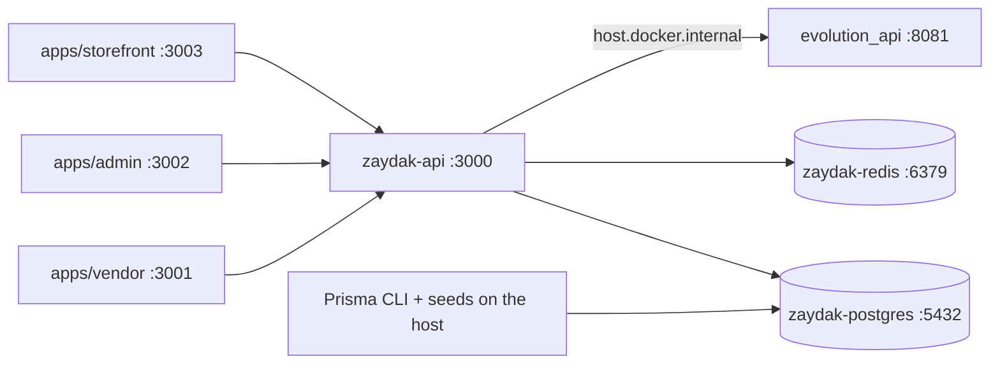

# Local Docker stack

**Last updated:** 2026-10-11

`docker-compose.yml` at the repo root runs the three long-lived pieces of the
platform as containers: PostgreSQL, Redis and the NestJS API. All three carry
`restart: unless-stopped`, so they come back with Docker Desktop after a reboot
and stay up until you stop them. The three Next.js apps still run on the host —
they are what you are usually editing, and Next's dev server over a Windows bind
mount is slower than it is worth.



## Commands

```bash
docker compose up -d --build     # build the API image and start all three
docker compose ps                # what is running, and whether it is healthy
docker compose logs -f api       # follow the API log
docker compose up -d --build api # rebuild after a code change
docker compose restart api       # restart without rebuilding
docker compose down              # stop everything; the data volumes survive
```

The API is `zaydak-api:local`, built from `back-end/Dockerfile`. There is no
watch mode: the image carries compiled JavaScript, so a source change needs a
rebuild. Keep using `npm run start:dev` on the host while you are actively
editing the API.

## Frontend reports a network error

Check `docker compose ps` first: Docker Desktop running and healthy Postgres /
Redis containers do not mean the API is listening. If `api` is `Restarting`,
read `docker compose logs --tail 100 api` before changing frontend URLs or CORS.
On 2026-10-11, an Instagram worker depended on customer-bot providers that its
module did not export, so Nest exited before opening port 3000. The fix exports
the shared providers and imports `AuthModule` for Instagram's resolver guards.

After changing module wiring, run `npm run check:di` in `back-end` before
rebuilding, then `docker compose up -d --build --no-deps api` from the root.
Confirm `http://localhost:3000/health` and `http://localhost:3000/ready` both
return 200; the second also checks Postgres and Redis. Restarting the old image
alone does not incorporate a source fix.

## The six things that are easy to get wrong

**`localhost` inside a container is the container.** `.env.development` says
`localhost` for Postgres and Redis because that is correct on the host. Compose
overrides `DATABASE_URL`, `REDIS_HOST`, `REDIS_PORT` and `REDIS_DB` with the
service names, and a real environment variable beats every `.env` file (see
[02 - Runtime Startup](../back-end/docs/02_runtime_startup/README.md#configuration-loading)),
so the same file is right in both places.

**`NODE_ENV` must stay `development`.** `ConfigModule` picks its env file off
`NODE_ENV`; set it to `production` and it looks for `.env.production`, ignores
the mounted `.env.development` entirely, and boots with an empty config.

**Schema pushes and seeds run on the host.** The runtime image installs with
`--omit=dev`, so it has no `ts-node` and none of the `npm run seed*`,
`migrate:local` or `check:drift` scripts work inside it. Postgres is published on
5432, so every one of those commands works unchanged from the host — including
`npx prisma db push --url $localDb`, which still needs its explicit `--url`.

**Env files are mounted, not copied.** `back-end/.env.development` and
`back-end/.env` are bind mounted read-only and parsed by Nest itself, so no
credential is ever baked into an image layer (`.dockerignore` excludes
`.env*`). ConfigModule still prefers `.env.development.local` when that file
exists on the host (Nest load order), but the compose stack does not mount it
— put Bunny / CDN overrides in `.env.development` (gitignored). Mounting
`.env` without `.env.development` (or the reverse) gives the container a
configuration the host never had, and it fails as a boot crash naming a
variable that is sitting in the file you did not mount. Editing either of them
needs a `docker compose restart api`, not a rebuild.

The trap underneath that is worth knowing on the host too: the first file to
define a key wins, and **an empty string still counts as defined**. So
`STRIPE_API_KEY=""` in `.env.development` does not mean "unset", it means the
real value in `.env` is unreachable. That is harmless for a credential whose
absence just disables a feature, and fatal for one whose client is built while
Nest wires the injector - `StripeService`, `AiModule`'s HttpModule factory and
LangChain's `ChatGroq` all throw on a blank key, and the app never opens a port.
Those keys are commented out in `.env.development` rather than set to `""`, with
the reason written at the top of the file.

**One CRITICAL on every boot is expected here.** `DeploymentSafetyService` reads
`DATABASE_URL`'s host and treats anything outside `localhost / 127.0.0.1 / ::1 /
0.0.0.0` as a deployment, so a compose service name (`postgres`) trips
`DEV_MODE_AGAINST_REMOTE_DB` and the warnings that follow it. The database
is the local one; only the hostname changed. Do not set
`DEPLOYMENT_SAFETY_ENFORCE=1` against this stack - it turns those findings fatal
and the API will refuse to boot.

`DevSinkAlertService` reads the same hostname and is noisy here for the same
reason: SMS resolves to the `console` sink on a developer's machine, which is
what the sink is for, so every boot against this stack logs
`DEV_SINK_PROVIDER_IN_PRODUCTION` for `SMS=console`. It never refuses a boot and
`DEPLOYMENT_SAFETY_ENFORCE` does not reach it. Running the API on the host
instead (`DATABASE_URL` on `localhost`) silences both checks.

**Evolution API is reached through `host.docker.internal`.** It has its own
compose file under `evolution-api/` and is not part of this stack. Compose sets
`EVOLUTION_API_URL` to `http://host.docker.internal:8081`, which answers HTTP 200
from inside the API container; `http://localhost:8081` from in there is the API
container itself and answers connection refused. So a Server URL saved through
the admin console has to be written with `host.docker.internal` as well - saving
`localhost` produces a verify failure that reads like a bad credential.

The URL alone configures nothing. `envFallback` in `provider-registry.ts` returns
null unless `EVOLUTION_API_URL` **and** `EVOLUTION_API_KEY` are both set, so
WhatsApp stays unconfigured until the key is supplied too - it is Evolution's own
`AUTHENTICATION_API_KEY`, which lives in the running `evolution_api` container.

## Data

`pgdata` and `redisdata` are declared `external`, pointing at `zaydak-pgdata`
and `zaydak-redisdata`. `docker compose down -v` cannot take the local database
with it. `back-end/uploads` is a bind mount rather than a volume, so files
uploaded under `STORAGE_DRIVER=local` are the same ones the host process sees.

Before running `docker compose up`, ensure the external volumes exist:

```bash
docker volume create zaydak-pgdata
docker volume create zaydak-redisdata
```

A Vercel preview cannot reach this stack on `localhost`. For a short trial,
tunnel port 3000 with ngrok and point `NEXT_PUBLIC_GRAPHQL_URL` at that HTTPS
origin — see [vercel-local-api-ngrok.md](vercel-local-api-ngrok.md). Production
still deploys the API to Render.

## Main files

- `docker-compose.yml` - the stack (repo root).
- `back-end/Dockerfile` - four stages; `runtime` is what compose runs.
- `back-end/.dockerignore` - keeps `node_modules`, `dist` and every `.env*` out of the build context.
- `scripts/dev-local.ps1` - the host-native bring-up, including Evolution API.
