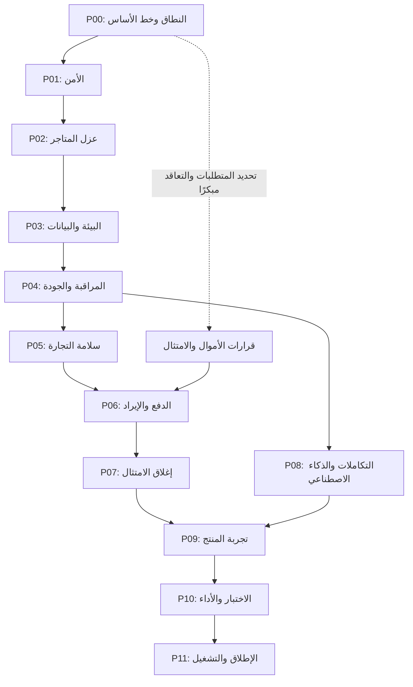

# خطة تجهيز زايدك للإنتاج

**تاريخ الإنشاء:** 2026-09-16 · **حالة التنفيذ:** بدأ التنفيذ المحلي على P01 وP02 وP04 وP05 وP09؛ لا مرحلة مغلقة بعد P00.

الهدف هو إصدار تجاري يمكن تشغيله ودعمه: آمن بين المتاجر، صحيح ماليًا، قابل للنشر والاستعادة، وله أدلة اختبار وتشغيل. نتوقف عن إضافة ميزات توسعية، وننجز الإصلاحات والفجوات اللازمة للإصدار فقط.

هذه ملفات تنفيذ مستقبلية طلبها صاحب المشروع. لا تمثل شهادة جاهزية، ولا تغيّر حالة الإنتاج بمجرد كتابتها. **«جاهز 100%» يعني اجتياز كل شروط نطاق الإصدار المعتمد، مع صفر حاجب إطلاق مفتوح؛ ولا يعني انعدام كل عيب محتمل أو إكمال كل أفكار المنتج.**

## نقطة البداية ومصداقية الأدلة

- المرجع: [تقرير الجاهزية بتاريخ 2026-09-16](../investor-readiness-report-ar.md)، ثم التحقق من الكود والبيئة عند بدء كل مهمة.
- تمت قراءة ملفات ومراجعة عينات من الكود أثناء إعداد الخطة؛ لم تُشغّل اختبارات التطبيق أو يُفحص الإنتاج الحي ضمن هذه المهمة.
- مرجع Git أثناء الإعداد: `3b8ff7218423eb89f6143c8d38a8c764a7e7439d`. توجد تعديلات محلية سابقة، لذلك هذا المعرّف وحده **لا يصف** كامل الملفات التي بُنيت عليها الخطة؛ تثبيت نسخة قابلة لإعادة الاختبار من مهام P00.
- جداول القدرات في ملحق التقرير تحتوي **458 صفًا عبر 17 نطاقًا**، محفوظة جميعًا في [سجل تغطية التقرير](report-coverage.md). جداول الملخص داخل الملحق لا تُحتسب قدرات إضافية؛ يراجع P00 التداخل والنطاق لكل صف.
- لا ننقل نسبة 52% أو تقديرات الأيام والتكلفة أو نتائج الاختبارات في التقرير إلى لوحة التنفيذ بوصفها قياسات حديثة. التقدم يُقاس بشروط اجتياز موثقة.

## الملفات وترتيب العمل

| المرحلة | الملف | النتيجة المطلوبة قبل إغلاقها | الاعتماد الأساسي |
|---|---|---|---|
| P00 | [تثبيت نطاق الإصدار وخط الأساس](00-scope-and-baseline.md) | نطاق مكتوب، نسخة مرجعية، ملاك مهام، قرارات محددة | نقطة البداية |
| P01 | [الأمن والهوية والأسرار](01-security-and-identity.md) | جلسات صحيحة وأسرار مدوّرة وإغلاق مسارات التسريب | P00؛ الاحتواء العاجل يبدأ فورًا |
| P02 | [عزل المتاجر والصلاحيات](02-tenant-isolation-and-permissions.md) | إثبات منع القراءة والكتابة بين المتاجر لكل سطح | P01 |
| P03 | [البيئة والبيانات والنشر](03-runtime-data-and-deployment.md) | بيئة مستقرة، ترحيلات قابلة للتكرار، استعادة مثبتة | P01 وP02 |
| P04 | [المراقبة وبوابات الجودة](04-observability-and-ci.md) | اكتشاف الأعطال ورفض التغيير المكسور آليًا | P03؛ إعداد CI والمراقبة يبدأ مبكرًا |
| P05 | [سلامة دورة التجارة](05-commerce-integrity.md) | سعر وطلب ومخزون وضريبة واسترجاع متطابقة | P02 وP03 وP04 |
| P06 | [الدفع والعمولة والتسويات](06-payments-and-revenue.md) | قبض واسترجاع وعمولة وصرف قابلة للمطابقة | P05 وقرار مسار الأموال |
| P07 | [الامتثال وحقوق البيانات](07-compliance-and-data-rights.md) | أدلة استيفاء الالتزامات التي تنطبق على الإصدار | يبدأ تحديد الالتزامات في P00؛ الإغلاق بعد P05 وP06 |
| P08 | [التكاملات والذكاء الاصطناعي](08-integrations-and-ai.md) | تكاملات مجرّبة وحدود استهلاك وفشل آمن | P02 وP03 وP04؛ المسارات المالية بعد P05 وP06 |
| P09 | [اكتمال تجربة العميل والتاجر والإدارة](09-product-and-experience.md) | رحلة قابلة للاستخدام والدعم بلا أزرار أو وعود معطلة | P05 وP06 وP07 وP08 للإغلاق الكامل |
| P10 | [الأداء والتحقق الشامل](10-performance-and-e2e.md) | اختبارات على إصدار واحد تثبت الرحلات والتزامن والسعة | P01–P09 |
| P11 | [الإطلاق والتشغيل بعده](11-release-and-operations.md) | إطلاق تدريجي، متابعة، تراجع مجرّب وتسليم تشغيل | P00–P10 |

كل ملف مرحلة يحتوي الهدف، المشكلة، الأدلة، الحل، نطاق العمل، المهام، المخرجات، الاختبارات، شروط الاجتياز، والتراجع وسجل التنفيذ. **P00 مكتملة.** P01 وP02 وP04 وP05 وP06 وP08 وP09 قيد التنفيذ الجزئي. إعداد الملفات لا يساوي إغلاق المرحلة.

الرسم يوضح المسار الرئيسي؛ الاعتمادات التفصيلية في ملفات المراحل. أرقام المراحل ترتيب إغلاق، ويمكن العمل بالتوازي عندما لا يعتمد العمل على نتيجة لم تُحسم.

## قواعد العمل من اليوم

1. **تجميد الميزات:** لا ميزات منافسة أو إعادة تصميم شاملة. الاستثناء إصلاح أو قدرة لازمة لإغلاق شرط إصدار، مثل ضبط الضريبة أو معالجة نزاع في النطاق المعتمد.
2. نختار المهمة التالية من أول مرحلة مفتوحة اعتمادًا على خطورتها؛ نعالج كشف بيانات أو توقف خدمة فورًا مع حفظ الدليل.
3. كل مهمة لها معرّف، مالك مسمّى، معيار قبول واختبار مناسب. «أُضيف الكود» وحدها لا تغلق المهمة.
4. قبل الإصلاح نتحقق من الادعاء على النسخة الحالية. إذا كان أُصلح سابقًا نربط دليل الإغلاق؛ لا نعيد بناء الحل ولا نغلقه اعتمادًا على الوصف فقط.
5. لا نؤجل حاجب أمان أو مال أو امتثال ينطبق على النطاق. القدرة الاختيارية غير الجاهزة تحتاج قرار نطاق مكتوبًا وتعطيلًا من الخادم والواجهة واختبار منع الوصول المباشر.
6. لا تُستخدم حسابات أو بيانات عملاء حقيقية للاختبارات التخريبية. بوابات الإنتاج تُنفذ بعد نجاحها في بيئة اختبار مماثلة.
7. الإطلاق العام يحتاج كل بوابات الإصدار. تجربة بدعوات لا تُعتبر تلقائيًا إطلاقًا تجاريًا مكتملًا؛ تغيير المسار يسجّل قرارًا واضحًا.
8. نحدّث وثائق السلوك ومرجع API مع إصلاحاتهما وفق قواعد المستودع. الخطة تصف المطلوب، ووثائق الميزات تصف الموجود.

## توزيع العمل والتقدير

| المسار | المسؤول المطلوب | ما يبدأ مبكرًا |
|---|---|---|
| المنتج والقرارات | صاحب المنتج | نطاق الإصدار، السوق، وسائل الدفع، التسعير، القدرة التشغيلية |
| الأمن والخادم | مسؤول Back-end/Security | P01 وP02 ثم P05 وP06 |
| التشغيل | مسؤول Infrastructure | احتواء البيئة، P03، مراقبة P04 وتجارب الاستعادة |
| الواجهات والجودة | مسؤول Frontend/QA | جرد الرحلات، CI، إصلاحات P09 واختبارات P10 |
| الدفع والامتثال | صاحب المنتج مع المختصين ومزوّد الدفع | مراجعة الانطباق والعقود من P00 |

قد يشغل الشخص نفسه أكثر من دور، لكن لا نضع أسماء أو قدرة فريق غير مؤكدة. نحدد تقدير كل مهمة **بعد P00** من حجمها الحالي، وتوفر الحسابات والقرارات، وعدد المنفذين. نجمع أيام عمل الأشخاص منفصلة عن مدة انتظار مزوّد أو موافقة؛ لا نعتمد موعدًا ثابتًا من التقرير.

## آلية المتابعة وإغلاق المرحلة

- حالات المرحلة: `لم تبدأ` ← `قيد التنفيذ` ← `قيد التحقق` ← `مكتملة`، أو `محجوبة` مع سبب ومالك للمتابعة. كتابة «مكتملة» تستلزم أدلة جميع شروطها.
- صناديق المهام: `[ ]` لم تبدأ، `[~]` جارية، `[x]` اجتازت التحقق. لا نضع علامة نجاح على اختبار لم يُشغّل.
- تحديث يومي قصير داخل سجل المرحلة: ماذا أُغلق، رابط الدليل، ما الذي يحجب التالي، والخطوة التالية.
- ملخص كل دفعة عمل: معرّف النسخة، المهام المغلقة، نتائج الاختبارات، المتبقي. أي تغيير جوهري بعد التحقق يعيد الاختبارات المتأثرة.
- الدليل يشمل الأمر أو السيناريو، البيئة، التاريخ، النتيجة الفعلية، ومعرّف النسخة. نحذف الأسرار والبيانات الشخصية من اللقطات والسجلات.
- راجع [قالب المهمة ودليل الإغلاق](task-template.md) و[سجل القرارات](decisions.md) و[سجل الحاجبات](blockers.md).

## العلاقة مع الوثائق الموجودة

| المرجع | دوره |
|---|---|
| [TODO.md](../../TODO.md) و[PRIORITIES.md](../../PRIORITIES.md) | المتراكم العام؛ تُربط البنود الحالية بمعرّفات المراحل بدل تكرار نسخ متعارضة |
| [Tap Commerce Platform — مؤجّل](../future-features/tap-commerce-platform.md) | اتجاه المدفوعات المستقبلي (D26)؛ خارج الإصدار؛ بلا تنفيذ |
| [تقرير الجاهزية](../investor-readiness-report-ar.md) | سجل الملاحظات التاريخي، لا نعدّل نتائجه لتبدو كأنها تحقق حديث |
| [قائمة الإطلاق القديمة](../go-live-checklist.md) | تفاصيل تشغيل نعيد التحقق منها؛ نوفّق التعليمات القديمة مع الكود قبل التنفيذ |
| [قرارات المال](../DECISIONS-NEEDED.md) و[قرارات AI والتكاملات](../DECISIONS-NEEDED-AI-INTEGRATIONS.md) | تفاصيل قرارات سابقة ينبغي الحفاظ عليها وتحديث نتيجتها |
| [جرد أسماء الأسرار](secrets-inventory.md) | P01-T07: أسماء ومواقع وملاك بلا قيم؛ يشمل الجداول المشفّرة |
| [سجل تدوير التشفير](p01-secret-rotation-log.md) | P01-T08/T09: أعداد وأبصام ونسخة احتياطية محلية بلا قيم؛ إلغاء إنتاج ملك تشغيل |
| [جرد العمليات المنشورة](operations-inventory.md) | P02-T01: REST/SSE + GraphQL كامل (240 Query / 371 Mutation، غير مصنّف 0). إثبات A/B الحيّ للأسطح عالية الأثر والفوترة. مراجعة مستقلة T10 لم تجرِ. |
| [جرد CI وlint الخلفي](p04-ci-inventory.md) | P04: Redis+Postgres، concurrency، scrub Sentry، eslint **569→0** وبوابة `lint:check` في CI؛ alerts/branch protection/staging محجوبة على التشغيل |
| [سجل تغطية التقرير](report-coverage.md) | يحدد مكان مراجعة كل صف في الجرد ويمنع سقوطه من الخطة |

**البداية العملية التالية:** فهرس credit-once مطبّق على Postgres المحلي `zaydak` (`20260917190000_credit_once_unique_index`) بعد inspect نظيف. فلاش سيل على `verifyCheckout` يطابق السلة والطلب. **كمل التالي:** تطبيق الفهرس على Neon؛ إثبات حفظ ضريبة حيّ (B37)؛ wallet على المعاينة؛ P03 Neon resolve ما زال محجوبًا بلا لوحة. لا تدوير أسرار، لا Tap، لا D26. Upstash المستضاف لم يُلمس.
