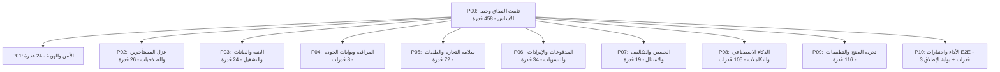

# وثيقة نطاق الإصدار — Release Scope V1 (مشروع Zaydak)

**تاريخ الاعتماد:** 2026-09-16  
**الحالة:** معتمد ومغلق في نهاية مرحلة P00  
**المصدر المرجعي:** [تقرير الجاهزية الاستثمارية](../investor-readiness-report-ar.md) · [سجل التغطية](report-coverage.md) · [سجل القرارات](decisions.md)

---

## 1. ملخص النطاق والهدف الأساسي

تم إغلاق وتثبيت نطاق الإصدار الأول (V1 Release Scope) لمنصة **Zaydak** بناءً على الفحص الفعلي للكود واختبارات خط الأساس ومراجعة جميع القدرات الـ 458 الواردة في ملحق أ لتقرير الجاهزية الاستثمارية.

الهدف من الإصدار V1 هو تقديم منصة تجارة إلكترونية متعددة المستأجرين (Multi-tenant E-Commerce SaaS) جاهزة للإنتاج، مستقرة أمنياً ومالياً وتشغيلياً، تغطي دورة التجارة الأساسية دون فجوات:
$$\text{Product} \longrightarrow \text{Cart} \longrightarrow \text{Checkout} \longrightarrow \text{Order} \longrightarrow \text{Payment} \longrightarrow \text{Inventory} \longrightarrow \text{Fulfillment}$$

---

## 2. الافتراضات التخطيطية ومحددات الإطلاق (Launch Assumptions)

1. **السوق المستهدف:** السوق السعودي (KSA) كإطلاق تجاري أساسي، مع دعم معايير التجارة الإلكترونية المحلية (ضريبة القيمة المضافة 15%، الفواتير الضريبية المتوافقة مع متطلبات هيئة الزكاة والضريبة والجمارك المرحلة الثانية ZATCA Phase 2، وسائل الدفع الشائعة).
2. **العملة:** الريال السعودي (SAR) كعملة الحساب والتسوية الأساسية، مع دعم عرض العملات المتعددة في واجهة المتجر.
3. **وسائل الدفع في V1:**
   - الدفع بالبطاقات الائتمانية وبطاقات مدى عبر بوابة Stripe Checkout.
   - الدفع عند الاستلام (COD) مع رسوم إضافية مضبوطة.
   - التحويل البنكي اليدوي مع رفع إيصال السداد والتحقق الإداري.
   - تم استبعاد البوابات الـ 13 غير المنفذة فعلياً من قائمة الخيارات المتاحة للمتاجر منعاً لوعود كاذبة.
4. **طبيعة المنتجات:** التركيز الكامل في V1 على **المنتجات الفيزيائية (Physical Goods)** ذات الشحن والتوصيل والمخزون، مع تأجيل المنتجات الرقمية (Digital Downloads) والمزادات (Auctions) إلى ما بعد V1.
5. **النطاقات والاستضافة:**
   - اعتماد النطاقات الفرعية الرسمية للمنصة ومسارات العناوين (`shop.zaydak.com` أو `zaydak.com/store/:slug`).
   - تأجيل ميزة النطاقات المخصصة بالكامل (Custom Domains CNAME) إلى ما بعد V1 لتلافي مشاكل ملفات تعريف الارتباط المشتركة للسلة (Cross-domain Cart Cookies) وضمان العزل التام للمستأجرين.

---

## 3. إحصائيات الجرد والفرز الإجمالي (Coverage Breakdown)

من أصل **458 قدرة وظيفية** مسجلة ومفهرسة بالتسلسل الكامل من `R-001` إلى `R-458` عبر 17 نطاقاً:

| التصنيف | العدد | النسبة | البيان |
|---|---:|---:|---|
| **داخل الإصدار (In-Scope)** | **417** | **91.0%** | قدرات معتمدة للتنفيذ والتحقق ضمن المراحل P01 → P10 |
| **خارج الإصدار (Deferred)** | **30** | **6.6%** | قدرات مؤجلة خارج V1 بقرارات موثقة (D11 → D26) |
| **مكررة (Duplicates)** | **11** | **2.4%** | قدرات مكررة محتفظة بمعرفاتها ومرتبطة بقدراتها الأصلية |
| **غير مفروزة (Untriaged)** | **0** | **0.0%** | تم فرز 100% من بنود الجرد بلا استثناء |
| **الإجمالي العام** | **458** | **100%** | سلسلة كاملة خالية من أي فجوات أو معرفات مفقودة |

---

## 4. توزيع القدرات المعتمدة على مراحل التنفيذ (Phase Allocation)

تم ربط كل قدرة داخل الإصدار أو مكررة بمهمة محددة ذات معايير قبول واختبارات إغلاق:

### تفصيل التوزيع العددي للمراحل

| المرحلة | اسم المرحلة ونطاق العمل | عدد القدرات المرتبطة | نطاق المهام المغطاة |
|---|---|---:|---|
| **P01** | الأمن والهوية والأسرار (Security & Identity) | 24 | P01-T01 → P01-T11 |
| **P02** | عزل المستأجرين والصلاحيات (Tenant Isolation) | 26 | P02-T01 → P02-T10 |
| **P03** | البنية التحتية والبيانات والتشغيل (Runtime & DB) | 24 | P03-T01 → P03-T12 |
| **P04** | المراقبة وبوابات الجودة والـ CI (Observability & CI) | 8 | P04-T01 → P04-T10 |
| **P05** | سلامة التجارة والكتالوج والطلبات (Commerce Integrity) | 72 | P05-T01 → P05-T14 |
| **P06** | المدفوعات والإيرادات والتسويات (Payments & Revenue) | 34 | P06-T01 → P06-T14 |
| **P07** | الحصص والتكاليف ومكافحة إساءة الاستخدام (Usage & Cost) | 19 | P07-T01 → P07-T14 |
| **P08** | الذكاء الاصطناعي والرسائل والتكاملات (AI & Integrations) | 105 | P08-T01 → P08-T23 |
| **P09** | تجربة المنتج والتطبيقات الثلاثة (Product Experience) | 116 | P09-T01 → P09-T25 |
| **P10** | الأداء واختبارات E2E والجاهزية (E2E & Release Readiness) | 3* | P10-T01 → P10-T22 |

*\* ملاحظة: مرحلة P10 تمثل البوابة النهائية للتحقق التكاملي واختبارات الحمل والتزامن لجميع المراحل الـ 417 قدرة داخل الإصدار (بعد نقل R-029/R-041/R-136 إلى D26).*

---

## 5. القدرات المؤجلة خارج الإصدار (Deferred Capabilities — 30 قدرة)

تم تأجيل هذه الميزات لعدم ضرورتها لقيمة المنتج الأساسية في V1 أو لكونها نماذج أولية غير مكتملة تمثل خطراً تشغيلياً أو أمنياً في حال فتحها:

| القرار | موضوع التأجيل | القدرات المتأثرة | مبرر التأجيل | شرط التعطيل قبل الإطلاق |
|---|---|---|---|---|
| **D11** | بيع المنتجات بالمزاد العلني | R-163 | ليست جوهرية لنموذج التجارة الأساسي في V1 | إخفاء واجهات المزادات وتعطيل طفرات الإنشاء |
| **D12** | المنتجات الرقمية وتسليم الملفات | R-164 | انقطاع سلسلة تسليم الملفات وتوليد روابط التنزيل | قصر نوع المنتج على الفيزيائي وتعطيل رفع الملفات الرقمية |
| **D13** | منظومة تنبيهات توفر المخزون عبر البريد | R-013, R-014, R-017, R-107 | تسريب بيانات المشتركين (PII) وغياب واجهات المتجر | إخفاء حقول الاشتراك وحماية/تعطيل استعلام المشتركين |
| **D14** | خدمة بايثون للذكاء الاصطناعي | R-385 | الخدمة الخارجية غير موجودة بالمستودع | اعتماد نماذج OpenAI/Gemini المباشرة وتعطيل عميل بايثون |
| **D15** | تحليلات الجلسات والإسناد التسويقي غير المسنودة | R-051, R-054 | غياب مصدر بيانات حقيقي في واجهة المتجر | إخفاء بطاقات الإسناد والجلسات غير المسنودة من لوحة التاجر |
| **D16** | منشئ التقارير المخصصة وتوقعات العملاء | R-053, R-057, R-058, R-063, R-064 | ميزات ذكاء أعمال متقدمة ومعقدة غير مطلوبة لـ V1 | الاكتفاء بتقارير المبيعات والمخزون والضرائب القياسية |
| **D17** | بنية اختبارات الانحدار البصري ومعرض المكونات | R-434 | أدوات بنية تحتية اختيارية غير مكتملة الإعداد | الاعتماد على اختبارات Vitest وPlaywright الوظيفية |
| **D18** | النطاقات المخصصة للمتاجر | R-357 | تعارض الجلسة وملفات تعريف الارتباط للسلة عبر CNAME | الاكتفاء بالنطاقات الفرعية ومسارات المتاجر الموحدة |
| **D19** | إنشاء الحسابات التلقائي عبر واتساب وتيليجرام | R-419 | ثغرات انتحال الهوية وتخطي المصادقة الصريحة | إلزام العميل بالتسجيل القياسي برمز OTP معتمد |
| **D20** | سجل أرباح الإحالة ونظام التسويق بالعمولة | R-004 | نموذج أولي غير مكتمل في دورة التسويات المالية | إخفاء روابط وعمولات الإحالة من لوحة العميل والتاجر |
| **D21** | أسئلة وأجوبة العملاء والتصويت عليها | R-002, R-006, R-008 | غياب واجهات المتجر والتكامل مع مسارات الإشراف | قصر تفاعل العملاء في V1 على تقييمات الشراء الموثقة |
| **D22** | متحكم الكاميرا ثلاثي الأبعاد 3D | R-439 | ميزة تجميلية غير أساسية تزيد حجم الحزم | إزالة المكون ثلاثي الأبعاد من شاشات العرض |
| **D23** | استوديو اللقطات المتعددة والكتابة على الصور | R-397, R-400, R-405 | استهلاك مفرط للميزانية وجودة تجريبية غير مستقرة | الاكتفاء بأدوات تحسين الصورة المفردة وإزالة الخلفية |
| **D24** | الزاحف غير المقيد لبيانات المتاجر الخارجية | R-080 | تجاوز سياسات robots.txt والمخاطر القانونية للحجب | قصر استيراد المتاجر على مفاتيح API الرسمية وملفات CSV |
| **D25** | المكونات غير المستخدمة والكود الميت في UI | R-435 | تنظيف الحزم المشتركة وتجنب تصدير شفرات ميتة | فحص شجرة التصدير في @repo/ui واستبعاد غير المستخدم |
| **D26** | سحب التاجر والمحفظة الداخلية كصرف | R-029, R-041, R-136 | نموذج المنصة كحافظة أموال التجار لم يعد الاتجاه؛ Tap Commerce Platform مؤجّل بلا تنفيذ | تجميد التطوير؛ الإبقاء على الكود الحي دون حلقة payout؛ لا تكامل Tap في V1 |

---

## 6. القدرات المكررة المحتفظ بها (Duplicate Capabilities — 11 قدرة)

تم الاحتفاظ بجميع المعرفات للحفاظ على إمكانية التتبع الكامل (Full Traceability) وربطها بالقدرة الأصلية ومهمة التحقق المعتمدة:

1. **R-007** (واجهات REST القديمة للتقييمات) $\rightarrow$ مكرر مع `R-012`، التحقق عبر `P02-T04`
2. **R-191** (الفواتير والمستندات) $\rightarrow$ مكرر مع `R-028`، التحقق عبر `P06-T04`
3. **R-198** (الكوبونات في السلة وإعادة التقييم) $\rightarrow$ مكرر مع `R-193`، التحقق عبر `P05-T06`
4. **R-256** (مساعد المتجر الذكي للزوار) $\rightarrow$ مكرر مع `R-250`، التحقق عبر `P08-T13`
5. **R-359** (رفض المضيف المجهول وكاش النطاق) $\rightarrow$ مكرر مع `R-358`، التحقق عبر `P09-T18`
6. **R-383** (توليد تضمينات المنتجات) $\rightarrow$ مكرر مع `R-166`، التحقق عبر `P08-T13`
7. **R-384** (البحث الدلالي الهجين في المنتجات) $\rightarrow$ مكرر مع `R-166`، التحقق عبر `P08-T13`
8. **R-406** (إعدادات استوديو التحسين المحفوظة) $\rightarrow$ مكرر مع `R-403`، التحقق عبر `P08-T13`
9. **R-422** (حسابات العملاء وجلسات المتجر المنفصلة) $\rightarrow$ مكرر مع `R-431`، التحقق عبر `P01-T04`
10. **R-452** (خلفية الشيدر لشاشات الدخول Mesh drift) $\rightarrow$ مكرر مع `R-443`، التحقق عبر `P09-T20`
11. **R-454** (حقل التظليل المتدرج DitherField) $\rightarrow$ مكرر مع `R-443`، التحقق عبر `P09-T20`

---

## 7. حاجبات الإطلاق الحرجة (Critical Launch Blockers)

تم حصر وتصنيف أخطر الفجوات التي تمنع الإطلاق للإنتاج وتعيين مهام علاجية لها:

1. **حاجبات الأمان والهوية (Security Blockers):**
   - خلط رموز التسجيل ورموز الوصول واستدعاء `me` دون `sub` صريح (`B10` $\rightarrow$ `P01-T01`).
   - بقاء محاولات OTP الفاشلة والقفل في الذاكرة المؤقتة دون تسجيل دائم (`B27` $\rightarrow$ `P01-T03`).
   - تدوير رموز التجديد غير الذري واحتمال تسريب الجلسات (`B20` $\rightarrow$ `P01-T04`).
   - استعادة كلمة المرور في واجهة المتجر كانت مفقودة؛ السطح واستهلاك OTP أُغلقا محلياً (`B11` $\rightarrow$ `P09-T03`). تسليم المزود الحي يبقى `B40`.

2. **حاجبات عزل المستأجرين (Tenant Isolation Blockers):**
   - إمكانية رد تاجر على أسئلة منتج متجر آخر (`B05` $\rightarrow$ `P02-T05`) — أُغلق محلياً بـ `assertShopScopedMutation`.
   - تعديل الأسئلة الشائعة FAQ لمتجر آخر (`B06` $\rightarrow$ `P02-T05`) — أُغلق محلياً بحراس الملكية.
   - الوصول إلى بث محادثة وكيل التاجر SSE دون التحقق من ملكية المتجر (`B08` $\rightarrow$ `P02-T06`) — أُغلق محلياً: الحارس + رفض `conversation_id` المزور.
   - كشف بيانات المشتركين بتنبيهات المخزون لجميع الحسابات الموثقة (`B09` $\rightarrow$ `D13` / `P02-T04`).
   - تنفيذ العمليات الجماعية من الوكيل الذكي دون تقييد بـ `shopId` (`R-251` $\rightarrow$ `P08-T14` / `P02-T04`).

3. **حاجبات المال والتسويات (Money & Commerce Integrity Blockers):**
   - معدل عمولة المنصة صفر دائماً ولا يُكتب في الإنتاج (`B01` $\rightarrow$ `P06-T01`).
   - طلب سحب أرباح التاجر واعتماد الصرف (`B02` $\rightarrow$ `D26`) — مجمّد؛ Tap Commerce Platform مؤجّل بلا تنفيذ.
   - تصادم أرقام الفواتير الناتجة عن دالة العشوائية الضعيفة (`B14` $\rightarrow$ `P06-T04`).
   - تباين حساب الكوبونات بين السلة والدفع النهائي والطلب (`B13` $\rightarrow$ `P05-T06`).
   - شراء منتجات متجر آخر عبر التلاعب بـ `createOrder` (`B04` $\rightarrow$ `P02-T04` / `P05-T04`) — أُغلق محلياً باختبار وحدة مع أو بدون `X-SHOP`.

---

## 8. معايير اجتياز الإطلاق (Launch Acceptance Criteria)

لا يعتبر الإصدار V1 جاهزاً للإطلاق التجاري إلا بعد استيفاء الشروط التالية:

- [ ] إغلاق جميع الحاجبات الحرجة (B01 → B42) بأدلة اختبار آلية وموثقة.
- [ ] اجتياز اختبارات العزل التام للمستأجرين عبر التحقق السلبي: فشل المتجر A قطعياً في قراءة أو تعديل أي مورد يخص المتجر B.
- [ ] تطابق كامل للحسابات المالية (مجموع الطلب = المجموع الفرعي + الضريبة + الشحن - الخصم) في جميع مراحل الشراء.
- [ ] اجتياز اختبارات التزامن (Concurrency Tests) لمنع الخصم المزدوج للمخزون أو الاستخدام المكرر لنفس الكوبون.
- [ ] اجتياز اختبارات E2E الشاملة لدورة حياة الطلب من التصفح حتى الدفع والشحن والاسترداد في مرحلة P10.
