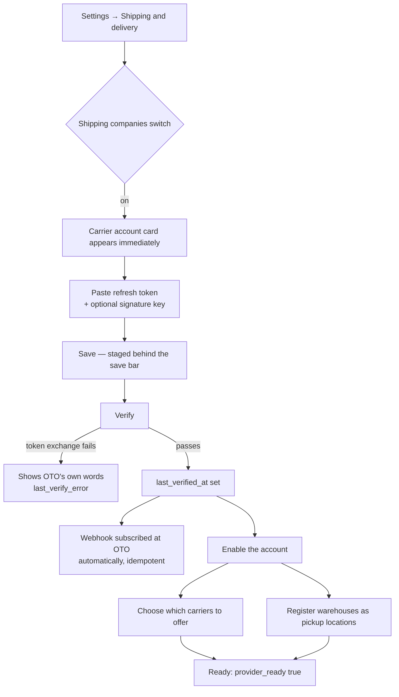
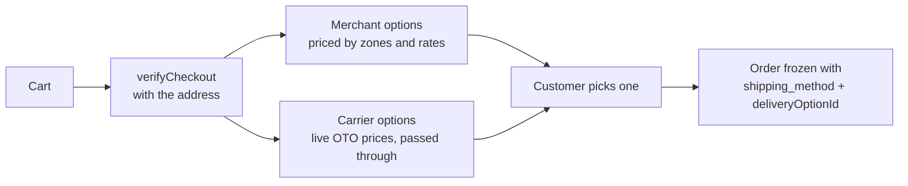
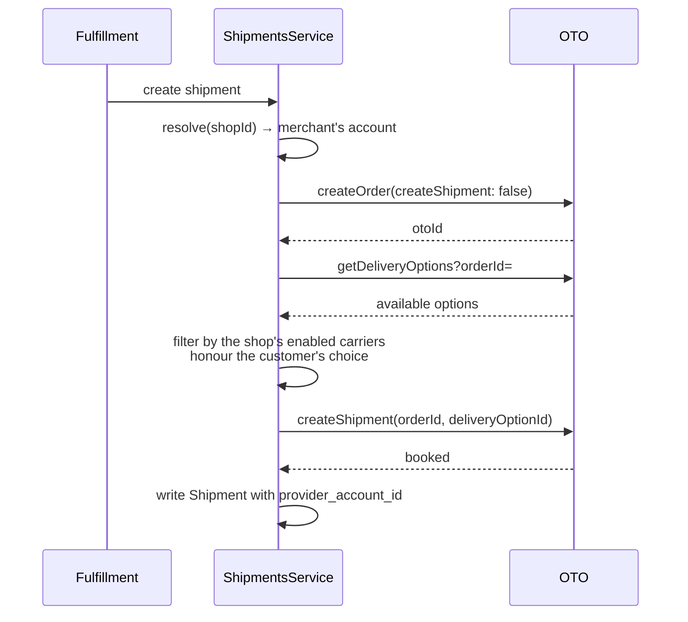

# OTO shipping — how it works, and what to review

**Written:** 2026-09-05 · **Revised:** 2026-09-05 · **For:** design review and sign-off
**Scope:** the whole carrier-shipping feature — the per-merchant account, the
booking path, status callbacks, and the platform/merchant credential split.

> **§2's first question was asked and answered, and the answer is that the trade
> stands.** A "Platform + Merchant override" architecture — a shop shipping on
> زيداك's own OTO account unless it connects one — was designed and built on
> 2026-09-05 and **rejected the same day**. §2 records what it was and why it
> was turned down. Everything else in this document describes the architecture
> as it is: a shop ships on its own OTO account, or it delivers the order
> itself.

This is a review document, not a reference. It states what the feature does, why
each load-bearing decision was taken, and — in the last two sections — what is
**not** proven and what is still open. The per-operation contracts live in
[api/oto-connection.md](../../back-end/docs/features/api/oto-connection.md) and
[api/shipping-providers.md](../../back-end/docs/features/api/shipping-providers.md).

---

## 1. What the feature is

A shop can offer its customers **its own delivery**, **live carrier prices**, or
both side by side, and the customer picks at checkout. Carrier delivery runs
through OTO, a multi-carrier aggregator, on **an OTO account the merchant owns**.

Two independent flags decide what is shown (`offers_merchant_delivery`,
`offers_carrier_delivery`; both off is legal for a downloads-only shop), and
`Shop.shipping_mode` survives only as how a shipment is *executed* and as the
fallback for orders frozen before channels existed.

**Carrier prices are passed through untouched** — no markup. That was an
explicit decision: a margin on shipping opens "who earns it", and it can wait.

---

## 2. The one architectural decision everything rests on

**Each merchant connects their own OTO account. The platform does not ship on
anyone's behalf.** A shop offers its customers **its own delivery**, **carrier
delivery on its own OTO contract**, or both — and there is no third thing.

The question has now been decided three times, and the third time confirmed the
second:

| | |
|---|---|
| **PHASE 6-B** (2026-08-24) | Platform-owned account, the Salla/Zid model: one زيداك OTO account books for every shop, merchants never see a token |
| **Reversed** (2026-08-31) | Back to per-merchant. Platform carries no shipping liability, each merchant is billed on their own contract |
| **Proposed and rejected** (2026-09-05) | "Platform + Merchant override" — both, chosen per shop by a stored `carrier_account_source` column. Built, then removed the same day |

**What it buys:** no financial exposure for the platform, no single point of
failure, real tenant isolation without judgement calls, each merchant billed on
terms they negotiated.

**What it costs, stated plainly:** every shop needs an OTO account, a token and
a signing key before it can ship with a carrier. That is real signup friction,
and it is **precisely the friction the aggregators centralise away**. A small
shop may never open an account and will stay on its own delivery — which is a
first-class channel here, not a degraded one.

### Why the two-tier version was rejected

It was not rejected for being unbuildable — it was built, with the tier stored
per shop, recorded on every shipment, and refusing to fall through when a
merchant's own token stopped verifying. It was rejected because of what it does
to the two things that actually matter:

- **Whoever holds the account holds the contract, the invoice and the
  liability.** A shop booking on زيداك's account means زيداك is invoiced for its
  parcels, and pass-through pricing means the shop was charged exactly what the
  carrier quoted — so the platform absorbs every difference, with no recharge
  mechanism and no obvious place to put one.
- **It costs the firewall.** The guarantee that no shipping code path can reach
  the platform credential is structural today and cannot survive a tier that
  needs to reach it. A narrower service wrapping the same credential is the same
  change wearing a different name.

**It cost zero migrations to build and zero to remove**, because a constraint
written five days before PHASE 6-B ("do not delete or repurpose the account rows
before checking production counts") had forced every schema delta since to be
purely additive.

### The firewall, and what actually enforces it

The platform still has an `IntegrationConfig(SHIPPING)` row. What stops it
becoming a silent fallback is **a missing dependency, not a rule**:

`ShippingProviderService` — which resolves the provider for every booking, quote
and cancellation — **takes no `IntegrationsService` at all**. There is no handle
in the shipping runtime with which a fallback could be written. Adding one is
the change a reviewer should stop, and so is a service that wraps the credential
more narrowly for the same purpose.

Two services in the module *do* hold `IntegrationsService`, and both are
deliberately outside the commercial path:

- `CarrierWebhookService` reads the **callback origin** — one public URL, no
  credentials.
- `NationalAddressService` holds the platform credential to **expand national
  address codes** — see §4.

---

## 3. The flows

### 3.1 Setup — what a merchant does once



The order of the cards **is** the setup order: connect + verify → which carriers
→ which warehouses. Neither later question can be answered before the account
exists, so the two dependent cards stay hidden and the blocker is named in one
line rather than left as a gap.

**Two things must both be true before a shop can ship:** the account is
`is_enabled` **and** `last_verified_at` is set. Enabled alone is not enough — a
token that never authenticated fails at the carrier mid-fulfillment, which is not
a state a settings screen should call ready.

**This is a precondition for carrier delivery, and only for carrier delivery.**
A shop that does none of it still sells and still delivers — its own delivery is
a first-class channel, priced by its own zones and rates, not a degraded mode.

### 3.2 Checkout — what a customer sees



`verifyCheckout` prices the order — subtotal, shipping, tax, discount — and the
client renders what comes back. **Money is never computed on the client.**

When the shop has no usable carrier account, the carrier list comes back **empty
with a reason** (`carrier_unavailable_reason`) rather than failing — a storefront
quote must never hard-fail. Seven distinct reasons are reported, because "no
carriers" had been indistinguishable from "we don't ship there".

### 3.3 Booking — two calls, and why



**Why two calls and not one.** `createOrder({createShipment: true})` delegates
the carrier decision to OTO's own account rules — so under a shared account every
shop would inherit the platform's, and a merchant's carrier choice would be
decoration. The two-step booking is the centrepiece of merchant carrier choice,
not a detail.

**The customer's pick is honoured or the booking refuses**
(`CHOSEN_CARRIER_UNAVAILABLE`). Substituting a cheaper company delivers a service
they did not buy, and they find out from the tracking page.

**`provider_account_id` is written in the same create.** It is tenant isolation,
not metadata — every inbound webhook is matched against it, so a null there would
leave the ownership check with nothing to compare. The argument carrying it into
the lookup is **required**, not optional: an optional one would let a caller that
forgot it get an unscoped lookup, the check quietly becoming no check.

### 3.4 Status callbacks — two independent checks

```
POST /webhooks/shipping/:provider/:accountId
        ↓
  load the account by id AND provider AND is_enabled
        ↓
  1 · authenticate   HMAC-SHA256 over "orderId:status:timestamp"
                     against THAT account's webhook_secret
        ↓
  2 · authorize      the account id goes INTO the shipment lookup
        ↓
  either fails → refused
```

**A valid signature proves the sender holds account X's key. It proves nothing
about whose parcel they named.** Merchant B can sign a payload perfectly with
their own key while naming merchant A's shipment; authentication passes, and only
the ownership check stops it. The attack is not hypothetical arithmetic.

The account id is passed **into** the WHERE clause rather than compared after
it, so a foreign shipment is *not found* rather than *refused* — a probe cannot
enumerate what other tenants hold. Dedupe is insert-to-lock on
`(provider, event_id)`; a missing signing key is **refused, never accepted on
faith**, and Refresh-tracking still covers status meanwhile.

**Registration is automatic and per merchant** (added 2026-09-05). With a
merchant-owned account there is no URL an operator can register on everyone's
behalf, so `verifyAccount` subscribes the account as its last step. It is
idempotent — the existing subscriptions are listed first, because `POST` creates
unconditionally and five presses of Verify would otherwise leave five live
subscriptions delivering every event five times.

---

## 4. The credential split — the newest decision, and the one to scrutinise

Added 2026-09-05, at your instruction. **Two credentials, two purposes:**

| Read | Account | Why |
|---|---|---|
| National address short code → full address | **Platform** | A national registry. Same code = same address for everyone, the call is free, no commercial terms affect it |
| Booking, quoting, cancelling, carrier list, pickup registration | **The merchant's** | Priced, billed and contracted per merchant |

**What was broken.** The lookup ran on the shop's own account and threw
`SHIPPING_PROVIDER_NOT_CONFIGURED` when there was none. With the storefront's
address form built on the short code, **a shop that had not connected OTO had
customers who could not enter an address and therefore could not buy.** A
merchant's shipping setup was deciding whether their customers could check out.
The customer chat bot hit the same failure saving a delivery address.

`enableCarrierPickup` now straddles both on purpose: it **reads** the address on
the platform and **registers** the pickup point on the shop's account — different
acts, and only the second is billed to anyone.

**There is no fallback to a shop's account**, deliberately: a fallback would put
two shops on two accounts for the same national registry, which is the
inconsistency being removed.

**⚠️ The consequence to weigh:** the platform SHIPPING row must be **enabled and
hold a working token**, because `resolve()` reads enabled rows only. It is no
longer the "kept but disabled" row of the original option C — it has two
sanctioned jobs, address lookup and the callback origin, and neither of them is
shipping. Nothing checks it on boot; if it is missing, address lookup fails
platform-wide and the first sign is a customer who cannot save an address.

The guarantee that keeps this from being a back door: `NationalAddressService`
exposes one method, that method returns an address, and the context it builds
**rejects** any pickup-location resolution — so nothing on this path can book.

---

## 5. Security posture

| | |
|---|---|
| **At rest** | AES-256-GCM, `SecretCryptoService`, keyed from `SECRETS_ENCRYPTION_KEY` |
| **Bound to the row** | The account id is the AAD, so a row copied into another shop **fails to decrypt** rather than quietly working under a new owner |
| **Never returned** | Only `••••` + last four. No field on any type can carry a plaintext |
| **Writes** | Decided by an explicit `touched` list, not value comparison — so a form seeded with masks cannot save `••••9U2x` as the token |
| **Audit log** | Field **keys** only. The values are exactly what must never be logged |
| **Tenant isolation** | `shop_id` in the WHERE clause, never a check after the read |
| **Webhook** | Authentication and ownership as two independent conditions, and the ownership argument is required rather than optional |
| **Platform credential** | Unreachable from the booking path — `ShippingProviderService` takes no `IntegrationsService`, so there is no handle to write a fallback with |

---

## 6. What is actually proven — read this before signing off

This is the section that matters most for a review, and it is uncomfortable.

### Verified against live OTO
- The refresh-token exchange (and therefore `verify`)
- The ten-carrier list
- National-address search
- **`createPickupLocation` through our own path** — `ahmed-electronics` has a
  registered warehouse at OTO (`zaydak-sy6l6tw8-jyylavvu`), created by
  `enableCarrierPickup`, not by a hand-built payload
- **Live rate quotes through our own checkout path** (2026-09-05). A real
  `verifyCheckout` for Riyadh → Jeddah returned **seven priced carrier options**
  from the sandbox — SPL PUDO 14.00, Safe Arrival 19.00, Stage Test 20.00, Adwar
  22.00, three SMSA services 66.55 SAR — with `carrier_unavailable_reason: null`
  and `shipping_available: true`. This exercises the whole quote chain:
  `expected-shipments` → `CarrierQuoteService` → `resolve(shopId)` → the
  merchant's own credential → `checkOTODeliveryFee` → the option list the
  customer sees.

### NOT verified against live OTO
- **Booking.** The whole two-step sequence has never run. *(Quoting now has —
  they are different endpoints, and the three defects below were all in booking.)*
- **Cancellation.**
- **Webhook delivery**, and **webhook registration** (built today).
- A full cycle: order → book → callback → track.

**Why this is the headline risk.** Three defects have been found in the booking
path so far. **All three were found by reading OTO's documentation or by a
side-probe — none by running it:**

| Defect | How it was found |
|---|---|
| `options` should have been `deliveryCompany` | Reading OTO's docs |
| `cancelShipment`, not `cancelOrder` | Reading OTO's docs |
| `contactEmail` missing | Side-probe with a manual payload |

Three out of three without ever executing the path. **Nothing suggests there is
not a fourth**, and quoting passing says nothing about booking — they are
different endpoints with different payloads, and all three defects were in
booking.

What changed on 2026-09-05 is that **nothing stands in front of the test any
more**. `ahmed-electronics` has a verified account, a warehouse registered at
OTO, stock in it, and a working quote. The remaining step is to place one order
and fulfil it.

### Verified by tests only
Back-end **5201 tests / 308 suites**, vendor **688 / 59**, `schema:check` (99
resolvers), `check:di`, zero lint errors in the touched directories. That covers
logic and contracts. It does not cover the carrier.

### A caveat on the test suite itself
Two tests in the pickup spec were passing **vacuously** until today — they called
a two-argument method with one argument, so the code was read as the shop id and
the mock returned the address regardless. Worth assuming that is not unique.

---

## 7. Open items, ranked by what they block

### Blocking a real test
1. **One sandbox booking round-trip** — the single highest-value action
   available, and now unblocked: place an order on `ahmed-electronics` and fulfil
   it. Everything in front of it is verified.
2. **Set `webhook_base_url`** on the platform SHIPPING row
   (`/integrations/shipping`). Until then nothing subscribes and the whole
   callback path is untested. Locally this needs a tunnel — a carrier posts from
   the public internet, so `host.docker.internal` will not do.
3. ~~Enable the platform SHIPPING row~~ — **already done locally** (`oto`,
   enabled, verified), which is why national-address lookup works. It still has
   to be configured per environment, and nothing checks it on boot. It is
   load-bearing for two things — national-address lookup for every shop and
   customer, and the callback origin — and for neither of them is it shipping.

### Product decisions, not code
4. **Non-Saudi customers cannot buy.** The address form is national-address-only;
   the written city/street/postcode fields were removed. Either build a manual
   fallback or decide the platform is Saudi-only — a legitimate position, but it
   should be a decision rather than a side effect.
5. **Merchant onboarding does not exist, and it is now the confirmed cost of the
   architecture.** No signup link, no "what is OTO", no guidance — just a
   credentials form. The two-tier design that would have removed this need was
   considered and rejected (§2), so the answer has to be onboarding rather than
   a platform account: a merchant who wants carrier delivery has to be walked
   through opening an OTO account. Their own delivery needs none of it, which is
   what keeps a shop sellable meanwhile.
6. **Delivery-option ranking** is "first surviving option" — not cheapest, not
   fastest. Live data shows **15 to 250 SAR on one route**. The customer picks at
   checkout now, so this only bites orders with no customer choice (draft
   conversion, merchant-created).
7. **COD caps are ignored.** `maxCodCents` comes back with every quote; an order
   over a carrier's cap is refused at booking when it could be refused before the
   customer ever picks it.

### Known gaps
8. **No de-registration.** A deleted or disabled account leaves its subscription
   live at OTO, posting to a receiver that will now 401 it.
9. **Nothing tells a merchant the platform has no callback origin.** Verify
   reports success, the account works, and status callbacks silently never
   arrive.
10. **Cost drift is invisible to the merchant.** Pass-through pricing means their
    margin is zero by design, so every quote error is a straight loss they cannot
    see. `Shipment.quoted_cost_cents` and `orderShippingEconomics` exist; the
    alert does not.
11. **Pickup locations are never deleted at OTO** — no delete in their API. A
    warehouse a merchant removes here stays there.
12. **`ShippingProviderLocation` carries two addressing schemes** (`shop_id` +
    `provider`, and legacy `account_id`). They have converged in meaning; collapse
    once the legacy rows are confirmed unreferenced.
13. **No integration test drives the real HTTP layer.** The cross-tenant
    guarantee is pinned at the controller and the service, not through a live
    request with a genuine HMAC.

### An unresolved external ambiguity
14. **Who generates the webhook signing key.** OTO's create-webhook page
    describes `secretKey` as the key they sign with (we supply it); their webhook
    page says the key "will be shared privately" (they supply it). **Their own
    docs contradict each other.** Both readings are handled — a stored key is
    registered and never overwritten, one is generated only when there is none —
    but only a live callback settles it.

---

## 8. Questions worth answering in the review

1. ~~Is the per-merchant trade the right one, knowing it costs every small shop
   an OTO signup?~~ **Asked and answered: yes.** The two-tier alternative was
   built on 2026-09-05 and rejected the same day — whoever holds the account
   holds the invoice, and the firewall is worth more than the convenience. (§2)
2. Is Saudi-only an accepted position, or does the manual address fallback get
   built? (§7.4)
3. Does the platform SHIPPING row being **enabled** sit right, now that it has a
   real job — and is a start-up assertion worth adding, given nothing checks it
   on boot? (§4, §7.3)
4. Is pass-through pricing with zero margin still the intent — and if so, does
   the merchant get told when a quote was wrong? (§7.10)
5. **What is the onboarding plan before the first merchant is asked to connect
   an account?** This is now the feature's confirmed adoption risk rather than
   one a platform tier might have absorbed. (§7.5)

---

## 9. Where the code is

| | |
|---|---|
| Back-end module | `back-end/src/shipping-providers/` |
| Adapter | `providers/oto.provider.ts`, `providers/oto.api.ts` |
| Credentials | `shipping-provider-account.service.ts` |
| Resolution + the firewall | `shipping-provider.service.ts` |
| Webhook subscription | `carrier-webhook.service.ts` |
| Platform address lookup | `national-address.service.ts` |
| Inbound callbacks | `back-end/src/shipments/shipping-webhooks.controller.ts` |
| Vendor UI | `apps/vendor/src/features/shipping/components/providers/` |
| Overview | [shipping-providers.md](../../back-end/docs/features/shipping-providers.md) |
| API contracts | [api/oto-connection.md](../../back-end/docs/features/api/oto-connection.md) · [api/shipping-providers.md](../../back-end/docs/features/api/shipping-providers.md) · [api/shipments.md](../../back-end/docs/features/api/shipments.md) |
| Reversal rationale | [oto-per-merchant-account.md](../future-features/oto-per-merchant-account.md) |
| Closing sequence | [oto-remaining.md](../future-features/oto-remaining.md) — **dated 2026-08-28, pre-reversal; its item 4 is now wrong** |
