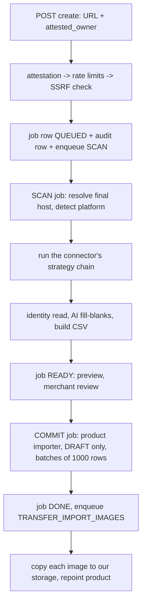

# Store import ("scan my old store"): how the scraping works, for a Laravel port

**Written:** 2026-09-30
**Source of truth:** `back-end/src/store-import/` (NestJS + Prisma + BullMQ + PostgreSQL)
**Audience:** a PHP/Laravel back-end developer re-implementing the same feature

This document explains what the scraper does, in the order it does it. It lists every constant and every trap we have already hit in production. Where the Node implementation relies on something PHP does differently, it gives a Laravel/PHP equivalent. File references point at the TypeScript source so you can read the original when something here is unclear.

---

## 0. The feature in one paragraph

A merchant types the URL of their old store (Shopify, WooCommerce, or any other site) and ticks "I own this store". They get their catalogue back as **draft** products in their new shop: titles, descriptions, prices, sale prices, variants, SKUs, barcodes, images and tags.

The work happens in two steps, with a job id between them:

- **Scan.** Reads the source and writes nothing to the catalogue. It produces a preview.
- **Commit.** The merchant approves, and the products are written as DRAFT. Images are then copied onto our own storage in the background.

## 1. The rules everything else follows

1. **Extraction never writes products.** The pipeline is scanner → normalized product drafts → the *same* product importer a CSV upload uses. In our case the drafts are serialized as a CSV. There is one product writer, not two. If your app already has a bulk or CSV importer, feed it; do not write a second writer.
2. **Scan and commit are separate jobs.** A scan writes nothing, which makes it safe to retry and makes the preview honest.
3. **Every imported product lands as DRAFT.** Never copy the source's published state, and never let a scan fill a `status` field.
4. **Stock is never invented.** Public endpoints only say "available: true/false", so quantity is 0 and the merchant sets it. `available ? 999 : 0` was rejected because it publishes a fake stock level.
5. **Money is integer minor units (cents) end to end.** It is parsed exactly once and never goes through float arithmetic on a formatted string.
6. **A strategy that finds 0 products means "try the next one", never "the store is empty".** `NO_PRODUCTS` is raised only once the whole chain has run cleanly.
7. **Our server fetches a stranger's website on a merchant's say-so.** That brings a set of obligations:
   - an ownership attestation, and an audit row for every scan;
   - three rate limits that **fail closed**;
   - an SSRF guard on every request and every redirect hop;
   - polite concurrency;
   - an honest User-Agent;
   - bounded response bodies.

## 2. Pipeline and job lifecycle



Job statuses:

```
QUEUED -> DISCOVERING -> EXTRACTING -> NORMALIZING -> READY -> IMPORTING -> DONE
                                          (any running state) -> FAILED | CANCELLED
```

- `READY` means the CSV exists and **nothing has been written**.
- `DONE`, `FAILED` and `CANCELLED` are terminal.
- Every status change is a compare-and-set, e.g. `UPDATE ... SET status = 'EXTRACTING' WHERE id = ? AND status IN ('DISCOVERING')`. If it matches zero rows, the job was cancelled under us and the worker stops with `STORE_IMPORT_INVALID_STATE`. Do the final `READY` write the same way, as our TypeScript does since 2026-10-01 (`updateMany` matching `NORMALIZING`): a plain update there let a cancel that landed during NORMALIZING be overwritten.

---

## 3. Admission: the create endpoint, before anything is fetched

The order below is deliberate. Each check is cheaper and more local than the next, and **only the last one touches the network**, so a refused request never causes a DNS lookup against someone else's host.

1. **Attestation.** If `attested_owner !== true`, return `STORE_IMPORT_OWNERSHIP_NOT_ATTESTED` (422). Not audited, because it is just an unticked checkbox.
2. **Local URL parse, with no DNS.** The URL must be `http`/`https` with a host. Strip the username, password and `#fragment`. If it fails, write an audit refusal and return `STORE_IMPORT_URL_BLOCKED`.
3. **Rate limits.** Consumed in this order. All three **fail closed**: if Redis is unreachable, refuse.

   | Key | Limit | Window |
   |---|---|---|
   | `rl:store-import:shop:{shopId}:hour` | 5 | 1 hour |
   | `rl:store-import:shop:{shopId}:day` | 20 | 1 day |
   | `rl:store-import:host:{sourceHost}:day` | 10 | 1 day, **across all shops** |

   `sourceHost` is lowercased, with any trailing `.` removed. The per-host key is what makes this an abuse control rather than a throttle: one store scanned over and over from several shops looks normal to every per-shop limit.

   On refusal, write an audit row (`ACCESS`, `refused: true`, reason and ceiling) and return `STORE_IMPORT_RATE_LIMITED`, with `retry_after_seconds` in the error detail.
   In Laravel, `RateLimiter` throws when the cache store is down. Catch that and **refuse** rather than letting the request through.
4. **SSRF check** (section 5.2). Resolve DNS; every resolved address must be public. Otherwise return `STORE_IMPORT_URL_BLOCKED`, with **no network detail in the message**: "resolves to 10.0.0.5" turns the field into a port scanner.
5. **Insert the job row:**
   - `status = QUEUED`
   - `source_url` = the normalized URL
   - `source_host` = the lowercased host
   - `scope` = `STORE` or `PRODUCT`
   - `requested_platform` = `AUTO`, `SHOPIFY` or `WOOCOMMERCE`
   - `attested_owner = true`
6. **Audit row, marked sensitive and kept long-term.** It records user, shop, URL, scope, platform, IP and user agent. It is the only thing that can answer a complaint from the real owner of the source store.
7. **Enqueue the SCAN job** with a unique id `scan:{jobId}`, so a double-submitted form cannot start two crawls. Use 3 attempts with exponential backoff starting at 15 s.

**Plan quota.** The quota key is `catalog.store_import`, counted per month. The limits are FREE 0, BASIC 1, GROW 5, ADVANCED 20, PLUS unlimited.

- One unit is reserved when a `STORE` scan starts. A retry reuses the same reservation.
- A `PRODUCT` scan books nothing.
- The reservation is committed on `DONE` and released on `FAILED`/`CANCELLED`. The exception is a run that already wrote products: it is committed, not refunded.

**Scope.**
- `STORE` imports the whole catalogue.
- `PRODUCT` imports one product page. It discovers nothing, reads no sitemap and follows no links. It also **never runs a "whole catalogue" strategy** (Shopify `products.json`, the Woo Store API): those page through the whole store, so a single-product import would return every product.

There is deliberately **no admin endpoint** that starts an import on a merchant's behalf, because that would make the attestation meaningless.

---

## 4. The scan job, step by step

Source: `store-import.service.ts` → `scanJob`.

1. **Load the job.** If its status is not one of `QUEUED`, `DISCOVERING`, `EXTRACTING` or `NORMALIZING`, return without doing anything. This handles a queue redelivery after the scan has already finished; never re-crawl a store because a queue retried.
2. **Reserve the plan quota** (STORE scope only).
3. **Check the paid provider.** `providerAvailable` is true when ScrapingBee is configured and under its monthly credit cap (section 11).
4. **Open a scan session.** A session holds three things:
   - the guarded HTTP client, whose connection pools must be closed in `finally`;
   - a cancellation flag;
   - a progress callback.
5. **Move to `DISCOVERING` and resolve the final host.** GET the base URL and take the hostname of the URL it finally landed on after redirects. This becomes `source_host`, the namespace of the identity map.
   - Do **not** just strip `www.`: `www.x.com` and `x.com` can be different sites. Ask the site where it lives.
   - If that request fails, fall back to the typed host. A store that will not serve its home page may still serve `products.json`.
6. **Detect the platform and pick a connector** (section 6).
   - If the merchant named a platform, their choice wins.
   - Detection still runs, and a disagreement is logged: it explains a scan that comes back empty.
   - Save `detected_platform` and `source_host`.
7. **Move to `EXTRACTING` and run the strategy chain** (section 7).
8. **Move to `NORMALIZING`**, then:
   - **Identity read** (section 14.1). Products imported before get their existing product id written into the draft, so the importer updates them instead of creating duplicates.
   - **AI fill-blanks** (section 14.3). Fills a missing Arabic/English name or description, a category and tags. Never throws, never overwrites.
   - **Serialize** to the canonical CSV (section 13). If the file is over 24 MB, fail with its own error code: the cause is long descriptions, not too many products.
   - **Missing-from-source report** (STORE scope only). Products previously imported from this host that this scan did not return. **Reported only, never acted on.**
9. **Write `READY`** with:
   - the CSV and its size;
   - the counts: `discovered_urls`, `products_found`, `skus_found`, `images_found`;
   - `source_currency`, or null when the source stated none;
   - provider spend;
   - the `report` JSON: strategy trace, identity index, image lists per handle and the missing list.
10. **On error:**
    - A *decision* (unsupported platform, no products, file too large, blocked URL) fails the job immediately, with no retry.
    - A *fault* (network, DB) is retried by the queue. The job is marked `FAILED` only when the last attempt is spent. A row that says FAILED while the queue still plans a retry is lying to the merchant.
    - The `error` column holds a **code**, never an exception message: socket errors name hosts and internal addresses.
    - The strategy trace is saved into `report.diagnostics`, so a failed job still shows "what we tried".

**Progress writes.**
- Throttle them to at most one every 2 s per job.
- Update only while the job is still in a running status.
- A progress frame whose unit is `products` updates `products_found`; a frame whose unit is `pages` updates `discovered_urls`. Never write a page count into `products_found`: a failed crawl once showed "59 products" that were really 59 pages read.

---

## 5. The safe HTTP client (the only way to touch the source)

Source: `http/guarded-fetch.ts` and `common/security/ssrf-guard.ts`.

### 5.1 Rules

- **Re-vet every request and every redirect hop.** Re-resolve DNS, require every address to be public, then **pin the TCP connection to those vetted IPs**. A scan is thousands of requests over minutes; checking once at create time leaves a DNS-rebinding window open for the whole scan.
- **Follow redirects manually**, at most **5**. Each target goes back through the guard. A public host answering `302 Location: http://10.0.0.5/` is the classic bypass, and it must end in `STORE_IMPORT_URL_BLOCKED` (a refusal), not "unreachable".
- **One 20 s deadline for the whole call**, redirects included, not 20 s per hop.
- **Cap the body at 8 MB.** Reject when `Content-Length` declares more, and abort the stream the moment it crosses the cap. Never read the whole body first and measure it afterwards.
- **Identify yourself honestly.** We send `ZaydakStoreImport/1.0 (+merchant-initiated catalogue migration)`. Do not spoof a browser; a source that wants to refuse us must be able to.
- **Decode using the `charset` in `Content-Type`**, falling back to UTF-8. Legacy Arabic themes still serve `windows-1256`, and reading those as UTF-8 destroys every Arabic title.
- **A 404 or 500 is an answer (`ok = false`), not an exception.** Strategy 1 reads a 404 and moves on to strategy 2. Only transport problems throw; they throw `STORE_IMPORT_SOURCE_UNREACHABLE`, with the real reason logged and never shown.
- **Return only** `ok`, `status`, `finalUrl`, `contentType` and the body text.
- **Read the body eagerly, even when the caller only checks the status**, so no socket is left open. Close the pools when the scan ends.

### 5.2 Blocked address ranges

| IPv4 | IPv6 |
|---|---|
| `0.0.0.0/8`, `10.0.0.0/8`, `100.64.0.0/10` (CGNAT), `127.0.0.0/8`, `169.254.0.0/16` (includes cloud metadata `169.254.169.254`), `172.16.0.0/12`, `192.0.0.0/24`, `192.168.0.0/16`, `198.18.0.0/15`, `224.0.0.0/4`, `240.0.0.0/4` | `::`, `::1`, `fe80::/10`, `fc00::/7`, `ff00::/8` |

A few more rules:
- IPv4-mapped or -compatible IPv6 (`::ffff:10.0.0.1`, `::10.0.0.1`) is judged as the embedded IPv4.
- The hostnames `localhost`, `*.localhost`, `*.local` and `*.internal` are refused without a lookup.
- A host that does not resolve is refused.
- Anything unparseable is treated as blocked (fail closed).

### 5.3 Laravel / PHP sketch

`FILTER_FLAG_NO_PRIV_RANGE | FILTER_FLAG_NO_RES_RANGE` does **not** cover CGNAT, `198.18/15` or `192.0.0/24`, so use an explicit list. `CURLOPT_RESOLVE` does the pinning, and it keeps the original hostname for SNI and TLS verification.

```php
use GuzzleHttp\Psr7\Uri;
use Symfony\Component\HttpFoundation\IpUtils;

final class SsrfGuard
{
    private const V4 = ['0.0.0.0/8', '10.0.0.0/8', '100.64.0.0/10', '127.0.0.0/8',
        '169.254.0.0/16', '172.16.0.0/12', '192.0.0.0/24', '192.168.0.0/16',
        '198.18.0.0/15', '224.0.0.0/4', '240.0.0.0/4'];
    private const V6 = ['::/128', '::1/128', 'fe80::/10', 'fc00::/7', 'ff00::/8'];

    /** @return array{0: Uri, 1: list<string>} the URI and the vetted IPs */
    public function assertPublic(string $raw): array
    {
        try { $uri = new Uri(trim($raw)); } catch (\InvalidArgumentException) { throw new UrlBlocked('invalid_url'); }
        if (! in_array($uri->getScheme(), ['http', 'https'], true) || $uri->getHost() === '') {
            throw new UrlBlocked('scheme');
        }
        $host = strtolower(trim($uri->getHost(), '[]'));
        if ($host === 'localhost' || preg_match('/\.(localhost|local|internal)$/', $host)) {
            throw new UrlBlocked('non_public');
        }
        $ips = filter_var($host, FILTER_VALIDATE_IP) ? [$host] : $this->resolve($host);
        if ($ips === []) {
            throw new UrlBlocked('unresolved');
        }
        foreach ($ips as $ip) {
            if ($this->isBlocked($ip)) throw new UrlBlocked('non_public');
        }
        return [$uri, $ips];
    }

    private function resolve(string $host): array
    {
        $v4 = gethostbynamel($host) ?: [];
        $v6 = array_column(@dns_get_record($host, DNS_AAAA) ?: [], 'ipv6');
        return array_values(array_unique([...$v4, ...$v6]));
    }

    private function isBlocked(string $ip): bool
    {
        if (preg_match('/^::(ffff:)?(\d{1,3}(?:\.\d{1,3}){3})$/i', $ip, $m)) {
            $ip = $m[2];                       // IPv4 in disguise: judge the IPv4
        }
        if (filter_var($ip, FILTER_VALIDATE_IP, FILTER_FLAG_IPV4)) return IpUtils::checkIp($ip, self::V4);
        if (filter_var($ip, FILTER_VALIDATE_IP, FILTER_FLAG_IPV6)) return IpUtils::checkIp($ip, self::V6);
        return true;                           // not an IP: fail closed
    }
}
```

```php
use GuzzleHttp\Client;
use GuzzleHttp\Exception\TransferException;
use GuzzleHttp\Psr7\Uri;
use GuzzleHttp\Psr7\UriResolver;

final class GuardedHttp
{
    public const TIMEOUT_SECONDS = 20;
    public const MAX_BYTES       = 8 * 1024 * 1024;
    public const MAX_REDIRECTS   = 5;
    public const USER_AGENT      = 'YourBrandStoreImport/1.0 (+merchant-initiated catalogue migration)';

    public function __construct(private readonly SsrfGuard $guard, private readonly Client $client) {}

    public function get(string $url, array $headers = []): GuardedResponse
    {
        $deadline = microtime(true) + self::TIMEOUT_SECONDS;

        for ($hops = 0; ; $hops++) {
            [$uri, $ips] = $this->guard->assertPublic($url);        // throws UrlBlocked on every hop

            $remaining = $deadline - microtime(true);
            if ($remaining <= 0) throw SourceUnreachable::because('timeout', $url);

            $port   = $uri->getPort() ?? ($uri->getScheme() === 'https' ? 443 : 80);
            $pinned = implode(',', array_map(fn ($ip) => str_contains($ip, ':') ? "[$ip]" : $ip, $ips));

            try {
                $res = $this->client->request('GET', (string) $uri, [
                    'allow_redirects' => false,
                    'http_errors'     => false,
                    'stream'          => true,
                    'timeout'         => $remaining,
                    'connect_timeout' => min(10, $remaining),
                    'headers'         => ['User-Agent' => self::USER_AGENT, 'Accept' => '*/*'] + $headers,
                    'curl'            => [
                        CURLOPT_RESOLVE   => ["{$uri->getHost()}:{$port}:{$pinned}"],  // pin to vetted IPs
                        CURLOPT_PROTOCOLS => CURLPROTO_HTTP | CURLPROTO_HTTPS,
                    ],
                ]);
            } catch (TransferException $e) {
                throw SourceUnreachable::because(class_basename($e), (string) $uri);  // log it, never show it
            }

            $status   = $res->getStatusCode();
            $location = $res->getHeaderLine('Location');
            if ($status >= 300 && $status < 400 && $location !== '') {
                $res->getBody()->close();
                if ($hops + 1 > self::MAX_REDIRECTS) throw SourceUnreachable::because('too many redirects', (string) $uri);
                $url = (string) UriResolver::resolve($uri, new Uri($location));
                continue;                                                 // next hop is vetted again
            }

            if ((int) $res->getHeaderLine('Content-Length') > self::MAX_BYTES) {
                $res->getBody()->close();
                throw SourceUnreachable::because('declared too large', (string) $uri);
            }

            $stream = $res->getBody();
            $raw = '';
            while (! $stream->eof()) {
                $raw .= $stream->read(65536);
                if (strlen($raw) > self::MAX_BYTES) {
                    $stream->close();
                    throw SourceUnreachable::because('body too large', (string) $uri);
                }
            }

            $contentType = strtolower($res->getHeaderLine('Content-Type'));
            return new GuardedResponse(
                ok: $status >= 200 && $status < 300,
                status: $status,
                finalUrl: (string) $uri,
                contentType: $contentType,
                body: self::decode($raw, $contentType),
            );
        }
    }

    private static function decode(string $raw, string $contentType): string
    {
        if (preg_match('/charset=["\']?([\w-]+)/i', $contentType, $m) && strtolower($m[1]) !== 'utf-8') {
            $out = @iconv($m[1], 'UTF-8//IGNORE', $raw);   // iconv knows windows-1256
            if ($out !== false) return $out;
        }
        return $raw;
    }
}
```

`CURLOPT_RESOLVE` needs Guzzle's curl handler, which is the default when `ext-curl` is loaded.

---

## 6. Connectors and platform detection

Source: `connectors/index.ts`.

A **connector** is a platform detector plus an ordered **chain of strategies**. The registry is checked in this order, and the **first** detector that says yes wins:

| # | Connector | Detects when (probes run in this order, each wrapped so it can never throw) | Strategy chain |
|---|---|---|---|
| 1 | Shopify | (a) `GET /products.json?limit=1` returns 200 with JSON holding a `products` array; (b) `GET /` body, lowercased, contains any of `cdn.shopify.com`, `/cdn/shop/`, `shopify.theme`, `shopify-features`, `myshopify.com`, **or** the final host ends with `.myshopify.com`; (c) `GET /sitemap.xml` matches `/sitemap_products_\d+/i` | `shopify:products.json` → `shopify:sitemap+ajax` → ScrapingBee |
| 2 | WooCommerce | (a) `GET {base}/wp-json/wc/store/v1/products?per_page=1` returns a JSON **array**; (b) `GET /` contains any of `wp-content/plugins/woocommerce`, `woocommerce-js`, `wc-blocks`, `wp-json/wc/store`, `name="generator" content="woocommerce`; (c) `GET /wp-json/` matches `/"(wc\/store\/v\d\|wc\/v\d)"/i` | `woocommerce:store-api` → `generic:sitemap+jsonld+payload` → ScrapingBee |
| 3 | Generic | Always true, and must stay last | `generic:sitemap+jsonld+payload` → `generic:crawl+jsonld+payload` → ScrapingBee |

How the connector is chosen:
- `requested_platform = AUTO`: use the detected connector.
- An explicit platform: use that connector even when detection disagrees. The mismatch is logged.
- `SALLA` / `ZID`: return `STORE_IMPORT_PLATFORM_UNSUPPORTED`. Both need an OAuth app registered with the platform, so they are not built. A Salla or Zid store scanned with `AUTO` simply falls through to the generic connector.

**ScrapingBee is a strategy, not a platform.** It is appended to the end of every chain and marked `requiresProvider`, so it is skipped whenever the paid provider is off.

---

## 7. The strategy chain

Source: `scan/strategy-chain.ts`. This is the core loop:

```php
$trace = [];
$firstFailure = null;

foreach ($connector->strategies() as $s) {
    if ($ctx->isCancelled()) { $trace[] = [$s->name(), 0, 'cancelled']; break; }

    // Single-product scans never run whole-catalogue strategies. Not recorded in the trace.
    if ($s->wholeCatalogue() && $ctx->scope === 'PRODUCT') continue;

    // The paid strategy with no provider is SKIPPED, not failed.
    if ($s->requiresProvider() && ! $ctx->providerAvailable) {
        $trace[] = [$s->name(), 0, 'provider unavailable'];
        continue;
    }

    try {
        $outcome = $s->run($ctx);
    } catch (UrlBlocked $e) {
        // A refusal WE made applies to every later strategy too: stop now.
        $trace[] = [$s->name(), 0, 'blocked'];
        throw $e->withTrace($trace);
    } catch (\Throwable $e) {
        $firstFailure ??= $e;
        $trace[] = [$s->name(), 0, closedReason($e)];   // never store $e->getMessage()
        continue;
    }

    $n = count($outcome->products);
    $trace[] = [$s->name(), $n, $n === 0 ? 'no_products' : null];
    if ($n > 0) return new ChainResult($outcome, $s->name(), $trace);  // first strategy with products wins
}

if ($firstFailure) throw withTrace($firstFailure, $trace);  // "store is down" is not "store is empty"
throw (new NoProducts())->withTrace($trace);                // STORE_IMPORT_NO_PRODUCTS, only here
```

- **Trace vocabulary is closed.** The only allowed values are `no_products`, `blocked`, `timeout`, `unreachable`, `cancelled`, `failed` and `provider unavailable`. The trace is shown to the merchant and kept for 60 days, so fold anything else to `failed`.
- **`closedReason` rules, applied to the lowercased message:**
  - contains `abort` or `cancel` → `cancelled`;
  - contains `timeout`, `timed out` or `etimedout` → `timeout`;
  - contains `blocked`, `forbidden`, `403` or `401` → `blocked`;
  - contains `econnrefused`, `enotfound` or `dns` → `unreachable`;
  - anything else → `failed`.

Each strategy returns an **outcome**:

```
products: ScannedProduct[]   // see section 13
currency: ?string            // ISO-4217, or null = unknown (NOT "same as the shop")
discoveredUrls: int          // diagnostic
providerRequests: int        // 0 on free strategies
providerCredits: int         // 0 on free strategies
```

---

## 8. Shopify

Sources: `connectors/shopify/*`.

### 8.1 Strategy 1: `shopify:products.json` (fast path, undocumented, whole-catalogue)

- `GET /products.json?limit=250&page=N`, starting at N = 1. 250 is Shopify's maximum.
- **Stop paging when:**
  - the response is not 2xx;
  - the body is not JSON (a password-protected store answers 200 with HTML);
  - `products` is missing or empty;
  - a page is short (fewer than 250 products);
  - 5,000 products have been collected. The page cap is `ceil(5000 / 250) = 20`.
- Nothing disappointing is an error. A 404 or HTML page returns zero products and the chain moves to strategy 2. The one failure that matters is reporting a store full of products as empty because this endpoint was switched off.
- **Money here is in MAJOR units as strings** (`"19.99"`). Convert with `round(float * 100)` after stripping everything except digits, `.` and `-`. That is our CSV decoder, and it is safe on this dot-decimal ASCII source.

### 8.2 Strategy 2: `shopify:sitemap+ajax` (documented floor)

- Discover URLs from the sitemap (section 10.1):
  - entry points `/sitemap.xml` and `/sitemap_products_1.xml`;
  - prefer child sitemaps whose path matches `/sitemap_products/i`;
  - cap at 5,000.
- Keep URLs whose path matches `(?:^|/)products/([^/]+)$`. If none match (a headless store), use all discovered URLs.
- **Dedupe by handle** (the last path segment), not by URL: the same product is listed under every collection path it belongs to.
- For each product, GET the Ajax endpoint `…/products/{handle}.js`:
  - build it from the sitemap URL, keeping any locale prefix such as `/en-gb/products/mug.js`, with query and hash stripped;
  - if the path is not `/products/…`, use `/products/{lastSegment}.js`.
- **Concurrency 4, with a 120 ms pause per worker between requests.**
  - One failing product is a hole to skip, not a failed scan.
  - Log how many product pages were unreadable.
- **Money here is in MINOR units as integers** (`1999`). Reading it as major units prices the catalogue at 100×. The scale is passed in as an argument and never sniffed from the value, because `1999` is also a plausible major-unit price.

### 8.3 Currency

Try `GET /meta.json`, then `GET /cart.js`. Read the `currency` field and accept it only if it is exactly three letters after uppercasing. Anything else, including `"$"`, means **null (unknown)**. Resolve it once per scan (memoize).

### 8.4 Mapping a Shopify product

A product is dropped (and counted as unreadable) when it has no `id` or no `title`.

| Draft field | From |
|---|---|
| `externalId` | `id` |
| `handle` / `fields.slug` | `handle` |
| `name_en` | `title` |
| `description_en` | `body_html` (products.json) or `description` (Ajax) |
| `brand` | `vendor` |
| `tag_names` | `tags`: an array, or a comma-separated string. Trimmed and deduped |
| images | See the image rules below |
| `image_alt` | The first non-empty image `alt`, stored as `en:{alt}` |
| options | `options[]`: objects `{name, position}` or plain strings (older Ajax) |
| variants | See the variant rules below |
| product-level `price_cents`, `sale_price_cents`, `sku`, `barcode`, `weight_grams`, `requires_shipping`, `track_quantity` | **Copied from the first variant**, because a Shopify export's first row is both the product and variant 1 |
| `sourceUrl` | `{base}/products/{handle}` |
| `status` | **Never set** |
| `quantity` | **0** |
| category | **Not set**. `product_type` is the merchant's free text, not a taxonomy path; the AI pass fills the category |

**Images.**
- `images[]` are objects with `src` and `position` on products.json, and bare URL strings on Ajax.
- Sort by `position`. Protocol-relative `//cdn…` URLs are resolved to absolute.
- The first image becomes the primary image and the rest the gallery, deduped with order kept.
- Fall back to `featured_image` if there is no image at all.

**Options and variants.**
- Ignore an option named `Title` (case-insensitive). That is Shopify's "no options" marker; the value is `Default Title`, and treating it as a real option turns every simple product into a one-variant variable product.
- Keep only positions 1 to 3.
- Take each variant's values from `option1`, `option2` and `option3`. **Skip a variant missing any kept axis.**
- Each axis's value list is built in the order the variants enumerate it (first seen).
- A variant's `title` is its values joined with `" / "`.
- The first variant shares the product's row number.
- Per-variant fields:
  - `sku`;
  - `barcode`;
  - `weight_grams`, from `grams` (products.json) or `weight` (Ajax), rounded;
  - `track_quantity`: true if `inventory_management` is a non-empty string, **unknown** if the key is absent;
  - `image_url`, from `featured_image`;
  - `quantity` = 0.

**Sale price inversion** (used by every connector). Shopify's `price` is what the shopper pays and `compare_at_price` is the struck-out "was" price. We store `price_cents` as the list price and `sale_price_cents` as the discounted price.

```
if compare_at > price:  price_cents = compare_at, sale_price_cents = price
else:                   price_cents = price       (compare_at <= price is "no sale", dropped)
```

---

## 9. WooCommerce

Sources: `connectors/woocommerce/*`.

### 9.1 Strategy 1: `woocommerce:store-api` (public, no auth, whole-catalogue)

- The endpoint is `GET {base}/wp-json/wc/store/v1/products?per_page=100&page=N`. 100 is the API's maximum.
- **Subdirectory installs:** force a trailing `/` on the base path before appending `wp-json/...`. Otherwise `https://x.com/shop` resolves to `https://x.com/wp-json/...` and the store looks like it is not WooCommerce.
- **Stop paging** on a non-2xx status, non-JSON, an empty or non-array body, a short page, or 5,000 rows. There is no `X-WP-TotalPages`; the short page is the signal.
- **Variations need a second pass.** The products endpoint **excludes variations**. If any product is variable, also page through `…/products?type=variation&per_page=100&page=N`. A product counts as variable when:
  - `type == 'variable'`, or
  - `variations[]` is non-empty, or
  - `has_options == true`.

  Skipping this pass gives a correct product count and a short SKU count. It surfaces weeks later, when someone orders a size that was never imported.
- **Money** is in **minor units as strings**, and `prices.currency_minor_unit` says how many digits are the fraction:
  - rebuild a major-unit string (`"1999"` with unit 2 → `"19.99"`) and parse it with the money parser, forcing the `.` separator;
  - if the value already contains a non-digit (an older API), parse it as written;
  - an invalid unit (missing, or outside 0 to 6) defaults to 2; a stated 0 or 3 is honoured.
- **Product price.**
  - Current price: `prices.price`, falling back to `prices.price_range.min_amount`.
  - List price: `prices.regular_price`.
  - Then apply the same sale inversion as Shopify.
- **Currency:** `prices.currency_code`, ISO only. The catalogue's currency is the most frequent code across its products.

### 9.2 Mapping a Woo product

- Drop any row with `type == 'variation'` from the products list; it belongs to its parent.
- Drop a product with no `id` or no `name`.

| Draft field | From |
|---|---|
| `externalId` | `id` |
| handle | `slug` |
| `name_en` | `name` |
| `description_en` | `description`, **or** `short_description` only when `description` is empty |
| `sku` | `sku` |
| `tag_names` | `tags[].name` |
| images | `images[].src`, in order. First is primary. Alt is the first non-empty `alt` |
| `sourceUrl` | `permalink`, or `{base}/product/{slug}` |
| quantity, weight, category | Not in the public API. Quantity 0; the AI pass fills the category |

**Variant matrix.** It is built from two halves: the parent's `variations[]` index (ids plus attribute values) and the separately fetched variation rows (price, SKU, image).

- **Axes** come from the parent's `attributes[]` where `has_variations == true`. Each axis maps term slug → display name (`blue` → `Blue`).
- **Matching attribute names:** a variation names its attribute either as `Color` or as `pa_color`. Normalize both by lowercasing, stripping a `pa_` or `attribute_` prefix, and removing spaces, `_` and `-`, then match. An attribute the parent never declared is kept under its own name.
- **Values:** map a term slug back to its display name when the parent lists it; otherwise use the raw value.
- **Fallback** when the parent has no index: parse the variation's `variation` label, e.g. `"Color: Blue, Size: Large"`.
- **At most 3 axes** (the CSV carries `Option1` to `Option3`). Log and drop extra axes, then **dedupe variants whose kept values are identical**.
- Skip a variant missing any kept axis. Axis order follows the parent's declaration, then first seen.
- Per-variant fields:
  - price, via the same minor-unit rule and sale inversion as the product;
  - `sku`;
  - `image_url` from the variation's first image;
  - `quantity` = 0.

---

## 10. Generic connector (any website)

Sources: `connectors/shared/sitemap.ts` and `connectors/generic/*`. The whole thing uses **no HTML/XML parser**: only regexes plus `json_decode`. That was deliberate. A full parser is a large attack surface (entity expansion, external entities) for documents we take three things out of. In PHP, `DOMDocument` or Symfony `DomCrawler` are acceptable for the HTML parts. Never load a stranger's XML with entity loading enabled.

### 10.1 Sitemap discovery (shared by several strategies)

- **Start** from the given entry points, resolved against the base URL.
- **For each document** (breadth-first queue, max **60 documents**, max **5,000 URLs**):
  - `GET` it; skip it if the response is not ok or the body has no `<loc`;
  - extract every `<loc>…</loc>` with `/<loc>\s*([\s\S]*?)\s*<\/loc>/gi`;
  - decode `CDATA`, `&#xHH;`, `&#DD;`, `&lt;`, `&gt;`, `&quot;`, `&apos;` and `&amp;` (the last one last);
  - resolve each value against the document URL;
  - **drop off-host entries**, since following them would crawl a host nobody attested to.
- **Sitemap index** (`<sitemapindex`):
  - queue its children, skipping `.gz` files (their bodies are gzip bytes without `Content-Encoding`);
  - if a `preferChild` filter matches at least one child, queue **only** the matching children.
- **URL set:** keep the page URLs (optionally filtered), deduped, in order.
- **PRODUCT scope:** return just the seed URL and read no sitemap.

### 10.2 Strategy `generic:sitemap+jsonld+payload`

- **Entry points:** `/sitemap.xml`, `/sitemap_index.xml`, `/sitemap-index.xml`. Prefer children whose path matches `/(product|item|goods)/i`.
- **Product-looking paths:** `/(?:^|\/)(?:products?|item|produkt|urun|montaj|p|dp|sku|goods)\/[^/]+/i`.
  - If any URL matches, read only those, up to 5,000.
  - If none match, read all URLs but **cap at 1,000 pages**. This is someone else's server.
- **Harvest** each page (section 10.4) with concurrency 4 and a 120 ms delay per worker.
- **Dedupe** products by `externalId`. The currency is the **most frequent** code across the pages.

### 10.3 Strategy `generic:crawl+jsonld+payload` (no sitemap at all)

- Breadth-first from the base URL. **Max 300 pages fetched, max depth 3** (depth 0 for PRODUCT scope). Concurrency 4 with a 120 ms delay.
- Only same-host links.
- Links under the seed's own path prefix are visited before the rest of the host. For example, a seed of `https://market.com/en/shop-name` has the prefix `/en/shop-name`; `index.html` and trailing slashes are stripped when computing it.
- **Skip links** whose path:
  - ends in `.jpg .jpeg .png .gif .webp .avif .svg .ico .css .js .mjs .json .xml .pdf .zip .gz .mp4 .webm .woff .woff2 .ttf`; or
  - contains a segment `cart|checkout|account|login|register|signin|wishlist|compare|search|blog|news|author|tag|feed|wp-admin|wp-login|wp-json`.
- Keep the visited set under `300 × 4` entries.
- No JavaScript is executed. Stores that render products only with JavaScript are what the paid floor is for.

### 10.4 Reading one page ("harvest")

Source: `generic/page-products.ts`.

1. **Fetch the page.**
   - A non-ok status, or a `Content-Type` without `html`, yields nothing.
   - A fetch error yields nothing, unless the scan was cancelled.
2. **Pick the canonical URL.** Use `<link rel="canonical" href>` when it is **on the same host**; otherwise use the URL the fetch landed on. The canonical decides identity, so `?variant=7` and tracking parameters do not create duplicates.
3. **Read schema.org JSON-LD first** (section 10.5). Dedupe by `externalId` within the page.
4. **Only if JSON-LD found nothing, read the hydration payload** (section 10.6), taking at most one product per page.
5. **Extract links** (`<a href>`, same host) only when crawling.

Never keep the page HTML after this step, or a 300-page crawl turns into hundreds of MB in the worker.

### 10.5 JSON-LD reader and mapper

**Extraction.**
- Find every `<script type="application/ld+json">…</script>` with `/<script\b[^>]*type\s*=\s*["']application\/ld\+json["'][^>]*>([\s\S]*?)<\/script>/gi`.
- Strip a `<![CDATA[ … ]]>` wrapper and `json_decode` each block. **Skip blocks that fail to parse**; one broken block is normal.
- Walk every decoded value recursively, **to depth 8**, and collect every object whose `@type` (a string or a list) is `Product` or `ProductGroup`.
  - Compare types lowercased, with everything up to the last `/` removed, so `http://schema.org/Product` also matches.
  - **Keep walking inside a match**, because a `ProductGroup` nests its member `Product`s.

```php
function findProductNodes(mixed $v, int $depth, array &$found): void
{
    if ($depth > 8 || ! is_array($v)) return;
    if (! array_is_list($v) && (hasType($v, 'Product') || hasType($v, 'ProductGroup'))) {
        $found[] = $v;                        // no return: members may be nested inside
    }
    foreach ($v as $child) findProductNodes($child, $depth + 1, $found);
}
```

**Mapping.** Every JSON-LD product is **SIMPLE**: the markup lists offers but never names option axes, and inventing axes would produce a variant matrix nobody can verify.

| Draft field | From |
|---|---|
| (required) | `name`, or the node is skipped |
| handle | The canonical URL's last path segment, URL-decoded (Arabic slugs arrive as `%D8%…`) |
| `name_en`, `description_en` | `name`, `description` |
| `brand` | `brand`: a string, or an object with `name` |
| `sku` | `sku` |
| `barcode` | The first non-empty of `gtin13`, `gtin12`, `gtin8`, `gtin14`, `gtin`, `mpn` |
| `tag_names` | `keywords`: an array, or a comma-separated string |
| images | `image`: a URL, an `ImageObject` (`url` or `contentUrl`), or a list of either. Resolved against the canonical URL, deduped, order kept |
| `image_alt` | `image.caption` |
| price | See the offer rules below |
| `externalId` | `sha256(lowercased host + path without trailing slash)`. Scheme, query and fragment are **excluded** |

A JSON-LD value can be a string, a number, `{"@value": …}`, `{name}`, `{url}`, or a list of any of those. Read the first usable one.

**Offer rules.** `offers` is one object or a list. For each offer:

- **Price:**
  - for an `AggregateOffer`, use `lowPrice ?? price`;
  - otherwise use `price`, falling back to the `priceSpecification` entry whose `priceType` does **not** contain `listprice`.
- **Parse** with the dot-decimal decoder (strip everything except digits, `.` and `-`; multiply by 100; round).
- **Currency:** `priceCurrency`, or `priceSpecification.priceCurrency`. ISO-4217 three letters only.
- **Keep the CHEAPEST offer.** The page shows a "from" price, and landing higher than the source advertised loses sales.
- **"Was" price:** the `priceSpecification` entry whose `priceType` contains `listprice` (for example `https://schema.org/ListPrice`). Then apply the sale inversion.

### 10.6 Hydration payload reader (headless stores with no JSON-LD)

Source: `generic/hydration-payload.ts` and `generic/hydration.mapper.ts`. JavaScript storefronts embed their catalogue in the HTML for their own front-end. We read that data **without executing anything**.

**Step 1: collect the payload text.** Concatenate the following, joined with `\n`, because Next.js splits one object across chunks:

- **Next.js App Router:** for each `self.__next_f.push([<digits>,` the next `"` must start within 4 characters. Take the complete JSON string literal, honouring backslash escapes, and `json_decode` it into a string chunk.
- **Pages Router, Nuxt and others:** the verbatim content of every `<script type="application/json">…</script>`.
- **Remix and state blobs:** after `window.__(remixContext|NUXT|INITIAL_STATE__|PRELOADED_STATE__)[A-Z_]*\s*=\s*`, a `{` must start within 4 characters. Take the balanced object, tracking string literals, up to 2,000,000 characters.

**Step 2: find product-shaped objects, innermost first.**
- **Quick gate:** give up unless the text contains `"name"` and at least one price key.
- **Scan** the text character by character:
  - skip over string literals, honouring `\` escapes;
  - push each `{` position onto a stack;
  - on `}`, pop its start. This visits objects in **closing order**, which is innermost first.
- **Reject** an object when:
  - it is shorter than 40 or longer than 20,000 characters;
  - it does not contain both a `"name"` key and a price key inside its span;
  - **it is an ancestor of an object already accepted** (an accepted object starts after this one's start).
- **Accept** an object when `json_decode` gives an associative array that:
  - has no `@type` or `@context` key;
  - has a non-empty string `name`;
  - has a positive number, or numeric string, under one of the price keys;
  - has a string `slug`, `sku` or `handle`, or a string or number `id`.
- Stop after 500 accepted objects.

Price keys, in order of preference: `sale_price`, `salePrice`, `net_price`, `netPrice`, `price`, `min_price`, `minPrice`, `regular_price`, `regularPrice`, `amount`.

"Was" price keys: `price`, `regular_price`, `regularPrice`, `compare_at_price`, `compareAtPrice`, `list_price`, `listPrice`, `max_price`, `maxPrice`, `old_price`, `oldPrice`. The first value **strictly greater** than the price wins.

**Step 3: take the product the page is ABOUT, never the cards beside it.**
1. Take the canonical URL's last path segment, URL-decoded and lowercased. If some object's `slug` or `handle` equals it, lowercased, that object is the product.
2. Otherwise, if exactly one object was found, take it.
3. Otherwise take nothing: it is a listing page, and each product is read from its own page.

**Step 4: never trust a bare number; corroborate it against the visible page.** `"price": 3` could be 3 riyals or 3 cents. Build the set of amounts the page **visibly renders as money**, in cents:

- **Visible text:**
  - remove `<script|style|noscript|template|svg|iframe>` blocks and HTML comments;
  - replace tags with spaces;
  - collapse whitespace.
- **Marked amounts:** a currency mark with an optional number before it and an optional number after it. **Prefer the number after** the mark, and use the one before only when there is none after, so one mark never claims two numbers.
  - A mark is one of the symbols `$ € £ ¥ ₹ ₺ ₪ ﷼ ¢`, or `ر.س`/`رس`, `د.إ`, `ج.م`, `ريال`, `درهم`, `دينار`, `جنيه`, `ليرة`.
  - Or it is a stand-alone 3-letter token **that is on the ISO list below**. Without the list, `SKU 3084` would count as money.
- **Bare amounts:** any number that ends in a 1 or 2 digit fraction (`[.,٫]\d{1,2}$`).

Parse every candidate with the money parser (section 12.1). Numbers may use ASCII, Arabic-Indic (U+0660–0669) or Extended Arabic-Indic (U+06F0–06F9) digits, with the separators `. , ' ٫ ٬ ’`, NBSP or narrow NBSP.

ISO codes accepted as marks:

```
AED AFN ALL AMD ARS AUD AZN BDT BGN BHD BND BRL CAD CHF CLP CNY COP CZK DKK DZD EGP ETB EUR GBP
GEL GHS HKD HRK HUF IDR ILS INR IQD IRR ISK JOD JPY KES KRW KWD KZT LBP LKR LYD MAD MDL MXN MYR
NGN NOK NZD OMR PHP PKR PLN QAR RON RSD RUB SAR SDG SEK SGD SYP THB TND TRY TWD TZS UAH UGX USD
UZS VND XAF XOF YER ZAR
```

**Scale decision:**

```
if price or compareAt is not an integer:
    major units if pageCents contains round(price * 100), else DROP the product
else:
    if pageCents contains price * 100  -> major units
    elif pageCents contains price      -> minor units (already cents)
    else                               -> DROP the product
```

**Step 5: map the product** (again SIMPLE only):

| Draft field | From |
|---|---|
| `name_en`, `description_en`, `sku` | `name`, `description`, `sku` |
| `barcode` | `barcode` or `gtin` |
| `brand` | `brand` or `manufacturer`: a string, or an object with `name` |
| handle | `slug` ?? `handle` ?? the URL's last segment |
| images | `image`, then the arrays `gallery`, `images` and `media`. Each entry is a string or an object; for an object take `original ?? url ?? src ?? thumbnail`, preferring the full size over the thumbnail |
| `image_alt` | `name` |
| `externalId` | **SHA-256 of the canonical URL**, the same as JSON-LD, never the payload's `id`. A listing page embeds cards with their ids, and URL identity lets a store that adds JSON-LD later re-scan onto the same rows |
| currency | The first match of `"(currency\|currency_code\|currencyCode\|priceCurrency)"\s*:\s*"([A-Za-z]{3})"` anywhere in the payload text |

---

## 11. ScrapingBee: the paid floor (JavaScript-rendered pages)

Sources: `connectors/scrapingbee/*`, `credentials/*`.

**When it runs.** Only as the last strategy, only when the free strategies found nothing, and only when `providerAvailable` is true.

**Credentials.** One platform-wide account, configured by an admin (an integration row with the API key and a `monthly_credit_cap`), falling back to the `SCRAPINGBEE_API_KEY` environment variable. A merchant never sees or supplies it. An explicit `off` provider exists so that disabling the row does not silently fall back to the env key. There is no "send test" action; verification uses ScrapingBee's free usage endpoint.

**Budget.**
- `MAX_JOB_CREDITS = 2500` per scan, which is about 500 JS-rendered pages or about 2 USD at the current table.
- The job budget is `min(2500, remaining monthly credits or the monthly cap)`. If it is 0, return nothing.
- `maxPaidPages = floor(budget / 5)`.

**Discovery is free and happens before the first paid request.** It uses the guarded client, not ScrapingBee:
1. The sitemap (`/sitemap.xml`, `/sitemap_index.xml`, `/sitemap-index.xml`, preferring product-named children), keeping only paths that match `/(?:^|\/)(?:products?|item|produkt|urun|p|dp|sku|goods)\/[^/]+/i`, capped at `maxPaidPages`.
2. If that finds nothing, the home page's same-host links matching the same product regex, with query and hash stripped, deduped, capped.

**Per page.** Concurrency 4 with **no delay**: this load goes to ScrapingBee, not the merchant's server.

1. **First request:** rendered HTML.

   ```
   GET https://app.scrapingbee.com/api/v1/?api_key=…&url={pageUrl}&render_js=true&max_cost=5
   ```
   - Always send `render_js` explicitly, because the provider's default is `true`.
   - Always send `max_cost`. It is the provider-side ceiling that protects you from a bug in your own flags.
   - Run the **JSON-LD reader** (section 10.5) on the returned HTML. The canonical rule is the same: same host only. If it finds products, stop here.
2. **Second request, only if JSON-LD found nothing:** the same URL plus `extract_rules={json}`. This is a second billed request, because extract rules replace the HTML in the response. The rules, verbatim:

```json
{
  "name":        { "selector": "h1.product_title, h1.product-title, [itemprop=name], h1", "output": "text" },
  "description": { "selector": "[itemprop=description], .woocommerce-product-details__short-description, #tab-description, .product-description, .product__description", "output": "html" },
  "price_meta":  { "selector": "meta[itemprop=price], [itemprop=price][content]", "output": "@content" },
  "price_text":  { "selector": "p.price ins .amount, .price ins .amount, [itemprop=price], p.price .amount, .price .amount, .product-price, .price", "output": "text" },
  "price_was":   { "selector": "p.price del .amount, .price del .amount, del .amount, [itemprop=highPrice]", "output": "text" },
  "currency":    { "selector": "meta[itemprop=priceCurrency], [itemprop=priceCurrency][content]", "output": "@content" },
  "sku":         { "selector": "[itemprop=sku], .sku", "output": "text" },
  "brand":       { "selector": "[itemprop=brand] [itemprop=name], [itemprop=brand]", "output": "text" },
  "images":      { "selector": ".woocommerce-product-gallery img, .product-gallery img, [itemprop=image]", "type": "list", "output": "@src" }
}
```

   Mapping the result:
   - `name` is required, **and so is a parseable price**. A heading alone is not evidence of a product; an About page with a `.price` in its footer would otherwise import.
   - Price is `price_meta`, falling back to `price_text`. "Was" is `price_was`. Parse both with the money parser, then apply the sale inversion.
   - The product is SIMPLE. `externalId` is the SHA-256 of the canonical URL. Images are resolved against the canonical URL. `image_alt` is the name. Currency is ISO only.
   - A rule value can be a string, a list, `null` or `""`. Take the first non-empty value.

**Accounting.**
- **Cost per request:** the `Spb-cost` response header is the truth. If it is missing, assume the table value (1 plain, 5 JS, 25 premium) and flag the figure as unmetered.
- **Timeout:** 60 s per provider request. A request that never reached the provider costs 0.
- **Account errors:** HTTP **401 or 402 is fatal to the account**. Stop the whole scan; do not walk 500 more URLs that will each fail the same way.
- **Budget check:** before each page, stop when the credits spent reach the budget.
- **Oversized responses:** a response over 8 MB is discarded but still booked, because it was billed.
- **Job columns:** save `provider_requests`, `provider_credits`, and a `pricing_snapshot` of the table at run time (`table_version`, credits per request, `cents_per_credit = 0.09`). Compute `cost_cents = round(credits × cents_per_credit)` **once**, at the end. Never re-price old jobs with today's table.

---

## 12. Normalization helpers

### 12.1 Money parser (for human-written prices)

Source: `normalize/price.ts`. It is used for JSON-LD offer strings on the generic path, visible page prices, Woo amounts and extract-rules output. It always returns **major units → integer cents**, or null. It never throws.

The decimal-point rule, which is the whole difficulty:

1. **Both `,` and `.` present:** the LAST one is the decimal point. `4,599.00` and `4.599,00` are both 4599.
2. **One kind, more than once:** grouping. `1.234.567` = 1234567.
3. **One kind, once, followed by exactly 3 digits, with 1 to 3 digits before it that do not start with `0`:** grouping. `4,599` and `1.500` are four-figure amounts.
   - `0,500` = 0.50, because a grouped number never starts with a zero group.
   - **Known casualty:** a 3-decimal currency (KWD, BHD, OMR) written as `4.599` reads as 4599. Integer cents cannot hold 3 decimals anyway.
4. **Anything else:** decimal point. `1234.5`, `12,50`.

PHP port:

```php
final class Money
{
    public const MAX_CENTS = 2147483647;        // signed INT column: the absurdity filter too
    private const MAX_INTEGER_DIGITS = 12;

    private const SEPARATORS = [
        "\u{066C}" => ',',  // Arabic thousands separator
        "\u{066B}" => '.',  // Arabic decimal separator
        "\u{2212}" => '-',  // minus sign
        "\u{2019}" => "'", "\u{02BC}" => "'",
        "\u{00A0}" => ' ', "\u{202F}" => ' ', "\u{2007}" => ' ',
        "\u{2009}" => ' ', "\u{205F}" => ' ', "\u{3000}" => ' ',
    ];

    public static function toCents(string|int|float|null $raw, ?string $forcedDecimal = null, bool $allowNegative = false): ?int
    {
        if ($raw === null) return null;

        if (is_int($raw) || is_float($raw)) {
            if (! is_finite((float) $raw) || abs($raw) >= 1e12) return null;
            $text = number_format((float) $raw, 6, '.', '');
        } else {
            $text = strtr(self::normalizeDigits($raw), self::SEPARATORS);
            // "$.99" -> "$0.99", but leave "Model X.5" alone
            $text = preg_replace('/(^|[^\p{L}\p{N}.,])([.,])(\d)/u', '${1}0.${3}', $text);
        }

        // First run that starts and ends with a digit. Stops before "د.إ" so its dot is not a decimal point.
        if (! preg_match('/-?\d[\d.,\' ]*\d|-?\d/', $text, $m)) return null;

        $core = $m[0];
        $negative = str_starts_with($core, '-');
        $body = str_replace([' ', "'"], '', $negative ? substr($core, 1) : $core);

        if ($forcedDecimal !== null) {
            $pos = strrpos($body, $forcedDecimal);
            $at = $pos === false ? -1 : $pos;
        } else {
            $at = self::inferDecimalIndex($body);
        }

        $whole    = preg_replace('/^0+(?=\d)/', '', str_replace(['.', ','], '', $at >= 0 ? substr($body, 0, $at) : $body));
        $fraction = str_replace(['.', ','], '', $at >= 0 ? substr($body, $at + 1) : '');

        if (! preg_match('/^\d*$/', $whole) || ! preg_match('/^\d*$/', $fraction)) return null;
        if (strlen($whole) > self::MAX_INTEGER_DIGITS) return null;
        if ($whole === '' && $fraction === '') return null;

        // String arithmetic, not $x * 100: floats turn 1.005 * 100 into 100.4999…
        $padded = substr($fraction . '000', 0, 3);
        $cents = ((int) ($whole === '' ? '0' : $whole)) * 100 + (int) substr($padded, 0, 2);
        if ((int) $padded[2] >= 5) $cents++;
        if ($negative) $cents = -$cents;

        if ($cents < 0 && ! $allowNegative) return null;
        if (abs($cents) > self::MAX_CENTS) return null;
        return $cents;
    }

    private static function inferDecimalIndex(string $body): int
    {
        $comma = strrpos($body, ',');
        $dot   = strrpos($body, '.');
        if ($comma === false && $dot === false) return -1;
        if ($comma !== false && $dot !== false) return max($comma, $dot);

        $at = $comma !== false ? $comma : $dot;
        if (substr_count($body, $body[$at]) > 1) return -1;          // 1.234.567
        $before = $at;
        $after  = strlen($body) - $at - 1;
        if ($after === 0) return -1;
        if ($after === 3 && $before >= 1 && $before <= 3 && $body[0] !== '0') return -1;  // 4,599
        return $at;
    }

    public static function normalizeDigits(string $s): string
    {
        static $map = null;
        if ($map === null) {
            $map = [];
            for ($i = 0; $i < 10; $i++) {
                $map[mb_chr(0x0660 + $i)] = (string) $i;   // Arabic-Indic
                $map[mb_chr(0x06F0 + $i)] = (string) $i;   // Extended Arabic-Indic (Persian/Urdu)
            }
        }
        return strtr($s, $map);
    }
}
```

Test vectors:

| Input | Cents |
|---|---|
| `4,599.00` | 459900 |
| `4.599,00` | 459900 |
| `SAR 4,599` | 459900 |
| `٤٬٥٩٩` | 459900 |
| `1 234,56 د.إ` | 123456 |
| `$.99` | 99 |
| `0,500` | 50 |
| `12,50` | 1250 |
| `1.234.567` | 123456700 |
| `abc` | null |
| `-5` | null (unless `allowNegative`) |

### 12.2 Currency

- **ISO-4217 three letters, or null.** Never guess from a symbol: `$` is five currencies.
- The scan **records** `source_currency`; it does not enforce it. A mismatch still produces a READY job, so the preview can name both currencies.
- The **commit** and the dry-run preview refuse with `STORE_IMPORT_CURRENCY_MISMATCH` when both the source and the shop currency are known and they differ. There is no "import anyway" option, and no FX conversion: that would bake one day's rate into permanent prices.
- An **unknown** source currency is allowed through, but it is not "agreement". Show "this store did not state a currency; prices were copied as written".
- The catalogue currency is the **mode** across products, not the first one seen.

### 12.3 URLs and identity

- **`absoluteUrl(href, base)`:**
  - resolve relative and protocol-relative URLs;
  - return null for anything that is not http(s) (`javascript:`, `mailto:`);
  - **unwrap image-optimizer proxies**: for `/_next/image?url=…` or `/_vercel/image?url=…`, take the decoded `url` parameter, so the new catalogue does not depend on the old store staying online.
- **`sameHost(a, b)`:** compare hostnames case-insensitively, ignoring scheme and port.
- **Canonical product URL:** `lowercase(host) + path` with trailing slashes removed. Query, fragment and scheme are dropped.
- **Generic `externalId`:** `hash('sha256', canonical)`. This is a documented weaker identity: a store that changes its URL shape reads as new products.

### 12.4 Draft rules shared by all mappers

- **An empty value is absent.** Trim every field and never write an empty string; a variant row must not wipe its parent's title.
- **Images are primary first.** The first image goes to `image_url` and the rest to `gallery_urls`. No duplicates, and order preserved: that order becomes the media transfer rows and the gallery order.
- **No `status`, and `quantity` = 0.** Never read the source's published state.
- **Sale inversion is always the same function** (section 8.4).

---

## 13. The output contract (what a connector produces)

```
ScannedProduct {
  externalId: string            // Shopify/Woo id, or sha256(canonical URL) on generic paths
  sourceUrl?: string
  draft: {
    handle?: string             // becomes the slug
    fields: {                   // canonical columns, all strings
      id?,                      // filled by the identity read when this product was imported before
      slug, name_en, name_ar, description_en, description_ar,
      seo_title_en, seo_title_ar, seo_description_en, seo_description_ar,
      price_cents, sale_price_cents, cost_per_item_cents,
      sku, barcode, quantity, track_quantity, continue_selling_when_out_of_stock,
      product_type, sale_type, system_category_id, tax_class_id, tags, collections,
      requires_shipping, weight_grams, hs_code, country_of_origin,
      image_url, image_alt ("en:…|ar:…"), gallery_urls, brand, is_digital
      // NEVER status
    }
    option_definitions: [{ name, values[] }]   // max 3, empty for a simple product
    variants: [{ title, options{name: value}, price_cents?, sale_price_cents?,
                 sku?, barcode?, quantity: 0, weight_grams?, track_quantity?, image_url? }]
    gallery_urls: string[]
    category_path?: string
    tag_names: string[]
  }
}
```

**How we serialize it.** We write a Shopify-export-shaped CSV so the existing CSV importer handles it unchanged:

- one row per variant;
- `Option1..3 Name/Value` columns, `Product Category` and `Variant Image URL`;
- the gallery fills down the rows (the second image in the second row, and so on), with extra rows added when the gallery outruns the variants;
- the `status` column is always empty.

If your importer takes structured input, skip the CSV and pass the drafts directly. What matters is **one product writer** for both uploads and scans.

**Handles.**
- Use `draft.handle`, else `slugify(name_en)`, else `product-{slugify(externalId)[0..24]}`.
- Within one file, collisions get `-2`, `-3`, and so on, in arrival order.
- The identity step also renames any unmatched handle already used by a different product in the shop (section 14.1).

---

## 14. After the scan (briefly)

### 14.1 Identity map

The `store_import_product_map` table is unique on `(shop_id, source_host, external_id)`. It maps a source product to our `product_id`, and its rows are **never pruned**. It **cannot be added retroactively**: import without it and the next scan duplicates everything.

**Read (at scan time):**
- Look up every scanned `externalId`.
- If the mapped product still exists (not soft-deleted), write its id into `fields.id`, and the importer **updates** instead of creating.
- A soft-deleted target is "stale". The product is recreated, not revived, and the map row is repointed at commit.

**Handle guard:** an **unmatched** draft whose handle is already used by some product in the shop gets `-2`, `-3`, and so on. Otherwise, with "overwrite existing" on, two unrelated sources that both have `black-t-shirt` would overwrite each other.

**Write (at commit):** inside **the same DB transaction as each product write**, upsert the map row, including `last_job_id`. A written product with no identity row must be impossible.

**Missing report:** map rows for this host that the scan did not return. Shown to the merchant, **never acted on**: no delete, no flag. Omitted for `PRODUCT` scope.

### 14.2 Review before approval (optional to port first)

- The merchant's edits are stored as a sparse JSON patch, keyed by handle, in `store_import_jobs.overrides`. They are **never written back into the CSV**.
- The patch is applied once, inside the commit.
- **Not editable:** `status`, `slug`/`id`, variant money, and images as text. Images can only be *dropped*, and only URLs the scan itself found.
- Every override write is a read-modify-write under `SELECT … FOR UPDATE` on the job row, so two open tabs do not lose each other's edits.

### 14.3 AI fill-blanks pass

This runs before the CSV is built. It **fills blanks only**:

- the missing language of `name`/`description`, when exactly one of en/ar is present;
- the taxonomy category, when there is no `system_category_id` or `category_path`;
- tags, when there are none.

It **never overwrites** anything, including the title. It never throws: a failure means the products are imported without the enrichment. It batches many products per completion and bills the shop's existing translation quota.

### 14.4 Commit

- **Claim** the job with a compare-and-set from `READY` to `IMPORTING`. A stale `IMPORTING` job can be resumed.
- **Refuse** on a currency mismatch, and when the CSV has been pruned.
- **Apply** the overrides, then split into batches of **1,000 CSV rows on product boundaries**. Each batch is its own transaction; `committed_rows` advances per batch, so a resumed commit skips finished batches.
- **Importer flags:** `publishNew = false` (always DRAFT) and `overwriteExisting = true` (the identity step already put ids in the file).
- **Finish:**
  - recompute `in_stock` from the stored quantity for the products this job wrote;
  - set `DONE`, with `artifact_expires_at = now + 60 days`;
  - commit the quota;
  - **then** enqueue the image transfer.
- **Retries:** none. `attempts = 1`, because a blind second run doubles the catalogue.

### 14.5 Image transfer

- **One `store_import_media` row per image,** unique on `(job_id, product_id, source_url)`, with status `PENDING`, `DONE`, `FAILED` or `SKIPPED`.
- **The walk:**
  - download each image (15 MB cap, MIME whitelist, through the same SSRF-safe fetch);
  - store the bytes **unchanged** (no re-encode), with a separate thumbnail;
  - repoint the product's image and gallery by URL.
- **Before the first download,** check the shop's storage quota, so a migration is not left half here and half on the old CDN.
- **Failures and retries:**
  - a failure ends the **row**, never the job;
  - **3 attempts per row**, and the queue job has 3 attempts with exponential backoff starting at 30 s;
  - the last attempt marks the rows still pending as `FAILED`.
- **Publish gate:** a product with any non-terminal media row cannot be published, because it still points at the old store.
- **Safety nets:**
  - a reconciler every **5 minutes** re-enqueues imports whose `PENDING` rows have been quiet for 5 minutes;
  - a reaper **hourly** fails rows untouched for 24 hours.
- **Merchant actions:** retry one image or skip one image.

### 14.6 Retention

- **Nightly:** blank `csv`, `report` and `overrides`, and delete **terminal** media rows, once `artifact_expires_at` (60 days) has passed.
- **Never deleted:** the job row itself (it is the audit trail), identity rows, and non-terminal media rows.

---

## 15. Data model

These are Prisma models; translate them to Laravel migrations. On **MySQL**, `csv` must be `LONGTEXT`: the cap is 24 MB and `MEDIUMTEXT` stops at 16 MB.

**`store_import_jobs`**

| Column | Type | Notes |
|---|---|---|
| `id` | string PK | |
| `shop_id` | FK, cascade | |
| `user_id` | string | Kept for the audit trail |
| `source_url` | string | Normalized, stored only after the SSRF check |
| `source_host` | string | Replaced by the final host at scan time |
| `scope` | enum `STORE`/`PRODUCT` | Default `STORE` |
| `requested_platform` | enum `AUTO`/`SHOPIFY`/`WOOCOMMERCE`/`SALLA`/`ZID`/`GENERIC` | Default `AUTO` |
| `detected_platform` | enum, nullable | |
| `status` | enum (section 2) | Default `QUEUED` |
| `discovered_urls`, `products_found`, `skus_found` | int | Default 0 |
| `source_currency` | string, nullable | |
| `committed_rows` | int | Commit resume point |
| `reservation` | json, nullable | Quota reservation handle |
| `csv` | longtext, nullable | |
| `csv_size_bytes` | int, nullable | |
| `artifact_expires_at` | datetime, nullable | |
| `report` | json, nullable | `scan` (trace, `external_id_by_handle`, `image_urls_by_handle`, `stale_external_ids`, counts, provider flag), `missing`, `preview`, `commit`, `diagnostics` |
| `overrides` | json, nullable | Review edits keyed by handle |
| `provider_requests`, `provider_credits` | int | |
| `pricing_snapshot` | json, nullable | |
| `cost_cents` | int | |
| `images_found`, `images_pending`, `images_transferred`, `images_failed` | int | |
| `attested_owner` | bool | |
| `error` | string, nullable | **A code, never a message** |
| `finished_at`, `created_at`, `updated_at` | datetime | |

Indexes: `(shop_id, created_at)`, `(status)`, `(source_host, created_at)`, `(artifact_expires_at)`.

**`store_import_product_map`:** `id`, `shop_id` (FK, cascade), `source_host`, `external_id`, `product_id`, `last_job_id`, `first_seen_at`, `last_seen_at`. Unique on `(shop_id, source_host, external_id)`; index on `(shop_id, product_id)`.

**`store_import_media`:** `id`, `job_id` (FK, cascade), `shop_id`, `product_id`, `source_url`, `position`, `status` (PENDING/DONE/FAILED/SKIPPED), `attachment_id`, `error`, `attempts`, timestamps. Unique on `(job_id, product_id, source_url)`; indexes on `(product_id, status)` and `(job_id, status)`.

---

## 16. Constants cheat sheet

| Constant | Value |
|---|---|
| Rate limits | shop 5/hour, shop 20/day, host 10/day across shops. All fail closed |
| Source request timeout | 20 s for the whole call, redirects included |
| Max redirects | 5 |
| Max response body | 8 MB |
| Max discovered product URLs / products per scan | 5,000 |
| Max sitemap documents per discovery | 60 |
| Generic sitemap, unfiltered page cap | 1,000 |
| Crawl | 300 pages, depth 3 (0 for PRODUCT) |
| Politeness (free strategies) | concurrency 4, 120 ms pause per worker |
| Shopify products.json page size | 250 |
| Woo Store API page size | 100 |
| JSON-LD walk depth | 8 |
| Hydration object size | 40 to 20,000 characters; max 500 objects; max 2,000,000 characters per state blob |
| ScrapingBee | 2,500 credits/job; JS render = 5 credits; 60 s timeout; concurrency 4, no delay; 0.09 cents/credit |
| CSV byte cap | 24 MB |
| Commit batch | 1,000 CSV rows |
| Max money value | 2,147,483,647 cents |
| Image download cap | 15 MB |
| Media attempts | 3 per row; queue backoff exponential from 30 s |
| Scan job | 3 attempts, exponential backoff from 15 s |
| Commit job | 1 attempt |
| Worker concurrency | 4 jobs |
| Progress write throttle | 2 s |
| Artifact retention | 60 days |
| Media reconciler / reaper | every 5 min (quiet ≥ 5 min) / hourly (untouched ≥ 24 h) |

---

## 17. Error codes

| Code | When |
|---|---|
| `STORE_IMPORT_OWNERSHIP_NOT_ATTESTED` | The attestation box was not ticked |
| `STORE_IMPORT_URL_BLOCKED` | Unparseable, non-http(s), private or unresolvable URL, or a redirect into one. Show no network detail |
| `STORE_IMPORT_RATE_LIMITED` | A ceiling is spent, or the limiter is down (fail closed). Carries `retry_after_seconds` |
| `STORE_IMPORT_PLATFORM_UNSUPPORTED` | The merchant explicitly chose Salla or Zid |
| `STORE_IMPORT_NO_PRODUCTS` | The whole chain ran cleanly and found nothing |
| `STORE_IMPORT_SOURCE_UNREACHABLE` | A network fault while reading the source |
| `STORE_IMPORT_PROVIDER_NOT_CONFIGURED` | The paid strategy was reached while the provider is off |
| `STORE_IMPORT_CURRENCY_MISMATCH` | Commit or preview, when the source and shop currencies are both known and differ |
| `STORE_IMPORT_INVALID_STATE` | A commit, edit or carry on a job that is not READY or whose artefacts were pruned; a cancel on a finished job; a lost status compare-and-set |
| `STORE_IMPORT_ARTIFACT_EXPIRED` | Carrying edits from a job past its 60 days |
| `STORE_IMPORT_FAILED` | Stored on a FAILED job for our own faults (DB, queue, bug). Never thrown to the client |
| `VALIDATION_ERROR` | A review edit to a field that may not be edited, or a bad value |

---

## 18. Laravel mapping

| Node / NestJS piece | Laravel equivalent |
|---|---|
| `StoreImportService.create` | A controller action plus a `CreateStoreImport` action class. Follow the admission order in section 3 |
| GraphQL operations | REST endpoints (below), all scoped to the current shop; no admin endpoint |
| BullMQ queue `store-import`, concurrency 4 | A dedicated queue, e.g. `store-import`, with a Horizon supervisor of 4 processes |
| `SCAN_STORE`: 3 attempts, backoff 15 s | `ScanStoreImportJob`: `$tries = 3`, `backoff(): [15, 30]`, a generous `$timeout` (e.g. 3600) with the queue's `retry_after` above it |
| Decision errors → `UnrecoverableError` | Catch `StoreImportDecision` exceptions, mark the job FAILED, then `$this->fail($e)` so no retry happens |
| Queue job id `scan:{id}` (dedupe) | `ShouldBeUnique` with `uniqueId()` = the import id, plus the status check at the start of the job |
| `COMMIT_STORE_IMPORT`: 1 attempt | `$tries = 1` |
| `TRANSFER_IMPORT_IMAGES`: 3 attempts, backoff from 30 s | `$tries = 3`, `backoff(): [30, 60]` |
| `AbortSignal` (cancellation) | Cooperative: re-read the job status between batches (cache it for a few seconds) and stop when it is CANCELLED. Every status change is a compare-and-set |
| `mapWithConcurrency(4, 120 ms)` | Simplest correct option: sequential requests with `usleep(120_000)`. About 5,000 products takes roughly 15 to 20 minutes in the background, which is acceptable. For speed, use a Guzzle `Pool` with `concurrency => 4` and the `delay` request option, after making `GuardedHttp` async-aware |
| `WeakMap` memo per scan (currency, spend ledger) | Plain properties on a per-scan `ScanContext` object |
| `KeyedRateLimiterService` with `failClosed` | `RateLimiter` over Redis, wrapped in try/catch that **refuses** on exception |
| SHA-256 | `hash('sha256', $canonical)` |
| URL resolution | `GuzzleHttp\Psr7\UriResolver::resolve(new Uri($base), new Uri($href))` |
| JSON parse of untrusted text | `json_decode($s, true, 512)` and check `json_last_error()`; never throw on bad input |
| Regexes | PCRE with the `u` flag where Arabic text is involved; use `\x{0660}` for Unicode ranges |
| Integer cents | PHP ints (64-bit). Never parse money through `(float)` on a formatted string; use the Money port |

Suggested REST surface:

```
POST   /api/store-imports                 { source_url, requested_platform?, scope?, attested_owner }  -> job (QUEUED)
GET    /api/store-imports                 ?page&limit            -> this shop's jobs, newest first, without csv/report
GET    /api/store-imports/{id}            ?include_csv            -> one job + report-derived fields
GET    /api/store-imports/{id}/preview                            -> dry run of the importer on the (edited) CSV
POST   /api/store-imports/{id}/commit                             -> enqueue commit (refuses on currency mismatch)
POST   /api/store-imports/{id}/cancel
GET    /api/store-imports/{id}/products   ?page&limit&only_incomplete&search   (review screen, optional)
PUT    /api/store-imports/{id}/overrides                          (review screen, optional)
GET    /api/store-imports/{id}/media-issues
POST   /api/store-import-media/{mediaId}/retry | /skip
```

---

## 19. Test cases worth porting (each one is a bug we already had)

1. A Shopify store where `products.json` returns 404 but the sitemap works must still end with products. Zero from strategy 1 means "try the next one".
2. Shopify Ajax `.js` prices are minor units and `products.json` prices are major units. The same product through both paths must give the same cents.
3. A single-variant Shopify product with option `Title` / `Default Title` is a SIMPLE product.
4. A variable Woo product must come with all of its variations: the second `?type=variation` pass.
5. A Woo store in a subdirectory (`https://x.com/shop`) is detected and read.
6. A Woo KWD store (`currency_minor_unit = 3`) and a JPY store (`= 0`) produce correct cents.
7. A public host redirecting to `http://169.254.169.254/` or `http://10.0.0.5/` ends in `STORE_IMPORT_URL_BLOCKED`, and the second request is never sent.
8. A response over 8 MB is aborted mid-stream.
9. A `windows-1256` page produces readable Arabic titles.
10. A page showing `SKU: 3084 SAR 2.50` with a payload of `"price": 250` resolves to 250 cents (minor), and never 308,400.
11. A listing page with 24 embedded product objects yields zero products from the payload reader.
12. A JSON-LD product with several offers imports at the **cheapest** price. `ListPrice` in `priceSpecification` becomes the "was" price.
13. An offer currency of `$` gives source currency null. A USD source into a SAR shop is refused at commit, not at scan.
14. Re-scanning the same store updates the same products (identity map) and never duplicates them. Two different sources with the same handle never overwrite each other.
15. A cancelled job never flips back to READY.
16. The rate limiter being down refuses the scan.
17. Money parser test vectors (section 12.1).

---

## 20. Not built yet (do not assume it exists)

- **Salla and Zid connectors.** They need OAuth apps registered with each platform.
- **Honouring `robots.txt`** on the generic path. It is planned, not implemented.
- **Ownership proof beyond the attestation.** A DNS TXT record check is planned, not built.
- **Real stock counts, weights and dimensions from public endpoints.** They are not exposed by the sources, by design.
- **Variant matrices on the generic, payload and ScrapingBee paths.** These produce SIMPLE products only, by design.
