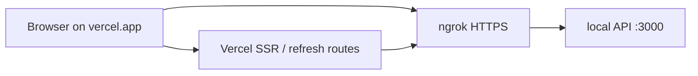

# Trial: Vercel frontend, local Docker API, ngrok tunnel

**Last updated:** 2026-09-17

A Vercel preview cannot reach `localhost:3000`. For a short trial, expose the
local API with ngrok and point the apps at that HTTPS URL. The production path
is unchanged: frontends on Vercel, API on Render.



## Every session

**1. Start the local stack** so something is listening on port 3000:

```bash
docker compose up -d
```

Native `npm run start:dev` in `back-end/` works the same way — ngrok forwards
to the host port, not into the container network.

**2. Start the tunnel** in a second terminal:

```bash
ngrok http 3000
```

The forwarding line is the origin. Take it with no path and no trailing slash:

```
Forwarding    https://abc123.ngrok-free.app -> http://localhost:3000
```

The same value is at <http://127.0.0.1:4040/api/tunnels>. A free URL changes
every time the agent restarts.

**3. Set the Vercel env** on the app you are trialling (Preview is enough). The
variable is baked at build, so a change needs a redeploy, not just a refresh:

```
NEXT_PUBLIC_GRAPHQL_URL=https://abc123.ngrok-free.app/graphql
```

Do this on `apps/vendor`, `apps/admin`, and/or `apps/storefront` — whichever
project is live. Leave Production pointing at the real API.

**4. Optional, on the local API.** Docker already runs `NODE_ENV=development`,
so CORS allows the Vercel origin. Magic-link and reset emails still use
`FRONTEND_URL`; set that in `back-end/.env.development` to the Vercel URL if
you are testing those mails, then `docker compose restart api`.

## What this does not cover

| Surface | Why |
|---|---|
| `EventSource` streams (notification bell, WhatsApp QR, inbox) | The browser cannot attach headers. Open the ngrok URL once in the same browser and click through the warning, or those streams stay on the interstitial. GraphQL, uploads, and vendor-agent `fetch` streams send `ngrok-skip-browser-warning` themselves. |
| Uploaded files served from `UPLOAD_BASE_URL=http://localhost:3000` | The visitor's browser cannot load them. BunnyCDN URLs still work. |
| A machine that sleeps or whose ngrok agent dies | Every Vercel request 502s until the tunnel is back, and a new free URL needs another env + redeploy. |

The ngrok URL is a public hole into the local API: GraphQL IDE is on, CORS is
open, Helmet is off. Do not paste it into a ticket or a group chat.

## When the ngrok URL changes

1. Edit Vercel Preview `NEXT_PUBLIC_GRAPHQL_URL`.
2. Redeploy that project.
3. If Telegram webhooks are also using the tunnel, follow [telegram-local-ngrok.md](telegram-local-ngrok.md) as well — that origin is a different env var.

ngrok install, Defender false positives, and `ngrok update` are documented in
that Telegram file; the same agent is used here.
