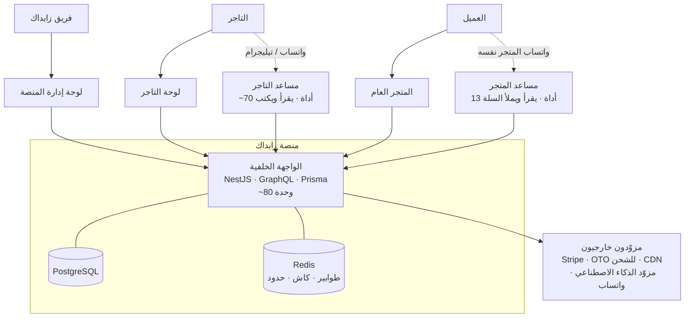

# زايداك — المنصة، من الصفر إلى عشرة

**آخر تحديث:** 2026-09-14
**الجمهور:** ملف واحد يخدم ثلاثة — المستثمر والشريك، التاجر الذي نبيع له، والموظف الجديد في الفريق.

> **قاعدة كتابة هذا الملف:** كل ما هو مذكور هنا موجود في الكود اليوم. ما هو نصف مبني مكتوب أنه نصف مبني، وما هو غير موجود مكتوب في القسم العاشر بصراحة. لا نبيع وعوداً.

---

## 0 · الفكرة في سطرين

**زايداك منصة تجارة إلكترونية عربية متعددة المتاجر، تتيح لأي تاجر أن يفتح متجره الإلكتروني الكامل ويديره من محادثة — وأن يبيع لعميله داخل واتساب المتجر نفسه.**

الجزء الأول — متجر إلكتروني كامل — يفعله غيرنا. الجزء الثاني — أن تكون المحادثة هي لوحة التحكم وواجهة البيع في آن واحد — هو ما يميّزنا، وهو موضوع القسم الثامن.

---

## 1 · المشكلة التي نحلّها

التجارة في الخليج والعالم العربي تحدث فعلياً في واتساب. التاجر الصغير والمتوسط اليوم يعيش في وضع مزدوج ومُتعب:

| ما يحدث فعلاً | التكلفة على التاجر |
|---|---|
| العميل يسأل عن المنتج والسعر والتوفّر في رسالة خاصة | ساعات يومياً في الرد اليدوي على أسئلة متكررة |
| الطلب يُغلق في المحادثة، ثم يُسجَّل يدوياً في مكان آخر | أخطاء في الطلبات، ومخزون لا يعكس الواقع |
| المنصات الجاهزة تعامل واتساب كزر "تواصل معنا" | قناة البيع الحقيقية خارج النظام بالكامل |
| لوحة التحكم على حاسوب مكتبي، والتاجر يدير عمله من هاتفه | تأخير في كل قرار: تعديل سعر، تعديل مخزون، إضافة منتج |
| المنصات العالمية مترجمة للعربية لاحقاً | نماذج عناوين لا تناسب السعودية، ودفع لا يشمل الدفع عند الاستلام كخيار أول |

النتيجة: التاجر يدفع اشتراك منصة، ثم يستمر في إدارة نصف عمله يدوياً في واتساب — لأن المنصة لم تُبنَ وهي تعرف أن المحادثة هي المتجر.

---

## 2 · من نحن — ما هي زايداك بالضبط

زايداك **منصة SaaS متعددة المستأجرين (multi-tenant)**: نشر واحد على السيرفر يخدم كل متاجر التجار، وكل متجر معزول عن الآخر بالبيانات والصلاحيات والهوية البصرية.

المنصة أربعة تطبيقات متصلة بواجهة برمجية واحدة:

| المكوّن | ما هو | من يستخدمه |
|---|---|---|
| **الواجهة الخلفية (API)** | NestJS + GraphQL + Prisma + PostgreSQL. تملك كل البيانات وكل منطق العمل — قرابة **80 وحدة وظيفية**. | لا أحد مباشرة؛ الثلاثة الباقون يتحدثون إليها |
| **لوحة التاجر** | غرفة التحكم التي يدير بها صاحب المتجر تجارته | التجار |
| **المتجر العام (Storefront)** | الواجهة التي يتسوّق منها العميل | المشترون |
| **لوحة إدارة المنصة** | مكتب تشغيل الأعمال: من يبيع عندنا، من يُدفع له، وكم نُنفق | فريق زايداك |

طبقة خامسة تمتد عبر الجميع: **الذكاء الاصطناعي والقنوات** — واتساب وتيليجرام والبريد والرسائل النصية، وأربعة أسطح ذكاء اصطناعي منفصلة لكل منها صلاحيات مختلفة تماماً.

### الصورة الكاملة

---

## 3 · لمن هذه المنصة — ثلاثة جماهير

**التاجر** هو العميل الذي يدفع. صاحب متجر صغير أو متوسط في السعودية والخليج، يبيع اليوم عبر إنستغرام وواتساب أو على منصة أخرى، ويريد نظاماً حقيقياً دون أن يتخلى عن القناة التي يبيع منها فعلاً.

**المشتري** هو من يجب أن تكون تجربته ممتازة حتى يشتري التاجر منا. لا يدفع لنا شيئاً، ولا يعرف أننا موجودون.

**مشغّل المنصة** — نحن. لوحة الإدارة ليست شاشة إعدادات، بل هي أداة تشغيل الشركة: الموافقة على المتاجر، صرف مستحقات التجار، تسعير الباقات، ومراقبة **ما ندفعه للمزوّدين مقابل كل متجر** — أي هامش ربحنا الحقيقي.

---

## 4 · الخدمات المقدَّمة

قُدّرت المنصة عند مسح الكود بـ **أكثر من 300 قدرة** موجودة فعلياً. هذه خلاصتها مجمّعة.

### 4.1 للتاجر — لوحة التحكم

**الكتالوج والمنتجات.** أربعة أنواع منتجات (بسيط، متعدد الخيارات، رقمي، خدمة)، محرر كامل يغطي الصور والسعر وسعر التخفيض والمخزون والوزن والشحن والخيارات والمتغيرات. **الاسم والوصف يُخزَّنان بالعربية والإنجليزية معاً** — كتالوج واحد يخدم جمهورين. تصنيف المنتج ضد **شجرة تصنيفات عالمية من 5,595 عقدة** (Google Product Taxonomy)، ومكتبة خصائص قابلة لإعادة الاستخدام (اللون → أحمر، كحلي)، ووسوم مترجمة، وضبط تحسين محركات البحث لكل منتج بلغتين، وروابط "منتجات ذات صلة" و"يُشترى معه".

**استيراد الكتالوج.** رفع ملف CSV — بما في ذلك **ملف تصدير Shopify بصيغته الأصلية**. النظام يجري تشغيلاً تجريبياً أولاً، يعرض أي المنتجات ستتعارض مع الموجود، يسأل: نتخطى أم نستبدل، يعرض معاينة، ثم ينفّذ. هذه هي تكلفة التحوّل إلينا: دقائق بدل إعادة إدخال يدوية.

**المجموعات الذكية.** مجموعة تُبنى بقواعد ("السعر أقل من 100" + "الوسم صيفي") بدل الاختيار اليدوي، مع **لوحة معاينة حيّة** تُظهر أي المنتجات تنطبق عليها القاعدة قبل الحفظ. المجموعة تملأ نفسها مع نمو الكتالوج.

**المخزون متعدد المستودعات.** مواقع تخزين متعددة، مخزون لكل منتج في كل موقع، محرر جماعي يشبه جدول البيانات، وسجل تعديلات لكل صنف. إضافة إلى ذلك: **تحويلات مخزون** بدورة حياة كاملة (مسودة، جاهز، مُرسل، مُستلم بكميات جزئية)، ودليل موردين، وأوامر شراء.

**الطلبات والتنفيذ.** قائمة طلبات قابلة للبحث والتصفية، وشاشة تفصيل تُظهر **ثلاث حالات منفصلة في آن**: أين الطلب في دورة حياته، هل شُحن، وهل دُفع أو استُرد. الشحن الجزئي مدعوم سطراً بسطر مع رقم تتبع ورابط تتبع. وطلبات يدوية (Draft Orders) للبيع الهاتفي.

**المرتجعات والاسترداد.** إنشاء استرداد لا يحرّك المال — يبقى معلقاً حتى موافقة صريحة، خلف تأكيد يذكر آثاره الأربعة بالاسم: خصم رصيد المتجر، إعادة المخزون، إلغاء استخدام الكوبون، وتنفيذ الاسترداد الفعلي على البطاقة. وطابور مرتجعات منفصل بدورة حياة (موافقة، في الطريق، مُستلم)، واستلام البضاعة هو ما يُطلق الاسترداد — ناقصاً رسوم إعادة التخزين.

**التسويق والعملاء.** كوبونات بأربعة أشكال، تخفيضات خاطفة (Flash Sales)، سجلات عملاء، **شرائح عملاء تُكتب بلغة طبيعية**، مراجعات المنتجات، وتقارير: لوحة مبيعات تبدأ من الربح لا من الإيراد، أهداف مبيعات مع توقّع، إسناد تسويقي مع إنفاق الإعلانات، وتقرير احتفاظ بالعملاء وقيمة العميل مدى الحياة.

**الوسائط.** مكتبة ملفات مع محرر صور، و**استوديو تصوير منتجات بالذكاء الاصطناعي** — بما فيه إعدادات جاهزة لجلسات تصوير رمضان والعيد بضغطة واحدة، ووصف بديل تلقائي للصور (لإمكانية الوصول ومحركات البحث).

**التشغيل.** ربط نطاقك الخاص، قوالب البريد الإلكتروني للعملاء قابلة للتحرير من التاجر نفسه، Webhooks للربط بأنظمتك، وشاشة الباقة والاستهلاك والفوترة الذاتية.

### 4.2 للمشتري — المتجر العام

دليل متاجر للسوق، صفحة رئيسية لكل متجر **تُركّب نفسها مما يملكه التاجر فعلاً**، تصفّح كتالوج بفلاتر قابلة للمشاركة عبر الرابط، صفحة منتج بمعرض صور وخيارات ومخزون ومراجعات (بما فيها مراجعات بالصور)، وتوصيات "قد يعجبك أيضاً" مبنية على التشابه الفعلي لا على مجلدات التاجر.

**سلة تعمل بدون حساب إطلاقاً** — ثم تتبع المشتري إلى حسابه عند تسجيل الدخول. **الدفع صفحة واحدة يُسعّرها السيرفر بالكامل**: المتصفح لا يحسب شيئاً، لا شحناً ولا ضريبة ولا خصماً. ثلاثة مسارات دفع يتحكم بها التاجر لكل متجر: بطاقة، **دفع عند الاستلام**، وحوالة بنكية بتعليمات ورفع إيصال.

**دفتر عناوين مبني على العنوان الوطني السعودي**، وتأكيد الطلب وسجله وتفاصيله في شاشة واحدة، وتتبع الشحنة بخط زمني مكتوب بلغة يفهمها المشتري، وقائمة أمنيات تعمل قبل تسجيل الدخول.

**المتجر بالعربية والإنجليزية كاملاً، بما فيه اتجاه الصفحة من اليمين لليسار**، وكل متجر يلبس هويته البصرية. الصفحات العامة تصل كـ HTML جاهز لمحركات البحث ومعاينات التواصل الاجتماعي، وخرائط موقع وقواعد زحف منفصلة لكل عنوان.

### 4.3 لمشغّل المنصة — لوحة الإدارة

**الأعمال:** لوحة إيرادات على مستوى السوق كله، كتالوج باقات الاشتراك، مصفوفة "ما الذي تشتريه كل باقة فعلياً"، دفتر المشتركين مع رؤية حالات التعثّر في السداد، وربط متجر بباقة يدوياً أو منحه استثناءً دون تغيير الباقة.

**المال:** طابور صرف مستحقات التجار. الموافقة على الصرف **تذكر ما ستفعله بالمال قبل أن تفعله**، وهناك حماية مبنية ضد تجميد أموال التجار.

**التكلفة والهامش — وهذا ما يميّز لوحتنا:** تقرير بما تدفعه المنصة للمزوّدين مقابل خدمة تجارها، وأي المتاجر تستهلك ميزانية المزوّدين، ودفتر استهلاك لكل متجر مع إسناد التكلفة. **هذا الحقل غير موجود في أي واجهة يصل إليها التاجر** — ليس مخفياً بل غير قابل للاختيار أصلاً.

**الحوكمة:** إدارة الحسابات (والتعليق والحذف معروضان كحالتين مختلفتين، لا كحالة واحدة)، صلاحيات مسمّاة قابلة للتحرير، دليل المتاجر ودورة حياتها، مراجعة طلبات البيع، مراقب شذوذ نشاط الموظفين، و**مخزن اعتمادات مشفّر (AES-256-GCM)** لمفاتيح كل المزوّدين — تُحرَّر ولا تُقرأ أبداً، ولا تُعاد أي منها في أي استجابة.

### 4.4 طبقة الذكاء الاصطناعي — أربعة أسطح، صلاحيات مختلفة عمداً

هذا أهم جزء تقنياً، والفروق بين الأسطح الأربعة مقصودة وليست صدفة:

| السطح | من يصل إليه | عدد الأدوات | هل يستطيع الكتابة؟ |
|---|---|---|---|
| **مساعد التاجر (Sidekick)** | التاجر: اللوحة + واتساب + تيليجرام | ~70 | **نعم** — منتجات، مجموعات، كوبونات، مخزون، تعديلات جماعية |
| **مساعد المتجر للعملاء** | عملاء المتجر: رقم واتساب المتجر نفسه + بوت تيليجرام | 13 | السلة والعنوان فقط |
| **مساعد المتجر على الموقع** | زوّار الموقع | 13 + 11 للحساب | السلة والعنوان فقط |
| **استوديو الصور** | التاجر من اللوحة | — | يكتب الوسائط المولَّدة |

**لوحة إدارة المنصة لا تحتوي على أي مساعد ذكاء اصطناعي إطلاقاً** — قرار متعمّد: لا نريد أدوات تحرّك المال خلف نموذج لغوي.

بالإضافة إلى ذلك: كتابة أوصاف المنتجات وتحسين محركات البحث والترجمة، ومساعدة كتابة داخل كل محرر نصوص، و**بحث دلالي عربي** خلف كل متجر، وبطاقات رؤى استباقية يخبر بها المتجر تاجره بما تغيّر، وفرز المراجعات والأسئلة قبل نشرها.

### 4.5 قنوات المراسلة

**واتساب:** التاجر يربط **رقمه هو** بمسح رمز QR من اللوحة (أو برمز من 8 أحرف لمن لا يستطيع المسح)، وحالة الاتصال تُطابَق مع المزوّد عند كل قراءة — فالهاتف الذي نفدت بطاريته يظهر مفصولاً من تلقاء نفسه بدل الاعتماد على عمود قديم. وصندوق وارد واتساب داخل اللوحة نفسها.

نقطة تستحق التوقّف: نستخدم خادم **Evolution (Baileys) مستضافاً ذاتياً** بدل واجهة واتساب السحابية الرسمية — وهذا **يتجاوز متطلبات توثيق Meta Business تماماً**، وهي أكبر عقبة أمام التاجر الخليجي الصغير في تفعيل تجارة واتساب.

**تيليجرام:** بوت خاص بالمتجر لعملائه، ومحادثات تيليجرام تصل إلى صندوق الوارد نفسه.

**بقية القنوات:** تحديثات الطلب تصل إلى واتساب أو تيليجرام أو البريد أو الرسائل النصية — **كل رسالة تُشحن بالعربية والإنجليزية**، وتُختار حسب لغة المشتري عند الدفع، والعربية هي البديل الصريح عند غياب اللغة. كذلك: بريد استرداد السلات المتروكة بوتيرة يحددها التاجر، وتنبيهات "عاد للمخزون"، ورموز دخول لمرة واحدة، وروابط مختصرة.

### 4.6 محرك التجارة والمال

**التسعير كله على السيرفر.** سلة مُسعَّرة من الخادم، عرض سعر قبل الشراء، محرك ضريبة القيمة المضافة، قواعد تراكم الخصومات **مصمَّمة بحيث لا يمكن التلاعب بها**، وحماية من الاسترداد الزائد، وحماية من الدفع المزدوج عند إعادة المحاولة.

**تدفق المال من البداية للنهاية:** العميل يدفع ← **العمولة تُقتطع لحظة البيع** ← رصيد التاجر يرتفع ← التاجر يطلب سحباً ← المنصة توافق مع فحص الأموال المحجوزة ← يُصرف. مع كشف حساب للتاجر، ومحفظة رصيد متجر، و**سجل تدقيق على كل عملية مالية**.

حالة خاصة: **الحوالة البنكية تُسوَّى مباشرة للتاجر** — لأن المال لم يمر بنا أصلاً.

### 4.7 الشحن والمخزون

مناطق شحن حسب الوجهة، وأربع طرق لتسعير التوصيل (منها "مجاني فوق مبلغ")، ووعد توصيل يُعرض عند الدفع **ويُجمَّد على الطلب**، والمشتري هو من يختار طريقة التوصيل.

**التكامل مع OTO** — مجمّع شركات الشحن السعودي — لأسعار حيّة من شركات متعددة، وتسجيل مستودع التاجر لدى شركة الشحن نيابةً عنه، وتتبع الطرود. **كل تاجر يشحن على عقده هو مع شركة الشحن، لا على عقدنا.**

ومن التفاصيل التي تُظهر جدّية البناء: **توزيع مبلغ الدفع عند الاستلام بشكل صحيح عبر عدة طرود**، وإصلاح ليلي لحجوزات المخزون مع تنبيه عند الانحراف، و**الدفع لا يتعطل حين تتعطل شركة الشحن**.

### 4.8 الأساس التقني — لماذا يُوثق بالمنصة

تسجيل دخول بكلمة مرور أو برمز لمرة واحدة، قفل تلقائي ضد تخمين كلمات المرور، كشف الجلسات المسروقة، **تعليق حساب يُخرجه خلال ثوانٍ**، أدوار وصلاحيات مسمّاة قابلة للتحرير، وسجل تدقيق كامل لمن غيّر ماذا.

**العزل بين المتاجر:** كل طلب موسوم بالمتجر الذي يعمل عليه، ولا شيء يُحذف فعلياً (حذف ناعم)، والمتجر يستمر بالعمل بعد إعادة تسميته. الأعمال التي لا يجوز فقدانها تعمل على طوابير، والاعتمادات مشفّرة ومفاتيحها قابلة للتدوير، والنشر يرفض أن يُطلق قاعدة بيانات معطوبة.

**اللغة:** الواجهة البرمجية نفسها تعيد أخطاءً وإشعارات مترجمة — ليست الترجمة في الواجهة فقط. ملفات الرسائل العربية في لوحة التاجر **أكبر من الإنجليزية** (215 كيلوبايت مقابل 165)، وتطابق المفاتيح بين اللغتين مضمون في CI: 3,071 مفتاحاً في لوحة التاجر و884 في لوحة الإدارة و613 في المتجر — **صفر مفاتيح ناقصة في الثلاثة**.

---

## 5 · رحلة التاجر من الصفر إلى أول طلب

1. **التسجيل** — أربع خطوات، **بلا كلمة مرور**. التسجيل المتروك لا يكلّف شيئاً، وتحديث الصفحة لا يُفقدك مكانك.
2. **إنشاء المتجر** — لا يُسأل التاجر عن شيء قد يوقفه. رابط المتجر يُفحص فورياً، وأسماء المنصة المحجوزة محمية.
3. **المتجر يأتي مؤثثاً** — صفحات وسياسات وقوائم جاهزة، **مكتوبة بعربية سليمة**، لا صفحات فارغة.
4. **الموافقة** — مفتاح واحد من لوحة الإدارة يفتح المتجر للعمل فعلاً (يضبط الظهور في الدليل وتشغيل المتجر معاً — لأن ضبط أحدهما دون الآخر معطوب في الاتجاهين).
5. **الكتالوج** — استيراد CSV بمعاينة قبل الكتابة، أو إدخال يدوي بمساعدة الذكاء الاصطناعي في الخصائص.
6. **الهوية والدفع والشحن** — قائمة تحقق حيّة للعلامة التجارية، وحسابات بنكية **مُتحقَّق منها ضد النظام البنكي السعودي** (فحص IBAN بخوارزمية mod-97)، ومناطق شحن.
7. **العنوان** — كل متجر يجيب على عنوانين من اليوم الأول: `zaydak.com/acme` و `acme.zaydak.com`. ومن أراد نطاقه الخاص، يربطه بنفسه.
8. **البيع.**

---

## 6 · نموذج العمل — من أين يأتي الدخل

ثلاثة مصادر، وكلها مبنية في الكود لا في العرض التقديمي:

**أولاً — اشتراكات الباقات.** خمس فئات مسعّرة بالريال السعودي شهرياً:

| الباقة | السعر الشهري |
|---|---|
| مجانية | 0 |
| Basic | 99 ر.س |
| Grow | 299 ر.س |
| Advanced | 999 ر.س |
| Plus | 4,999 ر.س |

الاشتراك السنوي بسعر عشرة أشهر. الفوترة الذاتية عبر Stripe مبنية بالكامل: الاشتراك الأول، والترقية بحساب تناسبي فوري، والتخفيض المجدول لنهاية الفترة، وبوابة فوترة مستضافة.

**ثانياً — عمولة المبيعات**، تُقتطع لحظة البيع لا في تسوية شهرية.

**ثالثاً — وهذا الأهم استراتيجياً — الذكاء الاصطناعي كخط منتج مُقاس.** كل استدعاء ذكاء اصطناعي يُحجز مقابل حصة الباقة قبل التنفيذ، ويُسجَّل في دفتر استهلاك يحمل **ما دفعناه نحن للمزوّد** في ذلك الاستدعاء بالذات. هذا يعني أننا نعرف هامشنا لكل متجر على حدة، ونستطيع تسعير الباقات على بيانات لا على تخمين.

---

## 7 · الزبدة — ما الذي يميّز زايداك حقاً

> كل ما سبق يمكن لمنافس أن يبنيه بوقت ومال. هذا القسم هو ما لا يستطيع نسخه بسهولة، وهو هوية المشروع.

### الفكرة المركزية في جملة واحدة

**المحادثة ليست قناة تسويق ملحقة بالمتجر — المحادثة هي المتجر، في الاتجاهين: التاجر يدير متجره بالرسائل، والعميل يتسوّق داخل واتساب المتجر نفسه.**

### الاتجاه الأول: التاجر يدير متجره برسالة

التاجر يراسل رقم واتساب المنصة أو بوت تيليجرام، فيصل إلى **نفس محرّك المساعد** الذي تعمل به اللوحة. من أصل 69 أداة مسجّلة، **65 متاحة على المحادثة: 46 قراءة و19 كتابة**.

هذا ليس "مساعداً يجيب عن أسئلة". هذا مساعد **يكتب فعلاً**: ينشئ منتجاً، يعدّل كوبوناً، يضبط المخزون، ويغيّر الأسعار والوسوم بالجملة.

**ولا تُكتب أي تغييرة من رسالة وحدها.**

كل عملية كتابة تتوقف وتعرض **بطاقة تأكيد** تُجيب عليها بـ `1` أو `2` على واتساب، أو بزر على تيليجرام. وفي التعديل الجماعي للأسعار، البطاقة تذكر **رقماً حسبه السيرفر بنفسه عبر تشغيل تجريبي حقيقي** ("247 منتجاً") — لا تخميناً من النموذج. والحذف له مسار أخطر: رمز لمرة واحدة صالح خمس دقائق، مربوط بالسجل والحساب والمتجر بالتحديد، ويُرفض إذا تغيّر السجل بين "نعم" والتنفيذ.

### الاتجاه الثاني: العميل يتسوّق في واتساب المتجر

العميل يكتب إلى **رقم واتساب التاجر نفسه**. مساعد المتجر يجيب من الكتالوج، و**يملأ السلة لشخص لا يعرفه إلا برقم هاتف**: السلة مربوطة بمعرّف المحادثة، فـ"أضف اللابتوب" ثم "وأضف الحقيبة" في رسالتين منفصلتين تصلان إلى سلة واحدة.

ثم يأتي التسليم: رابط قصير لمرة واحدة صالح 15 دقيقة (مخزَّن كبصمة SHA-256 فقط)، فتحُه يسجّل دخول العميل، **ينقل السلة إليه**، ويضعه على صفحة الدفع.

**وهنا نقول الحد بصراحة: الشراء لا يكتمل داخل واتساب.** لا توجد أداة لإنشاء الطلب أو الدفع في المحادثة — بشكل متعمّد. المحادثة تبني السلة وتسلّم عميلاً حقيقياً بحساب حقيقي إلى صفحة دفع حقيقية. من يقول لك غير ذلك يبيعك وعداً.

### ما الذي يجعل هذا قابلاً للبيع بدل أن يكون عرضاً تجريبياً

هنا الفرق الحقيقي عن أي "AI copilot" في عرض تسويقي. ثلاث حدود، **كل واحدة قائمة افتراضية بالمنع**:

**1. الموافقة خاصية في وقت التشغيل، لا نصيحة في التعليمات.** التوقّف للتأكيد يحدث داخل محرّك التنفيذ نفسه. عبارة "نفّذ دون أن تسأل" مدسوسة في رسالة **لا تجد ما تحاوره** — فليس هناك تعليمة نصية تُقنعها، بل شيفرة لا تكمل. وعند التأكيد يُستدعى **نفس التابع الذي يستدعيه نموذج اللوحة**، بنفس فحوص الملكية والباقة داخله.

**2. حدّ المستأجر لا يستطيع النموذج تجاوزه.** أي متجر يخدمه الهاتف يُحدَّد لحظة الربط عبر مسح QR من جلسة موثّقة في اللوحة — **لا بمطابقة رقم هاتف وارد**، لأن رقم الهاتف ليس إثبات هوية. ولا يوجد أمر "بدّل المتجر" داخل المحادثة إطلاقاً. ومعرّف المتجر يأتي من السياق الموثّق، فمعرّف متجر مكتوب في رسالة هو نص، لا يصل إلى أي استعلام.

**3. الأمان بما هو غير موجود، لا بما هو مرفوض.** أدوات الحساب — سجل الطلبات، المرتجعات، البطاقات المحفوظة — **لا تُبنى أصلاً** على قناة الهاتف. لا رفض تجادله حقنةُ تعليمات، ولا فرق يُستشَف بين "غير مسجّل" و"قناة خاطئة". والسبب صريح: رقم الهاتف يعرّف **جهازاً** لا شخصاً (شرائح تُعاد وتُسرق) — يكفي لتقرير سلة، وهو خطأ قابل للإصلاح؛ ولا يكفي لقراءة تاريخ شراء، وهو خطأ لا يُصلَح.

وفوق ذلك: **قراءات الكتالوج تمر بمسار الشيفرة العام نفسه** الذي يستخدمه المتجر — بانتقاء صريح للحقول لا يحتوي على سعر التكلفة أصلاً. فحقنة التعليمات، حتى لو أُطيعت بالكامل، **لا تملك مساراً برمجياً** يصل إلى هامش التاجر.

وأخيراً **شبكتا أمان على المُخرَج**: كل رد يُفحص مرتين قبل مغادرة رقم التاجر — مرة لأي شيء بشكل اعتماد، ومرة لنموذج يسرد تعليماته أو يسمّي أدواته بدل أن يجيب. والثانية موجودة لأن العطل وقع فعلاً: نموذج أرسل تعليماته وقائمة أدواته إلى غريب على رقم تاجر. نحن نكتب هذا لأنه حدث، ولأن من لم يقع له بعد لم يبنِ الحاجز.

### الطبقة الرابعة: الباقة عقد في وقت التشغيل

ما يجعل بيع الذكاء الاصطناعي عملاً مستداماً بدل أن يكون نزيفاً:

**الحجز ذرّي داخل قاعدة البيانات.** الحصة تُحجز بجملة SQL واحدة (`INSERT … ON CONFLICT … WHERE used + qty <= limit`)، فـ PostgreSQL نفسه يرفض تجاوز الحصة وهو ممسك بقفل الصف. **لا توجد نافذة "اقرأ ثم تحقق" يعبر منها استدعاءان متزامنان معاً.** والتسوية محمية بفهرس فريد، فإعادة تنفيذ لا تُحاسب مرتين. والإلغاء يكتب صفاً بكمية صفر بدل حذف الحجز، ليبقى الدفتر قابلاً للمطابقة.

**وحقل التكلفة غير قابل للاختيار من جهة التاجر.** الأنواع المعروضة للتاجر كائنات GraphQL منفصلة **لا تحتوي حقل تكلفة ليُختار**، والإسقاط مكتوب كانتقاء حقلاً بحقل لا كحذف — فأي حقل يُضاف لاحقاً للنوع الداخلي يكون **غير مرئي للتاجر افتراضياً**. الخصوصية بالبنية لا بالانضباط.

### ملاءمة السوق: مبنيّة لا مترجَمة

- **واتساب عبر Evolution/Baileys مستضاف ذاتياً** — يتجاوز توثيق Meta Business، أكبر حاجز أمام التاجر الصغير.
- **الدفع عند الاستلام كيان مالي له دفتر**، لا وسم على طريقة دفع — بما في ذلك التوزيع الصحيح عبر عدة طرود.
- **الحوالة البنكية مبنية للتدفق السعودي**: سجل البنوك السعودية بأسمائها ورموزها، فحص IBAN كامل، حساب استقبال يُجمَّد على الطلب، ورفع إيصال — بدل صور الحوالات في واتساب.
- **العنوان الوطني السعودي** محور نموذج العنوان، يُحلّ داخل المحادثة نفسها ويُعاد حلّه قبل الحفظ.
- **الشحن عبر OTO**، المجمّع السعودي، وكل تاجر على عقده هو.
- **العربية بيانات من الدرجة الأولى**: الباقات والقدرات ومزوّدو التكامل يحملون اسماً ووصفاً عربيين من السيرفر، لا مفاتيح إنجليزية.

### ولماذا يصعب نسخه

لأن الصعوبة ليست في وصل نموذج لغوي بواتساب — ذلك عمل أسبوع. الصعوبة في **الطبقات التي تجعل ذلك آمناً بما يكفي ليُباع**: مُشرف تنفيذ قابل للاستئناف مع نقاط توقّف بشرية، قوائم أدوات لكل قناة تمنع افتراضاً، رموز تأكيد لمرة واحدة مربوطة بالكيان، حدّ مستأجر يُشتق من ربط موثّق لا من رقم وارد، شبكات أمان على المُخرَج مبنية على عطل حقيقي وقع، ومحرك حصص ذرّي بدفتر تكلفة.

كل واحدة منها تبدو تفصيلاً. مجتمعةً هي الفرق بين منتج وعرض تجريبي — وكل واحدة منها تُكتب عادةً **بعد** وقوع الحادثة التي تبررها.

---

## 8 · المقارنة مع البدائل

| | شوبيفاي | سلة / زد | ووكومرس | **زايداك** |
|---|---|---|---|---|
| متجر إلكتروني كامل | نعم | نعم | نعم | نعم |
| عربية و RTL كاملة | جزئية | نعم | إضافات | نعم |
| الدفع عند الاستلام | إضافة | نعم | إضافة | كيان مالي بدفتر |
| العنوان الوطني السعودي | لا | نعم | لا | محور نموذج العنوان |
| رد آلي على واتساب | إضافة خارجية | إضافة | إضافة | مساعد للمتجر يبني السلة |
| **إدارة المتجر بالرسائل (كتابة)** | **لا** | **لا** | **لا** | **نعم — 19 أداة كتابة** |
| **موافقة بشرية في محرّك التنفيذ** | — | — | — | **نعم** |
| **تسعير الذكاء الاصطناعي بتكلفة حقيقية لكل متجر** | لا | لا | لا | **نعم** |
| واتساب بلا توثيق Meta | لا | لا | لا | نعم |

---

## 9 · أين نحن اليوم — بصراحة

هذا القسم موجود لأن ملفاً بلا حدود معلنة لا يستحق الثقة.

### جاهز ومبني بالكامل
لوحة التاجر بكل ما سبق، المتجر العام، لوحة الإدارة، محرك التجارة والمال، الشحن مع OTO، أسطح الذكاء الاصطناعي الأربعة بطبقات الحماية كاملة، الفوترة الذاتية عبر Stripe، واتساب وتيليجرام في الاتجاهين، والعربية والإنجليزية عبر الطبقات كلها.

### مبني جزئياً — يُذكر كما هو
- **صندوق وارد واتساب لا يُحدَّث لحظياً.** البث من السيرفر مبني، لكن الربط من جهة اللوحة معطوب، فالصندوق يُحدَّث عند فتحه فقط.
- **17 من 30 قدرة مسعّرة مُطبَّقة فعلياً.** التطبيق عميق حيث يُصرف المال (الذكاء الاصطناعي، السقوف القابلة للعدّ)، وغائب حيث لم تُبنَ الميزة بعد.
- **سطحان يستهلكان مالاً دون قياس:** البحث الدلالي والتوصيات في المتجر — تكلفتهما غير منسوبة لمتجر بعينه.
- **محرر القوالب البصري** و**مُنشئ التقارير الذاتي** مبنيان، لكن مُنشئ التقارير غير موصول بمساعد الذكاء الاصطناعي.
- **الشحن:** الحجز لدى شركة محددة وروابط بوليصة الشحن والتحديث التلقائي لحالة التوصيل — جزئية.

### غير مبني — ولا نقول عنه غير ذلك
- **حسابات موظفين للمتجر.** اليوم **حساب مالك واحد لكل متجر** يفعل كل شيء. نموذج عضوية الفريق غير موجود في قاعدة البيانات.
- **الهجرة بلصق رابط المتجر القديم.** المكتوب في بعض مستنداتنا الداخلية عن "امسح متجرك القديم" **ليس منتجاً قائماً**: لا واجهة ولا عملية ولا مستدعٍ. **المتاح فعلاً هو استيراد CSV**، بما فيه ملف Shopify — وهو جيد، لكنه ليس ما وُصف.
- **العربية ليست الافتراضي.** التطبيقات الثلاثة تبدأ بالإنجليزية وتُحلّ اللغة من الكوكيز. الترجمة كاملة والاتجاه صحيح، لكن وصف المنتج بأنه "عربي افتراضاً" غير دقيق.
- **عملات متعددة** مبنية ومُطفأة خلف مفتاح.
- **الشراء داخل واتساب** — كما ذُكر أعلاه، السلة نعم، إتمام الطلب لا.

### ما قبل الإطلاق
المنصة **لم تُطلق تجارياً بعد**. الأعمال المفتوحة **69 بنداً، منها 24 عملاً على لوحات المزوّدين** لا كوداً: تدوير مفاتيح، تشغيل بذور قاعدة البيانات الإنتاجية، تهيئة مزوّد رسائل نصية وبريد حقيقي. العمل الهندسي المتبقي **52 بنداً**.

---

## 10 · الخلاصة في ثلاث جمل

**زايداك منصة تجارة إلكترونية عربية كاملة** — كتالوج وطلبات ومخزون وشحن ودفع ومرتجعات ومحاسبة وتقارير، بالعربية والإنجليزية، مبنية لتدفّقات السوق السعودي: الدفع عند الاستلام، الحوالة البنكية، والعنوان الوطني.

**وما يميّزها أن المحادثة فيها ليست ملحقاً**: التاجر يدير متجره برسالة واتساب، وعميله يتسوّق على رقم المتجر نفسه — بمساعدَين منفصلين، صلاحيات كل منهما مختلفة عمداً.

**وما يجعل ذلك منتجاً لا عرضاً تجريبياً هو الطبقات تحته**: موافقة بشرية داخل محرّك التنفيذ، وحدّ مستأجر لا يعبره النموذج، وأمان مبني على غياب الأدوات لا على رفضها، ومحرك حصص ذرّي يعرف تكلفة كل متجر علينا — أي أننا نعرف هامشنا قبل أن نسعّر.

---

### للتعمق أكثر

| الموضوع | المرجع |
|---|---|
| كل سطح ذكاء اصطناعي وما يُسمح له به بالضبط | [docs/ai-surface-audit.md](ai-surface-audit.md) |
| خريطة المستودع والتشغيل المحلي | [docs/README.md](README.md) |
| الباقات والحصص والتطبيق | [back-end/docs/features/plans.md](../back-end/docs/features/plans.md) |
| الشحن من طرف لطرف وما لم يُثبَت منه | [docs/reviews/oto-shipping-review.md](reviews/oto-shipping-review.md) |
| قائمة الأعمال المفتوحة مرتبة بالأولوية | [PRIORITIES.md](../PRIORITIES.md) · [TODO.md](../TODO.md) |
